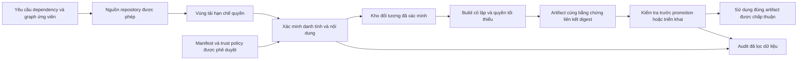

# Package integrity — Đặc tả yêu cầu toàn vẹn của gói phần mềm

## 1. Mục tiêu và phạm vi

Ứng dụng thường sử dụng thư viện, plugin, công cụ build và nhiều thành phần được tải từ bên ngoài. Nếu một thành phần bị thay nội dung trên đường phân phối, trong repository hoặc trong cache, hệ thống có thể thực thi mã khác với mã đã được xem xét và phê duyệt.

Package integrity là khả năng kiểm chứng rằng nội dung gói đang được sử dụng đúng với nội dung được chấp thuận theo một chính sách tin cậy xác định. Yêu cầu này cần trả lời cả hai câu hỏi: “Các byte có đúng không?” và “Dựa vào đâu để tin nội dung mong đợi đó?”.

Trong chương **Dependency và supply chain**, bài học tập trung vào cách chuyển rủi ro thay thế package thành yêu cầu bảo mật cụ thể, đo được và có thể kiểm chứng. Các yêu cầu cần liên kết với kiến trúc phân phối, xác thực nguồn, phân quyền repository, dữ liệu tin cậy, logging, kiểm thử và phục hồi khi chuỗi cung ứng bị xâm nhập.

Sau bài học, người học có thể:

- Phân biệt digest, chữ ký, nguồn gốc build, dependency lock và SBOM.
- Xác định điểm tin cậy cho package cùng metadata liên quan.
- Đặc tả việc xác minh trước khi sử dụng, bao gồm plugin và dependency bắc cầu.
- Kiểm soát repository, cache, ngoại lệ và vòng đời khóa xác minh.
- Gắn từng yêu cầu với rủi ro, điểm thực thi và bằng chứng.

Ví dụ sử dụng bối cảnh dự án Java nhưng các nguyên tắc áp dụng rộng hơn. Tên package, schema và ngưỡng trong bài là minh họa, cần điều chỉnh theo hệ thống thực tế.

## 2. Tính toàn vẹn không đồng nghĩa với an toàn tuyệt đối

### 2.1. Định nghĩa đúng đối tượng cần bảo vệ

Một package không chỉ được nhận diện bằng tên và version. Trong một hệ thống phân phối cụ thể, đối tượng có thể cần được nhận diện bằng:

- Namespace hoặc group, tên package và version.
- Loại artifact, classifier, biến thể hoặc nền tảng.
- Repository hoặc nguồn được phép cung cấp.
- Digest nội dung được chấp thuận.
- Metadata chi phối cách phân giải và sử dụng package.
- Danh tính bên phát hành hoặc bên build nếu chính sách yêu cầu.

Ví dụ, hai artifact cùng version nhưng khác classifier không tự được phép dùng thay nhau. Một repository cũng có thể cung cấp nội dung khác dưới cùng tọa độ nếu không có kiểm soát tính bất biến.

### 2.2. Các bằng chứng trả lời những câu hỏi khác nhau

| Cơ chế | Điều có thể hỗ trợ chứng minh | Điều không tự chứng minh |
| --- | --- | --- |
| Digest mật mã | Nội dung quan sát khớp một giá trị mong đợi | Giá trị mong đợi đến từ nguồn đáng tin cậy |
| Chữ ký số | Nội dung được ký bởi chủ thể tương ứng với khóa hoặc danh tính đã xác minh | Chủ thể đó được phép phát hành package này, hoặc package không có mã độc |
| Dependency lock | Kết quả phân giải dependency được cố định theo cơ chế của công cụ | Tất cả artifact đều có nội dung đúng hoặc nguồn phát hành hợp lệ |
| Provenance | Tuyên bố có thể kiểm chứng về nguồn và quá trình tạo artifact | Mọi đầu vào đều tốt, quy trình build không bị xâm nhập hoặc bằng chứng hoàn toàn đầy đủ |
| SBOM | Danh mục thành phần gắn với một sản phẩm nếu được tạo và liên kết đúng | Các thành phần đã được xác minh toàn vẹn hoặc không có lỗ hổng |
| TLS | Bảo vệ kênh và xác thực peer theo trust được cấu hình | Repository, tài khoản phát hành hoặc package ở đầu kia không bị xâm nhập |

Một package có chữ ký hợp lệ vẫn có thể chứa lỗ hổng hoặc mã độc do chính bên phát hành tạo ra. Ngược lại, digest khớp chỉ chứng minh sự khớp nội dung với một mốc tham chiếu, chưa chứng minh mốc đó được phê duyệt.

Yêu cầu integrity phải đi cùng quản lý lỗ hổng, đánh giá dependency và giới hạn quyền build/runtime, nhưng không được tuyên bố thay thế các kiểm soát đó.

### 2.3. Bẫy “tải package và checksum từ cùng một nơi”

Nếu kẻ tấn công sửa được cả package lẫn file checksum tại repository, việc tải hai file rồi so sánh có thể cho kết quả khớp hoàn toàn.

Vì vậy, digest mong đợi cần nằm trong một chuỗi tin cậy, chẳng hạn manifest đã được phê duyệt và bảo vệ, hoặc metadata được xác thực bằng một trust root đã thiết lập độc lập.

Checksum tải cạnh artifact có thể phát hiện lỗi truyền hoặc hỏng dữ liệu trong một số tình huống. Không mặc định nó chống được việc nguồn phát hành đã bị chiếm quyền.

## 3. Mô hình đe dọa xuyên suốt

Giả sử dự án Java sử dụng thư viện nội bộ, thư viện công khai, parent/BOM, plugin build và công cụ sinh mã. CI lấy thành phần qua repository proxy, dùng cache và phát hành artifact sang môi trường triển khai.

Các tài sản cần bảo vệ gồm mã được thực thi trong CI, credential của pipeline, nội dung artifact phát hành và khả năng truy vết sản phẩm nào đã dùng package nào.

| Đe dọa | Tác động | Hướng yêu cầu |
| --- | --- | --- |
| Artifact bị thay trong repository | Build hoặc runtime thực thi mã khác | Kiểm tra nội dung theo manifest hoặc bằng chứng tin cậy |
| Metadata checksum bị thay cùng artifact | So sánh digest vẫn đạt với nội dung giả | Bảo vệ nguồn giá trị mong đợi |
| Namespace nội bộ được phân giải từ nguồn công khai | Lấy nhầm package do dependency confusion | Ràng buộc namespace với repository được phép |
| Plugin hoặc processor bị thay | Mã độc chạy trong build trước khi kiểm tra ứng dụng | Bao phủ thành phần thực thi khi build |
| Cache dùng chung bị đầu độc | Job sau dùng nội dung chưa được chấp thuận | Xác minh khi sử dụng và cô lập quyền ghi |
| Khóa phát hành bị lấy | Artifact giả có chữ ký trông hợp lệ | Chính sách danh tính, phạm vi, thu hồi và tái đánh giá |
| Gói cũ hợp lệ được đưa trở lại | Dùng thành phần không còn được phép | Chính sách phiên bản hoặc digest được chấp thuận hiện hành |
| Tự sinh metadata kiểm tra từ lần tải chưa tin cậy | Hợp thức hóa nội dung bị thay | Quy trình onboarding và phê duyệt độc lập |
| Package đổi sau kiểm tra nhưng trước sử dụng | Kiểm tra đúng file nhưng chạy file khác | Bảo vệ đối tượng đã xác minh và tránh khoảng hở |

Mô hình cần xét cả lỗi vô ý: mirror đồng bộ sai, cache hỏng hoặc một quy trình publish ghi đè nhầm cũng có thể tạo sai lệch nội dung.

### 3.1. Phạm vi phải bao phủ cả build và runtime

Dependency trực tiếp chỉ là một phần. Phạm vi kiểm soát có thể bao gồm:

- Dependency bắc cầu và artifact theo biến thể.
- Parent, BOM và metadata ảnh hưởng kết quả phân giải.
- Plugin build cùng dependency của plugin.
- Annotation processor và công cụ sinh mã.
- Bản phân phối công cụ build và cơ chế bootstrap.
- Thành phần nền tảng hoặc thư viện được đóng gói trong sản phẩm cuối.
- Thành phần được tải động sau triển khai nếu ứng dụng có khả năng đó.

Không gọi một build “đã xác minh dependency” nếu các plugin có thể chạy mã vẫn được tải ngoài chính sách.

## 4. Thiết lập chuỗi tin cậy và hợp đồng package

### 4.1. Trust root phải được thiết lập có chủ đích

Trust root có thể gồm khóa được phê duyệt, danh tính phát hành, chính sách xác minh hoặc manifest chứa digest đã được xem xét. Cần bảo vệ cả nội dung và quyền thay đổi những thành phần này.

> **PKG-TRUST-01:** Hệ thống phải xác định nguồn tin cậy cho digest, chữ ký và chính sách chấp nhận package. Thay đổi trust root hoặc mở rộng danh tính được phép phải được xác thực, phân quyền, phê duyệt theo mức ảnh hưởng và ghi audit.

Không tự tải khóa từ một URL không được kiểm chứng rồi coi mọi chữ ký bởi khóa đó là đáng tin. Tương tự, một certificate hợp lệ theo hệ thống danh tính không tự chứng minh người giữ danh tính được phép phát hành mọi namespace.

Với mô hình chứng thư ngắn hạn hoặc danh tính pipeline, chính sách có thể cần ràng buộc issuer, subject, repository, workflow và ngữ cảnh phát hành. Không chỉ kiểm tra một tên tổ chức hoặc domain quá rộng.

### 4.2. Manifest phải ràng buộc danh tính với nội dung

Một bản ghi chấp thuận cần thể hiện artifact nào được phép có digest nào, thuộc nguồn nào và theo quyết định nào.

Schema học tập:

```yaml
approvalId: DEP-APPROVAL-042
component:
  ecosystem: maven
  group: vn.example
  name: payment-client
  version: "2.4.1"
  type: jar
  classifier: none
source:
  repository: approved-internal-proxy
content:
  algorithm: SHA-256
  digest: "<64-hex-characters-from-approved-evidence>"
trust:
  policy: payment-client-publisher-policy
status: approved
```

Giá trị digest trong ví dụ là placeholder, không được dùng làm cấu hình thực tế. Schema không thuộc riêng một sản phẩm quản lý dependency.

Một package có thể cần nhiều bản ghi cho các artifact và metadata liên quan. Không dùng digest của một JAR để kết luận POM, metadata biến thể hoặc artifact classifier khác cũng đã được xác minh.

### 4.3. Onboarding package mới là bước quyết định tin cậy

Quy trình thêm package nên xác định:

1. Nhu cầu và chủ sở hữu.
2. Danh tính package, nguồn cung cấp và nguy cơ nhầm namespace.
3. Bằng chứng nội dung và nguồn phát hành.
4. Dependency bắc cầu cùng thành phần chạy khi build.
5. Kết quả đánh giá rủi ro liên quan.
6. Manifest hoặc metadata kiểm tra sẽ được bảo vệ.
7. Người phê duyệt và điều kiện xem xét lại.

Công cụ có thể tạo bản nháp digest hoặc metadata để giảm thao tác thủ công. Bản nháp đó không được tự trở thành bằng chứng chấp thuận chỉ vì công cụ đã tải package thành công.

Lần đầu tải chưa tin cậy vẫn là một điểm cần đánh giá. Nếu chỉ áp dụng trust-on-first-use, phải nêu rõ giới hạn và rủi ro còn lại, thay vì tuyên bố đã xác thực nguồn phát hành.

## 5. Đặc tả xác minh trước khi sử dụng

### 5.1. Digest và chữ ký cần đúng chính sách

> **PKG-VERIFY-01:** Mọi artifact thuộc phạm vi phải được xác minh theo chính sách trước khi được đưa cho bước có thể thực thi hoặc sử dụng nội dung đó. Thiếu metadata bắt buộc, digest không khớp, chữ ký không hợp lệ hoặc nguồn tin cậy không được chấp nhận phải chặn sử dụng.

Với digest, đặc tả thuật toán được chấp thuận, encoding và nội dung byte được băm. Không tự thiết kế thuật toán mật mã.

Với chữ ký, cần xác định:

- Nội dung được ký và mức ràng buộc với tọa độ artifact.
- Danh tính hoặc khóa được chấp nhận cho đúng namespace.
- Nguồn trust root, chính sách thời gian và thu hồi.
- Thuật toán và định dạng được phép.
- Hành vi khi không thể lấy hoặc xác minh bằng chứng.
- Những trường hợp nhiều chữ ký hoặc chuyển đổi khóa được chấp nhận.

Không chỉ kiểm tra “có file chữ ký”. Không chấp nhận khóa bất kỳ do chính package cung cấp nếu chưa có quan hệ tin cậy phù hợp.

Nếu chính sách dùng timestamp hoặc bằng chứng lịch sử để đánh giá chữ ký, cần xác định nguồn thời gian đáng tin cậy. Một trường thời gian tự khai trong metadata không tự chứng minh package được ký trước lúc khóa bị lộ.

### 5.2. Kiểm tra phải xảy ra trước điểm chạy mã

Trong hệ sinh thái build, plugin hoặc processor có thể chạy trước khi đóng gói ứng dụng. Xác minh sau khi build xong là quá muộn để bảo vệ CI khỏi thành phần đó.

Cần phân biệt việc khám phá ứng viên với việc cho phép sử dụng:

- Metadata chưa tin cậy chỉ được phân tích bằng cơ chế có giới hạn và không được tự cấp quyền chạy mã.
- Artifact phải đạt chính sách trước khi class, plugin hoặc hook tương ứng được thực thi.
- Môi trường phân giải ban đầu cần hạn chế quyền, credential và đích mạng.
- Nếu công cụ hiện tại chạy mã trước điểm kiểm tra, phải thay đổi quy trình hoặc ghi nhận khoảng trống kiểm soát.

> **PKG-ORDER-01:** Quy trình phải xác định và kiểm chứng thứ tự xác minh đối với mọi thành phần thực thi trong build. Một kiểm tra diễn ra sau khi thành phần đã chạy không được coi là đáp ứng yêu cầu phòng ngừa.

Không đưa credential production vào môi trường phân giải hoặc build chỉ vì package sau đó sẽ được quét. Giới hạn quyền và cô lập build vẫn cần thiết khi nguồn upstream có thể bị xâm nhập.

### 5.3. Pin version không đủ để pin nội dung

Version cố định giúp hạn chế thay đổi kết quả phân giải, nhưng không chứng minh artifact dưới version đó bất biến.

Yêu cầu có thể gồm:

- Không dùng version động hoặc khoảng phiên bản cho build phát hành, trừ ngoại lệ có phạm vi.
- Kết quả phân giải phải được ghi nhận hoặc khóa theo cơ chế đã chọn.
- Artifact phải được ràng buộc với digest chấp thuận.
- Metadata ảnh hưởng phân giải cũng phải thuộc chính sách.
- Thay đổi graph phải được xem xét như một thay đổi dependency.

Trong dự án Java, khai báo version cho một dependency trực tiếp không tự cố định toàn bộ dependency bắc cầu, plugin và metadata liên quan. Cần xác định đúng phạm vi mà công cụ khóa hoặc xác minh thực sự bao phủ.

### 5.4. Chống quay lại nội dung không còn được phép

Một package cũ có digest và chữ ký hợp lệ vẫn có thể đã bị loại khỏi chính sách chấp nhận.

> **PKG-ROLL-01:** Quyết định sử dụng phải đối chiếu tập artifact được chấp thuận hiện hành, bao gồm trạng thái bị thu hồi hoặc bị chặn. Nội dung có chữ ký hợp lệ nhưng không còn được phép không được tự sử dụng lại.

Không giải quyết bằng quy tắc “luôn chọn version lớn nhất”, vì cách so sánh version và ý nghĩa phát hành phụ thuộc hệ sinh thái. Rollback hợp lệ cần một quyết định được phê duyệt cho nội dung cụ thể, với rủi ro được xem xét.

## 6. Repository, cache và đối tượng đã được xác minh

### 6.1. Ràng buộc nguồn theo namespace

> **PKG-SOURCE-01:** Mỗi nhóm package phải được phân giải từ tập repository được phép. Namespace nội bộ không được tự fallback sang nguồn công khai khi repository nội bộ không có nội dung hoặc không truy cập được.

Cần xét cả repository khai báo ở cấu hình gốc, plugin, metadata dependency hoặc những nguồn có thể được thêm trong quá trình build. Một danh sách repository đúng trong file chính chưa đủ nếu thành phần khác có thể mở rộng nguồn tải.

Proxy nội bộ giúp tập trung quyền và kiểm soát nhưng không tự bảo đảm mọi nội dung bên trong đáng tin. Cần biết proxy có kiểm tra, lưu bằng chứng và giữ tính bất biến theo chính sách hay không.

Danh tính publish và download cần tách theo chức năng. Tài khoản build chỉ đọc không nên được ghi đè package hoặc thay metadata chấp thuận.

Không chuyển credential repository sang hostname mới khi redirect. Chính sách tải cần kiểm soát đích thực tế và bảo vệ kênh, đồng thời giữ kiểm tra nội dung độc lập với TLS.

### 6.2. Cache là một nguồn dữ liệu cần kiểm chứng

Một package có thể bị thay trong cache sau lần tải hợp lệ. Vì vậy, “đã xác minh khi download” chưa đủ nếu vùng lưu sau đó vẫn cho chủ thể không đáng tin sửa nội dung.

> **PKG-CACHE-01:** Artifact lấy từ cache phải được kiểm chứng bằng nội dung và chính sách hiện hành trước khi sử dụng, hoặc được cung cấp từ kho bất biến có cơ chế bảo vệ tương đương đã được chứng minh. Cache hit không được làm bỏ qua kiểm soát integrity.

Các biện pháp có thể gồm:

- Cô lập cache theo miền tin cậy hoặc job phù hợp.
- Giới hạn quyền ghi và kiểm soát chủ thể tạo cache.
- Lưu blob theo digest, kiểm tra digest của nội dung thực tế.
- Không để job không đáng tin sửa cache dùng cho phát hành.
- Ghi nhận nguồn và thời điểm xác minh.
- Khi cache lỗi, chỉ tải lại từ nguồn được phép và tiếp tục xác minh.

Tên file chứa digest không tự chứng minh nội dung bên trong khớp digest. Kho content-addressed vẫn cần cơ chế xác minh và bảo vệ quyền ghi.

Build cache chứa đầu ra của công việc cũng cần chính sách riêng. Một dependency cache đúng không chứng minh đầu ra lấy từ build cache được tạo bởi pipeline được phép.

### 6.3. Tránh kiểm tra một file rồi sử dụng file khác

Giả sử verifier kiểm tra một đường dẫn, sau đó một tiến trình khác thay file tại đường dẫn đó trước khi compiler hoặc JVM đọc. Digest đã kiểm tra không còn đại diện cho nội dung thực thi.

Thiết kế cần bảo đảm đối tượng sử dụng là đối tượng đã xác minh, chẳng hạn đưa blob đã kiểm tra vào vùng bất biến, dùng snapshot chỉ đọc hoặc cơ chế tương đương phù hợp với công cụ.

Cũng cần xét symlink, thao tác ghi đồng thời và cách giải nén. Nội dung có digest đúng vẫn phải được xử lý bằng parser hoặc extractor an toàn, có giới hạn kích thước và kiểm soát đường dẫn. Integrity không thay thế phòng chống archive traversal hoặc cạn tài nguyên.

### 6.4. Khả năng build offline không được bỏ trust

Một bản build offline chỉ có thể đáp ứng chính sách nếu có đủ artifact cùng bằng chứng còn được phép sử dụng.

Nếu cần thông tin thu hồi hoặc trust policy mới, phải quy định độ mới tối đa và phản ứng khi quá hạn. Không tự coi “không có mạng” là lý do chấp nhận khóa hoặc package vô thời hạn.

Ví dụ một dự án có thể quy định đồng bộ chính sách mỗi 15 phút và không dùng trust bundle quá 4 giờ. Đây là lựa chọn về cửa sổ rủi ro; nó không có nghĩa mọi khóa bị lộ sẽ bị chặn trên toàn hệ thống sau 15 phút, nhất là với worker offline.

Nếu mục tiêu thu hồi yêu cầu nhanh hơn, kiến trúc và chính sách offline phải được điều chỉnh tương ứng.

## 7. Liên kết đầu vào build với artifact phát hành

### 7.1. Quy trình tham chiếu



Mỗi mũi tên là một ranh giới cần đánh giá. Nếu graph ứng viên hoặc công cụ phân giải có thể thực thi mã, điểm cấp phép tương ứng phải nằm trước hành động đó.

### 7.2. Mã giả của bước xác minh

```text
preparePackageForUse(requestedComponent):
    policy = loadTrustedCurrentPolicy()
    resolvedIdentity = resolveWithinApprovedSources(requestedComponent)

    approval = findApplicableApproval(
        identity = resolvedIdentity,
        policy = policy
    )
    requireApprovalIsActiveAndInScope(approval)

    candidate = fetchAsUntrustedBoundedContent(resolvedIdentity)
    requireDigestMatchesApprovedValue(candidate, approval)
    verifyRequiredSignaturesAndPublisherBinding(candidate, approval, policy)
    verifyRequiredMetadataAndProvenance(candidate, approval, policy)

    verifiedObject = commitToProtectedContentStore(candidate)
    recordFilteredVerificationEvidence(
        resolvedIdentity,
        verifiedObject.digest,
        approval.id,
        policy.revision
    )

    return handleToTheSameVerifiedObject(verifiedObject)
```

Mã giả không mô tả API có sẵn của một package manager. Quy trình thật cần kiểm soát cả metadata dùng trong phân giải và bảo đảm không thực thi code từ ứng viên trước khi được phép.

Không xử lý digest mismatch bằng cách thay giá trị chấp thuận thành digest vừa tải. Khi tải lại, nội dung vẫn phải được so với mốc tin cậy đã được quyết định độc lập.

### 7.3. Provenance bổ sung bối cảnh, không thay digest

Nếu yêu cầu provenance, đặc tả cần nêu chính xác tuyên bố nào phải được kiểm tra:

- Subject có gắn với digest của artifact đang xét không?
- Ai phát hành bằng chứng và có được chính sách tin cậy không?
- Builder, nguồn mã và ngữ cảnh build có nằm trong phạm vi chấp thuận không?
- Những đầu vào quan trọng nào được ghi nhận và kiểm chứng?
- Bằng chứng có ràng buộc với lần build và artifact cụ thể không?

Một bản provenance có chữ ký nhưng nói về artifact khác không đáp ứng yêu cầu. Một workflow có danh tính hợp lệ vẫn có thể chạy mã không được phê duyệt nếu policy không ràng buộc ngữ cảnh thích hợp.

Không mặc định provenance liệt kê đầy đủ mọi đầu vào, hay rằng pipeline ký được bằng chứng thì không thể bị xâm nhập. Cần đánh giá cơ chế tạo, mức cô lập và giới hạn của bằng chứng.

### 7.4. Giữ nguyên danh tính nội dung khi promotion

> **PKG-PROMOTE-01:** Artifact được kiểm chứng, được phê duyệt và được triển khai phải được liên kết bằng digest hoặc cơ chế nhận diện nội dung tương đương. Việc promotion không được âm thầm thay bằng một artifact được build lại mà chưa có bằng chứng phù hợp.

Build lại từ cùng mã nguồn có thể tạo byte khác do công cụ, dependency, timestamp hoặc môi trường. Nếu lựa chọn build lại, phải đánh giá và ghi nhận artifact mới theo quy trình tương ứng.

SBOM và bằng chứng build nên gắn với digest sản phẩm cuối. Danh sách dependency lấy từ file khai báo chưa chắc phản ánh mọi thành phần đã được đóng gói hoặc tải động.

## 8. Phản ứng khi xác minh thất bại và khi nguồn tin cậy thay đổi

### 8.1. Chặn sử dụng, giữ bằng chứng phù hợp

Khi digest hoặc chữ ký không đạt, hệ thống cần:

1. Không đưa nội dung vào bước có thể thực thi hoặc phát hành.
2. Phân loại lỗi và ghi thông tin đủ điều tra.
3. Cách ly ứng viên nếu chính sách yêu cầu, với quyền đọc và thời hạn rõ ràng.
4. Kiểm tra repository, cache, metadata tin cậy và các job đã dùng nội dung liên quan.
5. Chỉ thử lại trong phạm vi cho phép; không đổi nguồn hoặc giảm kiểm tra tùy ý.
6. Mở lại quy trình sau khi có nội dung và bằng chứng hợp lệ.

Artifact bị nghi ngờ không nên được sao chép tự do vào ticket hoặc máy người vận hành. Việc lưu mẫu phải tuân theo chính sách xử lý mã không đáng tin.

### 8.2. Phân biệt lỗi nội dung và lỗi bằng chứng

| Tình huống | Kết luận phù hợp | Phản ứng minh họa |
| --- | --- | --- |
| Digest khác giá trị được duyệt | Nội dung không khớp mốc tin cậy | Chặn, cách ly và điều tra |
| Không có chữ ký trong khi chính sách bắt buộc | Thiếu điều kiện chấp nhận | Chặn; không tự hạ sang chỉ dùng checksum |
| Chữ ký đúng nhưng signer sai namespace | Nguồn ký không được phép | Chặn theo policy |
| Trust metadata quá hạn | Không đủ bằng chứng hiện hành | Chặn hoặc áp dụng chế độ đã được phê duyệt rõ ràng |
| Cache hỏng nhưng repository cung cấp bản đúng | Có thể phục hồi từ nguồn được phép | Thay cache sau xác minh; ghi nhận nguyên nhân |
| Policy từ chối một artifact từng được duyệt | Quyết định tin cậy đã thay đổi | Không tiếp tục chấp nhận chỉ vì có cache hit |

Không gọi mọi failure là “mã độc”. Bằng chứng chỉ cho biết điều kiện nào chưa đáp ứng; kết luận về tấn công cần điều tra thêm.

### 8.3. Khóa hoặc tài khoản phát hành bị xâm nhập

> **PKG-REVOKE-01:** Khi danh tính hoặc khóa bị thu hồi theo quyết định tin cậy, hệ thống phải cập nhật chính sách và chặn các trường hợp thuộc phạm vi thu hồi trong thời hạn đã quy định. Artifact đã dùng cần được truy vết và đánh giá tác động.

Phạm vi xử lý phụ thuộc bằng chứng: package nào, khoảng thời gian nào, digest nào và hệ thống nào đã sử dụng. Không thể chỉ nhìn chữ ký từng hợp lệ rồi bỏ qua thông báo xâm nhập mới.

Các bước có thể gồm:

- Tạm dừng publish hoặc promotion liên quan.
- Thu hồi credential repository hoặc CI bị ảnh hưởng.
- Cập nhật trust root, allowlist hoặc danh sách chặn.
- Đối soát graph build, SBOM và digest artifact phát hành.
- Đánh giá việc thay thế, rebuild hoặc rollback an toàn.
- Xem xét credential có thể đã bị mã build không đáng tin đọc.

Chặn build mới không tự xử lý ứng dụng đã triển khai. Kế hoạch ứng phó phải bao phủ sản phẩm đang chạy và tác động đã xảy ra.

### 8.4. Ngoại lệ phải có giới hạn

Ngoại lệ cần nêu package, digest, nguồn, môi trường, lý do, chủ sở hữu, kiểm soát thay thế và hạn kết thúc. Không có ngoại lệ dạng “bỏ mọi kiểm tra integrity cho cả repository” chỉ để sửa nhanh một build.

Hết hạn ngoại lệ phải dẫn tới đánh giá lại hoặc chặn theo chính sách. Không tự chuyển nội dung đang dùng thành nội dung được duyệt vĩnh viễn.

Với package không có chữ ký, chính sách có thể sử dụng mốc digest được phê duyệt qua quy trình khác. Phải nói rõ mức đảm bảo đạt được; không báo “đã xác thực publisher” nếu chỉ biết nội dung khớp một digest nội bộ.

## 9. Audit, quyền hạn và chỉ số

### 9.1. Bằng chứng cần liên kết được quyết định

Mỗi quyết định xác minh quan trọng nên ghi:

- Danh tính đầy đủ của component trong phạm vi áp dụng.
- Digest nội dung và thuật toán.
- Nguồn tải, nguồn cache và thời điểm quan sát.
- ID approval, revision policy và loại bằng chứng đã kiểm tra.
- Danh tính signer hoặc builder ở dạng phù hợp.
- Kết quả, mã lý do và job hoặc sản phẩm liên quan.
- Ngoại lệ được áp dụng nếu có.

Không ghi repository password, access token, header xác thực, secret của pipeline hoặc URL có credential. Log của công cụ build và HTTP client cũng phải nằm trong phạm vi lọc.

Audit cần quyền đọc, quyền ghi và bảo vệ khỏi sửa trái phép. Người có quyền publish không nên mặc nhiên có quyền sửa manifest chấp thuận và xóa mọi dấu vết liên quan.

### 9.2. Các chỉ số cần có mẫu số rõ ràng

Có thể theo dõi:

- Tỷ lệ artifact trong graph thực tế có bằng chứng chấp nhận hợp lệ.
- Số thành phần chưa được phân loại hoặc nằm ngoài phạm vi công cụ.
- Tỷ lệ failure theo nội dung, chữ ký, policy và độ mới.
- Thời gian từ quyết định thu hồi đến khi chặn tại các điểm sử dụng.
- Số ngoại lệ còn hiệu lực hoặc đã quá hạn.
- Số cache hit vẫn được kiểm chứng và số cache lỗi.
- Số sản phẩm chưa liên kết được với dependency cùng digest đã dùng.

“100% dependency trực tiếp đã khóa version” không tương đương “100% thành phần build đã được xác minh integrity”. Báo cáo phải nêu mẫu số và phần chưa bao phủ.

Nếu metadata tin cậy không cập nhật được hoặc verifier không chạy, đó là trạng thái thiếu kiểm soát cần quan sát, không phải bằng chứng rằng không có package bị thay.

## 10. Ma trận truy vết và kiểm chứng

| ID | Rủi ro chính | Điểm thực thi | Tiêu chí chấp nhận tiêu biểu |
| --- | --- | --- | --- |
| PKG-TRUST-01 | Mốc tin cậy bị thay trái phép | Nguồn policy và phê duyệt | Chủ thể không có quyền không đổi được digest hoặc signer được chấp nhận |
| PKG-VERIFY-01 | Nội dung hoặc bằng chứng không hợp lệ | Verifier trước sử dụng | Đổi một byte hoặc bỏ bằng chứng bắt buộc làm chặn artifact |
| PKG-ORDER-01 | Mã chạy trước khi được kiểm tra | Quy trình resolver và build | Plugin hoặc processor chưa được chấp thuận không được thực thi |
| PKG-SOURCE-01 | Dependency confusion, nguồn thay thế | Resolver và repository proxy | Namespace nội bộ không được tải từ public khi nguồn nội bộ lỗi |
| PKG-CACHE-01 | Cache poisoning hoặc kiểm tra bị bỏ qua | Cache và lớp cấp artifact | Cache bị sửa không được dùng dù dependency lock không đổi |
| PKG-ROLL-01 | Phát lại package không còn được phép | Policy hiện hành | Artifact cũ bị chặn dù chữ ký còn xác minh được |
| PKG-PROMOTE-01 | Phát hành khác nội dung đã duyệt | Promotion và triển khai | Thay artifact sau kiểm tra bị phát hiện bằng liên kết digest |
| PKG-REVOKE-01 | Tiếp tục tin signer bị xâm nhập | Phân phối policy và điểm thực thi | Sau thu hồi, nội dung thuộc phạm vi không tiếp tục được chấp nhận quá thời hạn |
| PKG-EVID-01 | Không truy vết hoặc lộ secret trong log | Audit và kho bằng chứng | Tìm được build đã dùng digest; credential thử nghiệm không xuất hiện trong log |

ID về bằng chứng cần được mở rộng thành yêu cầu có chủ sở hữu, thời hạn lưu và vị trí lưu cụ thể. Tương tự, mỗi thời hạn trong chính sách phải được gắn với điểm bắt đầu và điểm kết thúc đo được.

### 10.1. Các tình huống thử cần ưu tiên

1. Thay một byte của JAR nhưng giữ nguyên version.
2. Thay cả JAR và checksum tải cạnh nó, trong khi manifest tin cậy không đổi.
3. Cung cấp chữ ký hợp lệ bởi khóa không được phép cho namespace.
4. Thay POM hoặc metadata làm graph khác dù JAR trực tiếp không đổi.
5. Đưa package cùng tên nội bộ lên nguồn công khai và làm nguồn nội bộ lỗi.
6. Sửa cache sau lần xác minh đầu tiên.
7. Tạo thay đổi đồng thời giữa kiểm tra và sử dụng.
8. Thêm plugin hoặc annotation processor ngoài danh mục.
9. Phát lại artifact đã bị loại khỏi policy nhưng còn trong cache.
10. Làm trust bundle quá hạn hoặc ngắt đường cập nhật thu hồi.
11. Tạo provenance hợp lệ về chữ ký nhưng subject digest khác artifact.
12. Thay sản phẩm cuối sau bước kiểm tra trước promotion.
13. Cho ngoại lệ hết hạn trong khi pipeline vẫn còn metadata cũ.
14. Xác nhận tất cả đường lỗi không lộ credential thử nghiệm.

Các phép thử phải dùng package và hạ tầng thử nghiệm được phép. Không publish package giả vào namespace công khai của bên khác để thử dependency confusion.

Mock verifier chỉ chứng minh một phần logic. Muốn chứng minh thứ tự trước thực thi, cần kiểm thử đường build thật trong môi trường cô lập và quan sát rằng mã thử nghiệm chưa được phép không chạy.

### 10.2. Chọn bằng chứng theo lớp

- Kiểm thử logic cho ánh xạ identity, digest, signer và policy.
- Kiểm thử tích hợp cho resolver, cache và thứ tự thực thi.
- Kiểm tra triển khai cho quyền repository, mạng và bảo vệ trust root.
- Diễn tập cho thu hồi signer, truy vết sản phẩm và phục hồi.
- Kiểm tra sản phẩm cuối cho liên kết artifact, bằng chứng và quyết định phát hành.

Không dùng một lần build thành công làm bằng chứng rằng chính sách chặn hoạt động. Cần thử những trường hợp phải bị từ chối.

## 11. Áp dụng trong vòng đời phát triển

Ở giai đoạn yêu cầu, xác định loại thành phần và mức đảm bảo cần có. Giai đoạn thiết kế chọn nguồn tin cậy, điểm xác minh, quyền và kho bằng chứng.

Khi triển khai kiểm soát, cần đưa plugin, processor và công cụ bootstrap vào phạm vi phù hợp. Khi phát hành, giữ liên kết từ graph được chấp thuận tới sản phẩm thực tế.

Trong vận hành, theo dõi thay đổi trust, ngoại lệ, dependency mới và sản phẩm đang dùng nội dung bị chặn. Khi nâng cấp công cụ build hoặc thay repository, kiểm chứng lại phạm vi xác minh và thứ tự thực thi.

Khi ngừng dùng một package, giữ bằng chứng cần thiết cho các sản phẩm còn được hỗ trợ. Loại package khỏi cấu hình mới không xóa việc nó vẫn tồn tại trong phiên bản đã triển khai.

## 12. Bài tập áp dụng

Một dự án Java dùng thư viện nội bộ, thư viện công khai, plugin build và annotation processor. CI dùng cache chung; nhóm phát triển cho rằng version cố định và HTTPS đã đủ bảo đảm nội dung package.

Hãy xây dựng đặc tả gồm:

1. Danh mục thành phần thuộc phạm vi, kể cả metadata và công cụ chạy khi build.
2. Mô hình đe dọa cho repository, cache, namespace và danh tính phát hành.
3. Nguồn tin cậy cho digest và signer, cùng quy trình thêm package mới.
4. Tám yêu cầu có ID, chủ sở hữu, điểm thực thi và tiêu chí chấp nhận.
5. Chính sách chặn, ngoại lệ, offline và thu hồi.
6. Ma trận truy vết từ dependency tới artifact phát hành.
7. Ba phép thử cho artifact bị sửa, cache bị sửa và metadata bị thay.
8. Runbook khi signer bị xâm nhập và cần xác định sản phẩm bị ảnh hưởng.

Đặc tả cần trả lời được ai quyết định nội dung mong đợi, điều gì ngăn mã chưa được phép chạy và bằng chứng nào xác nhận sản phẩm dùng đúng artifact đã được chấp thuận. Những câu trả lời có phạm vi, hành vi đo được và điểm thực thi rõ ràng sẽ biến package integrity thành yêu cầu bảo mật có thể kiểm chứng trong toàn bộ chuỗi cung ứng.
