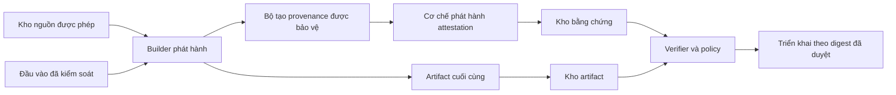

# Build provenance

## 1. Mục tiêu và phạm vi

Build provenance là bằng chứng có cấu trúc mô tả nguồn gốc của một artifact được tạo ra: build nào đã chạy, dùng mã nguồn và đầu vào nào, theo quy trình nào, trên builder nào và tạo ra kết quả có định danh nội dung gì.

Trong chương Dependency và supply chain, provenance giúp chuyển câu hỏi “artifact này có đúng là sản phẩm của quy trình đã được phép không?” thành các điều kiện có thể kiểm chứng. Với một dịch vụ xử lý đơn hàng, yêu cầu có thể là:

> Mọi artifact triển khai vào production phải có provenance được xác minh, ràng buộc với đúng digest artifact, đúng kho mã nguồn, revision được phép và builder thuộc phạm vi tin cậy.

Muốn nghiệm thu yêu cầu đó, cần đặc tả rõ:

- Những loại artifact nào thuộc phạm vi: JAR, image, gói frontend hoặc các gói triển khai khác.
- Nội dung provenance bắt buộc và cách thu thập từng trường.
- Thành phần nào phát hành bằng chứng và vì sao được tin cậy.
- Cách xác minh tính toàn vẹn, danh tính người phát hành và nội dung khai báo.
- Quy tắc cho phép phát hành, triển khai, rollback và xử lý ngoại lệ.
- Bằng chứng quan sát được cho thấy artifact đang chạy là artifact đã được kiểm tra.

Các tên dịch vụ, định danh, digest và thời hạn bên dưới là ví dụ thiết kế. Chúng không đại diện cho một chứng thực có hiệu lực trong hệ thống thực tế.

## 2. Phân biệt những loại bằng chứng thường bị gộp chung

| Khái niệm | Câu hỏi được hỗ trợ | Giới hạn cần giữ rõ |
| --- | --- | --- |
| Digest artifact | Nội dung được kiểm tra có giống nội dung đang xét không? | Cần có một digest kỳ vọng từ nguồn được tin cậy |
| Chữ ký artifact | Chủ thể kiểm soát khóa tương ứng đã ký nội dung nào? | Chưa mô tả đầy đủ nguồn mã, quy trình hoặc đầu vào build |
| Build provenance | Artifact được khai báo đã được tạo ở đâu, từ gì và bằng quy trình nào? | Độ tin cậy phụ thuộc nguồn thu thập và chủ thể phát hành |
| Attestation | Một chủ thể đưa ra phát biểu có thể được kiểm chứng về một đối tượng | Cần kiểm tra loại phát biểu, đối tượng, người phát hành và cơ sở tin cậy |
| SBOM | Sản phẩm chứa những thành phần nào theo phạm vi kiểm kê? | Không tự mô tả đầy đủ cách build hoặc chứng minh không có lỗ hổng |
| Reproducible build | Có thể tạo lại kết quả giống nhau từ đầu vào và điều kiện đã xác định không? | Một lần tạo lại giống nhau không chứng minh mã nguồn không có lỗi bảo mật |
| Quyết định phát hành | Artifact nào được phép đưa vào môi trường nào, theo chính sách nào? | Cần thêm ngữ cảnh rủi ro, kiểm thử và quyền triển khai |

Provenance có thể được đóng gói như một attestation có chữ ký. File JSON chứa thông tin build chưa tự tạo thành bằng chứng đáng tin chỉ vì có trường tên builder.

Chữ ký hợp lệ cho biết nội dung được ký không bị thay đổi theo cơ chế xác minh đã chọn và được ràng buộc với danh tính ký tương ứng. Để tin vào phát biểu, bên kiểm tra còn phải tin cách chủ thể đó thu thập thông tin và giới hạn quyền phát hành của họ.

Một artifact có provenance hợp lệ vẫn có thể chứa dependency có lỗ hổng hoặc hành vi không mong muốn được viết trực tiếp trong source. Các yêu cầu về kiểm thử, phân tích dependency và phê duyệt thay đổi cần được liên kết riêng với quyết định phát hành.

## 3. Từ mô hình đe dọa tới yêu cầu nguồn gốc build

| Tình huống | Rủi ro | Bất biến cần đặc tả |
| --- | --- | --- |
| Thay artifact trên kho lưu trữ nhưng giữ nguyên tên phiên bản | Triển khai nội dung khác với bản đã xét | Xác minh bằng digest của nội dung cuối cùng |
| Tự tạo provenance ghi tên builder được tin cậy | Giả mạo quy trình build | Danh tính phát hành phải được xác minh ngoài các trường tự khai |
| Build từ fork hoặc revision chưa được duyệt | Đưa mã không thuộc luồng phát hành vào production | Kiểm tra kho nguồn và revision theo thẩm quyền phát hành |
| Pipeline của pull request không tin cậy được quyền ký bản phát hành | Mã đầu vào điều khiển việc phát hành bằng chứng | Tách quyền của build kiểm thử và build phát hành |
| Sửa build script hoặc workflow nhưng vẫn dùng cùng tên job | Quy trình thực tế khác quy trình được phê duyệt | Ràng buộc recipe/workflow với phiên bản được kiểm soát |
| Dependency được tải bằng tên có thể đổi nội dung | Không xác định được đầu vào thực sự | Ghi nhận đầu vào đã resolve bằng định danh nội dung phù hợp |
| Kiểm tra tag rồi triển khai lại theo tag đó | Tag có thể bị đổi sau kiểm tra | Triển khai đúng digest đã được xác minh |
| Dùng lại provenance cũ cho một lần phát hành không được phép | Vượt quy trình phê duyệt hoặc chống rollback | Tách bằng chứng build khỏi quyền triển khai hiện tại |
| Builder hoặc dịch vụ ký bị chiếm quyền | Kẻ tấn công có thể phát hành bằng chứng hợp lệ về mặt mật mã | Bảo vệ trust boundary, hạn chế quyền và có kế hoạch thu hồi |

Yêu cầu bảo mật phải nêu cả những điều provenance có thể phát hiện và giả định tin cậy còn lại. Nếu builder thuộc miền tin cậy đã bị kiểm soát hoàn toàn, bên tấn công có thể làm sai thông tin mà builder xác nhận. Chữ ký của chính builder đó không loại bỏ được rủi ro này.

## 4. Mô hình luồng bằng chứng và ranh giới tin cậy

Một kiến trúc tham khảo:



Cần phân biệt ít nhất bốn miền quyền:

1. **Chủ thể sửa source và recipe:** có thể đề xuất thay đổi hành vi của build.
2. **Builder và bộ thu thập thông tin:** quan sát những gì thực sự xảy ra trong build.
3. **Cơ chế phát hành attestation:** kiểm soát danh tính dùng để xác nhận bằng chứng.
4. **Verifier và bên quyết định triển khai:** áp chính sách của môi trường đích.

Nếu một script do người gửi thay đổi điều khiển có thể tùy ý tạo mọi trường provenance rồi yêu cầu ký, chữ ký chỉ bảo vệ một bản tự khai. Cần xác định trường nào do control plane hoặc thành phần được bảo vệ thu thập, trường nào là tham số do người dùng cung cấp và trường nào chưa có bảo đảm độc lập.

Ví dụ, commit nguồn có thể được thu từ sự kiện checkout do hệ thống build quản lý. Không nên chỉ đọc một biến môi trường mà script ứng viên có thể thay. Builder identity cũng phải được đối chiếu với danh tính đã xác minh của chủ thể phát hành, thay vì tin nguyên chuỗi trong payload.

Việc phân quyền ký phải giới hạn theo nguồn, workflow, loại sự kiện và mục đích. Một job kiểm thử mã từ bên ngoài có thể cần chạy build, nhưng không vì vậy được phép phát hành bằng chứng đủ điều kiện triển khai production.

## 5. Nội dung tối thiểu của provenance

### 5.1. Đối tượng được chứng thực

Provenance phải định danh rõ kết quả build:

- Loại artifact và tên dùng để liên kết.
- Thuật toán digest được cho phép.
- Digest của nội dung cuối cùng.
- Các đối tượng liên quan nếu build tạo nhiều kết quả.

Tên file, đường dẫn và tag hỗ trợ tìm kiếm; digest hỗ trợ xác định đúng nội dung.

Nếu một attestation có nhiều đối tượng, verifier phải tìm đúng đối tượng yêu cầu triển khai và đối chiếu digest của đối tượng đó. Chỉ thấy một digest khác khớp trong cùng tài liệu không đủ để chấp nhận artifact đang xét.

Với image nhiều kiến trúc, cần làm rõ bằng chứng gắn với digest của index, manifest theo nền tảng hay cả hai. Chính sách triển khai phải biết đối tượng nào được xác minh và cách liên kết tới nội dung sẽ chạy trên nền tảng đích.

### 5.2. Nguồn mã

Thông tin nguồn thường gồm:

- Định danh repository được chuẩn hóa theo chính sách.
- Revision đầy đủ, không chỉ branch hoặc tag có thể dịch chuyển.
- Subdirectory hoặc thành phần nguồn nếu là monorepo.
- Trạng thái và nguồn gốc các thay đổi ngoài revision, nếu có.
- Submodule hoặc nguồn bổ sung có ảnh hưởng đến kết quả.

Một commit giống nhau xuất hiện trong hai repository không tự làm hai nguồn có cùng thẩm quyền. Chính sách phải kiểm tra cả định danh repository và revision.

Tên branch như `release` trong một phát biểu tự khai chưa chứng minh commit đã được phê duyệt. Cần liên kết với quy trình bảo vệ nguồn và quyết định cho phép revision đó tham gia phát hành.

### 5.3. Builder, recipe và invocation

Cần ghi nhận:

- Builder hoặc dịch vụ build thuộc miền tin cậy nào.
- Workflow/recipe và phiên bản hoặc digest tương ứng.
- Định danh lần chạy, lần thử lại và mối liên kết với sự kiện kích hoạt.
- Tham số có ảnh hưởng tới kết quả.
- Thời điểm và trạng thái kết thúc build theo mô hình bằng chứng đã chọn.

Tên job đơn thuần không đủ khi nội dung workflow có thể đổi. Cần kiểm soát cách recipe được chọn, nguồn recipe và quyền thay đổi nó.

Một invocation ID giúp truy vết nhưng không tự tạo khả năng chống phát lại. Bên triển khai vẫn phải kiểm tra rằng artifact được phép phát hành trong ngữ cảnh hiện tại.

### 5.4. Đầu vào thực tế

Các đầu vào có thể gồm:

- Mã nguồn và nguồn bổ sung.
- Toolchain, runtime và image dùng để build.
- Dependency trực tiếp, bắc cầu và các công cụ được tải về.
- Base image, generator và tài nguyên dùng khi đóng gói.
- Cấu hình hoặc tham số có thể thay đổi kết quả.

Cần ghi nhận những đầu vào đã được resolve hoặc thực sự sử dụng theo phạm vi đảm bảo. Chỉ ghi danh sách dependency khai báo không đủ để biết build đã tải phiên bản nào.

Nếu có truy cập mạng không được ghi nhận hoặc một input động không thể xác định, phải phản ánh giới hạn đó. Không gắn nhãn “đầy đủ” khi bộ thu thập chưa quan sát được toàn bộ phạm vi được yêu cầu.

### 5.5. Thông tin nhạy cảm và giới hạn thu thập

Không đưa token, mật khẩu, private key hoặc giá trị bí mật vào provenance. Có thể cần ghi định danh phiên bản của nguồn bí mật hoặc loại ảnh hưởng của nó, nhưng phải đánh giá tính nhạy cảm của metadata đó.

Không băm một bí mật rồi mặc nhiên coi digest của nó là dữ liệu công khai. Một bí mật có không gian giá trị nhỏ vẫn có thể bị đoán bằng đối chiếu.

Nếu một input bí mật ảnh hưởng nội dung artifact, cần ghi rõ giới hạn đối với việc tái tạo build và cách quản lý bằng chứng. Việc loại giá trị bí mật khỏi báo cáo không có nghĩa có thể giả vờ rằng input đó không tồn tại.

## 6. Payload minh họa và cách đọc

JSON dưới đây là mô hình minh họa tự định nghĩa để học cách ràng buộc thông tin. Đây là phần payload, chưa bao gồm cơ chế chữ ký và các bằng chứng tin cậy cần cho phát hành. Danh sách materials chỉ minh họa một phần đầu vào.

```json
{
  "schemaId": "example-build-provenance/v1",
  "subject": {
    "name": "orders-api-1.4.2.jar",
    "kind": "java-archive",
    "digest": {
      "sha256": "aaaaaaaaaaaaaaaaaaaaaaaaaaaaaaaaaaaaaaaaaaaaaaaaaaaaaaaaaaaaaaaa"
    }
  },
  "source": {
    "repository": "https://git.example.com/retail/orders-api",
    "revision": "bbbbbbbbbbbbbbbbbbbbbbbbbbbbbbbbbbbbbbbb"
  },
  "builder": {
    "id": "release-builder-production",
    "workflowId": "orders-release",
    "workflowRevision": "cccccccccccccccccccccccccccccccccccccccc"
  },
  "invocation": {
    "id": "build-demo-008",
    "attempt": 1
  },
  "recipe": {
    "id": "java-jar-release",
    "parameters": {
      "profile": "release"
    }
  },
  "materials": [
    {
      "name": "build-toolchain",
      "digest": {
        "sha256": "dddddddddddddddddddddddddddddddddddddddddddddddddddddddddddddddd"
      }
    },
    {
      "name": "pkg:maven/org.example/report-core@3.2.1",
      "digest": {
        "sha256": "eeeeeeeeeeeeeeeeeeeeeeeeeeeeeeeeeeeeeeeeeeeeeeeeeeeeeeeeeeeeeeee"
      }
    }
  ],
  "coverage": {
    "status": "example-excerpt",
    "note": "Danh sach dau vao da duoc rut gon de minh hoa"
  }
}
```

Các chuỗi hex lặp là dữ liệu giả định, không phải digest của một artifact thực.

Khi đọc payload, cần tách hai câu hỏi:

1. Payload nói điều gì về artifact?
2. Có căn cứ nào để tin chủ thể phát hành đã quan sát đúng những điều đó?

Ví dụ, `builder.id` là một phát biểu bên trong tài liệu. Verifier phải kiểm tra nó phù hợp với quyền của signer hoặc danh tính phát hành đã được xác minh.

Đoạn ví dụ có trạng thái coverage là phần trích minh họa, nên không đáp ứng một chính sách production yêu cầu tập đầu vào đầy đủ. Một schema hợp lệ không được tự coi là bằng chứng thỏa mọi điều kiện bảo mật.

Trong triển khai thực tế, có thể chọn định dạng attestation và framework bảo đảm supply chain phù hợp. Khi chọn, cần ghi rõ phiên bản định dạng, loại phát biểu và yêu cầu assurance; tránh suy ra mức bảo đảm chỉ từ tên framework hoặc việc tồn tại một file provenance.

## 7. Phát hành attestation và xác minh danh tính

### 7.1. Mô hình dùng khóa được quản lý

Trong một mô hình, dịch vụ phát hành dùng khóa mà verifier đã có căn cứ tin cậy.

Yêu cầu cần nêu:

- Khóa nào hoặc tập khóa nào được chấp nhận.
- Khóa được phép ký cho builder, repository và mục đích nào.
- Cách bảo vệ quyền sử dụng khóa.
- Cách thay khóa, thu hồi và xử lý bằng chứng cũ.
- Cách ghi nhận hành vi ký và phát hiện sử dụng ngoài phạm vi.

Giữ khóa trong phần cứng hoặc dịch vụ quản lý có thể hạn chế việc xuất khóa, nhưng quyền gọi thao tác ký vẫn cần kiểm soát. Một script không tin cậy được phép yêu cầu ký mọi payload có thể tạo phát biểu sai mà không cần lấy được private key.

Bộ tạo provenance và đường yêu cầu phát hành phải bảo đảm payload thuộc đúng lần chạy và được thu thập theo hợp đồng.

### 7.2. Mô hình dùng danh tính và chứng thư

Một mô hình khác dùng chứng thư ràng buộc khóa ký với danh tính của workload hoặc dịch vụ phát hành.

Verifier cần kiểm tra theo mô hình đã chọn:

- Chuỗi tin cậy và issuer được phép.
- Danh tính hoặc claims được ràng buộc trong bằng chứng.
- Quan hệ giữa danh tính đó với builder, nguồn và workflow được phép.
- Điều kiện hiệu lực, thời gian và chính sách thu hồi.
- Bằng chứng thời điểm ký hoặc nhật ký minh bạch nếu chính sách yêu cầu.

Không lấy một root certificate đính kèm trong tài liệu rồi tự xem nó là trust anchor. Trust anchor và chính sách danh tính phải đến từ nguồn cấu hình được bảo vệ.

Với chứng thư ngắn hạn, xác minh lịch sử cần mô hình thời gian phù hợp. Chỉ kiểm tra “chứng thư còn hạn ở thời điểm hiện tại” có thể loại bỏ bằng chứng lịch sử hợp lệ; chỉ tin timestamp tự khai trong payload cũng không đủ chứng minh thời điểm ký.

Nếu chính sách cần bằng chứng thời gian đáng tin cậy mà bằng chứng đó thiếu, kết quả phải phản ánh điều kiện chưa được đáp ứng.

### 7.3. Chữ ký phải bao phủ đúng phát biểu

Dùng cơ chế xác minh phù hợp với định dạng đã chọn để bảo vệ đúng payload và loại phát biểu. Tránh tự ghép chuỗi hoặc tự thiết kế quy tắc mật mã.

Cần làm rõ:

- Các byte hoặc biểu diễn nào thực sự được ký.
- Metadata nào nằm trong phạm vi bảo vệ.
- Cách ràng buộc loại payload hoặc ngữ cảnh của phát biểu.
- Cách xử lý tài liệu trùng khóa, cấu trúc mơ hồ hoặc thuật toán không hỗ trợ.

Không sửa whitespace hoặc parse rồi serialize lại trước khi xác minh một chữ ký vốn được tính trên byte gốc, trừ khi định dạng quy định rõ cơ chế chuẩn hóa tương ứng.

Nhật ký minh bạch, nếu được sử dụng, hỗ trợ khả năng quan sát và kiểm tra theo mô hình của nó. Sự hiện diện trong nhật ký không tự chứng minh nội dung provenance là đúng hoặc artifact không có lỗ hổng.

## 8. Pipeline xác minh trước triển khai

Một quy trình kiểm tra tham khảo:

```text
1. Xác định artifact ứng viên bằng digest bất biến.
2. Lấy provenance và bằng chứng liên quan qua nguồn được phép.
3. Kiểm tra giới hạn kích thước, định dạng và loại phát biểu.
4. Xác minh chữ ký, danh tính phát hành và các điều kiện tin cậy.
5. Đối chiếu subject với đúng digest artifact.
6. Kiểm tra repository, revision, builder, workflow và đầu vào theo policy.
7. Kiểm tra quyền phát hành, ngoại lệ và điều kiện môi trường hiện tại.
8. Ghi quyết định cùng phiên bản policy và các bằng chứng đã dùng.
9. Triển khai đúng digest đã được chấp thuận.
10. Đối chiếu artifact thực tế trên phạm vi triển khai.
```

Các bước có thể được tối ưu thứ tự về hiệu năng, nhưng mọi điều kiện bắt buộc phải được thỏa trước khi artifact được phép chạy.

### 8.1. Không tin nội dung chỉ vì chữ ký hợp lệ

Một signer được tin cậy cho artifact thử nghiệm không tự có quyền ký artifact production. Một builder hợp lệ cho repository khác không tự được quyền phát hành orders.

Chính sách cần đối chiếu đồng thời:

- Danh tính phát hành đã xác minh.
- Phạm vi builder hoặc workflow mà danh tính đó được đại diện.
- Nguồn và revision được phép.
- Mục đích build và điều kiện phê duyệt.
- Artifact cụ thể và môi trường đích.

Một trường `environment: production` do ứng viên tự đưa vào không cấp quyền production cho nó.

### 8.2. Tránh khoảng hở giữa kiểm tra và sử dụng

Nếu verifier kiểm tra `orders-api:stable` rồi hệ thống triển khai lại theo chính tag đó, tag có thể đã trỏ sang nội dung khác.

Cần resolve và triển khai bằng digest đã được xác minh. Nếu có bước đóng gói lại, ký JAR, thay manifest hoặc biến đổi artifact, phải xác định digest của kết quả cuối cùng và bằng chứng liên kết phù hợp.

Với JAR, một thao tác thay đổi nội dung sau khi tính digest sẽ tạo artifact khác. Với image, cần kiểm tra đúng đối tượng manifest/index thực sự được kho lưu trữ và môi trường triển khai sử dụng.

Không dùng tên file giống nhau làm bằng chứng rằng nội dung không đổi.

### 8.3. Giữ chính sách và dữ liệu kiểm tra nhất quán

Quyết định phải ghi phiên bản trust policy và release policy. Nếu policy thay đổi giữa kiểm tra và triển khai, cần quy tắc đánh giá lại hoặc cơ chế ràng buộc quyết định có điều kiện.

Một token hoặc bản ghi cho phép triển khai, nếu được dùng, nên ràng buộc với digest, môi trường đích, policy, thời hạn và chủ thể được phép sử dụng. Bản ghi provenance thường không tự chứa đầy đủ quyền này.

Khi verifier cache kết quả, cần xác định những thay đổi nào làm cache mất hiệu lực, đặc biệt là thu hồi signer, loại builder khỏi tập tin cậy hoặc thay đổi quyền phát hành.

## 9. Viết yêu cầu bảo mật có thể nghiệm thu

| Mã | Yêu cầu | Tiêu chí chấp nhận |
| --- | --- | --- |
| SEC-PROV-01 | Mọi artifact production trong phạm vi phải có provenance trước khi được phép triển khai | 100% artifact mới qua cổng đều có bằng chứng đủ điều kiện; artifact thiếu bằng chứng không được nhận kết quả xác minh thành công |
| SEC-PROV-02 | Provenance phải ràng buộc với digest của artifact cuối cùng | Thay một byte hoặc thay manifest ngoài phạm vi đã chứng thực làm kiểm tra thất bại |
| SEC-PROV-03 | Chỉ chấp nhận chủ thể phát hành và builder trong phạm vi tin cậy được phê duyệt | Chữ ký từ khóa hoặc danh tính ngoài tập cho phép bị từ chối |
| SEC-PROV-04 | Repository, revision và workflow phải đáp ứng quyền phát hành của dịch vụ | Build từ fork, revision chưa được phép hoặc recipe ngoài policy không được triển khai |
| SEC-PROV-05 | Các trường quan trọng phải được thu thập từ nguồn có bảo đảm đã đặc tả | Script ứng viên không thể thay commit hoặc builder identity rồi vẫn nhận bằng chứng phát hành đủ điều kiện |
| SEC-PROV-06 | Phạm vi đầu vào bắt buộc phải được định danh và ghi nhận | Input động không được quan sát tạo kết quả chưa đầy đủ, không bị gắn nhãn complete |
| SEC-PROV-07 | Việc triển khai phải dùng đúng digest đã được xác minh | Thay tag sau kiểm tra không thay đổi artifact được triển khai |
| SEC-PROV-08 | Lỗi xác minh hoặc phụ thuộc kiểm tra không khả dụng không được coi là thành công | Chữ ký lỗi, bằng chứng thiếu và verifier lỗi tạo trạng thái phân biệt rõ, không có ALLOW mặc định |
| SEC-PROV-09 | Quyết định phải truy vết được về artifact, nguồn, policy và danh tính đã kiểm tra | Có thể tái dựng căn cứ của một lần triển khai từ bản ghi được bảo vệ |
| SEC-PROV-10 | Ngoại lệ phải có phạm vi, thẩm quyền và hạn hiệu lực | Ngoại lệ hết hạn, sai digest hoặc sai môi trường không cho phép triển khai |
| SEC-PROV-11 | Thu hồi trust phải ảnh hưởng tới quyết định mới trong thời hạn đã cam kết | Cache và verifier trên mọi điểm kiểm soát áp dụng cập nhật trong giới hạn |
| SEC-PROV-12 | Bằng chứng và quy trình kiểm tra không được làm lộ bí mật | Payload, log lỗi và artifact chẩn đoán không chứa khóa, token hoặc mật khẩu |

### Mốc thời gian minh họa

Dịch vụ có thể chọn các yêu cầu vận hành sau:

- Artifact và provenance được đưa vào trạng thái phát hành chỉ khi cả hai đã có thể truy xuất, xác minh và liên kết theo digest.
- Một quyết định triển khai có thời hạn 15 phút và chỉ áp dụng cho digest, môi trường và policy được ghi trong quyết định.
- Cập nhật khẩn loại signer hoặc builder khỏi tập tin cậy phải ảnh hưởng tới mọi quyết định triển khai mới trong tối đa 15 phút kể từ khi sự kiện thu hồi được xác nhận.
- Bằng chứng và quyết định triển khai được giữ ít nhất 180 ngày sau lần sử dụng cuối cùng trong phạm vi chính sách minh họa.

Các mốc này cần được chọn theo rủi ro, hệ thống lưu trữ và khả năng vận hành. Không suy ra một thời hạn mặc định chung cho mọi sản phẩm.

Độ tuổi của provenance và thời hạn của quyền triển khai là hai vấn đề khác nhau. Một provenance cũ có thể vẫn mô tả chính xác artifact; việc dùng artifact đó hôm nay còn phải qua chính sách hiện tại.

## 10. Trạng thái quyết định và xử lý thất bại

Có thể dùng mô hình sau:

| Trạng thái | Ý nghĩa | Hành vi |
| --- | --- | --- |
| ALLOW | Mọi điều kiện bắt buộc được đáp ứng cho ngữ cảnh cụ thể | Triển khai đúng digest trong phạm vi quyết định |
| BLOCK | Có bằng chứng vi phạm policy | Không triển khai ứng viên qua cổng đó |
| INCOMPLETE | Thiếu dữ liệu hoặc không thể hoàn tất kiểm tra | Chờ bổ sung, thử lại có kiểm soát hoặc đi quy trình được phép |
| ALLOW_WITH_EXCEPTION | Có ngoại lệ hợp lệ cho điều kiện được phép miễn trong policy | Ghi rõ ngoại lệ, giới hạn và thời hạn |

Trong chính sách minh họa, không cho phép miễn kiểm tra bằng cách bỏ qua digest mismatch, chữ ký sai hoặc danh tính phát hành không được tin cậy. Những lỗi này cần được xử lý bằng việc xác định lại artifact hoặc cung cấp bằng chứng hợp lệ.

Với artifact legacy thiếu provenance, tổ chức có thể có quy trình chuyển tiếp riêng dùng bằng chứng thay thế được phê duyệt. Kết quả phải hiển thị rõ ngoại lệ, không được mô tả như đã xác minh đầy đủ provenance.

### Phụ thuộc xác minh không khả dụng

Nếu kho bằng chứng, nguồn trust hoặc dịch vụ kiểm tra bắt buộc không truy cập được:

- Không đổi lỗi kết nối thành “không có vấn đề”.
- Ghi rõ điều kiện chưa thể kiểm tra.
- Dùng cache chỉ khi tuổi dữ liệu và điều kiện sử dụng đáp ứng policy.
- Không tự kéo dài quyết định đã hết hạn.
- Phân biệt ứng viên mới với workload đang chạy.

Một sự cố verifier có thể làm tạm dừng triển khai mới. Hành vi với workload đang chạy cần quy trình vận hành riêng, dựa trên rủi ro và khả năng phục hồi của dịch vụ.

### Ngoại lệ phải cụ thể

Hồ sơ ngoại lệ cần nêu điều kiện được miễn, artifact, môi trường, lý do, bằng chứng thay thế, người chịu trách nhiệm, người có thẩm quyền, hạn hết hiệu lực và kế hoạch kết thúc.

Một suppression trong công cụ không tự tạo thẩm quyền chấp nhận rủi ro. Một quyền triển khai khẩn cũng không biến một chữ ký sai thành chữ ký hợp lệ.

## 11. Bảo vệ builder và chất lượng bằng chứng

Provenance đáng tin cần dựa trên một quy trình build có bảo đảm tương ứng:

- Tách workspace và quyền giữa các lần chạy theo mô hình đe dọa.
- Không cấp bí mật phát hành cho mã chưa được tin cậy.
- Kiểm soát cách thay workflow, recipe, toolchain và cấu hình builder.
- Giới hạn quyền xuất artifact và yêu cầu phát hành attestation.
- Quản lý cache để tránh đầu vào từ một miền tin cậy khác bị sử dụng ngoài policy.
- Ghi nhận đầu vào thực tế và phát hiện truy cập ngoài phạm vi đã khai báo.
- Theo dõi sự kiện thay trust, thay quyền ký và hành vi phát hành bất thường.

Một build có đầu vào được cố định và môi trường được kiểm soát hỗ trợ khả năng giải thích kết quả. Nếu tuyên bố build hermetic hoặc reproducible, cần định nghĩa điều kiện và kiểm thử riêng cho tuyên bố đó.

Reproducibility có thể bị ảnh hưởng bởi timestamp, thứ tự đóng gói, đường dẫn và đầu vào động. Có thể cần chuẩn hóa quá trình để tạo kết quả giống nhau, nhưng không được sửa artifact sau kiểm tra mà bỏ qua việc cập nhật digest và bằng chứng.

Build lại độc lập có thể bổ sung bằng chứng trong mô hình phù hợp. Nó không tự loại bỏ rủi ro mã nguồn đã được duyệt nhưng chứa hành vi không mong muốn, hoặc hai môi trường cùng dùng một đầu vào không đáng tin.

### Ràng buộc với các bằng chứng khác

Nếu có SBOM, báo cáo kiểm thử và kết quả quét dependency, cần gắn chúng với đúng digest hoặc một chuỗi liên kết được xác minh tới artifact cuối cùng.

Không gắn báo cáo của lần build trước vào artifact mới chỉ vì cùng version ứng dụng. Nếu bước ký hoặc đóng gói làm thay đổi nội dung, cần đặc tả cách duy trì liên kết bằng chứng qua bước đó.

## 12. Ma trận kiểm thử provenance

| Tình huống | Kết quả mong đợi | Yêu cầu liên quan |
| --- | --- | --- |
| Artifact đúng digest, signer, nguồn và workflow được phép | ALLOW cho đúng ngữ cảnh | SEC-PROV-01 tới SEC-PROV-04 |
| Thay một byte artifact sau build | Digest mismatch, BLOCK | SEC-PROV-02 |
| Payload bị sửa sau khi ký | Xác minh chữ ký thất bại | SEC-PROV-03 |
| Attestation dùng signer ngoài tập cho phép | BLOCK dù chữ ký tự nó hợp lệ | SEC-PROV-03 |
| Payload tự ghi builder được tin cậy nhưng signer không được đại diện | BLOCK | SEC-PROV-03, SEC-PROV-05 |
| Đúng signer nhưng repository là fork không được phép | BLOCK | SEC-PROV-04 |
| Workflow có cùng tên nhưng revision không được phép | BLOCK | SEC-PROV-04 |
| Script ứng viên thay biến nguồn commit hoặc builder | Không tạo được bằng chứng đủ điều kiện từ giá trị giả | SEC-PROV-05 |
| Có đầu vào mạng ngoài phạm vi được quan sát | Không đạt yêu cầu coverage; INCOMPLETE hoặc BLOCK theo policy | SEC-PROV-06 |
| Một subject trong attestation khớp, subject được triển khai không khớp | Không chấp nhận bằng subject khác | SEC-PROV-02 |
| Image index và manifest nền tảng không có liên kết bằng chứng yêu cầu | Không tự coi cả hai đã được xác minh | SEC-PROV-02 |
| Tag bị đổi sau khi quyết định ALLOW | Vẫn chỉ triển khai digest đã được duyệt | SEC-PROV-07 |
| Kho bằng chứng không truy cập được, không có cache hợp lệ | INCOMPLETE, không ALLOW mặc định | SEC-PROV-08 |
| Trust anchor do tài liệu ứng viên tự cung cấp | Không tự thêm vào tập tin cậy | SEC-PROV-03 |
| Bằng chứng lịch sử thiếu dữ liệu thời gian mà policy yêu cầu | Không giả định thời điểm ký từ timestamp tự khai | SEC-PROV-03, SEC-PROV-08 |
| Quyết định hết hạn hoặc dành cho môi trường khác | Đánh giá lại trước triển khai | SEC-PROV-07, SEC-PROV-10 |
| Signer bị thu hồi sau khi kết quả được cache | Quyết định mới phản ánh thu hồi trong thời hạn | SEC-PROV-11 |
| Provenance chứa token giả định dùng cho kiểm thử rò rỉ | Bị phát hiện và không phát tán qua kênh bằng chứng chung | SEC-PROV-12 |
| Rollback artifact cũ có provenance hợp lệ nhưng không còn được phép | BLOCK hoặc xử lý ngoại lệ theo policy hiện tại | SEC-PROV-04, SEC-PROV-10 |

### Tiêu chí Given/When/Then cho thay artifact

```text
Given:
  Artifact A có digest DA.
  Provenance hợp lệ chứng thực đúng DA.
  Quyết định triển khai chỉ cho phép DA vào production.

When:
  Nội dung tại một tag được thay bằng artifact B có digest DB,
  và DB khác DA.

Then:
  Hệ thống không triển khai DB dựa trên quyết định dành cho DA.
  Nếu tiếp tục triển khai, chỉ DA được sử dụng.
  Nếu không lấy được DA, lần triển khai dừng theo trạng thái phù hợp.
  Bản ghi quyết định và quan sát triển khai cho phép đối chiếu digest.
```

Phép thử cần quan sát artifact thực sự được tải hoặc chạy. Chỉ kiểm tra một dòng “signature valid” chưa chứng minh toàn bộ chuỗi kiểm soát hoạt động đúng.

## 13. Thu hồi, rollback và điều tra sự cố

### 13.1. Khi signer hoặc builder bị nghi xâm phạm

Cần có khả năng xác định:

- Artifact và attestation nào được phát hành bởi danh tính liên quan.
- Khoảng thời gian hoặc tập invocation bị ảnh hưởng.
- Môi trường nào đã triển khai các digest đó.
- Quyết định nào còn trong cache hoặc chưa hết hiệu lực.
- Bằng chứng nào có thể được xác minh lại độc lập.

Ứng phó có thể gồm dừng quyền ký, cập nhật trust policy, chặn quyết định triển khai mới, điều tra artifact và build lại bằng miền tin cậy phù hợp. Phạm vi xử lý workload đang chạy cần dựa trên kết luận sự cố và yêu cầu phục hồi.

Thu hồi không chỉ là thay một file khóa trên một máy. Mọi verifier, cache và điểm kiểm soát liên quan phải áp dụng chính sách mới theo thời hạn đã cam kết.

### 13.2. Rollback

Rollback dùng artifact cũ nhưng là một quyết định triển khai mới. Cần đánh giá lại:

- Provenance và danh tính phát hành còn được chấp nhận không?
- Artifact có còn được phép theo policy hiện tại không?
- Có thông tin lỗ hổng hoặc sự cố builder mới không?
- Revision đó có được phép khôi phục trong môi trường đích không?
- Có cần phê duyệt phục hồi hoặc ngoại lệ còn hiệu lực không?

Provenance của artifact cũ có thể vẫn đúng về lịch sử build trong khi quyền sử dụng artifact đã thay đổi. Phân biệt hai điều này giúp quy trình phục hồi tránh bỏ qua các kiểm soát hiện tại.

### 13.3. Lưu và bảo vệ bằng chứng

Cần bảo vệ tính toàn vẹn, quyền đọc, quyền sửa và khả năng truy xuất của provenance, trust policy, quyết định và audit.

Thông tin repository nội bộ, danh tính workload, topology builder và tham số build có thể nhạy cảm. Chỉ công khai phần phù hợp với nhu cầu người nhận; không biến việc hỗ trợ truy vết thành kênh lộ thông tin hạ tầng.

## 14. Truy vết trong vòng đời phát triển

| Rủi ro | Yêu cầu | Điểm cưỡng chế | Bằng chứng |
| --- | --- | --- | --- |
| R-PROV-01: thay artifact trên kho | SEC-PROV-02, SEC-PROV-07 | Digest verification và triển khai theo digest | Test thay byte, đổi tag và đối chiếu artifact thực tế |
| R-PROV-02: giả mạo nguồn gốc build | SEC-PROV-03, SEC-PROV-05 | Danh tính phát hành và bộ thu thập được bảo vệ | Test signer giả, payload tự khai và sửa biến môi trường |
| R-PROV-03: source hoặc workflow ngoài thẩm quyền | SEC-PROV-04 | Release policy và kiểm soát nguồn | Test fork, revision và recipe không được phép |
| R-PROV-04: bỏ sót đầu vào ảnh hưởng kết quả | SEC-PROV-06 | Thu thập materials và kiểm soát build | Test input động và trạng thái coverage |
| R-PROV-05: tiếp tục tin signer đã thu hồi | SEC-PROV-11 | Trust distribution, verifier và cache | Test thời hạn áp dụng thu hồi |
| R-PROV-06: lộ bí mật qua bằng chứng | SEC-PROV-12 | Quy tắc thu thập, kiểm tra payload và quyền truy cập | Test dữ liệu nhạy cảm và kênh xuất bằng chứng |

Trong thiết kế, thống nhất ranh giới tin cậy, nội dung provenance và các điều kiện phát hành. Khi hiện thực, đội nền tảng bảo vệ builder và đường phát hành bằng chứng; đội sản phẩm quản lý nguồn, recipe và phạm vi artifact; bên triển khai áp chính sách của môi trường đích.

Trước phát hành, kiểm tra cả đường thành công và các trường hợp giả mạo, thiếu bằng chứng, thay nội dung và thu hồi. Sau triển khai, duy trì khả năng nối artifact đang chạy với quyết định và bằng chứng đã dùng.

Một đặc tả build provenance đủ rõ phải cho phép người kiểm thử trả lời được: ai có quyền xác nhận, họ xác nhận điều gì, căn cứ nào bảo vệ lời xác nhận và artifact nào thực sự được sử dụng. Khi các câu trả lời được gắn với rủi ro, điểm cưỡng chế và tiêu chí nghiệm thu, nguồn gốc build trở thành một yêu cầu bảo mật có thể kiểm chứng trong chuỗi cung ứng phần mềm.
