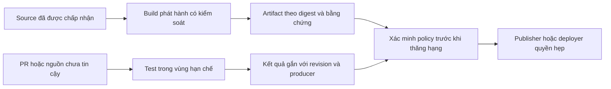

# CI pipeline protection

## 1. Mục tiêu bảo vệ pipeline CI

Pipeline CI thực thi mã từ repository, dependency, plugin và các công cụ tự động hóa. Tùy quyền được cấp, một job có thể đọc mã nguồn, lấy secret, tạo artifact, ghi vào registry hoặc yêu cầu triển khai. Vì vậy, pipeline là một hệ thống thực thi mã có đặc quyền và là một mắt xích quan trọng của software supply chain.

Trong chương **Dependency và supply chain** của module **SECURITY_SECURITY_DESIGN_SECURITY_REQUIREMENTS**, bài học chuyển mục tiêu bảo vệ CI thành yêu cầu cụ thể về xác thực, phân quyền, dữ liệu, logging và phục hồi. Phạm vi bao gồm CI tạo bản build và các điểm nối sang ký, phát hành, triển khai; không giả định rằng mọi job CI đều cần quyền CD.

Mục tiêu cần kiểm chứng là: **mã có mức tin cậy thấp không thể lấy quyền cao hơn ngoài chính sách; artifact được chấp nhận phải nối được với đúng source, quá trình build và bằng chứng; sự cố pipeline có thể được cô lập và phục hồi có kiểm soát**.

Sau bài học, người học cần làm được các việc sau:

- Xác định tài sản và ranh giới tin cậy từ sự kiện kích hoạt đến artifact được sử dụng.
- Đặc tả quyền theo từng loại job, nguồn mã và môi trường thực thi.
- Viết tiêu chí kiểm thử cho trigger, input, runner, secret, cache, artifact và release gate.
- Thiết kế audit, phản ứng sự cố và phục hồi phù hợp mức rủi ro của pipeline.

Các mã yêu cầu, quyền và ngưỡng trong bài là ví dụ đặc tả, cần điều chỉnh theo kiến trúc. [OWASP CI/CD Security Cheat Sheet](https://cheatsheetseries.owasp.org/cheatsheets/CI_CD_Security_Cheat_Sheet.html) cung cấp bối cảnh về bảo vệ SCM, môi trường thực thi, IAM và tính toàn vẹn; các yêu cầu dưới đây không mặc định chứng nhận một mức tuân thủ cụ thể.

## 2. Tài sản và mô hình đe dọa

### 2.1. Những gì pipeline cần bảo vệ

| Tài sản | Điều cần bảo vệ | Một đường bị lạm dụng |
| --- | --- | --- |
| Source và cấu hình build | Tính toàn vẹn, phạm vi người được đọc | Workflow hoặc script bị thay để gửi mã ra ngoài |
| Credential của job | Quyền truy cập và thời hạn sử dụng | Dependency thực thi mã rồi đọc token có trong process |
| Runner và mạng của runner | Cách ly giữa job, quyền host và đường mạng | Job để lại mã trên máy dùng chung hoặc gọi dịch vụ nội bộ |
| Cache và artifact | Nguồn tạo, nội dung và quyền sử dụng | Job ít tin cậy cung cấp dữ liệu cho job phát hành |
| Bằng chứng kiểm tra | Đúng producer, revision và phạm vi | Báo cáo giả hoặc kết quả của commit cũ được dùng lại |
| Registry và đích triển khai | Chỉ nhận đúng artifact được cho phép | Job ghi đè tag hoặc triển khai trực tiếp ngoài gate |
| Audit và cấu hình bảo vệ | Khả năng truy vết, chống sửa trái phép | Người thay policy đồng thời xóa dấu vết |

### 2.2. Các chủ thể và khả năng giả định

Kẻ tấn công có thể gửi pull request, điều khiển nội dung trong nhánh của mình, sửa title/description, cung cấp dependency hoặc tác động một integration. Trong một số tình huống, họ còn chiếm được tài khoản developer, token của bot hoặc runner.

Không coi việc repository private, người gửi là thành viên nội bộ hay job đã chạy thành công là bằng chứng mã thực thi an toàn. Mức tin cậy phải gắn với nguồn cụ thể, cách thay đổi được chấp nhận và quyền cần sử dụng.

| Mã rủi ro | Tình huống | Hậu quả |
| --- | --- | --- |
| R-01 | Sửa workflow, build script hoặc rule kiểm tra để tự mở quyền | Bỏ qua kiểm soát hoặc phát hành artifact không hợp lệ |
| R-02 | Mã PR hoặc input bên ngoài được chạy trong job có đặc quyền | Lấy token, sửa repository, xâm nhập môi trường đích |
| R-03 | Runner dùng chung bị lưu trạng thái độc hại | Job sau bị can thiệp hoặc lộ dữ liệu giữa dự án |
| R-04 | Dependency/action/script tải từ mạng thay đổi | Mã ngoài kiểm soát thực thi trên runner |
| R-05 | Cache, artifact hoặc báo cáo từ producer không phù hợp được tin | Đầu độc build hoặc giả mạo điều kiện phát hành |
| R-06 | Token rộng quyền, trust policy quá rộng hoặc secret bị log | Mở rộng ảnh hưởng vượt khỏi một job |
| R-07 | Thiếu audit, phục hồi từ runner cũ hoặc bypass không giới hạn | Không xác định được phạm vi ảnh hưởng và tái diễn sự cố |

Mô hình supply chain cần nhìn cả source integrity và build integrity: source được chấp nhận đúng quy trình vẫn có thể bị thay thế trong quá trình build hoặc phân phối. [SLSA mô tả các nhóm đe dọa ở nhiều mắt xích](https://slsa.dev/spec/v1.2/threats-overview); bảo vệ một bước riêng lẻ không chứng minh toàn chuỗi đã được kiểm soát.

## 3. Phân vùng tin cậy trước khi phân quyền

Một kiến trúc minh họa có ba vùng:



Sơ đồ chỉ cho phép kết quả test trở thành một đầu vào của quyết định sau khi được kiểm tra nguồn và phạm vi. Nó không cho phép job ít tin cậy tự gửi một file ghi `PASS` rồi yêu cầu job có quyền cao thực thi nội dung đi kèm.

| Vùng | Đầu vào chính | Quyền minh họa |
| --- | --- | --- |
| Test mã chưa tin cậy | PR, nhánh chưa chấp nhận, dữ liệu event | Đọc source cần thiết, không có secret production, không ghi release |
| Build bản phát hành | Source revision đã chấp nhận, công cụ được kiểm soát | Đọc dependency cần thiết, tạo artifact ở vùng staging theo phạm vi |
| Ký/phát hành/triển khai | Artifact đã định danh và bằng chứng được xác minh | Quyền ký, publish hoặc deploy riêng theo mục đích và môi trường |

“Đã được chấp nhận” không có nghĩa mã không thể độc hại. Thiết kế vẫn cần quyền tối thiểu và cách ly; nếu build thật sự cần một credential, phải chỉ rõ lý do, tài nguyên được phép và tác động khi mã trong build bị lạm dụng.

## 4. Yêu cầu đối với workflow, trigger và input

### CP-01 — Bảo vệ định nghĩa pipeline và policy của nó

**Yêu cầu:** Workflow, script build, cấu hình runner, dependency của pipeline và rule quyết định phát hành phải có owner, được quản lý phiên bản và đi qua cơ chế kiểm soát thay đổi tương xứng. Phạm vi review không chỉ là thư mục workflow: một script được workflow gọi cũng có thể thay toàn bộ hành vi.

Người đề xuất không được tự hạ required check, mở bypass hoặc sửa trust policy để hoàn tất chính thay đổi đang chờ. Quyền quản trị mạnh hơn gate phải được nhận diện, hạn chế sử dụng và có audit riêng. Với loại thay đổi rủi ro thấp đã được policy cho phép tự động, điều kiện tự động phải rõ và không mở rộng sang thay đổi quyền nhạy cảm.

**Tiêu chí nghiệm thu:** Thử thay workflow, script được gọi và rule bảo vệ trong sandbox. Thay đổi chưa đáp ứng policy không có khả năng tạo release được chấp nhận. Kiểm tra cả đường API, bot và thiết lập ngoài Git; chỉ bảo vệ một file YAML chưa đủ.

### CP-02 — Phân loại ngữ cảnh kích hoạt và nguồn mã thực thi

**Yêu cầu:** Mỗi trigger phải có hợp đồng về nguồn workflow, source revision thực sự checkout, actor, dữ liệu nhận từ bên ngoài và quyền tối đa. Tên event hoặc nhãn PR không tự tạo mức tin cậy cho mã bên trong.

Ví dụ, trong GitHub Actions, `pull_request_target` và `workflow_run` có ngữ cảnh quyền khác những luồng PR thông thường. [Tài liệu các event kích hoạt workflow](https://docs.github.com/en/actions/reference/workflows-and-actions/events-that-trigger-workflows) nêu những khác biệt và cảnh báo liên quan. Một workflow nằm ở nhánh tin cậy vẫn nguy hiểm nếu checkout rồi chạy mã PR chưa tin cậy bằng credential đặc quyền.

Job có quyền cao không được tùy ý thực thi script từ artifact của job ít tin cậy. Nếu cần tiếp nhận kết quả từ vùng đó, phải xác minh producer, run, revision và loại dữ liệu; xử lý nó như dữ liệu không tin cậy. Gắn lại một nhãn hoặc chuyển sang một workflow mới không tự nâng độ tin cậy của đầu vào.

**Tiêu chí nghiệm thu:** Mã từ fork/PR chưa chấp nhận không nhận được quyền publish, deploy, ký hoặc truy cập secret nhạy cảm. Thử cả trigger thủ công, rerun và workflow nối tiếp; quyền phải phụ thuộc ngữ cảnh hợp lệ, không chỉ việc job đã được kích hoạt.

### CP-03 — Input bên ngoài không trở thành lệnh hoặc đường dẫn tùy ý

**Yêu cầu:** Title, branch name, commit message, tham số dispatch và dữ liệu API phải được xử lý như dữ liệu. Không ghép trực tiếp chúng vào shell script, biểu thức thực thi hoặc lệnh `eval`. Cần kiểm tra schema/giá trị cho input dùng chọn môi trường, tài nguyên, đường dẫn hoặc công cụ.

Ví dụ hợp đồng xử lý:

```text
receiveRequest(event):
    context = validateEventAndActor(event)
    target = selectFromConfiguredTargets(event.requestedTarget)
    revision = validateRevisionForThisTrigger(event, context)

    runToolWithStructuredArguments(
        executable = configuredTool,
        arguments = ["check", "--revision", revision],
        workingDirectory = controlledWorkspace
    )
```

Đây là mã giả. Cách truyền argument phải phù hợp runtime; chuyển input sang biến môi trường vẫn không an toàn nếu bước sau dùng `eval` hoặc diễn giải lại nó thành code. Input đường dẫn cần được giới hạn trong workspace/tài nguyên đã cho phép, không chỉ lọc vài ký tự shell.

**Tiêu chí nghiệm thu:** Các giá trị thử nghiệm có ký tự điều khiển shell, xuống dòng, đường dẫn vượt phạm vi và tên môi trường ngoài danh sách không thực thi hành động phụ hoặc chọn đích trái phép. Kiểm thử dùng marker vô hại, không chạy lệnh phá hoại để chứng minh injection.

## 5. Danh tính, quyền job và credential

### CP-04 — Quyền tối thiểu ở cấp job và tài nguyên đích

**Yêu cầu:** Mỗi job có danh tính và quyền theo đúng nhu cầu. Job test không mặc nhiên có quyền ghi source; job build không mặc nhiên có quyền deploy. Quyền publish, tạo bằng chứng và triển khai phải được cấp theo phạm vi tài nguyên, môi trường và thời điểm cần sử dụng.

Cần kiểm tra quyền hiệu lực từ nhiều lớp: mặc định tổ chức/repository, cấu hình workflow, quyền job, quyền cloud và credential mà integration tự sử dụng. Không truyền token vào script không bảo đảm action không tiếp cận được token qua ngữ cảnh nền tảng.

Ví dụ một mảnh cấu hình chỉ minh họa quyền tối thiểu cho công việc đọc repository:

```yaml
permissions:
  contents: read
```

[Tài liệu workflow syntax của GitHub Actions](https://docs.github.com/en/actions/reference/workflows-and-actions/workflow-syntax#permissions) mô tả quyền ở cấp workflow và job. Dự án phải kiểm tra quyền thực tế cho từng event; mảnh YAML trên không thay thế policy ở cloud, registry hoặc runner.

**Tiêu chí nghiệm thu:** Job test thử ghi repository, publish package và gọi API production đều bị từ chối. Job publish hợp lệ chỉ ghi namespace/đích của nó. Việc nâng quyền cho một job không làm các job khác nhận cùng credential ngoài hợp đồng.

### CP-05 — Credential ngắn hạn và trust policy giới hạn đúng ngữ cảnh

**Yêu cầu:** Secret không nằm trong source hoặc artifact; chỉ được cấp cho job có nhu cầu và ngữ cảnh hợp lệ. Ưu tiên danh tính workload/credential ngắn hạn khi khả dụng. Với secret dài hạn còn lại, phải có owner, phạm vi, luồng cấp phát và khả năng thu hồi.

[GitHub Actions OIDC](https://docs.github.com/en/actions/concepts/security/openid-connect) là một ví dụ trao đổi danh tính job lấy quyền từ nhà cung cấp. Bên cấp quyền phải xác minh issuer, audience, subject và các điều kiện nguồn workflow/repository/ref/environment phù hợp với tập claim và cơ chế mà hai bên hỗ trợ. Không dùng một trust rule rộng cho mọi repository hoặc mọi nhánh chỉ vì token có chữ ký hợp lệ.

Token ngắn hạn vẫn có thể bị lạm dụng trong thời gian còn hiệu lực. Nếu job được phép chạy mã tùy ý, mã đó có thể sử dụng quyền của job; không thể bảo vệ một secret trước chính mã đang được phép đọc nó chỉ bằng masking. Cần giảm quyền, hạn chế nguồn mã và tách bước có quyền cao.

**Tiêu chí nghiệm thu:** Token từ repository khác, nhánh không được phép, environment sai hoặc workflow ngoài hợp đồng không đổi được lấy quyền nhạy cảm. Khi job kết thúc hoặc có sự cố, quy trình phải xác định token nào hết hạn, token nào thu hồi được và quyền phát sinh nào còn phải xử lý.

## 6. Runner, dependency và cache

### CP-06 — Cách ly thực thi theo mức tin cậy

**Yêu cầu:** Job xử lý mã chưa tin cậy không dùng chung môi trường thực thi đặc quyền với job ký/phát hành/triển khai. Thiết kế phải nêu cơ chế cách ly workspace, process, filesystem, credential, mạng và trạng thái giữa các lần chạy.

Runner dùng một lần có thể giảm khả năng lưu trạng thái giữa job nếu toàn bộ đơn vị cách ly thực sự được hủy và tạo lại. Chỉ xóa thư mục source không bảo đảm đã loại bỏ process, hook, file ngoài workspace hoặc trạng thái trên host. Container dùng chung kernel, privileged mode, mount nhạy cảm và socket điều khiển container đều cần được xét trong mô hình quyền.

[Tài liệu GitLab về runner tự quản lý](https://docs.gitlab.com/runner/security/) nêu rủi ro khi runner không ephemeral được dùng cho nhiều dự án và khi shell executor thực thi với quyền của user runner. Khi chọn executor, phải xác định giả định tin cậy của host và khả năng một job tác động job khác; tên loại executor không tự chứng minh cách ly đủ mạnh.

Runner test không được có đường mạng không cần thiết tới database, metadata, secret store hoặc control plane production. Nếu build cần mạng, cấp phạm vi phù hợp và ghi nhận giới hạn còn lại. Không để một thay đổi do PR điều khiển tự chuyển job sang runner group có quyền cao.

**Tiêu chí nghiệm thu:** Marker tạo bởi job ít tin cậy không đọc được từ job khác ngoài kênh chia sẻ đã định; job đó không đọc được credential hoặc sửa môi trường của vùng đặc quyền. Kiểm tra việc hủy môi trường và egress, không chỉ kiểm tra workspace sạch.

### CP-07 — Kiểm soát mã bên ngoài và dữ liệu được tái sử dụng

**Yêu cầu:** Action, reusable workflow, plugin, image và script tải ngoài phải có nguồn được chấp nhận, định danh nội dung theo cơ chế phù hợp và luồng cập nhật được quản lý. Pinning là một lớp bảo vệ tính toàn vẹn; nó không tự làm mã đã pin trở nên an toàn.

Với workflow có cơ chế lockfile hỗ trợ dependency gián tiếp, phải xác minh phạm vi thực thi; với tham chiếu commit/digest, phải xét các thành phần mà chúng tiếp tục tải. [Hướng dẫn secure use của GitHub Actions](https://docs.github.com/en/actions/reference/security/secure-use) đề cập kiểm soát mã bên thứ ba, input và dữ liệu nhạy cảm. Các lựa chọn cụ thể phải khớp phiên bản và cấu hình nền tảng đang dùng.

Cache phải phân biệt producer và consumer theo vùng tin cậy. Job PR không được ghi dữ liệu có thể làm job release thực thi mã không được xác minh. Một cache key chứa branch name hoặc prefix không tự là cơ chế phân quyền; cần kiểm tra quyền ghi/đọc, fallback/restore key và cách xác minh nội dung nhận lại.

**Tiêu chí nghiệm thu:** Thay nguồn action/script, thay byte tải về hoặc cung cấp cache thử nghiệm từ job không phù hợp phải không dẫn tới release được chấp nhận. Kiểm tra cả cache hit và đường tải mới; không coi cache là dữ liệu đáng tin chỉ vì đã được một job lưu trước đó.

## 7. Artifact, bằng chứng và cổng phát hành

### CP-08 — Artifact phải nối được với producer và source đúng

**Yêu cầu:** Artifact cần có định danh nội dung bất biến và bằng chứng liên kết với repository, source revision, workflow/build recipe, run và builder được tin. Consumer phải xác minh bằng chứng trước khi thăng hạng hoặc triển khai, thay vì chỉ nhìn tên file, tên run hay tag.

Ví dụ tập thông tin kỳ vọng của một bản phát hành:

```yaml
releaseCandidate:
  artifactDigest: "sha256:<digest-can-xac-minh>"
  sourceRevision: "<revision-da-duoc-chap-nhan>"
  workflowIdentity: "<workflow-duoc-policy-cho-phep>"
  producerRunId: "<run-id-cu-the>"
  builderIdentity: "<builder-duoc-tin>"
  evidencePolicyVersion: pipeline-policy-7
```

Đây là mẫu hợp đồng, không phải bằng chứng tự thân. Một job không tin cậy có thể tự viết các trường như trên. Nguồn xác nhận phải được bảo vệ khỏi khả năng giả mạo trong mô hình đe dọa; nếu mã build tự kiểm soát toàn bộ dữ liệu và khóa tạo bằng chứng, phải ghi rõ giới hạn tin cậy đó.

[SLSA hướng dẫn xác minh artifact và provenance](https://slsa.dev/spec/v1.2/verifying-artifacts) dựa trên root of trust, danh tính builder, tính hợp lệ của bằng chứng và kỳ vọng về quá trình build. Chỉ có một chữ ký đúng chưa chứng minh source hoặc workflow là thứ consumer mong đợi. Root of trust và policy xác minh cũng phải được quản lý thay đổi.

[Tài liệu GitHub về artifact attestations](https://docs.github.com/en/actions/concepts/security/artifact-attestations) mô tả bằng chứng gắn artifact với thông tin build và nhấn mạnh sự cần thiết của verification. Attestation không chứng nhận artifact không có lỗ hổng hoặc mã độc; nó hỗ trợ đánh giá theo policy cụ thể.

Nếu một job có quyền cao nhận gói từ job ít tin cậy, cần kiểm soát thêm cách giải nén, đường dẫn, symlink, kích thước và loại dữ liệu. Không tự chạy script hay nạp plugin đi kèm một “báo cáo test”. Hash đúng chỉ chứng minh đúng gói đó, không cho phép diễn giải mọi nội dung trong gói thành code.

**Tiêu chí nghiệm thu:** Artifact đổi byte, có source revision khác, producer ngoài policy, bằng chứng thiếu hoặc chữ ký không tin cậy đều bị từ chối tại consumer. Một artifact hợp lệ từ run PR vẫn không được dùng làm release nếu policy chỉ cho builder/revision của luồng phát hành.

### CP-09 — Gate phải kiểm tra đúng đối tượng và không có đường publish vòng

**Yêu cầu:** Quyết định phát hành phải gắn với artifact digest và source revision cụ thể, cùng các kiểm tra bắt buộc từ producer được chấp nhận. Không dùng báo cáo của commit cũ, trạng thái có cùng tên hoặc file `PASS` do người đề xuất tự tạo để đáp ứng gate.

Job kiểm tra bị lỗi, bị bỏ qua, hủy hoặc không đủ bằng chứng phải có ngữ nghĩa rõ. Nếu đó là điều kiện bắt buộc cho release, không được đổi thành thành công bằng `continue-on-error`, script nuốt exit code hoặc rule chỉ kiểm tra sự tồn tại của báo cáo. Những lỗi được phép không chặn phải là lựa chọn policy rõ ràng, có phạm vi và owner.

Một luồng quyết định khái niệm:

```text
promoteCandidate(candidate, target):
    policy = loadTrustedPolicy(target)
    identity = authenticatePublisher()
    require authorize(identity, candidate, target)

    require verifyArtifactDigest(candidate)
    provenance = verifyTrustedProvenance(candidate)
    require provenance matches expected source, workflow and builder

    checks = loadChecksFromAcceptedProducers(candidate)
    require checks cover this revision and artifact as required
    require all mandatory conditions passed under policy
    require required approval, if any, matches candidate and target

    publishOrDeployExactDigest(candidate, target)
    recordDecisionAndVerifyTarget(candidate, target)
```

Kiểm tra source và artifact cần đúng phạm vi từng công cụ: test source gắn với revision; scan package gắn với digest package; kiểm tra cấu hình có thể còn phụ thuộc môi trường. Không yêu cầu một báo cáo tuyên bố bao phủ thứ nó chưa kiểm tra.

Quyền ghi registry hoặc deploy ở API đích phải giới hạn để job test/build không bỏ qua gate. Với cơ chế environment protection, cần kiểm tra cả ngữ nghĩa reviewer và quyền bypass. [GitHub deployment environments](https://docs.github.com/en/actions/reference/workflows-and-actions/deployments-and-environments) là một ví dụ về chốt trước job sử dụng environment; nó không tự bảo vệ một credential deploy khác được cấp bên ngoài chốt đó.

**Tiêu chí nghiệm thu:** Artifact khác, commit mới sau lần kiểm tra, báo cáo giả, mandatory check bị skip và publish trực tiếp từ job test đều không tạo được release được chấp nhận. Retry/rerun phải đánh giá lại điều kiện hiện hành, không tái dùng quyết định hết hiệu lực.

## 8. Logging và khả năng điều tra

### CP-10 — Audit đủ chuỗi và bảo vệ dữ liệu nhạy cảm

**Yêu cầu:** Audit phải nối được actor, trigger, workflow revision, source revision, runner identity, quyền đã cấp, artifact digest, bằng chứng, quyết định gate và đích phát hành. Ghi cả thay policy, kích hoạt quyền đặc biệt, từ chối, hủy, retry và thao tác quản trị runner.

Một sự kiện tối giản:

```json
{
  "event": "pipeline_promotion_denied",
  "requirementId": "CP-09",
  "runId": "run-lab-042",
  "candidateId": "candidate-042",
  "target": "production",
  "policyVersion": "pipeline-policy-7",
  "reason": "untrusted_artifact_producer",
  "decision": "deny"
}
```

Không in token, cookie, private key, URL có credential hoặc toàn bộ environment. Masking là lớp hỗ trợ; dữ liệu bị encode, cắt đoạn hay đưa vào exception có thể không được che đúng. Báo cáo và log cần quyền đọc, thời hạn lưu và xử lý ký tự điều khiển do input bên ngoài cung cấp.

Theo mô hình rủi ro, quyền sửa/xóa audit cần tách khỏi quyền thực thi pipeline. Có thể chuyển sự kiện tới hệ thống độc lập hoặc lưu với cơ chế chống sửa phù hợp; phải kiểm tra khả năng thực tế. Cần tín hiệu cho các hành vi như đổi trust policy, cấp runner đặc quyền hoặc cấp credential ngoài ngữ cảnh đã định.

**Tiêu chí nghiệm thu:** Từ artifact thử nghiệm, người điều tra truy được job tạo nó và quyết định cho phép sử dụng. Credential mồi không xuất hiện trong log thành công/lỗi và artifact chẩn đoán. Người chỉ có quyền chạy pipeline không sửa hoặc xóa được audit ngoài quyền đã đặc tả.

## 9. Phản ứng sự cố và duy trì khả năng phục hồi

### CP-11 — Cô lập pipeline bị nghi xâm nhập và khôi phục niềm tin

**Yêu cầu:** Runbook phải xác định cách dừng job, ngăn publish/promotion, cách ly runner, bảo toàn bằng chứng và xử lý credential. Hủy job không tự bảo đảm mọi token đã bị thu hồi hoặc mọi process bên ngoài job đã dừng.

Khi một runner có khả năng bị kiểm soát, cần xác định các run, secret, cache và artifact mà nó tiếp cận được trong khoảng thời gian liên quan. Artifact có thể bị giữ lại ở trạng thái cách ly hoặc đánh dấu không được sử dụng cho tới khi đánh giá xong. Nếu danh tính ký hoặc builder bị ảnh hưởng, consumer phải xét lại policy tin cậy; chữ ký từng hợp lệ không tự loại trừ sự cố đó.

Runner nghi bị xâm nhập không được đưa lại vào pool chỉ sau khi xóa workspace. Quy trình phục hồi cần tạo môi trường sạch từ nguồn đã xác minh, vá nguyên nhân, tái cấp danh tính cần thiết và kiểm tra lại các ranh giới. Xử lý cache/credential còn phụ thuộc hệ thống khác phải có owner, không chỉ một bước “rebuild runner”.

**Tiêu chí nghiệm thu:** Diễn tập xác định được artifact/run bị ảnh hưởng, hạn chế đường phát hành và xác minh quyền cũ không còn hiệu lực theo khả năng nhà cung cấp. Môi trường mới vượt các phép thử cách ly và quyền tối thiểu trước khi nhận job đặc quyền.

### CP-12 — Fail-closed cho quyền mới, có đường khẩn cấp và giới hạn tài nguyên

**Yêu cầu:** Khi không xác minh được policy, bằng chứng hoặc danh tính bắt buộc, không cấp quyền phát hành/triển khai mới theo luồng thông thường. Test ít quyền có thể tiếp tục nếu được thiết kế như vậy; dịch vụ đang chạy không cần tự dừng chỉ vì CI tạm lỗi.

Đường khẩn cấp phải được thiết kế trước với danh tính truy vết được, phạm vi hẹp, thời hạn, lý do sự cố và review hồi cứu. Nó không được là một credential dùng chung có thể tắt mọi gate. Khi hệ thống CI trung tâm bị nghi xâm nhập, phương án phục hồi cần tính tới một kênh quản trị đáng tin riêng thay vì yêu cầu tin ngay chính pipeline đó.

Để bảo vệ tính sẵn sàng, áp dụng giới hạn đồng thời, thời gian chạy, dung lượng artifact/cache và ngân sách theo nguồn kích hoạt. Không để nhiều PR tiêu thụ hết pool release hoặc khiến job chạy vô hạn. Kế hoạch lưu giữ source, cấu hình runner, policy và công cụ phải đủ để phục hồi trong mục tiêu của dịch vụ; bản dự phòng không được chứa secret thực trong Git.

**Tiêu chí nghiệm thu:** Mô phỏng verifier lỗi không tạo release được cho phép; luồng khẩn cấp hết hạn đúng và có bằng chứng. Tải thử từ nguồn ít tin cậy không chiếm toàn bộ năng lực đặc quyền theo giới hạn đã đặt. Diễn tập phục hồi không mở rộng quyền hoặc dùng lại artifact/runner đang bị cách ly.

## 10. Ma trận truy vết yêu cầu

| Yêu cầu | Rủi ro chính | Điểm thực thi | Bằng chứng nghiệm thu |
| --- | --- | --- | --- |
| CP-01 | R-01, R-07 | SCM, workflow policy, quyền quản trị | Thay pipeline và policy chưa hợp lệ không mở đường release |
| CP-02 | R-02, R-05 | Trigger routing, checkout, liên kết workflow | Mã từ vùng ít tin cậy không nhận đặc quyền qua event/rerun nối tiếp |
| CP-03 | R-02 | Input parser, shell/process invocation | Input có ký tự đặc biệt không thành lệnh hoặc đường dẫn trái phép |
| CP-04 | R-06 | Job permissions, IAM, registry/API | Test/build bị từ chối khi yêu cầu quyền ngoài phạm vi |
| CP-05 | R-02, R-06 | Secret store, OIDC trust, cấp token | Context sai không đổi được quyền; vòng đời credential rõ |
| CP-06 | R-03 | Runner isolation, network, lifecycle | Không đọc/sửa chéo vùng; hủy môi trường và egress đúng hợp đồng |
| CP-07 | R-04, R-05 | Dependency policy, cache service | Nguồn/code/cache ngoài policy không được tin tự động |
| CP-08 | R-05 | Artifact store, builder, verifier | Digest và provenance khớp nguồn/producer kỳ vọng |
| CP-09 | R-01, R-05 | Release gate và quyền ghi ở đích | Báo cáo sai/thiếu không tạo release; không có publish vòng từ job ít quyền |
| CP-10 | R-06, R-07 | Audit và log access | Truy được toàn chuỗi, không lộ credential, dấu vết được bảo vệ |
| CP-11 | R-03, R-07 | Runbook, runner rebuild, credential response | Cô lập được ảnh hưởng và phục hồi từ môi trường sạch |
| CP-12 | R-07 | Gate, emergency access, quota, backup | Lỗi kiểm soát không tự mở quyền; phục hồi và nguồn lực có giới hạn |

Trong dự án thực tế cần thêm owner của từng ranh giới. Nhóm ứng dụng quản lý script không tự chứng minh runner đã cách ly; nhóm nền tảng cần cung cấp bằng chứng về host, network và credential. Phía registry/cloud cần xác nhận rằng quyền ở đích không mở đường vòng qua gate.

## 11. Thiết kế bộ kiểm thử nghiệm thu

Thực hiện trong môi trường cô lập với tài nguyên sandbox, token quyền hẹp và marker không nhạy cảm. Kiểm thử các hành vi đối kháng nhưng không dùng secret production hoặc gây xâm nhập thật để chứng minh khả năng ngăn chặn.

| Mã | Thiết lập | Điều kiện pass |
| --- | --- | --- |
| T-01 | Source, workflow, builder và candidate hợp lệ | Build/promotion đúng policy, có bằng chứng và xác minh đích |
| T-02 | PR sửa workflow hoặc script gọi bởi workflow | Thay đổi chưa được chấp nhận không có khả năng publish/deploy đặc quyền |
| T-03 | Trigger có ngữ cảnh quyền cao thử checkout/chạy mã PR chưa tin cậy | Bị policy chặn hoặc thực thi trong vùng hạn chế đúng hợp đồng |
| T-04 | Workflow nối tiếp nhận artifact từ run ít tin cậy | Không thực thi script hoặc coi báo cáo tự tạo là chứng cứ release |
| T-05 | Input thử có ký tự shell, xuống dòng, đường dẫn vượt phạm vi | Không tạo hành động phụ hoặc chọn tài nguyên ngoài danh sách |
| T-06 | Job test thử ghi source, registry hoặc gọi production API | Bị từ chối ở quyền hiệu lực và đích tương ứng |
| T-07 | OIDC token từ repository/ref/environment/workflow sai | Không đổi được lấy quyền nhạy cảm |
| T-08 | Job thấp quyền yêu cầu secret của job phát hành | Không nhận được secret hoặc credential tương đương |
| T-09 | Job tạo marker/process thử ngoài workspace rồi kết thúc | Môi trường kế tiếp không bị ảnh hưởng ngoài kênh chia sẻ cho phép |
| T-10 | PR thử chọn runner group đặc quyền hoặc gọi mạng production | Bị giới hạn theo policy runner và egress |
| T-11 | Action/script đổi nội dung hoặc dependency ngoài baseline | Kiểm soát nguồn/nội dung phát hiện theo phạm vi trước khi tin sử dụng |
| T-12 | Cache do job ít tin cậy chuẩn bị được job release yêu cầu | Không vượt ranh giới tin cậy hoặc làm nhận code chưa xác minh |
| T-13 | Artifact đổi byte, source khác hoặc provenance sai producer | Consumer từ chối dù tên file/tag không đổi |
| T-14 | Báo cáo kiểm tra của commit cũ, producer giả hoặc artifact khác | Gate không nhận làm bằng chứng cho candidate hiện tại |
| T-15 | Mandatory check lỗi, skip, bị hủy hoặc không có kết quả | Không thành release được chấp nhận bằng cờ thành công chung |
| T-16 | Dùng credential/đường API ngoài gate để publish từ job test | Bị từ chối; quyền đặc biệt còn lại được ghi rõ và giám sát riêng |
| T-17 | Token mồi đi qua nhánh lỗi, exception và diagnostics | Log/artifact không chứa giá trị; bằng chứng vẫn định vị được lỗi |
| T-18 | Người chạy job thử sửa/xóa audit | Bị từ chối theo mô hình quyền, không mất dấu quyết định |
| T-19 | Diễn tập runner bị xâm nhập và credential có thể bị lộ | Cô lập run/artifact, xử lý quyền, phục hồi môi trường sạch có xác minh |
| T-20 | Verifier/approval service lỗi và yêu cầu emergency access | Luồng thường không mở quyền; ngoại lệ đúng phạm vi, thời hạn và audit |
| T-21 | Nhiều job ít tin cậy dùng thời gian/dung lượng lớn trong sandbox | Quota/timeout áp dụng, vùng đặc quyền giữ mức nguồn lực theo hợp đồng |

Báo cáo phải ghi source/workflow revision, event, quyền hiệu lực, runner image/config, artifact digest, policy, đường đi đã thử và kết quả tại API đích. Một job báo lỗi hoặc một nút UI bị ẩn không chứng minh rằng không có dữ liệu đã bị đọc hay thao tác ghi đã được thực hiện.

## 12. Tình huống áp dụng: “CI xanh” nhưng candidate không đáng tin

Một nhóm cho phép PR chạy test ở job ít quyền. Khi test xong, workflow thứ hai có quyền publish tải artifact có tên `release-package`, chạy script trong gói để chuẩn bị metadata rồi ghi package lên registry. Nhóm tin rằng việc tách thành hai workflow đã bảo vệ credential.

Ranh giới thực tế bị phá ở đầu vào của workflow thứ hai: mã trong artifact do vùng ít tin cậy tạo đang được thực thi với quyền publish. Tách job hoặc workflow không có ý nghĩa cách ly quyền nếu mã từ vùng trước vẫn đi thẳng sang vùng sau.

Yêu cầu sửa thiết kế gồm CP-02 để không tự nâng độ tin cậy khi chuyển workflow; CP-08 để xác minh producer và candidate; CP-09 để chỉ thăng hạng artifact đúng policy. Một lựa chọn là build lại từ source revision đã được chấp nhận trong vùng build có kiểm soát, rồi tạo và kiểm tra bằng chứng trước publish. Nếu tái sử dụng artifact, phải chứng minh producer và quá trình build đáp ứng policy; không chỉ kiểm tra tên file hoặc chữ `success` của test.

Kết quả nghiệm thu cần chứng minh artifact từ PR không được phát hành bằng quyền của workflow thứ hai, trong khi candidate hợp lệ từ luồng phát hành vẫn được xử lý. Nếu phát hiện đã có run bị khai thác, áp dụng CP-11 để điều tra credential, cache và artifact liên quan thay vì chỉ vá một dòng trigger.

## 13. Câu hỏi tự kiểm tra

1. Job test không được truyền secret trực tiếp nhưng action có thể sử dụng token ngữ cảnh của nền tảng. Cần kiểm tra những lớp quyền nào?
2. Một workflow có quyền cao nằm trên nhánh được bảo vệ nhưng checkout và chạy code từ PR. Vì sao nguồn workflow chưa đủ xác định độ tin cậy của mã thực thi?
3. Runner chỉ xóa workspace sau job. Cần bằng chứng nào để khẳng định job kế tiếp không bị ảnh hưởng?
4. Artifact có chữ ký hợp lệ nhưng được tạo bởi workflow không nằm trong policy phát hành. Consumer phải quyết định thế nào và dựa vào trường nào?
5. Required scanner bị lỗi dịch vụ nhưng pipeline dùng `continue-on-error` rồi publish. Hãy viết lại yêu cầu về ngữ nghĩa thất bại và ngoại lệ.
6. Một runner phát hành bị nghi xâm nhập. Hãy xác định thứ tự cô lập quyền, bảo toàn bằng chứng, đánh giá artifact và phục hồi niềm tin mà không dùng lại môi trường nghi vấn.

Mỗi câu trả lời cần nối được **rủi ro → ranh giới tin cậy → danh tính và quyền → điểm thực thi → bằng chứng kiểm thử → logging và phục hồi**. Chuỗi này giúp yêu cầu bảo vệ pipeline CI đi cùng thiết kế, vận hành và ứng phó sự cố trong vòng đời phát triển.
