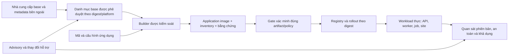

# Base image update

## 1. Cập nhật base image cần đạt kết quả gì?

**Base image** là image làm đầu vào cho một stage khi xây container image. Nó có thể cung cấp hệ điều hành userspace, runtime, công cụ build, thư viện native, chứng chỉ tin cậy và các tệp cấu hình mặc định. Những thành phần đó trở thành một phần bề mặt tấn công hoặc chuỗi tạo ra ứng dụng.

**Base image update** là quá trình chọn đầu vào mới được chấp nhận, xây lại image ứng dụng, kiểm chứng và thay thế các workload cần cập nhật. Chỉ sửa dòng `FROM`, di chuyển một tag trong registry hoặc tải image mới về node chưa chứng minh tiến trình production đã dùng thành phần được sửa.

Trong chương **Dependency và supply chain** của module yêu cầu bảo mật, mục tiêu là chuyển rủi ro từ base image cũ hoặc không đáng tin thành yêu cầu cụ thể, đo được và có bằng chứng. Một yêu cầu như “luôn dùng image mới nhất” chưa xác định nguồn, tính tương thích, phiên bản được hỗ trợ, thời hạn xử lý hay cách chứng minh đã triển khai.

Ví dụ: một API Java dùng base runtime có một thư viện userspace được xác nhận bị ảnh hưởng bởi advisory. Nhóm sửa tag trong Dockerfile nhưng pipeline vẫn xây từ digest cũ, hoặc đã tạo image mới mà worker định kỳ chưa được rollout. Công việc thay cấu hình đã xảy ra, nhưng phần rủi ro còn lại ở môi trường chạy chưa được xử lý.

### Mục tiêu học tập

Sau bài này, người học có thể:

1. Phân biệt tag, digest, image ứng dụng và trạng thái workload đang chạy.
2. Xác định phạm vi cập nhật ở build stage, runtime stage và các kiến trúc triển khai.
3. Viết yêu cầu về nguồn tin cậy, inventory, đánh giá ảnh hưởng và bằng chứng rebuild.
4. Thiết kế kiểm chứng tương thích, canary, rollback và xử lý ngoại lệ.
5. Truy vết từ advisory đến image digest, deployment và tiêu chí nghiệm thu.

## 2. Những đối tượng cần phân biệt

### 2.1. Base image, application image và container đang chạy

| Đối tượng | Ý nghĩa | Điều chưa được chứng minh khi chỉ thay đối tượng này |
|---|---|---|
| Tham chiếu `FROM` | Đầu vào mà build yêu cầu | Build đã dùng đúng bytes mới và đã thành công |
| Base image theo digest | Nội dung base cụ thể được chọn | Image ứng dụng đã được xây lại từ base đó |
| Application image theo digest | Kết quả build có nội dung xác định | Mọi workload đã chuyển sang kết quả này |
| Cấu hình triển khai mong muốn | Image và cấu hình controller yêu cầu | Tiến trình hiện hữu đã được thay thế thành công |
| Trạng thái thực tế của workload | Image/platform mà instance đang dùng | Không còn job, worker hoặc site khác dùng bản cũ |

Một container đã chạy không tự được thay root filesystem chỉ vì tag cùng tên trong registry trỏ sang nội dung mới. Ngược lại, cập nhật gói bên trong một container đang chạy tạo trạng thái lệch khỏi image được quản lý, có thể mất khi container được tạo lại và làm bằng chứng nguồn gốc không còn phản ánh đầy đủ trạng thái đó.

Hồ sơ tham chiếu của bài dùng quy trình **rebuild rồi redeploy image bất biến**. Nếu hệ thống có cơ chế vá trực tiếp khác, phải đặc tả inventory, tính bền vững, audit và rollback cho cơ chế đó, không mặc định nó tương đương một lần cập nhật base.

### 2.2. Tag và digest có nhiệm vụ khác nhau

Tag là tên tham chiếu và có thể được phép thay đổi theo quy tắc registry. Digest nhận diện nội dung của đối tượng image/manifest tương ứng. Pin digest giúp xác định đầu vào; nó không tự đưa bản vá mới vào ứng dụng.

Ví dụ minh họa:

```text
registry.internal.example/platform/java-runtime:approved
    thời điểm T1 → BASE_A
    thời điểm T2 → BASE_B

Dockerfile pin BASE_A vẫn dùng BASE_A
cho đến khi thay tham chiếu và thực hiện build có kiểm chứng.
```

`BASE_A` và `BASE_B` là ký hiệu digest trong bài, không phải giá trị dùng trực tiếp với công cụ. Tag có thể giúp con người hiểu dòng release, nhưng quyết định phát hành phải liên kết với digest cụ thể. Không lấy ngày tạo image, tên tag chứa “patched” hoặc số version lớn hơn làm bằng chứng duy nhất rằng advisory đã được xử lý.

### 2.3. Image đa kiến trúc

Một tham chiếu có thể nhận diện image index/manifest list chứa các image cho nhiều platform. Digest của index và digest của image con là các đối tượng khác nhau. Một platform đã được sửa không tự chứng minh platform còn lại dùng cùng bộ package hoặc đã được kiểm chứng.

Nếu hỗ trợ `linux/amd64` và `linux/arm64`, hồ sơ cần ghi index được phát hành, child manifest được chọn cho từng platform và kết quả inventory/test tương ứng. Trạng thái image mà runtime báo có thể nhận diện image con; không so sánh chuỗi đó với index digest rồi kết luận sai rằng workload chạy nhầm image.

### 2.4. Multi-stage build

Trong multi-stage build, base của stage build có thể không nằm trong root filesystem runtime, nhưng công cụ ở stage đó có khả năng đọc mã, tạo binary hoặc tác động artifact cuối. Phải có hai đánh giá phù hợp:

- Base và dependency của build stage: mã nào có thể chạy, quyền CI nào được cấp và đầu ra có thể bị thay thế ra sao.
- Base của runtime stage: userspace, runtime, thư viện, cấu hình và dữ liệu nào được đưa vào ứng dụng chạy.

Không kết luận build base không quan trọng vì scanner runtime không thấy package của nó. Cũng không đếm mọi package build như thể tất cả đang hiện diện và có cùng đường khai thác ở production.

## 3. Mô hình đe dọa và phạm vi trách nhiệm

### 3.1. Các tài sản cần bảo vệ

Tài sản gồm dữ liệu và quyền của tiến trình, secret/credential trong build, application image, registry, bằng chứng nguồn gốc, cấu hình runtime và tính sẵn sàng khi rollout. Một base bị thay đổi độc hại có thể tác động cả an toàn dữ liệu lẫn khả năng chứng minh artifact đến từ đâu.

Base image chứa userspace; container thông thường sử dụng kernel của môi trường host theo kiến trúc triển khai. Cập nhật base không tự vá kernel host. Yêu cầu phải chỉ rõ phần do đội base/runtime, đội ứng dụng và đội hạ tầng sở hữu, tránh dùng một lần rebuild thay cho mọi loại cập nhật.

### 3.2. Các kịch bản chính

| Mã rủi ro | Kịch bản | Mục tiêu kiểm soát |
|---|---|---|
| R1 | Base cũ có thành phần bị ảnh hưởng hoặc hết hỗ trợ | Phát hiện, đánh giá, thay thế/giảm thiểu theo thời hạn |
| R2 | Base đến từ nguồn sai, bị thay nội dung hoặc bị dùng qua tag không kiểm soát | Xác minh nguồn, digest, bằng chứng và quyền phát hành |
| R3 | Cấu hình đã đổi nhưng cache/build/promotion dùng image khác | Ràng buộc đầu vào build, artifact và quyết định promote |
| R4 | Image mới phá tương thích hoặc yêu cầu nới quyền | Kiểm thử hợp đồng runtime và giữ bất biến bảo mật |
| R5 | Bỏ sót platform, worker, job định kỳ hoặc site | Inventory đầy đủ và kiểm tra rollout thực tế |
| R6 | Rollback hoặc ngoại lệ đưa base nguy hiểm trở lại | Policy hiện hành, ngoại lệ có hạn và phương án phục hồi |
| R7 | Scanner/feed/inventory thiếu hoặc sai ngữ cảnh tạo kết luận sạch | Bằng chứng đủ phạm vi, có độ mới và trạng thái chưa xác định rõ |

### 3.3. Ranh giới tin cậy



Danh mục nội bộ cần kiểm tra và quản lý đầu vào, không chỉ sao chép tag từ bên ngoài. Registry nội bộ cũng có thể bị sai quyền hoặc mất tính toàn vẹn; nơi lưu nội bộ không thay thế kiểm tra digest và danh tính phát hành.

## 4. Chọn base và chứng minh nguồn được chấp nhận

### 4.1. Hợp đồng cho từng dòng base

Một bản ghi base được quản lý cần có:

- Nhà cung cấp/nguồn registry được phép, dòng hệ điều hành/runtime và mục đích sử dụng.
- Digest index và image con theo platform được hỗ trợ, cùng metadata cần để đối chiếu.
- Chủ sở hữu, trạng thái hỗ trợ, thời điểm đánh giá và điều kiện ngừng sử dụng.
- Inventory/SBOM phù hợp, dữ liệu advisory và các quyết định ảnh hưởng/ngoại lệ liên quan.
- Bằng chứng nguồn gốc/chữ ký nếu policy yêu cầu, cùng danh tính builder hoặc publisher được tin cậy.
- Hợp đồng runtime: user, đường dẫn, CA trust, thư viện native, crypto, cách cấu hình và các giới hạn cần thiết.

Trạng thái được hỗ trợ và lịch kết thúc hỗ trợ phải dựa vào thông tin có thẩm quyền cho đúng dòng base. Không suy hỗ trợ dài hạn từ việc registry vẫn cho tải image hoặc vì tag có chữ “stable”.

### 4.2. Chữ ký, provenance và digest không chứng minh cùng một điều

Digest xác định nội dung; chữ ký có thể chứng minh một chủ thể đã ký một đối tượng; provenance mô tả nguồn và quá trình tạo theo nội dung được chứng thực. Bên tiêu thụ phải xác minh chủ thể, issuer/trust root, subject digest và các thuộc tính mà policy thực sự yêu cầu.

Một image được ký vẫn có thể chứa lỗ hổng hoặc mã độc nếu nguồn được tin cậy đã bị xâm phạm. Một provenance hợp lệ cũng chưa đủ nếu builder đó không thuộc tập được cho phép. Vì vậy, cần kết hợp kiểm tra nguồn, nội dung, cấu hình và quyền của chuỗi phát hành.

Không lấy artifact và một chuỗi checksum từ cùng nguồn không được xác thực rồi coi việc chúng khớp là bằng chứng nhà cung cấp đúng. Danh mục phê duyệt cần lưu được quyết định và vật liệu xác minh phù hợp để người khác kiểm tra lại.

## 5. Inventory và đánh giá ảnh hưởng của bản cập nhật

### 5.1. Kiểm tra final image, không chỉ base đứng riêng

Một Dockerfile có thể cài thêm package, tải runtime từ archive khác, copy thư viện native hoặc đưa mã đã đóng gói vào image. Cập nhật base không tự sửa các bản sao được thêm ở layer sau, dependency trong JAR hoặc công cụ build đã dùng trước đó.

Hồ sơ cần đối chiếu ít nhất:

| Phạm vi | Bằng chứng cần có |
|---|---|
| Base cũ và mới | Digest/platform, thành phần thay đổi, advisory và trạng thái hỗ trợ |
| Application image mới | Package/runtime thực, thư viện ứng dụng/native, cấu hình và artifact digest |
| Build chain | Build base, công cụ thực thi và đầu vào có thể ảnh hưởng artifact |
| Workload hiện hành | Digest/platform đang dùng, cấu hình triển khai và chủ sở hữu |

Quét base sạch nhưng final image còn một runtime cũ được copy vào không đáp ứng yêu cầu xử lý runtime đó. Ngược lại, một advisory xuất hiện trong báo cáo không tự chứng minh đường khai thác đang áp dụng; cần đánh giá đúng package, môi trường và điều kiện.

### 5.2. Diễn giải kết quả scanner đúng ngữ cảnh

Metadata package, khả năng nhận diện của công cụ và cách nhà cung cấp đưa bản sửa vào dòng package có thể ảnh hưởng kết quả. Không chỉ so chuỗi version với một danh sách chung rồi bỏ qua bằng chứng sửa lỗi của đúng bản phân phối hoặc artifact.

Image tối giản hoặc không có package manager vẫn có thể chứa thư viện dễ bị ảnh hưởng. Thiếu metadata không phải bằng chứng không có package. Cần phương pháp inventory phù hợp và ghi rõ phần chưa nhận diện; phần bắt buộc chưa xác định không được tự đánh dấu đạt.

Số cảnh báo có thể thay đổi do nguồn advisory hoặc scanner thay đổi ngay cả khi digest image không đổi. Bản ghi phải giữ digest, phiên bản công cụ/policy, snapshot dữ liệu và thời điểm để phân biệt thay đổi nội dung với thay đổi nhận thức về nội dung.

### 5.3. File view và layer cần có phạm vi rõ ràng

Xóa một tệp ở layer sau không xóa bytes của nó khỏi layer trước trong image được phân phối. Với credential hoặc vật liệu bí mật, cần kiểm tra cả layer/đầu ra trong phạm vi để không phát hành dữ liệu đã lỡ đưa vào build.

Đối với lỗ hổng thư viện, cần phân biệt thành phần đang được dùng trong filesystem hiệu lực với bytes còn lưu ở layer hoặc bản sao ở nơi khác. Không mặc định mọi cảnh báo layer có cùng điều kiện khai thác, nhưng cũng không bỏ qua các bản sao có thể được nạp hoặc trích xuất theo chức năng ứng dụng.

## 6. Rebuild có kiểm soát và ví dụ cấu hình

### 6.1. Pin để biết đầu vào; cập nhật pin để nhận bản mới

Một Dockerfile tối giản minh họa:

```dockerfile
ARG BASE_IMAGE
FROM ${BASE_IMAGE}

WORKDIR /app
COPY --chown=10001:10001 app.jar /app/app.jar
USER 10001:10001
ENTRYPOINT ["java", "-jar", "/app/app.jar"]
```

Trong ví dụ, pipeline bắt buộc cung cấp `BASE_IMAGE` từ binding đã được phê duyệt, theo dạng `registry.internal.example/platform/java-runtime:approved@sha256:<digest>`. `<digest>` là placeholder phải thay bằng digest hợp lệ; đây không phải tham chiếu có thể chạy nguyên văn. Image base phải cung cấp runtime và đáp ứng hợp đồng user/path của ví dụ.

`app.jar` là artifact ứng dụng đã được tạo theo quy trình build được quản lý. Nếu có build stage tạo JAR, stage đó cần nguồn, digest và kiểm chứng riêng. Đoạn Dockerfile không triển khai toàn bộ policy supply chain, không tự kiểm tra chữ ký và không thay thế kiểm thử.

Không tin giá trị build argument tùy ý từ một pipeline chưa được cấp quyền. Gate phải xác minh image thực dùng base được phê duyệt theo bằng chứng build, không chỉ đọc một biến trong giao diện CI.

### 6.2. Cache và cờ build không thay thế bằng chứng

Khi pin một digest cũ, yêu cầu kéo lại base như `--pull` vẫn không tự chọn digest bản vá mới. Bỏ cache layer như `--no-cache` cũng không biến đầu vào cũ thành đầu vào mới. Cần thay reference được phê duyệt và kiểm tra đầu vào thực mà builder sử dụng.

Có thể dùng cache nếu nó được kiểm soát và kết quả được liên kết đúng với base mới. Yêu cầu “luôn build không cache” chưa chứng minh nguồn đúng, graph đúng hoặc artifact cuối đã được triển khai. Mục tiêu là phát hiện drift và không chấp nhận artifact cũ dưới bằng chứng của đầu vào mới.

### 6.3. Luồng build và gate tham chiếu

```text
update_application_base(application, approved_base_set):
    for platform in application.supported_platforms:
        base = approved_base_set.exact_child_for(platform)
        verify_source_digest_and_required_attestations(base)
        context = record_source_config_builder_and_platform(application)
        image = build_with_exact_approved_inputs(context, base)
        inventory = inspect_final_image(image, platform)
        assessment = evaluate_content_and_runtime_contract(inventory, image)
        require required_evidence_complete_and_policy_satisfied(assessment)
        run_compatibility_and_security_acceptance(image, platform)
        bind_release_evidence(image.digest, base.digest, context, assessment)

    release = assemble_and_verify_supported_platform_release()
    authorize_promotion_for_exact_release_digests(release)
```

Các hàm là hợp đồng trách nhiệm, không phải API tự cung cấp bảo đảm. Nếu build dùng index để chọn image con, bằng chứng phải ghi được index và kết quả chọn thực tế. Nếu chỉ có một platform, policy phải từ chối triển khai sang platform chưa có bằng chứng thay vì âm thầm dùng một image khác.

Muốn kết luận build tái lập từng byte còn cần kiểm soát nhiều đầu vào khác như công cụ, dependency tải thêm, nội dung artifact và yếu tố thời gian. Với mục tiêu cập nhật base, yêu cầu tối thiểu là xác định và kiểm chứng đúng đầu vào/kết quả; không tự gắn nhãn “reproducible” chỉ vì đã pin `FROM`.

## 7. Kiểm thử tương thích và giữ nguyên các bất biến bảo mật

### 7.1. Hợp đồng runtime cần được thử

| Nhóm kiểm tra | Ví dụ điều kiện cần quan sát |
|---|---|
| Khởi động và vòng đời | Entrypoint, readiness, shutdown, xử lý tín hiệu và công việc đang chạy |
| Runtime/ngôn ngữ | Phiên bản được hỗ trợ, tham số runtime, nạp class/module và giới hạn bộ nhớ |
| Native/ABI | Thư viện native, CPU architecture, dynamic loader và chức năng JNI nếu có |
| Quyền filesystem | User/group thực tế, đường tạm, volume, quyền ghi và read-only filesystem theo thiết kế |
| Kênh bảo vệ | CA trust, xác minh hostname, mTLS và các cấu hình crypto thuộc hợp đồng |
| Dữ liệu và môi trường | Timezone, locale, encoding, font và định dạng xuất/nhập |
| Chức năng ứng dụng | API, background job, xử lý lỗi và các đường phụ thuộc runtime thay đổi |
| Tài nguyên và vận hành | CPU/RAM, độ trễ, tỷ lệ lỗi, log/metric và khả năng quan sát version |

Chuyển họ hệ điều hành, loại libc, major runtime hoặc cấu trúc filesystem có thể là thay đổi tương thích lớn, dù Dockerfile chỉ đổi một dòng. Cần phân loại phạm vi trước khi chọn bộ test và kế hoạch rollout.

### 7.2. Không sửa lỗi tương thích bằng cách bỏ kiểm soát

Nếu image mới không ghi được thư mục do user/group thay đổi, cần sửa hợp đồng đường dẫn/quyền thích hợp. Không tự chuyển sang root hoặc cấp toàn bộ filesystem có quyền ghi để pipeline xanh trở lại. Nếu thay đổi quyền thật sự cần thiết, phải có yêu cầu, review và bằng chứng tương ứng.

Nếu trust store mới không tin một endpoint, phải xác minh danh tính đích và cấu hình CA có thẩm quyền. Không tắt xác minh TLS, chấp nhận mọi chứng chỉ hoặc đổi sang kênh không bảo vệ để hoàn tất cập nhật.

Các bất biến như user không đặc quyền, capabilities, chính sách sandbox, phân quyền tenant và bảo vệ secret cần được kiểm tra lại khi có ảnh hưởng. Việc giảm số CVE nhưng mở quyền runtime lớn hơn không tự động là cải thiện an toàn.

### 7.3. Kiểm thử trên đúng platform

Một test Java thuần có thể chạy tốt ở một platform nhưng không phát hiện lỗi thư viện native hoặc khác biệt package ở platform khác. Mỗi platform production được hỗ trợ cần có bằng chứng phù hợp, gồm kiểm thử trên môi trường thực hoặc phương pháp được chấp thuận cho các bảo đảm cần đo.

Không đánh dấu toàn index đạt chỉ vì một child image qua scanner và một bài smoke test. Nếu chưa có đủ bằng chứng cho platform còn lại, phải chặn phát hành phần đó hoặc thu hẹp phạm vi hỗ trợ có kiểm soát.

## 8. Rollout và xác minh workload thực tế

### 8.1. Inventory cần bao phủ cả nơi có thể tạo workload mới

Danh mục tác động cần liên kết application image với service, môi trường, site/cluster, platform, controller và chủ sở hữu. Phạm vi không chỉ có deployment API đang nhận traffic mà còn có worker, job đang chạy, lịch job, template tạo tác vụ và workload đang scale về 0.

Một template cũ có thể tạo lại container base cũ sau khi đợt rollout chính kết thúc. Tiêu chí hoàn tất phải kiểm tra cả instance hoạt động và cấu hình tạo instance tương lai. Bản ghi lịch sử của job đã kết thúc có thể giữ digest cũ để audit; điều đó khác với một job vẫn chạy hoặc có thể được tạo mới bằng image bị cấm.

Quan sát cần phân biệt image index được yêu cầu, image con theo platform và image thực mà runtime đã nạp. Không chỉ tìm chuỗi tag trong manifest. Registry có image mới hoặc controller có desired state mới chưa chứng minh mọi instance đã chuyển.

### 8.2. Canary với tiêu chí đã chốt

Một cấu hình minh họa cho API là đưa 5% traffic đại diện tới đúng candidate digest, quan sát ít nhất 30 phút và tối thiểu 1.000 request đại diện. Chỉ tiếp tục khi cả hai điều kiện thời gian và mẫu đã đạt; ít traffic thì kéo dài hoặc dùng một phương pháp kiểm chứng đã được phê duyệt, không tự bỏ điều kiện mẫu.

Ngưỡng ví dụ: tỷ lệ lỗi tăng không quá 0,5 điểm phần trăm và p95 latency không quá 110% baseline được chọn trước với tải tương đương. Các giá trị này cần hiệu chỉnh theo sản phẩm và cách đo. Không thay baseline sau khi nhìn thấy kết quả để làm canary đạt.

Chức năng bảo mật cần kiểm thử có kiểm soát: không có ca thử vượt quyền được chấp nhận, xác minh TLS vẫn bật, user/quyền runtime đúng hợp đồng và secret không xuất hiện trong đầu ra. Không suy rằng không thấy cảnh báo trong 30 phút là chứng minh không có mọi lỗ hổng.

Worker và batch job cần tiêu chí tương ứng về tỷ lệ xử lý, tính đúng dữ liệu, retry, trùng lặp và dừng công việc; không dùng số HTTP request của API thay cho kiểm chứng của chúng. Drain/shutdown phải theo hợp đồng để thay image không làm mất hoặc thực hiện lặp tác vụ ngoài thiết kế.

### 8.3. Rollback theo policy hiện hành

Trước rollout cần xác định artifact và cấu hình có thể phục hồi, điều kiện kích hoạt, người sở hữu và cách xử lý dữ liệu/tác vụ đã thay đổi. Chỉ rollback tới digest còn được policy hiện hành chấp nhận hoặc có ngoại lệ hợp lệ đúng phạm vi.

Nếu image cũ chứa rủi ro đang bị chặn, có thể cần rebuild phiên bản mã ứng dụng trước trên base đã được chấp nhận, hoặc áp dụng phương án giảm thiểu/tạm dừng tính năng. Rebuild đó tạo artifact mới và cần bằng chứng mới; nó không được kế thừa tự động chữ ký hoặc kết quả test của digest cũ.

Không dùng tag “previous” không xác định để phục hồi. Quyết định rollback phải giữ được digest, platform, cấu hình và trạng thái rủi ro; tránh phục hồi tính sẵn sàng bằng cách âm thầm đưa một rủi ro đã bị cấm trở lại production.

## 9. Thời hạn, ngoại lệ và audit

### 9.1. Hồ sơ thời gian minh họa

Các giá trị sau là mục tiêu ví dụ cho một dịch vụ, không phải chuẩn bắt buộc chung:

| Điều kiện | Yêu cầu đo được |
|---|---|
| Theo dõi digest production | Đánh giá inventory/advisory ít nhất mỗi 24 giờ và khi nhận tín hiệu mới liên quan |
| Triage tín hiệu liên quan | Hoàn tất trong 24 giờ từ lúc hệ thống quản lý tiếp nhận tín hiệu |
| Critical được xác nhận áp dụng, chưa có kiểm soát đạt yêu cầu | Chặn promote mới; xử lý hoặc giảm thiểu có bằng chứng trong 72 giờ từ xác nhận ảnh hưởng |
| Bản base thường lệ đã được tổ chức phê duyệt | Rebuild và rollout các workload trong phạm vi trong 7 ngày từ phê duyệt |
| Độ mới dữ liệu tại gate | Lần cập nhật advisory thành công không quá 24 giờ; tín hiệu mới đã tiếp nhận không được bỏ qua |
| Ngoại lệ | Tối đa 7 ngày từ lúc cấp, gắn đúng digest/platform/deployment và không tự gia hạn |

Hạn nghiêm ngặt hơn theo rủi ro có ưu tiên; mốc 7 ngày thường lệ không kéo dài cửa sổ 72 giờ cho critical. Nếu chưa có bản vá, nhóm vẫn phải đáp ứng yêu cầu xử lý bằng kiểm soát giảm thiểu được xác minh hoặc ghi nhận chưa đạt/ngoại lệ theo thẩm quyền, không đợi vô hạn trong trạng thái “chờ upstream”.

Khi có dấu hiệu bị khai thác hoặc base/build chain bị can thiệp, kích hoạt quy trình sự cố và kiểm soát phù hợp ngay, không đợi hết SLO. Cần điều tra quyền/secret đã dùng trong build và dữ liệu có thể bị tác động, không chỉ thay image rồi đóng sự cố.

### 9.2. Thiếu bằng chứng phải có trạng thái rõ

Scanner lỗi, feed quá hạn, thiếu inventory ở một platform hoặc không xác minh được provenance bắt buộc là trạng thái chưa đánh giá được theo policy. Không chuyển chúng thành “0 lỗ hổng” hoặc tái dùng báo cáo của platform khác.

Trong hồ sơ này, thiếu kiểm tra bắt buộc hoặc dữ liệu quá hạn chặn promote mới. Việc xử lý các workload đang chạy cần quy trình vận hành riêng để cân bằng tác động thực tế; không tự dừng toàn production chỉ vì scanner tạm không phục vụ.

Ngoại lệ cần có rủi ro/advisory, digest và platform, môi trường/workload, lý do, biện pháp giảm thiểu, người chịu trách nhiệm, người có thẩm quyền chấp nhận, thời điểm hết hạn và kế hoạch kết thúc. Không cấp ngoại lệ cho toàn bộ tag hoặc mọi image tương lai của cùng repository.

### 9.3. Audit từ tín hiệu tới triển khai

Ghi được advisory/tín hiệu, phạm vi ảnh hưởng, quyết định chọn base, nguồn/digest/platform, commit/cấu hình, builder, final image digest, inventory, kết quả test/gate, ngoại lệ và rollout/rollback. Bằng chứng cần đủ để trả lời instance nào đã được cập nhật và instance nào còn nằm trong thời hạn xử lý.

Không ghi token registry, credential build, URL có bí mật hoặc nguyên bộ biến môi trường. Báo cáo inventory có thể tiết lộ kiến trúc, nên quyền đọc/sửa/xóa audit và thời gian lưu phải được đặc tả theo hệ thống.

Metric hữu ích gồm tỷ lệ workload đang dùng digest được chấp nhận, template cũ còn có thể tạo workload, platform thiếu bằng chứng, base gần hết hỗ trợ, thời gian từ xác nhận đến xử lý và ngoại lệ sắp hết hạn. Chỉ đếm số image mới đã build không phản ánh đầy đủ mức giảm rủi ro ở production.

## 10. Ma trận yêu cầu bảo mật có thể kiểm chứng

Từ “phải” trong bảng mô tả nghĩa vụ của hồ sơ tham chiếu. Chủ base sở hữu nguồn và dòng hỗ trợ; nhóm ứng dụng sở hữu tương thích/chức năng; nhóm build/release sở hữu bằng chứng và gate; vận hành sở hữu inventory/rollout. Các trách nhiệm này cần được gán cho bên cụ thể khi áp dụng.

| ID / rủi ro | Yêu cầu | Điểm cưỡng chế | Bằng chứng chấp nhận |
|---|---|---|---|
| BI-01 / R1, R2 | Base phải thuộc nguồn/dòng hỗ trợ được chấp nhận, có digest, platform và chủ sở hữu; danh tính ký/builder được xác minh nếu policy yêu cầu. | Danh mục base, registry và gate | AC-01: nguồn, signer hoặc dòng không được chấp nhận bị từ chối; base hợp lệ đi tiếp. |
| BI-02 / R2, R3 | Build phải dùng đúng digest base đã duyệt; mutable tag hoặc cache không được làm thay đầu vào không được kiểm tra. | Builder và đối chiếu provenance | AC-02: đổi tag/cache không làm artifact cũ được chấp nhận dưới binding base mới. |
| BI-03 / R5, R7 | Mọi platform được phát hành phải có child digest và inventory/test phù hợp; index một mình không thay bằng chứng của từng platform. | Build đa kiến trúc và gate | AC-03: chỉ một platform đạt thì platform thiếu bằng chứng không được promote. |
| BI-04 / R1, R7 | Phải đánh giá final image và phần build chain trong phạm vi; package tải/copy thêm và thành phần chưa biết không được bỏ qua. | Inventory, scanner và đánh giá ngữ cảnh | AC-04: base sạch nhưng final image còn bản bị ảnh hưởng vẫn bị phát hiện và xử lý. |
| BI-05 / R3 | Final image, inventory, bằng chứng build/test/policy và quyết định promote phải gắn đúng digest/context. | Gate và công cụ deploy | AC-05: artifact khác cùng tên/version hoặc báo cáo release khác bị từ chối. |
| BI-06 / R4 | Bản cập nhật phải qua kiểm thử chức năng/runtime/native theo hợp đồng trên các platform hỗ trợ. | Pipeline test và môi trường kiểm chứng | AC-06: lỗi ABI, trust store, encoding hoặc job làm candidate chưa đạt. |
| BI-07 / R4 | Không được tự bỏ xác minh TLS, đổi sang root hoặc mở quyền ngoài hợp đồng để làm cập nhật chạy được. | Kiểm tra cấu hình và test bảo mật | AC-07: thay đổi nới quyền không được phê duyệt bị gate chặn. |
| BI-08 / R4, R5 | Canary/rollout phải đo theo tiêu chí đã chốt; xác nhận cả instance đang chạy và template tạo workload tương lai. | Controller/deploy và giám sát | AC-08: API mới nhưng worker/job/template cũ thì rollout chưa hoàn tất. |
| BI-09 / R1, R7 | Phải triage trong 24 giờ, xử lý critical áp dụng trong 72 giờ; base thường lệ đã duyệt được rollout trong 7 ngày, trừ ngoại lệ hợp lệ. | Quản lý rủi ro và inventory vận hành | AC-09: đo đúng mốc, ưu tiên hạn ngắn và phát hiện phần quá hạn. |
| BI-10 / R6, R7 | Gate phải chặn bằng chứng bắt buộc thiếu/quá hạn; ngoại lệ tối đa 7 ngày, đúng digest/platform/phạm vi và không tự gia hạn. | Gate và hệ thống ngoại lệ | AC-10: feed cũ, platform thiếu hoặc ngoại lệ hết hạn không được coi là sạch. |
| BI-11 / R6 | Rollback/phục hồi chỉ dùng artifact được policy hiện hành chấp nhận; rebuild phục hồi cần bằng chứng mới. | Deploy và quy trình sự cố | AC-11: từ chối rollback digest bị cấm; phương án phục hồi hợp lệ giữ đủ bằng chứng. |
| BI-12 / R2, R3, R5 | Audit phải truy vết tín hiệu → base → build → final digest → workload; không phát hành secret trong layer/log/diagnostic. | Builder, registry, deploy và audit | AC-12: đối chiếu đầy đủ chuỗi và không thấy marker secret fixture trong đầu ra thuộc phạm vi. |

## 11. Test và acceptance criteria

### 11.1. Bộ fixture và cách quan sát

Dùng registry, builder, base image và workload thử do nhóm kiểm soát. Mã advisory `ADV-DEMO-BASE-01`, các digest ký hiệu và package trong ví dụ là dữ liệu mô phỏng, không mô tả lỗ hổng thật. Fixture có thể chứa một thành phần vô hại được metadata thử đánh dấu bị ảnh hưởng; không cần đưa mã khai thác hoặc secret production vào test.

Quan sát ở nơi chọn base, artifact được tạo, gate và runtime/controller. Cần có đường hợp lệ làm đối chứng. Gate từ chối mọi image vì registry thử hỏng không chứng minh nó phân biệt được base đúng và sai.

### 11.2. Các ca nghiệm thu

**AC-01 — Nguồn và chuỗi tin cậy, truy vết BI-01.**

Given một base hợp lệ và các fixture sai nguồn, signer hoặc dòng hỗ trợ; when gửi tới quy trình duyệt; then chỉ base đáp ứng policy được chọn. Chữ ký sai subject digest hoặc từ publisher không được tin phải bị từ chối, dù định dạng chữ ký hợp lệ. Kết quả giữ được digest/platform và lý do quyết định.

**AC-02 — Tag, pin và cache, truy vết BI-02.**

Pin `BASE_A`, chuyển tag minh họa sang `BASE_B` rồi build: bằng chứng vẫn phải chỉ ra đầu vào thật, không tự tuyên bố đã dùng B. Sau khi phê duyệt và đổi pin sang B, thử một cache hoặc đầu ra cũ của A; artifact đó không được chấp nhận dưới bằng chứng B. Nếu dùng cache hợp lệ cho B thì vẫn được phép, miễn liên kết đầu vào/kết quả được xác minh.

**AC-03 — Đa kiến trúc, truy vết BI-03.**

Tạo index có hai platform, nhưng chỉ child `amd64` đáp ứng policy hoặc có đủ test. Gate phải chặn phần phát hành `arm64` thiếu bằng chứng. Khi cả hai đạt, thử triển khai trên từng platform và đối chiếu đúng child digest; không coi index digest khác chuỗi image ID của child là bằng chứng sai một cách máy móc.

**AC-04 — Base đã sửa, final image chưa sửa, truy vết BI-04.**

Xây candidate từ base được chấp nhận nhưng copy thêm một runtime/library fixture cũ ở layer sau, rồi một biến thể có bản nhúng trong artifact. Inventory/đánh giá phải ghi nhận thành phần và rủi ro tương ứng, không chỉ dựa vào kết quả quét base. Thêm biến thể thiếu metadata package: phần bắt buộc chưa xác định không được trở thành kết quả sạch. Đánh giá build stage phải tồn tại riêng cho công cụ không đóng gói runtime.

**AC-05 — Liên kết đúng artifact, truy vết BI-05.**

Kiểm tra image A rồi thử promote B có cùng tag nhưng digest khác; gate phải từ chối. Lặp lại với SBOM, kết quả test hoặc provenance của context/platform khác. Đối chứng là promote đúng candidate digest và evidence hợp lệ, sau đó xác nhận controller yêu cầu chính release đó.

**AC-06 — Tương thích chức năng, truy vết BI-06.**

Chạy các luồng API, báo cáo, job, shutdown và xử lý lỗi thuộc hợp đồng. Dùng fixture native/JNI nếu sản phẩm có khả năng đó, cùng dữ liệu encoding/timezone/font cần thiết trên từng platform. Một candidate khởi động được nhưng sai nội dung báo cáo hoặc lỗi worker phải bị đánh dấu chưa đạt; smoke test đơn lẻ không thay toàn bộ bằng chứng cần thiết.

**AC-07 — Bất biến bảo mật, truy vết BI-07.**

Mô phỏng lỗi quyền thư mục và lỗi trust store sau cập nhật. Candidate chỉ chạy được bằng root, thêm capability ngoài hợp đồng hoặc tắt xác minh TLS phải bị chặn. Sau khi sửa đúng cấu hình/quyền/trust có thẩm quyền, kiểm tra lại kết nối TLS hợp lệ và từ chối chứng chỉ sai, user runtime, quyền ghi và các ca phân quyền trong phạm vi.

**AC-08 — Canary và rollout đủ phạm vi, truy vết BI-08.**

Chạy canary với đúng digest và baseline đã chốt. Dùng đồng hồ/lưu lượng kiểm soát để kiểm tra cả 30 phút và 1.000 request, ngưỡng lỗi/latency cùng các bài kiểm thử bảo mật của hồ sơ. Mẫu chưa đủ hoặc vượt ngưỡng không được tự động đi tiếp. Sau rollout API, cố ý giữ một worker, lịch job hoặc template scale-0 ở digest cũ; inventory phải báo chưa hoàn tất. Khi xử lý đủ, mọi instance hoạt động và template tạo mới trong phạm vi phải trỏ tới release được chấp nhận.

**AC-09 — Deadline và xử lý chưa có bản vá, truy vết BI-09.**

Tạo tín hiệu fixture tại `t_receive`, xác nhận critical áp dụng tại `t_confirm` và phê duyệt base mới tại `t_approve`. Đo riêng triage 24 giờ, xử lý 72 giờ và rollout thường lệ 7 ngày. Mốc 7 ngày không được ghi đè hạn critical ngắn hơn. Khi fixture chưa có bản vá, hồ sơ phải giữ trạng thái xử lý/ngoại lệ có thẩm quyền hoặc kiểm soát giảm thiểu có bằng chứng, không tự đánh dấu hoàn tất chỉ vì đã tạo ticket.

**AC-10 — Thiếu dữ liệu và ngoại lệ, truy vết BI-10.**

Làm scanner lỗi, snapshot advisory quá 24 giờ hoặc mất inventory một child image; gate không được diễn giải thành không có rủi ro. Cấp ngoại lệ tối đa 7 ngày rồi thử dùng với digest/platform khác, sau hạn hoặc sau thay đổi điều kiện làm giả định không còn đúng; ngoại lệ cũ phải bị từ chối hoặc buộc đánh giá lại theo policy. Một advisory liên quan mới đã tiếp nhận không được bỏ qua chỉ vì snapshot cũ vẫn dưới 24 giờ.

**AC-11 — Rollback và khôi phục, truy vết BI-11.**

Sau khi candidate lỗi tương thích, thử rollback tới digest từng chạy nhưng hiện bị policy chặn; deploy phải từ chối. Tiếp theo thử một artifact còn được chấp nhận hoặc rebuild mã ứng dụng cũ với base mới; đường phục hồi phải tạo/giữ đủ bằng chứng cho digest thực dùng. Kiểm tra tác vụ đã drain, dữ liệu và trạng thái workload sau phục hồi, không chỉ thông báo “rollback succeeded”.

**AC-12 — Audit và secret trong đầu ra, truy vết BI-12.**

Thực hiện một cập nhật đầy đủ và đối chiếu advisory/decision, base index/child, commit/build, final digest, gate và runtime. Dùng marker secret fixture để kiểm tra layer, log build, lỗi registry và diagnostic trong phạm vi; marker không được phát hành. Một marker đã bị xóa khỏi filesystem hiệu lực nhưng còn ở layer được phân phối vẫn làm ca bảo vệ secret chưa đạt. Bằng chứng phải đủ nhận diện phần rollout còn thiếu mà không ghi credential thật.

### 11.3. Điều kiện hoàn tất nghiệm thu

Hồ sơ chỉ kết luận đáp ứng khi BI-01–BI-12 có chủ sở hữu, cấu hình cưỡng chế, bằng chứng đúng digest/platform và kết quả AC-01–AC-12 cho kiến trúc triển khai. Các ca ở đây là đặc tả kiểm thử, không phải tuyên bố một hệ thống cụ thể đã được chạy và đạt.

Phải ghi rõ phần chưa xác định, ngoại lệ và phạm vi không hỗ trợ. Khi thay họ base, runtime major, builder, registry, cách ký, platform hoặc topology rollout, cần cập nhật mô hình rủi ro và thực hiện lại các ca bị ảnh hưởng. Việc từng đạt trên digest cũ không tự chuyển thành kết luận cho digest mới.

## 12. Ví dụ truy vết từ advisory tới kết quả vận hành

Xét `report-service` có API, worker xuất báo cáo và lịch tổng hợp đêm trên hai platform. `ADV-DEMO-BASE-01` giả định ảnh hưởng một thư viện trong `BASE_A`; danh mục nội bộ đã xác minh `BASE_B` đáp ứng điều kiện sửa của fixture.

Một bản ghi xử lý đầy đủ cần liên kết các bước sau:

1. Inventory xác định final image nào bắt nguồn từ A, package nào thực có mặt và workload/template nào đang dùng chúng; ghi nhận nơi chưa đủ dữ liệu.
2. Chủ base kiểm tra nguồn/digest/platform và bằng chứng B; chủ ứng dụng xác định các hợp đồng native, trust và định dạng báo cáo có thể bị ảnh hưởng.
3. Pipeline đổi pin có review, rebuild cả platform, kiểm tra final image và giữ bằng chứng đầu vào–kết quả; không chỉ di chuyển tag.
4. Kiểm thử chức năng và bảo mật đạt, canary đáp ứng tiêu chí đã chốt; lỗi trust nếu có được sửa bằng cấu hình tin cậy đúng, không tắt TLS verification.
5. Rollout API, worker và lịch job; đối chiếu trạng thái thực cùng template tương lai, đánh dấu rõ job lịch sử đã kết thúc để không nhầm với workload còn rủi ro.
6. Đóng việc xử lý khi đạt điều kiện và thời hạn của hồ sơ, hoặc giữ phần chưa đạt dưới trạng thái/ngoại lệ đúng phạm vi; theo dõi advisory mới và vòng đời hỗ trợ tiếp theo.

Sửa `FROM` là thay đổi đầu vào. Bằng chứng build chỉ ra image mới được tạo từ đâu. Bằng chứng runtime và inventory mới xác nhận phạm vi cần bảo vệ đã chuyển sang bản được chấp nhận. Liên kết cả ba giúp yêu cầu cập nhật base image trở thành một kết quả an toàn và khả dụng có thể kiểm chứng.
