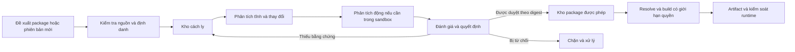

# Malicious package defense

## 1. Mục tiêu và phạm vi

Malicious package defense là tập kiểm soát nhằm ngăn package có hành vi độc hại đi vào, thực thi hoặc tiếp tục tồn tại trong chuỗi cung ứng phần mềm. Package có thể là thư viện, plugin, công cụ build, annotation processor, gói hệ điều hành hoặc một thành phần được tải về ngoài luồng quản lý dependency thông thường.

Trong đặc tả yêu cầu bảo mật, mục tiêu “không dùng package độc hại” cần được chuyển thành các điều kiện có thể kiểm chứng:

- Package phải được lấy từ nguồn nào và nhận diện bằng những thuộc tính nào?
- Khi nào package bị cách ly, ai được phép phân tích và phê duyệt?
- Những hành vi thực thi, truy cập mạng và đọc bí mật nào được phép?
- Cơ chế nào ngăn nội dung chưa được duyệt chạy trong CI hoặc ứng dụng?
- Nếu package từng được duyệt bị phát hiện độc hại, hệ thống chặn và điều tra trong bao lâu?
- Bằng chứng nào nối quyết định kiểm soát với đúng digest, bản build và môi trường triển khai?

Bài học dùng dịch vụ xử lý đơn hàng làm ví dụ. Tên package, registry, digest và mốc thời gian là dữ liệu hoặc chính sách minh họa, không mô tả một sự cố thực tế.

## 2. Phân biệt package độc hại với các vấn đề liên quan

| Khái niệm | Ý nghĩa | Hệ quả đối với yêu cầu |
| --- | --- | --- |
| Dependency có lỗ hổng | Có điểm yếu có thể bị khai thác, dù tác giả không chủ ý gây hại | Theo dõi advisory, điều kiện ảnh hưởng và phương án khắc phục |
| Package độc hại | Chứa hoặc phân phối hành vi trái phép, chẳng hạn đánh cắp thông tin xác thực hoặc sửa artifact | Kiểm soát nguồn, nội dung, hành vi, quyền thực thi và ứng phó sự cố |
| Package đáng ngờ | Có chỉ dấu cần phân tích nhưng chưa đủ bằng chứng kết luận | Cách ly hoặc yêu cầu xem xét, giữ rõ mức độ chắc chắn |
| Artifact bị thay thế | Nội dung nhận được khác nội dung đã được phép | Từ chối theo ràng buộc digest và nguồn tin cậy |
| Package hợp lệ bị chiếm quyền phát hành | Chủ thể tấn công lợi dụng một kênh vốn được sử dụng hợp pháp | Đánh giá từng phiên bản và thay đổi, không tin vô điều kiện theo tên package |
| Hành vi hợp lệ nhưng ngoài chính sách | Ví dụ một công cụ gửi telemetry mà tổ chức không cho phép | Từ chối hoặc cấu hình lại theo chính sách, dù chưa kết luận có chủ ý độc hại |

Một scanner vulnerability có thể không có advisory nào cho một package độc hại mới. Một chữ ký hợp lệ có thể thuộc về tài khoản phát hành đã bị chiếm quyền. Một package tải qua HTTPS vẫn có thể chứa mã gây hại.

Các kiểm soát nguồn gốc, tính toàn vẹn, vulnerability và hành vi cần bổ sung cho nhau. Không dùng một kết quả đạt ở lớp này làm bằng chứng thay thế toàn bộ các lớp còn lại.

Khi chưa đủ dữ liệu, cần ghi “đáng ngờ” hoặc “chưa thể kết luận”. Một chỉ dấu như mã bị làm rối, file nhị phân hoặc tải tài nguyên qua mạng cần được phân tích theo ngữ cảnh; tự nó chưa chứng minh ý đồ độc hại.

## 3. Mô hình đe dọa theo đường package đi vào hệ thống

| Đường tấn công hoặc sai sót | Ví dụ minh họa | Yêu cầu cần rút ra |
| --- | --- | --- |
| Typosquatting | Người phát triển gõ nhầm tên gần giống package dự kiến | Kiểm tra đúng tọa độ, namespace, nguồn và quy trình thêm dependency |
| Dependency confusion | Package tên nội bộ bị resolve từ registry công khai | Ràng buộc namespace với nguồn có thẩm quyền; không fallback ngoài chính sách |
| Chiếm tài khoản maintainer | Phiên bản mới của package quen thuộc chứa hành vi khác thường | Đánh giá thay đổi theo từng phiên bản và digest |
| Cài mã qua dependency bắc cầu | Thư viện cha bổ sung một package chưa từng được duyệt | Áp kiểm tra cho graph đã resolve và nội dung thực tế |
| Mã chạy trong build | Plugin hoặc annotation processor thực thi với quyền của runner | Giới hạn quyền, bí mật và phạm vi thực thi của build |
| Thay nội dung cùng phiên bản | Cùng tọa độ package nhưng trả về byte khác | So digest với bản được duyệt; xử lý xung đột như sự kiện cần điều tra |
| Tải công cụ ngoài dependency manager | Build tải script hoặc binary trực tiếp từ mạng | Đưa các đầu vào đó vào kiểm soát nguồn và quyền thực thi |
| Lợi dụng cache hoặc kho mirror | Nội dung chưa được duyệt xuất hiện trong cache dùng chung | Phân tách trạng thái cách ly/phê duyệt và xác minh khi sử dụng |

Trong hệ sinh thái Java, hành vi có thể chạy khi plugin hoặc annotation processor được thực thi, khi lớp được khởi tạo hoặc khi chức năng của thư viện được gọi. Vì vậy, kiểm soát riêng một loại install script không bao phủ mọi đường thực thi.

Cần xét ít nhất hai tài sản:

1. **Môi trường build:** có thể tiếp cận mã nguồn, token registry, quyền xuất artifact hoặc các kết nối nội bộ.
2. **Môi trường runtime:** có thể tiếp cận dữ liệu khách hàng, thông tin xác thực của dịch vụ và các hệ thống nghiệp vụ.

Một dependency chỉ dùng khi kiểm thử vẫn có thể gây rủi ro nghiêm trọng cho CI. Việc nó không nằm trong artifact production không làm mất nhu cầu quản lý ở phạm vi build.

## 4. Ràng buộc nguồn và danh tính package

### 4.1. Xác định package bằng nhiều thuộc tính

Một đơn vị phê duyệt nên có các thuộc tính phù hợp:

- Hệ sinh thái và tọa độ package đầy đủ.
- Namespace hoặc group.
- Phiên bản đã resolve.
- Nguồn có thẩm quyền cung cấp package.
- Digest của nội dung.
- Danh tính phát hành hoặc bằng chứng nguồn gốc nếu có.
- Phạm vi sử dụng: build, test, runtime và sản phẩm liên quan.

Ví dụ minh họa:

```text
Ecosystem: Maven
Coordinates: com.example.internal:accounting-helper:5.1.0
Authority: registry nội bộ được chỉ định
Content: digest đã được phê duyệt cho đúng gói
Usage: công cụ hỗ trợ build của orders
```

Không chỉ kiểm tra tên ngắn như `accounting-helper`. Quy tắc chuẩn hóa tên phải tuân theo hệ sinh thái; không tự chuyển đổi tên theo cách có thể gộp hai định danh khác nhau.

### 4.2. Ngăn dependency confusion

Đối với namespace nội bộ, đặc tả cần yêu cầu:

- Chỉ resolve từ nguồn được chỉ định có thẩm quyền.
- Khi nguồn đó không có package, trả lỗi rõ ràng.
- Không tự chọn package công khai cùng tên hoặc có số phiên bản lớn hơn.
- Không tự chuyển sang registry khác khi nguồn nội bộ lỗi.
- Áp cùng ràng buộc cho dependency bắc cầu, plugin và công cụ thuộc phạm vi.

“Ưu tiên registry nội bộ” còn để ngỏ hành vi fallback. Yêu cầu cần xác định nguồn duy nhất hoặc tập nguồn được phép cho từng namespace và cách xử lý khi không thể resolve.

Với ví dụ trên, việc registry công khai có cùng tọa độ và một phiên bản cao hơn không tạo quyền sử dụng nội dung đó.

### 4.3. Bảo vệ nội dung và thông tin xác thực

Digest cần được đối chiếu với giá trị được phê duyệt từ nguồn tin cậy. Một checksum tải từ cùng nguồn đã bị xâm phạm không tự cung cấp xác nhận độc lập về tính hợp lệ.

Token registry phải bị giới hạn theo quyền và đích sử dụng. Không chuyển thông tin xác thực sang một host khác chỉ vì một phản hồi tải package có redirect.

Lockfile hỗ trợ kiểm soát phiên bản đã chọn; khả năng ràng buộc nội dung phụ thuộc dữ liệu và cơ chế xác minh của công cụ. Cần đặc tả rõ phần nào đã được kiểm tra thay vì suy ra mọi lockfile đều có cùng bảo đảm.

Chữ ký và provenance giúp kiểm tra chủ thể phát hành hoặc quy trình tạo artifact theo mô hình tin cậy đã chọn. Package vẫn cần được đánh giá nội dung và hành vi trong phạm vi rủi ro của nó.

## 5. Thiết kế cổng tiếp nhận và cách ly

Một luồng tham khảo:



### 5.1. Cách ly trước khi chạy mã ứng viên

Package mới cần được tải bằng cơ chế không tự thực thi nội dung ứng viên trên runner có quyền phát hành hoặc có bí mật.

Không mặc định một lệnh “chỉ resolve dependency” luôn an toàn nếu nó còn đánh giá project script hoặc nạp extension do ứng viên kiểm soát. Kiến trúc tiếp nhận cần xác định rõ thành phần nào có thể chạy mã và với quyền gì.

Các bước phân tích động, nếu cần, chỉ được chạy trong sandbox được chỉ định, không có bí mật production và không có quyền xuất artifact phát hành.

### 5.2. Kho mirror cần có trạng thái tin cậy

Một proxy registry tự tải mọi nội dung upstream có thể giúp cache và tính sẵn sàng. Để dùng như một cổng bảo mật, cần thêm trạng thái và chính sách:

- Nội dung mới vào vùng cách ly.
- Chỉ nội dung đã được phê duyệt theo digest được promote sang vùng sử dụng.
- Builder thông thường không được lấy trực tiếp từ vùng cách ly.
- Nội dung bị thu hồi phải bị chặn cả qua cache và các đường tải thay thế.
- Lịch sử quyết định và nội dung liên quan được giữ theo chính sách.

Một thao tác tải thành công từ mirror không tự chứng minh nội dung đã được review.

### 5.3. Đơn vị phê duyệt phải đủ hẹp

Không phê duyệt toàn bộ namespace chỉ vì một phiên bản từng được kiểm tra.

Quyết định nên gắn với tọa độ, phiên bản, digest, nguồn, phạm vi sản phẩm và điều kiện sử dụng. Nếu package có quyền chạy script hoặc truy cập mạng, các quyền đó cũng cần có phạm vi cụ thể.

Thay dependency bắc cầu, quyền truy cập hoặc hành vi build có thể làm quyết định cũ không còn đủ. Một thư viện cha được duyệt không tự trao quyền cho mọi package mới mà phiên bản sau của nó kéo vào.

## 6. Phân tích package theo mức độ rủi ro

### 6.1. Phân tích metadata và thay đổi

Có thể kiểm tra:

- Thay đổi maintainer, chủ thể phát hành hoặc nguồn phân phối.
- Tọa độ, repository được khai báo và mối quan hệ với dự án dự kiến.
- Dependency mới, script mới, plugin mới và binary mới.
- Chênh lệch nội dung so với phiên bản đã được duyệt.
- Thay đổi quyền hoặc đích mạng mà package cần.
- Tính nhất quán giữa mã nguồn, artifact và bằng chứng nguồn gốc nếu có.

Số lượt tải, tuổi package hoặc giao diện repository quen thuộc chỉ là dữ liệu hỗ trợ. Chúng không đủ để phê duyệt một nội dung cụ thể.

Một maintainer mới có thể là chuyển giao hợp pháp. Yêu cầu cần quy định đó là điều kiện xem xét lại, thay vì tự động kết luận package độc hại.

### 6.2. Phân tích tĩnh

Tùy loại package, kiểm tra có thể tìm dấu hiệu:

- Đọc file hoặc biến môi trường ngoài chức năng dự kiến.
- Kết nối tới các đích không được giải thích.
- Tạo tiến trình, tải và chạy nội dung bổ sung.
- Sửa cấu hình build, artifact hoặc repository.
- Che giấu logic thực thi hoặc thay đổi hành vi theo môi trường.

Những dấu hiệu này cần được đối chiếu với chức năng hợp lệ. Công cụ build có thể cần tạo tiến trình; thư viện mạng có thể cần kết nối. Điều cần xác minh là phạm vi và mục đích có phù hợp hợp đồng hay không.

Công cụ giải nén và phân tích cũng là một phần của bề mặt tấn công. Cần giới hạn kích thước, số file, độ sâu và mức tiêu thụ tài nguyên; ngăn đường dẫn hoặc liên kết trong archive thoát khỏi vùng phân tích.

### 6.3. Phân tích động trong sandbox

Nếu chạy package để quan sát, sandbox cần:

- Không chứa token thật, private key hoặc dữ liệu khách hàng.
- Có filesystem và workspace tạm, giới hạn quyền và tài nguyên.
- Không có quyền truy cập host, socket quản trị hoặc cơ chế điều khiển runner.
- Giới hạn egress theo chính sách, gồm cả DNS và các tuyến mạng liên quan.
- Ghi nhận tiến trình, file, kết nối và hành vi cần phân tích.
- Không có quyền promote package hoặc ký artifact phát hành.

Có thể dùng canary giả định không có quyền thực để kiểm tra hành vi đọc hoặc gửi dữ liệu. Mọi đích nhận dùng trong thử nghiệm phải được kiểm soát; không dùng bí mật thật làm mồi.

Một lần chạy không quan sát thấy hành vi độc hại không chứng minh package luôn lành tính. Hành vi có thể phụ thuộc thời gian, dữ liệu, nền tảng hoặc điều kiện khác. Báo cáo cần ghi môi trường, kịch bản và giới hạn quan sát.

### 6.4. Trạng thái kết luận

Nên phân biệt:

| Kết luận phân tích | Ý nghĩa |
| --- | --- |
| Có bằng chứng hành vi độc hại | Đủ cơ sở chặn và kích hoạt ứng phó theo phạm vi |
| Đáng ngờ, cần xem xét | Có chỉ dấu nhưng chưa đủ kết luận |
| Chưa phát hiện chỉ dấu trong phạm vi kiểm tra | Các phép kiểm đã hoàn tất theo phạm vi, vẫn có giới hạn |
| Phân tích chưa đầy đủ | Công cụ lỗi, thiếu dữ liệu hoặc chưa bao phủ yêu cầu |

Một báo cáo không có finding trong phạm vi kiểm tra không được đổi thành tuyên bố “không thể gây hại”.

## 7. Giới hạn quyền trong build và runtime

### 7.1. Quyền trong build

Package được phê duyệt vẫn cần chạy với quyền phù hợp:

- Runner không có quyền rộng hơn nhiệm vụ.
- Bí mật chỉ cấp cho bước cần thiết và trong phạm vi cần thiết.
- Mã build từ nguồn chưa tin cậy không tiếp cận quyền phát hành.
- Các bước tạo artifact và phát hành chữ ký có ranh giới quyền rõ.
- Truy cập mạng của build bị giới hạn và quan sát theo chính sách.
- Cache dùng chung không trở thành đường đưa nội dung ngoài phê duyệt vào build.

Nếu một script cần được phép chạy, cần ràng buộc quyền đó với package và digest cụ thể, mục đích, sản phẩm và môi trường. Một whitelist theo tên rộng hoặc đường dẫn chung có thể cấp quyền cho nội dung chưa từng được đánh giá.

Tắt install script giảm một đường thực thi khi hệ sinh thái có cơ chế đó. Các plugin, compiler extension hoặc mã được gọi trong build vẫn cần được kiểm soát.

### 7.2. Quyền trong runtime

Mã dependency chạy cùng tiến trình thường chia sẻ quyền của ứng dụng. Nếu ứng dụng đọc được một bí mật, dependency trong tiến trình có thể nằm trong phạm vi có khả năng tiếp cận bí mật đó.

Các yêu cầu có thể gồm:

- Giới hạn quyền filesystem và tài khoản dịch vụ.
- Giới hạn kết nối mạng tới các đích cần thiết.
- Hạn chế quyền đọc dữ liệu và sử dụng credential theo chức năng.
- Tách xử lý có rủi ro cao sang tiến trình hoặc dịch vụ với quyền hẹp hơn.
- Quan sát các hành vi khác với hợp đồng của workload.

Egress allowlist giúp thu hẹp đường truyền ra ngoài. Vẫn cần đánh giá rủi ro sử dụng sai một đích vốn được phép hoặc lạm dụng quyền nghiệp vụ của chính ứng dụng.

### 7.3. Không làm mất ranh giới tin cậy bằng đường phụ

Các đường tải tool, plugin hoặc script ngoài dependency manager phải chịu yêu cầu tương đương. Nếu build chỉ được lấy package đã duyệt nhưng vẫn có thể tải một binary bất kỳ từ mạng rồi chạy, cổng package chưa bao phủ toàn bộ đầu vào thực thi.

Cần kiểm kê cả base image, công cụ đóng gói và tài nguyên có thể tạo hoặc sửa mã. Phạm vi cụ thể tùy kiến trúc, nhưng phần chưa bao phủ phải được ghi nhận.

## 8. Mô hình chính sách minh họa

Đoạn YAML sau là mô hình yêu cầu tự định nghĩa, không phải cấu hình dùng trực tiếp cho một package manager hay registry cụ thể.

```yaml
policyId: orders-package-defense-v1

sourcePolicy:
  internalNamespace: com.example.internal
  authoritativeRegistry: https://packages.internal.example/maven
  allowPublicFallbackForInternalNamespace: false

admission:
  requireResolvedIdentity: true
  requireApprovedDigest: true
  requireTransitiveCoverage: true
  requireBuildToolCoverage: true
  unknownPackageAction: quarantine
  incompleteAnalysisAction: block

newContent:
  observationDelayHours: 48
  delayClock: controlled-first-observation
  automaticApprovalAfterDelay: false
  reReviewOn:
    - content-change
    - publisher-change
    - execution-hook-change
    - new-transitive-package

execution:
  candidateAnalysis:
    requireIsolatedSandbox: true
    allowProductionSecrets: false
    allowHostControlInterface: false
  regularBuild:
    allowUnapprovedPackageExecution: false
    requireScopedExecutionPermissions: true

revocation:
  applyToNewBuildsWithinMinutes: 15
  includeCachesAndMirrors: true

exceptions:
  maximumDelayExceptionHours: 24
  requireExactDigest: true
  requireOwnerAndApprover: true
```

Khoảng chờ 48 giờ chỉ là một lớp giảm rủi ro minh họa. Nó có thể tạo thời gian để xuất hiện tín hiệu mới, nhưng không phát hiện chắc chắn package độc hại.

Mốc chờ trong ví dụ bắt đầu từ lần đầu cổng tiếp nhận được kiểm soát quan sát nội dung, thay vì tin vô điều kiện timestamp do ứng viên khai báo. Hết khoảng chờ vẫn cần thỏa các điều kiện phê duyệt khác.

Ngoại lệ cho khoảng chờ không tự miễn yêu cầu nguồn, digest hoặc cách ly thực thi. Việc áp dụng từng trường cần được kiểm tra bằng cơ chế thực tế của nền tảng.

## 9. Viết yêu cầu bảo mật có thể nghiệm thu

| Mã | Yêu cầu | Tiêu chí chấp nhận |
| --- | --- | --- |
| SEC-MPK-01 | Package phải được nhận diện bằng tọa độ, nguồn, phiên bản resolve và digest theo phạm vi chính sách | Không chấp nhận chỉ dựa trên tên hoặc version; thay nội dung cùng version bị phát hiện |
| SEC-MPK-02 | Namespace nội bộ chỉ được resolve từ nguồn có thẩm quyền | Package công khai cùng tên không được chọn; nguồn nội bộ lỗi không dẫn tới fallback |
| SEC-MPK-03 | Nội dung chưa được duyệt phải được cách ly trước khi có thể chạy trên môi trường build thông thường | Package mới không được thực thi bằng quyền runner phát hành hoặc tiếp cận bí mật |
| SEC-MPK-04 | Phân tích phải bao phủ dependency trực tiếp, bắc cầu và đầu vào build thuộc phạm vi | Package bắc cầu mới và plugin mới đều phải đi qua quyết định phù hợp |
| SEC-MPK-05 | Kết quả phân tích phải ghi phạm vi, bằng chứng và mức chắc chắn | Lỗi công cụ hoặc thiếu dữ liệu không được hiển thị như kết quả lành tính |
| SEC-MPK-06 | Quyết định phê duyệt phải ràng buộc với digest và điều kiện sử dụng cụ thể | Quyết định cho package A không cho phép nội dung B hoặc quyền thực thi ngoài phạm vi |
| SEC-MPK-07 | Mã ứng viên chỉ được phân tích động trong sandbox đã đặc tả | Không có bí mật production, giao diện điều khiển host hoặc kết nối ngoài chính sách |
| SEC-MPK-08 | Build và runtime phải áp quyền tối thiểu theo hợp đồng workload | Kiểm thử chứng minh các truy cập ngoài quyền được phép bị từ chối |
| SEC-MPK-09 | Nội dung bị thu hồi phải bị chặn với build mới trên mọi điểm kiểm soát trong thời hạn | Cache, mirror và các đường resolve thực tế không tiếp tục cấp nội dung đó |
| SEC-MPK-10 | Ngoại lệ phải có thẩm quyền, phạm vi, bằng chứng thay thế và hạn hiệu lực | Ngoại lệ sai digest, hết hạn hoặc ngoài môi trường không được áp dụng |
| SEC-MPK-11 | Sự cố package phải truy vết được tới artifact và môi trường có sử dụng | Inventory cho phép xác định build, workload và quyền đã có khả năng bị ảnh hưởng |
| SEC-MPK-12 | Log, báo cáo và quá trình kiểm thử không được phát tán bí mật | Chỉ dùng canary không có quyền thực; đầu ra không chứa token hoặc khóa thật |

### Mốc thời gian và phạm vi minh họa

Dịch vụ chọn các mục tiêu sau:

- 100% package mới hoặc nội dung mới trong phạm vi build phải có quyết định trước khi sử dụng trên runner thông thường.
- Sau khi có sự kiện thu hồi đáng tin cậy được xác nhận, chặn build mới dùng digest liên quan trong tối đa 15 phút.
- Với cảnh báo nghi ngờ package đã chạy và truy cập credential, bắt đầu triage trong tối đa 30 phút từ khi tiếp nhận cảnh báo.
- Lập danh sách artifact và môi trường có khả năng bị ảnh hưởng ban đầu trong tối đa 4 giờ từ khi xác nhận sự cố.
- Ngoại lệ chỉ cho khoảng chờ tiếp nhận có hiệu lực tối đa 24 giờ trong ví dụ này.

Những mốc này cần có nguồn thời gian, lịch trực và cách đo cụ thể. “Bắt đầu triage” không đồng nghĩa đã khắc phục xong; “danh sách ban đầu” không được dùng để đóng điều tra khi độ bao phủ còn thiếu.

Thời hạn chặn build mới và thời hạn xử lý workload đang chạy phải được đặc tả riêng. Tình trạng đang chạy có thể cần cô lập, thay credential hoặc phục hồi theo mức độ ảnh hưởng.

## 10. Quyết định phê duyệt và bằng chứng

### 10.1. Tách trạng thái nội dung khỏi quyết định sử dụng

Một mô hình minh họa:

```text
contentState:
  RECEIVED | QUARANTINED | APPROVED | REJECTED | REVOKED

analysisResult:
  MALICIOUS_EVIDENCE | SUSPICIOUS | NO_INDICATOR_IN_SCOPE | INCOMPLETE

usageDecision:
  ALLOW_SCOPED | BLOCK | INCOMPLETE | ALLOW_WITH_EXCEPTION
```

Package có kết quả `NO_INDICATOR_IN_SCOPE` vẫn cần đáp ứng nguồn, digest và quyền sử dụng trước khi nhận `ALLOW_SCOPED`.

Package từng được APPROVED có thể chuyển sang REVOKED khi có bằng chứng mới. Quyết định cũ cần được đánh giá lại theo trạng thái hiện hành.

### 10.2. Hồ sơ phê duyệt minh họa

```json
{
  "decisionId": "MPK-DEMO-013",
  "component": {
    "ecosystem": "maven",
    "coordinates": "com.example.internal:accounting-helper:5.1.0",
    "source": "https://packages.internal.example/maven",
    "sha256": "aaaaaaaaaaaaaaaaaaaaaaaaaaaaaaaaaaaaaaaaaaaaaaaaaaaaaaaaaaaaaaaa"
  },
  "scope": {
    "product": "orders",
    "usage": "build",
    "executionProfile": "restricted-build-helper"
  },
  "analysis": {
    "result": "NO_INDICATOR_IN_SCOPE",
    "evidenceId": "analysis-demo-013",
    "limitationsRecorded": true
  },
  "decision": "ALLOW_SCOPED",
  "policyVersion": "orders-package-defense-v1",
  "owner": "orders-team",
  "approver": "package-review-role"
}
```

Digest lặp là dữ liệu giả định. Hồ sơ vận hành còn cần thời điểm, điều kiện hết hiệu lực hoặc tái đánh giá và liên kết với nội dung thực tế được lưu.

Trường `approver` trong JSON không tự chứng minh thẩm quyền. Hệ thống phải bảo vệ danh tính người duyệt, lịch sử thay đổi và đường tạo quyết định.

### 10.3. Bảo đảm kiểm tra đúng nội dung sẽ sử dụng

Sau khi package được duyệt, builder phải lấy đúng nội dung theo digest. Không kiểm tra một nội dung rồi tải lại theo tọa độ có thể bị thay thế mà bỏ xác minh.

Nếu cùng version xuất hiện digest khác, cần dừng và điều tra theo chính sách. Không tự sửa checksum kỳ vọng để build tiếp mà không đánh giá lại nội dung.

Cache chỉ được hỗ trợ hiệu năng khi vẫn duy trì được ràng buộc digest và trạng thái thu hồi. Một cache cũ không được tạo quyền sử dụng cho package đã bị chặn.

## 11. Ngoại lệ và xử lý khi hệ thống kiểm tra lỗi

Ngoại lệ tối thiểu cần chỉ rõ:

- Điều kiện nào được miễn và điều kiện nào vẫn bắt buộc.
- Package, nguồn, phiên bản và digest.
- Sản phẩm, môi trường, mục đích và quyền thực thi.
- Lý do, bằng chứng thay thế và rủi ro còn lại.
- Người chịu trách nhiệm và người có thẩm quyền phê duyệt.
- Thời điểm hết hạn và điều kiện kết thúc sớm.

Trong chính sách minh họa, không dùng ngoại lệ khoảng chờ để hợp thức hóa digest mismatch, nguồn không được phép hoặc bằng chứng đã xác nhận hành vi độc hại.

Khi scanner, kho phê duyệt hoặc dịch vụ danh tiếng không khả dụng, cần trả trạng thái thiếu bằng chứng cho ứng viên chưa được duyệt. Không đổi lỗi kết nối thành “không có chỉ dấu”.

Một nội dung đã được duyệt có thể tiếp tục được sử dụng từ cache nếu policy cho phép, dữ liệu quyết định còn hiệu lực và yêu cầu độ mới của trạng thái thu hồi được đáp ứng. Nếu không chứng minh được các điều kiện đó, không tự suy ra quyền tiếp tục.

Đường phát hành khẩn, nếu có, cần quy trình được đặc tả trước với bằng chứng thay thế và thẩm quyền phù hợp. Người xem phải biết quyết định dựa trên ngoại lệ, thay vì tưởng mọi kiểm tra chuẩn đã hoàn tất.

## 12. Ứng phó khi package đáng ngờ đã được sử dụng

### 12.1. Phân biệt tải về, build và chạy

Mức độ ảnh hưởng phụ thuộc package đã đi tới đâu:

| Trạng thái quan sát | Câu hỏi điều tra |
| --- | --- |
| Chỉ có trong vùng cách ly | Công cụ phân tích có thực thi nội dung hoặc bị tác động không? |
| Đã được resolve hoặc cache | Có hook, plugin hoặc bước khác đã chạy mã không? |
| Đã chạy trong CI | Tiến trình có quyền đọc credential, sửa source hoặc xuất artifact nào? |
| Đã nằm trong artifact | Có thể truy vết mọi bản sao, image và đường triển khai không? |
| Đã chạy ở production | Có thể tiếp cận dữ liệu, quyền hoặc hệ thống liên quan nào? |

Không kết luận chỉ từ việc package được tải về rằng mọi bí mật đã bị lộ. Cũng không kết luận chưa ảnh hưởng nếu chưa kiểm tra các đường thực thi trong build.

### 12.2. Các hành động cần được thiết kế trước

Một playbook có thể gồm:

1. Chặn tiếp nhận và sử dụng mới theo digest, nguồn và phạm vi đã xác nhận.
2. Hạn chế các job hoặc workload liên quan theo mức độ rủi ro.
3. Giữ bằng chứng cần thiết trong kho có quyền truy cập phù hợp.
4. Xác định quyền và credential có khả năng bị tiếp cận.
5. Thu hồi, thay credential hoặc phiên truy cập theo kết luận điều tra.
6. Đánh giá artifact được tạo trong khoảng thời gian nghi bị ảnh hưởng.
7. Build lại từ đầu vào được xác minh trên môi trường đáng tin cậy.
8. Xác nhận các bản triển khai, cache và job không quay lại nội dung bị chặn.

Không chỉ xóa dependency rồi coi môi trường đã sạch. Nếu package đã có quyền sửa artifact hoặc đọc thông tin xác thực, phạm vi ứng phó còn bao gồm các tài sản đó.

### 12.3. Cache, bản sao và rollback

Cần xét mirror, cache runner, thư viện được vendor, JAR được shade, image cũ và môi trường phục hồi.

Rollback phải được đánh giá theo thông tin hiện tại. Một artifact cũ từng hoạt động có thể vẫn chứa package bị thu hồi. Quy trình phục hồi cần chọn nội dung còn đáp ứng chính sách và kiểm chứng lại phạm vi triển khai.

Không làm mất bằng chứng bằng cách xóa mọi bản sao trước khi giữ phần cần cho điều tra theo playbook. Nội dung nghi độc hại cần được lưu và truy cập trong phạm vi kiểm soát.

## 13. Ma trận kiểm thử yêu cầu

Các phép thử dùng package mô phỏng và chỉ dấu vô hại trong môi trường được kiểm soát, không cần đưa mã độc thật vào pipeline.

| Tình huống | Kết quả mong đợi | Yêu cầu liên quan |
| --- | --- | --- |
| Package nội bộ không có ở nguồn có thẩm quyền nhưng có ở public registry | Resolve thất bại, không fallback | SEC-MPK-02 |
| Package có tên gần giống dependency dự kiến | Không tự được thừa hưởng phê duyệt | SEC-MPK-01, SEC-MPK-06 |
| Cùng tọa độ và version nhưng digest thay đổi | Chặn và yêu cầu đánh giá lại | SEC-MPK-01, SEC-MPK-06 |
| Package mới kéo thêm dependency bắc cầu chưa duyệt | Nội dung mới đi qua cổng tiếp nhận | SEC-MPK-04 |
| Build tải tool ngoài dependency manager | Áp kiểm soát nguồn và quyền tương đương | SEC-MPK-04, SEC-MPK-08 |
| Package ứng viên yêu cầu chạy hook trước review | Không chạy trên runner thông thường hoặc tiếp cận bí mật | SEC-MPK-03 |
| Phân tích động thử đọc canary không có quyền thực | Có quan sát và đánh giá theo hợp đồng sandbox | SEC-MPK-07, SEC-MPK-12 |
| Sandbox thử tiếp cận giao diện điều khiển host | Bị từ chối | SEC-MPK-07 |
| Sandbox thử kết nối ngoài egress policy, gồm tuyến DNS liên quan | Bị giới hạn và có bằng chứng quan sát phù hợp | SEC-MPK-07 |
| Scanner lỗi hoặc không giải nén được nội dung thuộc phạm vi | INCOMPLETE, không được xem là lành tính | SEC-MPK-05 |
| Nội dung có minification hoặc binary hợp lệ | Có phân tích ngữ cảnh, không tự kết luận độc hại | SEC-MPK-05 |
| Package hết khoảng chờ nhưng chưa đủ review | Không tự động APPROVED | SEC-MPK-05, SEC-MPK-06 |
| Quyết định cho usage build bị dùng để cấp quyền runtime ngoài phạm vi | Bị từ chối hoặc yêu cầu quyết định mới | SEC-MPK-06 |
| Package bị thu hồi nhưng còn trong cache | Build mới bị chặn trong thời hạn | SEC-MPK-09 |
| Ngoại lệ hết hạn, sai digest hoặc sai môi trường | Không cho phép sử dụng | SEC-MPK-10 |
| Package mô phỏng đã chạy trong một job CI | Xác định được job, artifact và quyền có khả năng liên quan | SEC-MPK-11 |
| Rollback về image chứa digest bị chặn | Không vượt được policy hiện tại | SEC-MPK-09, SEC-MPK-11 |
| Báo cáo phân tích chứa dữ liệu canary và metadata nhạy cảm | Xuất đúng phần được phép, không dùng credential thật | SEC-MPK-12 |

### Ví dụ Given/When/Then cho dependency confusion

```text
Given:
  Namespace com.example.internal chỉ được resolve từ registry nội bộ.
  Một package công khai có cùng tọa độ và số phiên bản cao hơn.
  Registry nội bộ không cung cấp phiên bản được yêu cầu.

When:
  Build resolve dependency cho namespace đó.

Then:
  Build không chọn package công khai.
  Kết quả ghi rõ lỗi nguồn hoặc không có phiên bản được phép.
  Không có mã của package công khai chạy trong build.
  Không gửi credential nội bộ tới public registry.
```

Phép thử cần quan sát nguồn tải thực tế và đường thực thi, không chỉ kiểm tra thứ tự repository trong một file cấu hình.

Một phép thử thu hồi nên nạp trước nội dung vào cache rồi phát sự kiện chặn. Nhờ đó có thể kiểm chứng cache không làm mất hiệu lực yêu cầu thời hạn.

## 14. Truy vết với kiến trúc và vòng đời phát triển

| Rủi ro | Yêu cầu | Điểm cưỡng chế | Bằng chứng |
| --- | --- | --- | --- |
| R-MPK-01: lấy nhầm package ngoài nguồn có thẩm quyền | SEC-MPK-01, SEC-MPK-02 | Resolver policy và cổng tiếp nhận | Test namespace, nguồn và digest |
| R-MPK-02: thực thi nội dung chưa duyệt trong CI | SEC-MPK-03, SEC-MPK-07 | Vùng cách ly, sandbox và quyền runner | Test hook, truy cập bí mật và quyền host |
| R-MPK-03: bỏ sót package bắc cầu hoặc tool tải ngoài | SEC-MPK-04 | Kiểm kê đầu vào build và kiểm soát egress | Test graph mới và đường tải công cụ |
| R-MPK-04: phê duyệt theo tên rồi dùng nội dung khác | SEC-MPK-06 | Kho quyết định và xác minh khi sử dụng | Test thay digest và sai phạm vi |
| R-MPK-05: tiếp tục dùng package sau khi thu hồi | SEC-MPK-09 | Registry, cache và cổng build | Test thời hạn trên mọi đường sử dụng |
| R-MPK-06: không xác định được tác động khi đã chạy | SEC-MPK-11 | Inventory artifact, audit build và runtime | Bài diễn tập truy vết quyền và môi trường |

Ở giai đoạn thiết kế, đội ngũ xác định tài sản, nguồn có thẩm quyền, đường thực thi và quyền cần bảo vệ. Khi hiện thực, xây cổng tiếp nhận, quản lý phê duyệt theo digest và giới hạn runner. Trước phát hành, kiểm tra các nhánh nguồn sai, nội dung đổi, thiếu bằng chứng và thu hồi. Trong vận hành, duy trì inventory và playbook để phản ứng khi xuất hiện thông tin mới.

Hiệu quả kiểm soát cần được đánh giá bằng độ bao phủ đầu vào, khả năng chặn đúng nội dung và thời gian xử lý, đồng thời theo dõi false positive để quy trình không bị né tránh. Số package đã quét riêng lẻ chưa cho biết mọi đường thực thi đã nằm trong phạm vi kiểm soát.

Một đặc tả malicious package defense đủ rõ giúp người triển khai biết package nào được lấy và chạy, người kiểm thử biết điều kiện nào phải chặn, người vận hành biết phải truy vết và thu hồi ở đâu. Khi các yêu cầu được nối với mô hình đe dọa, digest, quyền thực thi và bằng chứng, mục tiêu bảo vệ chuỗi cung ứng trở thành một phần có thể nghiệm thu của thiết kế bảo mật.
