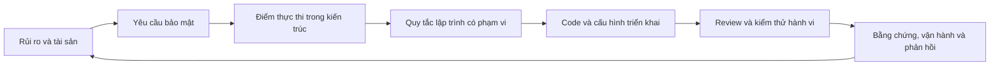

# Security coding standard

## 1. Mục tiêu của chuẩn lập trình an toàn

Security coding standard là tập quy tắc giúp developer hiện thực các yêu cầu bảo mật một cách nhất quán, có thể review và kiểm chứng. Một quy tắc hữu ích cần nói rõ khi nào áp dụng, hành vi nào bắt buộc, lỗi nào phải tránh và bằng chứng nào chứng minh mã đáp ứng quy tắc.

Trong chương **Secure development** của module **SECURITY_SECURITY_DESIGN_SECURITY_REQUIREMENTS**, chuẩn lập trình là cầu nối giữa mục tiêu an toàn thông tin, mô hình đe dọa, kiến trúc và tiêu chí kiểm thử. Mục tiêu không dừng ở một checklist “validate input, dùng mã hóa, bật logging”, mà phải chuyển thành hợp đồng cụ thể tại những ranh giới hệ thống cần bảo vệ.

Sau bài học, người học cần làm được các việc sau:

- Phân biệt yêu cầu bảo mật, quyết định kiến trúc, coding rule và quy ước trình bày mã.
- Viết quy tắc có mã định danh, phạm vi, mức bắt buộc, cách xử lý lỗi và tiêu chí nghiệm thu.
- Áp dụng quy tắc cho xác thực, phân quyền, dữ liệu, logging, cấu hình và phục hồi.
- Kết hợp kiểm tra tự động, review và kiểm thử hành vi mà không coi một công cụ là bằng chứng cho mọi loại rủi ro.
- Quản lý phiên bản, ngoại lệ và cập nhật chuẩn theo sự thay đổi của sản phẩm.

Các mã quy tắc và ngưỡng trong bài là ví dụ nội bộ để học cách đặc tả, không phải mã điều khoản chính thức của một tiêu chuẩn bên ngoài. [OWASP ASVS](https://asvs.owasp.org/) cung cấp nền tảng yêu cầu và kiểm chứng cho ứng dụng web/web service; [NIST SSDF SP 800-218](https://csrc.nist.gov/pubs/sp/800/218/final) cung cấp bối cảnh thực hành phát triển an toàn trong SDLC. Khi ánh xạ, dự án phải ghi phiên bản nguồn và điều khoản cụ thể đã chọn.

## 2. Coding standard nằm ở đâu trong thiết kế bảo mật?

| Loại tài liệu | Câu hỏi chính | Ví dụ cho dịch vụ hóa đơn |
| --- | --- | --- |
| Mục tiêu bảo mật | Tài sản nào cần được bảo vệ? | Dữ liệu hóa đơn không bị đọc chéo tenant |
| Mô hình đe dọa | Ai có thể vượt ranh giới bằng cách nào? | Người dùng đổi invoice ID để truy cập tài nguyên tenant khác |
| Yêu cầu bảo mật | Hệ thống phải làm gì và chứng minh ra sao? | Mọi đường đọc hóa đơn phải kiểm tra danh tính, quyền và phạm vi tenant |
| Quyết định kiến trúc | Kiểm soát được đặt ở đâu? | Identity context tin cậy, policy service và truy vấn có phạm vi |
| Coding standard | Developer phải dùng mẫu và API nào? | Không lấy tenant hiệu lực từ body; không gọi repository không giới hạn phạm vi |
| Style guide | Mã được trình bày thế nào? | Tên biến, cách xuống dòng, import |
| Kế hoạch kiểm thử | Bằng chứng nào xác nhận yêu cầu? | Request chéo tenant bị từ chối, không trả dữ liệu hoặc tạo tác dụng phụ |

Coding standard không thay thế kiến trúc. Quy tắc “mỗi request phải có danh tính” cần một nguồn danh tính được xác minh; developer không thể làm nó đúng chỉ bằng cách đổi tên một header thành `trusted-user`. Ngược lại, middleware tốt vẫn có thể bị bỏ qua nếu endpoint mới hoặc worker xử lý queue không đi qua đường đó.



Một quy tắc như “luôn dùng framework” chưa đủ: cần nêu tính năng bảo mật nào của framework, đường nào được bảo vệ, cấu hình nào bắt buộc và hành vi khi cấu hình sai. Không tự coi annotation hoặc tên hàm là bằng chứng hành vi đã được thực thi.

## 3. Xác định phạm vi và rủi ro trước khi viết quy tắc

Ví dụ sản phẩm gồm API nhiều tenant, worker xử lý sự kiện, trang quản trị và chức năng xuất báo cáo. Những điểm cần xét gồm HTTP input, message từ queue, dữ liệu lưu trong database, nội dung trả từ đối tác và tác vụ chạy nền.

Dữ liệu đi từ database hoặc dịch vụ nội bộ không tự an toàn trong mọi ngữ cảnh. Nó có thể bắt nguồn từ người dùng, đã lỗi thời hoặc chưa được phép sử dụng cho hành động hiện tại. Cần truy nguồn và mục đích thay vì chỉ phân loại theo nơi vừa đọc được dữ liệu.

| Mã rủi ro | Tình huống | Thuộc tính cần giữ |
| --- | --- | --- |
| R-01 | Input không đúng cấu trúc, giá trị hoặc giới hạn | Toàn vẹn xử lý và tính sẵn sàng |
| R-02 | Danh tính giả, quyền thiếu hoặc truy cập chéo tenant | Bí mật và phân tách quyền |
| R-03 | Dữ liệu được diễn giải thành SQL, command, HTML hoặc template | Toàn vẹn thực thi và dữ liệu |
| R-04 | Secret, dữ liệu nhạy cảm hoặc chi tiết nội bộ bị lộ | Bí mật và khả năng điều tra an toàn |
| R-05 | Parser, file hoặc kết nối ra ngoài có khả năng quá rộng | Giới hạn tài nguyên và ranh giới hệ thống |
| R-06 | Kiểm tra và cập nhật không nguyên tử, lỗi tạo trạng thái một phần | Toàn vẹn nghiệp vụ và phục hồi |
| R-07 | Cấu hình, dependency hoặc ngoại lệ làm mất kiểm soát | Tính nhất quán và khả năng duy trì bảo mật |

Phạm vi chuẩn phải nêu ngôn ngữ/runtime, framework, loại thành phần và các luồng xử lý. Một bộ quy tắc cho REST controller không tự bao phủ batch job, consumer queue hoặc mã được sinh tự động. Với Java, [Secure Coding Guidelines for Java SE của Oracle](https://www.oracle.com/java/technologies/javase/seccodeguide.html) là nguồn tham khảo chuyên biệt; các đặc tính của ngôn ngữ không loại bỏ lỗi phân quyền, injection hay sử dụng tài nguyên thiếu giới hạn.

## 4. Cấu trúc của một quy tắc có thể áp dụng

### 4.1. Nội dung tối thiểu của rule card

| Trường | Mục đích |
| --- | --- |
| Rule ID và phiên bản | Theo dõi quy tắc ổn định khi tài liệu thay đổi |
| Rủi ro và requirement liên quan | Chỉ rõ lý do tồn tại và mục tiêu cần đạt |
| Phạm vi áp dụng | Thành phần, thao tác, loại dữ liệu và điều kiện liên quan |
| Mức bắt buộc | Phân biệt yêu cầu phải đáp ứng với hướng dẫn có điều kiện |
| Phát biểu quy tắc | Hành vi quan sát được, tránh từ mơ hồ như “phù hợp” nếu chưa định nghĩa |
| Mẫu được chấp nhận | API, thư viện hoặc cách tổ chức kiểm soát đã được dự án lựa chọn |
| Mẫu vi phạm | Những cách triển khai không đạt dù có vẻ tương đương |
| Hành vi khi lỗi | Từ chối, dừng tác vụ, rollback hoặc phục hồi trong phạm vi nào |
| Cách kiểm chứng | Static check, review, unit/integration test và bằng chứng cần thu |
| Ngoại lệ và owner | Ai được chấp nhận rủi ro, phạm vi và thời hạn |

Trong bài này, **MUST** nghĩa là điều kiện bắt buộc theo policy nội bộ; **SHOULD** là mặc định cần theo, nếu khác phải có lập luận và quy trình của dự án; **MAY** là lựa chọn được phép trong điều kiện đã nêu. Không dùng SHOULD để né một yêu cầu nghiệp vụ/bảo mật vốn bắt buộc.

Mức bắt buộc của quy tắc khác với mức nghiêm trọng của một phát hiện cụ thể. Cùng một pattern có thể tạo hậu quả khác theo dữ liệu, quyền và khả năng tiếp cận. Việc phân loại phát hiện phải có ngữ cảnh, nhưng không vì thế tự bỏ hiệu lực quy tắc.

### 4.2. Ví dụ rule card cho phân quyền đối tượng

```yaml
id: SCS-AUTHZ-001
version: 1
level: MUST
title: Kiem tra quyen tren tai nguyen va pham vi tenant
appliesTo:
  - API doc va thay doi tai nguyen nhieu tenant
  - Worker xu ly hanh dong thay mat nguoi dung
riskRefs:
  - R-02
requirementRef: REQ-INVOICE-ACCESS-01
statement: >-
  Truoc khi tra du lieu hoac thay doi tai nguyen, he thong phai
  kiem tra danh tinh, hanh dong va pham vi tai nguyen theo policy.
failureBehavior: Tu choi, khong tra du lieu, khong tao tac dung phu trai phep
verification:
  - Review nguon identity context va diem thuc thi policy
  - Test cung tenant dung quyen, thieu quyen va cheo tenant
exceptionProcess: Ho so co owner, kiem soat bu va thoi han
ownerRole: Application security owner
```

Đây là cấu trúc minh họa, không phải cấu hình thực thi. `requirementRef` phải trỏ tới yêu cầu thật của dự án; việc khai báo trường này không tự tạo kiểm soát. Test phải chứng minh đúng hành vi của đường xử lý có hiệu lực.

## 5. Bộ quy tắc nền cho các ranh giới phổ biến

### SCS-IN-001 — Parse và validate dữ liệu theo hợp đồng

**MUST:** Input phải có quy tắc kiểu, cấu trúc, trường được phép, giới hạn kích thước và điều kiện nghiệp vụ cần thiết trước khi dùng. Kiểm tra phía client chỉ hỗ trợ trải nghiệm; điểm server xử lý dữ liệu phải thực thi hợp đồng tương ứng.

Ví dụ, số tiền cần đơn vị và miền giá trị rõ; một object cập nhật chỉ nhận trường người dùng được sửa; mảng và dữ liệu lồng nhau cần giới hạn. Quy tắc chuẩn hóa phải nhất quán giữa kiểm tra và sử dụng, tránh parse/giải mã nhiều cách khiến kết quả khác nhau. Không cấm toàn bộ Unicode hoặc dấu nháy chỉ vì khó viết regex.

**Kiểm chứng:** Thử giá trị biên, thiếu/null, trường dư, dữ liệu lồng sâu, quá kích thước và vi phạm quan hệ giữa trường. Xác nhận lỗi được xử lý trước tác dụng phụ. [OWASP Input Validation](https://cheatsheetseries.owasp.org/cheatsheets/Input_Validation_Cheat_Sheet.html) phân biệt kiểm tra cú pháp và ý nghĩa; validation không thay cho phân quyền hoặc API an toàn tại nơi sử dụng dữ liệu.

### SCS-ID-001 — Danh tính hiệu lực đến từ nguồn đã xác minh

**MUST:** Code nghiệp vụ dùng identity context do cơ chế xác thực được tin tạo ra. Không lấy danh tính, vai trò hoặc tenant hiệu lực chỉ từ body, query hay header mà client tự đặt. Với token hoặc assertion, sử dụng thành phần xác minh theo hợp đồng của hệ thống trước khi tin claim.

Đường HTTP, tác vụ nền và lời gọi dịch vụ cần hợp đồng riêng: ai là actor thực, quyền nào được ủy quyền, phạm vi và thời điểm kiểm tra. Message có trường `userId` không tự chứng minh người đó đã yêu cầu hành động hoặc còn quyền thực hiện nó.

**Kiểm chứng:** Danh tính thiếu, không hợp lệ, hết hiệu lực theo policy hoặc claim do client giả không tạo quyền truy cập. Kiểm tra cả endpoint mới và worker; một request đã qua gateway không cho phép backend tự tin mọi header nếu đường trực tiếp vẫn tồn tại.

### SCS-AUTHZ-001 — Phân quyền cho hành động và tài nguyên

**MUST:** Mọi đường đọc/ghi nhạy cảm phải kiểm tra quyền theo policy, bao gồm phạm vi tenant và các điều kiện đối tượng cần thiết. Tài nguyên có ID hợp lệ hoặc không đoán được vẫn cần phân quyền. Không chỉ ẩn nút UI hoặc kiểm tra một role chung rồi bỏ qua tài nguyên thực tế.

Điểm thực thi cần ở phía server và bao phủ cả đọc chi tiết, danh sách, export, attachment, batch và thao tác nền. Khi không thể xác định quyền bắt buộc, không tự mặc định cho phép. [OWASP Authorization Cheat Sheet](https://cheatsheetseries.owasp.org/cheatsheets/Authorization_Cheat_Sheet.html) là nguồn tham khảo về deny-by-default, quyền tối thiểu và kiểm tra trên request/tài nguyên.

**Kiểm chứng:** Có ca hợp lệ, thiếu quyền, chéo tenant và thay ID/đường truy cập. Đối với trường hợp bị từ chối, xác nhận không có dữ liệu hoặc tác dụng phụ trái phép; lựa chọn mã lỗi và thông tin tồn tại của tài nguyên phải theo hợp đồng đã định.

### SCS-INJ-001 — Tách dữ liệu khỏi ngôn ngữ thực thi

**MUST:** Dùng API tham số hóa cho giá trị trong SQL; không ghép input thành SQL, shell command, expression hoặc template thực thi. Những phần không tham số hóa được như tên cột/sắp xếp phải được ánh xạ từ tập lựa chọn cấu hình trước.

Ví dụ JDBC minh họa cho schema dùng ID kiểu số, với `authenticatedTenantId` đã lấy từ context tin cậy:

```java
String sql = "SELECT id, total_minor, currency FROM invoice "
        + "WHERE tenant_id = ? AND id = ?";

try (PreparedStatement statement = connection.prepareStatement(sql)) {
    statement.setLong(1, authenticatedTenantId);
    statement.setLong(2, invoiceId);
    try (ResultSet rows = statement.executeQuery()) {
        // Chỉ ánh xạ các trường được phép trả về cho thao tác hiện tại.
    }
}
```

Đoạn mã giả định kiểm tra danh tính và quyền hành động đã được thực hiện. Query có phạm vi hỗ trợ phân tách dữ liệu nhưng không tự quyết định mọi quyền nghiệp vụ. [OWASP SQL Injection Prevention](https://cheatsheetseries.owasp.org/cheatsheets/SQL_Injection_Prevention_Cheat_Sheet.html) mô tả parameterized query và allowlist cho các phần cấu trúc truy vấn cần kiểm soát.

**Kiểm chứng:** Dữ liệu có cú pháp đặc biệt vẫn được xử lý như dữ liệu; tùy chọn cấu trúc ngoài tập cho phép bị từ chối. Review ORM raw query, dynamic sort và công cụ gọi process, không chỉ các chỗ dùng JDBC trực tiếp.

### SCS-OUT-001 — Bảo vệ dữ liệu tại đúng ngữ cảnh đầu ra

**MUST:** Dữ liệu xuất ra trình duyệt hoặc môi trường diễn giải phải dùng API/sink an toàn và encoding đúng ngữ cảnh. Encoding cho HTML text không tự đúng cho JavaScript, URL hoặc CSS. Không tắt cơ chế escape của framework chỉ vì dữ liệu đã qua input validation.

Khi nghiệp vụ cho phép rich HTML, dùng cơ chế sanitization với policy và thư viện được quản lý, thay vì chỉ escape rồi tự hoàn nguyên một số thẻ. Một chuỗi được xem là an toàn trong ngữ cảnh này không được mang sang ngữ cảnh khác mà không đánh giá lại. [OWASP XSS Prevention](https://cheatsheetseries.owasp.org/cheatsheets/Cross_Site_Scripting_Prevention_Cheat_Sheet.html) phân biệt encoding theo ngữ cảnh, HTML sanitization và safe sink.

**Kiểm chứng:** Thử dữ liệu ở đúng nơi nó được hiển thị, bao gồm dữ liệu lưu rồi đọc lại. Xác nhận không thực thi nội dung không được phép và chức năng hiển thị hợp lệ vẫn hoạt động; không chỉ kiểm tra response có chứa ký tự đã escape ở một vị trí bất kỳ.

### SCS-SEC-001 — Dùng cơ chế quản lý secret và mật mã đã được chấp nhận

**MUST:** Không ghi credential thực vào source, fixture hoặc log. Dùng kênh cấp phát theo danh tính và phạm vi môi trường; code không fallback sang credential mặc định khi cấp phát lỗi. Mã cần chức năng mật mã phải dùng API/thư viện và cấu hình được dự án chấp nhận, không tự thiết kế thuật toán hoặc cơ chế token bảo mật.

Chuẩn nên trỏ tới profile kỹ thuật có phiên bản cho việc lưu mật khẩu, quản lý khóa, kiểm tra chứng thư và ngẫu nhiên bảo mật. Không nhúng một danh sách thuật toán bất biến vào tài liệu rồi bỏ việc theo dõi hỗ trợ, cấu hình và vòng đời khóa. Hash mật khẩu, mã hóa dữ liệu và xác thực kênh là các mục đích khác nhau, không thay thế nhau.

**Kiểm chứng:** Secret mồi không xuất hiện trong output thuộc phạm vi; thiếu secret không mở quyền hoặc dùng mặc định. Các đường gọi mật mã sử dụng đúng profile và cơ chế xác minh bắt buộc; ca lỗi chứng thư/khóa không được giải quyết bằng tắt kiểm tra trong code.

### SCS-ERR-001 — Lỗi và log giữ được bí mật, dấu vết và trạng thái an toàn

**MUST:** Response lỗi không trả stack trace, credential, câu truy vấn nhạy cảm hoặc dữ liệu ngoài quyền. Log ghi thông tin cần điều tra bằng mã lỗi, actor/tài nguyên theo policy và correlation ID, đồng thời loại dữ liệu bí mật, giới hạn độ dài và xử lý ký tự điều khiển.

Không dùng catch tổng quát để nuốt lỗi kiểm tra quyền rồi tiếp tục nghiệp vụ. Nếu audit là điều kiện bắt buộc của hành động, phải đặc tả việc dừng hoặc dùng kênh dự phòng khi audit lỗi; không chọn ngầm theo tiện lợi của developer. [OWASP Logging Cheat Sheet](https://cheatsheetseries.owasp.org/cheatsheets/Logging_Cheat_Sheet.html) là nguồn tham khảo về nội dung sự kiện, loại trừ dữ liệu nhạy cảm và bảo vệ log.

**Kiểm chứng:** Chạy đường lỗi với secret mồi và input có xuống dòng. Response/log không lộ giá trị hoặc tạo sự kiện giả; hành động bị từ chối không tiếp tục tạo tác dụng phụ.

### SCS-IO-001 — Giới hạn khả năng của file, parser và kết nối ngoài

**MUST:** Các API nhận path, URL, archive hoặc dữ liệu có thể điều khiển quá trình parse phải có policy khả năng và tài nguyên cụ thể. Không cho input tùy ý chọn file ngoài vùng cho phép, gọi đích mạng không được phép hoặc yêu cầu parser khởi tạo loại đối tượng/cấp quyền ngoài hợp đồng.

Chuẩn phải nêu giới hạn file upload, loại nội dung, kích thước sau giải nén, độ sâu và khả năng đọc external resource theo nhu cầu. Không tin đuôi file, content type do client khai hoặc việc dữ liệu đã được lưu trong database. Parser và deserializer phải được cấu hình theo định dạng, kiểu dữ liệu và feature thực sự cần dùng.

Với file, thao tác chuẩn hóa đường dẫn đơn lẻ có thể chưa xử lý symlink hoặc thay đổi xen giữa kiểm tra và mở file; cần cơ chế ràng buộc tại thao tác truy cập phù hợp nền tảng. Với URL, kiểm tra chuỗi hostname chưa đủ nếu kết nối thực tế có thể đổi đích; dùng thành phần thực thi policy tại đúng ranh giới.

**Kiểm chứng:** Thử path vượt phạm vi, archive vượt giới hạn, dữ liệu lồng sâu, tham chiếu external resource và đích mạng bị cấm trong sandbox. Xác nhận không đọc/ghi/gửi dữ liệu ngoài hợp đồng, không chỉ nhận một thông báo lỗi cuối cùng.

### SCS-STATE-001 — Bảo vệ bất biến khi đồng thời, lỗi và retry

**MUST:** Điều kiện bảo mật/nghiệp vụ liên quan tới thay đổi trạng thái phải được giữ tại điểm cập nhật, kể cả khi có nhiều request hoặc worker. Nếu cần nguyên tử trong database, sử dụng transaction, constraint hoặc cập nhật có điều kiện phù hợp; không giả định bước đọc-kiểm tra trước đó ngăn được thay đổi xen ngang.

Thao tác có thể retry cần hợp đồng idempotency và phạm vi hiệu lực rõ. Idempotency key không thay cho xác thực/phân quyền; cùng một key từ actor khác không được tự chia sẻ kết quả nhạy cảm. Với tác động ngoài transaction như gọi đối tác, phải có cách theo dõi trạng thái, xử lý một phần và điều phối phục hồi phù hợp.

Resource phải có giới hạn theo mục đích: thời gian, số lần retry, đồng thời, kích thước và vòng đời. Đóng tài nguyên khi kết thúc theo cơ chế của ngôn ngữ/framework; không tạo vòng retry vô hạn hoặc trả thành công khi một bước bảo vệ bắt buộc chưa hoàn tất.

**Kiểm chứng:** Hai thao tác cạnh tranh không làm vượt điều kiện được bảo vệ; lỗi giữa chừng và retry không tạo tác động trùng ngoài hợp đồng. Quan sát trạng thái lưu và đích bên ngoài thử nghiệm, thay vì chỉ kiểm tra hàm được gọi bao nhiêu lần.

### SCS-CONF-001 — Cấu hình và dependency không làm mất bảo vệ

**MUST:** Cấu hình mặc định, feature flag, dependency và API bảo mật phải được quản lý theo profile dự án. Code không tự mở debug, bỏ kiểm tra quyền hoặc tắt xác minh kết nối khi cấu hình thiếu/sai. Phân biệt rõ những thiết lập chỉ dùng trong môi trường thử nghiệm và cách ngăn chúng có hiệu lực ở production.

Các thư viện, plugin và wrapper nội bộ được chuẩn khuyến nghị phải có owner và vòng đời cập nhật. “Đã dùng helper chung” không chứng minh helper đó luôn đúng hoặc không cần vá. Nếu một hành vi bảo mật phụ thuộc cấu hình framework, cấu hình đó phải được kiểm chứng cùng code.

**Kiểm chứng:** Thử thiếu cấu hình bắt buộc, profile sai và feature flag nhạy cảm. Hệ thống có hành vi từ chối hoặc vô hiệu hóa tính năng theo hợp đồng, không tự hạ mức bảo vệ. Đường framework bị bypass hoặc dependency ngoài policy phải có kết quả kiểm soát rõ.

### SCS-VERIFY-001 — Mỗi quy tắc bắt buộc có phương pháp xác minh phù hợp

**MUST:** Rule MUST cần có ít nhất một phương pháp kiểm chứng đáng tin và phạm vi đã công bố. Có thể kết hợp SAST, review, kiểm thử tích hợp, kiểm thử đối kháng hoặc kiểm tra cấu hình; không bắt buộc mọi rule đều giải được bằng một regex hoặc một unit test.

Một scanner có thể phát hiện SQL nối chuỗi nhưng thường không biết đầy đủ quyền nghiệp vụ của mỗi tenant. Kiểm thử mock policy luôn trả allow cũng không chứng minh policy thật đã được áp dụng. Kết quả “không có findings” chỉ có ý nghĩa cùng phiên bản ruleset, phạm vi phân tích, lỗi công cụ và suppression.

**Kiểm chứng:** Evidence gắn được với revision, rule áp dụng, ca được thử và kết quả. Công cụ lỗi hoặc chưa chạy không được báo thành “đã kiểm tra đạt”. Với rule bắt buộc cho release, trạng thái thiếu bằng chứng phải đi theo policy từ chối/ngoại lệ đã định.

### SCS-GOV-001 — Có owner, phiên bản và ngoại lệ hết hạn

**MUST:** Chuẩn được quản lý phiên bản, có owner cập nhật và quy trình áp dụng khi ngôn ngữ, framework hoặc mô hình đe dọa đổi. Quy tắc được sửa phải giữ khả năng truy vết từ bằng chứng cũ tới phiên bản từng áp dụng.

Ngoại lệ ghi rule ID, thành phần/đường xử lý, lý do, rủi ro, kiểm soát bù, owner chấp nhận và ngày xem xét/hết hạn. Suppression trong tool cần ánh xạ tới ngoại lệ hoặc quyết định false positive có phạm vi; một comment `ignore security` không tự là phê duyệt.

Legacy code và generated code vẫn cần đánh giá rủi ro. Có thể lập lộ trình theo phạm vi và deadline, dùng template an toàn hoặc kiểm soát tại ranh giới; không loại cả repository hay thư mục khỏi kiểm tra chỉ để đạt chỉ số. Khi ngoại lệ hết hạn, phải xử lý theo policy thay vì giữ PASS vô thời hạn.

**Kiểm chứng:** Thay đổi chuẩn có review, tham chiếu nguồn và kế hoạch chuyển đổi. Ngoại lệ chỉ tác động đúng rule/vị trí được chấp nhận; mẫu vi phạm mới bên ngoài phạm vi vẫn bị phát hiện và xử lý.

## 6. Ví dụ xuyên suốt: API đọc hóa đơn nhiều tenant

### 6.1. Chuyển yêu cầu thành bất biến trong luồng xử lý

Yêu cầu sản phẩm:

> Người dùng chỉ đọc được hóa đơn nằm trong phạm vi tenant và quyền được cấp. Request không được phép không trả nội dung hóa đơn hoặc làm thay đổi trạng thái nghiệp vụ.

Luồng khái niệm:

```text
readInvoice(request):
    subject = requireVerifiedIdentity(request)
    invoiceId = parseAndValidateInvoiceId(request.path.id)
    action = "invoice:read"

    require authorizeAction(subject, action)
    invoice = repository.findWithinAuthorizedScope(
        id = invoiceId,
        tenant = subject.effectiveTenant,
        additionalScope = policyScopeFor(subject, action)
    )

    require invoice exists and policy permits this object
    response = mapOnlyPermittedFields(invoice, subject)
    recordSecurityEventIfRequiredWithoutSensitiveValues()
    return serializeUsingSafeResponseMechanism(response)
```

Đây là mã giả minh họa trách nhiệm, không phải implementation có thể sao chép trực tiếp. `effectiveTenant` phải đến từ context đã xác minh hoặc luồng chọn tenant có phân quyền, không từ body tùy ý. Điều kiện `additionalScope` tùy policy: có hệ thống cho người có quyền đọc xem toàn tenant, có hệ thống chỉ cho xem một tập quan hệ/tài nguyên.

Một query có `tenant_id` không tự bảo đảm mọi trường trong hóa đơn được phép trả. Cần DTO/mapping cho dữ liệu trả về; không serialize toàn bộ entity chứa thông tin nội bộ rồi trông chờ UI giấu trường.

### 6.2. Các biến thể phải được bao phủ

Quy tắc cần đi cùng endpoint danh sách, export, tải file hóa đơn và worker tạo báo cáo. Nếu export chỉ nhận danh sách ID nhưng gọi repository không có phạm vi, API chi tiết an toàn vẫn chưa đáp ứng yêu cầu tổng thể.

Với cache, key và quyền truy cập cần giữ đúng phạm vi dữ liệu. Cache toàn bộ entity theo invoice ID rồi trả cho người gọi khác mà không kiểm tra quyền hiện tại có thể làm mất bất biến. Không được coi lần kiểm tra quyền của request trước là quyền vĩnh viễn của dữ liệu đã cache.

Một test có giá trị dùng hai tenant, danh tính quyền đọc/không có quyền và hóa đơn có trường không được xuất. Kết quả cần quan sát response, log và trạng thái liên quan; mock repository luôn trả đúng tenant không phát hiện được việc implementation quên giới hạn truy vấn.

## 7. Đưa chuẩn vào vòng đời phát triển

| Giai đoạn | Cách dùng chuẩn | Bằng chứng phù hợp |
| --- | --- | --- |
| Đặc tả | Chọn tài sản, rủi ro, requirement và rule áp dụng | Danh mục yêu cầu và tiêu chí chấp nhận |
| Thiết kế | Chọn điểm thực thi, nguồn danh tính, thư viện và failure behavior | Sơ đồ ranh giới, hợp đồng API, quyết định kiến trúc |
| Lập trình | Dùng API an toàn, template và wrapper đã chọn | Code/cấu hình cùng phiên bản chuẩn liên quan |
| Review | Xem đường dữ liệu, quyền và lỗi theo rule | Nhận xét gắn rule ID và quyết định xử lý |
| CI | Chạy check tự động có phạm vi rõ | Kết quả gắn revision, ruleset và trạng thái công cụ |
| Kiểm thử | Thử hành vi đúng/sai và đường ít dùng | Ca chéo quyền, input biên, lỗi, đồng thời và kiểm tra trạng thái |
| Phát hành | Đối chiếu evidence, phát hiện và ngoại lệ còn hiệu lực | Quyết định release theo policy |
| Vận hành | Dùng sự cố và thay đổi nền tảng để cập nhật chuẩn | Bản sửa nguyên nhân gốc, rule/test hồi quy và kế hoạch chuyển đổi |

Không cần tạo một check tự động mang tính hình thức cho từng rule. Nếu chỉ xác minh được bằng review và integration test, hãy ghi đúng như vậy. Một control có thể phục vụ nhiều rule, nhưng bằng chứng phải đủ cho từng mục tiêu thay vì chỉ dẫn chung “CI xanh”.

### 7.1. Definition of Done về bảo mật

Một thay đổi có thể được xem là hoàn tất về yêu cầu lập trình an toàn khi:

- Những rule áp dụng cho phạm vi thay đổi đã được xác định.
- Điểm thực thi bảo mật và các nhánh lỗi đã được review.
- Có kiểm thử có ý nghĩa cho hành vi và rủi ro mới hoặc bị tác động.
- Các check bắt buộc đã chạy trên đúng revision, không bị lỗi hay bỏ qua chưa giải thích.
- Phát hiện còn lại đã được xử lý hoặc có ngoại lệ hợp lệ theo policy.
- Cấu hình, log và thông tin phục hồi cần thiết được cập nhật cùng thay đổi.

Không dùng số lượng test hoặc tỷ lệ coverage dòng như đại diện đầy đủ cho bảo mật. Một hàm có coverage cao vẫn có thể chưa được thử với actor sai, tenant khác hoặc tình huống đồng thời.

## 8. Ma trận truy vết mẫu

| Rule | Rủi ro chính | Điểm thực thi | Bằng chứng chấp nhận |
| --- | --- | --- | --- |
| SCS-IN-001 | R-01 | Parser, DTO/schema, validation nghiệp vụ | Input sai và vượt giới hạn bị xử lý trước tác dụng phụ |
| SCS-ID-001 | R-02 | Authenticator, trusted context, worker contract | Danh tính giả/thiếu không được tin ở mọi đường liên quan |
| SCS-AUTHZ-001 | R-02 | Policy và truy cập tài nguyên | Ca đúng quyền, thiếu quyền, chéo tenant và đường thay thế |
| SCS-INJ-001 | R-03 | Query/process/template API | Dữ liệu không thành lệnh; phần cấu trúc có allowlist |
| SCS-OUT-001 | R-03 | Serializer, template, DOM/sink đầu ra | Dữ liệu không tạo nội dung thực thi trái phép trong đúng ngữ cảnh |
| SCS-SEC-001 | R-04, R-07 | Secret provider, API mật mã, cấu hình kênh | Không lộ secret, không fallback, dùng đúng profile |
| SCS-ERR-001 | R-04, R-06 | Exception mapping, audit/logging | Không lộ chi tiết, không tiếp tục thao tác khi kiểm soát thất bại |
| SCS-IO-001 | R-05 | File API, parser, outbound transport | Không vượt phạm vi file/mạng; giới hạn parse/tài nguyên có hiệu lực |
| SCS-STATE-001 | R-01, R-06 | Transaction, constraint, retry và resource lifecycle | Bất biến giữ khi đồng thời, lỗi và thử lại |
| SCS-CONF-001 | R-07 | Cấu hình, wrapper, framework/dependency policy | Profile sai/thiếu không tự hạ bảo vệ |
| SCS-VERIFY-001 | R-07 | Review, tool, kiểm thử và release gate | Evidence đủ phạm vi, đúng revision, phân biệt lỗi tool với PASS |
| SCS-GOV-001 | R-07 | Quản lý chuẩn, ngoại lệ, suppression | Owner, phiên bản, phạm vi và hết hạn được thực thi |

Owner của rule không nhất thiết là người duy nhất triển khai control. Nhóm ứng dụng có thể kiểm soát code nhưng cần nhóm nền tảng cung cấp secret store, policy mạng hoặc quyền audit. Ma trận thực tế cần chỉ rõ trách nhiệm phối hợp, không giao mọi rủi ro cho developer của một endpoint.

## 9. Bộ kiểm thử nghiệm thu chuẩn

Các ca dưới đây dùng kiểm tra khả năng áp dụng và thực thi chuẩn trong dự án minh họa. Chúng cần được cụ thể hóa thành phép thử ở đúng tầng, trong môi trường kiểm soát và với dữ liệu/credential mồi. Không khẳng định một ca kiểm thử bao phủ mọi dạng khai thác của cả nhóm lỗ hổng.

| Mã | Thiết lập | Điều kiện pass |
| --- | --- | --- |
| T-01 | Rule mới thiếu phạm vi hoặc cách kiểm chứng | Không được công bố như một điều kiện MUST đã sẵn sàng áp dụng mà không xử lý thiếu sót |
| T-02 | Input sai kiểu, thiếu/null, trường dư và vượt giới hạn | Kết quả theo hợp đồng, không tạo tác dụng phụ trái phép |
| T-03 | Actor/role/tenant tự đặt trong request hoặc message | Không thay thế danh tính và quyền hiệu lực đã xác minh |
| T-04 | Đọc/ghi bằng actor thiếu quyền hoặc tenant khác | Không trả dữ liệu hoặc thực hiện hành động ngoài quyền |
| T-05 | Truy cập qua list, export, attachment hoặc worker thay endpoint chi tiết | Bất biến quyền vẫn được giữ trên từng đường thuộc phạm vi |
| T-06 | Giá trị có cú pháp SQL/command và tùy chọn cấu trúc ngoài danh sách | Giá trị chỉ là dữ liệu; lựa chọn cấu trúc trái phép bị từ chối |
| T-07 | Dữ liệu không tin cậy hiển thị ở các ngữ cảnh được hỗ trợ | Không thực thi nội dung trái phép; hiển thị hợp lệ không bị phá |
| T-08 | Secret thiếu hoặc profile xác minh kênh/khóa không hợp lệ | Không dùng mặc định hoặc tự tắt kiểm tra bắt buộc |
| T-09 | Exception có credential mồi và input có xuống dòng | Response/log không lộ giá trị hoặc tạo sự kiện giả |
| T-10 | Path, archive/parser hoặc URL vượt phạm vi trong sandbox | Không có truy cập/tài nguyên vượt hợp đồng |
| T-11 | Hai thao tác cạnh tranh và retry sau lỗi giữa chừng | Không vi phạm bất biến hoặc tạo tác động trùng ngoài hợp đồng |
| T-12 | Cấu hình thiếu, feature flag nhạy cảm hoặc helper bị bypass | Hành vi từ chối/giới hạn đúng; không hạ bảo vệ âm thầm |
| T-13 | Scanner không chạy, lỗi hoặc dùng ruleset khác phạm vi đã định | Không coi là bằng chứng kiểm tra đạt cho release bắt buộc |
| T-14 | Suppression hợp lệ cho một vị trí và vi phạm mới ở vị trí khác | Ngoại lệ không lan sang phạm vi chưa được chấp nhận |
| T-15 | Ngoại lệ hết hạn hoặc chuẩn đổi phiên bản | Có hành động theo policy, không giữ PASS vô thời hạn |
| T-16 | Bản sửa lỗi bảo mật được đưa vào sản phẩm và có kế hoạch rollback | Evidence đúng revision, có hồi quy và không phục hồi lại đường lỗi ngoài quyết định rủi ro |

Báo cáo cần ghi phiên bản chuẩn, rule áp dụng, source/config revision, môi trường, giả định, kết quả và giới hạn. “Không phát hiện lỗi” không có nghĩa mọi rule đã được thử; một rule không áp dụng phải có lý do, không chỉ một nhãn N/A không giải thích.

## 10. Áp dụng vào codebase mới và codebase đang tồn tại

Với codebase mới, đưa profile an toàn vào template, thư viện dùng chung và CI từ đầu. Developer nên có ví dụ nhỏ cho đường thường dùng như truy vấn, identity context, DTO trả về và exception mapping. Mẫu cần có owner và kiểm thử; sao chép từ một ví dụ cũ không tự chứng minh còn phù hợp.

Với codebase đang tồn tại, xác định phạm vi và rủi ro trước khi đặt deadline. Có thể ưu tiên đường public, quyền quản trị, dữ liệu nhạy cảm và các chỗ đang được thay đổi, đồng thời quản lý phần chưa xử lý thành backlog/ngoại lệ có owner. Không dùng baseline findings để coi mọi vi phạm cũ là an toàn.

Chỉ số hữu ích gồm rule đã có bằng chứng trong phạm vi, ngoại lệ quá hạn, thời gian khắc phục theo policy và lỗi cùng nguyên nhân tái xuất hiện. Số trang của chuẩn, số rule bật trong scanner hoặc số cảnh báo bằng không không đủ để kết luận sản phẩm an toàn.

Khi có sự cố, cần sửa cả đường lỗi, các biến thể tương tự và nguyên nhân khiến quy tắc không được áp dụng. Nếu helper chung hoặc cấu hình framework sai, chỉ sửa một endpoint có thể để lại nhiều đường cùng lỗ hổng.

## 11. Tình huống áp dụng: “validate đủ” nhưng vẫn lộ dữ liệu

Một nhóm có quy tắc “mọi ID phải là số dương”, dùng prepared statement và có unit test cho API đọc hóa đơn. Endpoint lấy tenant từ body do client gửi, rồi truy vấn theo tenant đó. Scanner không phát hiện injection và các test dùng cùng một tenant đều thành công.

Input hợp lệ và query tham số hóa chưa đáp ứng yêu cầu quyền. Rủi ro nằm ở nguồn tenant hiệu lực và phạm vi tài nguyên. SCS-ID-001 yêu cầu lấy context tin cậy; SCS-AUTHZ-001 yêu cầu kiểm tra quyền với đối tượng; SCS-VERIFY-001 yêu cầu bằng chứng có thể phát hiện hành vi sai quyền.

Bản sửa cần định nghĩa lại nguồn context, policy hành động và cách truy vấn trong phạm vi được phép. Test dùng hai tenant, actor thiếu quyền và các đường list/export liên quan. Kết quả phải chứng minh không lộ dữ liệu ở response, cache hoặc log, thay vì chỉ thêm một annotation rồi giữ nguyên test cũ.

Nếu phát hiện đã có dữ liệu bị truy cập trái phép, việc sửa code không thay cho điều tra và ứng phó sự cố. Khi phục hồi hoặc rollback, cần tránh đưa lại phiên bản có đường lỗi đã biết nếu chưa có quyết định và kiểm soát bù phù hợp.

## 12. Câu hỏi tự kiểm tra

1. Hãy chuyển câu “validate tất cả input” thành một rule card cho API tạo hóa đơn với trường, giới hạn và tiêu chí pass/fail cụ thể.
2. Một helper query luôn dùng prepared statement. Nó chứng minh được điều gì, và còn thiếu bằng chứng nào để bảo vệ truy cập chéo tenant?
3. Một scanner không phát hiện lỗi ở worker queue. Cần kiểm tra những giả định nào trước khi kết luận SCS-ID-001 và SCS-AUTHZ-001 đã đạt?
4. Quy tắc “không log dữ liệu nhạy cảm” cần bổ sung phạm vi, kiểu dữ liệu và cách thử đường lỗi như thế nào?
5. Một ngoại lệ tắt rule cho cả thư mục vì có một false positive. Hãy viết lại phạm vi, owner, lý do và thời hạn để vẫn phát hiện vi phạm mới.
6. Hai request đều vượt kiểm tra quyền trước khi một tài nguyên thay đổi trạng thái. Cần áp dụng yêu cầu nào tại điểm cập nhật để giữ bất biến khi đồng thời?

Mỗi câu trả lời cần nối được **rủi ro → yêu cầu bảo mật → coding rule → điểm thực thi → bằng chứng kiểm thử → ngoại lệ và phục hồi**. Đây là cơ sở để chuẩn lập trình an toàn trở thành một phần có thể kiểm chứng của vòng đời phát triển.
