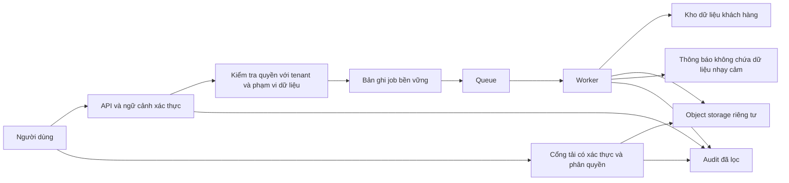

# Secure design review — Rà soát thiết kế bảo mật

## 1. Mục tiêu và phạm vi

Secure design review là hoạt động đánh giá một thiết kế để xác định liệu các quyết định về kiến trúc, dữ liệu, danh tính và luồng nghiệp vụ có đáp ứng yêu cầu bảo mật hay không. Mục tiêu là phát hiện điểm yếu khi còn có thể thay đổi thiết kế với chi phí phù hợp, đồng thời tạo quyết định và bằng chứng đủ rõ cho các bước phát triển tiếp theo.

Một thiết kế có thể sử dụng thư viện tốt, mã sạch và giao thức mã hóa phù hợp nhưng vẫn cho phép truy cập dữ liệu chéo tenant hoặc không thể thu hồi quyền tải file. Những vấn đề này thường nằm ở cách hệ thống phân chia trách nhiệm và thiết lập quan hệ tin cậy.

Trong chương **Secure development**, bài học này tập trung vào việc chuyển mục tiêu an toàn thông tin và mô hình đe dọa thành yêu cầu cụ thể, đo được, có thể kiểm chứng; sau đó dùng review để đối chiếu yêu cầu với kiến trúc và tiêu chí kiểm thử. Phạm vi bao gồm xác thực, phân quyền, dữ liệu, logging, khả dụng và phục hồi trong vòng đời phát triển.

Sau bài học, người học có thể:

- Chuẩn bị đầu vào và phạm vi cho một buổi review có ích.
- Kiểm tra giả định, ranh giới tin cậy và bất biến bảo mật.
- Ghi phát hiện dưới dạng kịch bản, tác động và khoảng trống yêu cầu.
- Liên kết rủi ro với quyết định thiết kế, chủ sở hữu và bằng chứng kiểm chứng.
- Xác định điều kiện chấp thuận, theo dõi phát hiện và thời điểm cần review lại.

Các số liệu trong ví dụ là giả định dự án để minh họa cách viết yêu cầu. Chúng cần được điều chỉnh theo dữ liệu, mức độ rủi ro và năng lực thực tế.

## 2. Secure design review đánh giá điều gì?

### 2.1. Phân biệt với các hoạt động khác

| Hoạt động | Câu hỏi chính | Bằng chứng điển hình |
| --- | --- | --- |
| Phân tích yêu cầu bảo mật | Hệ thống phải bảo vệ điều gì và đến mức nào? | Mục tiêu, bất biến, tiêu chí chấp nhận |
| Mô hình đe dọa | Ai có thể làm gì sai qua những đường nào? | Tài sản, luồng dữ liệu, ranh giới và kịch bản |
| Secure design review | Thiết kế có thực thi các yêu cầu và xử lý rủi ro đã xác định không? | Kiến trúc, quyết định, phân tích thiếu sót |
| Code review | Mã đã triển khai có đúng và an toàn theo thiết kế không? | Thay đổi mã và cấu hình |
| Kiểm thử bảo mật | Hành vi thực tế có đáp ứng điều kiện cần bảo vệ không? | Kết quả kiểm thử và môi trường |
| Review triển khai | Mạng, danh tính, quyền và cấu hình có hiệu lực có đúng không? | Cấu hình chạy và phép thử từ vị trí phù hợp |

Các hoạt động bổ sung cho nhau. Một buổi review thiết kế không chứng minh mã đã triển khai đúng, và một lần quét không phát hiện lỗi không xác nhận mọi quyết định kiến trúc đều phù hợp.

### 2.2. Đánh giá cả đường thành công và đường lỗi

Thiết kế cần mô tả không chỉ điều xảy ra khi mọi thành phần hoạt động bình thường mà còn khi:

- Credential hết hạn hoặc bị thu hồi.
- Dịch vụ phân quyền không đáp ứng.
- Request hoặc message bị gửi lặp.
- Worker dừng giữa một thao tác.
- Dữ liệu đến trễ hoặc sai thứ tự.
- Người dùng mất quyền trong lúc một job đang chờ.
- Nhà cung cấp hoặc tài khoản vận hành bị xâm nhập.
- Một thành phần trả thành công nhưng tác động chưa bền vững.

Các tình huống này giúp xác định liệu cơ chế bảo mật thực sự điều khiển hành vi hay chỉ được ghi trong tài liệu.

### 2.3. Quy mô review theo tác động thay đổi

Không phải mọi thay đổi đều cần cùng một thủ tục. Mức review nên dựa trên:

- Loại dữ liệu và phạm vi chủ thể bị ảnh hưởng.
- Thay đổi quyền, danh tính hoặc ranh giới tin cậy.
- Khả năng tạo tác động tài chính hoặc không thể đảo ngược.
- Mức phụ thuộc bên thứ ba.
- Thay đổi khả năng phục hồi hoặc quan sát.
- Mức độ mới và độ bất định của thiết kế.

Một thay đổi nhỏ trên giao diện có thể chỉ cần kiểm tra ngắn. Một tính năng xuất dữ liệu nhiều tenant cần xem xét sâu luồng bất đồng bộ, quyền dữ liệu và vòng đời file, dù số endpoint mới không nhiều.

## 3. Chuẩn bị đầu vào có thể đánh giá

### 3.1. Gói đầu vào tối thiểu

Một bộ đầu vào hữu ích thường gồm:

1. Mục tiêu nghiệp vụ, chủ thể và trường hợp sử dụng.
2. Yêu cầu bảo mật đã có, phân loại dữ liệu và bất biến.
3. Sơ đồ luồng dữ liệu với ranh giới tin cậy.
4. Cách xác thực, phân quyền và ánh xạ đối tượng.
5. Luồng thành công, luồng lỗi và máy trạng thái quan trọng.
6. Thành phần bên ngoài và giả định về chúng.
7. Cách lưu trữ, logging, retention, xóa và phục hồi.
8. Những quyết định chưa chốt, phương án thay thế và rủi ro đã biết.
9. Phiên bản thiết kế, phạm vi review và chủ sở hữu.

Không cần chờ mọi chi tiết hoàn hảo mới review. Tuy nhiên, thiếu thông tin cần được ghi thành câu hỏi hoặc khoảng trống bằng chứng, không được tự diễn giải theo giả định có lợi.

### 3.2. Viết bất biến trước khi chọn sản phẩm

Ví dụ bất biến:

- Một tenant không thể đọc bản xuất dữ liệu của tenant khác.
- Mọi quyết định cấp quyền đều dựa trên danh tính đã xác thực và nguồn thuộc tính đáng tin cậy.
- Công việc gửi lặp không tạo thêm tác động vượt quy tắc nghiệp vụ.
- Secret và dữ liệu xuất không xuất hiện trong log thông thường.
- Tác vụ bị từ chối không tạo artifact có thể tải trái phép.
- Dữ liệu hết thời hạn sử dụng không còn được truy cập theo chính sách.

Câu “dùng một gateway bảo mật” mô tả lựa chọn thành phần. Nó chưa trả lời thành phần đó thực thi bất biến nào, ở đường nào và xử lý ra sao khi lỗi.

### 3.3. Ghi giả định có chủ sở hữu

| Giả định | Cách làm rõ | Hậu quả nếu sai |
| --- | --- | --- |
| Queue chỉ nhận message từ dịch vụ được phép | Chính sách danh tính và nguồn gửi nào được áp dụng? | Message giả có thể tạo tác vụ |
| Storage không công khai | Bằng chứng quyền, đường proxy và cấu hình nào xác nhận? | File có thể được tải ngoài đường kiểm tra |
| Tenant được xác định đúng | Thuộc tính lấy từ đâu và kiểm tra membership thế nào? | Truy cập chéo tenant |
| Quyền được cập nhật nhanh | Cache và thời gian thu hồi tối đa là bao nhiêu? | Người đã mất quyền vẫn truy cập |
| Log không chứa dữ liệu xuất | Schema log và kiểm thử lọc nào chứng minh? | Rò rỉ thứ cấp |

Một giả định không có bằng chứng vẫn là điểm bất định. Review có thể chấp nhận tiếp tục thiết kế với một hành động xác minh cụ thể, nhưng không nên báo điều kiện đó đã đạt.

## 4. Ví dụ xuyên suốt: xuất dữ liệu khách hàng bất đồng bộ

### 4.1. Nhu cầu và thiết kế ban đầu

Một nền tảng nhiều tenant cho phép người dùng có quyền xuất dữ liệu khách hàng. Do dữ liệu lớn, API tạo job; worker sinh file và gửi thông báo để tải.

Thiết kế ban đầu đề xuất:

- Client gửi `tenantId`, bộ lọc và địa chỉ email nhận thông báo.
- API kiểm tra người dùng đã đăng nhập rồi đưa payload vào queue.
- Worker tin thông tin trong message để truy vấn dữ liệu.
- File được ghi vào storage; đường dẫn có mã tenant và job.
- Một URL có thể tải trực tiếp được gửi qua email.
- Log lưu toàn bộ request để hỗ trợ điều tra.

Thiết kế này đủ mô tả luồng chức năng nhưng chưa đủ bảo vệ dữ liệu. Những câu hỏi cần được đặt ra gồm: ai cho phép xuất dữ liệu của tenant đó, worker dựa vào nguồn nào để xác định phạm vi, URL đại diện cho quyền gì và dữ liệu nào được log?

### 4.2. Luồng dữ liệu cần rà soát



Sơ đồ minh họa một phương án sau khi bổ sung điểm kiểm soát. Nó không tự chứng minh chúng được triển khai đúng.

Các ranh giới cần xem xét gồm client tới API, API tới job/queue, worker tới dữ liệu, worker tới storage, cổng tải tới storage và hệ thống tới dịch vụ thông báo.

### 4.3. Chọn yêu cầu đo được cho ví dụ

Giả sử dự án thống nhất:

- Người dùng phải có quyền xuất dữ liệu cho đúng tenant và phạm vi trường.
- Job đang chờ phải được đánh giá lại quyền khi bắt đầu xử lý.
- Việc mở phiên tải mới phải phản ánh thu hồi quyền trong tối đa 60 giây.
- File xuất chỉ được truy cập trong tối đa 24 giờ theo chính sách.
- Audit không chứa nội dung file hoặc secret.
- Mọi thay đổi trạng thái nhạy cảm phải truy vết được.

Yêu cầu thu hồi 60 giây chỉ áp dụng cho quyết định cấp phiên tải mới như đã nêu. Cách xử lý một luồng tải đã bắt đầu cần yêu cầu riêng; không thể thu hồi những byte người dùng đã nhận.

Cần phân biệt thời hạn truy cập và thời hạn xóa vật lý. Nếu storage có version, bản sao phục hồi hoặc backup, chúng phải được mô tả trong chính sách dữ liệu tương ứng.

## 5. Thực hiện review theo đường đi của dữ liệu và quyền

### 5.1. Ai là chủ thể, ai là nguồn thuộc tính?

Tại mỗi bước, xác định:

- Danh tính người hoặc workload.
- Cơ chế xác thực và thời hạn của bằng chứng.
- Nguồn của tenant, role, gói dịch vụ và thuộc tính dữ liệu.
- Chủ thể thực sự ra quyết định phân quyền.
- Môi trường và đối tượng mà credential được phép sử dụng.

Trong ví dụ, `tenantId` từ request chỉ là lựa chọn cần kiểm tra. Nó không tự chứng minh người dùng thuộc tenant đó. Nếu người dùng thuộc nhiều tenant, backend cần xác minh quyền trên tenant đang thao tác.

> **SDR-AUTHZ-01:** API tạo job phải xác minh người dùng có quyền xuất dữ liệu trong tenant và phạm vi trường được yêu cầu. Message gửi worker phải tham chiếu bản ghi job đã được kiểm soát, không tự thiết lập quyền chỉ từ thuộc tính client khai báo.

Phân quyền không nên chỉ tồn tại ở giao diện. Cũng không nên trao cho worker quyền đọc mọi dữ liệu rồi mặc định mọi message đều hợp lệ.

### 5.2. Ràng buộc đối tượng có được giữ xuyên suốt không?

Một job cần liên kết đáng tin cậy với tenant, chủ thể khởi tạo, bộ lọc được chấp thuận và phạm vi dữ liệu. Worker phải lấy ngữ cảnh từ nguồn đã kiểm soát, không ghép đối tượng từ các giá trị rời rạc không được kiểm chứng.

Cần rà soát các thao tác:

- Tạo job.
- Đọc trạng thái job.
- Hủy hoặc chạy lại.
- Sinh file.
- Thông báo.
- Tải file.
- Xóa hoặc phục hồi.

Bảo vệ lúc tạo không đủ nếu endpoint đọc trạng thái hoặc tải file cho phép truy cập chéo tenant. ID khó đoán giúp giảm khả năng dò tìm nhưng không thay thế kiểm tra quyền trên đối tượng.

### 5.3. Quyền có thay đổi theo thời gian không?

Luồng bất đồng bộ kéo dài quan hệ tin cậy qua nhiều thời điểm. Review phải làm rõ chính sách:

- Quyền tại thời điểm tạo job có đủ cho xử lý về sau không?
- Khi chủ thể bị khóa hoặc mất membership, job đang chờ xử lý thế nào?
- Trước khi công bố file có cần kiểm tra lại không?
- Tải file có yêu cầu quyền hiện tại không?
- Cache phân quyền có đáp ứng mục tiêu thu hồi không?

Trong ví dụ, job đang chờ được đánh giá lại khi bắt đầu. Cổng tải cũng kiểm tra quyền hiện tại với độ trễ thu hồi đã định. Job đang chạy có chính sách riêng về hủy, hoàn tất và cách ly kết quả.

Không thể chỉ thêm một phép kiểm tra đầu request rồi kết luận mọi tác động sau đó đều phản ánh quyền mới nhất. Khoảng thời gian giữa kiểm tra và sử dụng phải được đánh giá theo yêu cầu thực tế.

### 5.4. URL tải là đường dẫn hay một dạng credential?

Một URL có token cho phép tải trực tiếp thường mang khả năng truy cập cho người giữ URL. Nếu URL được chuyển tiếp, người khác có thể sử dụng theo cơ chế của hệ thống.

Vì vậy, cần hỏi:

- URL có ràng buộc danh tính không?
- Có thể thu hồi riêng một URL hoặc job không?
- Thời hạn có đáp ứng yêu cầu không?
- URL xuất hiện trong email, log, lịch sử trình duyệt hoặc referrer ở đâu?
- Proxy hoặc CDN có cache dữ liệu ngoài chính sách không?

Nếu dự án yêu cầu thu hồi quyền trong 60 giây nhưng chọn URL trực tiếp có hiệu lực nhiều giờ và không có cơ chế thu hồi phù hợp, thiết kế có mâu thuẫn. Cổng tải có xác thực và phân quyền là một phương án; lựa chọn khác phải chứng minh cùng yêu cầu.

Không mặc định private storage đủ bảo vệ nếu một đường cấp URL bỏ qua phân quyền.

### 5.5. Dữ liệu có bị mở rộng ngoài mục đích không?

Review cần theo dõi từng trường dữ liệu từ nguồn tới nơi lưu và nơi nhận.

> **SDR-DATA-01:** Phạm vi dữ liệu xuất phải được xác định phía máy chủ theo quyền và mục đích đã phê duyệt. Trường nhạy cảm không được thêm chỉ vì có trong đối tượng dữ liệu nội bộ hoặc được client yêu cầu.

Các nơi cần xem gồm file tạm, object storage, queue, audit, tracing, thông báo và backup. Địa chỉ nhận thông báo cũng cần được kiểm soát để không biến thành đường gửi dữ liệu cho người ngoài.

Logging toàn bộ request có thể chứa bộ lọc nhạy cảm, định danh khách hàng hoặc dữ liệu nhập tự do. Thiết kế nên có schema log cho phép rõ ràng thay vì chỉ yêu cầu “che dữ liệu quan trọng”.

## 6. Review trạng thái, lỗi và khả năng lạm dụng

### 6.1. Máy trạng thái có bảo vệ bất biến không?

Một máy trạng thái minh họa cho job xuất dữ liệu:

```text
REQUESTED -> AUTHORIZED -> RUNNING -> READY -> EXPIRED
                    \-> DENIED
                              \-> FAILED
                              \-> CANCELLED
```

Trong thiết kế thực tế, các chuyển trạng thái phải được mô tả rõ, bao gồm quyền chuyển, điều kiện và khả năng thử lại. Sơ đồ trên chỉ thể hiện một số hướng chính.

Các câu hỏi cần trả lời:

- Có được tải khi file mới ghi được một phần không?
- Worker dừng sau upload nhưng trước khi cập nhật job thì sao?
- Message trùng có tạo nhiều artifact hoặc nhiều thông báo không?
- Job bị hủy nhưng worker cũ hoàn tất có công bố kết quả được không?
- File hết hạn nhưng cache hoặc URL cũ vẫn dùng được không?

Có thể cần ghi bền vững trạng thái, khóa hoặc cơ chế phiên bản, idempotency và bước xác minh trước công bố. Không tuyên bố “exactly once” chỉ vì queue có cơ chế nhận message.

### 6.2. Lỗi phụ thuộc có làm mở quyền không?

Thiết kế phải nói rõ phản ứng khi không tải được policy, không ghi audit hoặc không xác minh danh tính.

> **SDR-FAIL-01:** Lỗi hoặc kết quả không xác định của kiểm tra quyền bắt buộc không được làm phát sinh quyền xuất hoặc tải dữ liệu. Hệ thống phải trả kết quả được kiểm soát và ghi tín hiệu đủ xử lý.

Fail closed cần gắn với hành động cụ thể. Chặn xuất dữ liệu không nhất thiết phải chặn toàn bộ trang trạng thái tối thiểu hoặc hoạt động hỗ trợ không nhạy cảm đã được phân tách.

### 6.3. Người có quyền có thể lạm dụng hệ thống không?

Một người dùng hợp lệ vẫn có thể tạo rất nhiều job, xuất dữ liệu lớn hoặc gây áp lực lên storage. Review nên xét hạn mức theo tenant, đồng thời, kích thước, thời gian xử lý và chi phí.

Các hạn mức cần phù hợp với nghiệp vụ và điểm thực thi. Kiểm tra số job ở giao diện không ngăn được gọi API trực tiếp; timeout ở gateway không bảo đảm worker đã dừng.

Với dữ liệu nhạy cảm, có thể cần phê duyệt bổ sung, giới hạn trường hoặc theo dõi bất thường. Đây là yêu cầu phải dựa trên rủi ro cụ thể, không phải mặc định áp dụng mọi biện pháp cho mọi chức năng.

## 7. Tổ chức buổi review và kiểm tra các chiều thiết kế

### 7.1. Chọn người tham gia theo câu hỏi cần giải quyết

Nhóm review thường cần người hiểu nghiệp vụ, người chịu trách nhiệm thiết kế, đại diện phát triển và kiểm thử. Vận hành, chủ sở hữu dữ liệu hoặc chuyên gia bảo mật tham gia theo phạm vi và rủi ro.

Vai trò phải rõ:

- Người trình bày giải thích thiết kế và những giả định còn mở.
- Người review đặt câu hỏi, đối chiếu yêu cầu và kiểm tra tính nhất quán.
- Chủ sở hữu rủi ro quyết định chấp nhận rủi ro trong phạm vi được giao.
- Người triển khai chịu trách nhiệm thay đổi.
- Người xác minh xác nhận bằng chứng đáp ứng tiêu chí.

Một người có thể đảm nhiệm nhiều vai trò khi phù hợp, nhưng cần tránh để một giả định quan trọng được chính người đề xuất tự xác nhận mà không có bằng chứng hoặc phản biện cần thiết.

### 7.2. Trình tự review tham chiếu

1. Xác nhận mục tiêu, phạm vi, phiên bản và quyết định cần đạt.
2. Đọc yêu cầu và bất biến quan trọng trước khi đi sâu vào công nghệ.
3. Đi theo một luồng thành công qua từng ranh giới tin cậy.
4. Đi lại luồng đó bằng các tình huống giả mạo, sai đối tượng, lỗi và lặp.
5. Rà soát dữ liệu được lưu, chia sẻ, log và xóa.
6. Đánh giá quyền vận hành, dependency và khả năng phục hồi.
7. Ghi phát hiện, câu hỏi chưa có bằng chứng và phương án xử lý.
8. Chốt người chịu trách nhiệm, điều kiện kiểm chứng và bước review tiếp theo.

Nên gửi đầu vào trước buổi họp để thời gian trao đổi tập trung vào quyết định. Những vấn đề cần phân tích sâu có thể tách thành hành động riêng thay vì giải quyết bằng một câu phỏng đoán tại chỗ.

### 7.3. Các chiều cần rà soát có hệ thống

| Chiều | Câu hỏi thiết kế | Bằng chứng hoặc đầu ra |
| --- | --- | --- |
| Xác thực | Danh tính người và workload được xác lập ở đâu, có thể bị tráo không? | Hợp đồng token, credential và ranh giới |
| Phân quyền | Quyền được kiểm tra trên hành động, tenant và đối tượng nào? | Ma trận quyền và điểm thực thi |
| Dữ liệu | Trường nào được thu thập, xuất, lưu, chia sẻ và xóa? | Hợp đồng dữ liệu và retention |
| Toàn vẹn nghiệp vụ | Trạng thái nào được phép, xử lý lặp và race ra sao? | Máy trạng thái và bất biến |
| Kết nối | Peer và đích mạng được xác minh thế nào? | Chính sách TLS, egress và nguồn được phép |
| Logging | Điều gì cần điều tra và điều gì không được ghi? | Schema audit, quyền đọc và cảnh báo |
| Khả dụng | Hạn mức, backpressure và phụ thuộc lỗi được xử lý thế nào? | Ngân sách tài nguyên và chế độ suy giảm |
| Quản trị | Ai thay policy, cấu hình và credential? | Phân quyền thay đổi và audit |
| Phục hồi | Restore hoặc rollback có tái mở quyền, file hay secret cũ không? | Runbook và phép thử phục hồi |
| Chuỗi cung ứng | Thành phần nào được tin để build và chạy? | Policy dependency cùng bằng chứng sản phẩm |

Bảng giúp tránh bỏ quên một chiều, nhưng việc đánh dấu đủ dòng chưa chứng minh thiết kế đạt. Mỗi câu trả lời phải gắn với thành phần, hành vi và bằng chứng cụ thể.

### 7.4. Phân biệt điều đã biết và điều cần xác minh

Biên bản nên phân biệt:

- **Sự kiện có bằng chứng:** đã có tài liệu hoặc kết quả phù hợp.
- **Giả định:** đang được sử dụng nhưng chưa xác nhận.
- **Quyết định:** lựa chọn đã được người có trách nhiệm chốt.
- **Câu hỏi mở:** thiếu thông tin để kết luận.
- **Hành động:** việc cần làm, người thực hiện và tiêu chí hoàn tất.

Ví dụ, “storage riêng tư” có thể là một ý định thiết kế. Chỉ sau khi có cấu hình và phép thử đường truy cập liên quan mới có thể dùng làm bằng chứng triển khai.

Không chuyển câu hỏi mở thành trạng thái đạt chỉ vì chưa ai chứng minh nó sai.

## 8. Ghi phát hiện có thể xử lý và kiểm chứng

### 8.1. Cấu trúc một phát hiện tốt

Một phát hiện nên gồm:

1. ID và tiêu đề nêu vấn đề cụ thể.
2. Thiết kế hoặc luồng bị ảnh hưởng.
3. Kịch bản và điều kiện tiên quyết.
4. Tài sản, tác động và phạm vi.
5. Yêu cầu hoặc bất biến bị thiếu hay chưa được thực thi.
6. Mức độ ưu tiên cùng căn cứ và điểm chưa chắc chắn.
7. Phương án xử lý hoặc quyết định cần chốt.
8. Chủ sở hữu, thời hạn và bằng chứng đóng phát hiện.

Không chỉ ghi “cần tăng bảo mật phân quyền”. Người thực hiện phải hiểu ai có thể làm gì, qua đường nào và vì sao thiết kế hiện tại cho phép.

### 8.2. Ví dụ phát hiện về thu hồi quyền tải

> **F-EXPORT-03 — URL tải không đáp ứng thời hạn thu hồi quyền.** Thiết kế gửi URL tải trực tiếp có thời hạn nhiều giờ qua email, trong khi yêu cầu của dự án là ngừng cấp phiên tải mới trong tối đa 60 giây sau thu hồi quyền. Nếu người giữ URL mất quyền nhưng URL vẫn được chấp nhận, họ có thể mở phiên tải mới ngoài thời hạn yêu cầu. Thiết kế chưa có cơ chế chứng minh thu hồi tương ứng. Cần chọn đường tải kiểm tra quyền hiện tại hoặc phương án tương đương, đồng thời xác định chính sách cho luồng tải đã bắt đầu.

Bằng chứng đóng phát hiện có thể gồm quyết định kiến trúc, cấu hình cache quyền và phép thử: thu hồi quyền tại thời điểm có xác nhận, dùng đường tải cũ để mở phiên mới sau giới hạn và xác nhận bị từ chối.

Đây là phát hiện minh họa trên thiết kế ví dụ, không phải kết quả kiểm tra một hệ thống đang chạy.

### 8.3. Một số phát hiện khác trong ví dụ

| ID | Khoảng trống | Kịch bản | Hướng xử lý |
| --- | --- | --- | --- |
| F-EXPORT-01 | Chỉ kiểm tra đã đăng nhập | Người dùng chọn tenant không có quyền | Phân quyền trên tenant, hành động và phạm vi dữ liệu |
| F-EXPORT-02 | Worker tin payload tự khai | Message bị sửa hoặc nguồn gửi ngoài dự kiến | Tham chiếu job được kiểm soát, xác thực nguồn và kiểm tra trạng thái |
| F-EXPORT-03 | URL tồn tại lâu hơn mục tiêu thu hồi | Người đã mất quyền tiếp tục mở phiên tải | Thiết kế đường tải và vòng đời quyền đáp ứng yêu cầu |
| F-EXPORT-04 | Log toàn bộ request | Dữ liệu nhạy cảm đi vào hệ thống log | Schema log tối thiểu và kiểm thử lọc |
| F-EXPORT-05 | Job hủy vẫn có thể công bố kết quả | Worker cũ hoàn tất sau thao tác hủy | Kiểm tra phiên bản/trạng thái tại điểm công bố |
| F-EXPORT-06 | Chưa thiết kế dữ liệu sau restore | File hết hạn xuất hiện trở lại sau phục hồi | Áp dụng lại trạng thái truy cập và retention khi restore |

Không cần cùng một biện pháp cho mọi phát hiện. Có thể sửa kiến trúc, bổ sung yêu cầu, thay cơ chế vận hành hoặc loại bỏ một khả năng có rủi ro vượt lợi ích.

### 8.4. Đánh giá mức độ theo kịch bản thực tế

Mức độ cần xét loại dữ liệu, khả năng tiếp cận, điều kiện khai thác, phạm vi tenant và khả năng phát hiện hoặc phục hồi.

Không tự gán độ nghiêm trọng cao nhất chỉ vì liên quan “security”, nhưng cũng không hạ mức vì “chỉ là thiết kế”. Một đường xuất dữ liệu trái phép có thể ảnh hưởng lớn trước khi có nhiều mã triển khai.

Khi chưa đủ thông tin, ghi sự bất định và hành động cần xác minh. Một con số rủi ro không thay thế phần giải thích kịch bản.

## 9. Chuyển phát hiện thành yêu cầu và quyết định kiến trúc

### 9.1. Yêu cầu phải mô tả hành vi

So sánh:

- Mơ hồ: “Thêm bảo mật cho đường tải”.
- Có thể kiểm chứng: “Mỗi yêu cầu mở phiên tải phải xác thực người gọi và kiểm tra quyền với job, tenant cùng phạm vi dữ liệu; thu hồi quyền phải có hiệu lực với phiên mới trong tối đa 60 giây”.

Yêu cầu nên nêu trường hợp từ chối, hành vi khi lỗi, giới hạn đo và bằng chứng cần có.

Một số yêu cầu bổ sung của ví dụ:

> **SDR-REVOKE-01:** Quyết định mở phiên tải mới phải phản ánh thu hồi quyền trong tối đa 60 giây kể từ mốc thu hồi được nguồn quyền có thẩm quyền xác nhận. Cache và mọi đường cấp quyền tải phải tuân theo giới hạn đó.

> **SDR-STATE-01:** Chỉ kết quả thuộc phiên xử lý hợp lệ và trạng thái cho phép mới được công bố cho một job. Worker cũ không được ghi đè trạng thái hủy hoặc công bố lại file sau khi job hết hạn.

> **SDR-LIFE-01:** Sau thời hạn truy cập 24 giờ tính từ mốc hoàn tất được định nghĩa, hệ thống không được cấp phiên tải mới cho file. Cơ chế xóa vật lý, bản sao và backup phải tuân theo chính sách retention riêng đã được phê duyệt.

> **SDR-LOG-01:** Audit phải đủ xác định ai yêu cầu, ai xử lý, đối tượng nào và kết quả ra sao, nhưng không chứa nội dung file, secret hoặc trường request ngoài danh sách được phép.

Các mốc và phạm vi giúp người kiểm thử biết điều gì phải đo. Chúng cũng buộc thiết kế thừa nhận giới hạn, chẳng hạn quyền với phiên tải đã bắt đầu chưa được quy định bởi SDR-REVOKE-01.

### 9.2. Quyết định kiến trúc giải thích lựa chọn

Một quyết định nên ghi:

- Vấn đề và các yêu cầu liên quan.
- Những phương án thực tế đã được cân nhắc.
- Lựa chọn, lý do và điều kiện áp dụng.
- Chi phí, giới hạn và rủi ro còn lại.
- Điều kiện cần xem xét lại.

Ví dụ, chọn cổng tải có xác thực có thể giúp đáp ứng thu hồi quyền nhưng làm tăng tải và phụ thuộc khả dụng. Thiết kế cần giải quyết streaming, timeout, cache và vận hành; không chỉ thêm một hộp gateway vào sơ đồ.

Có thể chọn phương án khác nếu chứng minh được cùng yêu cầu. Review nên đánh giá khả năng đáp ứng và hệ quả, không ép một sản phẩm chỉ vì quen thuộc.

### 9.3. Ma trận truy vết

| Rủi ro hoặc phát hiện | Yêu cầu | Quyết định hoặc điểm thực thi | Bằng chứng kiểm chứng |
| --- | --- | --- | --- |
| Truy cập chéo tenant khi tạo job | SDR-AUTHZ-01 | API kiểm tra quyền và ghi ngữ cảnh job đáng tin cậy | Người tenant A không tạo hoặc đọc job trái phép của tenant B |
| Message tạo quyền không hợp lệ | SDR-JOB-01 | Queue xác thực nguồn; worker lấy ngữ cảnh từ job đã kiểm soát | Message giả hoặc payload bị sửa không mở rộng phạm vi dữ liệu |
| URL sống lâu hơn quyền | SDR-REVOKE-01 | Đường tải kiểm tra quyền hiện tại | Sau giới hạn thu hồi, mở phiên mới bị từ chối |
| Worker cũ công bố kết quả | SDR-STATE-01 | Chuyển trạng thái có điều kiện theo phiên xử lý | Hủy và hoàn tất đồng thời không tạo kết quả tải trái policy |
| File tồn tại ngoài thời hạn truy cập | SDR-LIFE-01 | Gate tải, vòng đời object và quy trình retention | File cũ không được cấp phiên tải mới; việc xóa được xác minh theo phạm vi |
| Dữ liệu nhạy cảm lọt vào log | SDR-LOG-01 | Audit schema và lọc tại các lớp liên quan | Giá trị thử nghiệm nhạy cảm không xuất hiện trong log hoặc cảnh báo |
| Dependency phân quyền lỗi làm mở quyền | SDR-FAIL-01 | Phản ứng lỗi tại các điểm quyết định | Timeout hoặc UNKNOWN không trở thành cho phép |
| Restore tái mở quyền dữ liệu | SDR-REC-01 | Áp dụng trạng thái và policy sau phục hồi | File và job được restore không vượt retention hoặc quyền hiện hành |

Các ID mới như SDR-JOB-01 và SDR-REC-01 cần được đặc tả đầy đủ khi triển khai. Mỗi hàng phải có người chịu trách nhiệm và nơi lưu bằng chứng.

Ma trận giúp nhận diện yêu cầu chưa có điểm thực thi, điểm thực thi chưa có kiểm thử và rủi ro bị bỏ sót. Nó không thay thế việc phân tích chất lượng của từng bằng chứng.

## 10. Kết luận review và quản lý rủi ro còn lại

### 10.1. Kết luận phải gắn với phạm vi và phiên bản

Một kết luận nên nêu thiết kế nào được xem xét, phần nào chưa thuộc phạm vi, phát hiện nào còn mở và điều kiện nào phải hoàn tất trước các mốc tiếp theo.

Có thể sử dụng những trạng thái nội bộ như:

- Thiết kế đáp ứng các điều kiện đã xem xét, còn cần bằng chứng triển khai theo kế hoạch.
- Cần sửa các phần cụ thể trước mốc phát hành đã định.
- Có rủi ro còn lại được người có thẩm quyền chấp nhận trong phạm vi và thời hạn.
- Chưa đủ đầu vào để đưa ra kết luận cho phần quan trọng.

Tên trạng thái tùy quy trình. Ý nghĩa phải rõ để “đã review” không bị hiểu thành “đã an toàn để phát hành”.

### 10.2. Chấp nhận rủi ro là quyết định có trách nhiệm

Chấp nhận rủi ro cần có:

- Kịch bản và tài sản bị ảnh hưởng.
- Lý do chưa xử lý hoặc chọn phương án khác.
- Biện pháp giảm thiểu và khả năng phát hiện.
- Phạm vi, thời hạn và điều kiện chấm dứt.
- Chủ thể có thẩm quyền và kế hoạch theo dõi.

Người review không tự có quyền chấp nhận mọi rủi ro chỉ vì họ ghi biên bản. Thẩm quyền thuộc mô hình trách nhiệm của tổ chức và loại dữ liệu, nghiệp vụ liên quan.

“Sau này sẽ sửa” chưa phải quyết định rủi ro đầy đủ. Ngoại lệ hết hạn hoặc thiết kế thay đổi phải dẫn tới xem xét lại, không tự gia hạn.

### 10.3. Điều kiện đóng phát hiện

Một phát hiện chỉ được đóng theo tiêu chí đã thống nhất. Có thể cần:

- Thiết kế được cập nhật và quyết định liên quan đã chốt.
- Yêu cầu có tiêu chí chấp nhận rõ ràng.
- Mã và cấu hình đã triển khai đúng phạm vi.
- Kiểm thử hoặc bằng chứng vận hành đã đạt.
- Rủi ro còn lại được ghi nhận phù hợp.

Cần phân biệt “đã sửa trong thiết kế” và “đã xác minh ở bản chạy”. Không bắt một buổi review sớm phải có mọi bằng chứng triển khai, nhưng cũng không dùng kết luận sớm thay cho bằng chứng đó khi phát hành.

### 10.4. Mẫu biên bản rút gọn

```text
Review ID:
Design revision:
Scope and exclusions:
Business and data owners:
Security requirements reviewed:
Assumptions requiring validation:
Findings and severity rationale:
Architecture decisions:
Required actions, owners and due dates:
Residual risks and acceptance authority:
Evidence required before release:
Triggers for re-review:
```

Biên bản phải đủ để người không dự họp hiểu vấn đề và quyết định. Không chỉ lưu danh sách người tham dự hoặc một dấu “approved”.

## 11. Xác minh và duy trì review trong vòng đời phát triển

### 11.1. Xây dựng phép thử từ kịch bản đe dọa

Với ví dụ xuất dữ liệu, những phép thử có ý nghĩa gồm:

1. Người dùng đổi tenant trong request hoặc mã job trên URL.
2. Người dùng có quyền đọc nhưng không có quyền xuất.
3. Thay đổi quyền khi job đang chờ và khi đang chạy.
4. Mở phiên tải mới sau thu hồi quyền, qua cả đường chuẩn và đường thay thế.
5. Message trùng, worker crash và xử lý lại.
6. Hủy job đồng thời với bước công bố file.
7. Policy service timeout hoặc trả dữ liệu không hiểu được.
8. File hết hạn còn tồn tại trong storage, cache hoặc bản restore.
9. Storage hoặc proxy bị cấu hình mở ngoài dự định.
10. Log lỗi hoặc tracing gặp dữ liệu thử nghiệm nhạy cảm.
11. Tải lớn hoặc nhiều job từ một tenant.
12. Rollback ứng dụng hoặc phục hồi dữ liệu sau sự cố.

Dữ liệu và hạ tầng kiểm thử phải phù hợp phạm vi được phép. Không dùng dữ liệu khách hàng thật để chứng minh rò rỉ.

### 11.2. Dùng đúng loại bằng chứng

| Loại bằng chứng | Phù hợp để xác nhận | Giới hạn |
| --- | --- | --- |
| Phân tích thiết kế | Luồng và trách nhiệm có hợp lý, yêu cầu có điểm thực thi | Chưa chứng minh mã đã làm đúng |
| Kiểm thử đơn vị | Predicate, policy và chuyển trạng thái cục bộ | Không bao phủ mọi đường mạng hoặc tích hợp |
| Kiểm thử tích hợp | API, queue, worker và storage phối hợp | Phụ thuộc môi trường cùng cấu hình được thử |
| Kiểm thử triển khai | Quyền, mạng, proxy và credential có hiệu lực | Cần đúng bản và vị trí kiểm tra |
| Diễn tập phục hồi | Thu hồi, restore, rollback và đối soát | Cần cập nhật khi kiến trúc thay đổi |
| Quan sát vận hành | Hành vi, cảnh báo và phạm vi thực tế | Không tự chứng minh mọi kịch bản đều đã được xử lý |

Một bộ mock không chứng minh storage production riêng tư. Một phép thử từ Internet cũng không chứng minh workload nội bộ không vượt được gateway. Bằng chứng phải khớp câu hỏi của yêu cầu.

### 11.3. Xác định thời điểm review lại

Những thay đổi thường cần đánh giá lại gồm:

- Thêm dữ liệu hoặc loại người dùng.
- Đổi nguồn danh tính, policy hoặc mô hình tenant.
- Chuyển từ xử lý đồng bộ sang bất đồng bộ.
- Thêm nhà cung cấp, queue, cache hoặc storage.
- Đổi cách cấp URL hoặc truy cập dữ liệu.
- Thêm công cụ vận hành và quyền khẩn cấp.
- Đổi retention, backup hoặc quy trình phục hồi.
- Phát hiện sự cố hoặc giả định cũ không còn đúng.

Có thể review phần thay đổi và những bất biến chịu ảnh hưởng thay vì lặp toàn bộ thủ tục. Tuy nhiên, cần nhìn cả tác động gián tiếp, chẳng hạn thêm cache có thể làm thay đổi thời gian thu hồi quyền.

### 11.4. Đo hiệu quả mà không khuyến khích che phát hiện

Chỉ số hữu ích có thể là tỷ lệ yêu cầu có điểm thực thi và bằng chứng, số giả định quan trọng chưa xác minh, thời gian xử lý phát hiện và số lỗi thiết kế xuất hiện muộn.

Không dùng “không có phát hiện” làm mục tiêu chất lượng duy nhất. Review có ích có thể tìm nhiều vấn đề ở giai đoạn sớm. Việc đóng nhanh nhưng không có bằng chứng không làm rủi ro giảm.

## 12. Bài tập áp dụng

Một nền tảng muốn cho đối tác tải báo cáo đơn hàng theo lịch. Thiết kế gồm API cấu hình lịch, scheduler, worker tổng hợp và storage. Đối tác có thể đổi người nhận và nhiều tenant dùng chung hạ tầng.

Hãy chuẩn bị một review gồm:

1. Mục tiêu, dữ liệu, chủ thể và ít nhất năm bất biến bảo mật.
2. Sơ đồ luồng dữ liệu cùng ranh giới tin cậy.
3. Danh sách giả định, nguồn bằng chứng và chủ sở hữu.
4. Sáu kịch bản lạm dụng hoặc lỗi, bao gồm đổi quyền, message trùng và URL bị chuyển tiếp.
5. Bốn phát hiện được viết đủ điều kiện, tác động và tiêu chí đóng.
6. Tám yêu cầu có ID, điểm thực thi và phép kiểm chứng.
7. Một quyết định kiến trúc so sánh hai phương án thực tế.
8. Biên bản kết luận nêu phạm vi, hành động, rủi ro còn lại và điều kiện review lại.

Kết quả cần giải thích được ai có quyền quyết định, dữ liệu đi qua đâu, điều gì giữ các bất biến khi lỗi và bằng chứng nào xác nhận thiết kế đã được thực thi. Đó là cơ sở để secure design review nối yêu cầu bảo mật với phát triển, kiểm thử và vận hành một cách có thể truy vết.
