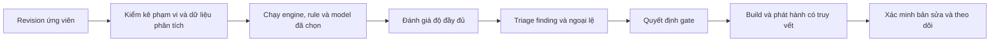

# Static analysis

## 1. Mục tiêu trong phát triển an toàn

Static analysis là phân tích mã nguồn hoặc biểu diễn của chương trình để suy ra các thuộc tính mà không cần chạy ứng dụng theo một kịch bản nghiệp vụ cụ thể. Trong bảo mật, phân tích tĩnh giúp phát hiện những mẫu nguy hiểm, luồng dữ liệu không tin cậy và cách sử dụng API vi phạm chính sách.

Trong chương Secure development, yêu cầu bảo mật cần đi xa hơn câu “phải chạy công cụ SAST”. Cần đặc tả:

- Rủi ro nào phải được kiểm tra bằng phân tích tĩnh.
- Những ngôn ngữ, module, biến thể build và loại mã nào thuộc phạm vi.
- Quy tắc và mô hình dữ liệu nào được sử dụng.
- Cách xác định lần phân tích đã hoàn tất đủ phạm vi.
- Finding nào phải chặn thay đổi hoặc phát hành.
- Ai phân tích finding, cách xử lý false positive và ngoại lệ.
- Bằng chứng nào nối kết quả với đúng revision và artifact liên quan.

SAST là cách gọi thường dùng cho kiểm thử bảo mật ứng dụng bằng phân tích tĩnh. Mức bảo đảm phụ thuộc kỹ thuật, mô hình, độ bao phủ và cách kết quả được sử dụng trong quy trình phát triển.

Bài học dùng dịch vụ xử lý đơn hàng làm ví dụ. Các mã yêu cầu, ngưỡng thời gian và quyết định chính sách là minh họa thiết kế, cần được lựa chọn theo rủi ro của sản phẩm thực tế.

## 2. Phân tích tĩnh kiểm tra những gì?

| Nhóm kỹ thuật | Ví dụ điều được kiểm tra | Giới hạn cần hiểu |
| --- | --- | --- |
| So khớp mẫu | Chuỗi hoặc cấu trúc gần một cách dùng API nguy hiểm | Có thể thiếu ngữ cảnh và bỏ sót các cách viết khác |
| Phân tích cú pháp và kiểu | Cách gọi phương thức, đối tượng, cấu trúc AST | Cần hiểu đúng ngôn ngữ và phiên bản cú pháp |
| Phân tích luồng điều khiển | Các nhánh và điều kiện có thể dẫn tới một điểm xử lý | Phụ thuộc cách xấp xỉ các đường thực thi |
| Phân tích luồng dữ liệu | Giá trị đi qua phép gán, tham số và giá trị trả về | Có thể khó theo dõi qua framework hoặc cơ chế động |
| Taint analysis | Dữ liệu từ nguồn không tin cậy tới một nơi sử dụng nhạy cảm | Cần mô hình source, propagation, sink và xử lý an toàn theo ngữ cảnh |
| Phân tích liên thủ tục | Quan hệ giữa các hàm hoặc module | Có chi phí và giới hạn mô hình hóa |
| Phân tích cấu hình liên quan mã | Bật debug, kiểm soát truy cập hoặc cấu hình nhạy cảm | Cần xác định cấu hình hiệu lực và môi trường áp dụng |

Một công cụ có thể kết hợp nhiều kỹ thuật. Không nên suy ra khả năng phân tích liên module hoặc theo luồng dữ liệu chỉ từ việc công cụ có nhãn “security”.

Khái niệm quan trọng là **mô hình xấp xỉ**. Công cụ không luôn biết chính xác mọi trạng thái và đường đi của chương trình. Một mô hình rộng có thể báo những đường không thực sự xảy ra; một mô hình thiếu có thể bỏ sót đường nguy hiểm.

Vì vậy, yêu cầu phải nêu phạm vi bảo đảm và cách xử lý bất định. “Không có finding” chỉ phản ánh kết quả của phép phân tích trong phạm vi đã thực hiện, không chứng minh chương trình không có lỗi bảo mật.

## 3. Liên kết với mô hình đe dọa và yêu cầu bảo mật

Bắt đầu từ các tài sản, ranh giới tin cậy và hành vi cần ngăn chặn:

| Rủi ro | Yêu cầu về hành vi chương trình | Hướng phân tích tĩnh |
| --- | --- | --- |
| Dữ liệu người dùng làm thay đổi cấu trúc SQL | Giá trị truy vấn phải được bind; thành phần cấu trúc động phải được kiểm soát | Theo luồng input tới API thực thi SQL và vị trí tạo câu lệnh |
| Bí mật bị đưa vào log | Không ghi token, khóa hoặc dữ liệu bí mật ngoài chính sách | Theo luồng dữ liệu được phân loại nhạy cảm tới logger |
| Input điều khiển lệnh hệ điều hành | Không ghép dữ liệu không tin cậy vào chuỗi lệnh ngoài hợp đồng | Kiểm tra luồng tới API tạo tiến trình |
| Input điều khiển file được đọc hoặc ghi | Đường truy cập phải nằm trong phạm vi đã được phép | Kiểm tra cách xây dựng và sử dụng đường dẫn, kết hợp thiết kế filesystem |
| URL từ bên ngoài điều khiển kết nối nội bộ | Đích mạng phải được xác định và kiểm soát theo chính sách | Theo luồng URL tới HTTP client, xem xét mô hình kiểm tra đích |
| Một nhánh đặc quyền thiếu kiểm soát | Mọi thao tác đặc quyền phải có điều kiện truy cập phù hợp | Dùng rule tùy chỉnh và review ngữ cảnh nghiệp vụ |

Cần phân biệt yêu cầu bảo mật của sản phẩm với quy tắc công cụ.

Ví dụ:

- **Yêu cầu sản phẩm:** dữ liệu người dùng không được thay đổi cấu trúc câu lệnh SQL.
- **Quy tắc phân tích:** phát hiện dữ liệu từ HTTP request đi tới SQL sink qua phép nối chuỗi.
- **Tiêu chí bằng chứng:** mẫu lỗi đại diện bị phát hiện; mã đã sửa được phân tích; kiểm thử liên quan xác nhận hành vi đúng.

Một rule không bao phủ hết mọi cách vi phạm yêu cầu. Ngược lại, một finding chưa chắc là vi phạm thực tế nếu công cụ không hiểu một ràng buộc hợp lệ. Cần giữ chuỗi truy vết giữa rủi ro, yêu cầu, rule và cách kiểm chứng bổ sung.

## 4. Hiểu source, sink và biện pháp xử lý theo ngữ cảnh

### 4.1. Source và propagation

Source là điểm đưa dữ liệu cần theo dõi vào chương trình, chẳng hạn:

- Trường của HTTP request.
- Thông điệp từ một queue có thể nhận dữ liệu không tin cậy.
- Nội dung file hoặc cấu hình do bên ngoài kiểm soát.
- Dữ liệu từ hệ thống khác qua một ranh giới tin cậy.
- Dữ liệu nhạy cảm cần theo dõi để ngăn rò rỉ.

Dữ liệu có thể đi qua DTO, mapper, service và repository trước khi đến điểm sử dụng. Nếu công cụ chỉ nhìn từng file riêng lẻ, nó có thể mất dấu đường đi này.

Một tên biến như `validatedInput` hoặc `trustedTenant` không tự chứng minh thuộc tính bảo mật. Mô hình cần dựa trên hành vi và hợp đồng thực tế.

### 4.2. Sink

Sink là điểm mà dữ liệu có thể tạo tác động nhạy cảm:

- Thực thi truy vấn.
- Tạo tiến trình.
- Đọc hoặc ghi file.
- Gửi request mạng.
- Ghi log hoặc xuất dữ liệu.
- Diễn giải template hoặc biểu thức.

Mức độ nguy hiểm phụ thuộc cách dữ liệu được sử dụng. Dữ liệu được bind thành giá trị SQL có ý nghĩa khác với dữ liệu được ghép vào cấu trúc SQL.

### 4.3. Xử lý an toàn phải gắn với thuộc tính cần bảo vệ

Một phép kiểm tra hoặc chuyển đổi chỉ có hiệu lực trong phạm vi nó chứng minh được.

Ví dụ:

- Bind tham số SQL bảo vệ vị trí giá trị được bind.
- Kiểm tra độ dài không tự bảo vệ cấu trúc truy vấn.
- Encode cho một ngữ cảnh hiển thị không tạo bảo đảm chung cho SQL hoặc lệnh hệ điều hành.
- Chỉ kiểm tra URL bắt đầu bằng HTTPS không chứng minh đích mạng được phép.
- Chuẩn hóa chuỗi đường dẫn chưa bao phủ mọi điều kiện liên quan filesystem và liên kết.

Không gắn một hàm tiện ích là “sanitizer cho mọi đầu vào” chỉ để giảm số finding. Mô hình sai có thể làm công cụ ngừng theo dõi những luồng vẫn còn nguy hiểm.

Với framework tùy chỉnh, cần xác định rõ source, sink, wrapper và hợp đồng của validator. Mỗi mô hình quan trọng nên có ví dụ đúng và sai để kiểm tra lại khi framework thay đổi.

## 5. Ví dụ Java: từ finding SQL tới yêu cầu có thể kiểm tra

### 5.1. Mẫu cần bị phát hiện

Một đoạn mã minh họa:

```java
String sql =
        "SELECT order_id FROM orders WHERE customer_name = '"
        + customerName
        + "'";

statement.executeQuery(sql);
```

Nếu `customerName` đến từ request, có đường dữ liệu không tin cậy tham gia tạo cấu trúc SQL. Công cụ cần phát hiện theo source và sink, kể cả khi hai điểm nằm ở các lớp khác nhau.

Một finding hữu ích nên chỉ ra:

1. Source đưa dữ liệu vào.
2. Các bước truyền hoặc biến đổi liên quan.
3. Vị trí tạo câu lệnh.
4. Sink thực thi.
5. Mã rule, mức độ và giới hạn phân tích.

Chỉ hiển thị một dòng ở sink có thể làm người sửa khó xác định nguyên nhân.

### 5.2. Mẫu sử dụng tham số

Ví dụ dưới đây dùng Java 17 trở lên và API JDBC của thư viện chuẩn:

```java
import java.sql.Connection;
import java.sql.PreparedStatement;
import java.sql.ResultSet;
import java.sql.SQLException;
import java.util.ArrayList;
import java.util.List;

public final class OrdersRepository {
    public record OrderView(long orderId, String status) {
    }

    public List<OrderView> findByCustomerName(
            Connection connection,
            String verifiedTenantId,
            String customerName) throws SQLException {

        String sql = """
                SELECT order_id, status
                FROM orders
                WHERE tenant_id = ? AND customer_name = ?
                """;

        try (PreparedStatement query = connection.prepareStatement(sql)) {
            query.setString(1, verifiedTenantId);
            query.setString(2, customerName);
            query.setMaxRows(100);

            try (ResultSet rows = query.executeQuery()) {
                List<OrderView> result = new ArrayList<>();
                while (rows.next()) {
                    result.add(new OrderView(
                            rows.getLong("order_id"),
                            rows.getString("status")));
                }
                return List.copyOf(result);
            }
        }
    }
}
```

Ở đây, cấu trúc SQL cố định và các giá trị được bind. Giới hạn 100 dòng chỉ là một lựa chọn minh họa; phân trang và yêu cầu hiệu năng cần hợp đồng riêng.

Tên `verifiedTenantId` biểu đạt hợp đồng mà bên gọi phải đáp ứng: tenant phải được suy ra từ ngữ cảnh xác thực và quyền thành viên đã được kiểm tra. Tên biến không thay thế việc thực hiện kiểm tra đó.

Ví dụ cũng chưa mô tả toàn bộ quyền xem đơn hàng của từng người dùng. Phân quyền nghiệp vụ cần được cưỡng chế ở thiết kế phù hợp và kiểm tra riêng.

### 5.3. Những điểm rule cần phân biệt

- Gọi `prepareStatement` với SQL đã ghép input vẫn có thể vi phạm yêu cầu.
- Bind giá trị không cho phép tùy ý bind tên bảng, tên cột hoặc từ khóa.
- Nếu cần cấu trúc động, nên ánh xạ một lựa chọn hợp lệ sang cấu trúc cố định đã được phép.
- Rule phải nhận diện wrapper JDBC hoặc thư viện truy vấn trong phạm vi thực tế.
- Bản sửa cần được kiểm tra ở đường thực thi liên quan, không chỉ thay tên API để finding biến mất.

Đây là ví dụ về SQL injection. Cùng phương pháp phân tích không tự chứng minh người dùng được phép xem đúng tài nguyên, vì quy tắc phân quyền có thể phụ thuộc ngữ cảnh nghiệp vụ mà công cụ chưa biết.

## 6. Đặc tả phạm vi và độ bao phủ

### 6.1. Những gì phải được kiểm kê

Hồ sơ phân tích nên xác định:

- Repository, revision và candidate được kiểm tra.
- Các module và ngôn ngữ.
- Source thuộc production, test hoặc công cụ build.
- Biến thể build và điều kiện biên dịch.
- Mã sinh tự động, template và cấu hình liên quan.
- Dependency hoặc bytecode cần cho phân tích kiểu và liên thủ tục.
- Các vùng bị loại trừ cùng lý do và thẩm quyền.

Không mặc định một lần quét ở thư mục gốc đã bao phủ tất cả module. Một module có thể bị bỏ qua do cấu hình, lỗi build, ngôn ngữ chưa hỗ trợ hoặc đường dẫn không khớp.

Mã được vendor hoặc sinh tự động có thể đi vào sản phẩm. Cần quyết định cách kiểm soát nó dựa trên rủi ro và nguồn gốc, thay vì loại bỏ toàn bộ chỉ để giảm nhiễu.

### 6.2. Phân tích hoàn tất phải có bằng chứng

Cần xác định các tín hiệu như:

- Số lượng và tập source dự kiến trong phạm vi.
- Tập source thực sự được phân tích.
- Lỗi parse, lỗi dựng mô hình hoặc lỗi biên dịch liên quan.
- Ngôn ngữ hoặc tính năng không được hỗ trợ.
- Rule bundle và các rule bắt buộc đã được bật.
- Mô hình source/sink/framework đã nạp.
- Các bước phân tích bị giảm mức hoặc bỏ qua.

Một tiến trình trả mã thành công không tự chứng minh mọi điều kiện này đều đạt. Cơ chế đánh giá phải hiểu ngữ nghĩa đầu ra của công cụ được chọn.

Nếu engine cần bytecode hoặc classpath nhưng không có dữ liệu đó, phải ghi rõ mức phân tích thực hiện được. Không mô tả một phép so khớp văn bản thay thế như phân tích luồng dữ liệu đầy đủ.

### 6.3. Phạm vi chưa hỗ trợ

Với ngôn ngữ hoặc cơ chế chưa được hỗ trợ, cần:

1. Ghi nhận khoảng trống.
2. Đánh giá rủi ro.
3. Chọn kiểm soát bổ sung như review chuyên biệt hoặc kiểm thử phù hợp.
4. Chỉ định chủ sở hữu và thời hạn.
5. Áp ngoại lệ nếu policy yêu cầu.

Một ngoại lệ có thể cho phép phát hành trong phạm vi được duyệt. Báo cáo vẫn phải phản ánh phần chưa được phân tích, không đổi độ bao phủ thực tế thành đầy đủ.

## 7. Chọn và quản lý rule theo rủi ro

### 7.1. Rule bắt buộc phải truy vết được

Mỗi nhóm rule quan trọng nên có:

- Rủi ro hoặc yêu cầu liên quan.
- Ngôn ngữ và API được hỗ trợ.
- Source, sink và điều kiện xử lý an toàn.
- Mức độ do công cụ đề xuất và cách policy sử dụng.
- Hạn chế đã biết.
- Bộ ví dụ để kiểm tra hành vi mong đợi.

Rule kiểm tra cách gọi API có thể phù hợp với một yêu cầu cấm cụ thể. Rule luồng dữ liệu phù hợp khi rủi ro phụ thuộc nguồn của dữ liệu. Không cần dùng cùng một kỹ thuật cho mọi yêu cầu.

### 7.2. Rule và mô hình cũng có vòng đời

Khi thêm rule, đổi engine hoặc cập nhật framework, cần xem:

- Finding mới có phản ánh rủi ro hay do mô hình thay đổi?
- Rule có còn nhận diện wrapper của ứng dụng không?
- Có pattern an toàn nào bị hiểu sai không?
- Có pattern nguy hiểm mới bị bỏ qua không?
- Kết quả cũ hoặc suppression nào cần đánh giá lại?

Phiên bản engine, rule và model cần được ghi trong báo cáo để giải thích khác biệt giữa các lần chạy.

Không tự động tắt một rule chỉ vì nó tạo nhiều finding. Cần xác định nguyên nhân: lỗi thật tồn đọng, mô hình thiếu, rule quá rộng hay phạm vi cấu hình sai.

### 7.3. Kiểm chứng rule bằng ví dụ có kiểm soát

Bộ ví dụ cho một rule có thể gồm:

- Luồng dữ liệu nguy hiểm trực tiếp.
- Luồng qua nhiều hàm hoặc wrapper.
- Luồng an toàn theo hợp đồng.
- Nhánh không đủ dữ liệu để kết luận.
- Cú pháp hoặc framework mà sản phẩm sử dụng.

Tỷ lệ phát hiện trên bộ ví dụ chỉ đo khả năng với tập đó. Không dùng nó để tuyên bố phát hiện 100% lỗ hổng trong chương trình thực.

Các fixture cố ý chứa mẫu lỗi cần được quản lý riêng để không làm nhiễu gate của sản phẩm. Việc loại trừ fixture phải có phạm vi hẹp; không tạo đường để mã production được đặt vào vùng bỏ qua.

## 8. Phân loại finding và trách nhiệm xử lý

### 8.1. Dữ liệu tối thiểu của finding

Một finding cần có:

- Rule ID, phiên bản và nhóm rủi ro.
- Repository, revision và phạm vi phân tích.
- Vị trí liên quan cùng luồng dữ liệu nếu có.
- Mức độ, độ chắc chắn hoặc dữ liệu hỗ trợ tương ứng.
- Chủ sở hữu xử lý.
- Kết luận, lý do và bằng chứng.
- Liên kết tới thay đổi sửa và kết quả kiểm tra lại.

Finding cần định danh đủ ổn định để theo dõi khi số dòng thay đổi. Tuy vậy, một fingerprint giống nhau không chứng minh logic không đổi; thay đổi ở source, sink, caller hoặc model có thể yêu cầu đánh giá lại.

### 8.2. Tách các loại trạng thái

Một mô hình minh họa:

```text
analysisStatus:
  COMPLETE | PARTIAL | FAILED

assessment:
  UNREVIEWED | NEEDS_CONTEXT | CONFIRMED | FALSE_POSITIVE

remediation:
  OPEN | IN_PROGRESS | FIXED_IN_CANDIDATE | VERIFIED_IN_TARGET

riskDisposition:
  NO_EXCEPTION | ACCEPTED_UNTIL_EXPIRY

gateDecision:
  PASS | BLOCK | INCOMPLETE | PASS_WITH_EXCEPTION
```

Một finding được chấp nhận rủi ro vẫn có thể là CONFIRMED và OPEN. Nó không trở thành false positive.

Một lần phân tích COMPLETE vẫn có thể có finding phải BLOCK. Một lần PARTIAL không trở thành kết quả sạch chỉ vì không có finding.

### 8.3. Triage theo ngữ cảnh

Người xử lý cần xác minh:

1. Dữ liệu có thực sự đến từ nguồn cần theo dõi không?
2. Luồng có thể tồn tại trong cấu hình thuộc phạm vi không?
3. Sink có tạo tác động mà rule mô tả không?
4. Có kiểm soát nào thỏa đúng thuộc tính cần bảo vệ không?
5. Hậu quả và độ phơi lộ là gì?
6. Có giới hạn mô hình nào làm kết luận chưa chắc chắn không?

Với reflection, dependency injection, plugin và hành vi sinh mã, cần thận trọng khi kết luận không có đường thực thi.

Không thấy một đường trong trace chạy thử chưa đủ chứng minh không thể có đường đó. Kết luận false positive phải dựa trên điều kiện kỹ thuật có thể kiểm tra.

## 9. Baseline, suppression và ngoại lệ

### 9.1. Baseline quản lý tồn đọng

Baseline giúp phân biệt finding đã biết với finding mới. Nó không biến các lỗi tồn đọng thành rủi ro được chấp nhận.

Cần bảo vệ:

- Thời điểm và revision tạo baseline.
- Quyền thêm finding vào baseline.
- Chủ sở hữu và thời hạn của finding tồn đọng.
- Quy tắc cho các lỗi nghiêm trọng đã có từ trước.
- Lịch sử thay đổi baseline.

Không tự tạo lại baseline từ kết quả mới mỗi lần build, vì cách đó có thể đưa lỗi mới vào nhóm đã biết mà không có quyết định.

### 9.2. Không chỉ xem dòng thay đổi

Một thay đổi nhỏ có thể tạo đường dữ liệu tới sink ở file không sửa. Ví dụ, controller mới truyền input tới một repository cũ vốn chỉ nhận giá trị nội bộ.

Phân tích tăng dần cần đủ ngữ cảnh và cơ chế phát hiện thay đổi đường đi. Gate có thể ưu tiên finding mới phát sinh từ thay đổi, nhưng không nên chỉ lọc theo số dòng nằm trong diff.

Cần có lần phân tích đầy đủ theo policy để phát hiện drift, thay đổi rule hoặc các ảnh hưởng mà phép phân tích tăng dần chưa bao phủ.

### 9.3. Suppression phải có căn cứ

Một suppression cần ràng buộc với:

- Rule và finding hoặc mẫu luồng cụ thể.
- Lý do kỹ thuật.
- Artifact hoặc revision, phạm vi mã và giả định liên quan.
- Người xem xét có thẩm quyền.
- Hạn sử dụng hoặc điều kiện tái đánh giá.

Không tắt cả nhóm rule hay toàn thư mục vì một false positive cục bộ.

Nếu suppression dựa trên một validator, thay đổi validator, caller hoặc model cần kích hoạt xem xét lại. Việc dịch chuyển số dòng không nhất thiết làm mất suppression, nhưng thay đổi ngữ nghĩa có thể làm cơ sở cũ không còn đúng.

### 9.4. Ngoại lệ là quyết định rủi ro

Ngoại lệ cho finding thật cần có rủi ro còn lại, biện pháp bù, chủ sở hữu sửa, người chấp nhận rủi ro và thời hạn.

Một comment trong source không tự cấp thẩm quyền bỏ gate. Hệ thống cần kiểm tra quyền, phạm vi và hiệu lực của quyết định.

Nếu finding hết thời hạn được chấp nhận mà chưa sửa, policy phải nêu hành vi chặn hoặc nâng cấp xử lý; không tự gia hạn chỉ vì build cần chạy.

## 10. Yêu cầu bảo mật và tiêu chí nghiệm thu

| Mã | Yêu cầu | Tiêu chí chấp nhận |
| --- | --- | --- |
| SEC-SAST-01 | Mọi candidate phát hành phải được phân tích theo phạm vi bắt buộc | Có revision, module, ngôn ngữ và tập source dự kiến; khoảng trống được phản ánh rõ |
| SEC-SAST-02 | Rule bắt buộc phải gắn với rủi ro và được kiểm chứng | Mẫu lỗi đại diện bị phát hiện; mẫu an toàn được diễn giải theo hợp đồng |
| SEC-SAST-03 | Kết quả phải ghi engine, rule, model và cấu hình | Có thể tái dựng căn cứ phân tích và giải thích khác biệt giữa các lần chạy |
| SEC-SAST-04 | Lỗi parse, thiếu dữ liệu hoặc bỏ qua phạm vi phải tạo trạng thái thiếu bằng chứng | Không nhận PASS mặc định chỉ vì số finding bằng 0 |
| SEC-SAST-05 | Finding phải có đủ ngữ cảnh và chủ sở hữu để xử lý | Có source/sink hoặc bằng chứng tương ứng, revision, rule và kết luận triage |
| SEC-SAST-06 | Rủi ro vượt chính sách phải chặn phát hành nếu không có ngoại lệ hợp lệ | Finding confirmed thuộc nhóm chặn tạo BLOCK |
| SEC-SAST-07 | Finding nghiêm trọng chưa được phân loại phải được giữ ở trạng thái cần xử lý | Không tự coi là false positive hoặc bỏ qua vì thiếu ngữ cảnh |
| SEC-SAST-08 | Suppression, baseline và ngoại lệ phải được kiểm soát | Không tự đưa lỗi mới vào baseline; ngoại lệ sai phạm vi hoặc hết hạn không vượt gate |
| SEC-SAST-09 | Bản sửa phải được xác minh với độ bao phủ tương ứng | Finding biến mất do mã sửa được phân tích, không do rule hoặc đường mã bị bỏ qua |
| SEC-SAST-10 | Kết quả phải liên kết với đúng candidate và quy trình tạo artifact | Không dùng kết quả của revision cũ để duyệt candidate đã đổi |
| SEC-SAST-11 | Phân tích mã chưa tin cậy không được làm lộ bí mật hoặc cấp quyền phát hành | Runner và các bước build hỗ trợ có quyền phù hợp nguồn đầu vào |
| SEC-SAST-12 | Kết quả và bằng chứng phải được bảo vệ | Kiểm soát quyền đọc/sửa và không đưa dữ liệu nhạy cảm ngoài phạm vi cho phép |

### Chính sách gate minh họa

- Finding high hoặc critical đã xác nhận: BLOCK, trừ ngoại lệ còn hiệu lực.
- Finding high hoặc critical chưa đủ triage: INCOMPLETE, chờ quyết định có căn cứ.
- Phân tích thiếu phạm vi bắt buộc hoặc rule bắt buộc không chạy: INCOMPLETE.
- Finding thấp hơn đã được phân loại: xử lý theo thời hạn và điều kiện policy.
- Finding nằm trong baseline vẫn chịu các quy tắc rủi ro và ngoại lệ tương ứng.
- Ngoại lệ hợp lệ: PASS_WITH_EXCEPTION trong phạm vi được duyệt, không hiển thị như không có lỗi.

### Thời hạn minh họa

Dịch vụ có thể cam kết:

- Hoàn tất triage ban đầu cho critical trong 4 giờ và high trong 24 giờ.
- Đặt thời hạn khắc phục critical là 72 giờ, high là 7 ngày.
- Đánh giá lại suppression khi thay đổi phần mã hoặc mô hình làm cơ sở kết luận.
- Rà soát thay đổi rule được tiếp nhận từ nguồn đã phê duyệt trong 7 ngày.

Thời gian xử lý finding tính từ lúc nhận kết quả đáng tin cậy cho candidate thuộc phạm vi, không đặt lại bằng cách đổi ticket hoặc chạy lại công cụ.

Các mốc này là lựa chọn minh họa. Dấu hiệu khai thác thực tế hoặc rủi ro đặc biệt cần quy trình ứng phó phù hợp, thay vì mặc định chờ hết thời hạn thông thường.

## 11. Tích hợp pipeline và ràng buộc candidate

Một luồng tham khảo:



### 11.1. Candidate phải được định danh bất biến

Kết quả cần gắn với revision đầy đủ hoặc định danh tương đương của source được xét. Nếu pipeline kiểm tra một nhánh rồi triển khai một trạng thái mới hơn của nhánh đó, bằng chứng không còn khớp.

Với candidate được tạo từ kết quả tích hợp nhiều thay đổi, cần kiểm tra đúng trạng thái tích hợp theo policy. Không chỉ dựa vào kết quả của từng nhánh khi cấu hình hoặc đường đi có thể đổi sau khi kết hợp.

Nếu phân tích phụ thuộc bytecode, dependency graph hoặc cấu hình build, cần lưu định danh các đầu vào tương ứng.

### 11.2. Phân tích source và bảo đảm artifact

SAST trên source cung cấp bằng chứng về source và mô hình đã xét. Để sử dụng trong quyết định phát hành artifact, cần chuỗi truy vết giữa source, cấu hình build và artifact cuối cùng.

Không mặc định một kết quả source scan tự chứng minh mọi byte trong artifact đều được phân tích. Mã sinh, bước đóng gói, thư viện nhúng hoặc input build khác cần các kiểm soát liên quan.

### 11.3. Bảo vệ môi trường phân tích

Bản thân phân tích tĩnh không cần chạy ứng dụng theo nghiệp vụ, nhưng pipeline có thể chạy compiler, generator hoặc plugin để chuẩn bị dữ liệu.

Với mã đầu vào chưa tin cậy:

- Tách quyền và môi trường phù hợp.
- Không cấp bí mật production hoặc quyền ký phát hành.
- Giới hạn truy cập mạng và tài nguyên theo nhiệm vụ.
- Kiểm soát cache và đầu vào từ các lần chạy khác.
- Bảo vệ cấu hình rule và logic gate khỏi việc ứng viên tự nới lỏng.

Một thay đổi source không được tự tắt rule bắt buộc rồi dùng báo cáo đó làm bằng chứng đã đạt chính sách.

## 12. Kiểm thử yêu cầu phân tích tĩnh

| Tình huống | Kết quả mong đợi | Yêu cầu liên quan |
| --- | --- | --- |
| Input HTTP được nối vào SQL sink | Có finding đúng source, sink và đường dữ liệu | SEC-SAST-02, SEC-SAST-05 |
| Luồng nguy hiểm đi qua wrapper hoặc nhiều module | Được phát hiện trong phạm vi mô hình đã cam kết | SEC-SAST-01, SEC-SAST-02 |
| SQL cấu trúc cố định và bind giá trị | Không bị kết luận sai do thiếu mô hình, hoặc có triage được kiểm chứng | SEC-SAST-02 |
| API prepare được gọi với SQL đã ghép input | Không coi tên API là đủ an toàn | SEC-SAST-02 |
| Một validator chỉ kiểm tra độ dài | Không loại bỏ taint cho thuộc tính bảo vệ SQL | SEC-SAST-02 |
| Thiếu module trong cấu hình scan | Phát hiện khoảng trống, không PASS mặc định | SEC-SAST-01, SEC-SAST-04 |
| Parser không hỗ trợ cú pháp hoặc thiếu classpath | PARTIAL hoặc FAILED theo phạm vi ảnh hưởng | SEC-SAST-04 |
| Rule bắt buộc bị ứng viên tắt | Gate từ chối cấu hình hoặc báo thiếu bằng chứng | SEC-SAST-02, SEC-SAST-11 |
| Tiến trình công cụ thành công nhưng không phân tích source dự kiến | Không nhận PASS dựa trên exit code riêng lẻ | SEC-SAST-04 |
| Finding high confirmed không có ngoại lệ | BLOCK | SEC-SAST-06 |
| Finding high chưa đủ ngữ cảnh | INCOMPLETE, không tự coi là false positive | SEC-SAST-07 |
| Finding mới bị thêm vào baseline không có quyết định | Không được dùng baseline để vượt policy | SEC-SAST-08 |
| Caller mới đưa input tới sink ở dòng không sửa | Phân tích hoặc kiểm soát bổ sung phát hiện ảnh hưởng | SEC-SAST-01, SEC-SAST-08 |
| Suppression đúng rule nhưng sai ngữ cảnh | Không tự bỏ finding mới | SEC-SAST-08 |
| Ngoại lệ hết hạn | Không tiếp tục vượt gate | SEC-SAST-08 |
| Finding biến mất vì module bị bỏ khỏi scan | Không đánh dấu đã sửa | SEC-SAST-04, SEC-SAST-09 |
| Finding biến mất sau bản sửa với coverage còn đủ | Ghi nhận FIXED_IN_CANDIDATE kèm bằng chứng | SEC-SAST-09 |
| Candidate đổi sau khi scan | Không dùng kết quả cũ để duyệt trạng thái mới | SEC-SAST-10 |
| Pipeline chuẩn bị phân tích thử tiếp cận bí mật ngoài quyền | Bị từ chối và có bằng chứng phù hợp | SEC-SAST-11 |
| Báo cáo chứa đoạn source nhạy cảm | Chỉ xuất qua kênh và quyền được phép | SEC-SAST-12 |

### Ví dụ Given/When/Then cho độ đầy đủ

```text
Given:
  Dịch vụ có hai module production thuộc phạm vi SAST.
  Policy yêu cầu phân tích cả hai module.
  Một module bị bỏ qua do lỗi dựng mô hình.

When:
  Pipeline nhận báo cáo không có finding từ module còn lại.

Then:
  Kết quả tổng thể không phải PASS.
  Báo cáo ghi rõ module thiếu và nguyên nhân.
  Gate trả INCOMPLETE nếu không có ngoại lệ phù hợp.
  Không diễn giải số finding bằng 0 thành bằng chứng đủ phạm vi.
```

Kiểm thử cần chứng minh cả đường phát hiện và đường công cụ không hoàn tất. Chỉ có các mẫu vulnerability được phát hiện chưa đủ để kiểm chứng gate và quản lý bằng chứng.

## 13. Xác minh bản sửa và đo hiệu quả

### 13.1. Điều kiện xác minh bản sửa

Khi finding không còn xuất hiện, cần kiểm tra:

1. Đúng revision chứa thay đổi đã được phân tích.
2. Module, rule và model liên quan vẫn được chạy.
3. Không có suppression mới che finding mà chưa được phê duyệt.
4. Đường dữ liệu hoặc điều kiện gây lỗi đã được thay đổi phù hợp.
5. Kiểm thử bổ sung xác nhận thuộc tính bảo mật tại ranh giới cần thiết.

Nếu yêu cầu là đã xử lý ở một môi trường triển khai, cần thêm bằng chứng artifact từ bản sửa đã được đưa vào môi trường đó. “Đã sửa trong candidate” và “đã thay thế bản đang chạy” là hai phạm vi kết luận khác nhau.

### 13.2. Chỉ số hữu ích

Có thể theo dõi:

- Độ bao phủ source và rule bắt buộc.
- Tỷ lệ phân tích PARTIAL hoặc FAILED.
- Thời gian triage và khắc phục theo mức rủi ro.
- Finding bị mở lại do sửa chưa đủ.
- Ngoại lệ, suppression và finding tồn đọng quá hạn.
- Số lần gate bị vượt ngoài quy trình.
- Khả năng phát hiện trên bộ ví dụ kiểm chứng đã biết.

Tỷ lệ finding được xác nhận trong tập đã triage có thể phản ánh mức hữu ích của rule ở tập đó. Cần ghi rõ cách lấy mẫu, vì tập đã review có thể không đại diện cho mọi finding.

Không thể suy ra tỷ lệ bỏ sót thực tế chỉ từ những lỗi công cụ đã tìm thấy. Muốn đánh giá điểm mù, cần kết hợp review, kiểm thử động, sự cố và tập ví dụ có kết quả kỳ vọng.

Số finding giảm có thể do sửa lỗi, nhưng cũng có thể do giảm coverage hoặc tắt rule. Báo cáo cần liên kết số liệu với thay đổi phạm vi và cấu hình.

## 14. Truy vết trong vòng đời phát triển

| Rủi ro | Yêu cầu | Điểm cưỡng chế | Bằng chứng |
| --- | --- | --- | --- |
| R-SAST-01: dữ liệu không tin cậy đi tới sink nguy hiểm | SEC-SAST-02, SEC-SAST-05 | Rule và model luồng dữ liệu | Mẫu lỗi, flow report và kết luận triage |
| R-SAST-02: bỏ sót module rồi công bố kết quả sạch | SEC-SAST-01, SEC-SAST-04 | Kiểm kê phạm vi và gate | Test thiếu module, lỗi parse và số source được xét |
| R-SAST-03: finding thật bị ẩn bằng cấu hình | SEC-SAST-08, SEC-SAST-11 | Quản lý baseline, suppression và quyền sửa policy | Audit thay đổi và test quyền vượt gate |
| R-SAST-04: dùng báo cáo của mã cũ | SEC-SAST-10 | Ràng buộc candidate và chuỗi build | Revision, cấu hình và liên kết artifact |
| R-SAST-05: kết luận đã sửa khi rule không còn chạy | SEC-SAST-09 | Kiểm tra lại coverage và bản sửa | Báo cáo so sánh và kiểm thử hành vi |
| R-SAST-06: lộ source hoặc bí mật qua pipeline | SEC-SAST-11, SEC-SAST-12 | Quyền runner và kho bằng chứng | Test quyền truy cập, log và đường xuất báo cáo |

Trong thiết kế, xác định yêu cầu bảo mật và các ranh giới mà SAST có thể hỗ trợ kiểm tra. Khi hiện thực, chọn rule, mô hình và phạm vi phù hợp với kiến trúc. Trước phát hành, kiểm tra độ đầy đủ, xử lý finding và ràng buộc kết quả với đúng candidate. Sau đó duy trì rule, xem xét ngoại lệ và học từ các lỗi mà phân tích tĩnh chưa phát hiện.

Review thủ công, kiểm thử động, phân tích dependency và kiểm tra bí mật bổ sung các góc nhìn khác nhau. Đặc tả cần phân công rõ mỗi loại bằng chứng phục vụ yêu cầu nào.

Một yêu cầu static analysis đủ rõ giúp người triển khai biết phải phân tích gì, người kiểm thử biết khi nào kết quả chưa đủ và người chịu trách nhiệm rủi ro biết vì sao một candidate được phép phát hành. Giá trị bảo mật đến từ chuỗi rủi ro, quy tắc, độ bao phủ, quyết định và bằng chứng có thể kiểm chứng.
