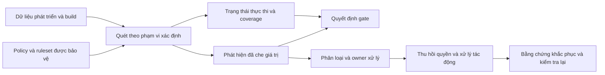

# Secret scanning

## 1. Mục tiêu và phạm vi bài học

Secret scanning là việc phát hiện dữ liệu có khả năng chứa credential hoặc vật liệu bí mật trong source, lịch sử Git và những bề mặt phát sinh của quá trình phát triển. Kết quả quét giúp ngăn đưa secret vào nơi không phù hợp, xác định việc đã lộ và kích hoạt xử lý quyền truy cập liên quan.

Trong chương **Secure development** của module **SECURITY_SECURITY_DESIGN_SECURITY_REQUIREMENTS**, bài học chuyển mục tiêu đó thành yêu cầu cụ thể, đo được và kiểm chứng được. Một chương trình secret scanning cần trả lời: quét ở đâu, tìm loại gì, dữ liệu nào đã thực sự được kiểm tra, ai được xem phát hiện, khi nào chặn thay đổi và bằng chứng nào xác nhận secret đã được xử lý.

Sau bài học, người học cần có khả năng:

- Phân biệt ứng viên secret, secret thực, trạng thái còn hiệu lực và sự cố lộ credential.
- Đặc tả phạm vi quét source, commit/ref, artifact và những bề mặt ngoài Git.
- Thiết kế detector, kiểm thử mẫu tổng hợp và điều kiện PASS/FAIL không nhầm lỗi công cụ với kết quả sạch.
- Quản lý false positive, baseline, ngoại lệ, báo cáo nhạy cảm và luồng thu hồi credential.
- Liên kết yêu cầu quét với CI, rủi ro, owner, logging và phục hồi.

Các mã yêu cầu, marker và mục tiêu thời gian dưới đây là ví dụ thiết kế cho bài học. Không dùng credential thật trong production để thử khả năng phát hiện; mọi phép thử đối kháng cần diễn ra trong môi trường kiểm soát.

## 2. Những khái niệm không được đánh đồng

| Khái niệm | Ý nghĩa | Điều chưa thể kết luận |
| --- | --- | --- |
| Candidate hoặc finding | Detector thấy một chuỗi/ngữ cảnh đáng nghi | Chuỗi đó chắc chắn cấp quyền thực |
| Secret thực | Giá trị có chức năng xác thực, ký, giải mã hoặc cấp quyền tương đương | Nó hiện còn hoạt động hay đã từng bị lạm dụng |
| Validity | Trạng thái hiệu lực quan sát được theo phương pháp kiểm tra | Secret inactive chưa từng bị khai thác hoặc mọi quyền phát sinh đã mất |
| Exposure | Giá trị đi tới người/hệ thống ngoài phạm vi được phép | Bản sao nào cũng có thể thu hồi bằng cách xóa file gốc |
| Remediation | Xử lý quyền, tác động và bề mặt còn lưu theo quyết định rủi ro | Đóng alert hoặc xóa dòng đã đủ hoàn thành |
| Clean scan | Không có phát hiện theo detector và phạm vi đã chạy | Toàn bộ sản phẩm không còn secret |

Ví dụ cần nhận diện gồm API token, mật khẩu trong connection string, private key, cookie phiên và credential trong fixture. Public key, public client ID hoặc một chuỗi ngẫu nhiên không tự là secret; cần phân loại theo khả năng cấp quyền và ngữ cảnh sử dụng, không chỉ theo tên biến hay entropy.

Quét là lớp phát hiện và hỗ trợ ngăn chặn, không thay cho kho secret, danh tính workload, quyền tối thiểu hay quản lý vòng đời credential. [OWASP Secrets Management Cheat Sheet](https://cheatsheetseries.owasp.org/cheatsheets/Secrets_Management_Cheat_Sheet.html) là nguồn tham khảo cho bối cảnh cấp phát, thay thế và thu hồi bí mật ngoài hoạt động dò tìm.

## 3. Mô hình đe dọa và ranh giới tin cậy

Giả sử một nhóm phát triển API có repository, job CI tạo package, kho artifact và dashboard xử lý cảnh báo. Secret có thể bị đưa vào source bởi lỗi thao tác, dữ liệu test sao chép từ môi trường thật hoặc công cụ sinh cấu hình. Người có quyền sửa pipeline cũng có thể làm scanner không chạy hoặc giảm ruleset.



Hai ranh giới cần bảo vệ là dữ liệu được quét với hệ thống scanner, và scanner với thành phần ra quyết định. Một báo cáo do chính PR không tin cậy tự tạo không chứng minh scanner bắt buộc đã chạy; ngược lại, báo cáo scanner chứa nguyên credential có thể trở thành một điểm rò rỉ mới.

| Mã rủi ro | Tình huống | Hậu quả |
| --- | --- | --- |
| R-01 | Chỉ quét HEAD hoặc một phần file trong khi secret ở lịch sử/ref khác | Bỏ sót credential vẫn còn trong phạm vi truy cập |
| R-02 | Ruleset thiếu định dạng hoặc loại bỏ quá nhiều nội dung | Kết quả sạch nhưng không có khả năng phát hiện cần thiết |
| R-03 | Hook bị bỏ qua, scanner lỗi hoặc cấu hình bị sửa | Thay đổi vượt gate mà không được kiểm tra đúng |
| R-04 | Report, log hoặc validity check chuyển secret tới nơi không phù hợp | Scanner tạo thêm exposure |
| R-05 | Baseline, allowlist hoặc bypass biến thành quyền bỏ qua lâu dài | Finding thực không được xử lý hoặc phát hiện mới bị che |
| R-06 | Chỉ xóa source/đóng alert, credential cũ vẫn dùng được | Quyền bị lộ tiếp tục tồn tại |
| R-07 | Không có owner, nguồn lực hoặc chiến lược phục hồi | Cảnh báo bị tồn đọng, sự cố tái diễn |

## 4. Phạm vi quét và vị trí kiểm soát

### 4.1. Mỗi chế độ quét nhìn thấy một tập dữ liệu khác

| Vị trí | Dữ liệu cần xác định | Giới hạn điển hình |
| --- | --- | --- |
| Trước commit | Nội dung đang stage hoặc thay đổi chuẩn bị commit | Quét working tree có thể khác nội dung thật trong index |
| Trước nhận push | Những object/commit cần kiểm tra cho thao tác ghi | Tính năng và giới hạn phụ thuộc nền tảng, loại secret và đường ghi |
| CI của PR | Diff/range hoặc snapshot theo revision đã chọn | Nội dung đã có thể tới remote; checkout nông có thể thiếu lịch sử |
| Quét lịch sử | Commit/ref có thể tiếp cận theo phạm vi cấu hình | Không tự bao phủ clone ngoài quyền kiểm soát hoặc ref chưa được lấy |
| Artifact/build | Package, image layer, generated config, log hoặc cache theo policy | Source sạch không chứng minh đầu ra build sạch |
| Bề mặt cộng tác | Nội dung PR, issue, wiki, tệp đính kèm theo khả năng tích hợp | Một công cụ Git cục bộ không tự đọc các bề mặt này |

Repository có submodule, LFS hoặc nội dung đóng gói cần cách tiếp cận riêng: Git pointer không phải toàn bộ byte của đối tượng được trỏ tới. Các giới hạn kích thước, định dạng, độ sâu archive, quyền truy cập và nội dung bị bỏ qua phải được ghi nhận, không làm biến mất khỏi báo cáo.

[Tài liệu GitHub secret scanning](https://docs.github.com/en/code-security/concepts/secret-security/secret-scanning) mô tả khả năng quét lịch sử và các bề mặt mà dịch vụ hỗ trợ. Khi đặc tả dự án, cần xác minh phạm vi, quyền và cấu hình thật; không suy từ tên tính năng rằng mọi clone, artifact hoặc kênh cộng tác đều đã được bao phủ.

### 4.2. Ngăn trước khi ghi khác phát hiện sau khi ghi

Hook local giúp phản hồi sớm nhưng có thể không được cài hoặc bị bỏ qua. Push protection có thể chặn trước khi một thao tác push được nhận theo khả năng và cấu hình. CI sau push thường chỉ chặn merge hoặc phát hành sau khi nội dung đã tới remote.

[GitHub push protection](https://docs.github.com/en/code-security/concepts/secret-security/push-protection) là ví dụ về cơ chế ngăn push khi nhận diện được secret thuộc phạm vi hỗ trợ. Yêu cầu phải chỉ rõ đường ghi nào được bảo vệ, cơ chế bypass và cách xử lý lỗi/giới hạn. Không dùng check sau push để tuyên bố rằng credential chưa từng đi vào remote.

## 5. Các yêu cầu về phạm vi và chất lượng phát hiện

### SS-01 — Có danh mục dữ liệu, loại secret và owner

**Yêu cầu:** Chương trình quét phải liệt kê repository, ref/range, artifact và bề mặt ngoài Git thuộc phạm vi, cùng loại secret cần phát hiện. Mỗi phần có owner và phương thức lấy dữ liệu; nội dung không tiếp cận được phải được báo rõ.

Phân biệt phạm vi kiểm soát với phạm vi điều tra. Một lần quét trong CI có thể chỉ kiểm tra commit mới; khi phát hiện lộ credential, điều tra còn cần xem các vị trí, run và bản sao liên quan. Không khẳng định một lần quét thường kỳ đã bao phủ toàn bộ sự cố.

**Tiêu chí nghiệm thu:** Báo cáo có thể chỉ ra đã quét revision/ref nào, dữ liệu phát sinh nào và giới hạn nào còn tồn tại. Một repository chưa được cấp quyền hoặc một artifact chưa tải được không được tính là đã hoàn tất quét sạch.

### SS-02 — Quét đúng nội dung sẽ được ghi hoặc phát hành

**Yêu cầu:** Gate phải gắn kết quả với đúng snapshot, commit/range hoặc artifact đang được quyết định. Quét local phải phân biệt index với working tree; quét PR cần xử lý commit mới, rebase và merge base đúng phạm vi; release gate cần kiểm tra đầu ra nếu policy yêu cầu.

Quét snapshot hiện tại không thay cho lịch sử: một credential đã bị xóa khỏi HEAD có thể vẫn ở commit trước. Với incremental scan, cần bảo đảm range chứa toàn bộ thay đổi bắt buộc, kể cả nội dung ở commit trung gian; không chỉ nhìn diff cuối khi policy yêu cầu ngăn credential từng được commit.

**Tiêu chí nghiệm thu:** Finding chỉ ở commit cũ, branch/tag thuộc phạm vi hoặc nội dung stage khác file trên đĩa vẫn được xử lý đúng hợp đồng. Commit/artifact đổi sau lần quét làm kết quả cũ không còn đáp ứng gate tương ứng.

### SS-03 — Detector và ruleset có phiên bản, phạm vi và kiểm thử

**Yêu cầu:** Dự án cần chọn detector phù hợp loại secret: pattern của provider, định dạng private key/connection string, rule riêng và tín hiệu ngữ cảnh/entropy khi có ích. Không dựa duy nhất vào tên biến hoặc một ngưỡng entropy cho mọi loại dữ liệu.

Pattern nhận diện một cấu trúc; entropy phản ánh một đặc tính của chuỗi; bộ phân loại theo ngữ cảnh đưa ra một đánh giá. Không tín hiệu nào tự chứng minh giá trị là credential thực trong mọi trường hợp. Secret ngắn hoặc không có tiền tố quen thuộc có thể bị bỏ sót, trong khi digest công khai hay dữ liệu nén có thể bị báo nhầm.

[Danh mục pattern được GitHub hỗ trợ](https://docs.github.com/en/code-security/reference/secret-security/supported-secret-scanning-patterns) phân biệt các khả năng như phát hiện, push protection và validity check. Cần lập ma trận theo loại secret và cấu hình đang dùng; không coi việc có alert cho một loại đồng nghĩa loại đó luôn được chặn ở mọi đường push.

**Tiêu chí nghiệm thu:** Ruleset có tập positive/negative mẫu đã gán nhãn và được chạy khi cập nhật. Báo cáo ghi tool/ruleset version và cấu hình hiệu lực. Thêm detector riêng không được vô tình thay mất toàn bộ default rule mà chưa được đánh giá.

### SS-04 — PASS cần cả thực thi thành công và coverage đủ

**Yêu cầu:** Tách trạng thái thực thi, coverage và findings. Timeout, thiếu quyền, lỗi parse, thiếu lịch sử hoặc định dạng không được kiểm tra không được biến thành “0 findings nên PASS”. Policy phải quy định lỗi nào chặn push/merge/release và cách xử lý ngoại lệ.

Hợp đồng quyết định minh họa:

```text
evaluateSecretScan(scan, requiredScope, revision, policy):
    require scan.producer is trusted by policy
    require scan.subject matches revision or artifact being evaluated

    if scan.executionStatus != COMPLETED:
        return BLOCKED_WITH_SCAN_ERROR

    if not scan.coverage satisfies requiredScope:
        return BLOCKED_WITH_INCOMPLETE_COVERAGE

    unresolved = findingsRequiringAction(scan.findings, policy)
    exceptions = loadValidScopedExceptions(scan.subject)

    if any unresolved finding is not handled under policy:
        return BLOCKED_WITH_FINDINGS

    require exceptions do not hide findings outside their scope
    return PASS_FOR_THIS_SCOPE_AND_RULESET
```

Đây là mã giả của policy, không phải tập exit code chung của các công cụ. Adapter phải ánh xạ đúng kết quả thực tế; không dùng script luôn trả `0` hoặc chỉ tìm chữ success trong output. Đối với scanner có giới hạn nội bộ, yêu cầu coverage có thể cần một lớp kiểm tra bổ sung.

**Tiêu chí nghiệm thu:** Mô phỏng lỗi công cụ, checkout thiếu dữ liệu và báo cáo của revision khác. Không trường hợp nào được chấp nhận như kết quả sạch của đối tượng hiện tại.

## 6. Bảo vệ scanner, báo cáo và hoạt động xác minh

### SS-05 — Scanner và cấu hình hiệu lực không do thay đổi đang xét tự kiểm soát

**Yêu cầu:** Binary/image scanner, rule, exclude list và adapter CI phải được quản lý phiên bản, nguồn tin cậy và quyền thay đổi. Người đề xuất không được tự tắt job, đổi đường quét hoặc cung cấp báo cáo giả để đáp ứng check bắt buộc cho chính thay đổi đó.

Nếu scanner đọc cấu hình trong repository, phải xác định revision nào cung cấp policy có hiệu lực. Cần kiểm tra thứ tự ưu tiên giữa tham số CLI, biến môi trường và file cấu hình. Một ruleset được bảo vệ không có tác dụng nếu job dùng một biến môi trường do PR điều khiển để thay nó.

Scanner cần quyền đọc dữ liệu thuộc phạm vi và ghi kết quả tới kênh được phép, không cần quyền quản trị tài nguyên production. Runner và kết nối ra ngoài phải phù hợp độ nhạy source/secret; khi dùng dịch vụ bên ngoài, luồng dữ liệu và quyền lưu giữ cần được tổ chức xác định trước.

**Tiêu chí nghiệm thu:** Thử đổi rule/exclude, thay producer báo cáo và bỏ job qua nhánh điều kiện trong sandbox. Các thay đổi chưa được chấp nhận không làm gate tin một kết quả sạch ngoài hợp đồng.

### SS-06 — Finding không tạo thêm bản sao secret ngoài kiểm soát

**Yêu cầu:** Báo cáo thông thường chỉ cung cấp thông tin đủ định vị: finding ID, loại/rule, repository hoặc artifact, revision/run, vị trí và trạng thái. Giá trị secret phải được che hoặc chỉ hiển thị qua luồng quyền riêng nếu thật sự cần cho xử lý.

Ví dụ record tối giản:

```json
{
  "findingId": "finding-lab-042",
  "ruleId": "training-secret-marker",
  "subjectRevision": "revision-lab-7",
  "path": "config/example.properties",
  "line": 15,
  "validity": "unknown",
  "triageState": "new",
  "secretValue": "[REDACTED]"
}
```

Không sao chép nguyên finding có credential vào ticket, chat, annotation công khai hoặc artifact CI rộng quyền. Nếu nguồn API/report chứa thêm trường nhạy cảm, phải lọc trước khi ghi log. Kiểm tra riêng stdout, stderr, file report, định dạng máy đọc và thông báo lỗi; không giả định một tùy chọn che dữ liệu bảo vệ mọi output.

Nếu cần deduplicate theo giá trị, không công khai một hash không khóa của mật khẩu entropy thấp vì nó có thể hỗ trợ dò đoán offline. Có thể dùng opaque ID hoặc cơ chế fingerprint có khóa và quản lý truy cập phù hợp. Vị trí xuất hiện vẫn cần theo dõi riêng vì một credential có thể lộ ở nhiều ranh giới khác nhau.

**Tiêu chí nghiệm thu:** Secret mồi không xuất hiện nguyên văn trong các output thuộc phạm vi; người chỉ cần theo dõi tiến độ không đọc được dữ liệu xử lý nhạy cảm. Dữ liệu report có quyền, thời hạn lưu và cách xóa theo hợp đồng, không được mặc định commit lại vào repository.

### SS-07 — Validity check có phạm vi và không làm tăng quyền

**Yêu cầu:** Kiểm tra hiệu lực là một bước tùy khả năng provider và policy, tách khỏi phát hiện. Chỉ dùng phương thức/endpoint được chấp nhận, với quyền và dữ liệu tối thiểu; không thử dùng credential trên tài nguyên nghiệp vụ tùy ý để xem “có chạy không”.

Giá trị nhận diện từ source không được tự chọn hostname hoặc URL mà scanner gửi secret tới. Nếu tích hợp validity check, đích xác minh phải theo cấu hình tin cậy, đồng thời có giới hạn mạng, timeout và rate limit. Lỗi mạng, thiếu quyền hoặc provider không hỗ trợ phải tạo trạng thái unknown/error, không tự chuyển thành inactive hoặc false positive.

[Tài liệu GitHub secret scanning](https://docs.github.com/en/code-security/concepts/secret-security/secret-scanning#about-validity-checks) nêu rằng validity check có thể liên hệ bên phát hành secret. Vì vậy, cần đánh giá luồng dữ liệu và tính năng thực tế. Một token được xác định inactive vẫn có thể từng bị lạm dụng hoặc đã tạo session/token con; validity hỗ trợ ưu tiên chứ không tự đóng hồ sơ exposure.

**Tiêu chí nghiệm thu:** Unknown, timeout và unsupported không bị diễn giải thành an toàn. Việc xác minh không gửi secret tới đích do input chỉ định hoặc tạo thay đổi ngoài hợp đồng; bằng chứng không chứa giá trị credential.

## 7. Phân loại, baseline và ngoại lệ

### SS-08 — Finding có owner, ưu tiên và trạng thái xử lý rõ

**Yêu cầu:** Mỗi finding cần owner phân loại, thời hạn theo rủi ro và quy tắc chuyển trạng thái. Ưu tiên dựa trên quyền, môi trường, mức phơi lộ và khả năng sử dụng, không chỉ độ tin cậy của regex hoặc điểm entropy.

Một vòng đời minh họa:

```text
NEW -> TRIAGED
TRIAGED -> FALSE_POSITIVE_WITH_EVIDENCE
TRIAGED -> CONFIRMED -> CONTAINMENT_IN_PROGRESS
CONTAINMENT_IN_PROGRESS -> ACCESS_MITIGATED
ACCESS_MITIGATED -> LOCATIONS_AND_IMPACT_HANDLED -> CLOSED
TRIAGED -> TIME_BOUND_EXCEPTION_WITH_OWNER
```

`FALSE_POSITIVE` cần bằng chứng giá trị không phải secret thực trong ngữ cảnh đó. Một credential thật đã thu hồi là finding thực được xử lý, không phải false positive. Ngoại lệ là trạng thái quản lý rủi ro có thời hạn, không phải cách đổi nhãn để credential đang lộ trở thành dữ liệu hợp lệ.

Một policy nội bộ có thể đặt mục tiêu xác nhận cảnh báo credential production quyền cao trong 15 phút và vô hiệu hóa quyền bị lộ trong 30 phút sau xác nhận. Đây chỉ là ngưỡng minh họa; phải định nghĩa điểm bắt đầu, người trực, quyền thu hồi và tình huống provider không đáp ứng được mục tiêu.

**Tiêu chí nghiệm thu:** Diễn tập finding có nhiều vị trí vẫn có owner và lộ trình xử lý rõ. Không đóng chỉ vì tác giả nói “dùng test”; phải xác định nó có cấp quyền cho môi trường thật hoặc môi trường dùng chung hay không.

### SS-09 — Baseline và suppression không che mất rủi ro thực

**Yêu cầu:** Baseline phục vụ quản lý phát hiện cũ và thay đổi mới, không mặc nhiên xác nhận finding cũ an toàn. Mỗi phát hiện thực đang tồn tại phải có phân loại, xử lý hoặc ngoại lệ riêng theo policy; không dùng baseline để xóa backlog khỏi trách nhiệm.

[Tài liệu Gitleaks](https://github.com/gitleaks/gitleaks) mô tả baseline có thể loại các finding cũ khỏi báo cáo mới và có các khả năng cấu hình/redaction. Khi tích hợp, phải kiểm tra rõ kết quả còn chứa gì. Báo cáo “không có finding mới” không tương đương “không có credential thực trong lịch sử”.

Suppression cần hẹp theo rule, vị trí hoặc định danh phù hợp, có lý do, owner và thời hạn xem xét. Không bỏ qua cả thư mục cấu hình, mọi file test hay mọi chuỗi có từ `password`. Một fixture tổng hợp có thể được xử lý khác, nhưng phải chứng minh nó không cấp quyền thực.

Khi cùng credential xuất hiện ở vị trí mới, hoặc rule/định dạng thay đổi, cần đánh giá phạm vi suppression và mức phơi lộ lại. Giữ finding ID ổn định để theo dõi hữu ích nhưng không được làm mất các location mới. Thay đổi baseline/ruleset phải có kiểm tra hồi quy và review theo mức rủi ro.

**Tiêu chí nghiệm thu:** Finding thử ở vị trí được chấp nhận không gây nhiễu theo policy, còn cùng marker hoặc một finding khác ngoài phạm vi vẫn được phát hiện. Ngoại lệ hết hạn và baseline bị sửa trái policy không giữ PASS vô thời hạn.

## 8. Xử lý secret thực đã đi qua ranh giới cho phép

### SS-10 — Thu hồi quyền và xác minh tác động trước khi đóng sự cố

**Yêu cầu:** Với credential thực đã bị lộ, luồng xử lý phải bao gồm quyền tại bên cấp, phạm vi truy cập, consumer hợp lệ và các vị trí còn lưu. Không chỉ xóa dòng, đóng alert hay rewrite Git history rồi coi như xong.

Các bước cần đặc tả:

1. **Xác định phạm vi:** loại credential, quyền, tài nguyên, môi trường, vị trí xuất hiện và thời gian phơi lộ có thể xác nhận. Bảo toàn bằng chứng theo quyền phù hợp, không tạo thêm bản sao công khai.
2. **Hạn chế quyền bị lộ:** revoke/rotate hoặc biện pháp phù hợp loại secret; xác minh giá trị cũ mất quyền theo khả năng provider. Cấp giá trị mới bằng kênh ngoài Git, không commit nó để thay giá trị cũ.
3. **Điều tra tác động:** kiểm tra hành động trong khoảng thời gian liên quan, session/token con hoặc quyền phát sinh còn hiệu lực. Với khóa ký/giải mã, đánh giá riêng dữ liệu hoặc chữ ký có thể đã bị tác động.
4. **Xử lý bản sao:** quyết định việc làm sạch lịch sử/ref, report, artifact, log, cache và các bề mặt kiểm soát được. Phối hợp với owner nền tảng và người giữ clone khi cần.
5. **Ngăn tái diễn và đóng hồ sơ:** sửa đường cấp phát, điều chỉnh detector hoặc luồng phát triển, kiểm tra lại và ghi rõ bằng chứng, giới hạn, việc tồn đọng cùng owner.

[GitHub hướng dẫn xử lý dữ liệu nhạy cảm trong repository](https://docs.github.com/en/authentication/keeping-your-account-and-data-secure/removing-sensitive-data-from-a-repository) đặt revoke/rotate ở bước đầu với credential và nêu tác động khi viết lại lịch sử. Làm sạch lịch sử là quyết định riêng, có thể ảnh hưởng commit hash và cộng tác; nó không bảo đảm mọi clone/fork hoặc bản sao ngoài quyền kiểm soát đều biến mất.

Đối với finding bị chặn hoàn toàn trên máy cá nhân trước khi đi qua ranh giới được phép, cần đánh giá theo exposure thực tế thay vì tự tuyên bố đã có sự cố production. Tuy nhiên, việc chưa push không chứng minh không có bản sao trong backup, log hoặc kênh hỗ trợ nếu những kênh đó đã nhận dữ liệu.

**Tiêu chí nghiệm thu:** Credential cũ bị từ chối hoặc có biện pháp xử lý được chấp nhận cho loại bí mật đó; consumer hợp lệ hoạt động bằng đường cấp phát mới. Hồ sơ có đánh giá tác động và vị trí còn lưu, không tuyên bố “đã xóa mọi nơi” khi chưa có bằng chứng.

## 9. Kiểm thử chương trình quét bằng dữ liệu tổng hợp

### SS-11 — Bộ mẫu kiểm thử tách khỏi credential có quyền thực

**Yêu cầu:** Dự án có corpus positive/negative được gán nhãn cho rule quan trọng và ca kiểm tra luồng thực thi từ local tới gate. Dữ liệu thử không cấp quyền thật; nếu cần thử thu hồi, dùng credential sandbox được tạo cho mục tiêu đó với quyền hẹp và vòng đời kiểm soát.

Ví dụ marker cho một detector riêng trong phòng thử:

```text
Pattern thử nghiệm: TRAINING_SECRET_[A-Z0-9]{24}
Positive marker:    TRAINING_SECRET_0123456789ABCDEF01234567
Negative sample:    TRAINING_SECRET_NOT_A_CREDENTIAL
```

Marker positive chỉ kiểm tra rule tổng hợp này và đường truyền kết quả. Nó không chứng minh detector nhận biết mọi token provider, private key hoặc mật khẩu thực. Không sử dụng token trông như credential đang hoạt động để thử trên repository công khai khi có thể dùng một cơ chế test riêng.

Bộ thử nên bao gồm thay đổi stage, commit trung gian đã xóa ở HEAD, branch/tag thuộc phạm vi, artifact sinh ra, output có che dữ liệu và lỗi công cụ. Với khả năng xử lý encoding/archive, chỉ kết luận những dạng đã nằm trong hợp đồng và được kiểm thử; chuỗi đã encode không tự chắc chắn được quét.

**Tiêu chí nghiệm thu:** Positive thuộc phạm vi được phát hiện/chặn ở chốt đã thiết kế, negative phù hợp không bị báo sai theo rule thử, và lỗi/coverage thiếu tạo trạng thái riêng. Thay ruleset không làm các ca quan trọng mất hiệu lực mà không có quyết định rõ.

### SS-12 — Có quan sát chất lượng, nguồn lực và phục hồi

**Yêu cầu:** Theo dõi lần quét hoàn tất gần nhất, scope chưa bao phủ, lỗi/thời gian quét, queue cảnh báo, bypass, suppression và thời gian vô hiệu hóa credential. Log vận hành cần đủ điều tra nhưng không lưu giá trị secret.

Có thể dùng precision và recall trên corpus đã gán nhãn:

```text
Precision = TP / (TP + FP)
Recall    = TP / (TP + FN)
```

Trong đó TP là mẫu secret được phát hiện đúng, FP là mẫu không phải secret bị báo nhầm và FN là mẫu secret bị bỏ sót. Chỉ số trên tập thử không đo được mọi secret chưa biết trong production. Tỷ lệ cảnh báo đóng cũng không chứng minh credential đã bị thu hồi; cần tách quyết định false positive, ngoại lệ và khắc phục thực.

Đặt giới hạn tài nguyên phù hợp để dữ liệu lớn, archive hoặc detector lỗi không làm hệ thống cạn tài nguyên. Nội dung vượt giới hạn phải trở thành thông tin coverage hoặc lỗi cần xử lý. Khi scanner/dịch vụ tạm ngừng, gate bắt buộc thực thi đúng policy; đường ngoại lệ có danh tính, thời hạn và bằng chứng thay thế, không phải lệnh bỏ qua vô hạn.

**Tiêu chí nghiệm thu:** Mô phỏng timeout, backlog, nguồn dữ liệu thiếu quyền và khôi phục cấu hình scanner. Hệ thống phát hiện được vùng chưa kiểm tra, giữ trạng thái finding/ngoại lệ cần thiết và không tự mở gate bằng một báo cáo rỗng. Thay đổi detector hoặc policy có audit và kiểm tra lại corpus.

## 10. Ma trận truy vết từ rủi ro tới bằng chứng

| Yêu cầu | Rủi ro | Điểm thực thi | Bằng chứng nghiệm thu |
| --- | --- | --- | --- |
| SS-01 | R-01, R-07 | Inventory, quyền lấy dữ liệu, scanner scheduler | Danh mục scope/owner và phần chưa tiếp cận rõ |
| SS-02 | R-01, R-03 | Hook, push check, CI subject binding | Đúng index/revision/range/artifact; lịch sử cần thiết được kiểm tra |
| SS-03 | R-02 | Detector, ruleset, corpus | Tool/rule version và kết quả positive/negative có giới hạn |
| SS-04 | R-01, R-03 | Adapter và gate | Phân biệt execution error, coverage thiếu và findings |
| SS-05 | R-03 | Quyền workflow, scanner binary/config, producer | Không tự đổi policy hoặc giả report để vượt kiểm soát |
| SS-06 | R-04 | Redaction, report store, ACL/retention | Output đủ định vị nhưng không lộ secret mồi |
| SS-07 | R-04, R-06 | Validity integration và egress | Đúng đích xác minh; unknown không thành safe |
| SS-08 | R-06, R-07 | Triage workflow, owner/on-call | Finding có ưu tiên, trạng thái và thời hạn rõ |
| SS-09 | R-02, R-05 | Baseline, suppression, bypass policy | Ngoại lệ không che phát hiện ngoài phạm vi/hết hạn |
| SS-10 | R-06 | Credential issuer, consumer, incident process | Quyền cũ được xử lý, tác động và bản sao có quyết định |
| SS-11 | R-02, R-03 | Sandbox regression suite | Marker kiểm tra đúng detector và luồng, không tạo exposure thật |
| SS-12 | R-07 | Monitoring, quota, backup và khôi phục | Nhận biết coverage/lỗi/tồn đọng, không mở gate im lặng |

Trong dự án thực tế, mỗi dòng cần owner triển khai và owner chấp nhận rủi ro. Developer có thể sửa vị trí lộ trong source nhưng thường cần owner credential thu hồi quyền và nhóm nền tảng xử lý report, cache hoặc cấu hình gate.

## 11. Bộ ca nghiệm thu cốt lõi

Thực hiện trong repository và môi trường thử nghiệm, với scope có thể kiểm soát. Báo cáo ca thử ghi revision/artifact, tool/ruleset, cấu hình hiệu lực, phạm vi yêu cầu/thực tế, kết quả gate và output đã được kiểm tra redaction.

| Mã | Thiết lập | Điều kiện pass |
| --- | --- | --- |
| T-01 | Marker tổng hợp trong nội dung thuộc scope | Được phát hiện/chặn theo hợp đồng; record không lộ nguyên marker ở output cần che |
| T-02 | Index chứa marker nhưng working tree đã sửa khác | Chốt trước commit đánh giá đúng nội dung sẽ commit |
| T-03 | Marker chỉ ở commit trung gian, đã xóa khỏi HEAD | Quét lịch sử/range bắt buộc vẫn phát hiện |
| T-04 | Marker ở branch/tag, submodule/LFS hoặc artifact đã khai báo | Được quét đúng byte hoặc báo coverage thiếu, không coi pointer là nội dung đầy đủ |
| T-05 | Commit hoặc artifact đổi sau lần quét đạt | Kết quả cũ không tự đáp ứng gate mới |
| T-06 | Checkout nông, thiếu quyền hoặc ref chưa lấy được | Trạng thái phạm vi không đủ được ghi và xử lý theo policy |
| T-07 | Scanner lỗi, timeout, report rỗng hoặc format không parse được | Không chuyển thành kết quả sạch |
| T-08 | PR sửa ruleset, exclude, biến cấu hình hoặc bỏ job | Không tự làm mất điều kiện quét bắt buộc |
| T-09 | Báo cáo giả hoặc từ producer/revision khác | Không được gate tin |
| T-10 | Bộ mẫu provider/định dạng riêng và negative đã gán nhãn | Đúng kỳ vọng corpus, không suy rộng thành bảo đảm phát hiện mọi secret |
| T-11 | stdout, stderr, file report và lỗi có dữ liệu mồi | Những output thuộc chính sách redaction không chứa nguyên giá trị |
| T-12 | Người xem tiến độ thử đọc raw finding hoặc report nhạy cảm | Bị giới hạn theo quyền và retention đã định |
| T-13 | Validity timeout/unsupported hoặc đích do input tự chỉ định | Unknown/error không thành inactive; secret không bị gửi sai đích |
| T-14 | Suppression cho fixture và marker mới ngoài phạm vi | Chỉ phạm vi hợp lệ được bỏ qua; finding mới vẫn được xử lý |
| T-15 | Baseline chứa credential thực cũ hoặc cùng giá trị ở location mới | Có triage và trách nhiệm; không tự coi baseline là đã khắc phục |
| T-16 | Ngoại lệ/bypass hết hạn hoặc policy đổi | Không giữ quyền bỏ qua vô thời hạn |
| T-17 | Credential sandbox xác nhận đã lộ và được rotate | Giá trị cũ mất quyền theo hợp đồng; consumer mới hoạt động |
| T-18 | Đóng alert hoặc xóa dòng nhưng credential cũ còn dùng được | Không đáp ứng tiêu chí hoàn tất khắc phục |
| T-19 | Backlog, file/archive vượt giới hạn và scanner ngừng tạm thời | Có tín hiệu và coverage/lỗi rõ; gate không nhận báo cáo rỗng như PASS |
| T-20 | Khôi phục scanner/ruleset từ cấu hình chuẩn | Corpus, trạng thái cần giữ và chốt bắt buộc vẫn đúng; ngoại lệ không bị mở rộng |

Một kết quả PASS cho corpus nhỏ chứng minh đường thực thi của các ca đã thử. Nó không cho phép báo cáo “không còn secret” nếu chưa quét những bề mặt còn ngoài phạm vi hoặc detector chưa nhận diện được loại credential cần bảo vệ.

## 12. Tình huống áp dụng: alert hết nhưng quyền chưa mất

Một nhóm bật scanner trên PR, nhận cảnh báo token trong file cấu hình, xóa dòng đó rồi chạy lại. Snapshot mới không còn finding và alert được đóng. Token cũ vẫn còn quyền, commit trước vẫn chứa nó, còn report JSON của lần quét được lưu làm artifact CI với quyền đọc rộng.

Ba yêu cầu chưa đạt là SS-02 về scope lịch sử, SS-06 về báo cáo và SS-10 về xử lý quyền. Pipeline xanh chỉ cho biết lần quét mới không thấy mẫu trong scope đó; nó không chứng minh exposure và credential đã được khắc phục.

Cách xử lý cần gắn owner token để thu hồi quyền, xác minh giá trị cũ, đánh giá hoạt động trong thời gian phơi lộ, quản lý bản report và quyết định xử lý lịch sử/bản sao. Sau đó bổ sung ca hồi quy cho commit đã xóa ở HEAD, kiểm tra redaction của file report và tiêu chí đóng finding có bằng chứng quyền.

Nếu muốn giảm cảnh báo cũ bằng baseline, nhóm vẫn phải giữ hồ sơ xử lý credential thực. Baseline chỉ thay cách trình bày hoặc so sánh finding; nó không thay quyết định an toàn cho quyền đang tồn tại.

## 13. Câu hỏi tự kiểm tra

1. Một pipeline báo `0 findings` sau timeout. Hãy viết hợp đồng kết quả tách trạng thái thực thi, coverage và phát hiện.
2. Hook quét working tree nhưng commit dùng index. Cần ca nghiệm thu nào để phát hiện hai nội dung không giống nhau?
3. Một generic password không có validity check. Thiết kế triage cần làm gì để không coi unsupported là false positive?
4. Report có nguyên token nhưng chỉ được lưu trong artifact CI private. Cần xác định những quyền, thời hạn và đường rò rỉ nào?
5. Baseline loại toàn bộ finding cũ khỏi kết quả PR. Cần bằng chứng nào để biết credential cũ đã được khắc phục thật?
6. Sau rotate, token cũ vẫn còn hiệu lực hoặc đã tạo session con. Hãy viết lại tiêu chí đóng hồ sơ để bao phủ quyền phát sinh theo khả năng provider.

Mỗi câu trả lời cần nối được **rủi ro → phạm vi và detector → chốt thực thi → finding được bảo vệ → owner xử lý → bằng chứng thu hồi và phục hồi**. Chuỗi này giúp secret scanning trở thành yêu cầu bảo mật có thể vận hành trong vòng đời phát triển.
