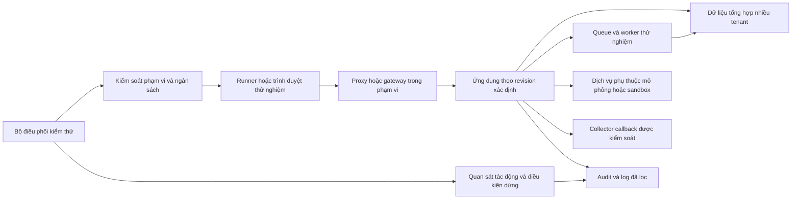

# Dynamic application testing — Kiểm thử bảo mật ứng dụng đang chạy

## 1. Mục tiêu và phạm vi

Dynamic application testing là hoạt động quan sát và tương tác với một ứng dụng đang chạy để đánh giá hành vi bảo mật từ các giao diện có thể tiếp cận. Trong bối cảnh bảo mật, DAST thường chỉ các kỹ thuật và công cụ kiểm thử động qua giao diện ứng dụng mà không cần dựa hoàn toàn vào phân tích mã nguồn.

DAST có thể phát hiện một số vấn đề chỉ thể hiện khi ứng dụng, cấu hình, proxy, danh tính và dữ liệu phối hợp với nhau. Tuy nhiên, công cụ chỉ đánh giá được những hành vi mà nó thực sự tiếp cận và kiểm tra. Một báo cáo không có phát hiện không chứng minh toàn bộ ứng dụng an toàn.

Trong chương **Secure development**, bài học này tập trung vào việc chuyển mục tiêu an toàn thông tin và mô hình đe dọa thành yêu cầu DAST cụ thể, đo được và có thể kiểm chứng. Phạm vi bao gồm xác thực, phân quyền, dữ liệu, logging, trạng thái nghiệp vụ, khả dụng và phục hồi; đồng thời liên kết kết quả với rủi ro, kiến trúc và quyết định phát hành.

Sau bài học, người học có thể:

- Xác định DAST cần kiểm chứng yêu cầu nào và giới hạn nào phải được công bố.
- Lập phạm vi mục tiêu, danh tính, dữ liệu và luồng nghiệp vụ.
- Phân biệt bề mặt được khám phá với kiểm soát thực sự được kiểm tra.
- Thiết kế bằng chứng đủ xác minh phát hiện mà không làm lộ dữ liệu.
- Đưa DAST vào vòng đời phát triển với tiêu chí xử lý, kiểm thử lại và báo cáo rõ ràng.

Tên hệ thống, ngưỡng và tình huống trong bài là ví dụ học tập. Chúng cần được điều chỉnh theo mức rủi ro, môi trường và khả năng thực tế của công cụ.

## 2. DAST trả lời được những câu hỏi nào?

### 2.1. Vị trí trong tập hoạt động kiểm chứng

| Hoạt động | Đầu vào chính | Điều có thể đánh giá | Giới hạn cần nhận biết |
| --- | --- | --- | --- |
| Rà soát thiết kế | Luồng dữ liệu, kiến trúc, yêu cầu | Quyết định và ranh giới tin cậy | Chưa chứng minh bản chạy thực thi đúng |
| Phân tích tĩnh | Mã và cấu hình thuộc phạm vi công cụ | Một số mẫu lỗi và luồng dữ liệu trong mã | Có thể thiếu ngữ cảnh triển khai |
| DAST | Ứng dụng đang chạy, request và response | Hành vi quan sát được qua giao diện | Phụ thuộc khả năng tiếp cận và điều khiển trạng thái |
| Kiểm thử bảo mật có thông tin hỗ trợ | Kiến trúc, tài khoản và quyền truy cập phù hợp | Kịch bản sâu theo rủi ro | Cần thiết kế tình huống và bằng chứng cụ thể |
| Kiểm tra triển khai | Mạng, proxy, quyền và credential | Kiểm soát có hiệu lực của môi trường | Không thay thế kiểm tra mọi luồng ứng dụng |
| Diễn tập phục hồi | Hệ thống, runbook và tình huống lỗi | Khả năng khôi phục và giữ bất biến | Không được bao phủ chỉ bởi một lần quét HTTP |

Các nhóm có thể dùng thuật ngữ khác nhau cho kiểm thử động thủ công hoặc có thông tin nội bộ. Điều cần chốt là phương pháp, phạm vi và yêu cầu được kiểm chứng, thay vì chỉ ghi “đã chạy DAST”.

### 2.2. Phân biệt phát hiện tự động và kiểm thử theo nghiệp vụ

Một scanner có thể phát hiện phản hồi bất thường, dữ liệu phản chiếu hoặc cấu hình giao tiếp không phù hợp. Nó thường không tự hiểu đầy đủ:

- Người dùng này chỉ được đọc đơn hàng nào.
- Một thao tác hoàn tiền có được thực hiện hai lần không.
- Tenant nào sở hữu một file xuất.
- Quyền đã bị thu hồi có phải làm dừng job đang chờ không.
- Một trạng thái chuyển đổi có vi phạm quy tắc nghiệp vụ không.

Vì vậy, yêu cầu DAST cần kết hợp khám phá tự động với các kịch bản có ngữ cảnh, nhất là phân quyền và hành vi nhiều bước.

### 2.3. Không dùng trạng thái hoàn tất của công cụ làm kết luận bảo mật

Một lần chạy có thể kết thúc bình thường nhưng:

- Không đăng nhập thành công.
- Chỉ quét trang đăng nhập.
- Bỏ qua API không có liên kết trên giao diện.
- Không tạo được đối tượng cần thiết để tới bước nhạy cảm.
- Bị proxy chặn trước khi chạm vào ứng dụng.
- Không hỗ trợ một giao thức hoặc kiểu tương tác.
- Chạy trên bản cấu hình khác với bản dự định phát hành.

Cần chứng minh đường kiểm thử đã đạt tới đúng kiểm soát cần đánh giá, cùng công bố phần chưa kiểm tra được.

## 3. Từ mô hình đe dọa tới hợp đồng kiểm thử

### 3.1. Bắt đầu từ tài sản và bất biến

Giả sử một nền tảng nhiều tenant có API quản lý đơn hàng, luồng tạo yêu cầu hoàn tiền và chức năng xuất dữ liệu. Các bất biến gồm:

- Người dùng chỉ truy cập đối tượng trong phạm vi được cấp.
- Tenant không thể tự được xác lập bằng thuộc tính client khai báo.
- Đầu vào không được thay đổi ý nghĩa truy vấn hoặc lệnh ngoài thiết kế.
- Lỗi xác thực hoặc phân quyền không tạo tác động nghiệp vụ.
- Request lặp không tạo thêm tác động vượt quy tắc.
- Secret và dữ liệu nhạy cảm không bị trả hoặc ghi log ngoài chính sách.
- Luồng bị kiểm thử vẫn tuân theo giới hạn tài nguyên.

Từ đó mới chọn mục tiêu và phương pháp thử. Không bắt đầu bằng việc bật mọi tùy chọn của công cụ rồi suy ra yêu cầu từ những gì công cụ tìm thấy.

### 3.2. Một yêu cầu DAST cần những trường gì?

| Thuộc tính | Nội dung cần xác định |
| --- | --- |
| ID và rủi ro | Bất biến nào cần kiểm chứng, kịch bản nào có thể vi phạm |
| Đối tượng | Bản ứng dụng, môi trường, endpoint hoặc luồng |
| Danh tính | Người gọi, role, tenant và trạng thái phiên |
| Điều kiện ban đầu | Dữ liệu, trạng thái job và feature flag cần có |
| Hành động | Request hoặc chuỗi tương tác nào được thực hiện |
| Kết quả mong đợi | Phản hồi, trạng thái dữ liệu và tác động được phép |
| Giới hạn | Phạm vi, cường độ, thời gian, số đối tượng và điều kiện dừng |
| Bằng chứng | Request đã lọc, audit, marker hoặc kiểm tra trạng thái |
| Chủ sở hữu | Người thiết kế, xử lý phát hiện và xác minh lại |

Ví dụ:

> **DAST-AUTHZ-01:** Với người dùng thuộc tenant A, thay mã đơn hàng trong request đọc hoặc cập nhật bằng mã đơn thử nghiệm của tenant B phải bị từ chối theo hợp đồng API. Không được trả dữ liệu tenant B hoặc tạo thay đổi trên đối tượng đó. Phép thử phải xác nhận cả phản hồi và trạng thái phía máy chủ.

HTTP 403 hoặc 404 có thể phù hợp theo hợp đồng đã chọn, nhưng mã phản hồi đơn lẻ chưa đủ. Nếu request đã tạo tác động rồi mới bị trả lỗi, yêu cầu vẫn bị vi phạm.

### 3.3. Ma trận rủi ro ban đầu

| Rủi ro | Kịch bản kiểm thử | Bằng chứng cần có |
| --- | --- | --- |
| Truy cập chéo tenant | Đổi mã đối tượng với hai tenant kiểm thử | Không có dữ liệu hoặc thay đổi trái phép |
| Quyền chức năng quá rộng | Role chỉ đọc gọi thao tác có ghi | Bị từ chối ở điểm thực thi thích hợp |
| Đầu vào thay đổi ngữ nghĩa xử lý | Gửi biến thể đầu vào được thiết kế cho môi trường thử | Không tạo truy vấn hoặc tác động ngoài dữ liệu kiểm soát |
| XSS | Đưa marker kiểm thử qua đường nhập và hiển thị | Ngữ cảnh hiển thị được xử lý đúng; không có hành vi thực thi ngoài dự kiến |
| SSRF | Đầu vào URL trỏ tới collector thử nghiệm | Chỉ đích được phép có thể được truy cập theo policy |
| Request lặp hoặc race | Lặp thao tác hoặc thực hiện đồng thời ở mức đã duyệt | Bất biến trạng thái và idempotency được giữ |
| Rò rỉ dữ liệu | Gây lỗi có kiểm soát và xem phản hồi, log | Không lộ secret hoặc dữ liệu ngoài hợp đồng |
| Lạm dụng tài nguyên | Tăng đầu vào trong giới hạn thử | Giới hạn và phản ứng có kiểm soát |

Mọi tình huống cần dùng tài sản, dữ liệu và hạ tầng kiểm thử trong phạm vi được phép. Phép thử SSRF không cần truy cập metadata cloud thật hoặc một hệ thống nội bộ ngoài phạm vi để tạo bằng chứng.

## 4. Xác định phạm vi và ranh giới của lần chạy

### 4.1. Phạm vi phải có thể thực thi

Một hostname không đủ mô tả phạm vi. Cần xác định:

- Scheme, hostname, cổng và các đường dẫn được phép.
- API, giao thức hoặc luồng được hỗ trợ.
- Môi trường và revision ứng dụng.
- Danh tính, tenant và dữ liệu thử nghiệm.
- Endpoint hoặc thao tác không được gọi trong lần chạy.
- Đích callback, email, thanh toán và lưu trữ được sử dụng.
- Ngân sách request, đồng thời, dữ liệu và thời gian.
- Người theo dõi, cơ chế dừng và kế hoạch dọn dữ liệu.

> **DAST-SCOPE-01:** Bộ điều phối phải giới hạn tương tác vào mục tiêu và hành động đã được xác định. Redirect, liên kết được khám phá hoặc URL trong nội dung không được tự mở rộng phạm vi kiểm thử.

Không chỉ giới hạn scanner. Ứng dụng đích có thể gửi email, tạo giao dịch hoặc gọi hệ thống khác khi nhận request. Mạng và cấu hình của môi trường thử cũng cần giới hạn tác động ra ngoài.

### 4.2. Kiến trúc môi trường thử tham chiếu



Mô hình cần phù hợp đường triển khai muốn kiểm chứng. Môi trường có proxy khác production chỉ cung cấp bằng chứng trong phạm vi đó; không tự chứng minh chính sách production đã đúng.

### 4.3. Phân biệt kiểm soát ngoại vi và kiểm soát ứng dụng

Nếu WAF chặn một request, có thể kết luận đường đi được thử đã bị chặn ở lớp đó. Không tự kết luận ứng dụng xử lý an toàn cùng đầu vào nếu request chưa tới ứng dụng.

Theo rủi ro, có thể cần:

- Kiểm thử qua đường ngoại vi tương đương triển khai.
- Kiểm thử riêng lớp ứng dụng trong môi trường cô lập có kiểm soát.
- Liên kết kết quả để xác định lớp nào thực thi yêu cầu.

Không tắt kiểm soát bảo vệ của hệ thống thật chỉ để tăng số phát hiện. Mọi biến thể môi trường và mục đích kiểm thử cần được ghi nhận rõ.

### 4.4. Kiểm soát tác động ngoài dự định

Các luồng cần chú ý gồm tạo thanh toán, gửi email/SMS, xóa tài khoản, đổi mật khẩu, thu hồi quyền và tác vụ nền. Trong môi trường thử, cần dùng tài khoản và điểm nhận được kiểm soát.

Không mặc định GET luôn vô hại hoặc chỉ POST mới có tác động. Hành vi thực tế và hợp đồng endpoint mới là căn cứ.

Trước lần chạy, nên xác nhận có thể dừng runner, hủy tác vụ nền phù hợp và phục hồi dữ liệu thử. Dừng request không nhất thiết hủy được công việc đã vào queue.

## 5. Danh tính, phiên và điều kiện ban đầu

### 5.1. Thiết kế tập tài khoản có mục đích

Ví dụ tập danh tính:

| Danh tính | Vai trò | Mục đích |
| --- | --- | --- |
| Anonymous | Không đăng nhập | Kiểm tra bề mặt công khai và yêu cầu xác thực |
| Tenant A reader | Chỉ đọc trong tenant A | Kiểm tra quyền chức năng và đối tượng |
| Tenant A operator | Được thao tác trong phạm vi | Tạo dữ liệu và kiểm thử đường hợp lệ |
| Tenant B operator | Tenant khác | Kiểm tra cô lập tenant |
| Disabled hoặc revoked user | Không còn quyền hợp lệ | Kiểm tra vòng đời phiên và thu hồi |
| Tài khoản vận hành giới hạn | Chỉ chức năng được cấp | Kiểm tra bề mặt quản trị theo phạm vi |

Không dùng một tài khoản quản trị cho toàn bộ lần quét rồi báo đã kiểm tra phân quyền. Tài khoản quá rộng có thể che các khác biệt cần đánh giá.

### 5.2. Xác minh đăng nhập thực sự thành công

> **DAST-SESSION-01:** Runner phải xác nhận trạng thái xác thực và ngữ cảnh danh tính trước và trong các kịch bản cần đăng nhập. Mất phiên hoặc sai role/tenant phải được ghi thành thiếu bao phủ hoặc lỗi thực thi, không thành kết quả không có phát hiện.

Một HTTP 200 có thể là trang đăng nhập. Cần một dấu hiệu phù hợp, chẳng hạn endpoint danh tính đã được cho phép hoặc bằng chứng từ môi trường thử cho thấy đúng chủ thể đang gọi.

Các role cần session, cookie jar, token và dữ liệu trình duyệt được tách biệt. Không để cache của một tài khoản làm một phép thử khác trông như thành công.

Cơ chế đăng nhập tự động phải tuân theo mô hình danh tính của môi trường thử. Không tạo đường bỏ MFA hoặc secret dùng chung ở production chỉ để scanner thuận tiện.

### 5.3. Quản lý credential của chính công cụ

Credential kiểm thử cần quyền tối thiểu, thời hạn phù hợp và nguồn cấp được kiểm soát. Báo cáo, lịch sử lệnh, file cấu hình và tracing không được lưu token hoặc cookie đầy đủ.

Khi cần tạo request tái hiện, thay secret bằng placeholder hoặc tham chiếu đến nguồn cấp hợp lệ. Người xử lý phát hiện chỉ được nhận dữ liệu cần thiết, không mặc nhiên nhận toàn bộ credential runner.

### 5.4. Chuẩn bị trạng thái nghiệp vụ

Một endpoint hoàn tất job không thể được kiểm tra có ý nghĩa nếu chưa tạo được job đúng trạng thái. Cần mô tả fixture, quyền sở hữu và bước chuẩn bị.

Với luồng nhiều bước, cần giữ được:

- Liên kết đối tượng và tenant.
- Token chống giả mạo request nếu áp dụng.
- Idempotency key hoặc mã tương quan theo hợp đồng.
- Trạng thái đối tượng trước và sau thao tác.
- Cơ chế dọn hoặc phục hồi dữ liệu thử.

Nếu công cụ không đi qua được một bước, phải báo luồng chưa được bao phủ thay vì quét lặp màn hình đầu tiên.

## 6. Độ bao phủ phải có mẫu số

### 6.1. Khám phá không đồng nghĩa kiểm tra

Cần phân biệt:

- Đường dẫn được liệt kê trong tài liệu.
- Đường dẫn được công cụ khám phá.
- Request đã gửi.
- Request tới được đúng handler hoặc trạng thái cần thử.
- Kiểm soát cụ thể đã được đánh giá bằng một oracle phù hợp.

Oracle là căn cứ phân biệt hành vi đúng và sai, như trạng thái đối tượng, sự kiện audit hoặc một marker kiểm thử được kiểm soát. Nó không chỉ là việc response có chứa một chuỗi.

### 6.2. Xác định đơn vị bao phủ

Đơn vị có thể là tổ hợp thao tác, danh tính và trạng thái, chẳng hạn:

```text
HTTP method + route pattern + role/tenant context + workflow state
```

Với GraphQL, WebSocket hoặc giao thức khác, cần mô hình hóa thao tác thích hợp. Một URL dùng chung có thể chứa nhiều khả năng nghiệp vụ, nên số URL không phản ánh đầy đủ độ bao phủ.

> **DAST-COVER-01:** Báo cáo phải đối chiếu danh mục thao tác có phiên bản với những kịch bản đã chạy hợp lệ, ghi rõ phần chưa tiếp cận, không hỗ trợ hoặc thiếu dữ liệu. Không được dùng số request làm bằng chứng thay thế cho độ bao phủ kiểm soát.

Ví dụ, 100% route đã được gọi chưa chứng minh 100% kiểm tra phân quyền được thực hiện, vì mỗi route có thể cần nhiều role và trạng thái đối tượng.

### 6.3. Chọn mục tiêu theo rủi ro

Một dự án có thể yêu cầu mọi thao tác xuất dữ liệu và hoàn tiền trong phạm vi thay đổi đều có kịch bản quyền hợp lệ, sai quyền, chéo tenant và lỗi phụ thuộc. Đây là yêu cầu bao phủ rõ hơn “quét ít nhất một giờ”.

Không nhất thiết thử mọi tổ hợp của mọi thuộc tính. Cần chỉ ra những tổ hợp giữ bất biến bảo mật, các nhánh có rủi ro và phần chưa được kiểm chứng.

Khi một feature flag tắt khiến luồng không thể chạy, đó là giới hạn của lần thử. Không suy ra nhánh sẽ an toàn khi flag được bật về sau.

## 7. Thiết kế kịch bản và căn cứ kết luận

### 7.1. Kiểm tra quyền trên chức năng và đối tượng

Một tập kịch bản hữu ích cho endpoint cập nhật đơn hàng gồm:

1. Chủ thể hợp lệ cập nhật đối tượng được phép.
2. Chủ thể cùng tenant nhưng chỉ có quyền đọc.
3. Chủ thể tenant khác dùng mã đối tượng có thật trong dữ liệu thử.
4. Không có hoặc có credential đã hết hiệu lực.
5. Client thêm thuộc tính quyền, chủ sở hữu hoặc tenant không được phép thay đổi.
6. Lặp lại sau khi quyền bị thu hồi theo chính sách.

Kết quả mong đợi phải bao gồm dữ liệu và tác động, không chỉ response. Có thể dùng truy vấn kiểm tra từ fixture service, audit hoặc giao diện quan sát được kiểm soát trong môi trường thử.

Nếu cập nhật đi qua queue, phản hồi HTTP không đủ kết luận. Cần theo dõi công việc tới trạng thái phù hợp và đối chiếu tác động trong cửa sổ quan sát được định nghĩa theo thiết kế.

Không thấy thay đổi sau vài mili giây chưa chứng minh một tác vụ bất đồng bộ sẽ không thực hiện về sau. Báo cáo cần nêu phạm vi quan sát và bằng chứng về trạng thái bền vững.

### 7.2. Kiểm thử đầu vào phải phân biệt dấu hiệu và bằng chứng

Biến thể đầu vào có thể làm xuất hiện lỗi, độ trễ hoặc phản chiếu nội dung. Những dấu hiệu đó cần được phân tích trước khi kết luận:

- HTTP 500 không tự chứng minh injection.
- Chuỗi được phản chiếu không tự chứng minh XSS.
- Thay đổi thời gian phản hồi có thể do tải hoặc cache.
- Callback tới collector có thể là hành vi hợp lệ của một tính năng được phép.

Với mỗi loại kiểm tra, cần định nghĩa oracle. Ví dụ, một phép thử XSS trong trình duyệt kiểm soát có thể dùng tín hiệu vô hại để xác nhận hành vi thực thi ngoài ngữ cảnh được phép. Không cần dùng dữ liệu hoặc hành động gây thiệt hại.

Với kiểm tra truy vấn, sử dụng dữ liệu tổng hợp và quan sát có kiểm soát để xác định đầu vào có làm thay đổi ý nghĩa xử lý ngoài hợp đồng hay không. Không lấy dữ liệu thật hoặc phá cấu trúc dữ liệu để tăng độ chắc chắn.

### 7.3. Kiểm tra SSRF và tương tác ngoài băng

Nếu ứng dụng xử lý URL, có thể cần một collector do nhóm kiểm thử kiểm soát, với mã tương quan riêng cho mỗi tình huống.

Yêu cầu phải xác định đích nào được phép và đích nào phải bị chặn trong môi trường thử. Collector nhận được request chỉ tạo bằng chứng có ý nghĩa khi đã liên kết với đúng thử nghiệm và chính sách đích.

Cần hạn chế cả egress của ứng dụng đích. Giới hạn mạng của runner không ngăn ứng dụng nhận đầu vào rồi gọi một địa chỉ khác.

Không dùng endpoint metadata thật hoặc dịch vụ ngoài phạm vi làm “đích thử”. Có thể mô phỏng vùng đích bị hạn chế trong hạ tầng thử được phép.

### 7.4. Luồng trình duyệt, phiên và CSRF

Một số yêu cầu cần hành vi trình duyệt, không thể kết luận chỉ bằng một HTTP client đơn giản:

- Cookie có được gửi trong ngữ cảnh liên quan không?
- Nguồn khác có đọc được dữ liệu theo chính sách thực tế không?
- Thao tác có credential tự động đính kèm có được bảo vệ khỏi giả mạo request không?
- Đăng xuất hoặc thu hồi có tác động tới phiên mới và phiên hiện tại thế nào?
- Dữ liệu được hiển thị trong ngữ cảnh nào?

CORS không thay thế phân quyền; việc thiếu một header bảo vệ cũng cần ngữ cảnh trước khi xác định tác động. Mô hình cookie tự gửi và bearer token do client chủ động gắn có những khác biệt cần được phản ánh trong kịch bản.

Nếu có nguồn danh tính bên ngoài, phạm vi có thể cho phép runner thực hiện luồng đăng nhập mà không cho phép fuzz hoặc quét chính hệ thống danh tính đó. Hai quyền này phải được phân biệt.

### 7.5. Trạng thái, idempotency và cạnh tranh

Ví dụ yêu cầu:

> **DAST-STATE-01:** Trong kịch bản hai request đồng thời cho cùng một thao tác logic theo hợp đồng idempotency, hệ thống không được tạo tác động vượt số lần được phép. Bằng chứng phải đối chiếu trạng thái bền vững và lời gọi tới dịch vụ phụ thuộc thử nghiệm.

Kịch bản cần số request, mức đồng thời và dữ liệu cụ thể. Không biến kiểm thử race thành một lần tạo tải không giới hạn.

Một response trùng hoặc khác nhau không tự chứng minh tác động trùng. Cần quan sát kết quả nghiệp vụ và giới hạn của dịch vụ phụ thuộc.

## 8. Điều phối lần chạy và bảo vệ môi trường thử

### 8.1. Một quy trình tham chiếu

```text
runDynamicSecurityTests(plan):
    requireApprovedScopeAndTargetRevision(plan)
    verifyTestDataAndDependencyIsolation(plan)
    establishMonitoringAndStopConditions(plan)

    inventory = loadVersionedOperationInventory()
    identities = acquireScopedTestIdentities()
    validateIdentityContexts(identities)

    for scenario in prioritizedApplicableScenarios(plan):
        enforceScopeAndRequestBudget(scenario)
        prepareKnownBusinessState(scenario)
        verifyRequiredSessionIsStillValid(scenario)
        executeControlledInteractions(scenario)
        observeResponsesAndPermittedServerEvidence(scenario)
        classifyResultWithCoverageStatus(scenario)

    sanitizeAndStoreEvidence()
    cleanupOrQuarantineTestArtifactsAccordingToPlan()
    reportFindingsCoverageAndExecutionFailures()
```

Mã giả mô tả trách nhiệm, không phải API có sẵn của một scanner. Việc các bước có tồn tại trong script chưa chứng minh chúng thực thi đúng; cần kiểm thử cơ chế chặn ngoài phạm vi và điều kiện dừng.

### 8.2. Ngân sách và điều kiện dừng

Ví dụ kế hoạch của một môi trường thử có thể quy định:

| Đại lượng | Giới hạn minh họa | Hành vi khi chạm giới hạn |
| --- | --- | --- |
| Lưu lượng runner | Tối đa 10 request/giây | Giảm tốc hoặc chờ trong ngân sách |
| Request đang xử lý | Tối đa 2 request đồng thời, trừ kịch bản đã chỉ rõ | Không tự tăng đồng thời |
| Thời gian tương tác chủ động | Tối đa 45 phút | Dừng tạo thử mới và tổng hợp phần chưa chạy |
| Số job hoặc đối tượng | Theo hạn mức dữ liệu đã chuẩn bị | Dừng trước khi vượt phạm vi |
| Tình trạng môi trường | Chỉ số sức khỏe vượt ngưỡng đã phê duyệt | Dừng hoặc tạm dừng theo kế hoạch |
| Phát hiện gọi ra ngoài phạm vi | Bất kỳ tương tác xác nhận được | Dừng nhánh liên quan và điều tra |

Các con số chỉ là ví dụ. Giới hạn thực tế phải dựa trên năng lực môi trường và loại phép thử.

Điều kiện sức khỏe nên dùng các tín hiệu phù hợp, chẳng hạn request kiểm tra bình thường bị lỗi hoặc độ trễ tăng ngoài giới hạn, thay vì coi mọi 4xx do thử đầu vào là sự cố môi trường.

Khi gặp rate limit, runner cần tuân theo chính sách chờ, phản hồi hướng dẫn nếu có và ngân sách tổng. Không retry vô hạn hoặc tăng số nguồn gọi để vượt hạn mức.

### 8.3. Phục hồi và dọn dữ liệu

Cần có mã tương quan hoặc namespace dữ liệu thử để tìm artifact đã tạo. Dọn dữ liệu phải tránh đụng vào dữ liệu ngoài phạm vi.

Với job đang chạy, dừng scanner không tự hủy job. Kế hoạch cần xác định giữ lại, hủy, chờ hoàn tất hoặc cách ly kết quả.

Nếu phát hiện cần điều tra, giữ bằng chứng tối thiểu trước khi dọn. Không xóa toàn bộ môi trường rồi mất khả năng xác minh một phát hiện chưa kết luận.

Restore snapshot có thể hữu ích, nhưng phải xét queue, storage, email và dịch vụ phụ thuộc. Khôi phục cơ sở dữ liệu đơn lẻ không tự đảo ngược mọi tác động ngoài hệ thống.

## 9. Bằng chứng, phân loại và xác minh phát hiện

### 9.1. Hồ sơ phát hiện có thể tái hiện

Một hồ sơ nên chứa:

- ID phát hiện, yêu cầu và rủi ro liên quan.
- Build, revision cấu hình và môi trường.
- Công cụ, tập kiểm tra hoặc kịch bản sử dụng.
- Danh tính logic, role và tenant dưới dạng không lộ credential.
- Điều kiện dữ liệu cùng bước chuẩn bị.
- Request/response đã lọc và bằng chứng tác động.
- Kết quả mong đợi, kết quả quan sát và giới hạn kết luận.
- Thời điểm, mã tương quan, độ tin cậy và mức ưu tiên.
- Chủ sở hữu xử lý và tiêu chí kiểm thử lại.

Dữ liệu báo cáo phải được phân loại và giới hạn quyền đọc. Request có thể chứa PII, token, cookie hoặc giá trị dùng làm credential. Ảnh chụp màn hình, trace trình duyệt và file đính kèm cũng cần được xử lý.

> **DAST-EVID-01:** Bằng chứng phải đủ xác minh kịch bản trong phạm vi cho phép nhưng không được làm lộ credential hoặc dữ liệu nhạy cảm ngoài chính sách. Các bản chia sẻ và request tái hiện phải được lọc phù hợp.

### 9.2. Phân loại một kết quả

Có thể phân biệt:

- Phát hiện đã được xác nhận.
- Dấu hiệu cần xác minh.
- False positive có căn cứ.
- Chưa thể kết luận vì thiếu dữ liệu hoặc lỗi môi trường.
- Kịch bản đạt tiêu chí trong phạm vi đã thử.
- Kịch bản chưa được chạy hoặc không tiếp cận được.

“Không tái hiện được” không tự đồng nghĩa false positive. Có thể có điều kiện phiên, thời gian, dữ liệu, callback trễ hoặc revision đã thay đổi.

Tương tự, việc một scanner không còn báo sau khi đổi rule chưa chứng minh ứng dụng đã được sửa.

### 9.3. Xác minh theo tác động và nguyên nhân

Ví dụ một phát hiện truy cập chéo tenant cần làm rõ:

- Mã đối tượng có thực sự thuộc tenant khác trong fixture không?
- Danh tính gọi có đúng quyền giới hạn không?
- Dữ liệu trả về có phải nội dung đối tượng đó không?
- Có cache hoặc phiên của tài khoản khác làm sai phép thử không?
- Request đã tới lớp quyết định nào?
- Có tác động hoặc dữ liệu ngoài response không?

Các câu hỏi này giúp tránh cả báo sai và bỏ sót. Mức độ cần xét dữ liệu, điều kiện khai thác, phạm vi và tác động nghiệp vụ; điểm do công cụ gán chỉ là một đầu vào.

Có thể nhóm nhiều endpoint theo một nguyên nhân chung, nhưng tiêu chí sửa và kiểm thử lại phải bao phủ các đối tượng bị ảnh hưởng. Không đóng toàn bộ nhóm chỉ vì một route đã được sửa.

### 9.4. Ví dụ phát hiện minh họa

> **F-DAST-04 — Role chỉ đọc tạo được yêu cầu xuất dữ liệu.** Trong môi trường thử theo build đã ghi nhận, danh tính reader của tenant A gửi thao tác tạo job xuất dữ liệu cho tenant A. Hợp đồng quyền không cho role này xuất. API trả trạng thái nhận xử lý và một job có thể tải được xuất hiện sau đó. Bằng chứng cần gồm ngữ cảnh danh tính, request đã lọc, job tương ứng và kiểm tra trạng thái, thay vì chỉ một response thành công.

Phát hiện trên là tình huống học tập. Nó cho thấy một lỗi quyền chức năng có thể không phải truy cập chéo tenant nhưng vẫn vi phạm yêu cầu.

Tiêu chí sửa là chặn thao tác và tác động không được phép ở các đường liên quan, đồng thời giữ đường hợp lệ hoạt động.

## 10. Ma trận yêu cầu, kiểm chứng và quyết định phát hành

### 10.1. Ma trận truy vết

| ID | Rủi ro chính | Điểm thực thi hoặc kiểm thử | Tiêu chí chấp nhận tiêu biểu |
| --- | --- | --- | --- |
| DAST-SCOPE-01 | Tương tác ngoài phạm vi | Bộ điều phối, redirect và môi trường đích | URL ngoài phạm vi không được tự quét; tác động phụ bị giới hạn |
| DAST-SESSION-01 | Quét sai danh tính nhưng báo đạt | Quản lý phiên và oracle danh tính | Mất phiên tạo trạng thái thiếu bao phủ, không thành không có phát hiện |
| DAST-COVER-01 | Bỏ sót luồng hoặc role | Inventory thao tác và báo cáo | Mỗi hạng mục quan trọng có kịch bản hợp lệ hoặc khoảng trống được nêu rõ |
| DAST-AUTHZ-01 | Truy cập đối tượng chéo tenant | API và bằng chứng phía máy chủ | Không trả dữ liệu hoặc tạo thay đổi trên đối tượng không được phép |
| DAST-FUNC-01 | Role thực hiện chức năng vượt quyền | Ma trận quyền và kịch bản chức năng | Role chỉ đọc không tạo job, giao dịch hoặc tác động bị cấm |
| DAST-INPUT-01 | Đầu vào đổi ngữ nghĩa xử lý | Kịch bản đầu vào và oracle theo ngữ cảnh | Không có hành vi ngoài hợp đồng với dữ liệu thử được kiểm soát |
| DAST-STATE-01 | Tác động lặp hoặc chuyển trạng thái sai | Luồng nhiều bước và kiểm tra bền vững | Request lặp hoặc cạnh tranh không vượt bất biến nghiệp vụ |
| DAST-DATA-01 | Lộ dữ liệu qua lỗi hoặc quan sát | Phản hồi, log và tracing | Không có dữ liệu nhạy cảm ngoài trường được phép |
| DAST-EVID-01 | Báo cáo làm lộ credential | Kho bằng chứng và quy trình chia sẻ | Token, cookie và secret thử nghiệm không xuất hiện trong bản được chia sẻ |
| DAST-RETEST-01 | Đóng phát hiện khi chưa sửa đủ | Kiểm thử lại trên bản xác định | Kịch bản gốc và đường liên quan đạt; đường hợp lệ vẫn hoạt động |

Các ID bổ sung cần được viết thành yêu cầu đầy đủ trong kế hoạch dự án, với chủ sở hữu, phạm vi, giới hạn và bằng chứng. Bảng không thay thế đặc tả hành vi chi tiết.

### 10.2. Tiêu chí phát hành phải phân biệt chất lượng lần chạy

Một cổng kiểm chứng có thể đánh giá riêng:

1. Lần chạy có hợp lệ không: đúng target, revision, danh tính, dữ liệu và cơ chế kiểm soát?
2. Kịch bản bắt buộc có được thực hiện và có bằng chứng không?
3. Các phát hiện có vi phạm policy phát hành không?
4. Phần chưa kết luận và rủi ro còn lại đã được xử lý thế nào?
5. Ngoại lệ có đúng phạm vi, thẩm quyền và thời hạn không?

Một lần chạy lỗi hạ tầng nhưng không có finding không được coi là đạt. Một báo cáo đủ kỹ thuật nhưng bỏ toàn bộ luồng nhạy cảm cũng không đáp ứng yêu cầu bao phủ.

### 10.3. Phát hiện cũ không tự được miễn xử lý

Có thể dùng baseline phát hiện để nhận diện vấn đề mới, nhưng vấn đề có từ trước vẫn có thể vi phạm policy hiện hành.

Không tự bỏ qua mọi finding cũ hoặc mọi finding ít tự tin. Dấu hiệu có tác động cao có thể cần xác minh trước quyết định của phạm vi liên quan.

Chấp nhận rủi ro phải nêu đối tượng, tác động, lý do, biện pháp thay thế, người có thẩm quyền và hạn xem xét lại. Việc công cụ có nút suppress không tự tạo thành quyết định chấp nhận rủi ro.

### 10.4. Kiểm thử lại sau sửa

> **DAST-RETEST-01:** Phát hiện chỉ được đóng theo tiêu chí đã định khi kiểm thử lại trên bản xác định cho thấy kịch bản vi phạm không còn thành công trong phạm vi liên quan, đồng thời hành vi hợp lệ vẫn đáp ứng hợp đồng.

Nên thử cả kịch bản gốc và các biến thể có chung nguyên nhân, như route khác, phương thức khác hoặc role tương ứng. Cần ghi build và policy được thử lại.

Nếu chỉ thêm chặn ở proxy, báo cáo phải nói rõ lớp đã sửa và phạm vi đảm bảo. Không mô tả thành thay đổi logic phân quyền trong ứng dụng nếu chưa có bằng chứng đó.

## 11. Đưa DAST vào vòng đời phát triển

### 11.1. Giai đoạn yêu cầu và thiết kế

Từ mô hình đe dọa, xác định các bất biến có thể quan sát và môi trường cần thiết. Thiết kế khả năng tạo dữ liệu tổng hợp, mã tương quan và oracle phù hợp mà không expose thêm dữ liệu nhạy cảm.

Nếu một yêu cầu không thể kiểm chứng qua giao diện, hãy chọn bằng chứng khác thay vì ép DAST trả lời. Ví dụ, một số yêu cầu quản lý khóa, backup hoặc nguồn gốc build cần đánh giá và kiểm thử riêng.

### 11.2. Trong phát triển và CI/CD

Có thể chạy tập kịch bản trọng tâm trên thay đổi nhạy cảm và tập rộng hơn ở các mốc phù hợp. Phạm vi nên dựa trên rủi ro và phần thay đổi, không chỉ thời gian scan.

Giữ kế hoạch, inventory và dữ liệu fixture có phiên bản. Tách cấu hình kiểm thử khỏi credential; quyền chạy công cụ không nên tự kèm quyền đọc mọi báo cáo.

Các check nhanh có thể hỗ trợ phản hồi sớm. Một tập nhỏ đạt không được trình bày như kiểm chứng toàn bộ ứng dụng.

### 11.3. Trước phát hành và trong vận hành

Trước phát hành, liên kết kết quả với đúng artifact và cấu hình dự định triển khai, đồng thời nêu chênh lệch môi trường thử. Những yêu cầu về mạng hoặc quyền có hiệu lực cần bằng chứng triển khai bổ sung.

Nếu kiểm thử trên hệ thống đang phục vụ là một phần kế hoạch, cần phạm vi, cường độ, dữ liệu và giám sát riêng phù hợp. Quyền chạy thử ở môi trường cô lập không tự áp dụng cho production.

Sau khi đổi nguồn danh tính, proxy, luồng nghiệp vụ, role, feature flag hoặc API, cần đánh giá lại kịch bản và khả năng tiếp cận của công cụ. Một scanner vẫn chạy thành công có thể đã mất phần bao phủ sau thay đổi đăng nhập.

### 11.4. Đo hiệu quả

Các chỉ số hữu ích gồm:

- Tỷ lệ kịch bản rủi ro quan trọng đã chạy hợp lệ.
- Số luồng hoặc tổ hợp danh tính còn thiếu bằng chứng.
- Thời gian xác minh và khắc phục phát hiện theo mức tác động.
- Tỷ lệ phát hiện được kiểm thử lại đúng phạm vi.
- Số lần chạy sai phiên, sai target hoặc thiếu dữ liệu.
- Số ngoại lệ quá hạn.
- Mức độ truy vết từ yêu cầu tới bằng chứng.

Số payload, số request hoặc số giờ chạy không nên là chỉ số chất lượng duy nhất. Một phép thử phân quyền đúng ngữ cảnh có thể cung cấp bằng chứng quan trọng hơn nhiều request không tới được luồng cần bảo vệ.

## 12. Bài tập áp dụng

Một nền tảng có API quản lý hóa đơn, job xuất dữ liệu và chức năng gửi thông báo. Đội phát triển đề xuất dùng một tài khoản quản trị, quét từ trang chủ trong một giờ và chấp nhận phát hành nếu không có cảnh báo nghiêm trọng.

Hãy xây dựng kế hoạch thay thế gồm:

1. Tài sản, bất biến và sáu kịch bản rủi ro quan trọng.
2. Phạm vi mục tiêu, revision, dữ liệu và dịch vụ phụ thuộc thử nghiệm.
3. Bộ danh tính có ít nhất hai tenant cùng các role khác nhau.
4. Inventory thao tác theo role và trạng thái nghiệp vụ.
5. Tám yêu cầu có ID, oracle, tiêu chí chấp nhận và giới hạn thử.
6. Cách xác nhận phiên còn hợp lệ và các luồng đã thực sự được tiếp cận.
7. Ngân sách, điều kiện dừng, xử lý tác vụ nền và dọn dữ liệu.
8. Mẫu phát hiện đã lọc credential cùng kế hoạch kiểm thử lại.
9. Tiêu chí phát hành phân biệt finding, lỗi thực thi và phần chưa được bao phủ.

Kế hoạch cần giải thích được đang kiểm chứng điều gì, bằng chứng nào phân biệt đúng sai và vì sao kết luận chỉ áp dụng cho phạm vi đã thử. Khi các câu trả lời gắn với rủi ro, kiến trúc và hành vi đo được, dynamic application testing trở thành một phần có thể truy vết của yêu cầu bảo mật trong vòng đời phát triển.
