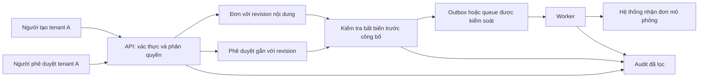

# Penetration testing — Kiểm thử xâm nhập theo yêu cầu bảo mật

## 1. Mục tiêu và phạm vi

Penetration testing là hoạt động kiểm thử có phạm vi và quyền thực hiện xác định, trong đó người kiểm thử chủ động đánh giá liệu một chủ thể có thể vượt qua các kiểm soát để tạo ra tác động không được phép hay không. Hoạt động này kết hợp hiểu biết về hệ thống, giả thuyết tấn công, thử nghiệm có kiểm soát và phân tích bằng chứng.

Giá trị của một đợt kiểm thử không nằm ở số công cụ hoặc số payload đã chạy. Kết quả cần chỉ ra yêu cầu nào được kiểm chứng, đường nào có thể vi phạm, tác động là gì và bằng chứng nào cho phép sửa hoặc chấp nhận rủi ro.

Trong chương **Secure development**, bài học này chuyển mục tiêu an toàn thông tin và mô hình đe dọa thành yêu cầu kiểm thử xâm nhập cụ thể, đo được và có thể kiểm chứng. Phạm vi bao gồm xác thực, phân quyền, dữ liệu, trạng thái nghiệp vụ, logging và phục hồi; đồng thời liên kết phát hiện với kiến trúc và tiêu chí kiểm thử trong vòng đời phát triển.

Sau bài học, người học có thể:

- Xác định mục tiêu, giả định, tài sản và giới hạn của một đợt kiểm thử.
- Viết quy tắc thực hiện đủ rõ cho người kiểm thử và vận hành.
- Xây dựng kịch bản từ bất biến bảo mật thay vì chỉ dựa vào danh mục lỗi.
- Thu thập bằng chứng tối thiểu đủ kết luận mà không mở rộng tác động không cần thiết.
- Ghi phát hiện, truy vết nguyên nhân, kiểm thử lại và báo cáo giới hạn.

Các tên hệ thống, dữ liệu, ngưỡng và thời hạn trong bài là ví dụ học tập. Chúng cần được điều chỉnh theo rủi ro, môi trường và khả năng thực tế.

## 2. Phân biệt với những hoạt động liên quan

### 2.1. Mỗi hoạt động trả lời câu hỏi khác nhau

| Hoạt động | Câu hỏi chính | Đầu ra điển hình |
| --- | --- | --- |
| Mô hình đe dọa | Những tác nhân và đường đi nào có thể phá vỡ mục tiêu an toàn? | Kịch bản, ranh giới và yêu cầu |
| Rà soát thiết kế | Kiến trúc có điểm thực thi phù hợp cho yêu cầu không? | Khoảng trống và quyết định |
| Quét lỗ hổng hoặc DAST tự động | Công cụ nhận diện được dấu hiệu nào trên bề mặt đã tiếp cận? | Phát hiện ứng viên và giới hạn bao phủ |
| Penetration testing | Trong điều kiện đã xác định, có thể vượt kiểm soát và tạo tác động nào? | Phát hiện đã xác minh, đường vi phạm và bằng chứng |
| Kiểm thử giả lập đối kháng hướng mục tiêu | Hệ thống phòng vệ phát hiện và ứng phó với một chuỗi hành vi ra sao? | Bằng chứng về phòng vệ theo mục tiêu |
| Kiểm thử phục hồi | Sau lỗi hoặc sự cố, hệ thống có trở về trạng thái an toàn không? | Kết quả diễn tập và khoảng trống runbook |

Tên gọi có thể khác giữa các tổ chức. Điều cần thống nhất là mục tiêu, phương pháp, phạm vi và tiêu chí kết luận. Không dùng một báo cáo quét tự động để đại diện cho kiểm thử sâu về phân quyền và logic nghiệp vụ nếu các nội dung đó chưa được thực hiện.

### 2.2. Mức thông tin ban đầu không quyết định toàn bộ chất lượng

Có thể tổ chức kiểm thử với ít thông tin, một phần thông tin hoặc quyền tiếp cận tài liệu và mã nguồn:

- Ít thông tin giúp đánh giá một số đường khám phá từ vị trí ban đầu cụ thể.
- Có tài khoản và sơ đồ giúp dành thời gian cho các ranh giới quyền quan trọng.
- Có mã nguồn hoặc cấu hình có thể hỗ trợ xác minh nguyên nhân và tìm đường mà khám phá bên ngoài khó chạm tới.

Cần ghi rõ những gì người kiểm thử được biết và được cấp. Quyền xem mã không tự cho phép sửa production; quyền đăng nhập một tài khoản không tự cho phép tấn công nguồn danh tính hoặc hạ tầng của bên khác.

### 2.3. Không có phát hiện không đồng nghĩa không có rủi ro

Kết luận chỉ áp dụng cho phạm vi, thời điểm, phiên bản, dữ liệu và phương pháp đã sử dụng. Một đợt kiểm thử có thể bỏ sót luồng không tiếp cận được, điều kiện thời gian hiếm hoặc tính năng chưa bật.

Báo cáo cần nêu các phần chưa kiểm tra được và nguyên nhân. Trạng thái không đủ bằng chứng phải được phân biệt với yêu cầu đã được kiểm chứng.

## 3. Từ mô hình đe dọa tới mục tiêu kiểm thử

### 3.1. Bắt đầu bằng tài sản và bất biến

Giả sử một nền tảng mua hàng nhiều tenant cho phép tạo đơn, phê duyệt và gửi đơn đã duyệt sang hệ thống xử lý. Môi trường kiểm thử dùng dữ liệu tổng hợp và dịch vụ nhận đơn mô phỏng, không tạo giao dịch thật.

Những bất biến cần bảo vệ:

- Người dùng tenant A không đọc hoặc sửa đơn của tenant B.
- Người tạo không tự phê duyệt đơn của mình theo chính sách dự án.
- Phê duyệt phải gắn với đúng nội dung và phiên bản đơn.
- Sửa thông tin trọng yếu phải làm mất hiệu lực phê duyệt cũ theo quy tắc.
- Message hoặc request lặp không tạo thêm đơn xử lý vượt hợp đồng.
- Quyền đã thu hồi không tiếp tục cấp thao tác mới ngoài thời hạn cho phép.
- Audit đủ truy vết nhưng không chứa secret hay dữ liệu vượt mục đích.
- Lỗi phụ thuộc không được chuyển thành chế độ bỏ kiểm soát.

Các bất biến là cơ sở thiết kế thử nghiệm. Mục tiêu “kiểm tra toàn bộ hệ thống” chưa đủ để xác định cách thực hiện hoặc tiêu chí hoàn tất.

### 3.2. Viết mục tiêu dưới dạng câu hỏi có thể xác minh

| Mục tiêu mơ hồ | Mục tiêu có thể kiểm chứng |
| --- | --- |
| Kiểm tra phân quyền | Xác minh người tenant A không đọc, sửa, phê duyệt hoặc tải tài liệu của đơn tenant B |
| Kiểm tra workflow | Xác minh phê duyệt phiên bản cũ không cho phép xử lý nội dung đã sửa |
| Kiểm tra xác thực | Đánh giá credential thiếu, hết hạn, sai ngữ cảnh và bị thu hồi trên các thao tác trong phạm vi |
| Kiểm tra API an toàn | Xác minh trường client không được thay đổi quyền, chủ sở hữu hoặc trạng thái ngoài hợp đồng |
| Kiểm tra logging | Xác nhận hành vi quan trọng có audit và credential thử nghiệm không bị ghi vào kênh chia sẻ |
| Kiểm tra phục hồi | Xác nhận thử lại hoặc restore không công bố lại tác động đã bị hủy hoặc không còn được phép |

Mỗi mục tiêu cần gắn với tài sản, chủ thể, điều kiện ban đầu, kết quả mong đợi và giới hạn tác động.

### 3.3. Định nghĩa giả định về tác nhân

Các vị trí kiểm thử có thể gồm:

- Người không đăng nhập trên bề mặt được phép tiếp cận.
- Người dùng thông thường của một tenant.
- Người có quyền tạo nhưng không có quyền phê duyệt.
- Người có quyền phê duyệt trong một phạm vi.
- Danh tính tích hợp với tập quyền đã được cấp.
- Chủ thể có phiên hoặc credential bị thu hồi trong tình huống thử.

Một kịch bản giả định credential đã bị lấy cần nói rõ credential nào và quyền ban đầu là gì. Không suy ra quyền kiểm thử các tài sản khác chỉ vì có thể truy cập được chúng.

## 4. Phạm vi, quyền thực hiện và quy tắc tương tác

### 4.1. Phạm vi phải cụ thể và có chủ sở hữu

> **PT-SCOPE-01:** Mọi hoạt động kiểm thử phải nằm trong tài sản, chủ thể, môi trường, thời gian và kỹ thuật đã được xác định. Tài sản phát hiện thêm hoặc đường đi ngoài phạm vi phải được ghi nhận để điều chỉnh phạm vi trước khi tương tác tiếp.

Kế hoạch cần làm rõ:

- Domain, địa chỉ, cổng, ứng dụng và API được kiểm thử.
- Những thành phần chỉ được sử dụng cho đăng nhập hoặc nghiệp vụ bình thường.
- Hệ thống bên thứ ba và tài sản không thuộc phạm vi.
- Tài khoản, role, tenant và dữ liệu được dùng.
- Những kỹ thuật được phép và bị loại trừ.
- Khung giờ, người liên hệ và cơ chế dừng.
- Hạn mức lưu lượng, đồng thời, đối tượng và dữ liệu.
- Cách xử lý phát hiện nghiêm trọng hoặc dữ liệu ngoài dự kiến.
- Dọn dữ liệu và xác nhận trạng thái sau kiểm thử.

Quyền kiểm thử ứng dụng không tự mở rộng sang nhà cung cấp email, thanh toán, định danh hoặc cloud. Tương tự, một redirect tới host khác không tự làm host đó trở thành mục tiêu.

### 4.2. Rules of engagement là hợp đồng vận hành

Bộ quy tắc cần đủ cụ thể để người kiểm thử biết phải làm gì khi một tình huống bất ngờ xuất hiện.

| Nội dung | Ví dụ yêu cầu |
| --- | --- |
| Giới hạn tác động | Chỉ sử dụng đơn tổng hợp; không gửi đơn thật sang đối tác |
| Bằng chứng dữ liệu | Dùng marker và đối tượng thử; không tải hàng loạt dữ liệu ngoài mục tiêu |
| Tài khoản | Chỉ dùng tài khoản được cấp hoặc được phép tạo trong phạm vi |
| Tương tác ngoài băng | Chỉ callback tới collector được kiểm soát |
| Tạo tải | Chỉ theo ngân sách; thử nghiệm gây cạn tài nguyên không thuộc phạm vi thông thường |
| Thay đổi trạng thái | Chỉ trên dữ liệu được đánh dấu; có phương án phục hồi phù hợp |
| Duy trì truy cập | Không tự cài cơ chế tồn tại lâu dài hoặc thêm tài khoản ngoài kế hoạch |
| Phát hiện vượt phạm vi | Dừng nhánh đó, giữ bằng chứng tối thiểu và thông báo |
| Liên hệ khẩn cấp | Có người nhận, kênh và mục tiêu thời gian phản hồi |
| Báo cáo | Quyền đọc, cách truyền, thời hạn lưu và xử lý secret |

Nếu kiểm thử kỹ nghệ xã hội, kiểm tra mật khẩu hoặc hoạt động có tác động cao là mục tiêu riêng, chúng phải được xác định rõ. Không xem chúng là phần mặc định của mọi đợt pentest.

### 4.3. Điều kiện dừng phải quan sát được

Ví dụ điều kiện dừng gồm:

- Tương tác tới tài sản ngoài phạm vi.
- Xuất hiện dữ liệu thật ngoài kế hoạch.
- Chỉ số sức khỏe của môi trường vượt ngưỡng.
- Tác động nghiệp vụ ngoài dữ liệu tổng hợp.
- Người có trách nhiệm yêu cầu tạm dừng.
- Không còn xác định được danh tính hoặc môi trường đang kiểm thử.

> **PT-STOP-01:** Khi điều kiện dừng được xác nhận, công cụ và người kiểm thử phải ngừng tạo tương tác mới của nhánh liên quan trong thời hạn đã quy định, đồng thời thông báo và xử lý tác vụ đã bắt đầu theo kế hoạch.

Ví dụ dự án có thể đặt mục tiêu ngừng phát request mới trong 30 giây. Điều này không có nghĩa mọi job đã vào queue được hủy hoặc mọi tác động đã xảy ra được đảo ngược trong 30 giây; cần quy tắc riêng cho phần đó.

### 4.4. Kiểm soát tác động ở cả ứng dụng đích

Giới hạn mạng của máy kiểm thử không ngăn ứng dụng đích gửi email hoặc gọi một hệ thống khác sau khi nhận đầu vào.

Môi trường cần sử dụng dependency mô phỏng hoặc sandbox phù hợp, giới hạn egress và giám sát tác vụ nền. Mục tiêu là kiểm chứng một đường vi phạm bằng tác động đại diện, không tạo thiệt hại thật để chứng minh vấn đề.

## 5. Chuẩn bị dữ liệu, danh tính và khả năng quan sát

### 5.1. Ma trận danh tính

| Tài khoản thử | Phạm vi | Mục đích |
| --- | --- | --- |
| A-requester | Tạo đơn trong tenant A | Kiểm tra quyền đối tượng và tự phê duyệt |
| A-approver | Phê duyệt theo quy tắc trong tenant A | Kiểm tra ràng buộc phê duyệt |
| A-reader | Chỉ đọc một tập đối tượng | Kiểm tra vượt quyền chức năng |
| B-requester | Tạo đơn trong tenant B | Kiểm tra cô lập tenant |
| Revoked-user | Quyền bị thu hồi có chủ đích | Kiểm tra vòng đời credential và phiên |
| Integration-test | Tích hợp với quyền hạn chế | Kiểm tra quyền và message nghiệp vụ |

Các phiên, cookie jar và token cần được tách biệt. Trước các tình huống quan trọng, phải xác nhận đúng role và tenant đang được sử dụng.

Tài khoản quá rộng có thể làm mất khả năng đánh giá ranh giới. Kiểm thử chỉ bằng administrator không chứng minh người dùng thông thường bị giới hạn đúng.

### 5.2. Dữ liệu tổng hợp phải đủ ngữ nghĩa

Cần có đơn ở những trạng thái khác nhau: bản nháp, chờ duyệt, đã duyệt, bị hủy và đã gửi. Mỗi đối tượng cần biết rõ tenant, chủ thể và phiên bản.

Dữ liệu tổng hợp phải cho phép xác minh kết quả, như một marker riêng của tenant B. Không cần dùng dữ liệu cá nhân thật để chứng minh truy cập chéo tenant.

Cần gắn mã lần kiểm thử để tìm dữ liệu đã tạo và hỗ trợ dọn sau đó. Không dùng một mẫu “xóa tất cả” có thể chạm vào đối tượng ngoài phạm vi.

### 5.3. Quan sát kết quả từ nhiều nguồn

Bằng chứng có thể gồm:

- Request/response đã lọc.
- Trạng thái đối tượng qua giao diện kiểm tra được cho phép.
- Audit của quyết định quyền và chuyển trạng thái.
- Message, outbox hoặc lời gọi tới dependency mô phỏng.
- Log hệ thống đã lọc và mã tương quan.
- Chỉ số sức khỏe và tín hiệu dừng.

Một mã HTTP không đủ cho mọi kết luận. API có thể trả lỗi sau khi đã tạo tác động hoặc trả thành công trong khi job về sau bị từ chối.

Việc có quyền đọc bằng chứng nội bộ cần được xác định riêng. Không tự truy cập cơ sở dữ liệu hoặc hệ thống log ngoài phạm vi chỉ vì muốn xác minh một nghi vấn.

## 6. Thực hiện theo giả thuyết và tác động tối thiểu

### 6.1. Lập giả thuyết trước mỗi nhánh thử

Một giả thuyết nên nêu:

1. Kiểm soát nào có thể bị thiếu hoặc không nhất quán.
2. Chủ thể nào có thể tiếp cận.
3. Điều kiện dữ liệu và trạng thái.
4. Tương tác có thể phân biệt đúng và sai.
5. Bằng chứng tối thiểu cần thu.
6. Điều kiện dừng và dọn kết quả.

Ví dụ:

> Phê duyệt có thể chỉ gắn với mã đơn, trong khi nội dung đơn vẫn sửa được. Với đơn tổng hợp, kiểm tra việc thay đổi một trường trọng yếu sau phê duyệt có làm phê duyệt mất hiệu lực và có chặn bước gửi hay không.

Giả thuyết này đi thẳng vào bất biến nghiệp vụ, không yêu cầu một payload gây hại.

### 6.2. Phân biệt dấu hiệu và xác nhận

Các dấu hiệu cần được phân tích:

- Thay mã đối tượng nhận được response khác.
- Một trường không được giao diện hiển thị vẫn được API nhận.
- Thay đổi dữ liệu nhưng trạng thái phê duyệt không đổi.
- Request lặp trả nhiều lần thành công.
- Audit không xuất hiện trong cửa sổ quan sát ban đầu.

Không vội kết luận chỉ từ dấu hiệu. Một response khác có thể là thông báo không tồn tại; hai response thành công có thể đại diện cho cùng một tác động idempotent.

Cần xác minh trên dữ liệu tổng hợp với oracle phù hợp: trạng thái bền vững, nội dung đối tượng hoặc số tác động ở dependency mô phỏng.

### 6.3. Chứng minh đủ, không mở rộng không cần thiết

Nếu một marker trong tài liệu thử của tenant B đã chứng minh tenant A đọc được dữ liệu không được phép, không cần tải toàn bộ tài liệu của tenant B.

Nếu một hành động trên đối tượng tổng hợp xác nhận role reader có quyền ghi ngoài policy, không cần lặp trên mọi bản ghi. Các biến thể nên được chọn để xác định phạm vi nguyên nhân và tiêu chí sửa, không tăng tác động chỉ để làm báo cáo ấn tượng.

Với phát hiện có khả năng gây gián đoạn hoặc không thể đảo ngược, có thể dừng ở bằng chứng đủ mạnh theo quy tắc đã thống nhất và ghi rõ giới hạn xác nhận. Không tự thực hiện tác động lớn để loại bỏ mọi bất định.

## 7. Ví dụ: kiểm chứng ràng buộc phê duyệt và nội dung

### 7.1. Kiến trúc cần bảo vệ



Kiểm tra cần xác định điểm nào giữ quan hệ giữa nội dung, phê duyệt và tác động. Một cột trạng thái `APPROVED` riêng lẻ có thể không đủ nếu nội dung tiếp tục thay đổi.

### 7.2. Kịch bản học tập

Trong môi trường thử:

1. Tạo một đơn tổng hợp với revision nội dung đã biết.
2. Người khác phê duyệt đúng revision theo quyền được cấp.
3. Thực hiện một thay đổi trọng yếu trong phạm vi phép thử.
4. Quan sát hiệu lực phê duyệt và quyết định gửi.
5. Đối chiếu revision, nội dung và số lần nhận tại hệ thống mô phỏng.

Thiết kế có thể chọn khóa sửa sau phê duyệt hoặc cho sửa nhưng bắt phê duyệt lại. Điều cần chứng minh là tác động được phép luôn gắn với nội dung đã được chấp thuận, không bắt buộc mọi hệ thống dùng cùng một giao diện.

> **PT-VERSION-01:** Phê duyệt chỉ được cấp hiệu lực cho nội dung hoặc revision đã được quyết định. Nội dung trọng yếu thay đổi không được tiếp tục sử dụng phê duyệt cũ để tạo tác động mới, trừ quy tắc ngoại lệ đã được xác định rõ.

### 7.3. Chuỗi thiếu sót có thể tạo tác động lớn hơn từng dấu hiệu

Giả sử phép thử quan sát được đồng thời:

- Đơn vẫn giữ trạng thái đã duyệt sau thay đổi trọng yếu.
- Bản phê duyệt không được đối chiếu với revision hiện tại.
- Worker gửi nội dung mới tới hệ thống mô phỏng.

Khi đó có bằng chứng về đường vi phạm toàn vẹn phê duyệt trong phạm vi dữ liệu thử. Không nên tách thành những ghi chú nhỏ mà bỏ mất tác động kết hợp.

Ngược lại, nếu mới quan sát được trạng thái giao diện không đổi nhưng chưa có bằng chứng bước gửi chấp nhận nội dung mới, phải ghi rõ phần đã biết và phần còn cần xác minh. Không suy diễn cả chuỗi là thành công.

### 7.4. Yêu cầu sửa phải bảo vệ bất biến

Một logic phòng vệ minh họa:

```text
beforeDispatch(order, currentApproval):
    requireOrderBelongsToAuthorizedScope(order)
    requireAllowedWorkflowState(order)
    requireApprovalIsValidForCurrentContent(currentApproval, order)
    requireSeparationOfDutiesRulesStillHold(currentApproval, order)
    commitDispatchIntentWithConcurrencyProtection(order)
```

Mã giả không tự tạo tính nguyên tử. Thiết kế phải xác định cách ngăn nội dung đổi giữa lúc kiểm tra và ghi ý định gửi, cùng cách xử lý retry và thông điệp cũ.

Kiểm thử lại nên bao gồm sửa nội dung, gửi lặp, hủy đồng thời và worker chạy lại, thay vì chỉ kiểm tra giao diện đã ẩn nút sửa.

## 8. Các chiều kiểm thử quan trọng ngoài ví dụ

### 8.1. Xác thực và vòng đời quyền

Đánh giá credential thiếu, hết hạn, sai đối tượng nhận hoặc bị thu hồi theo cơ chế thực tế. Không chỉ kiểm tra form đăng nhập.

Ví dụ:

> **PT-REVOKE-01:** Trong phạm vi các thao tác mới đã xác định, thu hồi quyền phải có hiệu lực trong tối đa 60 giây kể từ mốc nguồn quyền có thẩm quyền xác nhận. Session, cache và đường tích hợp liên quan phải tuân theo giới hạn đó.

Phạm vi phiên đã mở, job đã nhận hoặc tác động đang thực hiện cần được quy định riêng. Không suy ra có thể thu hồi dữ liệu đã tải hoặc đảo ngược lời gọi đã hoàn tất.

### 8.2. Phân quyền đối tượng và chức năng

Kiểm tra cả hai chiều:

- Chủ thể có quyền với loại hành động nhưng sai đối tượng hoặc tenant.
- Chủ thể có thể đọc đối tượng nhưng không có quyền thực hiện hành động.

Các endpoint đọc, sửa, tải file, xem trạng thái, chạy lại và hủy đều có thể cần kiểm tra. ID khó đoán không thay thế phân quyền.

Thuộc tính như tenant, người tạo, người phê duyệt hoặc trạng thái không được tự trở thành sự thật chỉ vì client gửi lên.

### 8.3. Đầu vào, giao tiếp và cấu hình

Theo rủi ro, có thể cần kiểm tra các đường xử lý đầu vào, tải file, URL, hiển thị trình duyệt, proxy và bề mặt quản trị.

Phương pháp cần giới hạn theo bằng chứng mong đợi và môi trường:

- Dữ liệu tổng hợp để đánh giá ý nghĩa truy vấn.
- Marker vô hại và trình duyệt thử cho ngữ cảnh hiển thị.
- Collector được kiểm soát cho tương tác ngoài băng.
- File thử có kích thước và nội dung được giới hạn.
- Phép thử đường truy cập quản trị từ vị trí đã được cho phép.

Một header thiếu hoặc một lỗi xử lý đầu vào là dữ kiện cần ngữ cảnh. Phát hiện phải giải thích tác động và điều kiện, không chỉ lặp thông báo của công cụ.

### 8.4. Bất đồng bộ, lặp và cạnh tranh

Cần xem xét request trùng, message trễ, worker chạy lại và thay đổi trạng thái đồng thời.

> **PT-STATE-01:** Các thử nghiệm lặp hoặc cạnh tranh được phê duyệt phải không tạo tác động vượt quy tắc nghiệp vụ. Kết luận phải đối chiếu trạng thái bền vững và dependency mô phỏng, không chỉ số response thành công.

Một thử nghiệm đồng thời có giới hạn không chứng minh mọi race condition đều bị loại bỏ. Nó tạo bằng chứng cho kịch bản đã thử và có thể giúp xác định cần review sâu cơ chế nhất quán.

Nếu xử lý bất đồng bộ, cửa sổ quan sát và trạng thái hoàn tất cần được định nghĩa. Không thấy tác động ngay lập tức chưa đủ kết luận sẽ không có tác động về sau.

### 8.5. Logging và phản ứng vận hành

Kiểm thử có thể xác nhận:

- Quyết định quyền và thay đổi trạng thái có audit phù hợp.
- Sự kiện quan trọng có thể liên kết với danh tính và đối tượng.
- Secret hoặc dữ liệu nhạy cảm không lọt vào log được chia sẻ.
- Cảnh báo được gửi tới đúng người trong thời hạn đã định.
- Runbook xác định được workload, credential và dữ liệu liên quan.

Phát hiện lỗ hổng và đánh giá khả năng phát hiện là hai mục tiêu khác nhau. Nếu đánh giá cảnh báo nằm trong phạm vi, phải nêu điều kiện, kênh và mốc thời gian; không tự kết luận hệ thống phát hiện kém khi mục tiêu đó chưa được thiết kế.

Không tự tắt audit hoặc thay chính sách bảo vệ chỉ để giảm nhiễu. Nếu cần cấu hình riêng cho môi trường thử, phải ghi rõ hệ quả đối với kết luận.

## 9. Bằng chứng, báo cáo và quản lý phát hiện

### 9.1. Thu thập bằng chứng tối thiểu đủ dùng

> **PT-EVID-01:** Bằng chứng phải đủ tái hiện hoặc xác minh phát hiện trên đối tượng được phép, đồng thời không làm mở rộng quyền tiếp cận credential, dữ liệu hoặc hệ thống ngoài phạm vi.

Hồ sơ nên có:

- ID phát hiện và yêu cầu liên quan.
- Build, cấu hình, môi trường và thời gian.
- Vị trí ban đầu, danh tính logic, role và tenant.
- Điều kiện dữ liệu cùng các bước cần thiết.
- Request/response đã lọc hoặc tham chiếu bằng chứng.
- Kết quả mong đợi và kết quả quan sát.
- Tác động đã xác nhận và phần chỉ là giả thuyết.
- Nguyên nhân thiết kế hoặc triển khai nếu có căn cứ.
- Mức ưu tiên, chủ sở hữu và tiêu chí kiểm thử lại.

Ảnh chụp, log, trace và request tái hiện có thể chứa token hoặc dữ liệu nhạy cảm. Cần phân loại, giới hạn quyền đọc và làm sạch trước khi chia sẻ.

Không đính kèm credential còn hiệu lực để người khác “thử cho nhanh”. Dùng placeholder và nguồn cấp danh tính được kiểm soát cho việc tái hiện.

### 9.2. Viết phát hiện theo kịch bản và tác động

Ví dụ minh họa:

> **F-PT-03 — Phê duyệt cũ vẫn có thể cấp phép gửi nội dung đơn đã sửa.** Với đơn tổng hợp trong tenant A, requester thay đổi trường trọng yếu sau khi approver đã duyệt revision trước. Hệ thống vẫn cho worker gửi nội dung mới tới dependency mô phỏng mà không có phê duyệt tương ứng. Đường thử cho thấy bất biến gắn phê duyệt với nội dung chưa được thực thi ở điểm công bố tác động.

Bằng chứng cần đối chiếu revision trước/sau, bản phê duyệt và lời gọi ra hệ thống mô phỏng. Nếu chỉ có màn hình hiển thị trạng thái, chưa đủ để khẳng định toàn bộ tác động.

Đề xuất xử lý nên nêu bất biến và điểm thực thi: ràng buộc phê duyệt với nội dung, cập nhật hiệu lực khi sửa và chống xung đột trước gửi. Câu “tăng kiểm tra đầu vào” không mô tả đúng nguyên nhân.

### 9.3. Mức độ và độ tin cậy là hai thuộc tính

Mức độ xét tác động, điều kiện tiếp cận, phạm vi dữ liệu, đặc quyền ban đầu và khả năng phục hồi. Độ tin cậy xét chất lượng bằng chứng.

Một dấu hiệu có tác động tiềm năng lớn nhưng chưa xác minh cần được ưu tiên làm rõ; không tự biến thành một sự cố đã xảy ra. Một phát hiện đã xác nhận với phạm vi nhỏ cũng không nên bị nâng mức chỉ để nhấn mạnh.

Nếu dùng thang điểm kỹ thuật, cần bổ sung ngữ cảnh nghiệp vụ. Không dùng một con số thay cho mô tả ai làm được gì và tài sản nào bị ảnh hưởng.

### 9.4. Phân biệt kết quả kiểm thử

Các trạng thái hữu ích gồm:

- Phát hiện đã xác nhận.
- Dấu hiệu cần xác minh.
- Không tái hiện được trong điều kiện hiện tại.
- False positive có bằng chứng giải thích.
- Kịch bản đạt tiêu chí trong phạm vi đã thử.
- Chưa kiểm tra hoặc bị giới hạn.
- Bị dừng do điều kiện vận hành.

Không tái hiện được không tự đồng nghĩa false positive. Có thể khác phiên, dữ liệu, revision, thời gian hoặc đường đi.

Một phát hiện được đóng do chấp nhận rủi ro cũng không được báo thành “đã sửa”. Trạng thái kỹ thuật và quyết định quản trị cần được phân biệt.

### 9.5. Báo cáo cần phục vụ nhiều người đọc

Phần đầu nên nêu tác động chính, phạm vi, giới hạn và quyết định cần thực hiện. Phần kỹ thuật giữ bằng chứng, điều kiện và tiêu chí xác minh.

Danh mục thao tác và ranh giới đã thử giúp người đọc hiểu độ bao phủ. Số request hoặc số ngày thực hiện không tự thể hiện mức đảm bảo.

Thông tin credential, mẫu dữ liệu hoặc chi tiết nhạy cảm cần được chia sẻ theo quyền và thời hạn. Kho báo cáo không nên trở thành nguồn rò rỉ mới.

## 10. Truy vết yêu cầu, xử lý và kiểm thử lại

### 10.1. Ma trận tham chiếu

| ID yêu cầu | Rủi ro | Điểm kiểm soát hoặc kiểm thử | Tiêu chí chấp nhận tiêu biểu |
| --- | --- | --- | --- |
| PT-SCOPE-01 | Vượt quyền thực hiện | Kế hoạch và kiểm soát mục tiêu | Tài sản mới hoặc redirect ngoài phạm vi không bị tự tiếp tục kiểm thử |
| PT-STOP-01 | Tác động vượt ngân sách | Runner, người điều phối và giám sát | Trigger dừng làm ngừng tương tác mới đúng thời hạn; tác vụ đang chạy được xử lý theo kế hoạch |
| PT-TENANT-01 | Truy cập chéo tenant | API, file và trạng thái đối tượng | Tài khoản tenant A không đọc hoặc sửa dữ liệu thử tenant B |
| PT-ROLE-01 | Vượt quyền chức năng hoặc tự duyệt | Ma trận quyền và workflow | Người tạo hoặc reader không thực hiện thao tác bị cấm |
| PT-VERSION-01 | Phê duyệt không gắn nội dung | Chuyển trạng thái và điểm gửi | Nội dung mới không dùng phê duyệt cũ trái quy tắc |
| PT-STATE-01 | Lặp tác động và race | API, queue, worker và dependency mô phỏng | Tác động không vượt bất biến trong các kịch bản đã định |
| PT-REVOKE-01 | Quyền tiếp tục có hiệu lực ngoài hạn | Phiên, cache và điểm phân quyền | Thao tác mới bị từ chối sau giới hạn thu hồi đã chọn |
| PT-OBS-01 | Thiếu audit hoặc lộ dữ liệu | Log, audit và cảnh báo | Truy được sự kiện; secret thử nghiệm không xuất hiện ngoài chính sách |
| PT-EVID-01 | Bằng chứng làm tăng rủi ro | Kho báo cáo và quy trình chia sẻ | Request tái hiện không chứa credential còn hiệu lực; quyền đọc đúng phạm vi |
| PT-RETEST-01 | Đóng phát hiện khi chưa khắc phục đủ | Quy trình kiểm thử lại | Kịch bản gốc và biến thể liên quan đạt trên build được xác định |
| PT-RESTORE-01 | Dữ liệu và tác vụ thử còn gây tác động | Runbook dọn và phục hồi | Dữ liệu, tài khoản và công việc được xử lý theo kế hoạch; không bỏ sót tác động ngoài hệ thống |

Các ID bổ sung cần được đặc tả đầy đủ với chủ sở hữu, thời hạn, bằng chứng và phạm vi. Bảng không thay thế mô tả chi tiết từng hành vi.

### 10.2. Sửa theo nguyên nhân thay vì chỉ chặn biểu hiện

Một lỗi quyền có thể xuất hiện ở nhiều endpoint cùng dùng một dịch vụ. Một lỗi workflow có thể xuất hiện qua API, job chạy lại và công cụ hỗ trợ.

Nhóm xử lý cần xác định nguyên nhân chung và phạm vi ảnh hưởng. Việc chặn một mẫu request ở proxy có thể giảm một đường tiếp cận, nhưng không tự chứng minh lớp nghiệp vụ đã giữ bất biến.

Đề xuất nên phân biệt:

- Biện pháp hạn chế tác động tạm thời.
- Thay đổi sửa nguyên nhân.
- Hành động với dữ liệu, credential hoặc tác động đã xảy ra.
- Kiểm thử hồi quy cần duy trì.

### 10.3. Tiêu chí kiểm thử lại

> **PT-RETEST-01:** Phát hiện chỉ được xác nhận đã khắc phục khi kịch bản vi phạm không còn thành công trên bản và cấu hình xác định, các đường liên quan được kiểm tra theo phạm vi nguyên nhân, và hành vi hợp lệ vẫn hoạt động.

Với ví dụ phê duyệt, cần kiểm tra:

- Thay đổi nội dung trọng yếu sau duyệt.
- Quyền tự duyệt hoặc role sai.
- Gửi lại message cũ.
- Sửa hoặc hủy đồng thời với công bố.
- Luồng tạo, duyệt và gửi hợp lệ.

Nếu môi trường khác hoặc dữ liệu không cho phép tái hiện, báo rõ giới hạn. Không dùng “endpoint không trả response cũ” làm bằng chứng sửa nếu thay đổi là do phiên hết hạn.

### 10.4. Quyết định phát hành và rủi ro còn lại

Quyết định cần xét phát hiện, phần chưa kiểm tra, độ tin cậy, biện pháp giảm thiểu và policy dự án. Không chỉ nhìn số finding mới.

Chấp nhận rủi ro cần có kịch bản, tài sản, lý do, người có thẩm quyền, phạm vi, thời hạn và kế hoạch theo dõi. Người kiểm thử không tự có quyền chấp nhận mọi rủi ro chỉ vì viết báo cáo.

Phát hiện cũ không tự được miễn xử lý. Nếu nó vẫn vi phạm điều kiện phát hành, cần khắc phục hoặc quyết định rủi ro phù hợp.

## 11. Đưa penetration testing vào vòng đời phát triển

### 11.1. Chuẩn bị từ giai đoạn yêu cầu và thiết kế

Xác định các bất biến và tình huống sẽ cần kiểm chứng trước khi triển khai. Thiết kế khả năng tạo dữ liệu tổng hợp, phân tách tenant, quan sát trạng thái và liên kết audit.

Nếu yêu cầu không thể kiểm chứng qua giao diện, chọn bằng chứng bổ sung từ review, cấu hình hoặc diễn tập. Không ép một đợt pentest trả lời mọi câu hỏi về khóa, backup hoặc nguồn gốc build.

### 11.2. Khi đã có bản tích hợp

Kiểm thử cần bản đủ ổn định để đi qua các luồng trọng yếu. Tài khoản, fixture, dependency mô phỏng và cơ chế dừng phải sẵn sàng.

Một thay đổi nhạy cảm có thể được kiểm thử tập trung. Phạm vi cần bao gồm cả các giả định và đường liên quan bị ảnh hưởng, không chỉ endpoint mới.

Định danh artifact, cấu hình và policy giúp liên kết phát hiện với sản phẩm thực tế. Một lần kiểm thử bản cũ không tự chứng minh bản mới đạt.

### 11.3. Sau sửa và trong vận hành

Duy trì các kịch bản đã phát hiện như kiểm thử hồi quy ở mức phù hợp. Không nhất thiết lặp toàn bộ hoạt động thủ công cho mọi commit, nhưng không để lỗi cùng nguyên nhân xuất hiện lại mà không có kiểm soát.

Cần xem xét kiểm thử lại khi đổi mô hình quyền, luồng phê duyệt, tenant, nguồn danh tính, proxy, API, dependency hoặc quy trình phục hồi. Sự cố thực tế cũng có thể làm thay đổi giả thuyết và mục tiêu.

Nếu một phần kiểm thử diễn ra trên môi trường đang phục vụ, nó phải có phạm vi và kiểm soát riêng phù hợp. Quyền thử ở môi trường cô lập không tự áp dụng cho production.

### 11.4. Đo hiệu quả theo khả năng giảm rủi ro

Các chỉ số có ích gồm:

- Tỷ lệ kịch bản rủi ro quan trọng đã có kết quả và bằng chứng.
- Số ranh giới hoặc thao tác còn chưa kiểm chứng.
- Thời gian xác minh, xử lý và kiểm thử lại theo mức tác động.
- Tỷ lệ nguyên nhân được sửa trên các đường liên quan.
- Số ngoại lệ hết hạn.
- Số lỗi cùng nguyên nhân xuất hiện lại.
- Mức độ truy vết giữa yêu cầu, phát hiện và kiểm thử hồi quy.

Không dùng “không có finding” hoặc “càng nhiều finding càng tốt” làm mục tiêu duy nhất. Cả hai có thể khuyến khích báo cáo thiếu trung thực hoặc tăng tác động không cần thiết.

## 12. Bài tập áp dụng

Một nền tảng nhiều tenant cho phép tạo yêu cầu thay đổi thông tin giao hàng, phê duyệt và gửi sang đối tác. Nhóm phát triển đã chạy scanner và muốn thực hiện một đợt kiểm thử xâm nhập trước phát hành.

Hãy xây dựng:

1. Tài sản, chủ thể và ít nhất sáu bất biến bảo mật.
2. Mục tiêu kiểm thử cùng giả định về quyền ban đầu.
3. Phạm vi, phần loại trừ, quy tắc tương tác và điều kiện dừng.
4. Ma trận danh tính của hai tenant cùng dữ liệu tổng hợp theo trạng thái.
5. Sáu giả thuyết, gồm truy cập chéo tenant, tự duyệt, sửa sau duyệt và message lặp.
6. Bằng chứng tối thiểu để xác nhận từng giả thuyết mà không tạo tác động thật.
7. Một phát hiện mẫu có điều kiện, tác động, nguyên nhân và tiêu chí đóng.
8. Ma trận truy vết từ yêu cầu tới điểm thực thi và kiểm thử lại.
9. Kế hoạch dọn dữ liệu, xử lý tác vụ còn chạy và xác nhận phục hồi.

Kế hoạch cần giải thích được ai được phép thử điều gì, bằng chứng nào xác nhận một đường vi phạm và điều gì giới hạn kết luận. Khi các câu trả lời gắn với rủi ro, kiến trúc và hành vi đo được, penetration testing trở thành một phần có thể kiểm chứng của yêu cầu bảo mật trong suốt vòng đời phát triển.
