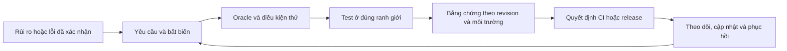

# Security regression test

## 1. Mục tiêu: giữ các bất biến bảo mật qua thay đổi

Security regression test là kiểm thử nhằm phát hiện việc một hành vi bảo mật đã được yêu cầu hoặc một lỗi đã được sửa bị mất đi sau thay đổi. Tác nhân gây hồi quy có thể là code, cấu hình, dependency, schema dữ liệu, policy quyền, cache hoặc môi trường triển khai.

Trong chương **Secure development** của module **SECURITY_SECURITY_DESIGN_SECURITY_REQUIREMENTS**, mục tiêu là chuyển rủi ro và yêu cầu bảo mật thành phép thử có điều kiện đầu vào, kết quả mong đợi và bằng chứng rõ ràng. Một test phải cho biết kiểm soát nào đang được bảo vệ, nó nhìn thấy phần nào của hệ thống và điều gì khiến kết quả không đủ để kết luận.

Sau bài học, người học cần có khả năng:

- Viết bất biến bảo mật và test oracle, tức tiêu chí xác định hành vi đúng/sai.
- Thiết kế ca hợp lệ, ca đối kháng và quan sát tác dụng phụ trên đúng ranh giới.
- Tạo kiểm thử hồi quy sau bản sửa, đồng thời bao phủ các đường xử lý có cùng nguyên nhân rủi ro.
- Tích hợp kết quả vào CI với ngữ nghĩa PASS, FAIL và lỗi môi trường rõ ràng.
- Quản lý dữ liệu thử, độ ổn định, ngoại lệ, bằng chứng và phục hồi.

[OWASP ASVS](https://asvs.owasp.org/) có thể làm nguồn yêu cầu kiểm chứng cho ứng dụng web/web service. [NIST SSDF SP 800-218](https://csrc.nist.gov/pubs/sp/800/218/final) cung cấp bối cảnh giảm lỗi, xử lý nguyên nhân và tích hợp bảo mật vào SDLC. Những mã yêu cầu và ngưỡng trong bài là ví dụ nội bộ; khi ánh xạ nguồn bên ngoài phải ghi đúng phiên bản và điều khoản đã chọn.

## 2. Hồi quy bảo mật khác gì kiểm thử chức năng thông thường?

Kiểm thử chức năng thường xác nhận người dùng hợp lệ làm được việc cần làm. Kiểm thử hồi quy bảo mật còn cần xác nhận ai không được làm, dữ liệu nào không được lộ, trạng thái nào không được hình thành và hệ thống phản ứng thế nào khi một kiểm soát không sẵn sàng.

| Loại bằng chứng | Ví dụ | Giới hạn cần nhớ |
| --- | --- | --- |
| Functional test | Người có quyền đọc được hóa đơn | Chưa chứng minh người khác không đọc được |
| Security regression test | Người tenant A không đọc hóa đơn tenant B qua API/export/cache | Chỉ bảo vệ các trường hợp và ranh giới đã đặc tả |
| Static rule | Phát hiện SQL nối chuỗi hoặc API nguy hiểm | Không tự hiểu đầy đủ quyền nghiệp vụ và trạng thái runtime |
| Vulnerability scan | Nhận diện dependency hoặc cấu hình có vấn đề đã biết | Không tự chứng minh một bản sửa logic quyền đã đúng |
| Kiểm thử khám phá/pentest | Tìm đường tấn công chưa được mô hình hóa | Kết quả cần chuyển thành yêu cầu/test bền vững khi phù hợp |

Một security regression suite có thể chứa cả kiểm thử hành vi và check tự động khác. Tuy nhiên, không gộp mọi tín hiệu thành kết luận “scanner xanh nên yêu cầu phân quyền đạt”. [OWASP Web Security Testing Guide](https://owasp.org/projects/web-security-testing-guide) là nguồn tham khảo để chọn kỹ thuật kiểm tra phù hợp; bộ hồi quy cần được thiết kế theo phạm vi sản phẩm cụ thể.

Hồi quy cũng không chỉ dành cho lỗi đã khai thác được. Ngay khi một tính năng mới có yêu cầu “không đọc chéo tenant” hoặc “không dùng credential mặc định khi cấu hình lỗi”, có thể tạo test để giữ bất biến đó qua các bản sửa sau.

## 3. Từ rủi ro đến bất biến và oracle

### 3.1. Ví dụ yêu cầu đọc hóa đơn

Yêu cầu còn mơ hồ:

> API hóa đơn phải an toàn và có kiểm thử phân quyền.

Yêu cầu có thể kiểm chứng:

> Với danh tính hợp lệ thuộc tenant A không có quyền trên tenant B, mọi đường đọc hóa đơn của B phải từ chối theo hợp đồng API, không trả trường dữ liệu được bảo vệ và không tạo hành động nghiệp vụ ngoài quyền. Audit từ chối, nếu được yêu cầu, vẫn được phép và phải không chứa secret.

Oracle cần nhìn vào response và trạng thái liên quan. Chỉ kiểm tra mã `403` có thể bỏ sót trường hợp response đã chứa dữ liệu nhạy cảm hoặc một tác vụ export đã được xếp hàng trước khi bị từ chối.

### 3.2. Những rủi ro của chính chương trình hồi quy

| Mã rủi ro | Tình huống | Hệ quả |
| --- | --- | --- |
| R-01 | Test không gắn với requirement hoặc chỉ giữ một payload cũ | Bản sửa hẹp, biến thể cùng lỗi vẫn tồn tại |
| R-02 | Oracle yếu hoặc setup sai làm request không tới kiểm soát cần thử | Test PASS dù kiểm soát đã bị mất |
| R-03 | Mock che mất middleware, query hoặc cấu hình thực | Bằng chứng chỉ phản ánh mô hình giả |
| R-04 | Thiếu tổ hợp quyền, tenant, đường truy cập, trạng thái hoặc đồng thời | Lỗi tái phát ở một nhánh không được thử |
| R-05 | Flaky, skip, timeout hoặc lỗi tool bị diễn giải thành PASS | Gate cho phép phát hành khi chưa có bằng chứng |
| R-06 | Dữ liệu/test credential/log hoặc thao tác đối kháng không được kiểm soát | Kiểm thử gây rò rỉ hoặc tác động ngoài phạm vi |
| R-07 | Bằng chứng cũ, ngoại lệ vô hạn hoặc rollback mang lỗi trở lại | Quyết định phát hành không tương ứng trạng thái thật |



## 4. Hồ sơ của một ca hồi quy

Mỗi ca cần đủ thông tin để người khác hiểu nó bảo vệ điều gì và vì sao kết quả có ý nghĩa.

| Trường | Nội dung cần có |
| --- | --- |
| Test ID và owner | Định danh ổn định, nhóm duy trì |
| Risk/requirement/fix reference | Nguồn yêu cầu, lỗi hoặc threat liên quan |
| Bất biến | Điều phải tiếp tục đúng qua thay đổi |
| Actor và quyền | Danh tính, role, tenant, quan hệ với tài nguyên |
| Dữ liệu và tiền điều kiện | Tài nguyên tồn tại, cấu hình hiệu lực, trạng thái ban đầu |
| Hành động | Kênh, endpoint, tham số và thứ tự sự kiện |
| Oracle | Response, dữ liệu, trạng thái, event hoặc kết nối cần quan sát |
| Phạm vi và giới hạn | Tầng được thử, dependency thật/giả, điều chưa kiểm tra |
| Cách thực thi | Trigger CI, môi trường, thời hạn và cleanup |
| Bằng chứng | Revision, artifact/config, test version, kết quả và output đã lọc dữ liệu |

Ví dụ record khái niệm:

```yaml
testId: SEC-REG-INVOICE-READ-01
requirementRef: REQ-INVOICE-TENANT-01
riskRef: RISK-CROSS-TENANT-READ
ownerRole: Invoice service team
preconditions:
  - Actor A da xac thuc hop le va thuoc tenant A
  - Invoice B ton tai va thuoc tenant B
  - Actor A khong co quyen uy quyen tren invoice B
action: Goi duong doc invoice B bang danh tinh actor A
expected:
  - Bi tu choi theo hop dong API
  - Khong tra truong du lieu hoa don duoc bao ve
  - Khong tao tac dong nghiep vu trai phep
  - Audit neu bat buoc tuan thu hop dong va khong lo secret
```

Đây là metadata minh họa, không phải test thực thi. Mã hóa thành test còn cần cơ chế tạo dữ liệu, gọi đúng application stack, đọc kết quả và quan sát những trạng thái được liệt kê.

## 5. Yêu cầu thiết kế bộ hồi quy

### SRT-01 — Mỗi test bảo vệ một yêu cầu hoặc bất biến xác định

**Yêu cầu:** Test phải truy được về requirement/threat hoặc lỗi đã xác nhận. Sau bản sửa, cần mô tả nguyên nhân và phạm vi họ lỗi để chọn thêm ca liên quan, thay vì chỉ lưu một chuỗi tấn công từng xuất hiện.

Ví dụ lỗi quên giới hạn tenant ở một query cần được xem cùng list, export, attachment và worker dùng lại đường truy cập đó. Không có nghĩa mọi endpoint phải có một bản test giống hệt; có thể dùng test tham số hóa hoặc control dùng chung, nhưng phải chứng minh đường nào đã được bao phủ.

**Tiêu chí nghiệm thu:** Người review xác định được test thất bại thì yêu cầu nào đang bị đe dọa, và biết những đường chưa có bằng chứng. Không dùng tên test như `securityTest1` làm tài liệu duy nhất.

### SRT-02 — Oracle phải phân biệt hành vi an toàn với lỗi setup

**Yêu cầu:** Ca bị từ chối phải có tiền điều kiện hợp lệ và tiêu chí quan sát đủ mạnh. Cần chứng minh actor/tài nguyên tồn tại, request có thể đi qua đường cần thử và trường hợp được phép vẫn hoạt động. Một `404` do fixture chưa được tạo hoặc `401` do token test hỏng không tự chứng minh phân quyền đối tượng đúng.

Oracle gồm những điều yêu cầu thực sự bảo vệ: status/error contract, dữ liệu không được trả, thay đổi trạng thái, message hoặc request tới đích ngoài. Hoạt động phụ được cho phép như audit từ chối phải được phân biệt với tác dụng nghiệp vụ trái phép.

**Tiêu chí nghiệm thu:** Khi một kiểm soát được loại bỏ trong mô hình thử cô lập hoặc khi kiểm tra lại bản lỗi có thể chạy an toàn, test phải nhận ra hành vi sai. Đây là cách đánh giá khả năng phân biệt, không phải bảo đảm đã thử mọi biến thể. Không đưa code lỗi hoặc cấu hình yếu vào production để thực hiện phép đánh giá này.

### SRT-03 — Chọn tầng test theo ranh giới cần chứng minh

**Yêu cầu:** Unit test dùng cho logic quyết định có phạm vi hẹp; integration/component test dùng cho middleware, dữ liệu, cấu hình và kết nối giữa thành phần; test qua biên hệ thống dùng khi cần chứng minh routing, proxy hoặc runtime policy. Mỗi lớp cần nêu phần dependency thật và phần đã giả lập.

Mock một policy luôn trả deny chỉ kiểm tra code xử lý nhánh deny, không kiểm tra policy thật có từ chối actor sai hay không. Tương tự, mock repository chỉ trả dữ liệu đúng tenant có thể che việc query thực tế không giới hạn tenant.

**Tiêu chí nghiệm thu:** Bằng chứng của yêu cầu quan trọng đi qua điểm thực thi thực tế ít nhất ở lớp phù hợp. Suite không cần biến mọi test thành end-to-end chậm; phải đủ để quan sát đúng ranh giới và ghi rõ giới hạn còn lại.

### SRT-04 — Bao phủ tổ hợp quyền và các đường tương đương

**Yêu cầu:** Thiết kế ma trận theo actor, action, resource, tenant/quan hệ, trạng thái và kênh khi chúng ảnh hưởng quyết định. Bao gồm ca được phép, không có danh tính, sai quyền, sai phạm vi và những nhánh thay thế liên quan.

Ví dụ cho một policy giả định:

| Actor | Tài nguyên | Hành động | Kỳ vọng |
| --- | --- | --- | --- |
| Người đọc tenant A | Hóa đơn A trong phạm vi được cấp | Đọc | Cho phép |
| Người đọc tenant A | Hóa đơn B ngoài phạm vi | Đọc | Từ chối |
| Người đọc tenant A | Hóa đơn A | Thay đổi cấu hình thanh toán | Từ chối |
| Danh tính thiếu/không hợp lệ | Hóa đơn A | Đọc | Từ chối theo hợp đồng xác thực |
| Chủ thể dịch vụ có quyền giới hạn | Tập hóa đơn được ủy quyền | Export | Theo đúng phạm vi ủy quyền |

[OWASP Authorization Testing Automation](https://cheatsheetseries.owasp.org/cheatsheets/Authorization_Testing_Automation_Cheat_Sheet.html) trình bày cách mô hình hóa ma trận quyền để hỗ trợ kiểm tra tự động. Ma trận dự án phải theo policy thật, không tự mặc định mọi admin có quyền qua mọi tenant.

**Tiêu chí nghiệm thu:** Ma trận có chủ thể đúng/sai và kênh quan trọng; ca bị từ chối không làm vô hiệu hóa toàn chức năng để đạt PASS. Test được phép là đối chứng giúp phát hiện cách sửa “deny tất cả”.

### SRT-05 — Dữ liệu và môi trường thử được cách ly

**Yêu cầu:** Sử dụng danh tính, tenant và dữ liệu tổng hợp hoặc sandbox được cấp riêng. Không sao chép credential production hoặc dữ liệu nhạy cảm vào fixture, snapshot, log hay test report. Định danh/tài nguyên của test cần cách ly để không ảnh hưởng ca khác và có cleanup đúng phạm vi.

Tài khoản phục vụ setup có thể mạnh hơn actor đang được thử, nhưng không được vô tình trở thành client thực hiện request đối kháng. Phải kiểm tra context của chính hành động test, không chỉ context khi tạo fixture.

**Tiêu chí nghiệm thu:** Ca chạy song song không đọc nhầm dữ liệu/phiên của nhau; report không chứa secret mồi ở những output phải che. Cleanup chỉ chạm tài nguyên của test, vẫn thực hiện khi assertion hoặc setup một phần thất bại theo thiết kế.

### SRT-06 — Thời gian, bất đồng bộ và đồng thời có cơ chế quan sát rõ

**Yêu cầu:** Khi thử expiry, dùng nguồn thời gian hoặc cơ chế chờ được kiểm soát phù hợp hệ thống. Khi thử race, phối hợp thứ tự bằng barrier/điểm đồng bộ quan sát được; không dựa vào vài lần gọi ngẫu nhiên rồi kết luận không có lỗi cạnh tranh.

Với queue, outbox hoặc tác dụng phụ bất đồng bộ, test cần biết pipeline xử lý đã tới mốc nào và đặt timeout hữu hạn. “Ngủ một khoảng ngắn rồi không thấy event” không đủ chứng minh event không xuất hiện. Có thể dùng checkpoint/drain trong môi trường thử và đối chứng cho đường được phép, đồng thời ghi rõ giới hạn quan sát.

**Tiêu chí nghiệm thu:** Ca expired token không phụ thuộc giờ chạy ngẫu nhiên; ca cạnh tranh có thể kích hoạt điều kiện cần thử; ca async phân biệt không có hành động theo hợp đồng với hệ thống chưa xử lý. Timeout cần phản ánh ERROR/FAIL phù hợp, không tự thành PASS.

## 6. Ví dụ một ca hồi quy có khả năng phân biệt

### 6.1. Không đọc chéo tenant sau khi cache đã được làm nóng

Giả sử lỗi cũ xảy ra khi cache chỉ dùng invoice ID và response được trả trước khi kiểm tra quyền. Sau bản sửa, cần thử cả đường cache miss và cache hit, đồng thời giữ một đối chứng cho người được phép.

```text
testCrossTenantReadAfterCacheWarmup():
    sandbox = createIsolatedTestScope()
    invoiceB = sandbox.createInvoice(tenantB, syntheticProtectedFields)
    actorA = sandbox.createValidReader(tenantA)
    actorB = sandbox.createValidReader(tenantB)

    require fixtureConfirmsInvoiceExists(invoiceB)
    require actorA has no delegated access to invoiceB

    allowed = clientAs(actorB).readInvoice(invoiceB.id)
    assert allowed matches successContractForThisEndpoint
    assert allowed contains expected permitted invoice data

    before = observeRelevantBusinessState(invoiceB, sandbox)
    attempt = clientAs(actorA).readInvoice(invoiceB.id)

    assert attempt matches denialContractForThisEndpoint
    assert attempt contains no protected invoice fields or canary values
    assert relevantBusinessState(invoiceB, sandbox) == before

    observeAsyncProcessingToDefinedCheckpoint(sandbox)
    assert no unauthorized business action belongs to attempt.requestId
    assert denialAuditMatchesPolicyWithoutSecrets(attempt.requestId)
```

Đây là mã giả, không phải test có thể chạy trực tiếp. Cần ánh xạ các hàm quan sát tới cơ chế thật của ứng dụng. Nếu thao tác đọc không có nhánh async, có thể không cần assertion async; nếu audit không phải điều kiện của endpoint, hợp đồng phải ghi đúng. Không thêm assertion mà test không thể quan sát đáng tin.

Đối chứng actor B giúp xác nhận tài nguyên và đường đọc hoạt động, nhưng không tự chứng minh mọi tiền điều kiện. Test vẫn cần kiểm tra actor A dùng đúng token, không có quyền ủy quyền và request đang tới đúng instance/configuration cần thử.

Không buộc test phụ thuộc cấu trúc cache nội bộ như số lần gọi một method, nếu mục tiêu là bảo vệ dữ liệu ở biên. Có thể cần kiểm thử riêng ở lớp cache để định vị lỗi, còn ca hồi quy chính bảo vệ hành vi quan sát được.

### 6.2. Kiểm tra test có phát hiện được lỗi cần ngăn không?

Có thể đánh giá trên bản lỗi tái tạo an toàn hoặc một mô hình thử có chủ đích làm vi phạm bất biến, chẳng hạn trả response cache trước khi phân quyền. Test phải FAIL vì dữ liệu trái phép được trả, không vì fixture không khởi động.

Kỹ thuật mutation/seeded defect chỉ là một cách kiểm tra độ nhạy. Nếu bỏ một control nhưng control độc lập khác vẫn giữ đúng bất biến, không cần ép test hành vi FAIL chỉ để bám vào cách bố trí code. Điều cần phát hiện là vi phạm yêu cầu, không phải mọi refactor của implementation.

## 7. Chọn ca theo rủi ro và họ lỗi

Không phải mọi lỗi cần một bộ test giống nhau. Cần chọn tầng và oracle tương ứng tài sản bị ảnh hưởng.

| Nhóm yêu cầu | Ca hồi quy minh họa | Oracle quan trọng |
| --- | --- | --- |
| Xác thực và phiên | Danh tính thiếu/sai, token hết hiệu lực, phiên đã thu hồi theo policy | Không được cấp quyền; token sai không bị tin vì một nhánh fallback |
| Phân quyền | Sai role, tenant, quan hệ, tài nguyên hoặc kênh export | Không lộ dữ liệu, không có hành động ngoài quyền; ca đúng quyền vẫn chạy |
| Injection và parser | Dữ liệu có cú pháp đặc biệt, trường/loại nội dung ngoài hợp đồng | Input giữ vai trò dữ liệu, không đọc/gọi nguồn bên ngoài trái policy |
| Giới hạn tài nguyên | Payload, độ sâu, số lượng hoặc retry vượt giới hạn | Giới hạn được thực thi, lỗi có kiểm soát, không mở vòng xử lý vô hạn |
| Secret và logging | Nhánh lỗi có credential mồi hoặc dữ liệu nhạy cảm | Response/log/report thuộc scope không chứa giá trị cấm |
| Giao tiếp và cấu hình | Đích mạng/chứng thư không hợp lệ hoặc cấu hình bắt buộc thiếu | Không tự hạ xác minh hoặc dùng credential mặc định |
| Trạng thái và phục hồi | Hai hành động cạnh tranh, lỗi giữa chừng, retry hoặc rollback | Bất biến và quyền giữ đúng; phần đã thực hiện có trạng thái xử lý rõ |

[OWASP Authorization Cheat Sheet](https://cheatsheetseries.owasp.org/cheatsheets/Authorization_Cheat_Sheet.html) là một nguồn tham khảo khi chọn yêu cầu quyền, vị trí thực thi và kiểm thử liên quan. Những nhóm khác cũng cần nguồn yêu cầu phù hợp; bảng trên là mẫu thiết kế, không phải một bộ payload đầy đủ.

Với kiểm thử sinh dữ liệu/property-based testing, property phải bắt nguồn từ yêu cầu, generator phải có miền rõ và lưu được seed/case thu nhỏ để tái hiện. Một tập mẫu ngẫu nhiên hữu hạn có thể tìm lỗi nhưng không chứng minh mọi đầu vào đều an toàn.

## 8. Yêu cầu đưa hồi quy vào CI và release

### SRT-07 — Chạy đúng tập test và phân biệt các trạng thái kết quả

**Yêu cầu:** Mỗi nhóm test có trigger và mức bắt buộc theo rủi ro. Test nhanh có thể chạy trong PR; test tích hợp hoặc môi trường triển khai có thể chạy ở chốt khác, nhưng bản phát hành phải có đủ bằng chứng bắt buộc theo policy.

Path filter hoặc cách chọn test theo thay đổi phải xét ảnh hưởng gián tiếp. Sửa policy chung, dependency bảo mật hoặc cấu hình middleware có thể tác động nhiều endpoint dù file nghiệp vụ không đổi. Không để test quan trọng bị bỏ qua chỉ vì thư mục của nó không xuất hiện trong diff.

Ví dụ ngữ nghĩa kết quả:

| Trạng thái | Ý nghĩa | Hệ quả cho điều kiện bắt buộc |
| --- | --- | --- |
| PASS | Ca đã chạy trên đúng subject và oracle đạt | Có bằng chứng cho phạm vi ca đó |
| FAIL | Hành vi quan sát vi phạm oracle hợp lệ | Chặn theo policy và điều tra lỗi |
| ERROR | Setup, hạ tầng hoặc công cụ không cho phép kết luận | Chưa có bằng chứng đạt, không tự chuyển PASS |
| NOT_RUN/SKIPPED | Ca chưa chạy hoặc điều kiện khiến nó bị bỏ qua | Cần lý do áp dụng/ngoại lệ; không tính như ca đã đạt |
| QUARANTINED | Ca bị tách khỏi luồng vì vấn đề đã quản lý | Phải có owner, thời hạn và bằng chứng/kiểm soát thay thế nếu bắt buộc |

**Tiêu chí nghiệm thu:** Một shard thiếu kết quả, job bị hủy, scanner lỗi hoặc test skip không được aggregator coi là toàn bộ suite PASS. Test không áp dụng có lý do được review, không chỉ một annotation để làm pipeline xanh.

### SRT-08 — Bằng chứng gắn với đúng phiên bản cần quyết định

**Yêu cầu:** Kết quả cần ghi test ID/version, source revision, artifact digest khi phù hợp, cấu hình/policy hiệu lực, môi trường, thời điểm và producer. Không tái dùng báo cáo của commit hoặc artifact khác chỉ vì tên branch, job hay file report giống nhau.

Test source chứng minh hành vi của build đã thử, không tự chứng minh binary khác do pipeline khác tạo. Nếu release dùng một artifact cụ thể, cần liên kết kết quả với artifact đó hoặc có quy trình xác định rõ vì sao bằng chứng ở tầng khác đáp ứng yêu cầu.

Ví dụ record không chứa dữ liệu nhạy cảm:

```json
{
  "testId": "SEC-REG-INVOICE-READ-01",
  "requirementId": "REQ-INVOICE-TENANT-01",
  "sourceRevision": "revision-lab-7",
  "candidateId": "candidate-lab-042",
  "policyVersion": "security-policy-3",
  "environmentProfile": "integration-lab",
  "result": "PASS",
  "evidenceRef": "restricted-evidence-042"
}
```

**Tiêu chí nghiệm thu:** Báo cáo giả, không có producer được tin hoặc từ subject khác không mở gate. Người xử lý sự cố có thể truy từ bản phát hành tới những ca thực sự đã chạy và các giới hạn của chúng.

### SRT-09 — Thay đổi test và kỳ vọng cũng cần quản trị

**Yêu cầu:** Xóa ca hồi quy, nới oracle, đổi required suite hoặc cập nhật expected result phải có lý do gắn với requirement/rủi ro. Người sửa lỗi không được tự làm mất gate bằng cách xóa test mà không đi qua cơ chế review phù hợp.

Khi nghiệp vụ chủ đích đổi policy, có thể cần cập nhật test. Thay đổi kỳ vọng phải đi cùng quyết định policy, phạm vi quyền mới và ca kiểm tra liên quan; không tự chấp nhận mọi snapshot output mới chỉ vì test đang đỏ.

**Tiêu chí nghiệm thu:** PR xóa/nới một ca quan trọng được nhận diện như thay đổi kiểm soát, không chỉ thay test data. Metadata và ma trận vẫn phản ánh đúng yêu cầu hiện hành sau khi đổi.

### SRT-10 — Flaky và ngoại lệ không tạo PASS vô thời hạn

**Yêu cầu:** Test không ổn định phải được phân loại nguyên nhân: dữ liệu dùng chung, thứ tự, đồng hồ, async, hạ tầng hoặc lỗi sản phẩm thực sự. Retry có giới hạn và lưu mọi lần chạy; không lặp đến khi xanh rồi bỏ dấu vết lần vi phạm.

Nếu cần quarantine, ghi owner, lý do, deadline và ảnh hưởng tới yêu cầu chưa có bằng chứng. Với control bắt buộc, phải có phép kiểm tra thay thế hoặc quyết định ngoại lệ theo rủi ro; việc chuyển test sang một suite không chạy không khắc phục rủi ro.

**Tiêu chí nghiệm thu:** Một lỗi hành vi tái hiện được không bị đóng thành flaky chỉ vì lần sau PASS. Quarantine hết hạn tạo hành động theo policy; báo cáo phân biệt ca đã chạy đạt, chưa chạy và đang dùng ngoại lệ.

## 9. An toàn của hoạt động kiểm thử và khả năng phục hồi

### SRT-11 — Kiểm thử đối kháng có giới hạn và không tạo exposure thật

**Yêu cầu:** Các ca tạo tải, lỗi kết nối, truy cập file/mạng hoặc dữ liệu có tính đối kháng phải có môi trường, target allowlist, timeout, tài nguyên và cleanup rõ. Credential sandbox chỉ có quyền cần thiết; kết nối ra dịch vụ thật chỉ được dùng trong phạm vi kiểm thử đã xác định.

Dùng canary/marker tổng hợp để quan sát đọc dữ liệu, log hoặc gọi đích. Nếu cần giả lập metadata, đối tác hoặc storage, dùng đích mồi kiểm soát được; không dựa vào việc thử lấy credential/dữ liệu production. Report, trace và screenshot cũng thuộc phạm vi bảo vệ dữ liệu.

**Tiêu chí nghiệm thu:** Test sai cấu hình target dừng trước thao tác ngoài scope; timeout không để lại tài nguyên hoạt động vô hạn. Cleanup không xóa dữ liệu ngoài namespace/run của ca thử. Nhánh lỗi vẫn không làm lộ secret mồi trong các output cần che.

### SRT-12 — Bản sửa, rollback và cập nhật môi trường giữ được yêu cầu

**Yêu cầu:** Sau lỗi bảo mật, cần có ca hồi quy hoặc phương pháp kiểm chứng tương đương cho nguyên nhân đã xử lý, cùng những biến thể có rủi ro liên quan. Test phải được duy trì qua refactor, nâng framework/dependency, đổi schema và thay cấu hình.

Kế hoạch rollback/khôi phục phải xét việc phiên bản cũ có mang lỗ hổng trở lại hay không. Một artifact từng hoạt động tốt về nghiệp vụ không tự đáp ứng policy bảo mật hiện tại. Nếu phải dùng kiểm soát bù trong sự cố, cần phạm vi, owner và thời hạn; ca hồi quy không được xóa để hợp thức hóa trạng thái yếu hơn.

Khi yêu cầu hết áp dụng thật sự, có thể retire test cùng hồ sơ giải thích và bằng chứng phạm vi mới. Không giữ test lỗi thời chỉ để có số lượng lớn, cũng không xóa lịch sử liên kết với nguyên nhân lỗi cần điều tra.

**Tiêu chí nghiệm thu:** Nâng cấp hoặc phục hồi ứng dụng được kiểm tra với tập hồi quy bắt buộc tương ứng. Bản lỗi được tái đưa vào sandbox tạo tín hiệu đúng, hoặc có bằng chứng control khác đang giữ bất biến trong kiến trúc hiện tại.

## 10. Ma trận truy vết từ yêu cầu tới bằng chứng

| Yêu cầu | Rủi ro | Điểm thực thi | Bằng chứng nghiệm thu |
| --- | --- | --- | --- |
| SRT-01 | R-01 | Requirement/test inventory | Mỗi ca gắn bất biến, owner và phạm vi họ lỗi |
| SRT-02 | R-02 | Fixture precondition, oracle | Ca phân biệt được vi phạm yêu cầu với setup hỏng hoặc deny tất cả |
| SRT-03 | R-03 | Unit, component, integration và system boundary | Đi qua control thật ở lớp phù hợp, giới hạn mock rõ |
| SRT-04 | R-04 | Ma trận actor/action/resource/kênh | Có tổ hợp đúng/sai và đường truy cập liên quan |
| SRT-05 | R-06 | Data factory, credential, test isolation | Không dùng dữ liệu thật, không chéo scope và cleanup đúng |
| SRT-06 | R-04, R-05 | Clock, async observation, concurrency harness | Điều kiện timing/race được kiểm soát và quan sát có giới hạn |
| SRT-07 | R-05 | Test selection, CI aggregator, gate | ERROR/skip/shard thiếu không thành bằng chứng đạt |
| SRT-08 | R-07 | Evidence producer/store và release binding | Kết quả đúng revision/artifact/config, có thể truy vết |
| SRT-09 | R-01, R-07 | Review test/policy changes | Xóa/nới test có quyết định và cập nhật requirement liên quan |
| SRT-10 | R-05, R-07 | Flaky triage, retry, quarantine | Có dấu vết mọi lần chạy, owner và thời hạn ngoại lệ |
| SRT-11 | R-06 | Sandbox, egress, quota, cleanup | Test không tác động ngoài target và không rò dữ liệu |
| SRT-12 | R-01, R-07 | Fix lifecycle, dependency update, recovery | Control giữ qua thay đổi, rollback không mang lỗi lại âm thầm |

Mỗi dự án cần thêm owner triển khai và owner chấp nhận rủi ro. Nhóm test không tự sửa được mọi policy IAM, route hoặc cấu hình môi trường; cần bằng chứng phối hợp từ nhóm vận hành/nền tảng cho những control đó.

## 11. Các ca nghiệm thu cho chương trình hồi quy

Các ca sau dùng đánh giá việc thiết kế và vận hành suite trong dự án minh họa. Chúng cần được cụ thể hóa theo kiến trúc, không phải một danh sách công cụ phải chạy nguyên xi.

| Mã | Thiết lập | Điều kiện pass |
| --- | --- | --- |
| T-01 | Một test mới chưa có requirement/bất biến/owner | Thiếu sót được phát hiện trước khi coi đó là bằng chứng bắt buộc đầy đủ |
| T-02 | Fixture không tạo được tài nguyên hoặc token sai từ setup | Kết quả là lỗi/thiếu tiền điều kiện, không thành ca phân quyền PASS |
| T-03 | Bản sửa từ chối mọi actor để tránh truy cập trái phép | Ca hợp lệ phát hiện chức năng cần cho phép đã bị phá |
| T-04 | Response có status từ chối nhưng còn dữ liệu bảo vệ | Oracle phát hiện vi phạm, không chỉ nhìn status |
| T-05 | Request bị từ chối sau khi đã tạo event/hành động nghiệp vụ | Quan sát trạng thái/async phát hiện tác dụng phụ ngoài hợp đồng |
| T-06 | Mock policy/repository che một lỗi ở control thật | Lớp integration phù hợp phát hiện hoặc giới hạn bằng chứng được nêu rõ |
| T-07 | Đường detail an toàn nhưng export/list/cache bị lỗi cùng họ | Ma trận có ca liên quan, không kết luận toàn phạm vi từ một endpoint |
| T-08 | Role/tenant/ủy quyền hoặc trạng thái tài nguyên thay đổi | Kết quả theo policy hiện tại, không dựa vào fixture một trường hợp duy nhất |
| T-09 | Test expiry, async và race chạy với thứ tự/đồng hồ thay đổi | Harness phân biệt được điều kiện hợp lệ, timeout và vi phạm thực |
| T-10 | Hai test chạy song song cùng tạo dữ liệu/cookie | Không lẫn context hoặc trạng thái giữa scope thử |
| T-11 | Commit/artifact/config mới nhưng tái sử dụng report cũ | Evidence không mở gate cho subject khác |
| T-12 | Một job hoặc shard bị hủy, test skip hay tool lỗi | Suite chưa đủ bằng chứng bắt buộc, không báo toàn bộ PASS |
| T-13 | Path filter bỏ test sau thay đổi policy/dependency chung | Lựa chọn suite hoặc release gate vẫn bao phủ ảnh hưởng bắt buộc |
| T-14 | PR xóa test hoặc nới expected result của lỗi đã sửa | Có review rủi ro/requirement, không tự đổi kỳ vọng để xanh |
| T-15 | Test FAIL rồi PASS sau retry hoặc được quarantine | Giữ dấu vết, phân loại nguyên nhân và xử lý ngoại lệ có hạn |
| T-16 | Secret mồi xuất hiện trên nhánh lỗi, log hoặc report | Output thuộc policy che dữ liệu không lộ giá trị |
| T-17 | Target thử nghiệm sai, thao tác quá hạn hoặc cleanup lỗi | Không tác động ngoài scope; nguồn lực được giới hạn và xử lý |
| T-18 | Mô hình thử cố ý tái tạo vi phạm bất biến | Test nhận ra hành vi sai thay vì chỉ báo setup lỗi |
| T-19 | Nâng framework/schema hoặc rollback bản ứng dụng | Tập bắt buộc tương ứng được thực thi, không tái mở đường lỗi âm thầm |
| T-20 | Ngoại lệ hết hạn hoặc requirement đổi có chủ đích | Có quyết định rõ, test/evidence được cập nhật và lịch sử còn truy vết |

Báo cáo phải ghi kết quả đã quan sát, scope và giới hạn. Không suy “toàn hệ thống an toàn” từ một số ca đã đạt. Coverage dòng, số lượng payload và số lần retry thành công không thay thế bằng chứng giữ đúng bất biến.

## 12. Tình huống áp dụng: test xanh vì dữ liệu không tồn tại

Một API từng lộ hóa đơn chéo tenant được sửa bằng cách thêm kiểm tra quyền. Nhóm viết test dùng ID cố định của tenant B, gọi bằng actor A và chấp nhận `404`. Sau một lần đổi fixture, hóa đơn B không còn được tạo; test vẫn xanh dù một refactor sau đó đã làm mất giới hạn tenant.

Lỗi của chương trình hồi quy nằm ở SRT-02: oracle không được bảo vệ bằng tiền điều kiện và đối chứng. Test cần tạo tài nguyên trong scope riêng, xác nhận nó tồn tại, kiểm tra actor được phép đọc được và sau đó thử actor không có quyền. Nếu cache từng liên quan lỗi, phải thêm chuỗi làm nóng cache trước lần đọc trái phép.

Bản sửa test cũng cần xem những đường cùng dùng repository hoặc policy đó. Một test detail mạnh hơn không tự thay cho export/worker nếu chúng có đường thực thi riêng. Khi CI chạy trên revision mới, report phải ghi đúng subject và không được tái dùng bằng chứng của bản sửa test ở một artifact khác.

Khi phát hiện hồi quy thực sự, cần dừng quyết định phát hành theo policy, xử lý ảnh hưởng nếu đã triển khai và bổ sung bằng chứng cho nguyên nhân. Không chỉ đổi expected status hoặc đánh dấu flaky để tiếp tục pipeline.

## 13. Câu hỏi tự kiểm tra

1. Một test phân quyền chỉ kiểm tra mọi response là `4xx`. Hãy bổ sung tiền điều kiện, đối chứng và oracle để không PASS vì request sai định dạng.
2. Một request bị từ chối nhưng đã xếp hàng export. Cần quan sát trạng thái và async thế nào để phát hiện lỗi mà không dựa vào một khoảng sleep ngắn?
3. Unit test mock repository luôn trả dữ liệu đúng tenant. Cần lớp kiểm chứng nào để biết truy vấn thật không trả chéo tenant?
4. Nâng dependency xác thực nhưng path filter không chọn suite security. Hãy đặc tả trigger và release gate để vẫn có đủ bằng chứng.
5. Một ca bị quarantine ba tháng, không có owner và luôn được tính là PASS. Hãy viết lại hợp đồng kết quả, ngoại lệ và điều kiện mở gate.
6. Trong sự cố cần rollback về artifact cũ. Cần đánh giá và kiểm thử gì để không phục hồi lại một lỗ hổng đã biết?

Mỗi câu trả lời cần nối được **rủi ro → bất biến → tiền điều kiện và oracle → điểm thực thi → evidence đúng phiên bản → quyết định và phục hồi**. Chuỗi này giúp security regression test trở thành bằng chứng có ích trong vòng đời phát triển, thay vì chỉ là một tên job trong CI.
