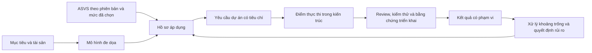

# OWASP ASVS — Khung kiểm chứng yêu cầu bảo mật ứng dụng

## 1. Mục tiêu và phạm vi

OWASP Application Security Verification Standard, thường viết là ASVS, cung cấp một tập yêu cầu dùng để định hướng thiết kế, phát triển và kiểm chứng bảo mật ứng dụng. Trong bối cảnh ứng dụng web và dịch vụ liên quan, ASVS giúp nhóm dự án mô tả rõ những kiểm soát cần có và tổ chức bằng chứng để đánh giá chúng.

Giá trị của ASVS nằm ở khả năng biến các mục tiêu như “bảo vệ tài khoản”, “cô lập tenant” hoặc “không lộ dữ liệu” thành những yêu cầu có thể xem xét và kiểm chứng. Việc tạo một bảng checklist chưa chứng minh hệ thống đã đáp ứng chuẩn; từng kết luận cần có phạm vi, phương pháp và bằng chứng phù hợp.

Trong chương **Verification framework**, bài học này nối mục tiêu an toàn thông tin và mô hình đe dọa với yêu cầu cụ thể về xác thực, phân quyền, dữ liệu, logging và phục hồi. Trọng tâm là cách sử dụng ASVS trong vòng đời phát triển, từ chọn hồ sơ áp dụng đến truy vết kiến trúc, kiểm thử và quyết định rủi ro.

Sau bài học, người học có thể:

- Phân biệt ASVS với danh mục rủi ro, công cụ quét và chứng nhận.
- Chọn phiên bản, mức kiểm chứng và phạm vi có căn cứ.
- Đánh giá tính áp dụng và trách nhiệm thực thi.
- Chuyển yêu cầu chuẩn thành yêu cầu dự án có thể đo và kiểm chứng.
- Quản lý bằng chứng, trạng thái đánh giá, ngoại lệ và thay đổi theo thời gian.

Bài học trình bày phương pháp sử dụng ASVS mà không ấn định một phiên bản cụ thể. Tên nhóm kiểm soát trong bài là cách diễn giải theo chủ đề, không phải danh mục chương hoặc số hiệu yêu cầu của một phiên bản. Khi triển khai, phải lấy nguyên văn yêu cầu và định danh từ phiên bản chính thức mà dự án đã chốt.

## 2. ASVS trả lời câu hỏi nào?

### 2.1. Phân biệt các loại đầu vào bảo mật

| Thành phần | Câu hỏi chính | Đầu ra có ích |
| --- | --- | --- |
| Mục tiêu an toàn thông tin | Cần bảo vệ tài sản và thuộc tính nào? | Mục tiêu bảo mật và ưu tiên |
| Mô hình đe dọa | Ai có thể phá vỡ mục tiêu qua đường nào? | Kịch bản và ranh giới tin cậy |
| ASVS | Những yêu cầu kiểm chứng nào cần được xem xét theo hồ sơ lựa chọn? | Baseline yêu cầu và tham chiếu |
| Yêu cầu dự án | Hệ thống cụ thể phải hành xử thế nào? | Điều kiện, giới hạn, điểm thực thi và tiêu chí chấp nhận |
| Kiểm thử, review và đánh giá triển khai | Có bằng chứng cho thấy yêu cầu được thực hiện không? | Kết quả kiểm chứng có phạm vi |
| Quyết định rủi ro | Khoảng trống nào được xử lý hoặc chấp nhận bởi ai? | Hành động, trách nhiệm và thời hạn |

ASVS không thay thế hiểu biết về tài sản và nghiệp vụ. Một ứng dụng nhiều tenant vẫn cần yêu cầu phân quyền theo từng đối tượng, từng hành động và vòng đời quyền của chính nó.

### 2.2. ASVS và OWASP Top 10 có vai trò khác nhau

Danh mục rủi ro giúp nhận diện và trao đổi về các nhóm vấn đề thường được quan tâm. ASVS cung cấp một tập yêu cầu để tổ chức việc kiểm chứng sâu hơn.

Không nên lấy số nhóm trong một danh mục rủi ro làm mẫu số kiểm chứng ASVS. Cũng không có giả định rằng một phát hiện hoặc một yêu cầu chỉ ánh xạ tới đúng một nhóm rủi ro.

Một nhóm có thể dùng danh mục rủi ro để truyền thông, dùng mô hình đe dọa để xác định kịch bản của hệ thống và dùng ASVS để xây dựng baseline kiểm chứng. Các công cụ này bổ sung cho nhau.

### 2.3. ASVS không phải một lệnh quét

Một số yêu cầu có thể được hỗ trợ bằng kiểm thử tự động, nhưng những yêu cầu khác cần review thiết kế, xem cấu hình, phân tích mã, kiểm thử có ngữ cảnh hoặc diễn tập.

Ví dụ:

- Kiểm tra quyền trên một đối tượng cần biết chủ thể, tenant và policy.
- Quản lý khóa cần bằng chứng về nguồn, quyền và vòng đời.
- Giới hạn dữ liệu log cần xem cả ứng dụng lẫn pipeline quan sát.
- Phục hồi không tái mở quyền cần kiểm chứng hành vi sau restore.
- Quy trình thay đổi cần bằng chứng về trách nhiệm và quyền thực hiện.

Một scanner không có phát hiện chỉ cung cấp bằng chứng trong phạm vi mà nó đã tiếp cận và kiểm tra. Nó không tự tạo kết luận đáp ứng mọi yêu cầu ASVS.

### 2.4. Đánh giá đáp ứng và chứng nhận là hai khái niệm khác nhau

Một báo cáo nội bộ có thể mô tả mức độ đáp ứng một hồ sơ ASVS. Nó cần nêu người đánh giá, phương pháp, phạm vi, phiên bản và giới hạn.

Không suy từ việc điền checklist hoặc hoàn tất một đợt kiểm thử thành tuyên bố chứng nhận không có căn cứ. Bất kỳ tuyên bố đảm bảo nào cũng phải đúng với nguồn cấp, phạm vi và bằng chứng thực tế.

## 3. Chốt phiên bản và mức kiểm chứng

### 3.1. Phiên bản là một phần của tham chiếu

Số hiệu, nội dung, cách tổ chức và phân bổ yêu cầu có thể thay đổi giữa các phiên bản. Một mã yêu cầu không kèm phiên bản có thể gây hiểu nhầm.

> **AV-PROFILE-01:** Hồ sơ áp dụng phải ghi rõ phiên bản ASVS, mức kiểm chứng mục tiêu, phạm vi hệ thống và phiên bản hồ sơ dự án. Tham chiếu yêu cầu phải xác định được đúng nội dung của phiên bản đã chọn.

Không tự lấy một checklist cũ rồi đổi tên phiên bản. Khi nâng phiên bản, phải đánh giá thay đổi ngữ nghĩa và phạm vi chứ không chỉ đổi số hiệu.

Một định dạng tham chiếu nội bộ có thể là:

```text
ASVS@<standard-version>:<requirement-id-from-that-version>
```

Đây là quy ước minh họa của dự án, không phải khẳng định về cú pháp định danh chính thức của ASVS.

### 3.2. Hiểu các mức L1, L2 và L3

ASVS được sử dụng với các mức kiểm chứng L1, L2 và L3. Ở mức khái quát:

| Mức | Định hướng lựa chọn | Điều cần tránh |
| --- | --- | --- |
| L1 | Một baseline kiểm chứng ban đầu cho những kiểm soát được mức này quy định | Hiểu rằng chỉ cần chạy công cụ hoặc không cần biết thiết kế |
| L2 | Phạm vi kiểm chứng sâu hơn cho các ứng dụng có nhu cầu bảo vệ đáng kể | Mặc định tên mức tự chứng minh an toàn cho dữ liệu nhạy cảm |
| L3 | Mức đảm bảo cao hơn khi tác động và rủi ro yêu cầu kiểm chứng nghiêm ngặt hơn | Hiểu là bảo đảm tuyệt đối hoặc thay thế mọi yêu cầu nghiệp vụ |

Định nghĩa chính xác và tập yêu cầu từng mức phải lấy từ phiên bản đã chốt. Khi sử dụng tính tích lũy của các mức, phải xử lý các yêu cầu của mức thấp hơn thuộc phạm vi, không chỉ những yêu cầu tăng thêm.

Không coi L1, L2, L3 là tên của ba sản phẩm scanner hoặc ba mức độ trưởng thành của tổ chức. Chúng phục vụ việc xác định mức kiểm chứng ứng dụng.

### 3.3. Chọn mức bằng rủi ro và ranh giới

Cần xét:

- Loại dữ liệu, quy mô và hậu quả khi bị lộ hoặc sửa.
- Giá trị của tài khoản và thao tác.
- Khả năng truy cập từ nguồn không đáng tin.
- Mô hình tenant, bên thứ ba và tích hợp.
- Tác động khả dụng và khả năng phục hồi.
- Những yêu cầu hợp đồng hoặc nội bộ đã xác định.

Không chọn mức chỉ vì “dự án nhỏ” hoặc “chỉ có API”. Một dịch vụ ít endpoint vẫn có thể nắm dữ liệu hoặc quyền quan trọng.

Nếu chỉ chọn một tập con yêu cầu để kiểm tra, phải mô tả đó là hồ sơ hoặc phạm vi đánh giá tương ứng. Không tuyên bố đạt trọn một mức nếu những yêu cầu áp dụng của mức đó còn bị bỏ qua hoặc chưa có bằng chứng.

## 4. Xây dựng hồ sơ áp dụng

### 4.1. Phạm vi phải xác định được đối tượng

Một hồ sơ cần mô tả:

- Dịch vụ, giao diện và thành phần được bao phủ.
- Môi trường, artifact hoặc revision cấu hình.
- Tenant, role và các luồng nghiệp vụ quan trọng.
- Những nhà cung cấp hoặc thành phần dùng chung liên quan.
- Những phần loại trừ và lý do.
- Yêu cầu ASVS được đưa vào cùng yêu cầu đặc thù bổ sung.
- Chủ sở hữu, người đánh giá và điều kiện review lại.

Một ứng dụng có thể gồm frontend, API, worker, queue, storage và cổng quản trị. Chỉ đánh giá frontend không tự bao phủ các thành phần còn lại.

### 4.2. Tính áp dụng và kết quả kiểm chứng phải tách biệt

Mỗi yêu cầu cần một quyết định về tính áp dụng:

- Áp dụng trực tiếp.
- Áp dụng nhưng trách nhiệm chia sẻ hoặc giao cho thành phần khác.
- Không áp dụng với căn cứ cụ thể.
- Chưa đủ thông tin để xác định.

Sau đó mới đánh giá kết quả kiểm chứng cho phần áp dụng.

> **AV-APPLY-01:** Yêu cầu không được đánh dấu không áp dụng chỉ vì chưa triển khai, công cụ không kiểm tra được hoặc bên khác chịu trách nhiệm. Quyết định không áp dụng phải có lý do, bằng chứng và người chịu trách nhiệm xác nhận.

Ví dụ, hệ thống chưa có audit bắt buộc là khoảng trống kiểm soát, không phải bằng chứng yêu cầu audit không áp dụng.

### 4.3. Trách nhiệm chia sẻ không xóa yêu cầu

| Tình huống | Trách nhiệm cần làm rõ | Kết luận sai cần tránh |
| --- | --- | --- |
| Dùng nhà cung cấp danh tính | Vòng đời tài khoản, luồng đăng nhập, token và xác minh tại ứng dụng | Mọi yêu cầu xác thực đều không áp dụng |
| TLS kết thúc ở gateway | Cấu hình peer, đoạn tới backend và đường bypass | Mọi kết nối phía sau đều được bảo vệ |
| Log gửi sang dịch vụ quan sát | Dữ liệu ứng dụng phát ra, lọc, quyền đọc và retention | Nhà cung cấp tự ngăn mọi secret bị ghi |
| Dùng secret manager | Quyền workload, nguồn secret, rotation và cách ứng dụng sử dụng | Không cần kiểm tra credential trong mã hoặc log |
| Storage do nền tảng quản lý | Quyền object, đường tải, vòng đời và backup | File không thể bị truy cập trái phép |

Bằng chứng của nhà cung cấp có thể hỗ trợ phần trách nhiệm tương ứng. Nó không tự chứng minh cấu hình và cách tích hợp của ứng dụng đã đúng.

### 4.4. Ví dụ hồ sơ rút gọn

```yaml
profileId: customer-export-security-profile
profileRevision: "3"
standard:
  name: OWASP ASVS
  version: "<selected-official-version>"
  targetLevel: L2
scope:
  application: customer-platform
  environment: pre-production
  components:
    - api
    - export-worker
    - download-gateway
    - storage-integration
requirements:
  - standardReference: "<exact-reference-from-selected-version>"
    projectRequirements:
      - SR-EXPORT-AUTHZ-01
      - SR-EXPORT-DOWNLOAD-01
    applicability: APPLICABLE
    owner: customer-platform-team
```

Các trường version và standardReference là placeholder, phải được điền từ phiên bản thực tế. Schema là ví dụ quản lý hồ sơ, không phải định dạng bắt buộc của ASVS.

## 5. Chuyển yêu cầu chuẩn thành đặc tả dự án

### 5.1. Giữ nghĩa gốc, bổ sung ngữ cảnh

Không thay yêu cầu chuẩn bằng một câu rút gọn làm mất điều kiện quan trọng. Nên giữ tham chiếu gốc, sau đó bổ sung:

1. Đối tượng và chủ thể của ứng dụng.
2. Tình huống áp dụng.
3. Hành vi bắt buộc và hành vi phải bị từ chối.
4. Giới hạn đo được.
5. Điểm thực thi.
6. Phương pháp cùng bằng chứng kiểm chứng.
7. Chủ sở hữu và điều kiện thay đổi.

Một yêu cầu chuẩn có thể dẫn tới nhiều yêu cầu dự án. Một yêu cầu dự án cũng có thể hỗ trợ nhiều tham chiếu nếu có căn cứ. Không ép ánh xạ một-một để làm bảng ngắn hơn.

### 5.2. Ví dụ nhiều tenant và xuất dữ liệu

Giả sử nền tảng khách hàng có API tạo job xuất dữ liệu, worker sinh file và cổng tải. Mô hình đe dọa xác định nguy cơ truy cập chéo tenant, mất quyền trong lúc job chờ và URL tải tồn tại lâu hơn quyền.

Các ID dưới đây là **ID nội bộ minh họa**, không phải số hiệu ASVS:

> **SR-EXPORT-AUTHZ-01:** Mọi thao tác tạo, xem, hủy hoặc chạy lại job phải xác minh quyền của chủ thể trên đúng tenant và đối tượng. Tenant từ request không được tự thiết lập ngữ cảnh quyền.

> **SR-EXPORT-DOWNLOAD-01:** Mỗi quyết định mở phiên tải mới phải xác thực người gọi và kiểm tra quyền với job cùng phạm vi dữ liệu. Thu hồi quyền phải được phản ánh trong tối đa 60 giây kể từ mốc nguồn quyền có thẩm quyền xác nhận.

> **SR-EXPORT-LOG-01:** Audit phải xác định được chủ thể, thao tác, job, kết quả và mã tương quan nhưng không chứa nội dung file, credential hoặc trường ngoài danh sách cho phép.

Ngưỡng 60 giây là yêu cầu của ví dụ dự án, không phải khẳng định ASVS bắt buộc cùng một ngưỡng cho mọi ứng dụng.

Cần định nghĩa riêng cách xử lý luồng tải đã bắt đầu. Không thể thu hồi những byte người dùng đã nhận chỉ bằng việc chặn phiên mới.

### 5.3. Từ yêu cầu tới kiến trúc



Trong ví dụ, API kiểm tra quyền khi tạo job, worker xác định ngữ cảnh từ bản ghi được kiểm soát và cổng tải kiểm tra quyền hiện tại. Nếu hệ thống còn có URL trực tiếp hoặc công cụ vận hành, những đường đó cũng phải được đánh giá.

Chỉ ghi “đã dùng framework phân quyền” chưa xác định được nơi thực thi từng yêu cầu.

### 5.4. Bổ sung yêu cầu đặc thù

ASVS là baseline, không phải danh mục đầy đủ mọi quy tắc nghiệp vụ. Dự án có thể cần thêm:

- Người tạo không được tự phê duyệt giao dịch.
- Phê duyệt gắn với đúng phiên bản nội dung.
- Message lặp không tạo thêm tác động.
- Hủy job không bị worker cũ ghi đè.
- File đã hết hạn không tái được truy cập sau restore.
- Tích hợp bên thứ ba không gửi trường ngoài hợp đồng dữ liệu.

Các yêu cầu bổ sung cần được truy vết và kiểm chứng như những yêu cầu khác, không bị bỏ khỏi báo cáo chỉ vì không có ánh xạ trực tiếp.

## 6. Lập kế hoạch kiểm chứng theo loại bằng chứng

### 6.1. Chọn phương pháp cho câu hỏi

| Nhóm câu hỏi | Phương pháp phù hợp | Giới hạn cần nêu |
| --- | --- | --- |
| Kiến trúc giữ ranh giới ở đâu? | Review thiết kế và luồng dữ liệu | Chưa chứng minh bản chạy đúng |
| Policy được áp dụng ở đường mã nào? | Code review và kiểm thử có ngữ cảnh | Cần xét cấu hình, đường vòng và phiên bản |
| Người sai quyền có tạo tác động không? | Kiểm thử tích hợp hoặc động với nhiều danh tính | Phụ thuộc dữ liệu và luồng đã tiếp cận |
| Mạng và TLS có hiệu lực ra sao? | Kiểm tra triển khai từ vị trí phù hợp | Kết luận chỉ cho môi trường và đường đã thử |
| Secret, khóa và quyền được quản lý thế nào? | Đánh giá cấu hình, danh tính và vòng đời | Một kết nối thành công không chứng minh least privilege |
| Restore có tái mở dữ liệu hoặc quyền không? | Diễn tập phục hồi và đối soát | Cần xét queue, storage, cache và hệ thống ngoài |
| Thay đổi có được kiểm soát không? | Bằng chứng quy trình và phân quyền | Tài liệu quy trình chưa chứng minh luôn được thực thi |

Một yêu cầu có thể cần nhiều loại bằng chứng. Không đánh dấu đạt chỉ vì có một unit test mang tên giống yêu cầu.

### 6.2. Chốt tiêu chí trước khi thu thập

> **AV-PLAN-01:** Mỗi yêu cầu áp dụng phải có phương pháp, phạm vi, tiêu chí chấp nhận và nguồn bằng chứng được xác định. Khoảng trống phương pháp hoặc nguồn không đáng tin phải được ghi nhận trước khi đưa ra kết luận.

Ví dụ với SR-EXPORT-AUTHZ-01, cần tối thiểu các danh tính đúng quyền, sai chức năng và khác tenant trong dữ liệu thử, cùng kiểm tra không có tác động trái phép.

Một response 403 không đủ nếu job đã được tạo trước khi trả lỗi. Tiêu chí phải xem trạng thái bền vững hoặc bằng chứng tương ứng.

### 6.3. Độ bao phủ có nhiều chiều

Có thể cần xét tổ hợp:

```text
Yêu cầu + thành phần + thao tác + danh tính/tenant + trạng thái nghiệp vụ + môi trường
```

Không nhất thiết thử mọi tổ hợp có thể tưởng tượng. Cần ưu tiên theo rủi ro và giải thích phần chưa bao phủ.

Một route đã được gọi không đồng nghĩa mọi quyền đã được kiểm tra. Một checklist hoàn tất không đồng nghĩa mọi clause của từng yêu cầu đều có bằng chứng.

## 7. Quản lý bằng chứng có thể kiểm tra lại

### 7.1. Một kết luận cần biết mình dựa vào đâu

Bằng chứng nên liên kết được với:

- Yêu cầu và tiêu chí đang đánh giá.
- Artifact ứng dụng, revision cấu hình và policy liên quan.
- Môi trường, thành phần và đường truy cập.
- Danh tính logic, role, tenant và trạng thái dữ liệu.
- Phương pháp, công cụ hoặc kịch bản cùng phiên bản.
- Thời điểm, người thực hiện và người review khi cần.
- Kết quả quan sát, giới hạn và phần chưa xác nhận.

> **AV-EVID-01:** Kết quả kiểm chứng phải tham chiếu bằng chứng có phạm vi, nguồn và thời điểm xác định. Bằng chứng không gắn với đúng đối tượng hoặc không đủ đánh giá tiêu chí không được dùng để kết luận đạt.

Một ảnh chụp dashboard ghi “healthy” không tự chứng minh chính sách phân quyền. Một đoạn mã có cấu hình TLS không tự chứng minh peer đang được xác minh trong môi trường chạy.

### 7.2. Mẫu bản ghi kiểm chứng

```yaml
verificationId: VER-EXPORT-017
projectRequirement: SR-EXPORT-AUTHZ-01
standardReference: "<exact-reference-from-selected-version>"
profileRevision: "3"
subject:
  applicationBuild: "<artifact-identity>"
  configurationRevision: "<configuration-revision>"
  environment: pre-production
method:
  type: integration-test
  scenarioSet: export-authorization
coverage:
  operations:
    - create-job
    - read-job-status
    - cancel-job
  identities:
    - authorized-user
    - read-only-user
    - other-tenant-user
result: PASS
evidence:
  reference: "<access-controlled-evidence-location>"
limitations:
  - production-network-policy-not-evaluated-by-this-test
```

Bản ghi minh họa cho thấy phạm vi của PASS. Nó không khẳng định mọi yêu cầu phân quyền của cả ứng dụng đều đã đạt.

### 7.3. Độ mới không chỉ là số ngày

Một bằng chứng có thể không còn phù hợp khi:

- Mã hoặc đường thực thi thay đổi.
- Policy, role hoặc mô hình tenant thay đổi.
- Cấu hình, proxy hoặc danh tính triển khai thay đổi.
- Công cụ hoặc giả định kiểm thử không còn áp dụng.
- Phiên bản chuẩn hoặc hồ sơ dự án thay đổi.
- Nguồn tin cậy bị thu hồi hoặc phát hiện giới hạn mới.

Ngược lại, không nhất thiết tạo lại mọi bằng chứng chỉ vì có thay đổi không liên quan. Có thể tái sử dụng khi xác định được đối tượng, giả định và phạm vi vẫn phù hợp, đồng thời có quyết định review rõ ràng.

Các ngưỡng tuổi bằng chứng cần dựa trên loại kiểm soát và rủi ro. Một đánh giá thiết kế và một báo cáo về thông tin rủi ro thay đổi nhanh không nhất thiết có cùng chính sách thời hạn.

### 7.4. Bảo vệ kho bằng chứng

Bằng chứng có thể chứa cấu trúc nội bộ, dữ liệu thử, request và dấu hiệu lỗ hổng. Cần phân loại, quyền đọc, quyền ghi, retention và audit phù hợp.

Không lưu token, cookie đầy đủ hoặc dữ liệu thật không cần thiết chỉ để làm báo cáo thuyết phục. Request tái hiện nên dùng placeholder hoặc nguồn cấp credential được kiểm soát.

Bằng chứng có chữ ký giúp xác minh nguồn và nội dung theo trust đã thiết lập. Nó không tự chứng minh công cụ đúng hoặc kết luận của người tạo là chính xác.

## 8. Trạng thái đánh giá, ngoại lệ và kết luận đáp ứng

### 8.1. Dùng các trục trạng thái riêng

Một mô hình quản lý rõ ràng tách ba trục:

| Trục | Ví dụ trạng thái | Ý nghĩa |
| --- | --- | --- |
| Tính áp dụng | APPLICABLE, NOT_APPLICABLE, UNDETERMINED | Yêu cầu có thuộc phạm vi và trách nhiệm không |
| Kết quả kiểm chứng | PASS, FAIL, NOT_VERIFIED, INCONCLUSIVE | Bằng chứng cho thấy điều gì về phần áp dụng |
| Xử lý rủi ro | OPEN, REMEDIATION_PLANNED, ACCEPTED_UNTIL | Dự án quyết định xử lý khoảng trống thế nào |

Tên trạng thái có thể khác giữa các công cụ. Ý nghĩa và quy tắc chuyển trạng thái phải nhất quán.

Không dùng “đã chấp nhận rủi ro” để thay FAIL thành PASS. Không dùng NOT_APPLICABLE thay cho NOT_VERIFIED.

### 8.2. Tiêu chí cho PASS

> **AV-RESULT-01:** Chỉ kết luận đạt khi các phần áp dụng của yêu cầu có bằng chứng đủ đáp ứng tiêu chí trong phạm vi đã khai báo. Điều kiện chưa rõ, bằng chứng lỗi hoặc phần quan trọng chưa kiểm tra phải được thể hiện riêng.

Nếu một yêu cầu có nhiều điều kiện, kiểm tra một điều kiện không đủ cho toàn yêu cầu. Có thể tách thành các kiểm tra con để quản lý, nhưng kết luận tổng phải giữ nghĩa của yêu cầu gốc.

Một kết quả kiểm thử tích cực cũng cần xem có đi qua đúng đường hay không. Ví dụ, request bị từ chối do sai session không chứng minh kiểm soát chéo tenant hoạt động với một session hợp lệ.

### 8.3. Cách xử lý không áp dụng

Một quyết định không áp dụng cần có:

- Lý do theo chức năng và kiến trúc.
- Bằng chứng phạm vi.
- Thành phần hoặc nhà cung cấp chịu trách nhiệm nếu có liên quan.
- Người review quyết định.
- Điều kiện phải xem xét lại.

Ví dụ, ứng dụng không trực tiếp nhận hoặc lưu mật khẩu có thể làm thay đổi cách áp dụng một số yêu cầu xử lý mật khẩu. Nó vẫn cần đánh giá luồng liên kết danh tính, xác minh token, phiên và phân quyền thuộc trách nhiệm ứng dụng.

Không có UI không làm mọi yêu cầu bảo mật ứng dụng web tự biến mất; API vẫn có danh tính, dữ liệu và quyền cần bảo vệ.

### 8.4. Ngoại lệ và chấp nhận rủi ro

> **AV-EXC-01:** Mỗi ngoại lệ phải xác định yêu cầu, đối tượng, môi trường, rủi ro, người có thẩm quyền, biện pháp thay thế và thời hạn. Hết hạn phải được đánh giá lại, không tự gia hạn.

Biện pháp thay thế cần có bằng chứng và giới hạn. “Đã có firewall” không tự bù cho lỗi quyền đối tượng nếu request hợp lệ từ bên ngoài vẫn tới được chức năng.

Một ngoại lệ có thể giúp người có trách nhiệm ra quyết định phát hành trong điều kiện cụ thể. Nó không làm thay đổi sự thật kỹ thuật rằng một yêu cầu còn chưa đạt.

### 8.5. Phạm vi tuyên bố phải đúng

Một kết luận hữu ích có thể mô tả:

- Đã đánh giá hồ sơ nào, theo phiên bản và mức mục tiêu nào.
- Những thành phần và môi trường được bao phủ.
- Yêu cầu áp dụng đạt, không đạt hoặc chưa đủ bằng chứng.
- Ngoại lệ, phần loại trừ và rủi ro còn lại.
- Ngày đánh giá, artifact và điều kiện review lại.

Không dùng câu “ứng dụng đạt ASVS” mà bỏ phiên bản, mức và phạm vi. Nếu chỉ review một tập yêu cầu, phải nêu đúng tập đó.

## 9. Ma trận truy vết từ rủi ro tới kiểm chứng

### 9.1. Ba lớp định danh

Nên quản lý riêng:

1. **Tham chiếu chuẩn:** ID nguyên văn kèm phiên bản.
2. **Yêu cầu dự án:** hành vi cụ thể của hệ thống.
3. **Bằng chứng hoặc kiểm tra:** thứ đã được thực hiện để đánh giá.

Ngoài ra, có thể liên kết rủi ro, quyết định kiến trúc và phát hiện. Không dùng tên một test thay cho định danh yêu cầu.

### 9.2. Ví dụ ma trận theo chủ đề

Cột chủ đề dưới đây chỉ hỗ trợ minh họa. Khi triển khai, phải thêm tham chiếu ASVS chính xác từ phiên bản đã chọn; bảng không gán các số hiệu chuẩn giả định.

| Rủi ro | Chủ đề đối chiếu | Yêu cầu dự án | Điểm thực thi | Bằng chứng |
| --- | --- | --- | --- | --- |
| Truy cập job chéo tenant | Kiểm soát truy cập | SR-EXPORT-AUTHZ-01 | API và lớp nghiệp vụ | Nhiều danh tính, tenant và thao tác; không có tác động trái phép |
| Dùng credential không phù hợp | Xác thực và danh tính | SR-IDENTITY-01 | Bộ xác minh danh tính | Sai issuer, audience hoặc trạng thái phù hợp loại credential bị từ chối |
| URL sống lâu hơn quyền | Phiên và quyền truy cập dữ liệu | SR-EXPORT-DOWNLOAD-01 | Cổng tải và cache quyền | Quyền thu hồi có hiệu lực với phiên tải mới đúng thời hạn |
| Log làm lộ dữ liệu | Bảo vệ dữ liệu và logging | SR-EXPORT-LOG-01 | Ứng dụng, proxy và tracing | Dữ liệu thử nhạy cảm không xuất hiện ngoài hợp đồng |
| Đích kết nối bị tráo | Bảo vệ giao tiếp | SR-COMM-01 | Client và mạng | Peer hoặc đích không được phép bị từ chối |
| Secret cũ tiếp tục hoạt động | Quản lý secret và khóa | SR-SECRET-01 | Secret manager và workload | Xoay vòng, thu hồi và xác nhận quyền có hiệu lực |
| File hết hạn tái xuất hiện sau restore | Yêu cầu phục hồi đặc thù | SR-RESTORE-01 | Runbook, storage và gate tải | Dữ liệu phục hồi không vượt quyền hoặc retention hiện hành |

Những yêu cầu như SR-IDENTITY-01 hoặc SR-COMM-01 cần được viết đầy đủ trong dự án. Không thể kết luận chúng đạt chỉ từ tên.

Một số yêu cầu đặc thù có thể không có ánh xạ trực tiếp trong hồ sơ ASVS đang dùng. Vẫn phải giữ chúng trong baseline dự án và báo cáo phù hợp.

### 9.3. Ma trận phải phát hiện được khoảng trống

Những câu hỏi cần trả lời:

- Có rủi ro quan trọng nào chưa dẫn tới yêu cầu không?
- Có yêu cầu nào không có điểm thực thi không?
- Có điểm thực thi nào không có bằng chứng phù hợp không?
- Có kiểm thử nào không biết đang chứng minh điều gì không?
- Có thành phần nào chưa rõ chủ sở hữu không?
- Có thay đổi nào làm bằng chứng cũ không còn hợp lệ không?

> **AV-TRACE-01:** Hồ sơ kiểm chứng phải duy trì liên kết từ tham chiếu chuẩn và rủi ro tới yêu cầu dự án, điểm thực thi, kết quả và khoảng trống. Thay đổi một mắt xích phải dẫn tới đánh giá tác động lên các mắt xích liên quan.

Một bảng lớn nhưng không cập nhật sau thay đổi không tạo được khả năng truy vết thực tế.

## 10. Đưa ASVS vào quyết định phát hành

### 10.1. Xác định điều kiện trước khi đánh giá

Điều kiện phát hành nên phân biệt:

- Hồ sơ và phạm vi đã được xác định hợp lệ.
- Tính áp dụng đã được giải quyết cho phần bắt buộc.
- Kiểm chứng đã được thực hiện với bằng chứng phù hợp.
- Những yêu cầu chưa đạt có vi phạm policy phát hành không.
- Ngoại lệ có đúng thẩm quyền, phạm vi và thời hạn không.
- Yêu cầu đặc thù quan trọng ngoài chuẩn đã được xử lý chưa.

Không chỉ kiểm tra số ô màu xanh. Một yêu cầu phân quyền quan trọng chưa đạt có thể quyết định rủi ro dù nhiều yêu cầu khác đã đạt.

### 10.2. Ví dụ đọc chỉ số đúng

Giả sử một hồ sơ rút gọn có **20 mục minh họa**, không phải số lượng yêu cầu của ASVS:

- 12 mục áp dụng.
- 5 mục không áp dụng với căn cứ.
- 3 mục chưa xác định được tính áp dụng.

Trong 12 mục áp dụng:

- 8 PASS.
- 2 FAIL.
- 1 NOT_VERIFIED.
- 1 INCONCLUSIVE.

Có thể nói 10/12 mục áp dụng đã có kết quả kết luận PASS hoặc FAIL, và 8/12 đã đạt trong phạm vi đánh giá. Đồng thời phải nêu 3 mục còn chưa xác định tính áp dụng.

Không được cộng 5 mục không áp dụng vào số PASS để làm đẹp kết quả. Cũng không được bỏ 3 mục chưa xác định khỏi báo cáo mà không giải thích.

Các tỷ lệ hỗ trợ quản lý tiến độ; chúng không tự là điểm an toàn tổng thể hoặc bằng chứng đạt một mức ASVS.

### 10.3. Điều kiện về bằng chứng và thay đổi

> **AV-RELEASE-01:** Quyết định phát hành phải sử dụng kết quả gắn với artifact, cấu hình và phạm vi phù hợp, đồng thời công bố khoảng trống cùng rủi ro còn lại. Lỗi thu thập bằng chứng hoặc kiểm thử chưa chạy không được coi là đạt.

Nếu artifact hoặc policy thay đổi sau đánh giá, cần phân tích tác động trước khi tái sử dụng kết luận. Những thay đổi không liên quan có thể không yêu cầu kiểm tra lại toàn bộ, nhưng phải có căn cứ.

Một phát hiện cũ chưa sửa không tự được miễn vì không xuất hiện trong thay đổi mới. Nó vẫn phải được đối chiếu policy hiện hành.

### 10.4. Dùng trong yêu cầu đối với nhà cung cấp

Một yêu cầu như “nhà cung cấp phải đáp ứng ASVS” còn thiếu thông tin. Nên xác định:

- Phiên bản, mức mục tiêu và phạm vi.
- Cách xác định tính áp dụng.
- Loại bằng chứng và quyền review phù hợp.
- Thành phần chịu trách nhiệm chung.
- Xử lý phát hiện, ngoại lệ và kiểm thử lại.
- Điều kiện đánh giá lại khi thay đổi sản phẩm.

Không mặc định báo cáo chung của một nền tảng chứng minh đúng cấu hình tích hợp của bên sử dụng. Cần nối trách nhiệm của nhà cung cấp với trách nhiệm ứng dụng.

## 11. Duy trì hồ sơ trong vòng đời phát triển

### 11.1. Giai đoạn yêu cầu và thiết kế

Chọn phiên bản và mức dựa trên rủi ro. Từ mô hình đe dọa, bổ sung yêu cầu đặc thù và ánh xạ điểm thực thi.

Thiết kế khả năng kiểm chứng ngay từ đầu: dữ liệu tổng hợp, role kiểm thử, audit, mã tương quan và giao diện quan sát tối thiểu. Không expose secret hoặc endpoint quản trị rộng chỉ để đánh giá thuận tiện.

### 11.2. Giai đoạn phát triển và kiểm thử

Đưa yêu cầu vào hạng mục triển khai cùng tiêu chí chấp nhận. Tự động hóa những kiểm tra ổn định và lặp lại được; giữ review hoặc thử nghiệm có ngữ cảnh cho phần cần hiểu biết nghiệp vụ.

Không tạo test chỉ kiểm tra sự tồn tại của cấu hình mà bỏ hành vi. Ví dụ, cần chứng minh request sai quyền không tạo tác động, không chỉ xác nhận đã khai báo một bộ lọc bảo mật.

Khi có phát hiện, liên kết nó với yêu cầu và nguyên nhân. Kiểm thử lại cần cả kịch bản gốc và các đường chung nguyên nhân theo phạm vi phù hợp.

### 11.3. Triển khai và vận hành

Kiểm tra mạng, danh tính, quyền và cấu hình có hiệu lực bổ sung cho bằng chứng ứng dụng. Quy trình vận hành phải giữ được các điều kiện mà kết luận đánh giá dựa vào.

Giám sát drift, vòng đời credential, ngoại lệ và dữ liệu quan sát. Một kết quả đạt trước phát hành không tự chứng minh trạng thái vẫn đúng sau thay đổi vận hành.

Các thay đổi về tenant, role, API, nhà cung cấp, cache, storage hoặc phục hồi có thể yêu cầu đánh giá lại những yêu cầu liên quan.

### 11.4. Nâng phiên bản ASVS

> **AV-MIGRATE-01:** Khi đổi phiên bản chuẩn, dự án phải đánh giá nội dung và ánh xạ yêu cầu, cập nhật tính áp dụng, kế hoạch cùng bằng chứng. Không tự chuyển trạng thái cũ sang PASS theo số hiệu mới.

Quy trình có thể gồm:

1. Chốt phiên bản đích và thời điểm áp dụng.
2. Đối chiếu yêu cầu mới, thay đổi, tách, gộp hoặc bỏ.
3. Đọc ngữ nghĩa thay vì chỉ so ID.
4. Đánh giá tác động tới yêu cầu dự án và kiến trúc.
5. Xác định bằng chứng có thể tái sử dụng và phần phải bổ sung.
6. Xử lý rủi ro, ngoại lệ và cập nhật báo cáo.

Một yêu cầu không còn xuất hiện ở cùng vị trí không có nghĩa rủi ro nghiệp vụ liên quan tự biến mất. Baseline dự án vẫn cần bảo vệ các bất biến đã xác định.

### 11.5. Những lỗi áp dụng thường gặp

| Lỗi | Hệ quả | Cách sửa |
| --- | --- | --- |
| Dùng checklist không biết phiên bản | Tham chiếu và kết luận mơ hồ | Chốt nguồn, phiên bản và hồ sơ |
| Gán không áp dụng cho phần chưa làm | Che khoảng trống thực thi | Tách tính áp dụng khỏi kết quả |
| Tin một scanner bao phủ toàn bộ | Thiếu bằng chứng thiết kế, quyền và vận hành | Chọn phương pháp theo yêu cầu |
| Tự đặt số hiệu giống ASVS | Truy vết sai nội dung chuẩn | Dùng ID dự án riêng và tham chiếu nguyên văn |
| Dùng ngoại lệ như PASS | Báo cáo sai tình trạng kỹ thuật | Tách quyết định rủi ro |
| Chỉ đánh giá trước phát hành | Không thấy drift hoặc thay đổi quyền | Duy trì đánh giá tác động và quan sát |
| Dùng tỷ lệ đạt làm kết luận duy nhất | Bỏ qua yêu cầu có tác động lớn | Xét rủi ro, khoảng trống và phạm vi |

## 12. Bài tập áp dụng

Một nền tảng có đăng nhập qua nhà cung cấp danh tính, API nhiều tenant, worker xuất báo cáo và storage. Nhóm dự án muốn dùng ASVS làm baseline và đề xuất đánh dấu mọi nội dung xác thực là không áp dụng vì đã thuê ngoài.

Hãy xây dựng:

1. Hồ sơ gồm phiên bản được chọn, mức mục tiêu, phạm vi và chủ sở hữu.
2. Danh sách giả định cùng trách nhiệm giữa ứng dụng, nền tảng và nhà cung cấp.
3. Cách xác định tính áp dụng với lý do và bằng chứng.
4. Tám yêu cầu dự án có ID riêng, trong đó có quyền đối tượng, dữ liệu log và phục hồi.
5. Ánh xạ tới tham chiếu chính xác từ phiên bản ASVS đã lựa chọn.
6. Kế hoạch phương pháp, dữ liệu, danh tính và tiêu chí kiểm chứng.
7. Mẫu bằng chứng gắn với artifact, cấu hình và môi trường.
8. Báo cáo phân biệt PASS, FAIL, chưa kiểm chứng, chưa kết luận và ngoại lệ.
9. Một kịch bản nâng phiên bản chuẩn cùng cách đánh giá lại bằng chứng.

Kết quả cần trả lời được chuẩn nào đang được áp dụng, yêu cầu có nghĩa gì trong ứng dụng, ai thực thi và bằng chứng nào đủ kết luận. Khi những câu trả lời có phạm vi, hành vi đo được và khả năng truy vết, OWASP ASVS trở thành một khung hữu ích để quản lý yêu cầu bảo mật xuyên suốt vòng đời phát triển.
