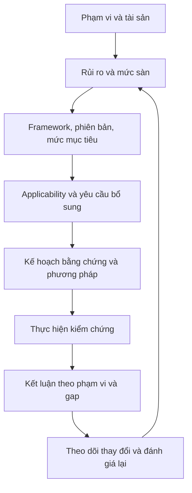

# Chọn mức verification

## 1. Mục tiêu của việc chọn mức kiểm chứng

Chọn mức verification là quyết định hệ thống cần đáp ứng tập yêu cầu bảo mật nào, trong phạm vi nào và cần bằng chứng gì trước khi có thể đưa ra kết luận. Quyết định này phải dựa trên tài sản, tác động khi bị xâm phạm, đường tấn công và những cam kết liên quan của sản phẩm.

Trong chương **Verification framework** của module **SECURITY_SECURITY_DESIGN_SECURITY_REQUIREMENTS**, mức kiểm chứng giúp chuyển mục tiêu an toàn thông tin và mô hình đe dọa thành yêu cầu cụ thể, đo được và kiểm chứng được. Kết quả cần liên kết với kiến trúc, xác thực, phân quyền, dữ liệu, logging, phục hồi và tiêu chí chấp nhận trong SDLC.

Ba trạng thái cần tách rõ:

- **Mức mục tiêu:** tập yêu cầu dự án quyết định phải đạt.
- **Kế hoạch kiểm chứng:** cách thu bằng chứng cho tập yêu cầu đó.
- **Kết quả đã xác minh:** những gì thực sự có đủ bằng chứng trên phiên bản và môi trường được đánh giá.

Viết “target L2” trong backlog không chứng minh ứng dụng đã đạt L2. Chạy một scanner hoặc hoàn thành một pentest cũng không tự xác định mức nếu phạm vi và bằng chứng chưa được đối chiếu với từng yêu cầu áp dụng.

Bài học dùng **OWASP ASVS 5.0.0** làm ví dụ có phiên bản để giải thích mức và profile kiểm chứng. Các mã yêu cầu, kịch bản và quy trình quyết định dưới đây là đặc tả minh họa của dự án, không phải mã điều khoản ASVS hoặc một quy định bắt buộc cho mọi tổ chức.

## 2. Hiểu đúng level của framework được chọn

[ASVS](https://asvs.owasp.org/) là tập yêu cầu cho ứng dụng web và dịch vụ web. Hồ sơ cần ghi phiên bản vì mã và nội dung yêu cầu có thể thay đổi; ví dụ một tham chiếu có dạng `v5.0.0-1.2.5`, không chỉ ghi một ID thiếu phiên bản.

Theo [phần giải thích level trong bản ASVS 5.0.0](https://github.com/OWASP/ASVS/blob/v5.0.0/5.0/en/0x03-What-is-the-ASVS.md):

| Mức | Ý nghĩa khái quát |
| --- | --- |
| L1 | Điểm khởi đầu với các yêu cầu tối thiểu, ưu tiên lớp bảo vệ cơ bản |
| L2 | Mục tiêu cho phần lớn ứng dụng, mở rộng yêu cầu so với L1 |
| L3 | Tập yêu cầu cao hơn, có các kiểm soát sâu và khó triển khai hơn |

Khi chọn mức cao, phải xét các yêu cầu ở mức thấp liên quan và điều kiện chặt hơn tại mức đã chọn. L1 không mặc nhiên chỉ cần black-box scan; có yêu cầu cần tài liệu hoặc thông tin nội bộ.

Level không phải phần trăm bảo đảm an toàn. Số level giữa các framework khác nhau cũng không tự tương đương. Vì vậy, quyết định phải nêu rõ framework, phiên bản và phạm vi trước khi dùng một nhãn như L2.

## 3. Tách tập yêu cầu khỏi cách thu bằng chứng

Hai hệ thống cùng chọn một mức có thể cần cách kiểm chứng khác nhau vì kiến trúc, ranh giới và dữ liệu khác nhau. Phương pháp phải đủ để đánh giá đúng yêu cầu, không chỉ đủ để tạo báo cáo.

| Khía cạnh | Câu hỏi cần trả lời | Ví dụ |
| --- | --- | --- |
| Phạm vi yêu cầu | Những control và luồng nào áp dụng? | API, giao diện quản trị, worker, cache và kết nối đối tác |
| Phương pháp | Làm sao biết control có hiệu lực? | Review quyết định thiết kế, code/config, test tích hợp, kiểm tra runtime |
| Độ sâu | Quan sát đến đâu và với điều kiện gì? | Role khác nhau, chéo tenant, nhánh lỗi, trạng thái đồng thời |
| Chủ thể đánh giá | Ai tạo và ai xem xét bằng chứng? | Nhóm phát triển, verifier chuyên trách hoặc review độc lập theo policy |
| Độ mới | Bằng chứng còn phù hợp không? | Đúng build/config, chưa thay identity provider hoặc policy quan trọng |
| Phát biểu kết quả | Có thể khẳng định điều gì? | Đạt yêu cầu cụ thể trong scope; thiếu bằng chứng cho phần khác |

Độc lập của người kiểm tra có thể là yêu cầu nội bộ theo rủi ro, không được suy tự động từ tên một level. Tương tự, thời lượng pentest hoặc số công cụ không phải đơn vị quy đổi thành level.

[OWASP WSTG](https://owasp.org/projects/web-security-testing-guide) hỗ trợ lựa chọn kỹ thuật kiểm tra web. Framework yêu cầu và hướng dẫn phương pháp có vai trò bổ trợ; dự án cần nối từng kỹ thuật/bằng chứng với control cần đánh giá.

## 4. Thu đầu vào để chọn mức theo rủi ro

### 4.1. Các nhóm thông tin cần có

| Nhóm đầu vào | Điều cần xác định | Ảnh hưởng đến lựa chọn |
| --- | --- | --- |
| Tài sản và dữ liệu | Độ nhạy, phạm vi người có quyền, vòng đời | Mức hậu quả khi đọc/sửa/xóa trái phép |
| Quyền và hành động | Quản trị, ủy quyền, ký, thay đổi dữ liệu quan trọng | Khả năng mở rộng ảnh hưởng và khó đảo ngược |
| Khả năng tiếp cận | Internet, đối tác, nội bộ, job/queue, chuỗi gọi | Những chủ thể và đầu vào có thể chạm control |
| Ranh giới kiến trúc | Tenant, dịch vụ, identity provider, proxy, storage | Control cần được chứng minh xuyên qua thành phần |
| Đối thủ và đường lạm dụng | Mục tiêu, động cơ, khả năng và điều kiện tấn công | Loại kịch bản phải xét và độ sâu cần có |
| Tính sẵn sàng/phục hồi | Tác động gián đoạn, dữ liệu, khả năng khôi phục | Yêu cầu bổ sung và kiểm tra lỗi/khôi phục |
| Cam kết áp dụng | Chính sách nội bộ, hợp đồng và nghĩa vụ đã xác định | Mức sàn hoặc control không được bỏ qua |
| Mức bất định | Kiến trúc/dữ liệu chưa rõ, thiếu source/config | Giới hạn kết luận và việc cần xác minh trước quyết định cuối |

[NIST SP 800-30 Rev. 1](https://csrc.nist.gov/pubs/sp/800/30/r1/final) cung cấp bối cảnh đánh giá rủi ro để hỗ trợ quyết định xử lý. Trong bài này, bảng trên là mẫu thu thông tin của dự án; nó không thay thế phương pháp rủi ro mà tổ chức đã chọn.

“Chỉ dùng nội bộ” không đủ để chọn mức thấp: tài khoản bị chiếm, tích hợp bên ngoài hoặc dịch vụ khác bị xâm nhập vẫn có thể đưa đầu vào tới hệ thống. “Không lưu dữ liệu” cũng chưa đủ nếu dịch vụ có quyền gọi API quản trị hoặc cấp token.

### 4.2. Không bình quân hóa mất rủi ro nghiêm trọng

Một sản phẩm có nhiều trang ít nhạy cảm nhưng một chức năng cấp quyền production không thể được coi nhẹ chỉ vì phần lớn endpoint là đọc thông tin công khai. Cần xét tác động của hành động mạnh nhất và ranh giới mà nó có thể vượt.

Nếu dùng điểm rủi ro, công thức, trọng số và ngưỡng phải được tổ chức định nghĩa và hiệu chỉnh. Không tự áp dụng một phép cộng điểm rồi tuyên bố nó là bảng ánh xạ chính thức sang ASVS. Có thể cần điều kiện nâng mức hoặc yêu cầu bổ sung khi tồn tại một khả năng có hậu quả cao.

Thiếu thông tin không tự đồng nghĩa rủi ro thấp. Hồ sơ cần ghi giả định, owner xác minh và phạm vi quyết định tạm thời. Không dùng việc chưa có bằng chứng về một đường tấn công để khẳng định đường đó không tồn tại.

## 5. Quy trình chọn mức và profile kiểm chứng

Một quy trình minh họa có thể dùng các bước sau:

1. **Chốt đối tượng:** dịch vụ, luồng dữ liệu, môi trường và phiên bản kiến trúc cần đánh giá.
2. **Xác định tài sản/rủi ro:** mô tả tác động và đường tấn công, cùng các điều kiện chưa rõ.
3. **Kiểm tra mức sàn:** áp dụng yêu cầu từ chính sách/cam kết đã xác định; giải quyết mâu thuẫn trước khi giảm yêu cầu.
4. **Chọn baseline:** chọn framework, phiên bản và mức mục tiêu có lập luận theo rủi ro.
5. **Lập applicability matrix:** phân biệt requirement áp dụng, không áp dụng, chưa đủ thông tin và gap triển khai.
6. **Bổ sung theo bối cảnh:** thêm yêu cầu miền nghiệp vụ hoặc kiểm soát ngoài scope framework khi cần.
7. **Lập phương pháp/evidence:** chỉ rõ kiểm tra gì, ở đâu, bởi ai, trên phiên bản nào và điều kiện chấp nhận.
8. **Ghi quyết định và trigger đánh giá lại:** phân công owner, xử lý ngoại lệ và những sự kiện làm hồ sơ mất hiệu lực.



Nếu nguồn lực chưa đủ cho mức mục tiêu, phải nêu gap và kế hoạch xử lý. Có thể giảm phạm vi triển khai, loại bỏ quyền/tính năng nguy cơ cao, bổ sung kiểm soát hoặc chấp nhận rủi ro có thẩm quyền. Không đổi nhãn level chỉ để khớp số giờ kiểm thử còn lại mà không có căn cứ mới về rủi ro.

## 6. Yêu cầu cho một quyết định có thể review

### VL-01 — Định nghĩa scope và ranh giới trách nhiệm

**Yêu cầu:** Hồ sơ lựa chọn phải nêu thành phần, luồng, môi trường, actor và ranh giới thuộc phạm vi. Những thành phần được dựa vào để thực thi control phải có cách cung cấp bằng chứng hoặc hợp đồng trách nhiệm tương ứng.

Ví dụ, API dùng identity provider bên ngoài vẫn cần xét cách xác minh/tiêu thụ danh tính, ánh xạ quyền và hành vi lỗi của chính API. Không đánh dấu toàn bộ xác thực là ngoài phạm vi chỉ vì màn hình đăng nhập do bên khác vận hành.

**Tiêu chí nghiệm thu:** Người review nhận diện được API, trang quản trị, worker, proxy/cache và tích hợp liên quan. Phần bị loại khỏi assessment được ghi rõ, cùng ảnh hưởng đến kết luận toàn hệ thống; không có đường quan trọng bị bỏ qua chỉ do chưa có owner.

### VL-02 — Có lập luận rủi ro, mức sàn và giả định

**Yêu cầu:** Mức mục tiêu phải có lý do dựa trên tác động, khả năng tiếp cận, quyền và đường lạm dụng. Hồ sơ ghi những mức sàn đã xác định, nguồn của chúng và giả định cần kiểm tra. Chi phí/thời gian là ràng buộc kế hoạch, không tự làm giảm hậu quả của một sự cố.

**Tiêu chí nghiệm thu:** Hai người review có thể hiểu vì sao cùng một loại giao diện nhưng quyền khác nhau dẫn tới nhu cầu kiểm chứng khác. Một hệ thống nội bộ có quyền cao hoặc dữ liệu nhạy cảm không bị xếp thấp chỉ vì không public.

### VL-03 — Chốt framework, phiên bản và quy tắc ánh xạ

**Yêu cầu:** Quyết định phải định danh framework và bản phát hành dùng làm baseline. Mã requirement phải giữ liên kết tới nội dung của phiên bản đó. Khi nâng framework, cần xem xét thay đổi scope, ID và nội dung trước khi tái sử dụng kết quả cũ.

Nếu tổ chức có framework/profile riêng, phải nêu nguồn và phần điều chỉnh. Không giữ cùng một ID chuẩn nhưng âm thầm làm yếu ý nghĩa rồi báo đã đáp ứng nguyên bản.

**Tiêu chí nghiệm thu:** Một kết quả hoặc ticket dẫn được tới đúng requirement của đúng phiên bản. Bằng chứng từ phiên bản khác chỉ được kế thừa sau khi có mapping và đánh giá còn phù hợp, không chỉ đổi nhãn version trên báo cáo.

### VL-04 — Baseline không bỏ yêu cầu cần thiết để làm đẹp nhãn

**Yêu cầu:** Tập requirement bắt buộc phải được xác định từ mức mục tiêu và điều kiện áp dụng. Không chọn riêng các mục dễ kiểm tra rồi tuyên bố đã hoàn tất mức. Nếu chọn một tập con vì mục tiêu triển khai theo giai đoạn, phải mô tả đúng là phạm vi/tập con đã đánh giá.

Có thể ưu tiên requirement ở mức cao hơn trước khi toàn baseline hoàn tất nếu rủi ro yêu cầu. Việc đó tạo một profile ưu tiên của dự án, không tự chứng minh đã đạt mọi yêu cầu của mức cao hơn.

**Tiêu chí nghiệm thu:** Danh mục không thiếu requirement chỉ vì chưa có tool hoặc triển khai khó. Các mục chưa làm tồn tại dưới dạng gap/chưa xác minh thay vì biến thành không áp dụng.

### VL-05 — Applicability dựa trên kiến trúc và hành vi thực

**Yêu cầu:** Mỗi quyết định không áp dụng cần lý do và bằng chứng về điều kiện kiến trúc. Phân biệt **N/A**, **chưa triển khai**, **chưa kiểm tra** và **thiếu thông tin**. Không dùng N/A để che việc không có source, không có quyền thử hoặc control chưa tồn tại.

Một API không phục vụ frontend có thể không cần các yêu cầu đặc thù giao diện trong scope đó, nhưng vẫn có thể xử lý cookie, token hoặc được proxy phục vụ qua trình duyệt ở đường khác. Applicability cần xét đúng chức năng, không chỉ tên loại dịch vụ.

**Tiêu chí nghiệm thu:** Có thể review lại lý do N/A từ sơ đồ/cấu hình và hợp đồng hiện hành. Khi thêm tính năng liên quan, những quyết định N/A bị ảnh hưởng được đánh giá lại.

### VL-06 — Bổ sung yêu cầu miền nghiệp vụ và phần ngoài framework

**Yêu cầu:** Profile cần thêm control cho rủi ro đặc thù chưa được baseline mô tả đủ. Ví dụ quyền chéo tenant, phê duyệt thao tác nhạy cảm, invariant nghiệp vụ, phụ thuộc nền tảng hoặc phục hồi dữ liệu cần được đặc tả cụ thể theo sản phẩm.

Yêu cầu vận hành như backup/restore hoặc kiểm soát pipeline có thể thuộc tập bổ sung riêng. Không gán chúng thành requirement ASVS tự tạo, cũng không loại khỏi mô hình rủi ro chỉ vì nằm ngoài phạm vi framework đang dùng.

**Tiêu chí nghiệm thu:** Một rủi ro quan trọng không có mapping trực tiếp vẫn có owner, requirement và phương pháp kiểm chứng. Tập bổ sung được đặt tên/ID riêng; kết luận phân biệt baseline chuẩn với các yêu cầu nội bộ đó.

## 7. Phương pháp, bằng chứng và giới hạn kết luận

### VL-07 — Mỗi yêu cầu áp dụng có phương pháp kiểm chứng phù hợp

**Yêu cầu:** Kế hoạch phải chỉ rõ bằng chứng cần thu cho từng requirement hoặc nhóm có thể đánh giá chung. Có thể kết hợp xem tài liệu/quyết định thiết kế, review code/config, kiểm thử động, test tích hợp và kiểm tra môi trường có hiệu lực.

Tài liệu ghi “phân quyền theo tenant” chưa chứng minh request thực sự bị giới hạn; một test HTTP cũng chưa chứng minh mọi worker hoặc cấu hình quản trị dùng cùng control. Phải chọn điểm quan sát theo ranh giới và có điều kiện chấp nhận đủ cụ thể.

Ví dụ kế hoạch bằng chứng nội bộ:

| Chủ đề | Quyết định cần biết | Bằng chứng triển khai/hành vi |
| --- | --- | --- |
| Xác thực | Chủ thể, nguồn danh tính, ngữ cảnh tin cậy | Cấu hình verifier và test danh tính hợp lệ/không hợp lệ |
| Phân quyền | Actor, action, resource, tenant/ủy quyền | Review điểm thực thi và test đúng/sai quyền trên các đường liên quan |
| Dữ liệu | Trường nhạy cảm, nơi lưu/xuất, quyền truy cập | Mapping dữ liệu, cấu hình và phép thử không lộ ở response/export |
| Logging | Sự kiện cần ghi, dữ liệu cấm, quyền đọc/sửa | Quan sát nhánh thành công/lỗi, redaction và policy lưu trữ |
| Phục hồi bổ sung | Bất biến khi lỗi, rollback và restore | Runbook, diễn tập có phạm vi và đối chiếu trạng thái sau phục hồi |

**Tiêu chí nghiệm thu:** Một scanner sạch không thay bằng chứng quyền hoặc quyết định kiến trúc còn thiếu. Khi không tiếp cận được source/config cần thiết, phần requirement liên quan được ghi chưa xác minh, kèm hướng xử lý; không tự coi black-box test đã đủ.

### VL-08 — Có nguồn lực, thẩm quyền và mức review theo rủi ro

**Yêu cầu:** Người quyết định target, người triển khai và người đánh giá phải có trách nhiệm rõ. Với phần rủi ro cao, policy nội bộ có thể yêu cầu review độc lập hoặc kỹ năng chuyên biệt, nhưng phải mô tả cơ chế cụ thể thay vì chỉ ghi “L3 nên sẽ kỹ hơn”.

Business/service owner cung cấp tác động và quyền chấp nhận rủi ro; kiến trúc/security owner xem ranh giới và baseline; verifier/test owner xác định khả năng thu bằng chứng. Nhiệm vụ có thể do các nhóm khác nhau đảm nhận tùy tổ chức, nhưng không được để tác giả một control tự thay tiêu chí chấp nhận mà không có review theo policy.

**Tiêu chí nghiệm thu:** Kế hoạch có owner, quyền truy cập cần thiết, môi trường và năng lực cho các phương pháp đã chọn. Nếu chưa đủ, ghi trạng thái chưa thể hoàn tất và kế hoạch khắc phục, không báo đạt vì đã hết thời gian assessment.

### VL-09 — Gap và ngoại lệ không bị đổi thành PASS

**Yêu cầu:** Phân biệt yêu cầu chưa đáp ứng, chưa kiểm chứng, không áp dụng và rủi ro được chấp nhận có điều kiện. Ngoại lệ cần nêu requirement, phạm vi, lý do, tác động, kiểm soát bù, owner có thẩm quyền, thời hạn và điều kiện xem xét lại.

Một ngoại lệ có thể hỗ trợ quyết định cho phép một phạm vi vận hành theo policy tổ chức, nhưng không làm control chưa đáp ứng trở thành đã kiểm chứng đạt. Báo cáo và phát biểu mức phải giữ nguyên sự thật về gap; không biến thời hạn khắc phục thành bằng chứng kỹ thuật.

Ví dụ, thiếu bằng chứng kiểm tra chéo tenant trong export là gap kiểm chứng. Tắt export và chứng minh đường đó không còn khả dụng trong phạm vi phát hành có thể làm thay đổi kiến trúc/scope cần đánh giá lại; chỉ hẹn viết test sau thì gap vẫn còn.

**Tiêu chí nghiệm thu:** Report tách finding/gap và quyết định chấp nhận rủi ro. Ngoại lệ hết hạn, scope mở rộng hoặc kiểm soát bù không có hiệu lực không tiếp tục mở quyền vô hạn.

### VL-10 — Kết luận có scope, phiên bản và trạng thái bằng chứng

**Yêu cầu:** Kết luận phải nêu framework/version, đối tượng được đánh giá, thời điểm, môi trường/config và kết quả các yêu cầu áp dụng. Nếu chỉ đánh giá một tập con hoặc một thành phần, không gán kết quả đó cho toàn bộ sản phẩm hay mức cao hơn.

Một cách ghi trạng thái trong hồ sơ dự án:

| Trạng thái requirement | Ý nghĩa |
| --- | --- |
| VERIFIED_PASS | Bằng chứng phù hợp xác nhận đạt trên subject đã ghi |
| VERIFIED_FAIL | Bằng chứng xác nhận hành vi/control không đạt |
| NOT_VERIFIED | Chưa thu được đủ bằng chứng để kết luận |
| NOT_APPLICABLE | Điều kiện áp dụng không tồn tại, có lý do/bằng chứng |
| NEEDS_CLARIFICATION | Requirement hoặc kiến trúc/giả định chưa đủ rõ |

Ngoại lệ và quyết định release có thể là trường riêng, không dùng để ghi đè trạng thái kỹ thuật. Tỷ lệ PASS chỉ mô tả tập được đếm; không có phép tính “đa số control đạt nên tự động đạt level”. Một control quan trọng chưa xác minh vẫn phải hiện trong kết luận.

**Tiêu chí nghiệm thu:** Báo cáo “target L2, còn gap” không bị trình bày thành “đã đạt L2”. Bằng chứng cho một trang quản trị hoặc một môi trường không tự bao phủ API, worker hay configuration khác.

### VL-11 — Có trigger đánh giá lại và điều kiện kế thừa bằng chứng

**Yêu cầu:** Hồ sơ lựa chọn phải được xem lại khi tài sản, quyền, bề mặt tiếp cận, trust boundary hoặc cam kết thay đổi. Các trigger có thể gồm thêm tenant, thêm chức năng quản trị, thay identity provider, mở tích hợp, đổi nền tảng, sự cố hoặc cập nhật framework.

Đánh giá lại không luôn cần làm lại mọi test từ đầu. Có thể kế thừa evidence nếu chứng minh requirement, implementation, môi trường và giả định liên quan vẫn phù hợp. Phần bị ảnh hưởng cần kiểm tra mới; hồ sơ phải ghi lập luận thay vì tái dùng report cũ vì source chỉ đổi ít dòng.

**Tiêu chí nghiệm thu:** Một thay đổi quyền cloud/configuration ngoài repository vẫn kích hoạt review khi ảnh hưởng scope. Bằng chứng hết hiệu lực hoặc từ bản framework khác được nhận diện, không tự giữ PASS bằng cách đổi ngày báo cáo.

### VL-12 — Quyết định release và phục hồi dựa trên trạng thái thực

**Yêu cầu:** Policy release phải định nghĩa điều kiện đủ bằng chứng, các gap không được chấp nhận và quyền xử lý ngoại lệ. Nếu verifier, môi trường hoặc dữ liệu bắt buộc không sẵn sàng, phải ghi thiếu bằng chứng thay vì cấp mức đã xác minh theo mặc định.

Rollback và restore phải xét lại profile hiện hành, không chỉ trạng thái chức năng của bản cũ. Cấu hình cũ có thể mở quyền hoặc làm mất logging đã được yêu cầu. Kế hoạch phục hồi phải chỉ rõ control nào cần xác nhận lại trước khi mở phạm vi phục vụ tương ứng.

**Tiêu chí nghiệm thu:** Thử thiếu kết quả bắt buộc, artifact/config đổi và ngoại lệ hết hạn không tạo một kết luận đạt giả. Diễn tập phục hồi cung cấp evidence cho những yêu cầu bị ảnh hưởng hoặc ghi rõ quyết định rủi ro và giới hạn còn lại.

## 8. Mẫu hồ sơ chọn mức

Một bản ghi minh họa cho dịch vụ portal nhiều tenant:

```yaml
decisionId: VERIFICATION-PROFILE-042
revision: 1
subject:
  service: customer-portal
  environment: production-candidate
  architectureRevision: architecture-7
scope:
  - public-api
  - administration-api
  - export-worker
standard:
  name: OWASP ASVS
  version: 5.0.0
targetLevel: L2
assessmentState: PLANNED
riskAssessmentRef: risk-profile-042
applicabilityMatrixRef: applicability-042
supplementaryRequirements:
  - ORG-TENANT-ISOLATION-01
  - ORG-EXPORT-AUDIT-01
  - ORG-RECOVERY-01
verificationPlanRef: verification-plan-042
gapRegisterRef: gap-register-042
decisionOwnerRole: Service risk owner
reviewerRole: Security architecture owner
reevaluationTriggers:
  - privilege-boundary-change
  - new-data-category
  - identity-provider-change
  - security-incident
  - standard-version-change
```

Các ID `ORG-*` là yêu cầu nội bộ, không phải requirement ASVS. `PLANNED` thể hiện chưa có kết quả đánh giá; nó không thay bằng nhãn đạt. Hồ sơ thật cần có lập luận rủi ro, người chịu trách nhiệm và liên kết có thể kiểm tra được, không chỉ các trường YAML.

Một profile có baseline L2 và vài yêu cầu bổ sung hoặc một số requirement ở mức cao hơn cần được gọi đúng theo phạm vi đó. Không đặt nhãn “ASVS L3 toàn hệ thống” khi chưa đánh giá tập áp dụng tương ứng.

## 9. Ví dụ lựa chọn theo bối cảnh

Các đề xuất sau minh họa cách lập luận, không phải bảng ánh xạ tự động từ tên sản phẩm sang level.

| Kịch bản | Phân tích quyết định | Hướng profile minh họa |
| --- | --- | --- |
| Trang công khai ít chức năng, không giữ dữ liệu người dùng | Cần xác nhận thực sự không có luồng nhạy cảm trong scope; pipeline/hosting vẫn có rủi ro riêng | Có thể bắt đầu đánh giá baseline L1 nếu lập luận rủi ro và mức sàn cho phép; bổ sung kiểm soát vận hành ngoài scope cần thiết |
| Portal nhiều tenant có dữ liệu riêng và export | Sai quyền có thể lộ dữ liệu qua nhiều kênh; cần bằng chứng đối tượng/tenant và đầu ra | Baseline L2 làm target minh họa, thêm yêu cầu tenant/export theo policy, xét control cao hơn nếu rủi ro cần |
| Control plane có thể cấp quyền production cho nhiều dịch vụ | Một hành động sai có thể mở rộng ảnh hưởng; cần đánh giá sâu trust boundary và quyền quản trị | Xem xét target L3 cho phạm vi ứng dụng liên quan và tập nền tảng bổ sung, có căn cứ và kế hoạch evidence |
| API máy với máy trên mạng nội bộ, có quyền nhạy cảm | Không có UI không làm giảm tác động; cần kiểm tra danh tính workload, ủy quyền và kết nối | Chọn L2/L3 theo rủi ro thực, N/A đúng phần không dùng; không tự hạ xuống L1 vì private network |

### 9.1. Khi có nhiều mức rủi ro trong cùng sản phẩm

Có thể tách scope nếu kiến trúc và trách nhiệm cho phép, rồi đặt yêu cầu/evidence khác nhau cho từng phần. Tuy nhiên, một giao diện ít nhạy cảm có thể gọi sang chức năng quản trị bằng quyền mạnh; khi đó cần đánh giá cả chuỗi và control ngăn vượt ranh giới.

Không tính trung bình các level hoặc gán một nhãn chung dựa trên thành phần dễ đạt nhất. Báo cáo cần chỉ rõ phạm vi nào đã được đánh giá và phần nào còn phụ thuộc chưa xác minh. Nếu đưa ra phát biểu cho toàn sản phẩm, phải bảo vệ được các ranh giới liên quan đến phát biểu đó.

### 9.2. Khi nguồn lực chưa đủ cho target

Giả sử portal đã chọn target L2 nhưng chưa có môi trường kiểm tra worker/export. Hướng xử lý là giữ target và gap, xác định việc cần bổ sung, hoặc thay phạm vi phát hành bằng một thay đổi kiến trúc/tính năng được đánh giá. Không tự đổi level xuống thấp chỉ để report có kết luận đẹp.

Nguồn lực cần được lập kế hoạch sớm trong SDLC: tài liệu, test account, dữ liệu tổng hợp, quyền đọc cấu hình và nơi lưu evidence. [NIST SSDF](https://csrc.nist.gov/pubs/sp/800/218/final) hỗ trợ bối cảnh đưa thực hành an toàn vào quy trình phát triển; lựa chọn mức trong bài là một quyết định dự án cần được vận hành xuyên suốt, không chỉ trước ngày phát hành.

## 10. Ma trận truy vết quyết định

| Yêu cầu | Sai lệch cần ngăn | Điểm thực thi | Bằng chứng nghiệm thu |
| --- | --- | --- | --- |
| VL-01 | Scope hẹp che đường quan trọng | Inventory và sơ đồ ranh giới | Thành phần/luồng/owner và phần loại trừ rõ |
| VL-02 | Chọn mức theo nhãn sản phẩm hoặc ngân sách | Risk assessment và decision review | Lập luận tác động, quyền, tiếp cận, mức sàn và giả định |
| VL-03 | Nhầm requirement giữa phiên bản | Catalog và mapping | Tham chiếu framework/version/ID ổn định |
| VL-04 | Chọn mục dễ rồi tự gán level | Baseline selection | Đủ tập áp dụng, gap được giữ nguyên |
| VL-05 | N/A bị dùng thay thiếu evidence | Applicability review | Lý do/bằng chứng kiến trúc cho từng loại trừ |
| VL-06 | Rủi ro ngoài framework bị bỏ qua | Domain supplement | Requirement bổ sung có ID, owner và phương pháp |
| VL-07 | Một công cụ bị coi là chứng minh mọi control | Verification plan | Evidence và oracle phù hợp từng ranh giới |
| VL-08 | Không có năng lực/quyền thu bằng chứng | Assignment và resource planning | Owner, môi trường, quyền và mức review cụ thể |
| VL-09 | Chấp nhận rủi ro biến thành PASS giả | Gap/exception register | Trạng thái kỹ thuật và quyết định rủi ro tách biệt |
| VL-10 | Target hoặc tập con bị quảng bá thành đã đạt toàn bộ | Assessment report | Kết luận có scope, phiên bản, gap và giới hạn |
| VL-11 | Evidence cũ tiếp tục được dùng sau thay đổi | Change trigger và impact analysis | Kế thừa có căn cứ, phần bị ảnh hưởng được kiểm tra mới |
| VL-12 | Release/restore dùng kết luận không còn đúng | Gate và runbook phục hồi | Thiếu evidence không mở kết luận đạt; control sau phục hồi được xác nhận |

Ma trận thực tế cần thêm owner theo tổ chức. Chọn mức là quyết định chung giữa chủ thể chịu rủi ro, người thiết kế và người kiểm chứng; không thể giao toàn bộ việc giải thích tác động kinh doanh cho một công cụ scan.

## 11. Ca nghiệm thu cho quy trình chọn mức

Những ca sau dùng review một quyết định/profile minh họa. Chúng đánh giá chất lượng và khả năng thực thi của quyết định, không thay cho các test kỹ thuật của ứng dụng.

| Mã | Thiết lập | Điều kiện pass |
| --- | --- | --- |
| T-01 | Hồ sơ chỉ ghi L2, không có framework/version/scope | Thiếu thông tin được nhận diện trước khi chấp nhận quyết định đầy đủ |
| T-02 | Dịch vụ nội bộ có quyền quản trị nhưng bị xếp thấp chỉ vì private network | Có đánh giá tác động và ranh giới thay cho suy luận theo nhãn |
| T-03 | Một chức năng quyền cao bị che trong điểm trung bình toàn sản phẩm | Điều kiện tác động lớn được xét riêng, không bị bình quân hóa |
| T-04 | Có mức sàn/cam kết nhưng kế hoạch muốn hạ vì thiếu thời gian | Mâu thuẫn được xử lý có thẩm quyền, không tự bỏ yêu cầu |
| T-05 | Nâng framework nhưng giữ ID/report cũ | Có mapping và review nội dung trước khi kế thừa |
| T-06 | Chỉ chọn những requirement scanner hỗ trợ | Các mục áp dụng còn lại hiện thành gap/plan, không tự biến mất |
| T-07 | N/A vì không có source hoặc chưa được cấp tài khoản kiểm tra | Được sửa thành thiếu evidence/thông tin phù hợp, không coi là không áp dụng |
| T-08 | Dùng identity provider bên ngoài để N/A toàn bộ xác thực | Trách nhiệm tiêu thụ danh tính và quyền của ứng dụng vẫn được đánh giá |
| T-09 | Rủi ro tenant/phục hồi không có mapping đủ trong baseline | Có yêu cầu bổ sung và phương pháp, không bỏ khỏi mô hình rủi ro |
| T-10 | Một report black-box/scanner được dùng để tuyên bố toàn level | Đối chiếu từng requirement và ghi giới hạn evidence |
| T-11 | Reviewer không có quyền đọc config cần thiết | Không kết luận đạt cho requirement chưa thể xác minh; có kế hoạch xử lý |
| T-12 | Control FAIL nhưng có ngoại lệ được chấp nhận | Giữ trạng thái kỹ thuật và ngoại lệ riêng, không đổi thành PASS |
| T-13 | Chỉ kiểm tra trang quản trị, báo đạt cho mọi API/worker | Scope phát biểu được giới hạn hoặc phải bổ sung evidence |
| T-14 | Baseline L2 cộng một số mục nâng cao bị gọi là L3 đầy đủ | Kết luận được viết lại đúng profile và tập áp dụng |
| T-15 | Thêm export, tenant hoặc quyền cloud mới | Trigger review và cập nhật applicability/risk/evidence bị ảnh hưởng |
| T-16 | Source ít đổi nhưng identity provider hoặc proxy config thay | Không tái dùng kết luận cũ thiếu phân tích tác động |
| T-17 | Evidence store/verifier tạm lỗi | Trạng thái chưa đủ bằng chứng, không tự báo đạt |
| T-18 | Ngoại lệ hết hạn hoặc kiểm soát bù ngừng hiệu lực | Có hành động theo policy, không giữ quyết định mở quyền vô hạn |
| T-19 | Restore cấu hình cũ làm mất control đã yêu cầu | Kiểm tra phục hồi phát hiện hoặc ngăn mở phạm vi chưa đạt |
| T-20 | Target còn gap nhưng dashboard ghi đã xác minh | Các trạng thái được tách và kết luận được sửa trước quyết định liên quan |

Báo cáo nghiệm thu cần ghi quyết định đã review, tài liệu/phiên bản nguồn, phạm vi, bằng chứng, kết quả và phần cần làm tiếp. Một profile đầy đủ về mặt hồ sơ vẫn chỉ là kế hoạch nếu kiểm chứng kỹ thuật chưa được thực hiện.

## 12. Tình huống xuyên suốt: portal từ chỉ đọc sang quản trị

Ban đầu một portal chỉ phục vụ dữ liệu công khai với scope nhỏ. Nhóm ghi target kiểm chứng cho giai đoạn đó và thu bằng chứng tương ứng. Sau đó sản phẩm thêm tài khoản nhiều tenant, export dữ liệu riêng và chức năng cấp quyền cho operator, nhưng vẫn dùng nguyên nhãn mức cũ vì “code chỉ thêm vài endpoint”.

Những thay đổi này tác động tới tài sản, danh tính, quyền và đường xuất dữ liệu. Theo VL-11, cần đánh giá lại risk profile và applicability; theo VL-01, scope phải bao phủ worker/export và quản trị. Target mới cần có lập luận và kế hoạch evidence cho các ranh giới mới, không được suy từ số dòng code.

Nếu nhóm chọn baseline L2 và bổ sung control cho tenant/export, hồ sơ phải ghi đúng profile đó. Chưa có test export thì giữ gap; thêm review độc lập cho quyền operator nếu policy rủi ro yêu cầu. Không công bố đã đạt mức chỉ từ việc target được phê duyệt.

Khi phải rollback trong một sự cố vận hành, cần xác định bản cũ và cấu hình đi kèm còn đáp ứng những control nào. Nếu bản cũ thiếu một bảo vệ bắt buộc cho chức năng mới, có thể cần tắt phạm vi chức năng hoặc áp dụng biện pháp đã đánh giá; không phục hồi toàn bộ quyền chỉ vì health check đã xanh.

## 13. Câu hỏi tự kiểm tra

1. Một dự án ghi “ASVS L2” nhưng không ghi phiên bản, scope và trạng thái assessment. Hãy viết lại thông tin tối thiểu để phân biệt target với kết quả.
2. Một dịch vụ không public nhưng có quyền thay cấu hình nhiều hệ thống. Cần các đầu vào nào để lựa chọn mức mà không dựa vào nhãn nội bộ?
3. Không có source để review một requirement. Vì sao N/A không phải trạng thái phù hợp, và evidence/giới hạn cần ghi thế nào?
4. Baseline đang chọn không mô tả đủ invariant chéo tenant hoặc phục hồi của sản phẩm. Hãy bổ sung requirement mà vẫn giữ truy vết với framework gốc.
5. Một control chưa đạt có ngoại lệ được chấp nhận. Hãy viết cách trình bày kết quả để không biến quyết định rủi ro thành PASS kỹ thuật.
6. Thay identity provider, thêm export hoặc restore cấu hình cũ cần kích hoạt đánh giá lại những phần nào của profile?

Mỗi câu trả lời cần nối được **tài sản và rủi ro → framework/phiên bản/mức mục tiêu → applicability và yêu cầu bổ sung → bằng chứng → kết luận theo scope → đánh giá lại và phục hồi**. Chuỗi này giúp quyết định chọn mức verification có căn cứ và có thể kiểm chứng trong suốt vòng đời phát triển.
