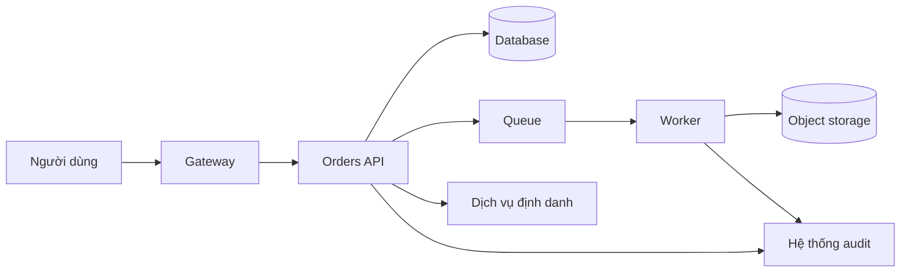
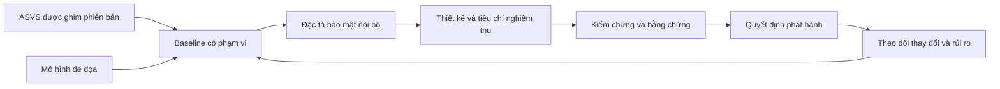

# ASVS làm security baseline

## 1. Baseline bảo mật dùng để làm gì?

Security baseline là tập yêu cầu tối thiểu được chọn, quản lý và kiểm chứng cho một phạm vi sản phẩm. Nó tạo điểm tham chiếu chung để đội phát triển biết phải đáp ứng điều gì, đội kiểm thử biết cần bằng chứng nào và người quyết định phát hành biết phần rủi ro còn lại.

OWASP ASVS, viết đầy đủ là Application Security Verification Standard, cung cấp các yêu cầu kiểm chứng bảo mật cho ứng dụng và dịch vụ web. Có thể dùng nó làm nền để xây baseline của sản phẩm. [Trang dự án ASVS](https://asvs.owasp.org/)

Một baseline hữu ích cần trả lời:

- Dùng phiên bản tiêu chuẩn nào?
- Phạm vi ứng dụng và thành phần nào được xét?
- Mục tiêu level là gì?
- Yêu cầu nào áp dụng, không áp dụng hoặc được thực hiện bởi thành phần khác?
- Các quyết định đặc thù của sản phẩm được ghi ở đâu?
- Ai chịu trách nhiệm hiện thực và kiểm chứng?
- Điều kiện nào chặn phát hành?
- Khi kiến trúc hoặc tiêu chuẩn đổi, baseline được cập nhật ra sao?

Đưa một danh sách ASVS vào tài liệu mới chỉ tạo một đầu vào. Cần chuyển nó thành yêu cầu của hệ thống, tiêu chí nghiệm thu và bằng chứng theo đúng candidate.

Bài học dùng dịch vụ quản lý đơn hàng nhiều tenant làm ví dụ. Các mã nội bộ, thời hạn và quyết định vận hành là minh họa của tổ chức, không phải tất cả đều do ASVS quy định.

## 2. Ghim phiên bản trước khi chọn yêu cầu

Bài này dùng bản phát hành **ASVS 5.0.0**, với mốc nguồn `v5.0.0_release`. Khi xây baseline thực tế, cần lưu phiên bản và định danh bản nguồn; tránh lấy nội dung từ nhánh phát triển liên tục rồi coi nó là một bản chuẩn cố định. [Các bản phát hành chính thức](https://github.com/OWASP/ASVS/releases)

ASVS sử dụng mã yêu cầu có các thành phần chương, mục và yêu cầu. Khi trích dẫn, nên kèm phiên bản, chẳng hạn `v5.0.0-1.2.4`, để tránh nhầm với nội dung ở bản khác. [Quy ước mã yêu cầu của dự án](https://github.com/OWASP/ASVS#how-to-reference-asvs-requirements)

### 2.1. Thông tin phiên bản cần lưu

| Thuộc tính | Ví dụ | Mục đích |
| --- | --- | --- |
| Tiêu chuẩn | OWASP ASVS | Xác định nguồn yêu cầu |
| Phiên bản tiêu chuẩn | 5.0.0 | Cố định nội dung được tham chiếu |
| Bản nguồn | v5.0.0_release | Tránh trộn với bản đang thay đổi |
| Baseline nội bộ | orders-security-baseline | Xác định profile của tổ chức |
| Revision baseline | 1.0.0 | Theo dõi cách chọn và bổ sung yêu cầu |
| Mục tiêu | L2 | Phân biệt đích cần đạt với kết quả hiện tại |
| Phạm vi | API, giao diện quản trị, worker và cấu hình liên quan | Xác định nơi phải cung cấp bằng chứng |

Phiên bản ASVS và revision baseline nội bộ là hai thứ khác nhau. Tổ chức có thể giữ ASVS 5.0.0 nhưng cập nhật baseline do thêm chức năng upload hoặc đổi cơ chế xác thực.

Không ghi “theo ASVS mới nhất” trong một quyết định cần tái kiểm tra về sau. Người đọc cần biết chính xác nội dung nào đã được dùng tại thời điểm đánh giá.

### 2.2. Giữ riêng nội dung chuẩn và phần diễn giải

Một bản ghi nên tách:

- Mã và nội dung yêu cầu nguồn.
- Quyết định áp dụng của tổ chức.
- Đặc tả cục bộ.
- Hướng dẫn hiện thực.
- Tiêu chí kiểm chứng.
- Kết quả và bằng chứng.

Không sửa nhẹ ý nghĩa một yêu cầu rồi giữ mã ASVS như thể nội dung vẫn nguyên vẹn. Nếu tổ chức bổ sung hoặc thay đổi kỳ vọng, cần ghi rõ phần khác biệt và quản lý bằng mã nội bộ phù hợp.

## 3. Chọn level theo rủi ro và giữ đúng ý nghĩa

ASVS 5.0.0 có ba level. L1 là điểm bắt đầu với các yêu cầu nền tảng ưu tiên cao; L2 bổ sung các yêu cầu của L2 trên nền L1; L3 bao phủ thêm phần của L3. Một số điều kiện trong yêu cầu thay đổi theo level. L1 cũng có thể cần tài liệu hoặc source để kiểm chứng. [Cách tổ chức level trong bản 5.0.0](https://raw.githubusercontent.com/OWASP/ASVS/v5.0.0_release/5.0/en/0x03-What-is-the-ASVS.md)

Mục tiêu level cần được lựa chọn dựa trên dữ liệu, quyền, độ phơi lộ và hậu quả của sản phẩm. Tổ chức có thể đưa một yêu cầu level cao hơn vào sớm vì rủi ro riêng. [Hướng dẫn chọn mức mục tiêu](https://raw.githubusercontent.com/OWASP/ASVS/v5.0.0_release/5.0/en/0x03-What-is-the-ASVS.md)

### 3.1. Những câu hỏi để ra quyết định

- Sản phẩm xử lý loại dữ liệu nào?
- Có nhiều tenant hoặc nhiều miền quyền không?
- Có chức năng đặc quyền, quản trị hoặc xuất dữ liệu diện rộng không?
- Tác động của truy cập sai là gì?
- Có tích hợp định danh, token, API đối tác hoặc worker đại diện người dùng không?
- Kiến trúc và đội ngũ hiện có khả năng hiện thực, vận hành và chứng minh yêu cầu nào?
- Có ràng buộc hợp đồng hoặc chính sách nội bộ nào cần bổ sung không?

Với ví dụ orders, đội ngũ chọn L2 làm mục tiêu cho phạm vi đã xác định, đồng thời đánh giá thêm một số rủi ro của luồng đặc quyền và bất đồng bộ.

Đây là một quyết định thiết kế của ví dụ. Nhãn “nội bộ”, “API” hoặc “startup” không tự quyết định level.

### 3.2. Mục tiêu, lựa chọn bổ sung và kết quả đạt được

Cần phân biệt:

| Phát biểu | Ý nghĩa |
| --- | --- |
| Mục tiêu L2 | Đội ngũ muốn đáp ứng tập yêu cầu áp dụng theo mục tiêu đó |
| Baseline nội bộ dựa trên L2 | Có một profile được chọn và quản lý; cần xem phần điều chỉnh |
| L2 và một số yêu cầu L3 | Có bổ sung được nêu rõ; chưa đồng nghĩa đã đạt toàn bộ L3 |
| Đã kiểm chứng một số yêu cầu | Chỉ có bằng chứng cho tập được nêu |
| Đã đáp ứng level trong phạm vi báo cáo | Cần chứng minh đầy đủ điều kiện áp dụng và phạm vi đã công bố |

Không dùng tỷ lệ trung bình hoặc một nhóm kiểm soát mạnh để thay thế yêu cầu còn thiếu. Một phần phân quyền chưa được kiểm chứng vẫn là khoảng trống, dù các kiểm tra mật mã đều đạt.

## 4. Xác định phạm vi ứng dụng và nơi thực hiện kiểm soát

Baseline cần một sơ đồ và inventory đủ dùng:



Với mỗi thành phần, cần biết:

- Dữ liệu nhận và xuất.
- Danh tính sử dụng.
- Quyền được cấp.
- Cấu hình có ảnh hưởng bảo mật.
- Nhóm sở hữu.
- Kiểm soát nào phụ thuộc thành phần đó.

ASVS có các yêu cầu về quyết định bảo mật cần được tài liệu hóa và việc hiện thực tương ứng. Hai loại bằng chứng này cần được phân biệt. [Vai trò của quyết định bảo mật trong ASVS](https://raw.githubusercontent.com/OWASP/ASVS/v5.0.0_release/5.0/en/0x03-What-is-the-ASVS.md)

### 4.1. Kiểm soát được thực hiện bên ngoài mã ứng dụng

Ví dụ TLS được kết thúc ở gateway hoặc xác thực được thực hiện qua một dịch vụ định danh. Cần xác định:

- Thành phần đó thực hiện phần nào của yêu cầu?
- Ứng dụng còn phải làm gì?
- Cấu hình và hợp đồng tích hợp nào ảnh hưởng kết quả?
- Ai cung cấp bằng chứng?
- Đường nào có thể đi vòng qua thành phần đó?

“Dịch vụ định danh xử lý” chưa đủ để kết luận mọi yêu cầu xác thực, session hoặc token không áp dụng cho ứng dụng.

Một gateway xác thực người gọi cũng không tự chứng minh API đã kiểm tra quyền trên từng đơn hàng hoặc worker còn giữ đúng ngữ cảnh người dùng.

### 4.2. Phạm vi baseline và quản lý rủi ro toàn hệ thống

Baseline sản phẩm có thể cần thêm yêu cầu về pipeline, nguồn dependency, vận hành, sao lưu và phục hồi. Khi bổ sung, cần đánh dấu nguồn nội bộ hoặc nguồn tiêu chuẩn khác.

Không gán mọi yêu cầu hạ tầng hoặc quy trình vào một mã ASVS chỉ để làm bảng có vẻ đầy đủ. Giữ đúng nguồn giúp người đọc biết phần nào là yêu cầu ứng dụng, phần nào là nghĩa vụ quản trị hoặc vận hành bổ sung.

## 5. Tailoring: điều chỉnh có truy vết

Tailoring là xác định cách áp dụng catalog vào ngữ cảnh sản phẩm. Để tránh mất thông tin, có thể dùng các nhóm quyết định sau:

| Quyết định | Ý nghĩa | Bằng chứng hoặc dữ liệu cần có |
| --- | --- | --- |
| Áp dụng trực tiếp | Sản phẩm phải đáp ứng yêu cầu | Đặc tả, điểm cưỡng chế và kế hoạch kiểm chứng |
| Áp dụng qua thành phần dùng chung | Một phần được thực hiện bởi nền tảng hoặc nhà cung cấp | Hợp đồng kiểm soát, cấu hình và bằng chứng tích hợp |
| Không áp dụng | Điều kiện hoặc chức năng liên quan không tồn tại trong phạm vi | Lý do kỹ thuật và điều kiện đánh giá lại |
| Chưa đáp ứng | Yêu cầu áp dụng nhưng hiện còn khoảng trống | Chủ sở hữu, kế hoạch và quyết định rủi ro |
| Bổ sung nội bộ | Cần thêm điều kiện theo rủi ro sản phẩm | Mã nội bộ, căn cứ và tiêu chí riêng |

### 5.1. Không áp dụng phải có lý do kỹ thuật

Ví dụ một yêu cầu dành cho một giao thức mà sản phẩm thực sự không hỗ trợ có thể được xem xét không áp dụng.

Cần kiểm tra phạm vi thực tế, gồm cả chức năng ẩn sau API, tích hợp đối tác hoặc module phụ. Không có nút upload trên UI chưa chứng minh sản phẩm không nhận file qua API.

Các lý do sau không phải căn cứ kỹ thuật để ghi không áp dụng:

- Chưa đủ thời gian.
- Chưa có test.
- Công cụ không hỗ trợ.
- Nhóm khác sở hữu.
- Chưa biết phải hiện thực thế nào.
- Đã tồn tại từ bản trước.

Những trường hợp đó là khoảng trống triển khai, kiểm chứng hoặc quản trị.

### 5.2. Điều kiện đánh giá lại

Một quyết định không áp dụng cần có trigger như:

- Thêm giao thức hoặc chức năng.
- Thay cơ chế xác thực.
- Thêm frontend hoặc thay đường tải file.
- Cho phép đa tenant.
- Thêm worker hoặc dịch vụ trung gian.
- Thay mô hình triển khai.

Không giữ nguyên các đánh giá cũ chỉ vì mã yêu cầu không đổi.

### 5.3. Ngoại lệ không làm thay đổi sự thật kỹ thuật

Nếu yêu cầu áp dụng nhưng chưa đáp ứng, có thể tồn tại quyết định chấp nhận rủi ro theo policy. Kết quả kỹ thuật vẫn phải ghi phần chưa đáp ứng.

Không đổi trạng thái thành không áp dụng hoặc đạt chỉ để cho phép phát hành. Cần giữ riêng quyết định rủi ro, người có thẩm quyền và hạn hiệu lực.

## 6. Từ catalog tới baseline có thể thực hiện

Một quy trình tham khảo:

1. Ghim bản nguồn và chuẩn hóa mã tham chiếu.
2. Xác định phạm vi sản phẩm và mục tiêu level.
3. Đánh giá khả năng áp dụng từng yêu cầu trong tập mục tiêu.
4. Ghi các quyết định bảo mật cụ thể của sản phẩm.
5. Liên kết yêu cầu với rủi ro và điểm cưỡng chế.
6. Viết tiêu chí nghiệm thu và chọn cách kiểm chứng.
7. Phân công chủ sở hữu hiện thực và xác minh.
8. Thu bằng chứng gắn với candidate.
9. Ra quyết định, theo dõi khoảng trống và ngoại lệ.
10. Đánh giá lại khi sản phẩm hoặc nguồn tiêu chuẩn thay đổi.

### 6.1. Những câu hỏi cần trả lời ở mỗi dòng

```text
Yêu cầu này bảo vệ thuộc tính nào?
Áp dụng ở đâu trong kiến trúc?
Quyết định đặc thù của sản phẩm là gì?
Thành phần nào cưỡng chế?
Kiểm tra bằng tài liệu, source, cấu hình hay hành vi nào?
Khi nào kết luận đạt, không đạt hoặc chưa đủ bằng chứng?
Ai chịu trách nhiệm?
Điều gì làm kết luận cần được đánh giá lại?
```

Một dòng chỉ có mã ASVS và tên công cụ thường chưa đủ để đội phát triển thực hiện.

### 6.2. Hướng dẫn hiện thực nên tách khỏi yêu cầu

Có thể bổ sung thư viện được phép, mẫu API hoặc cấu hình chuẩn của tổ chức. Phần đó cần được quản lý vì nền tảng có thể thay đổi.

Yêu cầu nói về thuộc tính phải đạt; hướng dẫn nói về cách được khuyến nghị hoặc bắt buộc để đạt thuộc tính. Khi cơ chế được thay, tiêu chí vẫn phải xác minh kết quả bảo mật cần thiết.

## 7. Ví dụ ánh xạ đúng mã: phân quyền của orders

Bảng dưới lấy một số yêu cầu từ chương phân quyền của bản 5.0.0, diễn giải ngắn để học cách ánh xạ. Đây chỉ là trích đoạn, không phải toàn bộ tập yêu cầu của L2. [Nguồn yêu cầu phân quyền](https://raw.githubusercontent.com/OWASP/ASVS/v5.0.0_release/5.0/en/0x17-V8-Authorization.md)

| Mã ASVS | Level | Ý nghĩa rút gọn | Mã đặc tả nội bộ minh họa |
| --- | --- | --- | --- |
| v5.0.0-8.1.1 | L1 | Đặc tả quyền chức năng và dữ liệu | SEC-ORD-AUTHZ-DOC |
| v5.0.0-8.1.2 | L2 | Đặc tả quyền đọc và ghi theo trường | SEC-ORD-FIELD-DOC |
| v5.0.0-8.2.1 | L1 | Cưỡng chế quyền chức năng | SEC-ORD-FUNCTION |
| v5.0.0-8.2.2 | L1 | Cưỡng chế quyền theo đối tượng dữ liệu | SEC-ORD-OBJECT |
| v5.0.0-8.2.3 | L2 | Cưỡng chế quyền theo trường | SEC-ORD-FIELD |
| v5.0.0-8.3.1 | L1 | Cưỡng chế ở lớp dịch vụ đáng tin cậy | SEC-ORD-SERVICE |
| v5.0.0-8.4.1 | L2 | Kiểm soát thao tác giữa các tenant | SEC-ORD-TENANT |

Các mã nội bộ không thay thế mã ASVS. Chúng giúp mô tả ngữ cảnh và tạo liên kết với kiến trúc, test và quyết định của sản phẩm.

### 7.1. Quyết định cục bộ cần viết thêm

Ví dụ sản phẩm chọn:

- Tenant được xác định từ ngữ cảnh quyền đã xác minh.
- Người dùng chỉ xem các đơn hàng thuộc tenant và phạm vi dữ liệu được cấp.
- Quyền đổi trạng thái đơn hàng tách khỏi quyền xem.
- Trường ghi chú nội bộ không được trả cho vai trò khách hàng.
- Client không được tự cấp role hoặc đổi tenant bằng payload.
- API trực tiếp và worker phải giữ cùng các bất biến dữ liệu.

Đây là nội dung đặc thù mà một mã tiêu chuẩn tổng quát không thể tự quyết định thay đội sản phẩm.

### 7.2. Tài liệu và hiện thực cần khớp

Nếu tài liệu nói khách hàng không đọc được ghi chú nội bộ, cần kiểm tra cả API chi tiết, danh sách, export và các đường liên quan.

Một bản policy được duyệt không chứng minh serializer hoặc query đã áp dụng nó. Ngược lại, một test chặn một URL chưa đủ chứng minh mọi quy tắc phân quyền đã được đặc tả rõ.

## 8. Chuyển ánh xạ thành tiêu chí nghiệm thu

### 8.1. Tiêu chí đối tượng và tenant

```text
Given:
  Principal P-A chỉ được phép truy cập tenant A.
  Đơn hàng O-B thuộc tenant B.
  P-A biết ID của O-B.

When:
  P-A gọi các API đọc hoặc cập nhật O-B thuộc phạm vi kiểm tra.

Then:
  Hệ thống từ chối theo hợp đồng API.
  Không trả dữ liệu của O-B.
  Không thay trạng thái hoặc phát sinh tác động nghiệp vụ cho O-B.
  Có audit từ chối với dữ liệu được phép ghi.
```

Tiêu chí này phục vụ các yêu cầu nội bộ về đối tượng, tenant và lớp cưỡng chế. Cần kiểm tra với các đường truy cập đã kiểm kê, không chỉ giao diện người dùng.

### 8.2. Tiêu chí quyền theo trường

```text
Given:
  Vai trò khách hàng được xem một tập trường công khai của đơn hàng.
  Trường internalNote chỉ dành cho vai trò nội bộ được phép.

When:
  Khách hàng đọc đơn hàng hoặc gửi payload chứa internalNote.

Then:
  Phản hồi không chứa giá trị trường bị cấm đọc.
  Payload không làm thay đổi trường mà khách hàng không được ghi.
  Hành vi từ chối hoặc bỏ trường tuân theo hợp đồng đã công bố.
  Không có đường cập nhật khác bỏ qua cùng quy tắc.
```

Sản phẩm cần chọn rõ hành vi đối với trường không được phép ghi. Không để mỗi endpoint tự chọn giữa bỏ qua và từ chối mà không có đặc tả.

### 8.3. Ví dụ yêu cầu khác: bảo vệ truy vấn

Trong ASVS 5.0.0, `v5.0.0-1.2.4` đề cập bảo vệ truy vấn và thao tác chọn dữ liệu khỏi injection. [Nguồn yêu cầu về xử lý dữ liệu](https://raw.githubusercontent.com/OWASP/ASVS/v5.0.0_release/5.0/en/0x10-V1-Encoding-and-Sanitization.md)

Đặc tả cục bộ có thể yêu cầu các giá trị truy vấn dùng cơ chế bind, còn thành phần cấu trúc động dùng ánh xạ được phép. Kế hoạch xác minh có thể kết hợp review cách dựng truy vấn, phân tích tĩnh và kiểm thử API liên quan.

Không suy ra chỉ cần thấy tên một ORM hoặc API chuẩn là đã đủ. Bằng chứng cần xét cách sản phẩm thực sự dùng cơ chế đó.

Các ví dụ trên là thiết kế kiểm chứng của bài học, không phải danh sách test đầy đủ cho từng yêu cầu ASVS.

## 9. Mô hình baseline và bản ghi yêu cầu

Đoạn YAML sau là mô hình quản lý tự định nghĩa. Nó không phải schema chính thức của ASVS và chỉ thể hiện một phần hồ sơ minh họa.

```yaml
baselineId: orders-security-baseline
baselineRevision: 1.0.0

sourceStandard:
  name: OWASP ASVS
  version: 5.0.0
  releaseRef: v5.0.0_release

scope:
  product: orders
  components:
    - api
    - admin-ui
    - worker
    - integration-configuration

targetLevel: L2
fullLevelAchievement: not-established

requirementExcerpt:
  - sourceId: v5.0.0-8.4.1
    applicability: applicable
    localSpecification: SEC-ORD-TENANT
    enforcementPoints:
      - api-service-layer
      - worker-data-access
    implementationOwner: orders-team
    verificationOwner: security-test-role
    acceptanceCriteria:
      - AC-ORD-CROSS-TENANT-READ
      - AC-ORD-CROSS-TENANT-WRITE
    verificationStatus: not-tested
    evidenceRefs: []

organizationAdditions:
  - id: ORG-ORD-BASELINE-CHANGE
    purpose: Reevaluate the profile when tenant or data paths change
```

Hồ sơ đầy đủ cần chứa hoặc liên kết tới toàn bộ tập được đánh giá, không chỉ dòng minh họa.

### 9.1. Trạng thái nên tách theo nghĩa

Có thể phân biệt:

```text
applicability:
  APPLICABLE | NOT_APPLICABLE | NEEDS_REVIEW

implementation:
  PLANNED | IMPLEMENTED | GAP

verification:
  NOT_TESTED | INCONCLUSIVE | PASS | FAIL

releaseDisposition:
  NORMAL | APPROVED_EXCEPTION | BLOCKED
```

Một yêu cầu IMPLEMENTED có thể chưa được kiểm chứng. Một yêu cầu FAIL có thể tồn tại ngoại lệ theo policy, nhưng kết quả kỹ thuật vẫn là FAIL.

Yêu cầu thực hiện qua một nền tảng dùng chung vẫn APPLICABLE khi thuộc phạm vi. Cần ghi nơi thực hiện và nghĩa vụ tích hợp thay vì biến nó thành không áp dụng.

### 9.2. Nguồn và mã bổ sung

Yêu cầu nội bộ nên có namespace riêng. Nếu yêu cầu bổ sung làm chặt hơn một yêu cầu nguồn, cần liên kết hai mã và ghi điều kiện bổ sung.

Nếu chỉ có một phần ánh xạ hoặc không tìm được mã phù hợp, ghi rõ điều đó. Không tự bịa mã ASVS hoặc gắn một mã gần giống về tên nhưng khác ý nghĩa.

## 10. Chọn phương pháp kiểm chứng và bằng chứng

Hướng dẫn đánh giá của ASVS đề cập việc kết hợp nhiều phương pháp và dữ liệu nội bộ; chạy một công cụ tự động riêng lẻ không đủ để chứng minh toàn bộ phạm vi. [Hướng dẫn đánh giá của bản 5.0.0](https://raw.githubusercontent.com/OWASP/ASVS/v5.0.0_release/5.0/en/0x04-Assessment_and_Certification.md)

Một kế hoạch kiểm chứng của sản phẩm có thể gồm:

| Loại bằng chứng | Câu hỏi được hỗ trợ | Ví dụ trong orders |
| --- | --- | --- |
| Review tài liệu | Quyết định có rõ và phù hợp không? | Ma trận role, đối tượng và trường |
| Review source | Điểm cưỡng chế được hiện thực thế nào? | Query, policy service và mapper |
| Kiểm tra cấu hình | Cấu hình hiệu lực có đáp ứng hợp đồng không? | Gateway, token validation và storage |
| Kiểm thử API | Người gọi quan sát được hành vi gì? | Từ chối đọc, ghi và export sai quyền |
| Kiểm thử tích hợp | Các thành phần giữ đúng ràng buộc không? | Ngữ cảnh tenant đi qua queue và worker |
| Kiểm thử lỗi và trạng thái | Lỗi hoặc thay đổi quyền có tạo khoảng hở không? | Cache quyền, lỗi policy service và job đang chờ |

### 10.1. Bằng chứng đủ để đưa ra kết luận

Mỗi yêu cầu cần một căn cứ kết luận có thể kiểm tra, ví dụ:

- Candidate và cấu hình được xét.
- Tập trường hợp đã kiểm tra.
- Kết quả quan sát và điều kiện biên.
- Đường đi hoặc thành phần còn thiếu.
- Người xác minh và thời điểm.
- Các giới hạn hoặc giả định còn hiệu lực.

Một ảnh chụp màn hình không có định danh môi trường hoặc candidate có thể không đủ để tái kiểm tra. Một báo cáo chỉ liệt kê lỗi không cho biết các yêu cầu khác đã được kiểm chứng hay chưa.

### 10.2. Kiểm tra cả tác động bị cấm

Với một request bị từ chối, cần xem:

- Có dữ liệu nhạy cảm nào đã trả không?
- Có trạng thái nào bị thay không?
- Có job hoặc event nghiệp vụ nào được chấp nhận không?
- Có đường trực tiếp nào bỏ qua điểm kiểm soát không?
- Audit có đủ nhưng không lộ dữ liệu bị cấm không?

Không dùng status code duy nhất làm bằng chứng cho tất cả các thuộc tính đó.

### 10.3. Ràng buộc với bản phát hành

Bằng chứng phải nối được tới source, artifact và cấu hình trong phạm vi kết luận.

Nếu một thay đổi sau kiểm tra thêm endpoint hoặc đổi cơ chế ánh xạ trường, cần đánh giá lại phần bị ảnh hưởng. Không dùng báo cáo cũ chỉ vì tên phiên bản hiển thị vẫn giống nhau.

## 11. Các yêu cầu quản trị baseline có thể nghiệm thu

| Mã nội bộ | Yêu cầu | Tiêu chí chấp nhận |
| --- | --- | --- |
| SEC-BL-01 | Mọi baseline phải ghim nguồn tiêu chuẩn và revision nội bộ | Không chấp nhận tham chiếu mơ hồ như “ASVS mới nhất” |
| SEC-BL-02 | Tập yêu cầu mục tiêu phải được rà soát khả năng áp dụng | Mỗi yêu cầu có quyết định, chủ sở hữu và căn cứ |
| SEC-BL-03 | Mã tham chiếu phải tồn tại trong đúng bản nguồn | Mã sai phiên bản hoặc không có trong catalog bị phát hiện |
| SEC-BL-04 | Không áp dụng phải có lý do kỹ thuật và trigger tái đánh giá | Thiếu test hoặc thiếu ngân sách không tự tạo trạng thái không áp dụng |
| SEC-BL-05 | Kiểm soát dùng chung phải có bằng chứng phù hợp phạm vi tích hợp | Không đánh dấu đạt chỉ dựa vào tên nhà cung cấp hoặc tên dịch vụ |
| SEC-BL-06 | Mọi yêu cầu áp dụng phải có đặc tả và cách kiểm chứng đủ dùng | Có điểm cưỡng chế, tiêu chí và bằng chứng hoặc ghi khoảng trống |
| SEC-BL-07 | Kết quả phải phân biệt đạt, không đạt và thiếu bằng chứng | NOT_TESTED hoặc INCONCLUSIVE không được tính thành PASS |
| SEC-BL-08 | Ngoại lệ phải có quyền phê duyệt, phạm vi và hạn hiệu lực | Ngoại lệ hết hạn hoặc sai candidate không vượt gate |
| SEC-BL-09 | Thay kiến trúc hoặc nguồn tiêu chuẩn phải kích hoạt đánh giá tác động | Có danh sách yêu cầu và bằng chứng cần xem xét lại |
| SEC-BL-10 | Báo cáo phải mô tả chính xác phạm vi và mức đã chứng minh | Không tuyên bố đầy đủ level khi mới kiểm tra một trích đoạn |

Có thể chọn các mốc vận hành minh họa:

- 100% yêu cầu trong tập mục tiêu được phân loại trước khi kết thúc thiết kế.
- Mọi khoảng trống có chủ sở hữu trước khi candidate được xét phát hành.
- Ngoại lệ quá hạn bị phát hiện tại thời điểm quyết định phát hành.
- Thay đổi ảnh hưởng tenant hoặc quyền dữ liệu được đánh giá lại trước khi phát hành thay đổi đó.
- Bằng chứng được giữ theo thời hạn nội bộ và mức nhạy cảm đã xác định.

Đây là yêu cầu quản trị của ví dụ. Không gán các con số đó thành ngưỡng bắt buộc của ASVS.

## 12. Gate, ngoại lệ và cách báo cáo trung thực

Một policy minh họa có thể quyết định:

| Tình trạng | Quyết định |
| --- | --- |
| Tập áp dụng trong phạm vi được xác minh đầy đủ và không còn vi phạm chặn | Có thể cho phép theo policy phát hành |
| Có yêu cầu bắt buộc FAIL | Chặn hoặc xử lý ngoại lệ nếu điều kiện đó được phép miễn |
| Có phần bắt buộc chưa đủ bằng chứng | Chưa đủ cơ sở cho phép bình thường |
| Có ngoại lệ hợp lệ | Hiển thị quyết định có ngoại lệ, giữ kết quả kỹ thuật |
| Có lý do không áp dụng được duyệt | Loại khỏi tập áp dụng với lý do và điều kiện tái đánh giá |

### 12.1. Không cộng điểm để che khoảng trống nghiêm trọng

Một tỷ lệ PASS cao không tự chứng minh level hoặc profile được đáp ứng. Cần xem yêu cầu nào còn thiếu, rủi ro gì và có đúng điều kiện áp dụng không.

Báo cáo nên hiển thị riêng:

- Tổng tập mục tiêu.
- Tập áp dụng.
- Tập không áp dụng cùng căn cứ.
- PASS, FAIL, NOT_TESTED và INCONCLUSIVE.
- Ngoại lệ còn hiệu lực.
- Các yêu cầu nội bộ bổ sung.
- Giới hạn phạm vi và dữ liệu.

Nếu dùng phần trăm, mẫu số phải rõ. Không làm tỷ lệ đẹp hơn bằng cách chuyển một yêu cầu chưa làm thành không áp dụng.

### 12.2. Mẫu tuyên bố có giới hạn rõ

```text
Nguồn: OWASP ASVS 5.0.0, bản v5.0.0_release.
Profile: orders-security-baseline, revision 1.0.0.
Mục tiêu: L2.
Phạm vi: các thành phần và candidate được định danh trong báo cáo.
Kết quả: theo từng yêu cầu và bằng chứng đính kèm.
Khoảng trống, ngoại lệ và phần chưa kiểm chứng: được liệt kê riêng.
Tuyên bố đạt đầy đủ level: chỉ đưa ra khi có đủ căn cứ.
```

Không thay mẫu này bằng câu “đã quét ASVS nên ứng dụng an toàn”.

### 12.3. Phân biệt đánh giá với chứng nhận của OWASP

OWASP không chứng nhận phần mềm, bên đánh giá hay nhà cung cấp theo ASVS. Một dịch vụ đánh giá của bên thứ ba cần mô tả đúng phạm vi và thẩm quyền của họ. [Lập trường chính thức về chứng nhận](https://raw.githubusercontent.com/OWASP/ASVS/v5.0.0_release/5.0/en/0x04-Assessment_and_Certification.md)

Trong báo cáo nội bộ hoặc hợp đồng, nên nói rõ ai đã đánh giá, theo bản nào, trên phạm vi nào và bằng phương pháp nào. Một nhãn chứng nhận không thay thế dữ liệu đó.

## 13. Cập nhật baseline và nâng phiên bản tiêu chuẩn

Khi nâng bản ASVS, đừng chỉ thay trường version.

Cần xem từng quan hệ giữa nguồn cũ và mới:

| Loại thay đổi | Hành động |
| --- | --- |
| Giữ mã nhưng nội dung đổi | Đọc lại điều kiện và xem bằng chứng cũ còn đủ không |
| Chuyển mã hoặc chương | Cập nhật liên kết nhưng giữ lịch sử |
| Một yêu cầu tách thành nhiều | Phân bổ đặc tả và bằng chứng cho từng phần |
| Nhiều yêu cầu được gộp | Kiểm tra không mất các điều kiện quan trọng |
| Yêu cầu mới | Đánh giá áp dụng, thiết kế và kế hoạch kiểm chứng |
| Thay level | Xem lại tập bắt buộc và điều kiện của mục tiêu |
| Yêu cầu bị loại | Quyết định có giữ như yêu cầu nội bộ vì rủi ro riêng không |

Đây là cách quản lý thay đổi của baseline. Kết luận cần dựa trên nội dung thực tế của hai bản, không suy đoán từ việc số hiệu trông giống nhau.

### 13.1. Giữ lịch sử đánh giá

Không ghi đè mọi bản ghi cũ thành phiên bản mới. Cần biết một báo cáo lịch sử đã dùng yêu cầu nào tại thời điểm nào.

Có thể duy trì mapping giữa các phiên bản, nhưng mapping chỉ hỗ trợ tìm quan hệ. Việc một mã cũ có mã tương ứng mới không tự chứng minh rằng bằng chứng cũ vẫn đáp ứng.

### 13.2. Thay đổi sản phẩm cũng quan trọng như thay tiêu chuẩn

Nếu thêm giao diện quản trị hoặc chức năng nhận file, các kết luận không áp dụng cũ có thể mất hiệu lực.

Nếu chuyển kiểm soát từ ứng dụng sang gateway, cần đánh giá quyền cấu hình, đường đi vòng và nghĩa vụ của ứng dụng sau thay đổi.

Nếu đổi worker hoặc cơ chế token, cần xem lại cách bảo toàn danh tính gốc, tenant và thời điểm kiểm tra quyền theo yêu cầu sản phẩm.

## 14. Kiểm thử chính quy trình quản lý baseline

| Tình huống | Kết quả mong đợi |
| --- | --- |
| Mã yêu cầu không tồn tại trong bản nguồn được ghim | Phát hiện dữ liệu tham chiếu không hợp lệ |
| Dùng cùng số hiệu từ bản khác | Không tự coi là cùng yêu cầu |
| Một yêu cầu mục tiêu chưa có quyết định áp dụng | Báo khoảng trống, không coi đã hoàn tất rà soát |
| Ghi không áp dụng vì chưa có test | Không chấp nhận lý do đó như căn cứ kỹ thuật |
| Nền tảng dùng chung cung cấp kiểm soát nhưng thiếu bằng chứng tích hợp | Chưa kết luận PASS |
| Tài liệu quyền đã có nhưng API vi phạm | Ghi FAIL cho phần thực thi tương ứng |
| API có test đạt nhưng không có đặc tả quyền bắt buộc | Không dùng test đó để thay mọi nghĩa vụ tài liệu |
| Chỉ có báo cáo scanner không có finding | Không tự xác nhận toàn bộ profile |
| Một tiêu chí kiểm tra UI nhưng API trực tiếp chưa được xét | Ghi rõ khoảng trống đường truy cập |
| Ngoại lệ hết hạn hoặc sai môi trường | Không dùng để cho phép phát hành |
| Một yêu cầu FAIL bị đổi thành không áp dụng để tăng tỷ lệ | Phát hiện qua lịch sử và quy tắc phê duyệt |
| Thêm tính năng làm thay căn cứ không áp dụng | Yêu cầu đánh giá lại trước phát hành |
| Nâng phiên bản nhưng bỏ qua điều kiện mới | Không chuyển kết quả cũ sang PASS tự động |
| Candidate đổi source hoặc cấu hình sau kiểm tra | Đánh giá lại bằng chứng chịu tác động |
| Chỉ kiểm tra trích đoạn yêu cầu L2 | Báo đúng trích đoạn, không tuyên bố đạt toàn bộ L2 |
| Báo cáo ghi “được OWASP chứng nhận” mà không đúng thẩm quyền | Chỉnh lại tuyên bố theo căn cứ thực tế |

### Ví dụ Given/When/Then cho tailoring

```text
Given:
  Baseline ghi một nhóm yêu cầu không áp dụng
  vì sản phẩm không có đường nhận file trong phạm vi.
  Một thay đổi mới bổ sung API nhận file.

When:
  Candidate chứa thay đổi được xét phát hành.

Then:
  Quyết định không áp dụng cũ phải được đánh giá lại.
  Các yêu cầu liên quan được phân loại theo chức năng mới.
  Có đặc tả, điểm cưỡng chế và bằng chứng hoặc khoảng trống rõ ràng.
  Không dùng kết luận lịch sử để bỏ qua thay đổi phạm vi.
```

Kiểm tra quy trình này giúp baseline không trở thành một bảng trạng thái bị bỏ quên sau lần đánh giá đầu tiên.

## 15. Đưa baseline vào vòng đời phát triển

Một chuỗi truy vết tham khảo:



Ở giai đoạn yêu cầu, dùng baseline để đặt câu hỏi còn thiếu và xác định quyết định cần tài liệu hóa. Trong thiết kế, phân công điểm cưỡng chế và nghĩa vụ giữa ứng dụng, nền tảng và nhà cung cấp. Khi phát triển, gắn công việc với yêu cầu và tiêu chí. Trước phát hành, đánh giá bằng chứng trên đúng candidate. Sau đó duy trì lịch sử, ngoại lệ và điều kiện tái đánh giá.

Baseline hỗ trợ ngôn ngữ chung cho nhiều đội, nhưng vẫn cần mô hình đe dọa riêng. Rủi ro nghiệp vụ hoặc kiến trúc đặc thù có thể cần yêu cầu bổ sung mà tập chuẩn chưa diễn đạt đủ cho sản phẩm.

Khi dùng ASVS làm security baseline, kết quả cần là một hệ thống yêu cầu có nguồn rõ, phạm vi rõ và bằng chứng rõ. Mỗi dòng phải giúp trả lời được yêu cầu nào áp dụng, kiểm soát nằm ở đâu, đã chứng minh điều gì và phần rủi ro nào vẫn còn cần xử lý.
