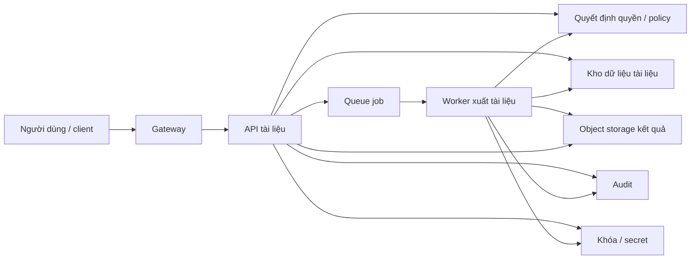

# Yêu cầu kiến trúc và thiết kế

## 1. Kiểm chứng kiến trúc bắt đầu từ yêu cầu, rủi ro và bằng chứng

Trong chương **Verification framework**, yêu cầu kiến trúc và thiết kế xác định những thuộc tính bảo mật mà cấu trúc hệ thống, cách các thành phần tương tác và cách xử lý trạng thái phải bảo đảm.

Một ứng dụng có thể sử dụng các thành phần riêng lẻ được cấu hình đúng nhưng vẫn có đường bỏ qua kiểm soát: API chính kiểm tra quyền, còn worker tin mọi message; dữ liệu gốc được bảo vệ, còn file xuất tải trực tiếp từ object storage; policy mới có hiệu lực ở một instance nhưng cache cũ tiếp tục cấp quyền.

Vì thế, kiểm chứng kiến trúc cần trả lời:

- Những tài sản, chủ thể, luồng dữ liệu và ranh giới tin cậy nào thuộc phạm vi?
- Yêu cầu nào được thực thi tại đâu, bằng dữ liệu có thẩm quyền nào?
- Có đường khác tới tài nguyên mà không đi qua kiểm soát không?
- Khi phụ thuộc lỗi, trạng thái thay đổi hoặc hệ thống phục hồi, thuộc tính bảo mật còn giữ được không?
- Bằng chứng nào cho phép kết luận về thiết kế và bằng chứng nào xác nhận implementation?

OWASP SAMM mô tả Architecture Assessment theo hướng đối chiếu kiến trúc với yêu cầu và các đe dọa cần xử lý. Việc rà thành phần phải đi cùng xem xét interface và luồng tương tác. [OWASP SAMM: Architecture Assessment](https://owaspsamm.org/model/verification/architecture-assessment/)

Chuỗi cần giữ trong bài học là:

**Tài sản và mục tiêu → đe dọa → yêu cầu → quyết định thiết kế → điểm thực thi → phương pháp kiểm chứng → bằng chứng → kết luận có phạm vi.**

Sau bài học, người học có thể:

- Viết yêu cầu kiến trúc cụ thể thay cho các khẩu hiệu như “an toàn nhiều lớp”.
- Lập hồ sơ thành phần, interface, dữ liệu và giả định.
- Đặc tả danh tính, quyền, dữ liệu, logging, trạng thái lỗi và phục hồi xuyên thành phần.
- Thiết kế review và kiểm thử để phát hiện đường bỏ qua kiểm soát.
- Phân biệt đầy đủ hồ sơ, thiết kế đáp ứng và implementation đã được xác minh.
- Quản lý thay đổi, ngoại lệ và giới hạn của kết luận kiểm chứng.

Các ID, thời hạn và kiến trúc bên dưới là ví dụ thiết kế. Chúng không phải yêu cầu áp dụng mặc định cho mọi hệ thống.

## 2. Phân biệt mục tiêu, yêu cầu, thiết kế và kết luận kiểm chứng

### 2.1. Bốn lớp thông tin khác nhau

| Lớp | Ví dụ | Cách sử dụng |
|---|---|---|
| Mục tiêu/rủi ro | Ngăn truy cập tài liệu giữa các tenant | Giải thích vì sao cần kiểm soát |
| Yêu cầu | Mọi lần đọc tài liệu phải có quyết định quyền cho đúng chủ thể, tenant, tài nguyên và hành động | Xác định hành vi bắt buộc và phạm vi |
| Thiết kế | API và worker có điểm kiểm tra quyền; storage riêng tư; kết quả xuất đi qua đường kiểm soát | Xác định cách đáp ứng và các giả định |
| Bằng chứng/kết luận | Review các đường dữ liệu, cấu hình triển khai và test sai tenant/sai quyền | Xác định đã kiểm tra điều gì, trên phiên bản nào |

Câu “dùng microservices”, “đặt sau gateway” hoặc “có service mesh” mô tả lựa chọn kiến trúc hoặc thành phần. Chúng chưa đủ để kết luận thuộc tính bảo mật được đáp ứng.

Một kiến trúc nguyên khối theo module vẫn có thể thực thi yêu cầu đúng. Một hệ thống nhiều service vẫn có thể thiếu kiểm soát ở một đường gọi. Cần đánh giá điểm thực thi và bằng chứng theo mục tiêu, không chỉ tên công nghệ.

### 2.2. Yêu cầu tốt cần có những phần nào?

Một bản ghi có thể cần:

- ID, revision và nguồn rủi ro/mục tiêu.
- Tài nguyên, chủ thể, interface và môi trường trong scope.
- Điều kiện đầu vào và nguồn dữ liệu có thẩm quyền.
- Hành vi bắt buộc, các bất biến và cận thời gian/tài nguyên nếu có.
- Hành vi khi thiếu dữ liệu, lỗi phụ thuộc hoặc trạng thái không xác định.
- Điểm thực thi dự kiến và owner.
- Phương pháp kiểm chứng, tiêu chí chấp nhận và evidence cần có.
- Giả định, giới hạn, điều kiện áp dụng và sự kiện cần đánh giá lại.

Một yêu cầu có thể ở mức kiến trúc nhưng vẫn phải kiểm chứng được. Ví dụ, “mọi đường đọc tài liệu được bảo vệ đều đi qua kiểm tra quyền” có thể được đánh giá bằng kiểm kê đường vào, phân tích thiết kế, review implementation và test các đường bypass.

### 2.3. Sử dụng framework có phiên bản

ASVS cung cấp yêu cầu cho thiết kế, phát triển và kiểm thử ứng dụng web/web service. Khi dùng nó làm baseline, hồ sơ phải xác định phiên bản, yêu cầu áp dụng, phần bổ sung theo rủi ro và cách ánh xạ. [OWASP ASVS: Overview](https://asvs.owasp.org/)

ID và cách phân nhóm có thể thay đổi giữa các phiên bản. Nên dùng tham chiếu có phiên bản khi ánh xạ một yêu cầu, đồng thời giữ yêu cầu riêng của hệ thống. [OWASP ASVS: How to reference requirements](https://github.com/OWASP/ASVS#how-to-reference-asvs-requirements)

Trong bài, các mã ARC là mã nội bộ minh họa; không được diễn giải chúng như mã ASVS hoặc tuyên bố đã đạt một mức kiểm chứng của chuẩn.

Một mục được đánh dấu không áp dụng cần lý do và bằng chứng phạm vi. Nếu hệ thống phụ thuộc một dịch vụ bên ngoài để thực thi kiểm soát, việc không sở hữu dịch vụ đó không tự làm yêu cầu biến mất.

## 3. Xây dựng mô hình đủ để kiểm chứng

### 3.1. Phạm vi nhiều hơn sơ đồ thành phần

Hồ sơ kiến trúc cần tối thiểu những góc nhìn phù hợp:

| Góc nhìn | Nội dung cần có |
|---|---|
| Ngữ cảnh | Người dùng, hệ thống ngoài, dữ liệu và mục tiêu nghiệp vụ |
| Thành phần | API, worker, datastore, queue, identity, key/secret service và audit |
| Interface | Protocol, caller, dữ liệu vào/ra, cơ chế danh tính và kiểm soát |
| Luồng dữ liệu | Dữ liệu đi qua đâu, nơi lưu tạm, nơi biến đổi, đích xuất |
| Triển khai | Đường vào thực tế, network exposure, danh tính workload và quyền |
| Trạng thái | Job, session, policy revision, hiệu lực quyền, retry và thu hồi |
| Vận hành | Quản trị, chẩn đoán, backup, recovery và đường khẩn cấp |
| Quyết định | ADR, lựa chọn thay thế, trade-off và giả định cần giữ |

Một luồng chỉ có trên sơ đồ logic nhưng khác topology triển khai cần được làm rõ. Đường truy cập trực tiếp, interface quản trị hoặc cơ chế khôi phục có thể mở đường tới dữ liệu ngoài luồng chính.

OWASP SAMM Architecture Validation đề cập cả interface nội bộ, bên ngoài và cách yêu cầu được đáp ứng qua tương tác giữa các thành phần. [OWASP SAMM: Architecture Validation](https://owaspsamm.org/model/verification/architecture-assessment/stream-a/)

### 3.2. Tình huống minh họa: xuất tài liệu đa tenant

Ứng dụng cho người dùng yêu cầu xuất một tài liệu. API tạo job, worker đọc dữ liệu và sinh file. Người dùng tải kết quả khi job hoàn tất.



Sơ đồ cho biết các tương tác dự kiến, chưa mô tả đầy đủ ranh giới tin cậy hoặc chứng minh các mũi tên có kiểm soát. Phải bổ sung hợp đồng cho từng interface.

Ví dụ:

| Luồng | Dữ liệu/đặc quyền | Câu hỏi kiểm chứng |
|---|---|---|
| Client → API | Session/token, document ID, yêu cầu xuất | Danh tính từ đâu; ai quyết định tenant và quyền? |
| API → Queue | Job ID, tài nguyên, hành động, ngữ cảnh người yêu cầu | Ai được gửi; payload có thể bị sửa/phát lại không? |
| Queue → Worker | Job và trạng thái xử lý | Worker xác minh nguồn và quyền còn hiệu lực thế nào? |
| Worker → Datastore | Nội dung tài liệu | Quyền workload và scope dữ liệu có quá rộng không? |
| Worker → Storage | File xuất và metadata | Ai đọc được; khi nào file được công bố? |
| API → Storage | Kết quả dùng để trả cho người gọi | Quyền tải được đánh giá theo tài liệu/job nào? |
| Workload → Audit | Chủ thể, tài nguyên, hành động và kết quả | Có lọc dữ liệu; khi audit lỗi xử lý thế nào? |
| Recovery → Datastore/Queue | Bản sao cũ và job cũ | Có khôi phục quyền đã thu hồi hoặc chạy lại tác vụ trái phép không? |

### 3.3. Ranh giới tin cậy phải có lý do

Cùng một mạng hoặc cùng cluster không tự chứng minh caller đáng tin. NIST Zero Trust Architecture nêu rằng vị trí mạng hay quyền sở hữu thiết bị không tự tạo sự tin cậy mặc định. [NIST SP 800-207](https://csrc.nist.gov/pubs/sp/800/207/final)

Trong ví dụ:

- Header tenant từ client là dữ liệu đầu vào, cần đối chiếu với danh tính và quyền.
- Danh tính gateway không tự thay danh tính người yêu cầu tài liệu.
- Quyền tiêu thụ queue không tự tạo quyền đọc mọi tài liệu.
- Key reference trong job không được tự quyết định khóa mà worker có quyền sử dụng.
- Object ID không phải bằng chứng người gọi được tải object.

Đối với mỗi lần qua ranh giới, cần chỉ rõ dữ liệu nào được tin, dựa vào bằng chứng nào và ai có thể sửa nó.

### 3.4. Đe dọa và giả định cần ghi rõ

| Mã rủi ro | Tình huống | Tài sản/thuộc tính bị ảnh hưởng |
|---|---|---|
| R-ARC-01 | Đổi tenant/document ID hoặc gọi đường nội bộ để vượt kiểm tra | Bí mật và quyền truy cập tài liệu |
| R-ARC-02 | Message giả, bị sửa hoặc được phát lại | Tính toàn vẹn job và quyền của worker |
| R-ARC-03 | Quyền bị thu hồi nhưng cache/job cũ tiếp tục dùng | Hiệu lực policy và dữ liệu xuất |
| R-ARC-04 | URL tải trực tiếp bỏ qua kiểm tra quyền hiện hành | Bí mật file kết quả |
| R-ARC-05 | Thiếu khóa hoặc lỗi phụ thuộc làm fallback không an toàn | Bảo vệ dữ liệu và bất biến bảo mật |
| R-ARC-06 | Log, trace hoặc file tạm làm lộ nội dung/credential | Bí mật và phạm vi sao chép dữ liệu |
| R-ARC-07 | Retry/recovery tạo output hoặc quyền ngoài dự kiến | Tính toàn vẹn trạng thái, kiểm soát chia sẻ |
| R-ARC-08 | Kiến trúc triển khai lệch mô hình đã review | Tính áp dụng của kết luận kiểm chứng |

Giả định như “mọi request tới storage đều qua API” phải được chứng minh bằng cấu hình/quyền và test đường trực tiếp. Nếu giả định chưa có bằng chứng, nó là khoảng trống cần xử lý.

## 4. Những nhóm yêu cầu cần được phân bổ trong thiết kế

### 4.1. Xác thực và ngữ cảnh danh tính

Thiết kế phải phân biệt người dùng, service/workload và tác vụ được ủy quyền. Mỗi loại cần vòng đời và phạm vi phù hợp.

Một job có thể cần lưu danh tính người khởi tạo và ngữ cảnh được bảo vệ để truy vết. Điều đó không có nghĩa quyền tại lúc enqueue luôn đủ cho mọi lần xử lý về sau.

Không truyền một boolean do client tự khai như isAdmin giữa các service rồi coi nó là quyết định có thẩm quyền.

### 4.2. Phân quyền, tenant và complete mediation

Cần xác định điểm kiểm tra trước hành động nhạy cảm và dữ liệu quyết định: chủ thể, tenant, tài nguyên, hành động, trạng thái và policy.

Điểm thực thi có thể dùng thư viện chung hoặc dịch vụ policy, tùy kiến trúc. Yêu cầu là mọi đường thuộc scope đều được kiểm soát nhất quán; không nhất thiết phải triển khai một service phân quyền riêng.

Đối với tenant isolation, cần ràng buộc ngữ cảnh vào truy vấn, key storage, cache, job và kết quả. Mã hóa dữ liệu không thay cho quyết định đúng tenant.

### 4.3. Dữ liệu, khóa và secret

Phải chỉ rõ loại dữ liệu, nơi lưu, đường truyền và profile bảo vệ. Với dữ liệu cần mã hóa, thiết kế cần nguồn khóa, quyền dùng, rotation và khả năng đọc dữ liệu hợp lệ sau phục hồi.

Không tự ghi plaintext khi key service lỗi. Cũng không phát sinh khóa tạm thay thế mà không có hợp đồng làm dữ liệu cũ mất khả năng khôi phục.

Quyền đọc secret hoặc sử dụng khóa cần theo công việc thực tế. Giữ được tham chiếu khóa không đồng nghĩa đã có quyền sử dụng nó.

### 4.4. Giới hạn đầu vào và bề mặt tấn công

Thiết kế cần biết thành phần nào kiểm tra kiểu, kích thước, định dạng và cận tài nguyên. Khi dữ liệu qua queue hoặc được giải nén/biến đổi, phải xét cận tại vị trí có ý nghĩa.

Các interface quản trị, chẩn đoán và đường trực tiếp phải có policy riêng. Một endpoint tối thiểu được phép công khai không làm mọi endpoint trong cùng service được miễn kiểm soát.

### 4.5. Audit, trạng thái lỗi và phục hồi

Logging và audit cần mục đích, danh sách dữ liệu được ghi, quyền đọc và hành vi khi đường ghi lỗi. Không mặc định dump toàn bộ request để chứng minh đã có logging.

Mỗi phụ thuộc quan trọng cần hành vi suy giảm có scope: thao tác nào dừng, thao tác nào tiếp tục bằng trạng thái tin cậy còn hiệu lực và bằng chứng nào cần giữ.

Backup/recovery phải xét cả policy, trạng thái thu hồi, key version, job và kết quả. Khôi phục thành công database không tự chứng minh đã giữ các bất biến bảo mật.

## 5. Bộ yêu cầu kiến trúc mẫu

### 5.1. Một yêu cầu đầy đủ

**ARC-01 — Mọi đường truy cập tài liệu trong scope phải được kiểm soát**

- **Rủi ro:** R-ARC-01 và R-ARC-04.
- **Phạm vi:** đọc, xuất và tải tài liệu qua API, worker và các đường trực tiếp được hỗ trợ.
- **Yêu cầu:** trước hành động được bảo vệ, hệ thống phải có quyết định cho đúng chủ thể hoặc ủy quyền được chấp nhận, tenant, tài nguyên và hành động.
- **Nguồn dữ liệu:** danh tính được xác minh, metadata tài nguyên có thẩm quyền và policy còn hiệu lực; không tin chỉ riêng tenant/document ID do client gửi.
- **Hành vi lỗi:** thiếu hoặc không xác minh được điều kiện bắt buộc thì không thực hiện hành động đó; trả kết quả công khai theo hợp đồng.
- **Phân bổ:** API, worker, cơ chế truy cập datastore/storage và các interface quản trị liên quan.
- **Bằng chứng:** danh mục interface, phân tích luồng, thiết kế quyết định quyền, cấu hình và test bypass.
- **Tiêu chí chấp nhận:** thiếu danh tính, sai tenant, sai tài nguyên và gọi đường trực tiếp không cấp quyền ngoài policy.
- **Giới hạn:** các endpoint công khai được cho phép phải được liệt kê riêng với dữ liệu/hành vi tối thiểu; không tạo ngoại lệ toàn service.

Yêu cầu này cần một hồ sơ đủ để đối chiếu mọi đường trong scope. Chỉ test qua gateway không đủ để kết luận về worker hoặc storage.

### 5.2. Các yêu cầu bổ sung

| ID | Yêu cầu trong tình huống minh họa | Tiêu chí chấp nhận chính |
|---|---|---|
| ARC-02 | Từng interface xác minh caller và ngữ cảnh được tin, phân biệt danh tính người dùng, workload và quyền ủy nhiệm. | Header tự khai hoặc workload được cấp kết nối không tự tạo quyền người dùng. |
| ARC-03 | Tenant/resource context được ràng buộc vào truy vấn, cache, job và kết quả theo metadata có thẩm quyền. | Đổi ID hoặc dùng cùng cache key cho tenant khác không trả dữ liệu ngoài quyền. |
| ARC-04 | Job có định danh, nguồn tạo, tài nguyên, hành động và trạng thái được kiểm tra; message không tự cấp quyền. | Message giả, bị sửa hoặc phát lại không tạo tác vụ ngoài phạm vi. |
| ARC-05 | Worker kiểm tra điều kiện quyền trước lần đọc nhạy cảm và trước công bố kết quả; tải kết quả cũng kiểm tra quyền hiện hành. | Thu hồi khi job đang chờ hoặc đang xử lý không làm công bố/tải mới trái policy. |
| ARC-06 | Sau lệnh thu hồi được chấp nhận, mọi thao tác mới thuộc phạm vi phải tuân thủ policy còn hiệu lực trong 60 giây. | Bao phủ cache cũ, điểm mất kết nối, restart và mọi đường phục vụ; không chỉ node khỏe. |
| ARC-07 | Truyền/lưu dữ liệu theo profile bảo vệ đã chọn; khóa và danh tính peer cần thiết được xác minh. | Không fallback plaintext, trust-all hoặc khóa không được cấp khi phụ thuộc lỗi. |
| ARC-08 | Các sự kiện quản lý quyền và công bố kết quả có audit theo hợp đồng; dữ liệu bị cấm được lọc. | Có evidence về chủ thể/tài nguyên/kết quả; không ghi credential hoặc nội dung tài liệu không được phép. |
| ARC-09 | Đầu vào, queue, parser, file tạm và output có cận tài nguyên/đơn vị và hành vi khi vượt cận. | Không để một giai đoạn hợp lệ làm giai đoạn sau dùng tài nguyên vô hạn. |
| ARC-10 | Retry và xử lý trùng giữ bất biến quyền và trạng thái; output chỉ khả dụng khi đủ điều kiện công bố. | Không tạo thêm quyền, phát hành output dở dang hoặc bỏ kiểm tra vì job đã từng hợp lệ. |
| ARC-11 | Recovery/rollback không tự khôi phục quyền đã thu hồi hoặc kích hoạt job bằng policy không được phép. | Khôi phục bản sao cũ phải đối soát trạng thái bảo mật trước phục vụ luồng liên quan. |
| ARC-12 | Bằng chứng và quyết định thiết kế có subject/config/revision rõ; sai lệch triển khai được phát hiện và xử lý. | Review của revision cũ không tự áp dụng cho topology hoặc policy mới. |
| ARC-13 | Mỗi yêu cầu có applicability, điểm thực thi, owner, phương pháp kiểm chứng và trạng thái evidence. | Thiếu bằng chứng hoặc ủy thác cho dịch vụ khác không tự thành PASS/N/A. |
| ARC-14 | Interface quản trị/chẩn đoán và tính năng tùy chọn có default an toàn, quyền và đường truy cập được công bố. | Không tự mở endpoint nhạy cảm khi thiếu cấu hình; route mới không bỏ kiểm soát. |

Thời hạn, phạm vi và profile phải được dự án xác nhận. Các yêu cầu không đòi mọi hệ thống dùng cùng sản phẩm hoặc topology, nhưng đòi cơ chế đã chọn chứng minh được hành vi.

## 6. Phân tích thiết kế cho luồng xuất tài liệu

### 6.1. Tạo job với ngữ cảnh có thẩm quyền

Một thiết kế khả thi cho ví dụ:

1. API xác minh danh tính và xác định tenant context từ nguồn được chấp nhận.
2. API lấy metadata tài liệu và kiểm tra quyền xuất đúng tài nguyên.
3. Job được ghi vào kho trạng thái có quyền ghi được kiểm soát, với chủ thể khởi tạo, tenant, tài nguyên, hành động và revision liên quan.
4. Message chỉ mang thông tin cần thiết để worker tìm và đối chiếu job; queue giới hạn danh tính gửi/nhận.
5. Worker không lấy tenant, key reference hoặc quyền mở rộng chỉ từ payload chưa được xác nhận.

Có thể có thiết kế dùng delegation token hoặc cơ chế khác, nhưng cần xác minh issuer, audience, scope, thời hạn và liên kết tới job theo hợp đồng. Không nhất thiết truyền credential người dùng dài hạn qua queue.

Lựa chọn “job ID tham chiếu record có thẩm quyền” cũng đòi hỏi bảo vệ kho record và quyền sửa. Một ID khó đoán không thay kiểm tra nguồn và scope.

### 6.2. Worker thực thi theo quyền và trạng thái hiện hành

Worker cần phân biệt:

- Quyền workload để tiêu thụ job và sử dụng hạ tầng.
- Quyền thực hiện hành động đối với tài liệu cụ thể.
- Trạng thái job có cho phép lần thực thi này không.
- Điều kiện còn hiệu lực của người yêu cầu hoặc ủy quyền theo policy.

Trong baseline của ví dụ, khi thu hồi đã có hiệu lực tại điểm quyết định theo cận ARC-06 trước lần đọc nhạy cảm, worker không tiếp tục đọc bằng quyền cũ. Nếu quyền đổi trong lúc xử lý, cần kiểm tra lại trước công bố theo cùng hợp đồng về hiệu lực.

Không thể xóa dữ liệu đã từng được đọc vào bộ nhớ chỉ bằng lệnh thu hồi. Hợp đồng phải nói rõ hành động nào bị chặn sau mốc thu hồi và cách xử lý dữ liệu tạm theo policy.

### 6.3. Công bố output là một hành động được bảo vệ

Một cách giữ nhất quán giữa kho job và object storage:

- Worker ghi file vào vùng staging riêng tư.
- Xác nhận output hoàn chỉnh và các điều kiện quyền/audit bắt buộc.
- Ghi trạng thái READY cùng tham chiếu output theo cơ chế commit đã chọn.
- API chỉ phục vụ khi trạng thái, ownership và quyền hiện hành phù hợp.
- File mồ côi hoặc output của job thất bại vẫn riêng tư và được dọn theo policy.

Không giả định transaction của database tự bao phủ object storage. Cần thiết kế thứ tự, điều kiện công bố và khôi phục giữa các bước.

Ví dụ, nếu object upload thành công nhưng ghi READY thất bại, object không được tự trở thành công khai. Nếu READY đã ghi nhưng object không đọc được, API phải trả trạng thái lỗi hợp đồng, không trỏ sang một object khác để hoàn tất.

### 6.4. Đường tải trực tiếp có thể phá yêu cầu thu hồi

Giả sử API phát URL tải trực tiếp tồn tại 15 phút, trong khi ARC-06 yêu cầu thu hồi trong 60 giây. Nếu storage tiếp tục chấp nhận URL mà không có cơ chế chặn phù hợp, kiểm tra quyền ở API không đủ giữ cam kết.

Hai hướng cần được đánh giá theo kiến trúc:

| Hướng | Điều kiện cần chứng minh |
|---|---|
| Tải qua điểm kiểm soát xét quyền hiện hành | Không có đường storage trực tiếp bỏ qua; cache và stream có scope rõ |
| Dùng capability ngắn hạn hoặc có thể thu hồi | Mọi capability đã cấp chịu cận hiệu lực/thu hồi, sai số thời gian và hành vi đích phù hợp cam kết |

Trong phương án chính của ví dụ, storage giữ riêng tư và tải qua API/điểm kiểm soát được quản lý. Quyền download được kiểm tra cho đúng job/tài liệu và tenant.

Tên “signed URL” không tự chứng minh thu hồi tức thì. Chữ ký có thể xác nhận quyền theo nội dung/thời hạn đã ký nhưng đích nhận vẫn phải hỗ trợ chính sách cần thiết.

### 6.5. Tính cận độ trễ thay vì chỉ đặt chu kỳ đồng bộ

Một cache quyền cần có:

- Chủ thể/tài nguyên/hành động/tenant và policy revision trong khóa hoặc ràng buộc tương ứng.
- Điều kiện hiệu lực, cơ chế cập nhật và trạng thái thu hồi.
- Hành vi khi mất kết nối và khi restart.
- Cách kiểm chứng mọi điểm quyết định không tiếp tục dùng trạng thái cũ quá hạn.

Nếu dùng lease, nơi cấp phải có thẩm quyền và không tiếp tục cấp lease theo policy đã bị thu hồi. Instance không được tự gia hạn hoặc đặt lại hạn từ cache.

Ví dụ ngân sách được đề xuất có thể là lease tối đa 30 giây, sai số thời gian được chấp nhận tối đa 5 giây và phần thực thi/chặn tối đa 15 giây. Tổng 50 giây còn trong cam kết 60 giây **nếu** mọi cận và giả định đó được xác minh.

Một con số polling 60 giây không tự tạo cam kết 60 giây, vì còn độ trễ xử lý, dữ liệu và điểm thực thi. Khi không giữ được cận, luồng ảnh hưởng phải ngừng cấp thao tác mới theo hợp đồng.

## 7. Hồ sơ quyết định kiến trúc và khả năng truy vết

### 7.1. ADR cần giữ cả lý do và điều kiện

Một Architectural Decision Record có thể gồm:

- Bối cảnh, tài sản, rủi ro và yêu cầu được xử lý.
- Những phương án đã xét.
- Quyết định cùng phạm vi áp dụng.
- Điểm thực thi và owner.
- Giả định, trade-off và phụ thuộc.
- Hành vi lỗi/khôi phục.
- Cách kiểm chứng và sự kiện phải xem lại quyết định.

OWASP SAMM Architecture Mitigation nhấn mạnh việc xem xét thiết kế đối với từng đe dọa và các giả định/trade-off trong quyết định kiến trúc. [OWASP SAMM: Architecture Mitigation](https://owaspsamm.org/model/verification/architecture-assessment/stream-b/)

ADR không chỉ ghi “đã chọn phương án A”. Nếu phương án A chỉ đúng khi object storage không công khai, điều kiện đó phải có owner và evidence.

### 7.2. Ví dụ bản ghi có trạng thái riêng từng lớp

```yaml
requirementId: ARC-06
requirementRevision: 1
riskRefs: [R-ARC-03, R-ARC-04]
scope: document-export-new-operations
architectureRevision: "documents-architecture-042"

controlAllocation:
  - api-authorization
  - worker-authorization
  - download-authorization
  - policy-cache-lifecycle

decisionRef: ADR-EXPORT-REVOCATION
assumptions:
  - id: private-output-storage
    verificationRequired: true
  - id: bounded-policy-lease
    verificationRequired: true

acceptance:
  withdrawalDeadlineSeconds: 60
  includesPartitionedDecisionPoints: true
  includesRestartWithCachedState: true

evidenceRefs:
  - design-review-export-042

status:
  designReview: CONDITIONAL
  implementationVerification: NOT_RUN
  operationalValidation: NOT_RUN

implementationOwnerRole: document-export-technical-owner
verificationOwnerRole: security-verification-owner
```

Đây là schema minh họa, không phải định dạng của một framework cụ thể. Bản ghi cho thấy một thiết kế có thể đã được review trong khi implementation chưa được kiểm chứng.

Các assumption và reference phải truy được trong hồ sơ thực tế. Nếu chưa xác nhận storage riêng tư, phần kết luận dựa vào nó vẫn cần ghi giới hạn; không tạo PASS toàn bộ bằng cách bỏ assumption khỏi báo cáo.

### 7.3. Ma trận truy vết nên đi được cả hai chiều

| Rủi ro | Yêu cầu | Phân bổ thiết kế | Evidence cần có |
|---|---|---|---|
| R-ARC-01 | ARC-01, ARC-02, ARC-03 | API, worker, scope datastore và đường nội bộ | Review interface, cấu hình quyền, test sai tenant/bypass |
| R-ARC-03 | ARC-05, ARC-06 | Kiểm tra quyền hiện hành, cache/lease và lifecycle job | Test thu hồi, mất kết nối, restart và publish |
| R-ARC-04 | ARC-01, ARC-06 | Storage riêng tư, download đi qua điểm kiểm soát | Kiểm tra đường trực tiếp và cache download |
| R-ARC-05 | ARC-07 | Profile truyền/lưu, quyền dùng khóa, hành vi suy giảm | Cấu hình và test key/peer không hợp lệ |
| R-ARC-07 | ARC-10, ARC-11 | State machine job, idempotency và đối soát recovery | Test trùng, crash giữa bước và khôi phục bản sao cũ |

Truy từ yêu cầu sang thành phần giúp giao implementation. Truy từ một thành phần thay đổi ngược về yêu cầu/rủi ro giúp xác định phạm vi kiểm chứng lại.

## 8. Kế hoạch kiểm chứng ở nhiều lớp

### 8.1. Review tài liệu và phân tích thiết kế

Người review cần dùng mô hình đã thống nhất và đối chiếu:

- Từng tài sản có những đường truy cập nào.
- Từng interface đi qua ranh giới nào và mang danh tính gì.
- Từng yêu cầu có điểm thực thi hoặc khoảng trống nào.
- Từng đe dọa được giảm bởi cơ chế nào.
- Từng giả định có evidence hay vẫn đang mở.
- Luồng lỗi, đường quản trị và recovery có khác luồng thuận thế nào.

Một danh sách yêu cầu chuẩn giúp tạo baseline, nhưng vẫn cần xét đe dọa riêng của sản phẩm. Không có finding trong checklist chưa chứng minh các tình huống đặc thù đã được xử lý.

### 8.2. Review implementation và cấu hình

Sau thiết kế, phải kiểm tra cơ chế đã được phân bổ có thực sự tồn tại:

| Nội dung | Ví dụ evidence |
|---|---|
| Quyết định quyền | Code/đường xử lý, policy, danh tính và tài nguyên thực sự được dùng |
| Workload permission | Quyền datastore/storage/queue/key service của API và worker |
| Network exposure | Listener, gateway, đường trực tiếp và endpoint vận hành |
| Default/config | Schema, nguồn ghi đè, kiểm tra bất biến và trạng thái thiếu |
| Data lifecycle | Quyền file tạm, cách công bố output và thời hạn lưu |
| Recovery | Runbook, dữ liệu khôi phục và bước đối soát trạng thái bảo mật |

IaC được review là một nguồn bằng chứng. Trạng thái đang chạy còn phải được đối chiếu nếu kết luận áp dụng cho deployment thực tế.

### 8.3. Kiểm thử hành vi, ca lỗi và abuse case

Kế hoạch cần có ca dương, ca âm, biến đổi quyền/tenant, gọi đường khác và lỗi phụ thuộc. Luồng async phải quan sát kết quả cuối, không chỉ HTTP chấp nhận job.

OWASP SAMM Control Verification liên kết yêu cầu bảo mật với các test kiểm chứng kiểm soát và yêu cầu kiểm tra lại khi cách sử dụng kiểm soát thay đổi. [OWASP SAMM: Control Verification](https://owaspsamm.org/model/verification/requirements-driven-testing/stream-a/)

Một test không tìm thấy lỗ hổng chỉ hỗ trợ kết luận trong phạm vi đã chạy. Kết luận về complete mediation cần kết hợp kiểm kê interface, phân tích thiết kế/implementation, cấu hình và kiểm thử có mục tiêu.

### 8.4. Phân biệt evidence thiết kế, kiểm thử và vận hành

- Sơ đồ/ADR cho biết thiết kế và lý do.
- Review code/config cho biết cơ chế được triển khai.
- Test cho biết hành vi trong điều kiện được tạo.
- Quan sát vận hành cho biết deployment hiện tại đang áp dụng những gì.

Không lấy một ảnh chụp staging để chứng minh production có cùng quyền và topology. Nếu chưa có evidence tương ứng, giới hạn kết luận phải được ghi rõ.

## 9. Quản lý kết luận và điều kiện qua gate

### 9.1. Trạng thái phải nói rõ đã xác minh điều gì

Một hồ sơ có thể dùng các trạng thái nội bộ:

| Trạng thái | Ý nghĩa |
|---|---|
| APPLICABLE | Yêu cầu thuộc phạm vi đánh giá |
| DESIGN_ADDRESSED | Có thiết kế phân bổ cơ chế; chưa đồng nghĩa implementation đã hoạt động đúng |
| VERIFIED | Có đủ evidence đáp ứng tiêu chí trong phạm vi/bản triển khai được nêu |
| FAILED | Có bằng chứng không đáp ứng tiêu chí |
| NOT_VERIFIED | Chưa đủ evidence hoặc chưa thực hiện phương pháp bắt buộc |
| NOT_APPLICABLE | Không áp dụng trong scope đã xác nhận, có lý do và bằng chứng |
| EXCEPTION_RECORDED | Có quyết định ngoại lệ được phép, nhưng thuộc tính chưa đáp ứng vẫn được giữ nguyên |

Đây là trạng thái minh họa, không phải enum chuẩn chung. Trong mô hình dữ liệu, applicability, design status, verification status và exception nên là các chiều có thể phân biệt.

### 9.2. Gate thiết kế và gate phát hành khác nhau

Gate thiết kế có thể yêu cầu mô hình đủ, phân bổ kiểm soát, giải quyết câu hỏi quan trọng, giả định có owner và kế hoạch kiểm chứng khả thi.

Gate phát hành cần evidence thực thi cho những yêu cầu bắt buộc ở mốc đó, gắn đúng artifact/cấu hình và xử lý các finding/khoảng trống theo policy.

Một kết quả thiết kế có điều kiện không được biến thành release PASS chỉ bằng cách đổi tên trạng thái. Nếu phương án dựa vào một capability chưa chứng minh được, cần giữ nó là điều kiện mở đến khi có bằng chứng phù hợp.

Ngoại lệ chỉ có hiệu lực khi đúng thẩm quyền, scope, thời hạn và các kiểm soát bù. Chấp nhận rủi ro không sửa kết quả FAILED thành VERIFIED.

### 9.3. Evidence cần có khả năng tái dựng

Một bản ghi evidence nên nêu:

- Yêu cầu/revision và rủi ro liên quan.
- Architecture/config revision, artifact/deployment được xét.
- Phương pháp, công cụ và phạm vi kiểm tra.
- Điều kiện đầu vào, dữ liệu thử, role/tenant và trạng thái phụ thuộc.
- Kết quả, tiêu chí đối chiếu và dữ liệu đã được lọc.
- Người hoặc hệ thống tạo/xác nhận, thời điểm và nguồn có thẩm quyền.
- Giới hạn, assumption và các reference cần thiết.

Quyền sửa/xóa evidence phải được kiểm soát. Không lưu credential hoặc dữ liệu khách hàng không cần thiết trong proof; dùng dữ liệu tổng hợp và redaction theo hợp đồng.

Một đường dẫn báo cáo không tự chứng minh nội dung chưa đổi hoặc thuộc đúng ứng viên. Cần định danh, lịch sử và ràng buộc đủ để đối chiếu.

### 9.4. Bao phủ phải có mẫu số và điều kiện

Ví dụ, baseline có 20 hạng mục: 15 VERIFIED, 2 FAILED, 2 NOT_VERIFIED và 1 NOT_APPLICABLE đã được xác nhận.

Kết quả là 15/19 hạng mục áp dụng đã được xác minh. Nếu một hạng mục bắt buộc còn thiếu hoặc thất bại, không dùng tỷ lệ tổng để cho qua.

Cần giữ riêng bao phủ interface, yêu cầu và đe dọa. Có thể đã kiểm tra tất cả API công khai nhưng vẫn bỏ worker hoặc đường recovery.

N/A cần được xem lại khi scope thay đổi. Chẳng hạn, không có luồng async có thể là lý do cho một yêu cầu riêng về queue chưa áp dụng; thêm worker làm điều kiện đó thay đổi.

## 10. Duy trì kết luận khi thiết kế và vận hành thay đổi

### 10.1. Sự kiện kích hoạt đánh giá lại

| Thay đổi | Phần có thể mất tính áp dụng |
|---|---|
| Thêm endpoint, message hoặc đường tải trực tiếp | Complete mediation, nguồn danh tính và phân quyền |
| Đổi gateway, identity provider hoặc delegation | Ranh giới trust và kiểm tra claim |
| Thêm tenant/role/loại tài nguyên | Mô hình quyền, cache key và query scope |
| Đổi cache, policy distribution hoặc TTL | Cam kết hiệu lực/thu hồi |
| Đổi datastore, object storage hoặc key service | Quyền, mã hóa, công bố dữ liệu và hành vi lỗi |
| Đổi cách retry, job state hoặc restore | Idempotency, đối soát và chống khôi phục quyền cũ |
| Thêm debug/admin/support interface | Bề mặt tấn công và dữ liệu được công bố |
| Đổi baseline hoặc phát hiện đe dọa mới | Mapping yêu cầu, phương pháp và độ đủ evidence |

Phạm vi kiểm chứng lại dựa trên tác động. Có thể tái sử dụng evidence không bị ảnh hưởng nếu chứng minh còn đúng; không cần lặp mọi test máy móc cho thay đổi không liên quan.

Ngược lại, source code không đổi không đồng nghĩa mọi kết luận còn hiệu lực. Một thay đổi quyền storage có thể mở đường tải trực tiếp mà code không biết.

### 10.2. Phát hiện sai lệch thiết kế và deployment

Cần đối chiếu những điều kiện có ảnh hưởng bảo mật, chẳng hạn:

- Danh tính và quyền thực tế của API/worker.
- Listener, route quản trị và đường storage.
- Policy/trust revision đang hiệu lực tại từng điểm.
- Profile truyền/lưu và quyền dùng khóa.
- Cấu hình audit, queue, cache và recovery.

Nếu phát hiện drift, phải nêu yêu cầu bị ảnh hưởng và hành động theo mức rủi ro. Một cảnh báo chưa được xử lý không tự khôi phục bất biến.

Quy trình vận hành cần xác minh lại sau sửa. Đưa một file cấu hình đúng vào repository không chứng minh process đã dùng nó.

### 10.3. Phục hồi phải giữ đúng trạng thái bảo mật

Một kế hoạch khôi phục có thể cần:

1. Xác định subject phần mềm, schema và dữ liệu đang được phục hồi.
2. Khôi phục bằng nguồn dữ liệu/bằng chứng được cấp.
3. Đối soát policy hiện hành, quyền bị thu hồi và phiên bản khóa cần thiết.
4. Phân loại job cũ: tiếp tục, hủy hoặc yêu cầu đánh giá lại theo hợp đồng.
5. Giữ output chưa đủ điều kiện ở trạng thái không thể tải trái quyền.
6. Kiểm tra bất biến và đường truy cập trước khi mở phục vụ tương ứng.

Mục tiêu thời gian phục hồi không tự cho phép bỏ bước bảo mật. Nếu không đạt đồng thời mục tiêu phục vụ và điều kiện bảo vệ, cần giải quyết trade-off bằng thiết kế và quyết định có thẩm quyền.

## 11. Kế hoạch kiểm thử kiến trúc và thiết kế

Các ca dưới đây dùng dữ liệu thử và môi trường đại diện cho kiến trúc. Chúng minh họa bằng chứng cần chuẩn bị, không yêu cầu thực hiện tác động trên production.

| Ca | Điều kiện hoặc tác động | Kết quả chấp nhận |
|---|---|---|
| T01 | Chủ thể hợp lệ tạo và tải kết quả xuất trong tenant của mình | Đúng tài liệu/quyền; audit và trạng thái phù hợp |
| T02 | Thiếu danh tính hoặc dùng danh tính sai audience/profile | Không đọc, tạo job hoặc nhận output trái quyền |
| T03 | Chủ thể tenant A thay document/job ID thành của tenant B | Không đọc hay công bố dữ liệu ngoài tenant; không có tác dụng phụ trái phép |
| T04 | Gọi API/backend/storage trực tiếp theo các đường được hỗ trợ | Không có đường bỏ kiểm soát; đường không được hỗ trợ bị chặn theo kiến trúc |
| T05 | Gửi message giả hoặc sửa tài nguyên/action trong payload | Worker không cấp quyền từ payload; từ chối hoặc đối soát job có thẩm quyền |
| T06 | Thu hồi đã có hiệu lực theo ARC-06 sau enqueue và trước lần đọc nhạy cảm | Worker không dùng quyền cũ để đọc |
| T07 | Quyền đổi khi worker đang xử lý, trước công bố/tải mới | Điều kiện hiện hành được áp dụng theo hợp đồng; không công bố/tải trái quyền |
| T08 | Warm cache, sau đó thu hồi trong lúc một điểm mất kết nối | Mọi thao tác mới sau deadline tuân thủ policy còn hiệu lực hoặc không được cấp |
| T09 | Restart với cache hoặc job cũ sau thu hồi | Không đặt lại hạn hoặc khôi phục quyền đã bị chặn |
| T10 | Dùng URL tải trực tiếp đã cấp trước thu hồi | Không vượt cam kết qua một đường ngoài điểm kiểm soát |
| T11 | Key service lỗi hoặc danh tính peer không hợp lệ | Không hạ profile bảo vệ; thao tác cần điều kiện đó không tiếp tục trái hợp đồng |
| T12 | Audit bắt buộc không ghi bền vững được trước công bố | Không bỏ audit để công bố; có trạng thái chờ/lỗi theo thiết kế |
| T13 | Message trùng và retry sau lỗi giữa các bước | Không tạo quyền mới, output công khai dở dang hoặc bỏ kiểm tra hiện hành |
| T14 | Crash sau upload staging nhưng trước commit READY | Object vẫn riêng tư, trạng thái được đối soát và dọn đúng policy |
| T15 | Khôi phục backup cũ có grant/job trước thu hồi | Đối soát trước phục vụ; không làm sống lại quyền cũ |
| T16 | Dữ liệu vào/giải nén/output vượt cận được đặc tả | Bị xử lý hữu hạn, không làm bỏ kiểm soát hoặc tiêu thụ vô hạn |
| T17 | Token/dữ liệu thử có dấu nhận dạng đi qua log, trace và lỗi | Không xuất hiện ở đầu ra bị cấm; audit vẫn có ngữ cảnh được phép |
| T18 | Deployment có quyền/storage exposure khác revision đã review | Phát hiện mismatch; kết luận cũ không tự áp dụng |
| T19 | Hồ sơ thiếu evidence hoặc khai N/A vì dùng provider ngoài | Giữ khoảng trống; không tự thành VERIFIED/N/A |
| T20 | Ngoại lệ hết hạn hoặc đổi scope/giả định | Không áp dụng ngoài hiệu lực; gate xử lý theo policy hiện hành |

Không phải mọi ca dùng cùng một công cụ. T02/T03 có thể cần test API và dữ liệu; T04 cần kết hợp cấu hình/quyền và kết nối thử; T08/T15 cần môi trường hỗ trợ tạo trạng thái lỗi/khôi phục có kiểm soát.

### 11.1. Given–When–Then cho lỗi phân bổ kiểm soát

```gherkin
Given API chỉ cấp quyền tải file qua policy hiện hành
And một thiết kế thay thế phát URL storage trực tiếp có hạn 15 phút
And yêu cầu thu hồi áp dụng cho thao tác mới trong tối đa 60 giây
When quyền tải được thu hồi nhưng storage vẫn chấp nhận URL cũ sau 60 giây
Then ARC-06 không được đánh giá là đã đáp ứng
And finding chỉ rõ đường tải bỏ qua hiệu lực policy
And review thiết kế yêu cầu thay phương án hoặc xử lý theo policy có thẩm quyền
And không dùng test tải qua API thành công để đóng finding của đường storage
```

Một biến thể đạt phải chứng minh mọi đường trong scope tuân thủ điều kiện tương ứng. Việc sửa riêng API không đủ nếu URL cũ vẫn tiếp cận storage.

### 11.2. Cách đọc một kết quả test âm

Nếu request sai quyền nhận 403 nhưng worker vẫn tạo file có thể tải, yêu cầu chưa đạt. Tiêu chí cần xem trạng thái bền vững và tác dụng phụ, không chỉ response.

Nếu request bị chặn bởi một lớp ngoài khiến test chưa tới điểm cần đánh giá, kết quả có thể hỗ trợ lớp đó nhưng chưa chứng minh điểm bên trong hoạt động. Cần phương pháp hoặc test phù hợp để phân biệt.

Nếu không thấy lỗi vì chưa chạy đường recovery hoặc interface quản trị, giữ trạng thái chưa xác minh cho phạm vi đó.

## 12. Bài tập: đánh giá kiến trúc có đủ cơ chế nhưng thiếu liên kết

Một thiết kế có các thành phần quen thuộc:

- Gateway xác minh session trước API.
- API kiểm tra quyền rồi enqueue job.
- Worker tin mọi message từ queue và có quyền đọc toàn bộ datastore.
- Kết quả nằm trong storage riêng tư nhưng được tải qua URL 15 phút.
- Cache quyền không có cận hiệu lực khi mất kết nối.
- Backup chứa cả trạng thái grant và job; sau restore hệ thống chạy lại job chưa xong.
- Hồ sơ hiện tại đánh dấu “đạt kiến trúc” vì có gateway, encryption và audit.

Hãy thực hiện:

1. Lập danh mục chủ thể, tài sản, interface và luồng dữ liệu.
2. Ghi giả định chưa được chứng minh và các đường có thể bỏ kiểm soát.
3. Chọn yêu cầu ARC áp dụng, bổ sung yêu cầu riêng nếu cần.
4. Phân bổ điểm thực thi cho API, worker, storage, cache và recovery.
5. Viết ADR cho phương án tải và hiệu lực quyền.
6. Xác định evidence thiết kế, implementation và vận hành.
7. Tạo gate cho từng mốc cùng cách xử lý FAILED, NOT_VERIFIED và ngoại lệ.

Một chuỗi truy vết mẫu:

| Mắt xích | Nội dung |
|---|---|
| Tài sản | File xuất chứa dữ liệu tài liệu của tenant |
| Đe dọa | Người dùng đã mất quyền vẫn tải qua URL cũ |
| Yêu cầu | ARC-01, ARC-05 và ARC-06 |
| Quyết định | Storage riêng tư, tải qua điểm kiểm soát hoặc capability có cơ chế/cận phù hợp |
| Phân bổ | Policy, API/download path, storage và cache |
| Kiểm chứng | Review luồng, quyền thực tế, T07/T08/T10 |
| Kết luận | Chỉ VERIFIED khi có evidence đúng scope và cam kết thời gian; giữ phần chưa chứng minh |

Sản phẩm cần đạt là một lập luận kiểm chứng có thể truy vết: cơ chế nào bảo vệ tài sản trước tình huống nào, điểm nào thực thi, điều kiện nào còn phải giữ và bằng chứng nào hỗ trợ kết luận ở từng mốc của vòng đời phát triển.
