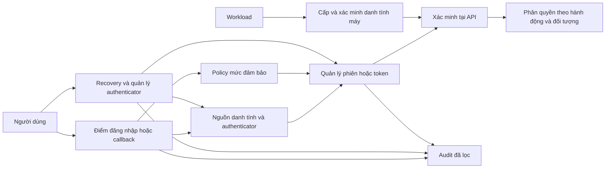

# Yêu cầu authentication — Đặc tả và kiểm chứng xác thực

## 1. Mục tiêu và phạm vi

Authentication, hay xác thực, là quá trình kiểm chứng một chủ thể đang kiểm soát bằng chứng hoặc authenticator được liên kết với một danh tính. Chủ thể có thể là người dùng, ứng dụng, workload hoặc một hệ thống tích hợp.

Một màn hình đăng nhập thành công chưa đủ tạo ra một cơ chế xác thực an toàn. Hệ thống còn phải bảo vệ việc đăng ký, liên kết authenticator, phát hành phiên, thay đổi thông tin, khôi phục truy cập, thu hồi và xử lý sự cố.

Trong chương **Verification framework**, bài học này chuyển mục tiêu an toàn thông tin và mô hình đe dọa thành yêu cầu authentication cụ thể, đo được và có thể kiểm chứng. Các yêu cầu được nối với kiến trúc, phân quyền, bảo vệ dữ liệu, logging, phục hồi và tiêu chí kiểm thử trong vòng đời phát triển.

Sau bài học, người học có thể:

- Phân biệt danh tính, xác thực, phiên và phân quyền.
- Xác định mức đảm bảo cần thiết cho từng thao tác.
- Viết yêu cầu cho mật khẩu, MFA, liên kết danh tính và credential máy.
- Đặc tả vòng đời token, phiên, recovery và thu hồi.
- Truy vết yêu cầu tới điểm thực thi, bằng chứng và rủi ro còn lại.

Các ngưỡng và tên thuộc tính trong ví dụ là giả định dự án. Khi áp dụng một chuẩn kiểm chứng, phải chốt phiên bản và tham chiếu chính xác; các ID trong bài là ID nội bộ minh họa.

## 2. Xác định danh tính và ranh giới tin cậy

### 2.1. Những khái niệm cần tách biệt

| Khái niệm | Câu hỏi | Ví dụ |
| --- | --- | --- |
| Định danh | Chủ thể đang khai mình là ai? | Username, subject hoặc workload ID |
| Xác thực | Có bằng chứng hợp lệ gắn với danh tính đó không? | Authenticator, assertion hoặc credential |
| Phiên | Hệ thống duy trì trạng thái đã xác thực ra sao? | Session cookie hoặc token |
| Phân quyền | Chủ thể được làm gì với đối tượng nào? | Đọc đơn, xuất dữ liệu của một tenant |
| Xác minh danh tính thực | Có căn cứ liên kết với cá nhân hoặc tổ chức ngoài hệ thống không? | Quy trình riêng theo nhu cầu nghiệp vụ |
| Kiểm soát rủi ro | Có cần bước bổ sung trước hành động không? | Yêu cầu xác thực lại hoặc rà soát giao dịch |

Xác thực địa chỉ email chứng minh khả năng tiếp cận kênh email theo cơ chế được dùng, không tự chứng minh danh tính pháp lý của người giữ địa chỉ.

Tương tự, token hợp lệ không tự cấp quyền trên mọi tenant. Danh tính phải được đưa vào cơ chế phân quyền đáng tin cậy.

### 2.2. Phân biệt người dùng và workload

Người dùng có thể tương tác với MFA, thông báo và quy trình recovery. Workload thường cần danh tính máy, credential tự động cấp, quyền theo môi trường và vòng đời ngắn hoặc khả năng thu hồi phù hợp.

Không dùng một tài khoản cá nhân chung để mọi dịch vụ gọi nhau. Cũng không áp dụng một luồng đăng nhập tương tác cho máy rồi lưu mật khẩu dài hạn trong mã nguồn.

### 2.3. Ví dụ xuyên suốt

Giả sử nền tảng khách hàng nhiều tenant có:

- Đăng nhập qua nhà cung cấp danh tính.
- Một số tài khoản nội bộ cần authenticator riêng.
- API và worker xử lý xuất dữ liệu.
- Chức năng thay đổi authenticator và thu hồi phiên.
- Tích hợp hệ thống khác bằng danh tính workload.

Những bất biến quan trọng gồm:

- Không có quyền nghiệp vụ chỉ từ dữ liệu client tự khai.
- Tài khoản bị vô hiệu hóa không được cấp phiên mới.
- Chưa hoàn tất các bước xác thực bắt buộc thì chưa có phiên đủ quyền.
- Recovery không trở thành đường bỏ qua kiểm soát của tài khoản.
- Secret, OTP và token không xuất hiện trong log hoặc báo cáo.
- Thu hồi có hiệu lực theo thời hạn được đặc tả trên các đường liên quan.

### 2.4. Ranh giới cần mô tả

Sơ đồ cần được cụ thể hóa bằng nơi lưu khóa, trust, credential, dữ liệu tài khoản và cơ chế thu hồi. Mỗi mũi tên là một quan hệ tin cậy cần kiểm chứng.

## 3. Từ rủi ro tới hợp đồng xác thực

### 3.1. Xác định mức đảm bảo theo thao tác

Không phải mọi thao tác đều cần cùng bằng chứng. Dự án có thể phân loại:

| Thao tác | Điều cần xem xét |
| --- | --- |
| Xem thông tin không nhạy cảm | Phiên hợp lệ và quyền phù hợp |
| Xuất dữ liệu cá nhân | Mức đảm bảo, quyền hiện tại và khả năng thu hồi |
| Thay đổi authenticator | Xác thực gần đây và chống chiếm quyền duy trì truy cập |
| Đổi địa chỉ recovery | Bảo vệ cả phiên hiện tại và kênh khôi phục |
| Thao tác quản trị | Mức đảm bảo cao hơn, scope và audit |
| Lời gọi máy tới máy | Danh tính workload, môi trường, audience và quyền tối thiểu |

Dữ liệu rủi ro như địa chỉ IP hoặc đặc điểm thiết bị có thể hỗ trợ quyết định, nhưng không tự trở thành một yếu tố xác thực mạnh.

Nếu dùng tên mức đảm bảo từ một tiêu chuẩn, phải áp dụng đúng định nghĩa và phiên bản. Không tự gắn một nhãn mức cao chỉ vì giao diện có thêm bước nhập mã.

### 3.2. Mẫu yêu cầu có thể kiểm chứng

Một yêu cầu nên nêu:

1. ID, tài sản và rủi ro.
2. Chủ thể, thao tác và điều kiện.
3. Bằng chứng xác thực được chấp nhận.
4. Trường hợp phải từ chối.
5. Thời hạn, giới hạn hoặc phạm vi.
6. Điểm thực thi và bằng chứng kiểm thử.
7. Chủ sở hữu cùng điều kiện đánh giá lại.

Ví dụ:

> **AUTH-STEP-01:** Trước khi thêm authenticator mới cho tài khoản nhạy cảm, hệ thống phải kiểm tra bằng chứng xác thực gần đây theo policy. Phiên cũ hoặc trạng thái tự khai từ client không đủ cấp phép. Trong ví dụ dự án, bằng chứng gần đây được giới hạn ở 5 phút và phải đáp ứng tập yếu tố đã chọn.

Ngưỡng 5 phút là quyết định của ví dụ, không phải giá trị bắt buộc của mọi chuẩn.

### 3.3. Hành vi lỗi phải được đặc tả

> **AUTH-FAIL-01:** Không xác minh được bằng chứng bắt buộc không được chuyển thành danh tính mặc định, phiên đầy đủ hoặc chế độ bỏ xác thực. Lỗi phụ thuộc và kết quả chưa xác định phải được xử lý theo chính sách chặn của thao tác liên quan.

Chính sách có thể cho phép tiếp tục một phiên đã được xác minh và còn hiệu lực trong giới hạn rõ ràng. Điều đó phải được thiết kế, không phải fallback phát sinh ngẫu nhiên khi nguồn danh tính lỗi.

## 4. Đăng ký, liên kết và vòng đời tài khoản

### 4.1. Liên kết danh tính phải có căn cứ

Cần xác định nguồn cấp định danh và cách bảo đảm duy nhất trong phạm vi. Một chuỗi username hoặc email có thể không đủ làm khóa danh tính xuyên qua nhiều nguồn.

Trong xác thực liên kết, cần xét tổ hợp issuer và subject theo cơ chế được chọn. Không ghép tài khoản chỉ vì hai nguồn trả cùng một email nếu chưa có chính sách liên kết và bằng chứng phù hợp.

> **AUTH-BIND-01:** Tạo hoặc liên kết tài khoản phải xác minh quyền kiểm soát bằng chứng theo policy và ràng buộc với đúng phiên, chủ thể cùng nguồn danh tính. Liên kết không được thực hiện chỉ từ thuộc tính client tự khai.

### 4.2. Trạng thái tài khoản phải được thực thi nhất quán

Cần mô tả các trạng thái như chờ xác minh, hoạt động, bị hạn chế, bị vô hiệu hóa và đang recovery. Trạng thái nào được cấp phiên mới, làm step-up hoặc thay authenticator phải rõ.

Tài khoản bị vô hiệu hóa không được tiếp tục đăng nhập qua một đường cũ còn sót lại, chẳng hạn API mobile, luồng liên kết hoặc tài khoản hỗ trợ.

Việc xử lý phiên đang tồn tại cần yêu cầu thu hồi riêng. Chặn đăng nhập mới chưa tự vô hiệu hóa mọi access token đã cấp.

### 4.3. Chống dò tồn tại tài khoản

Với những luồng cần bảo vệ sự tồn tại của tài khoản, cần xem body, mã trạng thái, thời gian xử lý, lỗi phụ thuộc và kênh thông báo.

Thông báo chung có thể giảm rò rỉ trực tiếp nhưng không loại mọi side channel. Không tuyên bố đã chống enumeration chỉ vì thay một câu lỗi.

Cách chuẩn hóa định danh cần nhất quán giữa đăng ký, đăng nhập, rate limit và recovery. Tránh để cùng một danh tính được diễn giải khác nhau giữa các bước.

## 5. Yêu cầu cho mật khẩu và chống thử credential

### 5.1. Policy mật khẩu cần đo được

Nếu hệ thống trực tiếp quản lý mật khẩu, policy cần xác định:

- Độ dài được chấp nhận và giới hạn đầu vào.
- Khả năng dùng passphrase, ký tự và khoảng trắng theo thiết kế.
- Cách xử lý Unicode và chuẩn hóa nếu có.
- Kiểm tra mật khẩu phổ biến hoặc nằm trong nguồn bị chặn theo policy.
- Hành vi khi mật khẩu không đáp ứng.
- Điều kiện yêu cầu đổi sau sự cố hoặc thay đổi rủi ro.

Không âm thầm cắt ngắn mật khẩu. Không tự đổi chữ hoa/thường hoặc bỏ ký tự mà người dùng không được thông báo theo hợp đồng.

Ví dụ dự án có thể chọn tối thiểu 16 ký tự cho một luồng chỉ dùng mật khẩu và hỗ trợ passphrase dài. Đây là ví dụ cách đặc tả, không phải ngưỡng chuẩn chung.

Quy tắc thành phần ký tự hoặc lịch đổi mật khẩu cần có căn cứ từ policy áp dụng; không dùng chúng làm bằng chứng duy nhất cho độ mạnh.

### 5.2. Lưu mật khẩu bằng cơ chế phù hợp

> **AUTH-PASS-01:** Mật khẩu phải được xử lý bằng cơ chế băm mật khẩu có salt riêng và chi phí được phê duyệt, sử dụng thư viện đáng tin cậy. Không lưu plaintext, không dùng mã hóa có thể giải ngược thay cho băm mật khẩu và không dùng một hàm băm nhanh đơn lẻ làm cơ chế lưu trữ.

Cần lựa chọn chi phí dựa trên đánh giá bảo mật và năng lực vận hành, có kế hoạch nâng cấp khi người dùng xác thực hoặc qua quy trình phù hợp.

Nếu dùng secret bổ sung như pepper, nó phải có nguồn, quyền và vòng đời riêng; không thay thế salt và chi phí băm. Kế hoạch khôi phục hoặc xoay vòng phải xét ảnh hưởng tới tài khoản.

Giới hạn đầu vào và rate limit cần ngăn việc làm cạn tài nguyên của bộ băm mà không gây cắt ngắn âm thầm.

### 5.3. Chống đoán và credential stuffing

> **AUTH-RATE-01:** Các điểm xác thực và recovery phải có biện pháp chống thử lặp theo nhiều chiều phù hợp, với giới hạn, thời gian và hành vi được đặc tả. Không được chỉ dựa vào một địa chỉ IP hoặc một tài khoản.

Có thể cần xem xét danh tính, nguồn, thiết bị, mạng, mức rủi ro và mẫu phân tán. IP dùng chung hoặc di động không nên tự bị coi là bằng chứng chiếm quyền.

Khóa tài khoản cứng có thể bị lạm dụng để gây từ chối dịch vụ cho nạn nhân. Cần cân nhắc chờ có kiểm soát, thách thức bổ sung và đường phục hồi phù hợp với rủi ro.

Các thử nghiệm cần được giới hạn trên tài khoản và môi trường cho phép, không dùng danh sách credential thật của bên khác để chứng minh yêu cầu.

## 6. MFA và quản lý authenticator

### 6.1. Phân biệt số bước và số yếu tố

Hai bước không nhất thiết là hai yếu tố độc lập. Mật khẩu và một PIN cùng loại bí mật không tự tạo mức đảm bảo tương đương hai yếu tố độc lập.

Policy cần chỉ rõ những tổ hợp được chấp nhận, khi nào phải dùng và thuộc tính nào cần đạt. Với thao tác cần kháng phishing, phải chứng minh cơ chế ràng buộc với dịch vụ hợp lệ; không coi mọi OTP là kháng phishing.

Nếu dùng cơ chế khóa công khai gắn với dịch vụ, cần xác minh challenge, phạm vi dịch vụ, danh tính và yêu cầu tương tác hoặc xác minh người dùng theo giao thức. Không chỉ nhận một trường client báo đã xác thực.

### 6.2. Chưa hoàn tất MFA thì chưa có quyền đầy đủ

> **AUTH-MFA-01:** Trạng thái mới hoàn tất bước đầu không được truy cập capability yêu cầu MFA. Bằng chứng hoàn tất phải được xác minh phía máy chủ và gắn với đúng chủ thể, phiên hoặc giao dịch xác thực.

Cần kiểm tra các đường API, callback, phiên cũ, mobile và luồng thay thế. Một màn hình yêu cầu OTP không đủ nếu token cấp trước đó đã có toàn bộ quyền.

Trạng thái trung gian phải có thời hạn, phạm vi hẹp và không cho phép client tự nâng lên bằng cách sửa thuộc tính.

### 6.3. Challenge, OTP và mã recovery

Tùy cơ chế, cần xác định:

- Thời hạn và scope của challenge.
- Giới hạn thử và phát lại.
- Cách dùng một lần khi cơ chế yêu cầu.
- Liên kết với chủ thể và mục đích.
- Lưu trữ, truyền tải và dữ liệu log.
- Hành vi với request đồng thời.

Với mã dùng một lần, cần bảo đảm hai request đồng thời không cùng tạo hiệu lực vượt quy tắc. Không chỉ kiểm tra ở một instance nếu hệ thống có nhiều replica.

Secret gốc của một cơ chế OTP có thể cần được sử dụng để tính hoặc xác minh mã, nên cách lưu khác với password hash. Cần bảo vệ bằng quyền và quản lý khóa phù hợp, không áp dụng máy móc cùng một phương pháp cho mọi loại secret.

### 6.4. Thêm, thay và xóa authenticator

Thay đổi authenticator có thể giúp kẻ chiếm phiên duy trì truy cập. Cần xác thực gần đây, thông báo phù hợp, kiểm soát recovery và khả năng thu hồi authenticator bị mất.

Không để authenticator vừa được thêm bằng một luồng chưa được tin cậy tự trở thành bằng chứng duy nhất phê duyệt chính việc thêm đó.

Người dùng cần xem hoặc quản lý các authenticator theo quyền, nhưng giao diện không được làm lộ secret gốc. Các thao tác nhạy cảm phải có audit.

## 7. Phiên, token và xác thực lại

### 7.1. Phiên phải có vòng đời rõ ràng

> **AUTH-SESSION-01:** Phiên phải có định danh khó dự đoán theo cơ chế được phê duyệt, được bảo vệ khi truyền và lưu, có thời hạn cùng khả năng thu hồi phù hợp. Chuyển từ chưa xác thực sang xác thực hoặc nâng mức đảm bảo phải chống việc tái sử dụng định danh phiên do đối tượng khác thiết lập.

Cần xác định:

- Thời hạn không hoạt động và thời hạn tuyệt đối nếu áp dụng.
- Thời điểm xác thực gần nhất và mức đảm bảo.
- Quan hệ giữa các phiên trên nhiều thiết bị.
- Hành vi đăng xuất một phiên và đăng xuất mọi phiên.
- Tác động của đổi mật khẩu, mất authenticator và tài khoản bị khóa.
- Trạng thái sau recovery.

Xóa cookie phía client không tự vô hiệu hóa phiên phía máy chủ. Tương tự, thu hồi refresh token chưa tự làm mọi access token đã cấp mất hiệu lực ngay.

### 7.2. Cookie và ứng dụng trình duyệt

Cookie cần thuộc tính bảo vệ phù hợp với luồng: truyền qua kênh an toàn, hạn chế JavaScript đọc khi không cần và kiểm soát việc gửi giữa các site. Phạm vi domain và path phải được lựa chọn có căn cứ.

Không coi một thuộc tính cookie là bảo vệ đầy đủ:

- HttpOnly không ngăn mọi hành động mà mã độc trong cùng ngữ cảnh có thể thực hiện.
- Bảo vệ đường truyền không tự chống CSRF.
- Chính sách gửi cookie cần được đánh giá cùng luồng đăng nhập và tác vụ liên quan.

Nơi lưu token ở client cần được lựa chọn theo mô hình đe dọa. Credential trong URL, log hoặc nội dung dễ bị chia sẻ là đường rò rỉ cần chặn.

### 7.3. Kiểm tra token theo hợp đồng

> **AUTH-TOKEN-01:** Thành phần nhận token phải xác minh loại token, nguồn phát hành, đối tượng sử dụng, thời hạn và tính toàn vẹn theo hợp đồng. Token không phù hợp không được tạo principal hợp lệ.

Với token có chữ ký, cần xác định thuật toán được chấp nhận và nguồn khóa đáng tin cậy. Decode payload không thay thế xác minh.

Nếu token chứa tham chiếu khóa hoặc URL, không được tùy ý tải khóa từ nguồn do người gửi điều khiển. Việc refresh khóa cần nguồn cố định theo trust, giới hạn và phản ứng lỗi rõ ràng.

Với opaque token, cần cơ chế xác minh hoặc introspection phù hợp cùng policy cache. Không mặc định mọi access token đều là JWT.

Các thông tin như issuer, audience, thời hạn và thời điểm được chấp nhận cần được kiểm tra theo giao thức. Sai lệch đồng hồ chỉ được cho phép trong giới hạn có căn cứ.

### 7.4. Không coi các loại token là thay thế cho nhau

Token dùng cho đăng nhập client, gọi API, reset mật khẩu hoặc hoàn tất một challenge có mục đích khác nhau.

Một assertion xác thực cho client không tự là credential phù hợp để gọi resource server. Token reset không được chấp nhận như token phiên, và token của một dịch vụ không được mặc nhiên dùng cho dịch vụ khác.

Cần kiểm tra loại token, purpose, audience hoặc ràng buộc tương ứng. Không chỉ tìm một trường username rồi coi người gọi đã xác thực.

### 7.5. Thu hồi cần mục tiêu đo được

> **AUTH-REV-01:** Với các thao tác mới trong phạm vi được xác định, quyết định xác thực phải phản ánh thu hồi phiên hoặc quyền sử dụng tài khoản trong tối đa 60 giây kể từ mốc nguồn có thẩm quyền xác nhận. Mọi cache và đường xác minh liên quan phải đáp ứng giới hạn này.

Mục tiêu 60 giây là ví dụ dự án. Thiết kế có thể cần trạng thái phiên, introspection, danh sách thu hồi hoặc một cơ chế tương đương.

Không chỉ ghi “token ngắn hạn” rồi kết luận đáp ứng. Cần xét tuổi tối đa còn lại, cache, sai lệch đồng hồ, refresh token và instance không nhận được sự kiện thu hồi.

Nếu cho phép xác minh offline, phải nói rõ cửa sổ rủi ro và hành vi khi dữ liệu tin cậy quá cũ. Không tuyên bố thu hồi tức thời trong kiến trúc không cung cấp điều đó.

## 8. Xác thực liên kết và danh tính workload

### 8.1. Liên kết với nhà cung cấp danh tính

Khi ứng dụng dựa vào một nguồn danh tính bên ngoài, cần chọn giao thức phục vụ đúng mục đích. OAuth 2.0 là khung ủy quyền; một luồng xác thực người dùng cần những cơ chế xác thực phù hợp, chẳng hạn một giao thức được thiết kế cho mục đích đó.

Không tự coi access token hoặc dữ liệu profile bất kỳ là bằng chứng đăng nhập đầy đủ.

> **AUTH-FED-01:** Luồng liên kết phải ràng buộc kết quả xác thực với đúng giao dịch đăng nhập, client, nguồn danh tính và phiên khởi tạo. Callback bị tráo, phát lại hoặc không thuộc luồng hợp lệ phải bị từ chối.

Cần đặc tả theo luồng được chọn:

- Endpoint và issuer được tin cậy.
- Ràng buộc callback và redirect.
- Cơ chế chống tráo phiên, đổi mã hoặc phát lại.
- Client authentication khi cần.
- Xác minh assertion và ánh xạ subject.
- Tác động khi người dùng hủy hoặc nguồn danh tính lỗi.

Các cơ chế như state, nonce hoặc bảo vệ quá trình đổi mã phải được triển khai đúng vai trò theo giao thức. Không tắt kiểm tra chỉ để một callback thử nghiệm hoạt động.

### 8.2. Quyền tenant không tự đến từ mọi claim

Ứng dụng cần chính sách cho thuộc tính nhận từ nhà cung cấp: trường nào được tin cho mục đích nào và có phải đối chiếu nguồn nội bộ không.

Một địa chỉ email, domain hoặc tên nhóm không tự đủ để cấp quyền quản trị hoặc gắn người dùng vào tenant bất kỳ.

Thay đổi liên kết hoặc nguồn danh tính cần xem xét nguy cơ hai tài khoản bị ghép sai. Các thao tác hỗ trợ thủ công cũng phải có quyền và audit.

### 8.3. Danh tính máy phải có scope và vòng đời

> **AUTH-MACHINE-01:** Mỗi workload hoặc tích hợp phải có danh tính phù hợp với chức năng, môi trường và phạm vi. Credential không được chia sẻ rộng, nhúng vào artifact hoặc cấp quyền vượt nhu cầu.

Có thể dùng credential ngắn hạn hoặc cơ chế xác thực máy có khả năng quản lý phù hợp. Với mTLS, cần xác minh peer, nguồn trust và ánh xạ danh tính; chứng thư hợp lệ không tự cấp mọi quyền.

Cần kiểm chứng cả việc cấp mới, xoay vòng, thu hồi và hành vi khi nguồn cấp không đáp ứng. Không chuyển sang một secret dùng chung không được quản lý để phục hồi nhanh.

Xác thực workload và phân quyền workload là hai bước. Một worker có danh tính hợp lệ vẫn chỉ được truy cập dữ liệu và hành động được cấp.

## 9. Recovery và thay đổi thông tin nhạy cảm

### 9.1. Recovery là một luồng xác thực có rủi ro riêng

Một cơ chế đăng nhập mạnh có thể bị vô hiệu hóa về mặt thiết kế nếu recovery chỉ cần thông tin dễ đoán hoặc một kênh đã bị chiếm.

Cần xác định:

- Ai được yêu cầu và hoàn tất recovery.
- Bằng chứng nào được chấp nhận.
- Thời hạn, số lần thử và cách chống phát lại.
- Kênh thông báo và việc thay kênh.
- Tác động tới authenticator cùng phiên cũ.
- Cách xử lý tài khoản nhạy cảm.
- Vai trò của nhân viên hỗ trợ.

Không dùng câu hỏi về dữ liệu cá nhân dễ biết như một bằng chứng mạnh mà thiếu đánh giá rủi ro. Hỗ trợ thủ công không được là đường bỏ qua mọi kiểm soát còn lại.

### 9.2. Token reset phải có mục đích và hiệu lực giới hạn

> **AUTH-REC-01:** Bằng chứng reset phải ràng buộc với đúng tài khoản và mục đích, có thời hạn và giới hạn sử dụng theo policy. Hoàn tất hợp lệ không được xảy ra nhiều lần ngoài quy tắc, kể cả khi request đến đồng thời.

Ví dụ dự án có thể đặt thời hạn 15 phút cho một token reset. Token cần đủ khó đoán theo cơ chế được phê duyệt và được bảo vệ khi truyền, lưu và ghi log.

Nếu hệ thống dùng token dùng một lần, cần cơ chế tiêu thụ và thay đổi trạng thái nhất quán. Với dữ liệu cùng hệ thống có thể dùng thao tác nguyên tử; với nhà cung cấp ngoài cần quy trình được hỗ trợ và trạng thái bền vững phù hợp.

Không đánh dấu token đã dùng trước khi thay đổi thành công rồi bỏ mất khả năng phục hồi. Cũng không cho một token tiếp tục tạo nhiều thay đổi vì cập nhật trạng thái bị trễ.

### 9.3. Tác động sau recovery phải rõ

Cần quyết định:

- Có vô hiệu hóa phiên cũ không và trong thời hạn nào.
- Có yêu cầu đăng nhập hoặc MFA lại không.
- Authenticator nào còn hiệu lực.
- Có hạn chế tạm thời với thao tác nhạy cảm không.
- Thông báo nào được gửi và dữ liệu nào được phép chứa.
- Cách xử lý người dùng báo recovery trái phép.

Một luồng reset không được tự cấp phiên đầy đủ nếu policy yêu cầu bước xác thực bổ sung. Thông báo sự kiện không nên chứa credential hoặc một liên kết làm phát sinh quyền ngoài thiết kế.

### 9.4. Đổi kênh liên hệ và authenticator

Đổi email, số liên hệ hoặc phương thức recovery có thể chuyển quyền kiểm soát tài khoản. Cần xác thực gần đây, kiểm tra trạng thái tài khoản và biện pháp phù hợp với rủi ro.

Không mặc định quyền sở hữu một phiên cũ đủ cho mọi thay đổi. Nếu phiên bị lấy, kẻ tấn công có thể dùng chức năng này để giữ quyền truy cập lâu hơn.

Quy trình đối với authenticator bị mất cần rõ và có khả năng truy vết. Xóa authenticator không tự thu hồi mọi phiên đã được tạo bằng nó; hai việc cần được liên kết bằng policy.

## 10. Logging, khả dụng và phục hồi vận hành

### 10.1. Audit những quyết định quan trọng

Các sự kiện thường cần xem xét:

- Xác thực thành công và thất bại với mức chi tiết phù hợp.
- Step-up được yêu cầu, hoàn tất hoặc thất bại.
- Thêm, thay, xóa authenticator.
- Recovery được yêu cầu và hoàn tất.
- Cấp, xoay vòng hoặc thu hồi credential máy.
- Đăng xuất, vô hiệu hóa tài khoản và thu hồi phiên.
- Thay đổi trust hoặc policy xác thực.

> **AUTH-OBS-01:** Audit phải đủ liên kết sự kiện với danh tính logic, môi trường, loại thao tác, kết quả và thời gian, nhưng không chứa mật khẩu, OTP, secret gốc, token đầy đủ hoặc credential còn dùng được.

Có thể dùng mã tương quan hoặc định danh đã xử lý phù hợp thay cho session ID bí mật. Địa chỉ mạng và dữ liệu thiết bị cũng cần quyền truy cập và retention thích hợp.

Header chuyển tiếp chỉ đáng tin từ proxy được cấu hình. Không dùng mọi giá trị client tự gửi làm nguồn sự thật để điều tra.

### 10.2. Cảnh báo và chống nhiễu

Các mẫu cần quan sát có thể gồm thử credential phân tán, nhiều recovery bất thường, thay authenticator ngoài dự kiến hoặc lỗi xác minh khóa tăng cao.

Ngưỡng, cửa sổ, người nhận và thời hạn cảnh báo phải được điền cụ thể. Chỉ có một dòng log không chứng minh người vận hành đã nhận tín hiệu.

Không ghi nguyên credential hoặc payload nhạy cảm vào cảnh báo. Cũng không khóa hàng loạt tài khoản chỉ từ một tín hiệu không đủ tin cậy nếu điều đó tạo khả năng gây gián đoạn.

### 10.3. Lỗi hệ thống xác thực không được mở quyền

Cần thiết kế khả dụng, timeout, retry và chế độ suy giảm:

- Đăng nhập mới có thể bị chặn khi không xác minh được bằng chứng bắt buộc.
- Phiên đã hợp lệ chỉ tiếp tục theo giới hạn đã phê duyệt.
- Thao tác nhạy cảm có thể bị chặn nếu không thực hiện được step-up.
- Cache khóa hoặc policy chỉ được dùng trong phạm vi và thời hạn.
- Không bỏ kiểm tra chữ ký, chứng thư hoặc trạng thái vì muốn giữ khả dụng.

Các mốc này cần được kiểm chứng khi nguồn danh tính hoặc secret manager gián đoạn. Không coi restart liên tục là giải pháp cho mọi lỗi phụ thuộc.

### 10.4. Phục hồi không tái mở credential cũ

Restore cơ sở dữ liệu tài khoản có thể làm xuất hiện lại authenticator, phiên hoặc token đã thu hồi nếu không có thiết kế phù hợp.

> **AUTH-RESTORE-01:** Sau phục hồi, trạng thái tài khoản, credential và thu hồi phải được đối soát để không tái cấp quyền trái policy hiện hành. Quy trình phải xác định nguồn trạng thái có thẩm quyền và khả năng xử lý dữ liệu cũ.

Với sự cố lộ credential, đổi cấu hình mới không thu hồi bí mật đã lộ. Cần xoay vòng, thu hồi, đối soát phiên và đánh giá tác động theo phạm vi.

Runbook phải được diễn tập với dữ liệu thử và bằng chứng đủ xác nhận trạng thái cuối.

## 11. Ma trận truy vết yêu cầu và bằng chứng

| ID | Rủi ro chính | Điểm thực thi | Tiêu chí chấp nhận tiêu biểu |
| --- | --- | --- | --- |
| AUTH-BIND-01 | Liên kết sai danh tính hoặc tài khoản | Đăng ký, callback và account linking | Kết quả không thuộc phiên hoặc nguồn hợp lệ không tạo liên kết |
| AUTH-PASS-01 | Lộ hoặc đoán mật khẩu từ dữ liệu lưu | Bộ xử lý mật khẩu và kho dữ liệu | Không có plaintext; salt, chi phí và đường nâng cấp được kiểm chứng |
| AUTH-RATE-01 | Thử credential và recovery không giới hạn | Các điểm xác thực và hạn mức | Giới hạn áp dụng đúng; không dễ gây khóa nạn nhân ngoài policy |
| AUTH-MFA-01 | Vượt bước xác thực bổ sung | Trạng thái trung gian và API | Chưa đủ yếu tố không có capability yêu cầu MFA |
| AUTH-STEP-01 | Phiên cũ đổi authenticator | Điểm cấp phép thao tác nhạy cảm | Bằng chứng quá hạn hoặc sai mức bị từ chối |
| AUTH-SESSION-01 | Chiếm hoặc duy trì phiên trái phép | Quản lý phiên và client | Chống fixation; thời hạn, đăng xuất và phạm vi được thực thi |
| AUTH-TOKEN-01 | Token sai nguồn hoặc sai mục đích | Resource server và nguồn khóa | Token sai issuer, audience, thời hạn hoặc loại bị từ chối |
| AUTH-REV-01 | Credential tiếp tục có hiệu lực quá hạn | Phiên, cache và điểm xác minh | Thu hồi phản ánh trên thao tác mới trong thời hạn ví dụ |
| AUTH-FED-01 | Tráo callback hoặc tài khoản | Luồng liên kết và xác minh assertion | Callback phát lại hoặc sai giao dịch không tạo phiên |
| AUTH-MACHINE-01 | Danh tính máy dùng sai phạm vi | Nguồn cấp và dịch vụ nhận | Credential môi trường hoặc audience khác không được chấp nhận |
| AUTH-REC-01 | Recovery trở thành đường vượt kiểm soát | Token reset và cập nhật tài khoản | Token sai mục đích, quá hạn hoặc dùng lại không tạo hiệu lực trái quy tắc |
| AUTH-FAIL-01 | Lỗi phụ thuộc làm mở quyền | Các điểm quyết định | UNKNOWN hoặc timeout không biến thành phiên mặc định |
| AUTH-OBS-01 | Thiếu audit hoặc lộ secret trong log | Audit và pipeline quan sát | Truy được sự kiện; secret thử nghiệm không xuất hiện ngoài chính sách |
| AUTH-RESTORE-01 | Restore khôi phục credential đã thu hồi | Runbook và nguồn trạng thái | Credential cũ không tự được tái chấp nhận |

Mỗi yêu cầu cần chủ sở hữu, phạm vi, mức ưu tiên, giá trị giới hạn và vị trí lưu bằng chứng. Nếu ánh xạ với ASVS hoặc một chuẩn khác, thêm tham chiếu chính xác theo phiên bản đã chọn; không dùng các ID nội bộ này như số hiệu của chuẩn.

## 12. Kiểm chứng trong vòng đời phát triển

### 12.1. Chọn bằng chứng phù hợp

| Loại bằng chứng | Phù hợp để xác nhận | Giới hạn |
| --- | --- | --- |
| Review thiết kế | Trust, luồng và trách nhiệm có hợp lý | Chưa chứng minh bản chạy đúng |
| Code review | Xác minh và chuyển trạng thái dùng đúng thành phần | Cần xem cấu hình, đường khác và dependency |
| Kiểm thử đơn vị | Predicate, parser và policy cục bộ | Không bao phủ toàn bộ phiên và mạng |
| Kiểm thử tích hợp | API, nguồn danh tính, phiên và recovery | Phụ thuộc môi trường và dữ liệu thử |
| Kiểm tra triển khai | TLS, trust, credential và quyền hiệu lực | Chỉ cho phạm vi đã quan sát |
| Diễn tập | Thu hồi, gián đoạn, sự cố và restore | Cần cập nhật khi kiến trúc thay đổi |

Một token decode được không phải bằng chứng xác minh. Một kết nối thành công không chứng minh credential có quyền tối thiểu. Một lần đăng xuất ở trình duyệt không chứng minh server đã thu hồi phiên.

### 12.2. Những tình huống nên ưu tiên

1. Credential đúng nhưng tài khoản đã bị vô hiệu hóa.
2. Đúng chữ ký nhưng sai issuer, audience hoặc purpose.
3. Token hết hạn, chưa tới thời điểm được phép hoặc không biết khóa.
4. Client tự sửa trạng thái MFA hoặc role.
5. Tái sử dụng định danh phiên trước đăng nhập.
6. Callback không thuộc phiên, bị phát lại hoặc liên kết sai nguồn.
7. Hai request đồng thời dùng một bằng chứng dùng một lần.
8. Thay authenticator bằng phiên quá cũ.
9. Recovery hoàn tất nhưng phiên cũ vẫn được chấp nhận ngoài policy.
10. Một replica không nhận sự kiện thu hồi.
11. Nguồn khóa, policy hoặc danh tính bị gián đoạn.
12. Credential workload dùng chéo môi trường hoặc dịch vụ.
13. Log lỗi gặp mật khẩu, OTP hoặc token thử nghiệm.
14. Restore trạng thái cũ sau khi credential đã bị thu hồi.

Cần dùng credential, dữ liệu và hệ thống thử nghiệm được phép. Các tình huống rate limit hoặc đồng thời phải có ngân sách phù hợp, không tạo tải không giới hạn.

Với thao tác bị từ chối, kiểm tra cả response và việc không tạo phiên hoặc thay đổi trái phép. Với tác động bất đồng bộ, cần quan sát trạng thái bền vững theo thời hạn đã định.

### 12.3. Duy trì sau phát hành

Đánh giá lại khi đổi nguồn danh tính, giao thức, chính sách MFA, token, cache, tenant hoặc recovery. Những thay đổi này có thể làm bằng chứng cũ không còn áp dụng.

Tự động hóa các trường hợp ổn định và kiểm thử lại phát hiện theo nguyên nhân chung. Giữ review cùng diễn tập cho những vấn đề cần ngữ cảnh và vận hành.

Báo cáo cần phân biệt đạt, không đạt, chưa kiểm chứng và chưa kết luận. Một ngoại lệ được chấp nhận không biến điều kiện kỹ thuật chưa đạt thành PASS.

## 13. Bài tập áp dụng

Một nền tảng có đăng nhập liên kết, API nhiều tenant, tài khoản quản trị và worker máy tới máy. Nhóm phát triển cho rằng chỉ cần xác minh token ở gateway và thêm màn hình OTP là đủ.

Hãy xây dựng đặc tả gồm:

1. Danh tính, nguồn tin cậy và bất biến cần bảo vệ.
2. Sơ đồ vòng đời đăng nhập, MFA, phiên, recovery và thu hồi.
3. Ma trận thao tác theo mức đảm bảo cùng thời hạn xác thực lại.
4. Tám yêu cầu có ID, điều kiện từ chối, điểm thực thi và tiêu chí chấp nhận.
5. Chính sách token, cache và mục tiêu thu hồi có thể đo được.
6. Phân chia trách nhiệm giữa ứng dụng, nguồn danh tính và nền tảng.
7. Kịch bản token sai mục đích, MFA chưa hoàn tất và callback bị phát lại.
8. Kịch bản recovery đồng thời, credential máy sai môi trường và restore dữ liệu cũ.
9. Hợp đồng audit cùng bằng chứng không làm lộ secret.

Đặc tả cần giải thích được ai đang được xác thực, bằng chứng đó có mục đích gì, khi nào không còn được chấp nhận và điều gì ngăn nó trở thành quyền ngoài dự định. Khi các câu trả lời gắn với rủi ro, kiến trúc và hành vi đo được, authentication trở thành một tập yêu cầu có thể kiểm chứng trong suốt vòng đời phát triển.
