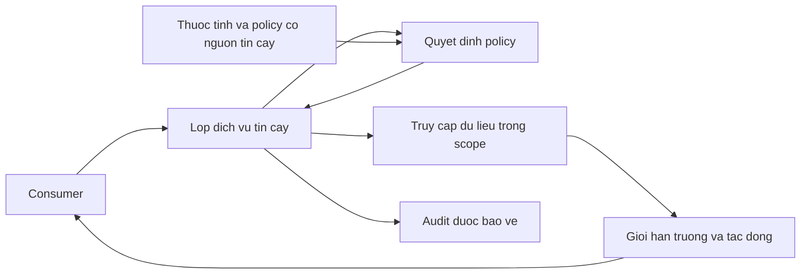

# Yêu cầu access control

## 1. Mục tiêu và phạm vi kiểm chứng

Access control xác định chủ thể nào được thực hiện hành động nào trên tài nguyên nào, với dữ liệu và điều kiện gì. Trong ứng dụng, đăng nhập thành công chỉ xác nhận một phần danh tính; nó không tự cấp quyền đọc mọi đối tượng, sửa mọi trường hoặc sử dụng chức năng quản trị.

Trong chương **Verification framework** của module **SECURITY_SECURITY_DESIGN_SECURITY_REQUIREMENTS**, yêu cầu access control phải chuyển thành đặc tả có thể đo và kiểm chứng. Mỗi quy tắc cần gắn với rủi ro, nguồn danh tính, điểm thực thi, hành vi khi lỗi và bằng chứng cho cả trường hợp được phép lẫn bị từ chối.

Sau bài học, người học cần làm được các việc sau:

- Mô hình hóa quyền theo chủ thể, hành động, tài nguyên, trường dữ liệu, tenant và ngữ cảnh.
- Phân biệt kiểm soát ở cấp chức năng, đối tượng, thuộc tính và ranh giới dịch vụ.
- Đặc tả việc cấp, thay đổi, thu hồi quyền và ảnh hưởng của cache/token.
- Lập ma trận kiểm chứng, chọn bằng chứng và phát hiện đường xử lý bỏ qua policy.
- Kết nối yêu cầu với logging, ngoại lệ quản trị, xử lý lỗi và phục hồi.

Các mã `AC-*`, ví dụ chính sách và ngưỡng trong bài là yêu cầu minh họa của dự án, không phải mã điều khoản chính thức. Bài dùng [OWASP ASVS](https://asvs.owasp.org/) làm một nguồn framework; khi đối chiếu phải ghi phiên bản, phạm vi và kết quả của từng yêu cầu áp dụng, không chỉ ghi nhãn “đã có phân quyền”.

## 2. Access control cần một mô hình quyết định rõ

### 2.1. Các đầu vào của quyết định

Có thể mô tả một quyết định khái niệm:

```text
decision = authorize(subject, action, resource, context, policyVersion)
```

| Thành phần | Nội dung cần xác định | Ví dụ |
| --- | --- | --- |
| Subject | Người dùng, dịch vụ, tiến trình hoặc chủ thể được ủy quyền | Nhân viên A; export worker; ứng dụng đối tác |
| Action | Thao tác nghiệp vụ đủ cụ thể | Đọc hóa đơn; sửa địa chỉ; phê duyệt; export; cấp quyền |
| Resource | Đối tượng và thuộc tính có liên quan | Invoice ID, tenant, owner, trạng thái, phiên bản |
| Context | Thuộc tính tin cậy dùng trong policy | Ngữ cảnh xác thực, thời điểm, thiết bị hoặc mức rủi ro nếu hệ thống sử dụng |
| Policy | Quy tắc và cách giải quyết xung đột | Explicit grant, điều kiện phạm vi, deny hoặc challenge theo hợp đồng |

Một kết quả allow có thể còn nghĩa vụ như giới hạn trường trả về, ràng buộc query, yêu cầu audit hoặc xác minh bổ sung. Nếu policy trả challenge/step-up, hoàn tất bước xác thực bổ sung vẫn cần đánh giá lại quyền và tài nguyên; không tự biến mọi challenge thành quyền cho phép.

Thuộc tính chỉ có ích khi nguồn và độ mới của nó được tin. `tenantId`, `role` hoặc `ownerId` do client gửi không tự trở thành sự thật bảo mật. Ngữ cảnh IP/thiết bị cũng cần nguồn xác minh phù hợp; không tin header tùy ý rồi gọi đó là kiểm soát thích ứng.

### 2.2. Role, thuộc tính và quan hệ có thể phối hợp

RBAC có thể mô tả nhóm quyền theo vai trò, nhưng tên role thường chưa đủ để quyết định quyền trên từng đối tượng. ABAC xét thuộc tính của chủ thể, tài nguyên, thao tác và môi trường; mô hình quan hệ có thể biểu diễn quyền qua owner, thành viên hoặc ủy quyền.

Ví dụ: một người có role `invoice-reader` chỉ đọc được hóa đơn trong tenant và tập khách hàng được cấp, trong khi người hỗ trợ có thể cần một ủy quyền riêng có thời hạn. Không tự cho role `admin` quyền qua mọi tenant nếu policy chưa quy định.

[NIST SP 800-162](https://csrc.nist.gov/pubs/sp/800/162/upd2/final) là tài liệu tham khảo về ABAC. Dự án không cần chọn một nhãn mô hình duy nhất; điều quan trọng là quy tắc kết hợp quyền, điều kiện và xung đột được mô tả rõ, triển khai và kiểm chứng nhất quán.

## 3. Mô hình đe dọa và các lớp quyền

| Mã rủi ro | Tình huống | Hậu quả |
| --- | --- | --- |
| R-01 | Chỉ ẩn nút UI, backend vẫn nhận thao tác quản trị | Leo thang đặc quyền theo chức năng |
| R-02 | Đổi ID hoặc đường truy cập để đọc/sửa tài nguyên khác | Truy cập ngang, BOLA/IDOR, lộ hoặc mất dữ liệu |
| R-03 | Được phép xem đối tượng nhưng thấy/sửa trường ngoài quyền | Lộ thuộc tính nhạy cảm hoặc mass assignment |
| R-04 | Tenant, cache, batch hoặc export không được ràng buộc nhất quán | Vượt ranh giới dữ liệu giữa khách hàng |
| R-05 | Dịch vụ trung gian dùng toàn quyền của mình thay cho quyền được ủy quyền | Confused deputy, mở rộng quyền qua chuỗi gọi |
| R-06 | Quyền đã đổi nhưng token/cache/worker dùng trạng thái cũ | Hành động sau thu hồi hoặc sai trạng thái tài nguyên |
| R-07 | Policy lỗi, cập nhật cạnh tranh, bypass hoặc restore làm yếu control | Trạng thái trái phép, không truy vết được, tái phát lỗi |

Các lớp cần kiểm tra gồm:

- **Chức năng:** chủ thể có được gọi hành động này không?
- **Đối tượng/dữ liệu:** hành động có được thực hiện trên tài nguyên cụ thể không?
- **Trường:** được đọc, tạo, sửa những thuộc tính nào?
- **Tenant/quan hệ:** tài nguyên có nằm trong ranh giới được cấp không?
- **Ngữ cảnh và vòng đời:** điều kiện vẫn còn đúng tại thời điểm sử dụng quyền không?

[OWASP API1:2023](https://api-security.owasp.org/editions/2023/en/0xa1-broken-object-level-authorization/) mô tả rủi ro quyền ở cấp đối tượng; ID là UUID hoặc khó đoán không thay thế kiểm tra quyền. [OWASP API3:2023](https://api-security.owasp.org/editions/2023/en/0xa3-broken-object-property-level-authorization/) phân biệt rủi ro ở thuộc tính được đọc/ghi. Một endpoint có thể đúng ở một lớp nhưng vẫn sai ở lớp khác.

## 4. Liên kết với framework kiểm chứng

Một số điểm tham chiếu trong [ASVS 5.0.0 V8 Authorization](https://github.com/OWASP/ASVS/blob/v5.0.0/5.0/en/0x17-V8-Authorization.md):

| Tham chiếu | Nội dung khái quát |
| --- | --- |
| `v5.0.0-8.1.1` | Tài liệu quy tắc chức năng và dữ liệu |
| `v5.0.0-8.2.1` | Thực thi quyền chức năng |
| `v5.0.0-8.2.2` | Thực thi quyền trên dữ liệu cụ thể |
| `v5.0.0-8.2.3` | Thực thi quyền trường dữ liệu |
| `v5.0.0-8.3.1` | Thực thi ở lớp dịch vụ tin cậy |
| `v5.0.0-8.4.1` | Kiểm soát tương tác chéo tenant |

Bảng chỉ là điểm nối để tra cứu, không chép đầy đủ điều khoản hoặc chứng minh đã đạt toàn chương. Các yêu cầu dự án dưới đây cần được đánh giá theo applicability và profile đã chọn; logging, kiểm thử, phục hồi hoặc invariant miền nghiệp vụ có thể cần thêm yêu cầu ngoài các mục tham chiếu này.

## 5. Yêu cầu về policy và các lớp thực thi

### AC-01 — Có policy và ma trận quyền đủ để review

**Yêu cầu:** Dự án phải mô tả chủ thể, thao tác, tài nguyên, trường, tenant/quan hệ và điều kiện làm thay đổi quyết định. Định nghĩa cách kết hợp grant/deny, mặc định cho trường hợp không có rule và hành vi khi thiếu thuộc tính bắt buộc.

Không để mỗi endpoint tự suy ý nghĩa một role khác nhau. Các quyền mạnh như cấp quyền, chuyển owner, phê duyệt hoặc export hàng loạt cần có hợp đồng riêng. Policy phải có owner và phiên bản để đối chiếu code, cấu hình và test.

Ma trận minh họa cho dịch vụ hóa đơn:

| Chủ thể | Phạm vi | Hành động | Trường/điều kiện | Quyết định |
| --- | --- | --- | --- | --- |
| Người đọc tenant A | Hóa đơn A được cấp | Đọc | Tập trường đọc công khai cho vai trò | Allow |
| Người đọc tenant A | Hóa đơn B không được cấp | Đọc | Bất kỳ trường bảo vệ | Deny |
| Người nhập liệu tenant A | Hóa đơn nháp A trong phạm vi | Sửa | Chỉ trường được phép, không đổi tenant/owner | Theo policy |
| Người đọc tenant A | Hóa đơn A | Phê duyệt | Thiếu quyền phê duyệt | Deny |
| Export worker | Tập dữ liệu được ủy quyền cho tác vụ | Export | Đúng actor/phạm vi và điều kiện còn hiệu lực | Theo policy |
| Operator hỗ trợ | Tenant cụ thể | Thao tác hỗ trợ | Có ủy quyền giới hạn và thời hạn | Theo policy |

**Tiêu chí nghiệm thu:** Review phân biệt được hành động đúng/sai và phạm vi dữ liệu, không cần đoán từ tên role. Ma trận không coi người cùng role luôn có quyền trên cùng mọi đối tượng.

### AC-02 — Danh tính và thuộc tính quyết định đến từ nguồn tin cậy

**Yêu cầu:** Đầu vào subject phải được xác thực trước khi sử dụng cho phân quyền. Những claim, quan hệ, trạng thái và thuộc tính dùng trong quyết định phải có nguồn, độ mới và phạm vi tin cậy rõ.

Nếu người dùng được chọn tenant đang làm việc, server phải kiểm tra quyền tham gia tenant đó trước khi thiết lập context. Body/query có `tenantId` chỉ là yêu cầu lựa chọn, không tự cấp membership. Header do proxy truyền chỉ được tin trong chuỗi kết nối và cấu hình proxy đã xác định.

**Tiêu chí nghiệm thu:** Giả mạo role/tenant/actor, dùng token không hợp lệ hoặc thay context trên đường backend trực tiếp không tạo quyền. Một request hợp lệ dùng đúng danh tính và quyền vẫn hoạt động, tránh cách sửa từ chối toàn bộ.

### AC-03 — Kiểm tra quyền chức năng ở lớp tin cậy, mặc định từ chối

**Yêu cầu:** Mỗi hành động bảo vệ phải kiểm tra quyền trước khi trả dữ liệu hoặc tạo tác động nghiệp vụ. Không dựa vào UI, client-side JavaScript, đường dẫn khó đoán hoặc việc chủ thể đã đăng nhập. Trường hợp không có quyền xác định phải bị từ chối theo policy.

Cần bao phủ REST/GraphQL/RPC, endpoint quản trị, thao tác nội bộ và worker có thể gọi cùng năng lực. Quyền HTTP method hoặc route phải gắn với hành động thực; một alias, API version cũ hoặc đường gọi trực tiếp không được bỏ qua control.

**Tiêu chí nghiệm thu:** Chủ thể thiếu quyền không gọi được chức năng qua các đường thuộc phạm vi, kể cả khi tự tạo request. [OWASP Authorization Cheat Sheet](https://cheatsheetseries.owasp.org/cheatsheets/Authorization_Cheat_Sheet.html) là nguồn tham khảo cho deny-by-default, quyền tối thiểu và vị trí thực thi; verifier phải xác nhận hành vi thật thay vì chỉ nhìn annotation.

### AC-04 — Kiểm tra đối tượng và tập dữ liệu thực tế

**Yêu cầu:** Có quyền gọi một chức năng không đồng nghĩa có quyền trên mọi đối tượng nó nhận. Mỗi thao tác phải giới hạn tài nguyên theo subject, action và thuộc tính/quan hệ cần thiết. Không chỉ so một ID với user ID nếu policy còn nhiều quan hệ khác.

Danh sách, search, pagination, tổng số, aggregate, download và export cần được ràng buộc cùng phạm vi. Không tải toàn bộ dữ liệu rồi để client lọc. Với tài nguyên có parent/child, phải xác minh quan hệ thật và quyền trên tài nguyên được truy cập, không chỉ quyền trên parent do URL khai báo.

Capability như signed download URL có thể là cơ chế ủy quyền nếu được thiết kế rõ; khi đó phải đặc tả scope, thời hạn, chia sẻ và thu hồi. Nó không được xem đơn giản là “ID khó đoán nên được phép”.

**Tiêu chí nghiệm thu:** Thay ID, trộn parent/child, thêm ID ngoài quyền trong batch và truy cập qua list/export không lộ hoặc tác động tài nguyên ngoài scope. Response từ chối không chứa dữ liệu bảo vệ; mã lỗi và thông tin tồn tại theo hợp đồng đã định.

### AC-05 — Đặc tả quyền đọc và ghi ở cấp trường

**Yêu cầu:** Với mỗi loại tài nguyên/hành động, cần định nghĩa tập trường được trả và tập trường được thay đổi. Hai tập không nhất thiết giống nhau và có thể phụ thuộc trạng thái đối tượng. Không serialize toàn bộ entity hoặc bind trực tiếp body vào entity có trường đặc quyền.

Các thuộc tính như `tenantId`, `ownerId`, `role`, `approvedBy`, `status` hoặc dữ liệu nội bộ phải được quyết định theo policy thực. Nếu thao tác không cho phép người dùng sửa chúng, phải loại khỏi hợp đồng cập nhật hoặc từ chối input vi phạm theo thiết kế; không tin vì UI không gửi trường đó.

Ví dụ policy minh họa: PATCH hóa đơn nháp chỉ nhận `customerReference` và `note`; thay `tenantId` hoặc `approvedBy` phải bị từ chối mà không cập nhật một phần trường nghiệp vụ. Khi hóa đơn đã chốt, quyền sửa có thể khác và cần test riêng.

**Tiêu chí nghiệm thu:** Gửi trường ẩn/đặc quyền, request lồng nhau, cập nhật trạng thái và đọc qua các serializer/export không vượt quyền. Trường bị cấm không xuất hiện trong response hoặc được ghi thay đổi ở database ngoài policy.

### AC-06 — Ranh giới tenant tồn tại trên mọi đường dữ liệu

**Yêu cầu:** Mọi thao tác nhiều tenant phải ràng buộc tenant được cấp tại điểm truy cập và sử dụng dữ liệu phù hợp. Không dùng tenant do client chọn chưa xác minh, cache dùng chung thiếu scope hoặc thông tin tổng hợp không được lọc để làm lộ dữ liệu chéo tenant.

Cache có thể dùng key gồm tenant/phạm vi, nhưng key đúng chưa thay việc đánh giá quyền hiện hành nếu policy yêu cầu. Dữ liệu trong object storage, link download, search index và message queue cũng cần policy và owner, không chỉ bảng dữ liệu chính.

Hành động hỗ trợ hoặc quản trị chéo tenant, nếu nghiệp vụ cho phép, phải là quyền explicit theo phạm vi và điều kiện, không phải một nhánh bỏ kiểm tra khi thấy role admin.

**Tiêu chí nghiệm thu:** Dùng ít nhất hai tenant, làm nóng cache bằng actor được phép rồi gọi bằng actor không có quyền. Kiểm tra cả list/count, export/file và dữ liệu nền thuộc phạm vi; không kết luận từ một endpoint chi tiết đã đạt.

## 6. Quyền trong chuỗi dịch vụ và vòng đời tài nguyên

### AC-07 — Ủy quyền không bị thay bằng toàn quyền của trung gian

**Yêu cầu:** Phải phân biệt danh tính dịch vụ đang gọi và chủ thể mà nó đại diện. Với hành động thay mặt người dùng, quyền hiệu lực phải nằm trong phạm vi được ủy quyền cho hành động/tài nguyên đó, không tự lấy toàn bộ quyền của service account để phục vụ mọi request.

Đường truyền context cần được xác thực và giới hạn audience, mục đích, thời hạn theo cơ chế sử dụng. Không tin `onBehalfOf`, role hoặc tenant do client/producer tự đặt trong body. Cũng không chuyển tiếp token sang một dịch vụ không phải audience hợp lệ; có thể cần token exchange, assertion hoặc cơ chế delegation được thiết kế riêng.

Worker tự thực hiện công việc hệ thống có thể dùng quyền dịch vụ của chính nó nếu policy quy định. Điều đó khác với worker thực hiện một export do người dùng yêu cầu: hồ sơ tác vụ phải có nguồn, phạm vi dữ liệu và cách xử lý khi quyền người yêu cầu thay đổi trước lúc chạy/tải kết quả.

**Tiêu chí nghiệm thu:** Người quyền thấp không dùng API trung gian hoặc queue để đọc dữ liệu mà họ không được phép tiếp cận. Thay actor, target hoặc phạm vi của tác vụ không vượt quyền; tác vụ hệ thống hợp lệ vẫn chạy theo policy riêng đã ghi.

### AC-08 — Thay đổi và thu hồi quyền có hiệu lực theo hợp đồng

**Yêu cầu:** Đặc tả thời điểm hiệu lực của cấp/thu hồi quyền, membership, delegation và trạng thái tài nguyên. Mốc áp dụng phải rõ cho request mới, phiên đang tồn tại, cache, job đã xếp hàng và kết nối dài như WebSocket.

Nếu quyền nằm trong self-contained token hoặc cache, cần cơ chế giữ quyết định đúng theo requirement đã chọn: nguồn quyền hiện hành, version/invalidation hoặc giải pháp khác có thể kiểm chứng. Không coi token chưa hết hạn là bằng chứng quyền chưa bị thu hồi. Khi policy cho phép một độ trễ, phải ghi đơn vị, mốc đo, phạm vi và rủi ro còn lại.

Khi đối chiếu `v5.0.0-8.3.2`, phải đọc đúng điều kiện hiệu lực và kiểm soát bù của điều khoản. Không thay yêu cầu cập nhật tức thời bằng một TTL tùy ý rồi báo đạt; phát hiện và hoàn tác sau một lần đọc không khắc phục dữ liệu đã lộ.

**Tiêu chí nghiệm thu:** Thu hồi quyền rồi thử bằng phiên/token cũ, cache hit, tác vụ chờ và kết nối dài. Kết quả phải khớp hợp đồng áp dụng, có bằng chứng thời điểm; phần chưa đáp ứng hoặc chưa kiểm tra không được che bằng việc yêu cầu người dùng đăng nhập lại thủ công.

### AC-09 — Quản trị và ngữ cảnh nhạy cảm có kiểm soát bổ sung

**Yêu cầu:** Quyền quản trị phải explicit theo chức năng/tài nguyên, không dựa duy nhất vào vị trí mạng hoặc việc đi qua VPN. Nếu policy dùng xác thực tăng cường, thiết bị, thời điểm hoặc rủi ro ngữ cảnh, phải ghi nguồn thuộc tính, ngưỡng, hành động allow/challenge/deny và lúc đánh giá lại.

Hoàn tất MFA không tự cấp quyền sửa tài nguyên ngoài scope. Tài khoản hỗ trợ, impersonation và quyền khẩn cấp cần danh tính gốc, phạm vi, lý do, thời hạn và audit. Không dùng một tài khoản chung toàn quyền để đại diện mọi người trực rồi mất khả năng truy vết.

Các chính sách ngữ cảnh không được chỉ kiểm tra lúc đăng nhập nếu profile yêu cầu tiếp tục kiểm soát trong phiên. Cần nêu thay đổi nào làm dừng hoặc yêu cầu đánh giá lại, thay vì giả định toàn phiên giữ mức tin cậy ban đầu.

**Tiêu chí nghiệm thu:** Client ở mạng nội bộ nhưng thiếu quyền vẫn bị từ chối; challenge hoàn tất nhưng sai tenant vẫn không được phép. Phiên quyền đặc biệt hết hạn hoặc vượt phạm vi không tiếp tục hoạt động chỉ vì còn cookie đăng nhập.

### AC-10 — Quyết định gắn với thao tác, xử lý lỗi an toàn

**Yêu cầu:** Với thay đổi trạng thái nhạy cảm, điều kiện quyền và thuộc tính tài nguyên phải còn đúng tại điểm thực hiện theo hợp đồng. Không giả định chuỗi đọc-kiểm tra-ghi tách rời là nguyên tử khi có cập nhật cạnh tranh hoặc quyền bị đổi xen ngang.

Có thể cần transaction, resource version, cập nhật có điều kiện hoặc cơ chế điều phối phù hợp kiến trúc. Nếu policy service và database tách rời, phải làm rõ khoảng trống và cách kiểm soát; một lần gọi hàm authorize trước lệnh ghi không tự tạo transaction xuyên hệ thống.

Khi không xác định được quyền bắt buộc vì lỗi policy/context, luồng thông thường không được fallback sang allow. Quyết định cache chỉ được dùng khi còn hợp lệ theo policy, không phải vì nguồn chính lỗi. Response có thể là từ chối hoặc lỗi tạm theo hợp đồng; không trả dữ liệu bảo vệ rồi mới báo lỗi.

**Tiêu chí nghiệm thu:** Thử thay owner/state hoặc thu hồi quyền xen giữa các bước trong sandbox, cùng lỗi nguồn policy. Không tạo trạng thái ngoài bất biến đã đặc tả; phần thao tác đã thực hiện có dấu vết và xử lý phù hợp, không coi hoàn tác là cách xóa được mọi hậu quả đọc dữ liệu.

## 7. Logging, bằng chứng và phục hồi

### AC-11 — Audit đủ để xác định quyết định mà không lộ bí mật

**Yêu cầu:** Đặc tả sự kiện cần ghi cho allow/deny quan trọng, thay đổi quyền, delegation, impersonation và quyền khẩn cấp. Sự kiện cần phân biệt subject gốc, dịch vụ thực hiện, action, phạm vi tài nguyên, quyết định, mã lý do và phiên bản policy khi có ích.

Ví dụ sự kiện tối giản:

```json
{
  "event": "authorization_denied",
  "subjectRef": "user-lab-A",
  "executorRef": "export-service",
  "action": "invoice:export",
  "resourceScopeRef": "scope-lab-042",
  "policyVersion": "invoice-policy-7",
  "reason": "outside_delegated_scope",
  "requestId": "req-lab-042"
}
```

Không ghi token, cookie, secret hoặc nội dung tài nguyên nhạy cảm để giải thích deny. ID và metadata audit cũng có thể cần phân loại, quyền đọc và retention; tránh đưa lý do nội bộ chi tiết vào response công khai gây lộ thông tin tồn tại/quyền.

[OWASP Logging Cheat Sheet](https://cheatsheetseries.owasp.org/cheatsheets/Logging_Cheat_Sheet.html) hỗ trợ thiết kế nội dung và bảo vệ sự kiện. Nếu audit là điều kiện bắt buộc cho thao tác, cần quy định hành vi khi kênh log lỗi; không tự chọn allow hoặc dừng mọi request mà không có hợp đồng.

**Tiêu chí nghiệm thu:** Truy được một hành động nhạy cảm tới chủ thể và quyết định thực; sự kiện bị từ chối không lộ secret mồi. Người chỉ có quyền thực hiện thao tác không tự sửa/xóa audit ngoài quyền đã thiết kế.

### AC-12 — Kiểm chứng toàn phạm vi và giữ policy qua thay đổi/phục hồi

**Yêu cầu:** Mỗi requirement có owner, phương pháp và evidence tương ứng với scope. Kết hợp review policy/kiến trúc/code/config và kiểm thử hành vi ở đúng lớp; không dùng scan endpoint hoặc một unit test mock để kết luận toàn bộ control đã đạt.

Khi đổi policy, schema, serializer, cache, proxy hoặc danh tính dịch vụ, phải đánh giá tác động tới quyền và tập hồi quy. Ngoại lệ ghi phạm vi, owner, kiểm soát bù và thời hạn. Không đánh dấu N/A chỉ vì chưa có tài khoản thử hoặc chưa tiếp cận được nguồn quyền.

Rollback/restore phải đối soát quyền, membership, delegation và cấu hình có hiệu lực để không khôi phục grant đã thu hồi ngoài quyết định hợp lệ. Nếu cần đường khẩn cấp trong sự cố, nó vẫn cần danh tính, giới hạn và audit; không thay policy bằng wildcard toàn hệ thống.

**Tiêu chí nghiệm thu:** Bằng chứng gắn đúng source/artifact/config/policy và trạng thái triển khai; requirement thiếu evidence vẫn hiện rõ. Diễn tập đổi/khôi phục policy không làm quyền cũ sống lại âm thầm và không xóa lịch sử quyết định.

## 8. Mẫu đặc tả quyền và điểm thực thi

### 8.1. Một requirement có thể đo và kiểm chứng

Ví dụ cho thao tác đọc hóa đơn:

```yaml
requirementId: ORG-AC-INVOICE-READ-01
policyVersion: invoice-policy-7
actor: Chu the da xac thuc hop le
action: invoice:read
resource: Hoa don trong tenant va quan he duoc cap
readableFields:
  - id
  - publicReference
  - totalMinor
  - currency
denyConditions:
  - Khong co quyen hanh dong
  - Tai nguyen ngoai tenant hoac quan he duoc cap
  - Context bat buoc khong xac minh duoc
failureBehavior:
  - Tu choi theo hop dong API
  - Khong tra truong bao ve hoac tao tac dong nghiep vu trai phep
verification:
  - Review nguon context, policy va diem thuc thi
  - Test dung quyen, thieu quyen, doi ID, cheo tenant va cache hit
  - Kiem tra response, trang thai lien quan va audit theo policy
ownerRole: Invoice service security owner
```

Đây là mẫu hợp đồng, không phải policy engine đã thực thi. Dự án cần thêm điều kiện cụ thể của dữ liệu, trạng thái lỗi, các đường API/export được bao phủ và hợp đồng hiệu lực quyền. Mã requirement nội bộ phải liên kết tới điều khoản framework liên quan nếu dùng trong assessment.

### 8.2. Luồng xử lý đọc với quyền đối tượng và trường

```text
readInvoice(request):
    subject = requireVerifiedSubject(request)
    action = trustedActionForThisOperation()
    input = parseRequestWithinLimits(request)

    scope = deriveAuthorizedTenantAndRelations(subject, action)
    require scope is established under current policy

    resource = loadInvoiceWithinScope(input.invoiceId, scope)
    require resource exists under the endpoint contract

    decision = evaluatePolicy(subject, action, resource, trustedContext)
    require decision permits this operation

    result = mapOnlyReadableFields(resource, decision)
    recordAuditIfRequiredWithoutSecretValues()
    return serializeSafeResponse(result)
```

Mã giả thể hiện trách nhiệm, không bảo đảm một implementation cụ thể đã an toàn. Lọc query, quyết định đối tượng và mapping trường cần phối hợp để không lộ dữ liệu qua response, exception, log hoặc cache. Với thao tác ghi, còn phải giữ các điều kiện quyền/trạng thái tại thời điểm cập nhật theo AC-10.

Một triển khai có thể dùng middleware, interceptor, policy engine, repository scope hoặc row-level security. Verifier cần biết lớp nào thực thi điều gì và đường nào có thể bỏ qua. Quyết định nằm trong client hoặc một policy engine chỉ trả kết quả nhưng ứng dụng không cưỡng chế thì không đạt mục tiêu.



## 9. Ma trận truy vết yêu cầu và framework

Các mapping dưới đây là điểm nối cần đối chiếu nội dung gốc, không tuyên bố một requirement nội bộ thay thế đầy đủ điều khoản chuẩn.

| Yêu cầu | Rủi ro | Tham chiếu/nhóm liên quan | Bằng chứng chính |
| --- | --- | --- | --- |
| AC-01 | R-01, R-03 | ASVS 5.0.0: 8.1.1, 8.1.2 | Policy và ma trận chức năng/đối tượng/trường có owner |
| AC-02 | R-02, R-04 | Baseline danh tính và nguồn thuộc tính của dự án | Context hợp lệ, giả mạo không tạo quyền |
| AC-03 | R-01 | ASVS 5.0.0: 8.2.1, 8.3.1 | Control ở lớp tin cậy bao phủ đường gọi thực |
| AC-04 | R-02 | ASVS 5.0.0: 8.2.2 | Thử ID, quan hệ, list/batch/export đúng scope |
| AC-05 | R-03 | ASVS 5.0.0: 8.1.2, 8.2.3 | Tập trường đọc/ghi và trạng thái lưu/response |
| AC-06 | R-04 | ASVS 5.0.0: 8.4.1 | Test nhiều tenant, cache, storage và kênh liên quan |
| AC-07 | R-05 | ASVS 5.0.0: 8.3.3 khi áp dụng | Danh tính gốc và phạm vi delegation xuyên dịch vụ |
| AC-08 | R-06 | ASVS 5.0.0: 8.3.2 khi áp dụng | Hợp đồng hiệu lực, test quyền cũ/token/cache/job |
| AC-09 | R-01, R-07 | ASVS 5.0.0: nhóm ngữ cảnh và 8.4.2 khi áp dụng | Quyền quản trị, nguồn ngữ cảnh và phiên đặc biệt |
| AC-10 | R-06, R-07 | Invariant trạng thái và failure policy của dự án | Test cạnh tranh, policy lỗi và cập nhật có điều kiện |
| AC-11 | R-07 | Tập yêu cầu logging/audit của dự án | Sự kiện có chủ thể/quyết định, không lộ secret |
| AC-12 | R-07 | Profile verification và quản trị thay đổi | Evidence đúng phiên bản, hồi quy và diễn tập phục hồi |

Nếu mức mục tiêu hoặc scope không bao gồm một điều khoản, profile vẫn cần xử lý rủi ro dự án đã xác định. Ngược lại, đã chọn điều khoản thì không tự hạ tiêu chí chỉ vì control khó kiểm thử. Tách PASS, FAIL, chưa xác minh và N/A có lý do.

## 10. Bộ ca nghiệm thu

Thực hiện trong sandbox với danh tính/tài nguyên tổng hợp và quyền hẹp. Fixture phải xác nhận tài nguyên tồn tại, actor có context đúng và ca được phép đi qua cùng đường có thể hoạt động. Không coi `404` do dữ liệu chưa được tạo hoặc `401` do token setup sai là bằng chứng quyền đối tượng đạt.

[OWASP Authorization Testing Automation](https://cheatsheetseries.owasp.org/cheatsheets/Authorization_Testing_Automation_Cheat_Sheet.html) là một nguồn tham khảo cho tự động hóa ma trận quyền. Ma trận dưới đây là thiết kế minh họa và cần được cụ thể hóa theo policy thực.

| Mã | Thiết lập | Điều kiện pass |
| --- | --- | --- |
| T-01 | Actor đúng quyền, đúng scope và tập trường | Thao tác hợp lệ thành công, chỉ trả/ghi dữ liệu được phép |
| T-02 | Không có danh tính hoặc context giả role/tenant | Không tạo quyền; hành vi xác thực/từ chối theo hợp đồng |
| T-03 | Người đọc gọi chức năng quản trị qua request tự tạo | Bị từ chối ở server dù UI không liên quan |
| T-04 | Đổi object ID sang tài nguyên cùng role nhưng ngoài quan hệ được cấp | Không đọc/sửa/xóa ngoài scope |
| T-05 | Trộn parent/child hoặc thêm ID ngoài quyền trong batch | Kiểm tra quan hệ thật và kết quả từng phần theo policy, không lộ đối tượng cấm |
| T-06 | List/search/count/aggregate/export với tài nguyên ngoài quyền | Không rò nội dung hoặc thông tin tổng hợp trái hợp đồng |
| T-07 | Request đọc đối tượng hợp lệ có trường nội bộ nhạy cảm | Chỉ xuất tập trường được phép, kể cả serializer/export khác |
| T-08 | PATCH thêm tenant/owner/approvedBy hoặc trường không được sửa | Không ghi trường cấm và không cập nhật một phần trái hợp đồng |
| T-09 | Tài nguyên chuyển từ nháp sang trạng thái khóa | Quyền trường/hành động thay theo policy hiện hành |
| T-10 | Hai tenant, cache được làm nóng bởi actor của tenant khác | Actor không có quyền không nhận dữ liệu cache hoặc link/file ngoài scope |
| T-11 | API alias/version cũ, GraphQL/RPC hoặc backend trực tiếp | Không bỏ qua control trên các đường thuộc scope |
| T-12 | Dịch vụ trung gian có quyền mạnh nhận request từ người quyền thấp | Không dùng quyền rộng của trung gian để vượt delegation |
| T-13 | Sửa actor/tenant trong message hoặc nhận kết quả job từ actor khác | Không tin context tự khai; tác vụ/kết quả giữ đúng phạm vi |
| T-14 | Thu hồi quyền rồi dùng token/phiên/cache/job/WebSocket cũ | Hiệu lực khớp hợp đồng và requirement đã chọn, không được che sai lệch |
| T-15 | Client ở VPN/nội bộ nhưng thiếu quyền quản trị | Vẫn bị từ chối; vị trí mạng không là căn cứ duy nhất |
| T-16 | Hoàn tất step-up nhưng sai tài nguyên, hoặc phiên khẩn cấp hết hạn | Không mở quyền ngoài scope/thời hạn |
| T-17 | Thay owner/state hoặc quyền xen giữa kiểm tra và ghi | Không vượt invariant theo cơ chế đồng thời đã đặc tả |
| T-18 | Policy service/nguồn context lỗi | Không fallback allow; cache chỉ dùng nếu còn hợp lệ theo policy |
| T-19 | Nhánh deny/lỗi có secret mồi và thông tin tài nguyên | Response/audit/log không lộ giá trị cấm, có dấu vết theo hợp đồng |
| T-20 | Operator thử sửa policy/quyền ngoài thẩm quyền hoặc xóa audit | Bị kiểm soát; quyền đặc biệt còn tồn tại có phạm vi và giám sát |
| T-21 | Restore dữ liệu quyền/config cũ hoặc rollback ứng dụng | Không tái mở grant/control yếu ngoài quyết định hợp lệ |
| T-22 | Thiếu evidence, test bị skip hoặc report của phiên bản khác | Không kết luận requirement đã xác minh đạt |

Đối với thao tác bất đồng bộ, cần quan sát checkpoint/trạng thái hoàn tất phù hợp với timeout hữu hạn, không chỉ ngủ ngắn rồi không thấy event. Các tác dụng phụ hợp lệ như audit phải được phân biệt với thao tác nghiệp vụ bị cấm.

## 11. Tình huống áp dụng: export dùng quyền quá rộng

Một portal chỉ cho người dùng xem hóa đơn trong tenant của mình. API chi tiết đã có kiểm tra đúng, nhưng export nhận danh sách ID rồi gửi cho worker dùng service account đọc toàn database. Worker tin `tenantId` trong message do request truyền tới và tạo file tải xuống chỉ theo job ID.

Rủi ro xuất hiện ở ba ranh giới: AC-04/AC-06 yêu cầu giới hạn đối tượng và tenant; AC-07 yêu cầu phạm vi ủy quyền của tác vụ; AC-04 còn áp dụng khi tải kết quả. Kiểm tra đúng endpoint chi tiết không bảo vệ được đường export này.

Yêu cầu sửa thiết kế cần nêu nguồn context đáng tin cho job, giới hạn tập tài nguyên, quyền worker và policy kiểm tra lại theo hợp đồng khi chạy/tải file. Không chỉ thêm UUID vào job ID hoặc ẩn nút export. Test dùng actor tenant A đưa ID ngoài quyền, sửa message ở sandbox, thu hồi quyền trước lúc chạy và thử tải file bằng actor khác.

Bằng chứng cần bao gồm request, dữ liệu đã export, quyền ở đích lưu file và audit có chủ thể gốc. Khi phát hiện đã có exposure, cần xử lý bản export/link và tác động thực tế theo runbook; xóa job record không tự thu hồi mọi bản đã tải.

## 12. Câu hỏi tự kiểm tra

1. Một endpoint kiểm tra role nhưng nhận mọi object ID. Hãy viết yêu cầu đối tượng và ca nghiệm thu cho quyền ngang.
2. Người dùng được đọc entity nhưng không được sửa trường owner/tenant. Hãy đặc tả riêng tập trường đọc, ghi và hành vi request có trường cấm.
3. Cache key đã có tenant nhưng quyền người dùng vừa bị thu hồi. Cần thêm hợp đồng và bằng chứng nào để cache không giữ allow trái policy?
4. Worker dùng service account mạnh để làm thay người dùng. Làm thế nào giữ danh tính gốc và delegation mà không chuyển tiếp token sai audience?
5. Policy service tạm lỗi hoặc quyền thay đổi giữa kiểm tra và ghi. Hãy mô tả failure behavior và cơ chế giữ invariant thay vì chỉ gọi authorize một lần.
6. Một assessment chỉ test API detail rồi báo toàn chương access control PASS. Cần bổ sung scope, evidence và cách trình bày kết quả ra sao?

Mỗi câu trả lời cần nối được **rủi ro → policy theo chủ thể/hành động/tài nguyên → điểm thực thi → vòng đời quyền → bằng chứng kiểm chứng → logging và phục hồi**. Chuỗi này giúp yêu cầu access control trở thành control có thể đánh giá trong vòng đời phát triển, thay vì chỉ là một role hoặc annotation trong code.
