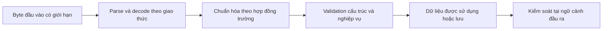

# Yêu cầu validation và encoding

## 1. Mục tiêu và phạm vi

Validation và encoding xử lý hai câu hỏi khác nhau:

- **Validation:** dữ liệu có thỏa hợp đồng của trường và thao tác không?
- **Encoding theo ngữ cảnh:** khi dữ liệu được đưa tới một bộ diễn giải, nó có tiếp tục được hiểu là dữ liệu thay vì làm thay đổi cấu trúc hay mã không?

Trong chương Verification framework, mục tiêu là đặc tả được cả hai nhóm yêu cầu, xác định điểm cưỡng chế và tạo bằng chứng kiểm chứng.

Một tên khách hàng hợp lệ có thể chứa dấu nháy. Một nội dung hỗ trợ hợp lệ có thể chứa ký tự nhỏ hơn, lớn hơn và dấu ampersand. Hệ thống cần lưu và hiển thị đúng nội dung đó mà không làm thay đổi truy vấn hoặc cấu trúc trang.

ASVS 5.0.0 phân biệt yêu cầu kiểm tra đầu vào với các kiểm soát tại nơi dữ liệu được sử dụng. [Yêu cầu validation và logic nghiệp vụ](https://raw.githubusercontent.com/OWASP/ASVS/v5.0.0_release/5.0/en/0x11-V2-Validation-and-Business-Logic.md)

Bài học dùng hệ thống quản lý ticket làm ví dụ. Các độ dài, giới hạn và mã nội bộ là lựa chọn minh họa của sản phẩm, cần được điều chỉnh theo ngữ cảnh thực tế.

## 2. Phân biệt các phép xử lý

| Phép xử lý | Mục đích | Ví dụ |
| --- | --- | --- |
| Parsing | Chuyển một biểu diễn thành cấu trúc dữ liệu | Đọc JSON thành object |
| Decoding | Giải một dạng biểu diễn đã được hợp đồng cho phép | Giải mã thành phần URL ở đúng tầng |
| Normalization | Đưa dữ liệu về dạng nhất quán theo quy tắc của trường | Chọn NFC để lưu và so sánh một trường văn bản |
| Validation | Chấp nhận hoặc từ chối theo kiểu, cấu trúc và điều kiện | Limit phải là số nguyên từ 1 tới 100 |
| Output encoding | Biểu diễn dữ liệu phù hợp với ngữ cảnh đầu ra | Encode cho một giá trị attribute HTML có dấu nháy bao quanh |
| Sanitization | Loại bỏ hoặc biến đổi phần nội dung không được phép | Lọc HTML người dùng theo policy rich text |
| Parameterization | Tách cấu trúc lệnh khỏi giá trị | Bind giá trị vào truy vấn SQL |
| Authorization | Xác định chủ thể có được làm thao tác với tài nguyên không | Kiểm tra quyền đọc ticket đã có ID đúng định dạng |

Một chuỗi đã parse được chưa chắc hợp lệ về nghiệp vụ. Một ID hợp lệ về định dạng chưa chứng minh người gọi có quyền truy cập.

Không nên dùng từ “làm sạch input” cho mọi phép xử lý. Cách gọi đó che mất câu hỏi quan trọng: phép xử lý bảo vệ thuộc tính nào và có hiệu lực ở đâu?

Ví dụ, xóa dấu nháy khỏi tên người dùng làm mất dữ liệu hợp lệ và chưa chứng minh truy vấn đã an toàn. Encode HTML cho một chuỗi cũng không tạo hợp đồng an toàn chung cho SQL, URL hoặc JavaScript.

## 3. Chuyển rủi ro thành yêu cầu

| Rủi ro | Bất biến cần đặc tả | Điểm kiểm chứng |
| --- | --- | --- |
| Giá trị ngoài miền được chấp nhận | Mỗi trường thỏa kiểu, phạm vi và quy tắc đã công bố | API và lớp dịch vụ |
| Hai trường riêng lẻ hợp lệ nhưng kết hợp sai | Quan hệ giữa trường được kiểm tra trước tác động | Service và trạng thái liên quan |
| Decoder ở các tầng hiểu dữ liệu khác nhau | Biểu diễn dùng để kiểm tra khớp biểu diễn dùng để xử lý | Gateway, parser, service và worker |
| Nội dung lưu được diễn giải thành HTML | Trường plain text tiếp tục hiển thị như văn bản | Trang người dùng, trang quản trị và email liên quan |
| Dữ liệu tham gia cấu trúc truy vấn | Giá trị không được thay đổi cấu trúc lệnh | Repository và API truy vấn |
| URL hoặc attribute chứa ngữ cảnh khác | Mỗi lớp cú pháp có kiểm soát phù hợp | Bộ tạo URL và renderer |
| Log từ chối chứa bí mật hoặc tạo dòng giả | Đầu ra chẩn đoán tuân theo schema và giới hạn dữ liệu | Logger, audit và màn hình xem log |

Một câu như “mọi input phải an toàn” chưa đủ. Có thể chuyển thành:

> API tìm ticket chỉ nhận các trường đã định nghĩa, kiểm tra dữ liệu ở lớp dịch vụ đáng tin cậy và từ chối dữ liệu sai trước khi thực hiện truy vấn. Summary được xử lý như plain text ở mọi nơi hiển thị thuộc phạm vi.

Cần bổ sung hợp đồng từng trường, ngữ cảnh sử dụng và bằng chứng. Mỗi mệnh đề trong yêu cầu phải có nơi cưỡng chế cụ thể.

## 4. Đặc tả validation theo trường và theo thao tác

### 4.1. Hợp đồng dữ liệu minh họa

Giả sử API nhận một request tìm hoặc hiển thị ticket:

| Trường | Kiểu và điều kiện minh họa | Hành vi khi không đạt |
| --- | --- | --- |
| ticketId | Bắt buộc; đúng mẫu ASCII TCK- và 8 chữ số | Từ chối, không thực hiện thao tác đích |
| summary | Bắt buộc; plain text; NFC; 1–120 Unicode code point; không rỗng toàn khoảng trắng | Từ chối theo mã lỗi ổn định |
| limit | Bắt buộc; số nguyên từ 1 tới 100 | Không ép chuỗi hoặc giá trị sai sang mặc định |
| sortBy | Nếu được hỗ trợ, thuộc tập lựa chọn đã công bố | Không đưa trực tiếp vào cấu trúc truy vấn |
| trường không biết | Không được phép trong hợp đồng minh họa | Parser/binder từ chối trước xử lý nghiệp vụ |

Ngoài ra, sản phẩm chọn:

- Request body tối đa 16 KiB trước khi parse.
- Giới hạn độ sâu và số phần tử theo schema.
- Không chấp nhận khóa JSON trùng trong cùng object.
- Không bind payload trực tiếp vào entity chứa trường quyền hoặc tenant.
- Dữ liệu sai không được làm thay đổi trạng thái nghiệp vụ.

Các giới hạn trên là ví dụ. Một API nhận file hoặc tài liệu lớn cần hợp đồng khác thay vì nới chung mọi endpoint.

### 4.2. Kiểu dữ liệu chưa đủ

Chuyển được một giá trị thành integer không chứng minh nó nằm trong khoảng được phép. Một ngày hợp lệ cũng chưa chứng minh ngày kết thúc không trước ngày bắt đầu.

Cần xác định:

- Giá trị thiếu khác gì null?
- Chuỗi rỗng có được chấp nhận không?
- Có cho phép ép kiểu ngầm không?
- Đơn vị của số là gì?
- Số lớn quá khả năng biểu diễn được xử lý thế nào?
- Array có giới hạn phần tử và kiểm tra từng phần tử không?
- Object lồng có được áp cùng quy tắc không?

Khi một input đã được cung cấp nhưng sai, không âm thầm thay bằng mặc định trừ khi hợp đồng chủ ý cho phép hành vi đó.

### 4.3. Kiểm tra ở lớp đáng tin cậy

Frontend có thể kiểm tra để phản hồi nhanh, nhưng server phải cưỡng chế hợp đồng. Dữ liệu từ queue, đối tác hoặc database cũng cần được đánh giá theo ranh giới tin cậy của bên nhận.

Đối với quy tắc phụ thuộc trạng thái như quota hoặc trạng thái ticket, cần kiểm tra tại thời điểm tác động. Một lần kiểm tra trước đó không tự ngăn được hai thao tác đồng thời cùng vượt giới hạn.

OWASP nhấn mạnh việc kiểm tra cấu trúc và ý nghĩa của dữ liệu, cùng giới hạn tài nguyên trước hoặc trong parsing. [Hướng dẫn kiểm tra đầu vào](https://cheatsheetseries.owasp.org/cheatsheets/Input_Validation_Cheat_Sheet.html)

## 5. Giải mã, chuẩn hóa và biểu diễn dùng để kiểm tra

### 5.1. Xác định rõ đường biến đổi

Một luồng tham khảo:



Mỗi tầng cần biết dữ liệu đã ở dạng nào. Không decode lặp cho tới khi chuỗi “không còn ký tự escape”.

Một request có thể hợp lệ cần xử lý cả biểu diễn URL và JSON ở các lớp khác nhau. Điều cần đặc tả là mỗi dạng biểu diễn được xử lý ở bước nào, tránh một lần decode ngoài hợp đồng sau khi validation đã hoàn tất.

Nếu field là plain text, chuỗi trông giống HTML entity vẫn có thể là nội dung người dùng muốn giữ nguyên. Không tự giải entity chỉ vì nó có hình thức quen thuộc.

### 5.2. Đồng thuận về ký tự và Unicode

Với ví dụ ticket:

- Các thành phần dùng UTF-8 theo hợp đồng giao tiếp.
- Dữ liệu malformed bị từ chối theo quy tắc parser.
- Summary được chuẩn hóa NFC trước validation và lưu.
- Độ dài được tính bằng code point sau chuẩn hóa.
- Trường này không chấp nhận ký tự điều khiển hoặc dấu phân cách dòng đã được liệt kê.

Byte, UTF-16 code unit, Unicode code point và ký tự người dùng cảm nhận không phải cùng đơn vị.

Với Java, `String.length()` đếm UTF-16 code unit. Nếu hợp đồng chọn code point, code kiểm tra phải dùng đúng đơn vị đó. Nếu nghiệp vụ muốn giới hạn cụm ký tự hiển thị, cần một chính sách và cơ chế đếm phù hợp khác.

Chuẩn hóa Unicode không tự giải quyết mọi vấn đề ký tự nhìn giống nhau. Không dùng summary hoặc display name thay cho một định danh bảo mật chỉ vì đã chuẩn hóa.

### 5.3. Không áp biến đổi đồng loạt

Trim, đổi chữ thường hoặc chuẩn hóa tương thích có thể thay đổi ý nghĩa của dữ liệu.

Với mật khẩu, token, chữ ký hoặc trường có quy tắc byte chính xác, cần hợp đồng riêng. Không áp một bộ “normalize mọi string” cho toàn hệ thống.

Đối với cùng một trường, validation, storage, so sánh và các thành phần tích hợp cần thống nhất quy tắc. Nếu một tầng so sánh trước chuẩn hóa còn tầng khác so sánh sau chuẩn hóa, hệ thống có thể có hai cách hiểu về cùng dữ liệu.

## 6. Đặc tả encoding theo nơi dữ liệu được sử dụng

ASVS 5.0.0 đặt yêu cầu về thời điểm encoding và ngữ cảnh sử dụng trong nhóm xử lý dữ liệu. [Yêu cầu encoding và sanitization](https://raw.githubusercontent.com/OWASP/ASVS/v5.0.0_release/5.0/en/0x10-V1-Encoding-and-Sanitization.md)

Cần kiểm kê sink thay vì chỉ kiểm kê input. Một summary có thể đi tới trang chi tiết, trang quản trị, email, log và export; mỗi nơi có một hợp đồng khác nhau.

### 6.1. Ma trận ngữ cảnh

| Ngữ cảnh | Hướng kiểm soát | Điều cần tránh |
| --- | --- | --- |
| Văn bản trong phần tử HTML thông thường | Template escape đúng hoặc DOM text node | Chèn chuỗi bằng HTML parser |
| Attribute văn bản có tên cố định | Attribute encoding khi tạo HTML; giá trị có dấu nháy bao quanh | Tên attribute do input quyết định |
| Thành phần URL | URL builder và kiểm soát giao thức/đích theo hợp đồng | Encode cả URL rồi coi mọi đích là hợp lệ |
| URL trong attribute HTML | Xử lý URL rồi encoding lớp attribute | Dùng một encoder cho hai lớp cú pháp |
| JSON response | Serializer và Content-Type phù hợp | Ghép JSON thủ công hoặc gửi như HTML |
| Dữ liệu cho JavaScript | Kênh dữ liệu hoặc cơ chế nhúng được thiết kế cho đúng ngữ cảnh | Nội suy input thành mã hoặc biểu thức |
| CSS động | Tên thuộc tính cố định và giá trị thuộc miền được phép | Ghép input vào source CSS tùy ý |
| SQL | Bind giá trị và kiểm soát cấu trúc động | Dùng HTML escaping hoặc nối chuỗi |

Các ngữ cảnh HTML, JavaScript, URL và CSS cần cách bảo vệ riêng; API DOM dùng dữ liệu như text có thể tránh việc diễn giải HTML. [Hướng dẫn phòng ngừa XSS](https://cheatsheetseries.owasp.org/cheatsheets/Cross_Site_Scripting_Prevention_Cheat_Sheet.html)

### 6.2. Encoding gần điểm dùng

Nên lưu giá trị miền nghiệp vụ theo hợp đồng của trường, không lưu sẵn HTML entity chỉ vì hiện tại có một trang HTML sử dụng nó.

Ví dụ summary chứa `<b>Chờ xác nhận & kiểm tra</b>` có thể là plain text hợp lệ. Khi hiển thị trong một phần tử văn bản, người dùng phải thấy nội dung nguyên nghĩa, không xuất hiện một phần tử b mới do summary tạo ra.

Nếu lưu bản đã encode HTML rồi encode lại, nội dung có thể hiển thị sai. Nếu dùng bản đó cho một ngữ cảnh khác, lớp bảo vệ cũ có thể không phù hợp.

### 6.3. Ngữ cảnh không nên nhận mã động

Không đặc tả “encode rồi cho phép đặt ở mọi nơi”. Tên tag, tên attribute, đoạn script, handler hoặc cấu trúc template cần được kiểm soát theo thiết kế.

Nếu chức năng chỉ cần một lựa chọn màu, nên ánh xạ lựa chọn sang token cố định đã được phép. Không cần cấp khả năng gửi một đoạn CSS tùy ý.

Nếu chức năng cần dữ liệu cho JavaScript, có thể dùng một response JSON riêng và xử lý bằng code ứng dụng đã kiểm soát, thay vì ghép dữ liệu vào source script.

## 7. Ví dụ đầu ra: plain text, URL và JSON

### 7.1. Hiển thị plain text bằng DOM

Giả sử trang có một phần tử cố định:

```html
<span id="ticket-summary"></span>
```

Code phía client:

```javascript
const summaryElement = document.querySelector("#ticket-summary");
summaryElement.textContent = ticket.summary;
```

Trong phần tử thông thường này, `textContent` tạo nội dung văn bản; nó không thực hiện HTML encoding. Truyền giá trị text gốc, không pre-encode thành HTML entity.

Không suy rộng cách dùng đó sang nội dung của phần tử script hoặc style, nơi dữ liệu có ngữ nghĩa khác.

### 7.2. Tạo liên kết với cấu trúc cố định

Ví dụ dùng DOM và URL API:

```javascript
const destination = new URL("/tickets", window.location.origin);
destination.searchParams.set("q", ticket.summary);

const link = document.querySelector("#ticket-search-link");
link.href = destination.href;
link.textContent = "Mở kết quả";
```

Đường dẫn và origin ở đây đến từ cấu trúc ứng dụng đã chọn, còn summary chỉ là giá trị của một tham số.

Nếu thay bằng một URL đầy đủ do người dùng cung cấp, cần hợp đồng kiểm tra giao thức và đích được phép. Nếu server dùng URL để gọi ra ngoài, cần thêm yêu cầu kiểm soát đích mạng theo rủi ro SSRF.

Khi tạo HTML từ server, một URL đã xây đúng vẫn cần được đưa vào attribute qua cơ chế encoding của lớp HTML. Khi gán property DOM như ví dụ, không cần tự tạo chuỗi markup.

### 7.3. JSON hợp lệ và HTML an toàn là hai hợp đồng khác nhau

Serializer giúp tạo JSON đúng cú pháp. Response JSON cần được phục vụ với Content-Type phù hợp.

Một chuỗi hợp lệ trong JSON chưa tự an toàn khi chép nguyên response vào HTML hoặc inline script. Nếu có nhúng dữ liệu, phải dùng cơ chế dành riêng cho ngữ cảnh nhúng đó và kiểm tra với parser thực tế.

Client nhận JSON cũng phải giữ đúng sink. Nếu parse JSON rồi đưa một trường plain text vào HTML parser, lớp serialization trước đó không bảo vệ cho thao tác mới.

### 7.4. SQL và các bộ diễn giải khác

Giá trị đi vào SQL phải được xử lý theo API truy vấn phù hợp. Validation tên người dùng không thay thế bind tham số.

Tên cột hoặc cấu trúc sort động cần được ánh xạ từ lựa chọn được phép. Không dùng input làm một đoạn cấu trúc truy vấn chỉ vì đã qua một hàm escape tổng quát.

Tương tự, yêu cầu cho lệnh hệ điều hành, header hoặc format export phải nêu đúng bộ diễn giải và miền giá trị. CSV quoting đúng định dạng riêng lẻ chưa chứng minh dữ liệu không bị client bảng tính diễn giải thành công thức.

## 8. Rich text cần hợp đồng sanitization riêng

Nếu sản phẩm cho phép HTML có định dạng, cần xác định policy như:

- Tag nào được phép.
- Attribute nào được phép trên từng tag.
- Giao thức và loại URL được phép.
- Có cho phép ảnh hoặc tài nguyên ngoài không.
- Giới hạn kích thước và độ phức tạp.
- Nơi thực hiện sanitization và phiên bản policy.
- Nơi được phép render kết quả như HTML.

ASVS có yêu cầu dành cho HTML không tin cậy từ trình soạn thảo; nên dùng thư viện hoặc cơ chế chuyên dụng được duy trì. [Yêu cầu về HTML người dùng](https://raw.githubusercontent.com/OWASP/ASVS/v5.0.0_release/5.0/en/0x10-V1-Encoding-and-Sanitization.md)

Ví dụ ticket hiện chỉ chấp nhận plain text. Vì vậy, không cần mở khả năng render HTML để giữ định dạng do người dùng gửi.

Nếu sau này bổ sung rich text, đó là thay đổi hợp đồng cần đánh giá rủi ro và kiểm chứng lại. Không đổi một sink text sang raw HTML chỉ để nội dung “trông đẹp hơn”.

Kết quả đã sanitize cần có nguồn gốc rõ và chỉ được sử dụng theo policy tương ứng. Việc ghép thêm markup không tin cậy sau bước sanitization có thể tạo nội dung chưa từng được kiểm tra.

Một tên kiểu như `SafeHtml` chỉ có giá trị khi quyền tạo giá trị đó được kiểm soát. Không cho phép biến mọi string thành kiểu đó bằng một hàm bypass không có căn cứ.

## 9. Ví dụ Java: validation trường theo hợp đồng

Đoạn mã dùng Java 17 trở lên và thư viện chuẩn. Nó minh họa validation ba trường của ví dụ, không thực hiện parsing HTTP hoặc output encoding.

```java
import java.text.Normalizer;
import java.util.regex.Pattern;

public record TicketSearchInput(
        String ticketId,
        String summary,
        Integer limit) {

    private static final Pattern TICKET_ID =
            Pattern.compile("TCK-[0-9]{8}");

    public TicketSearchInput {
        if (ticketId == null
                || !TICKET_ID.matcher(ticketId).matches()) {
            throw new IllegalArgumentException("TICKET_ID_INVALID");
        }

        if (summary == null || hasUnpairedSurrogate(summary)) {
            throw new IllegalArgumentException("SUMMARY_INVALID_UNICODE");
        }

        summary = Normalizer.normalize(summary, Normalizer.Form.NFC);

        int codePoints = summary.codePointCount(0, summary.length());
        boolean forbiddenCharacter = summary.codePoints().anyMatch(
                cp -> Character.isISOControl(cp)
                        || cp == 0x2028
                        || cp == 0x2029);

        if (summary.isBlank()
                || codePoints > 120
                || forbiddenCharacter) {
            throw new IllegalArgumentException("SUMMARY_INVALID");
        }

        if (limit == null || limit < 1 || limit > 100) {
            throw new IllegalArgumentException("LIMIT_OUT_OF_RANGE");
        }
    }

    private static boolean hasUnpairedSurrogate(String value) {
        return value.codePoints().anyMatch(
                cp -> cp >= 0xD800 && cp <= 0xDFFF);
    }
}
```

### 9.1. Những điều được kiểm tra

- Ticket ID khớp toàn bộ mẫu đã công bố.
- Summary có biểu diễn Unicode phù hợp với kiểm tra trong ví dụ.
- Summary được chuẩn hóa trước khi đo.
- Summary không rỗng toàn khoảng trắng, không vượt 120 code point.
- Summary là một dòng theo tập ký tự bị cấm đã định nghĩa.
- Limit không thiếu và nằm trong khoảng.

Dấu nháy, ký tự nhỏ hơn, lớn hơn và ampersand không bị cấm chung. Chúng được giữ như dữ liệu theo hợp đồng plain text.

### 9.2. Những việc nằm ở lớp khác

Adapter HTTP vẫn phải kiểm tra:

- Giới hạn body trước khi tạo object.
- Kiểu JSON thực tế, không ép chuỗi thành số ngoài hợp đồng.
- Trường bắt buộc, khóa trùng và trường không biết.
- Lỗi parse và các giới hạn cấu trúc.

Sau constructor, service vẫn phải kiểm tra quyền truy cập ticket, quan hệ nghiệp vụ và trạng thái hiện tại. Renderer, repository và các sink vẫn áp kiểm soát của từng ngữ cảnh.

Thông báo exception trong ví dụ chỉ có mã ổn định, không ghép input thô. Error handler cần chuyển thành phản hồi phù hợp và tránh lộ stack trace.

Quy tắc Unicode của ví dụ phục vụ một summary một dòng. Không sao chép nguyên tập cấm đó cho comment nhiều dòng, mật khẩu hoặc định danh có hợp đồng khác.

## 10. Viết yêu cầu có thể nghiệm thu

| Mã nội bộ | Yêu cầu | Tiêu chí chấp nhận |
| --- | --- | --- |
| SEC-VE-01 | Mỗi trường phải có kiểu, độ dài, miền giá trị và ý nghĩa thiếu/null rõ | Có hợp đồng được triển khai và test các lớp biên |
| SEC-VE-02 | Input phải được kiểm tra ở lớp dịch vụ đáng tin cậy | Bỏ qua frontend vẫn không chấp nhận dữ liệu sai |
| SEC-VE-03 | Parsing và validation phải có giới hạn tài nguyên | Input quá giới hạn bị từ chối có kiểm soát trước xử lý nghiệp vụ |
| SEC-VE-04 | Các tầng phải thống nhất decode và normalization | Biểu diễn được kiểm tra không bị thay nghĩa bởi bước decode ngoài hợp đồng |
| SEC-VE-05 | Quan hệ giữa trường và trạng thái phải được kiểm tra | Tổ hợp sai không tạo tác động nghiệp vụ, kể cả các trường hợp đồng thời thuộc phạm vi |
| SEC-VE-06 | Plain text phải được hiển thị như dữ liệu ở mọi sink thuộc phạm vi | Nội dung không tạo node hoặc mã ngoài cấu trúc được phép |
| SEC-VE-07 | Mỗi ngữ cảnh đầu ra phải có API hoặc encoder phù hợp | Không dùng một encoder chung cho HTML, URL, JSON và SQL |
| SEC-VE-08 | Rich HTML chỉ được render theo policy sanitization được quản lý | Nội dung và đường bypass được kiểm chứng theo tập tag/attribute/URL đã chọn |
| SEC-VE-09 | Dữ liệu lưu và đọc lại phải giữ cùng hợp đồng | Trang quản trị và đường đọc lại không diễn giải plain text thành HTML |
| SEC-VE-10 | Input sai không được làm lộ bí mật qua error hoặc log | Mã lỗi ổn định; không có token, nội dung nhạy cảm hoặc request đầy đủ ngoài policy |
| SEC-VE-11 | Bằng chứng phải gắn với candidate và cấu hình xử lý | Có revision, artifact, schema, renderer hoặc policy liên quan |
| SEC-VE-12 | Thay hợp đồng hoặc thêm sink phải kích hoạt đánh giá lại | Không dùng kết quả cũ để chấp nhận một ngữ cảnh mới chưa kiểm tra |

Các tiêu chí cần chỉ rõ phạm vi. Ví dụ SEC-VE-06 áp dụng cho trang khách hàng, quản trị và email nào phải được liệt kê; một câu “mọi output” không thay thế inventory thực tế.

Giá trị hợp lệ vẫn cần được phân quyền. SEC-VE-01 không được dùng làm bằng chứng rằng mọi ticket ID đúng mẫu đều được phép đọc.

## 11. Liên kết với ASVS 5.0.0

Các mã sau là điểm tham chiếu cho việc xây baseline; diễn giải ngắn không thay thế toàn bộ nội dung yêu cầu nguồn.

| Mã | Vai trò trong đặc tả |
| --- | --- |
| v5.0.0-2.1.1 | Ghi quy tắc kiểm tra cấu trúc dữ liệu |
| v5.0.0-2.1.2 | Ghi quy tắc nhất quán logic và ngữ cảnh |
| v5.0.0-2.2.1 | Cưỡng chế validation theo miền hoặc cấu trúc dự kiến |
| v5.0.0-2.2.2 | Cưỡng chế ở lớp dịch vụ đáng tin cậy |
| v5.0.0-2.2.3 | Kiểm tra tổ hợp dữ liệu |
| v5.0.0-1.1.1 | Kiểm soát thời điểm decode |
| v5.0.0-1.1.2 | Encoding tại bước phù hợp trước bộ diễn giải |
| v5.0.0-1.2.1 | Encoding đầu ra theo ngữ cảnh |
| v5.0.0-1.2.2 | Xử lý dữ liệu trong URL |
| v5.0.0-1.2.3 | Xử lý dữ liệu trong JavaScript và JSON |
| v5.0.0-1.2.4 | Bảo vệ truy vấn dữ liệu |
| v5.0.0-1.3.1 | Sanitization HTML người dùng |

Nguồn đối chiếu: [V2 của bản 5.0.0](https://raw.githubusercontent.com/OWASP/ASVS/v5.0.0_release/5.0/en/0x11-V2-Validation-and-Business-Logic.md), [V1 của bản 5.0.0](https://raw.githubusercontent.com/OWASP/ASVS/v5.0.0_release/5.0/en/0x10-V1-Encoding-and-Sanitization.md).

Khi dùng trong baseline, cần đọc điều kiện và level của từng yêu cầu. Một số điều kiện thay đổi theo level; không suy ra chỉ từ tên rút gọn.

Các giới hạn 16 KiB, 120 code point hoặc limit 100 trong bài là đặc tả của ví dụ, không phải con số chung của ASVS.

## 12. Thiết kế kiểm thử theo dữ liệu và ngữ cảnh

| Tình huống | Quan sát cần có | Kết quả mong đợi |
| --- | --- | --- |
| Thiếu trường, null hoặc chuỗi rỗng | Phản hồi và tác động nghiệp vụ | Đúng hợp đồng từng trường |
| Limit là chuỗi, số ngoài miền hoặc không biểu diễn được | Parser, binder và service | Không ép kiểu hoặc wrap số ngoài chính sách |
| Ticket ID chỉ khớp một phần mẫu | Kết quả validation | Bị từ chối |
| Summary tại biên 120 và vượt biên | Đơn vị đo sau normalization | Chấp nhận hoặc từ chối đúng biên |
| Ký tự ngoài BMP và tổ hợp dấu | Giá trị lưu, đọc và độ dài | Cùng quy tắc Unicode đã công bố |
| Dữ liệu malformed hoặc surrogate không ghép cặp | Parser và validator | Bị từ chối theo hợp đồng |
| Summary có dấu nháy và ký tự HTML hợp lệ với plain text | Storage và giao diện | Giữ nghĩa, không tự cắt bỏ |
| Cùng nội dung qua gateway, API và worker | Biểu diễn trước điểm dùng | Không có decode lại ngoài hợp đồng |
| Request có khóa trùng hoặc field không biết | Parser và binding | Không mất thông tin rồi âm thầm chọn một giá trị |
| Object lồng hoặc array có phần tử sai | Validation từng phần | Không chỉ kiểm tra lớp ngoài |
| Dữ liệu quá lớn hoặc quá sâu | Tài nguyên và lỗi | Từ chối có giới hạn, không tiếp tục xử lý |
| Plain text đọc lại ở trang quản trị | DOM và dữ liệu hiển thị | Không sinh cấu trúc HTML do dữ liệu |
| URL parameter chứa ký tự cần biểu diễn | URL được tạo và request đích | Giá trị vẫn là một tham số theo hợp đồng |
| URL đầy đủ ngoài tập được phép | Quyết định sử dụng | Không được chấp nhận chỉ vì HTML đã encode |
| JSON response chứa chuỗi có cú pháp nhạy cảm | Serializer, header và cách client sử dụng | Đúng JSON và đúng sink phía client |
| Rich text có nội dung ngoài policy | Kết quả sanitizer và renderer | Không render phần bị cấm |
| Thay serializer hoặc template engine | Các sink chịu tác động | Chạy lại bộ kiểm chứng liên quan |
| Validation lỗi có canary đại diện bí mật | Log, telemetry và response | Không phát tán canary ngoài policy |

### 12.1. Tiêu chí Given/When/Then cho plain text

```text
Given:
  Summary được đặc tả là plain text.
  Nội dung thử có ký tự <, >, &, dấu nháy
  và một đoạn đánh dấu định dạng vô hại.
  Ticket được lưu thành công.

When:
  Người có quyền xem ticket ở trang khách hàng và trang quản trị.

Then:
  Nội dung hiển thị giữ nghĩa của văn bản.
  Dữ liệu không tạo phần tử HTML mới ngoài cấu trúc trang.
  Không có đường render raw HTML cho trường này.
  Kết quả được kiểm tra trên các sink thuộc phạm vi.
```

Phép thử cần quan sát DOM hoặc cơ chế render thực tế. Chỉ tìm một chuỗi entity trong HTTP response có thể không đủ để xác định hành vi phía client.

### 12.2. Tiêu chí cho từ chối input

```text
Given:
  Limit được đặc tả là integer từ 1 tới 100.
  Một request đã xác thực gửi giá trị ngoài miền.

When:
  API xử lý request.

Then:
  Trả lỗi validation theo hợp đồng.
  Không tự thay bằng một giá trị mặc định.
  Không thực hiện thao tác nghiệp vụ với giá trị sai.
  Không ghi nguyên request vào log lỗi.
```

Cần kiểm tra cả endpoint trực tiếp, không chỉ thao tác qua UI.

### 12.3. Kết hợp các tầng kiểm tra

- Unit test kiểm tra hợp đồng trường và quan hệ thuần.
- Kiểm thử parser/binder xác nhận kiểu, duplicate key và giới hạn cấu trúc.
- Review hoặc SAST hỗ trợ tìm đường dữ liệu tới sink.
- Kiểm thử tích hợp xác nhận biến đổi qua các thành phần.
- Kiểm thử browser xác nhận nội dung được diễn giải đúng.
- Kiểm thử lỗi và tài nguyên xác nhận hành vi khi không thể xử lý.

Không dùng một loại bằng chứng để suy ra đã bao phủ mọi ngữ cảnh.

## 13. Bằng chứng, lỗi và quyết định kiểm chứng

Một báo cáo đủ dùng cần nối:

- Rủi ro và mã yêu cầu.
- Schema hoặc hợp đồng trường.
- Các bước decode và normalization.
- Tập sink và cơ chế bảo vệ.
- Candidate, cấu hình và policy đang kiểm tra.
- Kết quả biên, từ chối và đường đi thành công.
- Các giới hạn còn lại.

Có thể phân biệt:

```text
PASS:
  Điều kiện được kiểm tra và bằng chứng đáp ứng hợp đồng.

FAIL:
  Quan sát được vi phạm.

INCONCLUSIVE:
  Chưa đủ dữ liệu hoặc môi trường/công cụ không cho kết luận.

NOT_TESTED:
  Chưa thực hiện kiểm tra.
```

Một renderer hoặc module không được kiểm tra không được tính PASS chỉ vì không có finding.

Nếu lỗi xảy ra sau validation nhưng trước tác động, cần hành vi được xác định. Nếu thao tác có trạng thái hoặc nhiều bước, việc từ chối cần không để lại trạng thái nghiệp vụ ngoài hợp đồng.

Bằng chứng có thể chứa source, request hoặc nội dung người dùng. Cần giới hạn dữ liệu, quyền đọc và thời gian lưu phù hợp; dùng dữ liệu tổng hợp và canary không có quyền thực cho các ca kiểm tra.

## 14. Lỗi thường gặp và duy trì yêu cầu

| Lỗi | Cách hoàn thiện |
| --- | --- |
| Cấm một danh sách ký tự để chống mọi injection | Viết hợp đồng theo trường và kiểm soát theo sink |
| Tin frontend đã validation | Cưỡng chế ở server và ranh giới nhận dữ liệu |
| Chỉ kiểm tra kiểu | Thêm miền, đơn vị, tổ hợp và trạng thái |
| Encode HTML trước khi lưu mọi string | Lưu giá trị miền theo hợp đồng, xử lý tại ngữ cảnh dùng |
| Decode sau validation | Đặc tả đường biến đổi và kiểm tra cùng biểu diễn sẽ sử dụng |
| Dùng regex để parse hoặc sanitize rich HTML | Dùng parser và sanitizer phù hợp chức năng |
| Dùng textContent nhưng truyền sẵn HTML entity | Truyền text gốc cho sink text thông thường |
| Cho rằng JSON hợp lệ dùng được ở mọi chỗ | Kiểm tra ngữ cảnh nhúng và sink phía client |
| Dùng HTML encoder để bảo vệ URL hoặc SQL | Dùng cơ chế của từng bộ diễn giải |
| Tắt auto-escape để sửa lỗi hiển thị | Tìm nguyên nhân double encoding hoặc sai hợp đồng |
| Coi ID hợp lệ là đủ quyền | Cưỡng chế authorization theo tài nguyên |
| Chỉ kiểm tra dữ liệu lúc nhập | Kiểm kê và kiểm tra các đường đọc lại, export và quản trị |

Khi thêm field, đổi kiểu dữ liệu, đổi parser, serializer, template engine hoặc rich-text policy, cần đánh giá lại yêu cầu và bằng chứng liên quan.

Chuỗi truy vết cần duy trì là: rủi ro, hợp đồng dữ liệu, điểm kiểm tra, ngữ cảnh sử dụng, tiêu chí và bằng chứng. Validation giữ dữ liệu trong miền chức năng đã định; các kiểm soát tại điểm dùng giữ dữ liệu đúng vai trò trong từng bộ diễn giải. Khi cả hai được đặc tả rõ, đội ngũ có thể kiểm chứng hành vi bảo mật thay vì dựa vào một khái niệm mơ hồ rằng dữ liệu đã được “làm sạch”.
