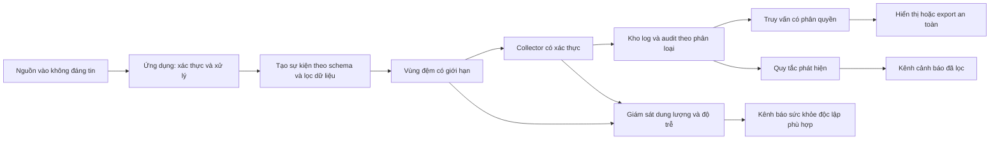

# Yêu cầu error handling và logging — Xử lý lỗi và ghi nhận có thể kiểm chứng

## 1. Mục tiêu và phạm vi

Xử lý lỗi quyết định hệ thống phản ứng thế nào khi một thao tác không thể hoàn tất như dự kiến. Logging ghi lại thông tin phục vụ vận hành, điều tra và kiểm chứng. Hai cơ chế này liên quan chặt chẽ: một lỗi có thể vừa cần phản hồi cho người dùng, vừa cần audit, metric và dữ liệu chẩn đoán ở các mức chi tiết khác nhau.

Thiết kế thiếu rõ ràng có thể trả stack trace cho client, ghi token vào log, che giấu tác động đã xảy ra hoặc làm ngừng cả hệ thống khi nơi nhận log tạm lỗi. Vì vậy, yêu cầu không thể chỉ là “bắt mọi exception” và “ghi log đầy đủ”.

Trong chương **Verification framework**, bài học này chuyển mục tiêu an toàn thông tin và mô hình đe dọa thành yêu cầu xử lý lỗi và ghi nhận cụ thể, đo được, có thể kiểm chứng. Các yêu cầu được liên kết với xác thực, phân quyền, dữ liệu, kiến trúc, tiêu chí kiểm thử và phục hồi trong vòng đời phát triển.

Sau bài học, người học có thể:

- Thiết kế hợp đồng lỗi không làm lộ dữ liệu nhưng đủ để xử lý.
- Phân biệt log chẩn đoán, audit, metric và trace.
- Đặc tả dữ liệu được ghi, quyền truy cập, tính toàn vẹn và retention.
- Xác định phản ứng khi không ghi được bằng chứng bắt buộc.
- Viết tiêu chí kiểm chứng cho lỗi, log injection, cảnh báo và phục hồi.

Các ngưỡng và schema trong bài là ví dụ dự án, không phải giá trị bắt buộc của một tiêu chuẩn. Khi đối chiếu khung kiểm chứng, cần chốt phiên bản và tham chiếu đúng yêu cầu; các ID dưới đây là ID nội bộ minh họa.

## 2. Phân biệt các đầu ra của một sự kiện

### 2.1. Một sự kiện có thể cần nhiều cách biểu diễn

| Đầu ra | Người sử dụng | Mục đích | Dữ liệu phù hợp |
| --- | --- | --- | --- |
| Phản hồi lỗi | Client hoặc người dùng | Biết thao tác không thành công và bước tiếp theo | Mã lỗi ổn định, thông báo an toàn, mã tương quan |
| Log chẩn đoán | Phát triển và vận hành có quyền | Xác định nguyên nhân kỹ thuật | Thành phần, loại lỗi, ngữ cảnh đã lọc |
| Audit | Người điều tra hoặc kiểm chứng có quyền | Truy vết ai làm gì với đối tượng nào và kết quả | Danh tính logic, hành động, đối tượng, trạng thái và thời gian |
| Metric | Hệ thống theo dõi | Đo tần suất, độ trễ và mức tài nguyên | Nhãn hữu hạn, số đếm và phân bố |
| Trace | Người theo dõi luồng xử lý | Liên kết các bước qua nhiều thành phần | Mã liên kết và metadata tối thiểu |

Không nên dùng nguyên một exception để điền vào mọi đầu ra. Dữ liệu cần cho người chẩn đoán có thể không được phép gửi tới client hoặc người đọc dashboard.

### 2.2. Audit khác với log debug

Audit cần phản ánh sự kiện và quyết định có ý nghĩa về trách nhiệm. Log debug thường hỗ trợ phân tích kỹ thuật và có thể thay đổi theo bản mã.

Một dòng “đã gọi hàm tạo đơn” chưa chứng minh đơn được tạo thành công. Cần phân biệt:

- Đã nhận yêu cầu.
- Đã xác thực hoặc từ chối.
- Đã quyết định quyền.
- Đã bắt đầu thao tác.
- Đã commit thay đổi.
- Kết quả còn đang chờ hoặc chưa rõ.
- Đã thử lại hoặc đối soát.

Không để việc tắt debug vô tình tắt audit bắt buộc. Cũng không dùng toàn bộ request/response làm audit chỉ vì cách đó dễ triển khai.

### 2.3. Không phải mọi thông tin đều cần ghi

“Ghi càng nhiều càng tốt” có thể làm lộ dữ liệu, tăng chi phí và che tín hiệu quan trọng. Mỗi trường cần có mục đích, phân loại, quyền truy cập và thời hạn lưu.

Các nhóm dữ liệu cần đặc biệt kiểm soát gồm mật khẩu, OTP, khóa, token, cookie, connection string có credential, payload khách hàng và dữ liệu nhập tự do.

## 3. Mô hình đe dọa và ví dụ xuyên suốt

Giả sử dịch vụ hoàn tiền có API, worker và tích hợp nhà cung cấp thanh toán thử nghiệm. Người dùng gửi yêu cầu, hệ thống kiểm tra quyền, ghi nhận thao tác và thực hiện bất đồng bộ.

Những bất biến cần bảo vệ:

- Lỗi xác thực hoặc phân quyền không tạo tác động hoàn tiền.
- Client không nhận secret hoặc cấu trúc nội bộ ngoài hợp đồng.
- Timeout không bị hiểu nhầm là chắc chắn chưa có tác động.
- Mỗi thao tác quan trọng có audit đúng trạng thái.
- Dữ liệu client không thể tự tạo sự kiện audit giả.
- Khi pipeline log lỗi, hệ thống vẫn thực thi policy đã chọn cho từng loại nghiệp vụ.
- Người không có quyền không đọc, sửa hoặc xóa bằng chứng.

| Đe dọa hoặc lỗi | Tác động | Hướng yêu cầu |
| --- | --- | --- |
| Trả exception gốc | Lộ đường dẫn, câu truy vấn, credential hoặc stack | Hợp đồng lỗi công khai tối thiểu |
| Ghi toàn bộ body và header | Token, dữ liệu cá nhân đi vào nhiều hệ thống | Allowlist trường và lọc tại các lớp |
| Dữ liệu chứa ký tự điều khiển hoặc nội dung định dạng | Giả mạo log hoặc gây lỗi công cụ đọc | Mã hóa cấu trúc và giới hạn |
| Log success trước commit | Bằng chứng sai về tác động | Audit gắn với trạng thái bền vững |
| Sink lỗi làm retry không giới hạn | Cạn bộ nhớ, đĩa hoặc thread | Buffer, backpressure và ngân sách |
| Bỏ audit khi sink lỗi | Không truy vết được giao dịch | Chính sách lưu bền vững hoặc chặn |
| Người quản trị ứng dụng xóa log liên quan | Mất khả năng điều tra | Tách quyền và bảo vệ kho bằng chứng |
| Restore log hoặc dữ liệu thiếu ngữ cảnh | Thứ tự và kết luận sai | Đối soát thời gian, trạng thái và nguồn |

Mô hình cần xét cả nguồn không đáng tin và lỗi vô ý trong middleware, thư viện, proxy hoặc cấu hình.

## 4. Đặc tả phản hồi lỗi

### 4.1. Hợp đồng lỗi phải ổn định và tối thiểu

> **ERR-PUBLIC-01:** Mọi phản hồi lỗi công khai phải tuân theo schema đã phê duyệt, không chứa secret, stack trace, câu truy vấn hoặc chi tiết nội bộ ngoài mục đích. Thông tin đưa ra phải phù hợp với quyền của người gọi.

Ví dụ:

```json
{
  "code": "OPERATION_NOT_COMPLETED",
  "message": "Chưa thể hoàn tất thao tác. Vui lòng kiểm tra trạng thái hoặc liên hệ hỗ trợ.",
  "correlationId": "req-example-42"
}
```

Schema là minh họa, không bắt buộc mọi lỗi có cùng code. Thông báo cần giúp người dùng hiểu bước tiếp theo mà không tiết lộ nguyên nhân nhạy cảm.

Mã lỗi nên ổn định cho client xử lý. Không đặt mã theo tên exception hoặc cấu trúc package nội bộ nếu điều đó làm rò rỉ và phụ thuộc không cần thiết.

### 4.2. Ánh xạ loại lỗi theo hợp đồng

| Loại | Cách biểu diễn có thể áp dụng | Điều cần kiểm chứng |
| --- | --- | --- |
| Đầu vào không hợp lệ | Mã lỗi validation và trường được phép nêu | Không phản chiếu dữ liệu nhạy cảm hoặc nguyên nội dung nguy hiểm |
| Thiếu hoặc sai xác thực | Phản hồi xác thực theo giao thức | Không cấp principal hoặc phiên mặc định |
| Không đủ quyền | Từ chối theo policy | Không trả dữ liệu hay tạo tác động trước từ chối |
| Không tồn tại hoặc cần che sự tồn tại | Phản hồi theo hợp đồng đối tượng | Không rò rỉ qua đường khác hoặc metadata |
| Xung đột trạng thái | Mã lỗi nghiệp vụ có kiểm soát | Không ép retry có thể tạo tác động lặp |
| Phụ thuộc tạm lỗi | Kết quả chưa hoàn tất hoặc tạm không phục vụ | Giữ đúng trạng thái và hướng dẫn retry phù hợp |
| Lỗi bất ngờ | Thông báo tổng quát và mã tương quan | Chi tiết chỉ ở kênh có quyền và đã lọc |

Mã HTTP cụ thể phải được chốt nhất quán. Không ánh xạ mọi lỗi thành HTTP 200 hoặc mọi exception thành cùng một trạng thái mà bỏ mất ý nghĩa xử lý.

Nếu dùng 404 để không tiết lộ đối tượng, cần xem cả response body, thời gian, header và những đường liên quan. Một mã lỗi không tự loại mọi side channel.

### 4.3. Phản hồi không được mở rộng bề mặt tấn công

Cần kiểm tra:

- Error page của framework, proxy và server.
- Lỗi trước hoặc sau middleware xác thực.
- Nội dung validation và parser.
- Cổng quản trị, API nội bộ và giao thức khác.
- Chế độ debug của từng môi trường.
- Header và chính sách cache của phản hồi nhạy cảm.

Không bật trang debug có chi tiết nội bộ ở môi trường có dữ liệu thật chỉ để hỗ trợ nhanh. Nếu có kênh chẩn đoán riêng, phải có quyền, audit và phạm vi.

Phản hồi nhạy cảm không được lưu trong cache chia sẻ trái policy. Cần kiểm tra cả ứng dụng lẫn cấu hình proxy; header dự định không đủ nếu thành phần trung gian ghi đè.

### 4.4. Mã tương quan không phải quyền truy cập

Mã tương quan giúp liên kết hỗ trợ và bằng chứng. Nó không phải credential hoặc bằng chứng người gọi được xem log.

> **ERR-CORR-01:** Mã tương quan phải có định dạng và độ dài giới hạn, được xử lý an toàn và không chứa dữ liệu nhạy cảm. Giá trị do client gửi không được tự trở thành danh tính, mức độ tin cậy hoặc điều kiện cấp quyền.

Có thể tạo mã mới ở ranh giới tin cậy hoặc chỉ tiếp nhận định dạng đã được xác minh. Không đưa nguyên một header tùy ý vào tên file, truy vấn hoặc nội dung hiển thị.

Giao diện tra cứu lỗi vẫn cần xác thực, phân quyền và kiểm soát tenant.

## 5. Xử lý lỗi phải giữ đúng trạng thái và quyền

### 5.1. Không fail open với kiểm soát bắt buộc

> **ERR-SEC-01:** Lỗi hoặc kết quả không xác định của xác thực, phân quyền, xác minh toàn vẹn và các kiểm soát bắt buộc không được chuyển thành cho phép. Hành vi suy giảm phải được xác định theo thao tác.

Không tải được policy không được cho mọi role truy cập. Không lấy được khóa không được bỏ kiểm tra chữ ký.

Chặn một nghiệp vụ nhạy cảm không nhất thiết phải tắt toàn bộ hệ thống. Những khả năng đã được tách biệt có thể tiếp tục nếu vẫn đáp ứng yêu cầu và có bằng chứng phù hợp.

### 5.2. Timeout không đồng nghĩa tác động chưa xảy ra

Với lời gọi hoàn tiền, nhà cung cấp có thể đã nhận và thực hiện dù ứng dụng không nhận response. Nếu trả “thất bại” rồi client thử lại bằng một khóa mới, có thể tạo hoàn tiền lặp.

> **ERR-STATE-01:** Xử lý lỗi phải phân biệt kết quả thất bại đã biết, đang xử lý và chưa xác định. Không được chuyển một kết quả chưa rõ thành kết luận chưa có tác động nếu thiếu bằng chứng.

Cần thiết kế idempotency, trạng thái bền vững và đối soát phù hợp. Retry chỉ áp dụng với loại lỗi, số lần và ngân sách đã được xác định.

Mã lỗi có thể hướng client kiểm tra trạng thái thay vì tự tạo thao tác mới. Nội dung thông báo phải đúng với mức độ chắc chắn của hệ thống.

### 5.3. Bắt exception không bảo đảm rollback

Một thay đổi có thể đã commit trước khi lỗi gửi response, ghi log hoặc gọi bước sau xuất hiện. Không giả định khối catch làm mọi tác động được hoàn nguyên.

Cần mô tả:

- Phạm vi transaction.
- Thời điểm ghi audit.
- Ý định gọi ra ngoài.
- Tác động đã xảy ra.
- Trạng thái retry hoặc bù.
- Những điều không thể đảo ngược.

Nếu dùng outbox hoặc cơ chế tương đương, cần kiểm chứng tính bền vững và xử lý lặp. Không tuyên bố đúng một lần chỉ vì có queue.

### 5.4. Audit success phải có nghĩa chính xác

> **LOG-STATE-01:** Sự kiện thành công phải phản ánh điều kiện hoàn tất đã được định nghĩa. Sự kiện ý định hoặc bắt đầu không được ghi như thành công cuối cùng.

Ví dụ:

- “Yêu cầu hoàn tiền được tiếp nhận” khác “đã hoàn tiền”.
- “Đã ghi outbox” khác “đối tác đã nhận”.
- “Đã nhận callback” khác “đã xác minh và áp dụng callback”.
- “Đã yêu cầu xóa” khác “mọi bản sao thuộc phạm vi đã xóa”.

Khi cần audit gắn với thay đổi dữ liệu, thiết kế nên bảo đảm sự kiện tương ứng được ghi bền vững cùng quyết định hoặc có cơ chế nhất quán đã được đánh giá. Log best-effort ở cuối hàm không tự đáp ứng yêu cầu đó.

### 5.5. Bộ xử lý lỗi tập trung có giới hạn rõ

Mã giả:

```text
handleRequest(request):
    context = createValidatedCorrelationContext(request)
    try:
        result = executeAuthorizedOperation(request, context)
        return mapSuccessfulOutcome(result)
    catch KnownBusinessFailure as failure:
        recordApprovedOutcomeMetadata(failure.code, context)
        return mapToSafeBusinessError(failure.code, context)
    catch UnexpectedFailure as failure:
        diagnostic = extractApprovedDiagnosticFields(failure)
        recordProtectedDiagnostic(diagnostic, context)
        return safeUnexpectedError(context.publicCorrelationId)
```

Không truyền nguyên exception vào logger nếu nó có thể chứa header, câu truy vấn hoặc payload nhạy cảm. Việc trích xuất metadata phải theo chính sách, bao gồm exception lồng nhau.

Lỗi của chính logger cũng cần đường xử lý có giới hạn, tránh vòng lặp “ghi lỗi vì không ghi được log” hoặc tiếp tục trả nội dung nội bộ cho client.

## 6. Hợp đồng dữ liệu log và chống log injection

### 6.1. Schema sự kiện nên được định nghĩa trước

Ví dụ audit đã lọc:

```json
{
  "eventId": "evt-example-17",
  "eventType": "refund.request.denied",
  "eventTime": "2027-01-01T00:00:00Z",
  "service": "payment-api",
  "environment": "test",
  "actorRef": "test-actor-3",
  "objectRef": "test-refund-8",
  "action": "refund.create",
  "result": "DENIED",
  "reasonCode": "INSUFFICIENT_PERMISSION",
  "correlationId": "req-example-42",
  "policyRevision": "policy-12"
}
```

Thời gian và định danh trong ví dụ chỉ minh họa định dạng. Dự án cần xác định ý nghĩa từng trường và nguồn đáng tin cậy.

Không dùng trường client tự khai để điền actor có thẩm quyền. Giá trị nguồn mạng cũng cần phân biệt client, proxy tin cậy và header không được xác minh.

### 6.2. Allowlist thay cho ghi tất cả rồi che vài tên

> **LOG-DATA-01:** Mỗi loại sự kiện phải xác định trường được ghi và cách xử lý dữ liệu. Credential, secret và dữ liệu ngoài mục đích không được xuất hiện trong log, metric, trace hoặc cảnh báo thuộc phạm vi.

Danh sách từ cấm hoặc regex che token có thể hỗ trợ, nhưng không đủ làm lớp duy nhất. Secret có thể nằm trong trường lồng nhau, URL, exception hoặc chuỗi tự do không mang tên quen thuộc.

Cần kiểm tra cả các lớp:

- Ứng dụng và thư viện.
- Proxy, gateway và HTTP client.
- Middleware validation.
- APM và tracing.
- Queue, dead-letter và hệ thống hỗ trợ.
- Bản export báo cáo hoặc dashboard.

Băm một định danh không tự biến nó thành dữ liệu ẩn danh. Nếu dùng mã giả danh, cần xét khả năng liên kết, suy đoán và quyền truy cập nguồn ánh xạ.

### 6.3. Dữ liệu không đáng tin phải không tạo sự kiện giả

> **LOG-INJECT-01:** Dữ liệu client hoặc hệ thống ngoài không được thay đổi cấu trúc sự kiện, danh tính nguồn, mức độ hoặc số lượng bản ghi logic ngoài hợp đồng. Việc hiển thị và xuất log phải xử lý an toàn theo định dạng đích.

Cần dùng bộ mã hóa có cấu trúc, không ghép chuỗi tùy ý. Ký tự xuống dòng, dấu phân cách, ký tự điều khiển và nội dung giống markup phải được xử lý phù hợp.

JSON serialization giúp giữ cấu trúc nếu dùng đúng, nhưng công cụ xem vẫn có thể render nội dung không an toàn. Cần xét cả parser, dashboard, terminal và định dạng export.

Không chỉ thay vài ký tự rồi coi mọi nơi sử dụng đã an toàn. Mỗi định dạng đầu ra có quy tắc riêng.

### 6.4. Giới hạn kích thước và độ phóng đại

Ví dụ dự án có thể chọn sự kiện tối đa 16 KiB và trường ngữ cảnh tự do tối đa 1 KiB sau mã hóa. Đây là ngưỡng học tập, cần điều chỉnh theo nhu cầu và năng lực.

Cắt ngắn phải giữ bản ghi hợp lệ và những trường audit bắt buộc. Không cắt đứt encoding hoặc làm mất eventId, loại hành động và kết quả.

Không log nguyên body lớn nhiều lần cho cùng một lỗi. Cần giới hạn retry, stack lặp, số bản ghi và chi phí xử lý để tránh log amplification.

## 7. Bảo vệ toàn bộ đường đi của sự kiện

### 7.1. Kiến trúc pipeline tham chiếu



Mỗi bước có thể làm mất dữ liệu, thêm bản sao hoặc thay đổi cách diễn giải. Cần chỉ rõ bước nào xác nhận đã nhận vào bộ nhớ, bước nào xác nhận ghi bền vững và bước nào xác nhận có thể truy vấn.

Dữ liệu đã ghi vào file cục bộ chưa chắc đã tới kho audit. Một collector trả thành công cũng chưa đủ nếu hợp đồng xác nhận chỉ có nghĩa đã nhận vào vùng đệm không bền vững.

### 7.2. Xác thực nguồn và giới hạn quyền ghi

> **LOG-SOURCE-01:** Thành phần nhận log phải xác thực nguồn phù hợp với ranh giới triển khai và gán metadata nguồn từ ngữ cảnh đáng tin cậy. Payload không được tự khai thành một dịch vụ, môi trường hoặc tenant khác để vượt chính sách.

Credential gửi log chỉ nên có quyền cần thiết cho vùng dữ liệu được cấp. Không dùng chung quyền quản trị kho log cho mọi ứng dụng.

Kết nối xuyên ranh giới cần bảo vệ đường truyền và xác minh peer theo policy. Nếu có proxy hoặc nơi kết thúc TLS, phải mô tả phần kết nối tiếp theo cùng quan hệ tin cậy.

Nguồn đã xác thực vẫn có thể bị xâm nhập hoặc phát ra nội dung sai. Xác thực nguồn giúp quy trách nhiệm và giới hạn phạm vi, nhưng không tự chứng minh mọi sự kiện mô tả sự thật.

### 7.3. Quyền đọc, tìm kiếm và export

> **LOG-ACCESS-01:** Truy vấn, dashboard, tải file và export phải kiểm tra quyền theo môi trường, loại dữ liệu và phạm vi tenant thích hợp. Biết eventId hoặc correlationId không tự tạo quyền đọc bằng chứng.

Cần kiểm tra cả:

- API tìm kiếm, giao diện người dùng và saved query.
- Object hoặc file export đã tạo.
- URL chia sẻ và bản xem trước.
- Tài khoản hỗ trợ và đường quản trị.
- Bản sao chuyển sang công cụ phân tích khác.

Ẩn một cột trên dashboard chưa ngăn API trả cột đó. Một bộ lọc tenant do người dùng có thể xóa cũng chưa phải cơ chế cô lập dữ liệu.

Hoạt động đọc hoặc export dữ liệu audit nhạy cảm cần được ghi nhận phù hợp. Kênh ghi nhận truy cập này phải tránh tạo vòng lặp ghi log vô hạn.

### 7.4. Tính toàn vẹn và khả năng chứng minh

> **LOG-INTEGRITY-01:** Bằng chứng quan trọng phải được bảo vệ khỏi sửa, thay hoặc xóa trái phép bằng quyền và cơ chế lưu trữ cụ thể. Thay đổi policy lưu giữ, quyền và cấu hình xuất log phải có audit độc lập phù hợp.

Các biện pháp có thể gồm tách quyền, ghi nối tiếp, versioning hoặc retention được thực thi bởi kho lưu trữ. Cần đánh giá ai có thể thay policy, xóa khóa mã hóa hoặc sửa nguồn dữ liệu trước khi ghi.

Một file gắn nhãn “append-only” chưa chứng minh quản trị viên không thể thay nó. Gửi log sang máy khác cũng chưa đủ nếu cùng credential vẫn có quyền xóa cả hai nơi.

Nếu dùng hash chain hoặc chữ ký, cần xác định khóa, nguồn trust, điểm neo và cách phát hiện thiếu bản ghi. Hash chain có thể hỗ trợ phát hiện thay đổi theo thiết kế, nhưng không tự chứng minh sự kiện ban đầu đúng hoặc không bị bỏ trước khi ghi.

Khẳng định như “không thể sửa” cần gắn với mô hình đối thủ và khả năng thực tế. Không tuyên bố chống được mọi quản trị viên khi họ có thể thay cả dữ liệu lẫn cơ chế xác minh.

### 7.5. Thời gian và thứ tự sự kiện

Cần phân biệt:

- Thời điểm nghiệp vụ hoặc nguồn phát sinh sự kiện.
- Thời điểm ứng dụng ghi nhận.
- Thời điểm collector nhận.
- Thời điểm lưu bền vững và có thể tìm kiếm.

> **LOG-TIME-01:** Sự kiện cần điều tra phải ghi thời gian theo quy ước thống nhất, xác định nguồn và theo dõi sai lệch đồng hồ theo giới hạn dự án. Dữ liệu đến trễ không được làm mất thời điểm gốc hoặc bị gán thành sự kiện mới.

UTC thường thuận tiện cho lưu trữ; giao diện có thể hiển thị theo múi giờ người dùng. Cần giữ thông tin đủ để không nhầm mốc khi chuyển đổi.

Timestamp giữa nhiều máy không tự tạo thứ tự nhân quả chính xác. Với thao tác cần đối soát, có thể cần revision, sequence theo đối tượng hoặc liên kết sự kiện. Không suy ra tác động xảy ra trước chỉ vì một đồng hồ báo thời gian nhỏ hơn.

## 8. Khi hệ thống logging gặp lỗi

### 8.1. Phân loại tính bắt buộc của dữ liệu

Không nên áp dụng một phản ứng chung cho mọi log.

| Loại dữ liệu | Phản ứng khi nơi nhận tạm lỗi | Điều không được làm |
| --- | --- | --- |
| Log debug không bắt buộc | Có thể giảm hoặc bỏ theo chính sách, kèm chỉ số mất dữ liệu | Để nó chiếm toàn bộ tài nguyên dành cho audit |
| Log bảo mật dùng phát hiện | Đệm và gửi lại trong giới hạn; phát tín hiệu độ trễ hoặc mất dữ liệu | Hiển thị hệ thống như vẫn được quan sát đầy đủ |
| Audit bắt buộc cho nghiệp vụ | Ghi bền vững bằng đường được phê duyệt hoặc chặn tác động mới khi chưa đáp ứng | Âm thầm chuyển sang best-effort |
| Metric và trace bổ sung | Suy giảm theo thiết kế khi vẫn giữ các bất biến còn lại | Biến lỗi quan sát thành bỏ xác thực hoặc phân quyền |

Dự án phải xác định sự kiện nào thuộc nhóm nào. Không cho thư viện tự quyết định mọi lỗi đều có thể bỏ qua.

### 8.2. Ghi bền vững và chuyển tiếp

> **LOG-DURABLE-01:** Với tác động yêu cầu audit bắt buộc, hệ thống phải bảo đảm bằng chứng cần thiết được ghi bền vững theo thiết kế trước hoặc cùng thời điểm tác động không thể bỏ qua. Xác nhận chỉ nằm trong bộ nhớ không đủ để đáp ứng yêu cầu này.

Một phương án cho thay đổi nội bộ là ghi bản ghi nghiệp vụ và ý định audit trong cùng transaction. Sau đó một bộ chuyển tiếp gửi sự kiện tới kho tập trung.

Cần kiểm chứng các điểm sau:

- Transaction thất bại thì không xuất hiện bản ghi thành công giả.
- Transaction thành công nhưng tiến trình chết thì sự kiện vẫn được gửi lại.
- Gửi lặp không tạo cách hiểu sai về số tác động nghiệp vụ.
- Sự kiện chưa tới kho trung tâm được quan sát bằng backlog và độ trễ.
- Quyền và retention của vùng đệm cũng bảo vệ dữ liệu.

EventId ổn định có thể hỗ trợ khử trùng hoặc đối soát. Nó không tự loại được mọi lần gửi lặp, nên người dùng kho log cần biết cách diễn giải.

Nếu tác động là lời gọi tới hệ thống ngoài, transaction cục bộ không tự làm cả lời gọi và audit trở thành một thao tác nguyên tử. Cần ý định bền vững, idempotency và đối soát theo hợp đồng.

### 8.3. Phân biệt lỗi trước và sau tác động

Đây là điểm quan trọng khi thiết kế fail closed:

- Nếu chưa tạo tác động và không thể ghi audit bắt buộc, hệ thống có thể phải từ chối thao tác mới.
- Nếu tác động đã xảy ra, lỗi gửi log không làm tác động tự biến mất.
- Khi kết quả chưa rõ, cần giữ trạng thái chờ đối soát và tránh khuyến khích retry tạo tác động mới.
- Bằng chứng đã có phải được bảo toàn theo khả năng thực tế, đồng thời phát tín hiệu qua đường phù hợp.

Không trả “chưa hoàn tiền” chỉ vì logger lỗi sau khi đối tác đã hoàn tiền. Phản hồi phải phản ánh kết quả nghiệp vụ mà hệ thống có căn cứ, cùng hướng xử lý tiếp theo.

### 8.4. Buffer, backpressure và dung lượng

> **LOG-CAP-01:** Pipeline phải có giới hạn bộ nhớ, đĩa, hàng đợi, số lần thử và thời gian chờ. Khi chạm ngưỡng, hệ thống phải áp dụng chính sách theo loại sự kiện và phát tín hiệu mất khả năng quan sát, không tăng vô hạn tài nguyên.

Kế hoạch năng lực cần xét lưu lượng đỉnh, kích thước sau mã hóa, thời gian gián đoạn chấp nhận được và tốc độ gửi bù.

Ví dụ giả định: lưu lượng audit 100 sự kiện/giây, trung bình 1 KiB/sự kiện và cần đệm 30 phút. Riêng payload đã xấp xỉ 176 MiB. Dung lượng thực tế còn cần overhead, chỉ mục, retry, mức dự phòng và biến động kích thước; không dùng con số payload như toàn bộ nhu cầu đĩa.

Dữ liệu audit nhạy cảm trong buffer cũng cần quyền truy cập và bảo vệ khi lưu. Bộ đệm ở đĩa tạm không có cam kết bền vững phù hợp có thể mất khi node bị thay.

Một số log có thể được lấy mẫu hoặc bỏ theo policy, nhưng không được tự áp dụng cơ chế đó cho audit bắt buộc. Khi không thể giữ thêm audit cần thiết, phải phản ứng với tác động mới theo thiết kế đã chốt.

### 8.5. Ngăn lỗi logging khuếch đại sự cố

Cần có timeout, backoff và jitter phù hợp cho việc gửi lại. Không để mọi thread nghiệp vụ cùng chờ vô hạn một sink đã lỗi.

Khi collector trở lại, tốc độ gửi bù phải không làm quá tải nó hoặc cản trở các sự kiện mới quan trọng. Cần quy tắc ưu tiên và quan sát backlog.

Lỗi parser hoặc một sự kiện sai schema không được làm cả pipeline retry mãi một bản ghi. Có thể cách ly dữ liệu lỗi trong vùng được kiểm soát và cảnh báo, theo chính sách không làm mất bằng chứng bắt buộc.

Kênh báo lỗi logging nên có mức độc lập phù hợp. Nếu chính collector bị chết, một dòng log gửi vào collector đó không đủ làm cảnh báo. Cần tránh vòng lặp ghi lỗi của logger vào chính đường đang lỗi.

## 9. Phát hiện, cảnh báo và đo khả năng quan sát

### 9.1. Từ rủi ro tới tín hiệu

| Kịch bản | Tín hiệu cần có | Câu hỏi kiểm chứng |
| --- | --- | --- |
| Nhiều lần bị từ chối quyền trên đối tượng | Loại thao tác, nguồn và kết quả đã lọc | Có phân biệt được với lỗi người dùng bình thường không? |
| Thay đổi credential hoặc policy | Chủ thể, phạm vi, revision và kết quả | Có biết ai thay đổi và phần nào bị ảnh hưởng không? |
| Kết quả hoàn tiền chưa rõ | Mã thao tác, trạng thái và lần đối soát | Có tìm được các thao tác cần xử lý tiếp không? |
| Mất audit hoặc collector chậm | Backlog, tuổi sự kiện và lỗi chuyển tiếp | Có nhận ra vùng mù trước khi buffer đầy không? |
| Truy vấn hoặc export log nhạy cảm | Danh tính người đọc, phạm vi và kết quả | Có phát hiện đọc ngoài nhu cầu hoặc quyền không? |

Không cần mọi sự kiện đều lập tức gọi người trực. Cần phân biệt audit, cảnh báo cần hành động và metric hỗ trợ xu hướng.

### 9.2. Thời hạn cảnh báo phải đo tới nơi nhận

> **LOG-ALERT-01:** Mỗi quy tắc cảnh báo quan trọng phải xác định điều kiện, cửa sổ, mức ưu tiên, nơi nhận và thời hạn gửi. Kiểm chứng phải xác nhận tín hiệu tới điểm nhận đã định, không chỉ được tạo trong ứng dụng.

Ví dụ dự án có thể yêu cầu cảnh báo mất khả năng ghi audit bắt buộc tới kênh trực trong 60 giây từ lúc điều kiện được xác nhận. Cần nêu thêm độ trễ phát hiện nếu điều kiện được xác nhận sau một cửa sổ quan sát.

Gửi tới kênh, được hệ thống thông báo tiếp nhận và được con người xác nhận là những mốc khác nhau. Nếu cần thời hạn con người phản hồi, phải đặc tả riêng cùng cơ chế chuyển cấp.

Thông báo chỉ nên chứa metadata đã lọc và đường tới bằng chứng có phân quyền. Không đưa secret hoặc toàn bộ payload vào một kênh rộng để “đủ ngữ cảnh”.

### 9.3. Sampling và deduplication phải đúng mục đích

Có thể giảm log debug hoặc nhóm các cảnh báo cùng nguyên nhân để hạn chế nhiễu. Tuy nhiên:

- Audit bắt buộc phải giữ mức đầy đủ đã được quy định.
- Gộp cảnh báo không được xóa khả năng xác định phạm vi và số lần xảy ra.
- Giới hạn tốc độ cảnh báo phải có tín hiệu khi đã nén hoặc bỏ.
- Một dấu hiệu mới quan trọng không nên bị che bởi nhóm sự kiện cũ.

Không dùng sampling ngẫu nhiên như bằng chứng mọi giao dịch đều có audit. Nếu một yêu cầu chỉ cần thống kê, hãy mô tả đúng mức đảm bảo đó.

### 9.4. Metric phải phản ánh phần chưa quan sát được

Nên theo dõi:

- Sự kiện được tạo, ghi bền vững, chuyển tiếp và bị từ chối schema.
- Số lần retry, sự kiện bị bỏ theo loại và lỗi không thể phục hồi.
- Kích thước hàng đợi, dung lượng còn lại và tuổi bản ghi cũ nhất.
- Độ trễ từ thời điểm sự kiện tới lúc có thể truy vấn.
- Nguồn gửi mất heartbeat hoặc thiếu dữ liệu quá thời hạn.
- Cảnh báo gửi lỗi và thời gian xử lý backlog.

Không dùng toàn bộ correlationId, user ID, URL tự do hoặc exception text làm nhãn metric không giới hạn. Chi tiết điều tra có thể nằm trong kho bằng chứng có quyền phù hợp.

Dashboard không có lỗi mới có thể là do không nhận được sự kiện. Cần đối chiếu sức khỏe nguồn và độ mới thay vì mặc định trạng thái yên lặng là an toàn.

## 10. Retention, xóa và phục hồi bằng chứng

### 10.1. Thời hạn lưu theo loại dữ liệu

> **LOG-LIFE-01:** Mỗi nhóm log và audit phải có mục đích, thời hạn lưu, quyền truy cập, cơ chế xóa cùng cách xử lý bản sao được xác định. Dữ liệu hết thời hạn không được tiếp tục tồn tại ngoài chính sách chỉ vì đã export hoặc sao lưu.

Cần phân biệt kho tìm kiếm, kho lưu trữ dài hạn, buffer, bản export và backup. Một lịch xóa ở kho chính không tự áp dụng cho những nơi còn lại.

Dự án phải thống nhất yêu cầu lưu giữ với khả năng xóa. Nếu chọn cơ chế lưu không cho sửa hoặc xóa trước thời hạn, phải đánh giá điều đó trước khi đưa dữ liệu nhạy cảm vào kho. Không cam kết đồng thời xóa tức thì và khóa lưu bất biến trong cùng phạm vi mà không có thiết kế giải quyết mâu thuẫn.

Thời hạn cụ thể cần dựa trên nhu cầu nghiệp vụ, điều tra và chính sách áp dụng. Không tự mặc định một thời hạn chung cho tất cả sự kiện.

### 10.2. Restore không làm sai sự kiện hoặc mở quyền cũ

> **LOG-RESTORE-01:** Phục hồi log và audit phải giữ được định danh, nguồn, thời điểm gốc và trạng thái xử lý phù hợp. Dữ liệu phục hồi không được tự làm khôi phục quyền đọc đã thu hồi hoặc phát sinh lại tác động nghiệp vụ.

Các vấn đề cần kiểm tra:

- EventId cũ có bị ghi thành sự kiện nghiệp vụ mới không?
- Thông báo cũ có bị gửi lại như một cảnh báo vừa xảy ra không?
- Quyền và retention hiện hành có được áp dụng cho dữ liệu restore không?
- Bản ghi đến trễ có được phân biệt với thời điểm tiếp nhận mới không?
- Chuỗi liên kết có bị thiếu do chỉ restore một phần dữ liệu không?
- Người điều tra có nhìn thấy giới hạn và khoảng trống sau phục hồi không?

Không dùng hành động replay audit làm cách chạy lại nghiệp vụ nếu chưa có một thiết kế riêng được kiểm soát. Bằng chứng về sự kiện và lệnh thực hiện là hai loại dữ liệu khác nhau.

### 10.3. Khi phát hiện secret trong log

Cần có runbook để:

1. Hạn chế truy cập và dừng phát tán bản sao theo phạm vi ảnh hưởng.
2. Xác định loại credential, thời gian và những nơi đã nhận dữ liệu.
3. Thu hồi hoặc xoay vòng credential tương ứng.
4. Giữ bằng chứng tối thiểu trong vùng có quyền phù hợp.
5. Xử lý bản sao, export và retention theo chính sách.
6. Sửa nguồn phát sinh và kiểm thử lại các đường ghi.
7. Theo dõi việc sử dụng credential nếu có bằng chứng phù hợp.

Xóa một dòng khỏi dashboard không thu hồi secret đã bị đọc hoặc sao chép. Che giá trị ở giao diện cũng không có nghĩa dữ liệu gốc đã được loại khỏi kho.

Việc xử lý bằng chứng cần cân bằng nhu cầu điều tra và bảo vệ dữ liệu theo chính sách đã phê duyệt, không tự sao chép toàn bộ log ra những kênh rộng hơn.

## 11. Ma trận truy vết yêu cầu và kiểm chứng

Các ID trong bảng là của bài học, không phải số hiệu của một phiên bản tiêu chuẩn.

| ID | Rủi ro chính | Điểm thực thi | Tiêu chí chấp nhận tiêu biểu |
| --- | --- | --- | --- |
| ERR-PUBLIC-01 | Phản hồi lỗi làm lộ dữ liệu | Handler, proxy và trang lỗi | Lỗi có kiểm soát và lỗi bất ngờ chỉ trả schema được phép |
| ERR-CORR-01 | Giả mạo hoặc lạm dụng mã tương quan | Ranh giới nhận request và tra cứu | Mã sai định dạng được xử lý; biết mã không cấp quyền đọc log |
| ERR-SEC-01 | Lỗi kiểm soát làm mở quyền | Xác thực, phân quyền và xác minh | Timeout hoặc UNKNOWN không tạo quyền hay tác động trái policy |
| ERR-STATE-01 | Timeout gây thử lại tạo tác động lặp | Adapter, trạng thái và đối soát | Kết quả chưa rõ không bị báo thành chắc chắn chưa xảy ra |
| LOG-STATE-01 | Audit thành công sai thời điểm | Transaction và máy trạng thái | Rollback không để lại thành công giả; sự kiện phản ánh đúng mốc |
| LOG-DATA-01 | Secret hoặc dữ liệu ngoài mục đích vào log | Ứng dụng, thư viện và pipeline | Giá trị thử nghiệm nhạy cảm không có ở các đầu ra thuộc phạm vi |
| LOG-INJECT-01 | Giả log hoặc hiển thị nội dung không an toàn | Encoder, parser và công cụ xem | Dữ liệu thử không tạo event giả hoặc thực thi ngoài dự kiến |
| LOG-SOURCE-01 | Payload giả danh nguồn tin cậy | Collector và danh tính gửi | Nguồn A không tự gán thành B bằng cách sửa payload |
| LOG-ACCESS-01 | Đọc hoặc export ngoài quyền | API, dashboard và file export | Role hoặc tenant sai không nhận dữ liệu bị hạn chế |
| LOG-INTEGRITY-01 | Sửa hoặc xóa bằng chứng trái phép | Kho lưu trữ, IAM và policy | Quyền ghi ứng dụng không đủ sửa, xóa hoặc đổi retention trái phép |
| LOG-TIME-01 | Hiểu sai thời gian hoặc thứ tự | Nguồn thời gian và schema | Sự kiện đến trễ giữ mốc gốc; lệch đồng hồ được phát hiện theo giới hạn |
| LOG-DURABLE-01 | Mất audit bắt buộc sau crash | Transaction, buffer và chuyển tiếp | Tác động đã commit có bằng chứng bền vững và được đối soát |
| LOG-CAP-01 | Pipeline làm cạn tài nguyên | Giới hạn, backpressure và retry | Sink lỗi hoặc buffer đầy kích hoạt đúng policy, không tăng vô hạn |
| LOG-ALERT-01 | Cảnh báo không tới người nhận | Detector và kênh thông báo | Tín hiệu thử đến đúng điểm nhận trong thời hạn đã chọn |
| LOG-LIFE-01 | Dữ liệu tồn lưu vượt mục đích | Retention và quản lý bản sao | Xác minh xử lý hết hạn ở các kho thuộc phạm vi |
| LOG-RESTORE-01 | Restore mở quyền hoặc tái chạy tác động | Runbook và kho bằng chứng | Dữ liệu cũ không vượt quyền hiện hành hoặc biến thành lệnh nghiệp vụ |

Mỗi yêu cầu cần bổ sung chủ sở hữu, phạm vi, mức ưu tiên và nơi lưu bằng chứng. Các cụm như “theo giới hạn” hoặc “trong thời hạn” phải được điền bằng tiêu chí cụ thể trong đặc tả dự án.

Một yêu cầu có thể cần nhiều loại bằng chứng. Xem code handler không đủ chứng minh proxy không trả trang lỗi khác; kiểm tra kho log cũng không chứng minh audit đã được ghi đúng lúc trước một tác động.

## 12. Lập kế hoạch kiểm thử và đánh giá kết quả

### 12.1. Tình huống kiểm thử có ý nghĩa

| Tình huống | Bằng chứng cần quan sát |
| --- | --- |
| Parser, validation hoặc dependency trả lỗi bất ngờ | Response giữ hợp đồng; kênh chẩn đoán chỉ chứa dữ liệu được phép |
| Kiểm tra quyền timeout | Không có tác động trái phép hoặc principal mặc định |
| Nhà cung cấp nhận thao tác nhưng response timeout | Trạng thái chờ đối soát, retry đúng idempotency và không có thành công giả |
| Transaction rollback sau khi đã tạo sự kiện dự kiến | Không xuất hiện audit khẳng định tác động đã commit |
| Tiến trình chết sau commit nhưng trước chuyển tiếp | Sự kiện bền vững vẫn được gửi và liên kết đúng tác động |
| Một sự kiện được gửi lại nhiều lần | Không bị hiểu thành nhiều giao dịch; vẫn giữ dấu vết chuyển tiếp phù hợp |
| Đầu vào chứa xuống dòng, ký tự điều khiển hoặc nội dung giống markup | Cấu trúc log, nguồn và giao diện hiển thị giữ đúng hợp đồng |
| CorrelationId rất dài hoặc có định dạng sai | Bị giới hạn hoặc thay thế an toàn, không phá truy vấn hoặc cấp quyền |
| Secret thử nghiệm nằm trong header, URL, body và exception lồng nhau | Không xuất hiện trong log, metric, trace, cảnh báo hoặc export thuộc phạm vi |
| Reader hoặc tenant khác truy vấn, tải export | Không đọc được dữ liệu bị hạn chế qua đường thay thế |
| Collector ngắt kết nối hoặc đĩa buffer gần đầy | Backpressure, cảnh báo và phản ứng nghiệp vụ đúng policy |
| Sự kiện sai schema nằm giữa backlog | Không làm cả pipeline lặp vô hạn hoặc mất im lặng phần còn lại |
| Đồng hồ lệch hoặc sự kiện đến trễ | Mốc nguồn và mốc nhận phân biệt được; tín hiệu độ lệch đúng thiết kế |
| Debug được bật rồi tắt | Audit bắt buộc vẫn hoạt động và không phát tán dữ liệu ngoài policy |
| Restore từ bản cũ | Không cấp lại quyền đã thu hồi, không replay tác động hoặc cảnh báo như sự kiện mới |
| Retention chạy với dữ liệu ở nhiều kho | Phần được xác nhận xóa hoặc tiếp tục giữ đúng phạm vi và thời hạn |

Các phép thử phải dùng dữ liệu tổng hợp, credential thử nghiệm và môi trường phù hợp. Không chèn secret production vào log để kiểm tra bộ lọc.

Khi kiểm tra không có dữ liệu nhạy cảm, cần xem tất cả đường thuộc phạm vi, không chỉ tìm trên dashboard. Dữ liệu có thể vẫn nằm trong buffer, bản ghi thô hoặc file export.

### 12.2. Phân biệt lớp bằng chứng

- Review thiết kế xác nhận mô hình trạng thái, trách nhiệm và hành vi lỗi có nhất quán.
- Code review cùng kiểm thử cục bộ xác nhận mapping, schema và bộ mã hóa.
- Kiểm thử tích hợp xác nhận tác động, audit bền vững và retry.
- Kiểm tra triển khai xác nhận quyền, kênh truyền, cấu hình và các đường truy cập.
- Diễn tập xác nhận buffer đầy, thu hồi quyền, restore và kênh cảnh báo.

Mock logger có thể xác nhận hàm ghi đã được gọi, nhưng không chứng minh sự kiện đã lưu bền vững hoặc tới kho trung tâm. Một log có thể truy vấn được cũng chưa chứng minh nó không chứa dữ liệu cấm ở bản sao khác.

### 12.3. Kết luận cần có phạm vi và giới hạn

Kết quả nên phân biệt:

- Đạt tiêu chí trong phạm vi đã kiểm chứng.
- Không đạt với bằng chứng cụ thể.
- Chưa chạy hoặc thiếu bằng chứng.
- Chưa thể kết luận do môi trường, thời gian hoặc nguồn dữ liệu.

Một cảnh báo đã đến đúng kênh không tự chứng minh người trực đã đọc. Một sự kiện không tìm thấy có thể do mất dữ liệu, độ trễ, sai query hoặc sai quyền. Cần xác minh trước khi kết luận.

Nếu một yêu cầu chưa đạt nhưng được chấp nhận rủi ro có thời hạn, trạng thái kỹ thuật vẫn cần thể hiện trung thực. Quyết định quản trị không biến nó thành PASS.

## 13. Đưa yêu cầu vào vòng đời phát triển

### 13.1. Khi xác định yêu cầu và thiết kế

Lập danh mục sự kiện từ tài sản và mô hình đe dọa. Chốt hợp đồng lỗi, phân loại audit bắt buộc và hành vi khi không thể ghi nhận.

Xác định nguồn của mỗi trường dữ liệu, quyền và retention trước khi đưa nó vào schema. Thiết kế khả năng kiểm chứng mà không cần mở endpoint chẩn đoán rộng hoặc in toàn bộ cấu hình.

### 13.2. Trong phát triển và tích hợp

Dùng thành phần chung cho mapping lỗi, mã hóa log và kiểm tra schema khi phù hợp. Thành phần chung giúp nhất quán nhưng vẫn cần đánh giá các đường ngoại lệ và cấu hình thực tế.

Kiểm thử những tình huống có thể phá bất biến: lỗi sau commit, dependency timeout, dữ liệu nhạy cảm trong exception và collector không đáp ứng. Không chỉ kiểm tra tên logger hoặc sự tồn tại của một lệnh ghi.

Khi thay đổi schema, cần xem khả năng tương thích của collector, truy vấn, cảnh báo và retention. Một trường bị đổi tên có thể làm rule phát hiện ngừng hoạt động dù ứng dụng vẫn ghi log.

### 13.3. Trước phát hành và khi vận hành

Liên kết bằng chứng với đúng artifact, cấu hình, môi trường và policy. Kiểm tra error page của các lớp ngoại vi và quyền truy cập những kho dữ liệu được thêm vào khi triển khai.

Theo dõi độ mới, mất sự kiện, backlog và ngoại lệ. Rà soát các thay đổi debug, mức log, quyền export và thời hạn retention theo trách nhiệm đã xác định.

Khi thêm dịch vụ, nhà cung cấp, APM hoặc công cụ hỗ trợ, đánh giá lại đường dữ liệu. Một log đã lọc ở ứng dụng vẫn có thể bị HTTP client hoặc proxy ghi lại ở dạng thô.

### 13.4. Quản lý thay đổi và sự cố

Mỗi phát hiện nên nối tới yêu cầu và điểm thực thi. Sửa nguyên nhân trên các đường liên quan và kiểm thử lại với dữ liệu tổng hợp.

Nếu lộ secret, xử lý cả credential và bản sao đã phát tán; chỉ thêm regex mới không đủ khôi phục trạng thái an toàn. Nếu mất audit, xác định khoảng thời gian và thao tác bị ảnh hưởng, đối soát theo khả năng và ghi rõ phần không thể phục dựng.

## 14. Bài tập áp dụng

Một dịch vụ nhiều tenant có API tạo yêu cầu hoàn tiền, worker gọi đối tác và dashboard hỗ trợ. Nhóm phát triển đề xuất trả nguyên exception khi lỗi, log toàn bộ request và tiếp tục giao dịch nếu kho log không đáp ứng.

Hãy xây dựng đặc tả thay thế gồm:

1. Hợp đồng lỗi cho đầu vào sai, thiếu quyền, timeout và kết quả chưa rõ.
2. Danh mục sự kiện theo log chẩn đoán, audit bắt buộc, metric và trace.
3. Schema dữ liệu cùng nguồn đáng tin cậy cho từng trường quan trọng.
4. Tám yêu cầu có ID, chủ sở hữu, điểm thực thi và tiêu chí chấp nhận.
5. Chính sách buffer, retry, backpressure và phản ứng khi không ghi được audit.
6. Phân quyền truy vấn, export, thay đổi policy và xóa dữ liệu.
7. Kế hoạch cảnh báo, retention, restore và xử lý secret bị ghi nhầm.
8. Ba phép thử cho log injection, lỗi sau commit và collector bị ngắt.
9. Ma trận truy vết từ rủi ro tới yêu cầu, kiến trúc và bằng chứng.

Đặc tả cần giải thích được client được biết gì, người điều tra cần dữ liệu gì, audit phản ánh trạng thái nào và điều gì xảy ra khi đường ghi nhận không hoạt động. Khi các câu trả lời gắn với rủi ro, điểm thực thi và hành vi đo được, error handling và logging trở thành những yêu cầu bảo mật có thể kiểm chứng trong suốt vòng đời hệ thống.
