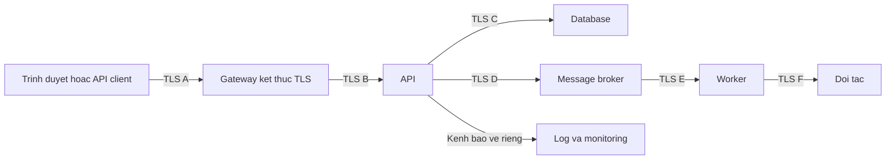

# Yêu cầu communication security

## 1. Mục tiêu kiểm chứng an toàn truyền thông

Communication security bảo vệ dữ liệu khi truyền giữa các thành phần và xác nhận rằng dữ liệu đang đi tới đúng đầu cuối theo chính sách. Một hệ thống có HTTPS ở trang chủ vẫn có thể gửi token qua redirect, bỏ kiểm tra chứng thư trong HTTP client hoặc truyền dữ liệu rõ từ gateway vào backend.

Trong chương **Verification framework** của module **SECURITY_SECURITY_DESIGN_SECURITY_REQUIREMENTS**, bài học chuyển mục tiêu an toàn thông tin và mô hình đe dọa thành yêu cầu có thể đo và kiểm chứng. Phạm vi gồm kết nối người dùng, dịch vụ nội bộ, database, message broker, đối tác và những kênh quản trị/quan sát liên quan.

Sau bài học, người học cần làm được các việc sau:

- Xác định tài sản, đối thủ, điểm kết thúc mã hóa và ranh giới tin cậy của từng luồng.
- Đặc tả giao thức, danh tính đầu cuối, trust policy và hành vi khi xác minh thất bại.
- Phân biệt mã hóa kênh, xác thực dịch vụ, phân quyền và bảo vệ thông điệp.
- Lập bằng chứng cho cả server lẫn client, bao gồm retry, redirect và đường dự phòng.
- Gắn việc kiểm chứng với quản lý chứng thư, logging và phục hồi trong SDLC.

Các mã `CS-*`, profile và ngưỡng dưới đây là ví dụ yêu cầu nội bộ, không phải mã điều khoản chuẩn hoặc cấu hình bắt buộc cho mọi sản phẩm. Bài dùng **OWASP ASVS 5.0.0** làm điểm tham chiếu có phiên bản; kết luận assessment phải theo đúng scope, mức mục tiêu và tập yêu cầu áp dụng của dự án.

## 2. Điều cần bảo vệ và giới hạn của TLS

| Mục tiêu | Câu hỏi cần trả lời | Điều chưa được chứng minh chỉ bằng TLS |
| --- | --- | --- |
| Bí mật khi truyền | Ai có thể nghe nội dung trên mỗi chặng? | Dữ liệu không bị lộ tại proxy, log hoặc endpoint |
| Toàn vẹn kênh | Bên trung gian có thể sửa nội dung mà không bị phát hiện không? | Nội dung nghiệp vụ do đầu cuối hợp lệ gửi là đúng |
| Danh tính dịch vụ | Client có xác minh đúng dịch vụ dự kiến không? | Dịch vụ có quyền nhận dữ liệu hoặc hành động cụ thể |
| Danh tính client | Server biết chủ thể kết nối bằng cơ chế nào? | Chủ thể đó được phép gọi mọi API hoặc truy cập mọi tenant |
| Chống hạ cấp | Lỗi kết nối có làm chuyển sang kênh yếu hơn không? | Mọi client, đường dự phòng và giao thức đều được cấu hình giống nhau |
| Tính sẵn sàng và phục hồi | Khi chứng thư/CA/kết nối lỗi, hệ thống xử lý thế nào? | Không có gián đoạn hoặc không cần kế hoạch vận hành |

TLS bảo vệ giữa các peer thực sự tham gia phiên TLS. Nếu TLS kết thúc ở gateway, gateway nhìn thấy plaintext; một phiên TLS khác từ gateway tới API là chặng riêng. Không gọi toàn tuyến là end-to-end encryption nếu các trung gian ngoài mô hình tin cậy vẫn giải mã được nội dung.

TLS cũng không che mọi metadata. Địa chỉ mạng, thời điểm và độ dài trao đổi có thể còn quan sát được; việc ẩn tên dịch vụ cần xem cơ chế như ECH và môi trường triển khai. Yêu cầu bảo mật nội dung, metadata và quyền truy cập phải được phân biệt trong threat model.

## 3. Inventory luồng truyền thông trước khi viết yêu cầu

### 3.1. Mỗi chặng là một đối tượng kiểm chứng

Ví dụ một ứng dụng xử lý đơn hàng:



Một kết quả scan TLS A không chứng minh TLS B, C hay F. Consumer kết nối tới broker cũng cần kiểm tra danh tính broker; việc producer đã dùng TLS không bảo vệ nội dung lúc broker lưu trữ hoặc chuyển tiếp bằng một kết nối khác.

| Luồng | Dữ liệu/quyền | Điểm cần làm rõ | Owner minh họa |
| --- | --- | --- | --- |
| Client → gateway | Phiên, token, dữ liệu người dùng | Hostname, listener, chứng thư, client được hỗ trợ | Nhóm edge và ứng dụng |
| Gateway → API | Nội dung request, context danh tính | Origin có được bảo vệ không, ai gọi trực tiếp được | Nhóm nền tảng/API |
| API → database/broker | Credential, dữ liệu, thao tác | Driver mode, peer identity, fallback | Nhóm dữ liệu và ứng dụng |
| Worker → đối tác | Dữ liệu ủy quyền, credential đối tác | Trust store, hostname, redirect, retry | Nhóm tích hợp |
| Quản trị/monitoring | Lệnh điều khiển, log nhạy cảm | Giao thức, danh tính, network path | Nhóm vận hành |

Inventory thực tế cần có source/destination, protocol/port, môi trường, loại dữ liệu, điểm termination, danh tính dự kiến, trust anchor, phương thức xác thực client, đường dự phòng và owner. Kiểm tra cả listener cũ, API version cũ, WebSocket, RPC và kết nối do thư viện tự tạo.

### 3.2. Những đường tấn công cần truy vết

| Mã rủi ro | Tình huống | Tác động |
| --- | --- | --- |
| R-01 | Một chặng truyền rõ hoặc tự fallback sau lỗi TLS | Nghe lén, sửa dữ liệu, lấy credential |
| R-02 | Chứng thư có chuỗi tin cậy nhưng sai danh tính, hoặc client tin mọi cert | Kết nối tới dịch vụ giả mạo |
| R-03 | TLS ở edge tốt nhưng origin/proxy header không được bảo vệ | Giả ngữ cảnh HTTPS hoặc danh tính client |
| R-04 | mTLS chỉ kiểm tra có cert, không kiểm tra trust và quyền | Dịch vụ không đúng vẫn được phép hoạt động |
| R-05 | Redirect, retry, DNS/proxy làm đổi đích ngoài chính sách | Rò credential, SSRF hoặc vượt ranh giới mạng |
| R-06 | Renewal, thu hồi, trust rotation hoặc restore sai | Gián đoạn, tiếp tục tin khóa bị lộ, mở chế độ bỏ kiểm tra |
| R-07 | Chỉ thu được bằng chứng của một endpoint hoặc một công cụ | Kết luận sai về toàn bộ phạm vi |
| R-08 | Replay, log/trace hoặc trung gian làm mất bảo vệ ngoài phiên TLS | Hành động lặp, lộ dữ liệu ở bề mặt không được xét |

## 4. Từ framework đến yêu cầu của dự án

[ASVS 5.0.0 V12 Secure Communication](https://github.com/OWASP/ASVS/blob/v5.0.0/5.0/en/0x21-V12-Secure-Communication.md) là điểm tra cứu cho các nhóm yêu cầu sau:

| Tham chiếu | Chủ đề |
| --- | --- |
| `v5.0.0-12.1.1`, `12.1.2` | Phiên bản TLS, cipher suite |
| `v5.0.0-12.1.3` | Tin cậy chứng thư mTLS client |
| `v5.0.0-12.1.4`, `12.1.5` | Thu hồi chứng thư, ECH |
| `v5.0.0-12.2.1`, `12.2.2` | HTTPS và chứng thư dịch vụ hướng ngoài |
| `v5.0.0-12.3.1` đến `12.3.5` | Kênh dịch vụ, validation, trust nội bộ, xác thực đầu cuối |

Trong bảng, các ID rút gọn cùng thuộc phiên bản đã nêu. Đây là danh mục tra cứu, không thay toàn văn điều khoản. Mỗi mục phải được đối chiếu đúng level và điều kiện; khó triển khai không tự là lý do N/A. Các yêu cầu redirect, replay nghiệp vụ, logging hoặc phục hồi bên dưới còn là bổ sung theo rủi ro dự án.

Không có một cấu hình cipher phù hợp vĩnh viễn cho mọi runtime và client. [RFC 9325](https://www.rfc-editor.org/rfc/rfc9325.html) và [OWASP TLS Cheat Sheet](https://cheatsheetseries.owasp.org/cheatsheets/Transport_Layer_Security_Cheat_Sheet.html) là nguồn kỹ thuật để xây profile có phiên bản, được xem xét cùng hướng dẫn và hỗ trợ hiện hành của nền tảng.

## 5. Yêu cầu đối với kênh và danh tính server

### CS-01 — Có scope và policy cho toàn bộ chặng kết nối

**Yêu cầu:** Mọi kết nối thuộc phạm vi phải được inventory và gắn policy về mã hóa, danh tính peer, xác thực, failure behavior và owner. Khi có trung gian termination, mô tả riêng từng chặng và các thành phần được phép thấy plaintext.

Một private network không tự chứng minh dữ liệu được bảo vệ. Nếu profile cho phép cơ chế khác TLS, phải nêu mục tiêu được đáp ứng, ranh giới khóa/danh tính và cách kiểm chứng. Ngoại lệ cho chặng cụ thể không được mở rộng sang toàn môi trường.

**Tiêu chí nghiệm thu:** Có thể truy từ một luồng dữ liệu nhạy cảm tới cấu hình và bằng chứng của từng chặng, bao gồm database, broker, quản trị và monitoring. Chặng chưa biết hoặc chưa kiểm tra được ghi rõ, không biến mất khỏi mẫu số đánh giá.

### CS-02 — Mã hóa được cưỡng chế và không hạ xuống plaintext

**Yêu cầu:** Client và server phải dùng giao thức bảo vệ được profile cho phép. Khi kênh bảo vệ không thiết lập được, luồng thông thường phải thất bại theo hợp đồng, không thử lại bằng giao thức rõ hoặc chế độ “ưu tiên TLS nhưng chấp nhận không TLS”.

Đối với driver database/broker, tên tùy chọn như `ssl=true` chưa đủ: phải xác định chế độ có cưỡng chế mã hóa và xác minh peer hay không. Nếu giao thức dùng bước nâng cấp kết nối sang TLS, phải chứng minh client từ chối khi bước bảo vệ bắt buộc không được đáp ứng.

Listener HTTP công khai chỉ nên phục vụ vai trò chuyển hướng tối thiểu khi kiến trúc cần, không xử lý nội dung nghiệp vụ nhạy cảm. Redirect không bảo vệ credential đã được client gửi bằng HTTP; API client phải bắt đầu bằng URL an toàn và không gửi secret trước khi xác minh kênh.

**Tiêu chí nghiệm thu:** Tắt TLS ở đích thử nghiệm hoặc làm handshake thất bại. Không có request/credential nghiệp vụ chuyển sang chặng rõ; đường dự phòng không tự bật một chế độ yếu hơn để làm health check xanh.

### CS-03 — Profile TLS có phiên bản và được áp dụng ở listener thực

**Yêu cầu:** Profile phải định nghĩa phiên bản giao thức, nhóm/cipher, thuật toán chữ ký và các tùy chọn liên quan theo hướng dẫn hiện hành. Một profile minh họa có thể cho TLS 1.3 và TLS 1.2 với tập thuật toán được duyệt, ưu tiên TLS 1.3; không cho SSL hoặc TLS 1.0/1.1. Đây không phải hướng dẫn giữ nguyên danh sách đó mãi về sau.

Nếu mức mục tiêu yêu cầu forward secrecy, phải chứng minh các cách thương lượng được chấp nhận đáp ứng yêu cầu, không chỉ dựa vào dòng cấu hình chứa từ TLS. Cấu hình TLS 1.2 và TLS 1.3 có thể dùng nhóm tùy chọn khác nhau tùy nền tảng; verifier cần kiểm tra kết quả runtime.

Compatibility là đầu vào thiết kế. Client cũ cần được thống kê và xử lý bằng kế hoạch nâng cấp hoặc ngoại lệ có ranh giới, không âm thầm mở lại giao thức cũ trên mọi listener. Profile cần owner, ngày review và trigger cập nhật khi runtime/hướng dẫn thay đổi.

**Tiêu chí nghiệm thu:** Client thử chỉ có protocol/cipher ngoài policy bị từ chối; client được hỗ trợ kết nối thành công với cấu hình đúng. Kiểm tra mọi edge, hostname/port và origin thuộc phạm vi, thay vì scan một địa chỉ mặc định rồi suy rộng.

### CS-04 — Client xác minh cả trust chain và danh tính dịch vụ dự kiến

**Yêu cầu:** Trước khi gửi dữ liệu ứng dụng nhạy cảm, client phải xác minh peer theo profile: đường chứng thư tới trust anchor được cho phép, thời gian hiệu lực, mục đích sử dụng và danh tính dịch vụ phù hợp. Không dùng trust-all, bỏ hostname verification hoặc chấp nhận self-signed bất kỳ để xử lý lỗi tích hợp.

Đối với HTTPS/X.509, danh tính dự kiến phải xuất phát từ cấu hình/URL hợp lệ theo hợp đồng, không chọn lại theo giá trị mà server bất kỳ vừa đưa ra. [RFC 9525](https://www.rfc-editor.org/rfc/rfc9525.html) mô tả reference identity và đối chiếu danh tính trong chứng thư; SNI hỗ trợ chọn dịch vụ/chứng thư nhưng không tự là bước xác minh. Không dùng Common Name để thay cơ chế SAN phù hợp.

Nếu kết nối tới IP đã được chọn vì cơ chế định tuyến, vẫn phải giữ danh tính dịch vụ cần kiểm chứng theo giao thức. Không đổi sang URL IP rồi tắt hostname check. Với IP reference hợp lệ, cơ chế đối chiếu phải đúng loại định danh IP, không phải so chuỗi tùy ý.

**Tiêu chí nghiệm thu:** Client thật bị thử với cert đúng CA nhưng sai tên, CA không tin, hết hạn/chưa có hiệu lực hoặc chuỗi không xây dựng được. Các trường hợp trái policy không làm client gửi request nghiệp vụ tới đích thử; đích đúng vẫn hoạt động.

### CS-05 — Trust anchor và private key có phạm vi, owner và vòng đời

**Yêu cầu:** Trust store và vật liệu khóa phải được quản lý như cấu hình bảo mật. Dịch vụ hướng ngoài cho client phổ thông cần trust phù hợp profile; kênh nội bộ có thể dùng CA riêng hoặc cert cụ thể được cấu hình tin cậy, không mở toàn bộ chứng thư tự ký.

Nêu ai được thêm CA, phạm vi môi trường và dịch vụ được tin, cách triển khai thay đổi và cách thu hồi niềm tin. Việc cùng một CA phát hành cert cho nhiều dịch vụ không có nghĩa mọi peer trong CA được phép làm cùng công việc. Tách private key/cert theo phạm vi hợp lý để giảm ảnh hưởng khi bị lộ.

Pinning chứng thư hoặc public key, nếu được chọn theo rủi ro, cần quy trình cập nhật, rotation, cơ chế dự phòng được quản lý và hành vi lỗi. Pinning không phải yêu cầu mặc định cho mọi kênh và không thay phân quyền.

**Tiêu chí nghiệm thu:** Cert từ CA ngoài phạm vi hoặc cert cho dịch vụ khác không được nhận. Thay trust store trái phép bị kiểm soát; private key không nằm trong source, report hoặc artifact rộng quyền. Tạo CA mới không tự làm mọi client tin nó trước bước triển khai được phép.

## 6. Xác thực hai chiều, proxy và luồng thay đổi đích

### CS-06 — mTLS xác minh client rồi mới ánh xạ quyền

**Yêu cầu:** Khi một kênh yêu cầu mTLS, server phải yêu cầu và xác minh client certificate theo trust policy trước khi sử dụng danh tính từ nó. Nêu rõ trường/định danh được ánh xạ, phạm vi principal và cách cấp quyền; không cho phép chỉ cần có một cert bất kỳ là nhận quyền dịch vụ dự kiến.

Một cert hợp lệ có thể chứng minh peer giữ private key tương ứng nhưng peer đó vẫn có thể không được phép gọi API, tenant hoặc hành động cụ thể. Xác thực hai chiều không thay access control. Ngược lại, dùng TLS một chiều không tự chứng minh đã có danh tính client; nếu chọn cơ chế xác thực khác, phải đặc tả và kiểm chứng cơ chế đó.

**Tiêu chí nghiệm thu:** Thử thiếu client cert, cert không tin, cert không phù hợp profile và cert hợp lệ của dịch vụ thiếu quyền. Kênh/xử lý phải từ chối đúng tầng; peer đúng danh tính và quyền được phép thành công. Không yêu cầu mọi hệ thống dùng mTLS nếu profile cho phép phương án khác đáp ứng mục tiêu.

### CS-07 — Termination và context truyền qua proxy có chuỗi tin cậy

**Yêu cầu:** Nếu gateway/load balancer/service mesh kết thúc TLS, phải kiểm soát đường tới backend và nguồn context mà backend tin. Chốt TLS tại edge không tự bảo vệ origin, loopback hoặc chặng từ sidecar tới ứng dụng; mỗi đoạn cần có mô hình tin cậy và cơ chế phù hợp.

Backend chỉ tin header về scheme, client certificate hoặc danh tính nếu đến từ proxy được xác thực theo kiến trúc. Proxy phải loại bỏ/ghi đè giá trị cùng loại do client không tin gửi. Backend không được truy cập trực tiếp theo cách làm giả context hoặc bỏ qua kiểm tra bắt buộc.

Ví dụ, `X-Forwarded-Proto: https` không chứng minh request tới từ kết nối an toàn. Tương tự, `X-Client-Cert` là dữ liệu, không phải một TLS handshake. Nếu backend dựa vào kết quả xác minh ở proxy, cần chứng minh proxy đã kiểm tra đúng và kênh/context không bị giả mạo trên đường sau đó.

**Tiêu chí nghiệm thu:** Thử header giả trên cả đường edge và đường origin trực tiếp, SNI/hostname khác, default virtual host và route dự phòng. Backend không nâng quyền hoặc coi plaintext là kênh đã được xác minh chỉ vì header tự khai. Bằng chứng bao phủ cấu hình proxy và hành vi ứng dụng.

### CS-08 — Client bảo vệ đích và credential khi redirect, retry, failover

**Yêu cầu:** Mỗi lần đổi đích phải thỏa policy scheme, identity, trust và quyền nhận credential. Tắt tự động theo redirect khi không cần; nếu cần, chặn hạ từ HTTPS xuống HTTP và không chuyển credential nhạy cảm sang authority mới ngoài hợp đồng explicit.

Retry/failover phải xác minh peer như lần đầu, kể cả endpoint dự phòng và kết nối mới sau rotation. Không coi một lỗi ở nguồn chính là lý do chấp nhận cert sai hoặc bỏ hostname verification ở nguồn phụ.

Với URL do người dùng ảnh hưởng, TLS chỉ xác minh danh tính kênh chứ không cho phép truy cập mọi đích. Chính sách SSRF/DNS rebinding cần ràng buộc đích mạng tại kết nối, bao gồm proxy, IPv4/IPv6 và fallback. [OWASP SSRF Prevention](https://cheatsheetseries.owasp.org/cheatsheets/Server_Side_Request_Forgery_Prevention_Cheat_Sheet.html) giải thích vai trò kiểm tra địa chỉ và gắn kết nối với đích đã được cho phép.

**Tiêu chí nghiệm thu:** Redirect xuống HTTP, sang authority không được cấp credential, hoặc failover tới cert sai đều không gửi dữ liệu/credential trái policy. Quan sát tại đích mồi để xác nhận, không chỉ dựa vào thông báo lỗi cuối cùng của client.

## 7. Client trình duyệt và giới hạn của bảo vệ kênh

### CS-09 — Hợp đồng trình duyệt cưỡng chế HTTPS và không rò qua đầu ra

**Yêu cầu:** Giao diện trong scope phải sử dụng tài nguyên/kết nối an toàn, không phát sinh mixed content theo luồng cần bảo vệ. URL API, form, WebSocket và đường tải dữ liệu phải theo hợp đồng HTTPS/WSS tương ứng. Cookie phiên nhạy cảm phải có thuộc tính và phạm vi phù hợp, trong đó `Secure` ngăn gửi cookie trên kênh HTTP theo cơ chế trình duyệt.

Nếu dùng HSTS, phải ghi phạm vi hostname, thời hạn và kế hoạch triển khai. [RFC 6797](https://www.rfc-editor.org/rfc/rfc6797.html) định nghĩa chính sách HSTS cho user agent; [OWASP HSTS Cheat Sheet](https://cheatsheetseries.owasp.org/cheatsheets/HTTP_Strict_Transport_Security_Cheat_Sheet.html) hỗ trợ xem xét vận hành. Header trên HTTP không thiết lập được chính sách tin cậy. HSTS chưa được học và không có cơ chế preload/configuration tương ứng thì không tự bảo vệ lần truy cập HTTP đầu tiên.

Không bật `includeSubDomains` hoặc theo đuổi preload khi chưa kiểm kê và bảo đảm phạm vi tên miền liên quan có thể duy trì HTTPS. Thời hạn dài có tác động tới phục hồi; cần kế hoạch thay chứng thư và xử lý sự cố, không khắc phục bằng cách yêu cầu người dùng bỏ xác minh.

TLS không ngăn token trong URL bị lưu ở history, log hoặc chuyển qua các cơ chế chia sẻ ngoài ý muốn. Thiết kế phải tránh đưa credential phiên vào URL và kiểm tra dữ liệu tại nơi lưu/hiển thị; đây là yêu cầu bảo vệ dữ liệu bổ sung, không phải thuộc tính tự động của HTTPS.

**Tiêu chí nghiệm thu:** Kiểm tra header/cookie trên response có hiệu lực, URL sinh bởi ứng dụng và luồng trình duyệt ở trạng thái HSTS đã biết/chưa biết. Xác nhận không có dữ liệu nhạy cảm đi qua kênh rõ trong những luồng được hỗ trợ; API client không hỗ trợ HSTS vẫn phải đáp ứng CS-02.

### CS-10 — Phân biệt replay thông điệp với tính toàn vẹn phiên TLS

**Yêu cầu:** Với hành động nhạy cảm, nêu rõ cách xử lý gửi lại request do retry, client hoặc mạng. Không suy từ “đã dùng TLS” rằng cùng một giao dịch không thể được thực hiện lại.

[RFC 8446, mục 8](https://www.rfc-editor.org/rfc/rfc8446.html#section-8) mô tả rủi ro replay của TLS 1.3 early data/0-RTT. Profile minh họa này tắt early data đối với hành động thay đổi trạng thái nhạy cảm nếu chưa có thiết kế chống replay được kiểm chứng. Tắt 0-RTT không thay hợp đồng idempotency/nonce của nghiệp vụ, và một request GET có tác dụng phụ vẫn cần được xem xét theo hành vi thật.

Nếu thông điệp cần giữ bí mật hoặc xác thực nguồn xuyên qua broker/proxy không được phép thấy/sửa nội dung, có thể cần bảo vệ ở tầng thông điệp. Khi đó đặc tả riêng danh tính ký, đối tượng nhận, khóa, thời hạn, replay và canonicalization theo giao thức được chọn; không gọi đó là thuộc tính sẵn có của TLS từng chặng.

**Tiêu chí nghiệm thu:** Gửi lại request trong sandbox không tạo tác động ngoài hợp đồng; yêu cầu 0-RTT trái policy không được xử lý sớm. Nếu có bảo vệ thông điệp, thử sửa nội dung, sai người nhận và replay theo policy riêng, tách bằng chứng khỏi handshake TLS.

## 8. Vòng đời chứng thư, logging và phục hồi

### CS-11 — Renewal, rotation và thu hồi có bằng chứng hiệu lực

**Yêu cầu:** Mỗi cert/key/trust anchor có owner, nguồn cấp, nơi sử dụng, thời hạn và quy trình thay đổi. Đặt mục tiêu cảnh báo trước hết hạn phù hợp tốc độ cấp phát và rollout; ví dụ cảnh báo trước 30 ngày chỉ là ngưỡng nội bộ, không phù hợp mọi loại chứng thư ngắn hạn.

Rotation phải phân biệt thay leaf cert, private key và CA/trust anchor. Kế hoạch cần thứ tự triển khai consumer/server, khoảng thời gian tin song song có giới hạn và cách xác nhận loại bỏ niềm tin cũ. Tránh thêm hàng loạt CA để giải quyết tạm một lỗi chain.

Đặc tả cơ chế trạng thái thu hồi và hành vi khi OCSP/CRL hoặc nguồn liên quan không sẵn sàng theo profile, runtime và mức mục tiêu. Không giả định mọi client đều tự thực hiện revocation check hoặc hỗ trợ OCSP stapling giống nhau. Nếu điều khoản bắt buộc chưa được thực thi, phải ghi gap thay vì coi renewal hoặc thời hạn ngắn là bằng chứng tương đương tự động.

Khi key bị lộ, thay cert mới không tự đóng phiên đã thiết lập bằng key cũ. Cần đánh giá resumption/session ticket, connection pool và danh tính ứng dụng theo mô hình sự cố. Không khẳng định thao tác revoke sẽ tự cắt mọi kết nối đang mở nếu cơ chế thật không có hành vi đó.

**Tiêu chí nghiệm thu:** Diễn tập renewal, đổi CA, cert bị thu hồi và nguồn kiểm tra trạng thái lỗi theo hợp đồng. Client hợp lệ tiếp tục kết nối qua đường mới; cert/niềm tin cũ bị từ chối trong mốc đã định. Mọi phần phiên cũ còn tồn tại được xử lý hoặc ghi rõ giới hạn và quyết định rủi ro.

### CS-12 — Evidence và phục hồi giữ nguyên bất biến bảo mật

**Yêu cầu:** Thu evidence cho cả cấu hình lẫn hành vi thực. Record cần chỉ rõ flow, source/destination, hostname/port, runtime, profile, version cấu hình, thời điểm, ca thử và kết quả tại điểm quan sát. Kết quả một scan public không đại diện cho trust manager hoặc driver mà ứng dụng thực dùng.

Theo dõi handshake/identity validation lỗi, cert sắp hết hạn, rotation và thay trust policy theo nhu cầu vận hành. Không log private key, token, TLS session secret hoặc request body nhạy cảm. Trace/packet capture phục vụ kiểm chứng cần sandbox, giới hạn và quyền truy cập vì có thể chứa metadata hoặc dữ liệu đã giải mã ở điểm thu.

Khi TLS hỏng, chỉ dùng retry có giới hạn, queue hoặc tính năng suy giảm trong phạm vi đã thiết kế. Không bật trust-all, mở listener rõ hoặc tắt mTLS để “phục hồi nhanh” ngoài một quyết định rủi ro có phạm vi; policy thông thường phải fail-closed cho kết nối chưa xác minh.

Rollback/restore phải đối chiếu profile, trust store, chứng thư còn hiệu lực, route và đường bypass. Một cấu hình cũ từng chạy được có thể còn giao thức đã cấm hoặc CA đã thu hồi. Ngoại lệ có owner, thời hạn và evidence không được ghi đè trạng thái kỹ thuật chưa đạt.

**Tiêu chí nghiệm thu:** Evidence thiếu, stale hoặc khác flow/config không được tính PASS cho đối tượng hiện tại. Diễn tập phục hồi không âm thầm hạ bảo vệ; các điều kiện bắt buộc được xác nhận lại trước khi mở luồng tương ứng.

## 9. Mẫu yêu cầu và gói bằng chứng

### 9.1. Requirement cho kết nối outbound đối tác

```yaml
requirementId: ORG-COMM-PARTNER-01
flowId: order-worker-to-partner
environment: production-candidate
dataClass: Customer order and delegated credential
profileRef: tls-client-profile-7
peerIdentityRef: partner-endpoint-identity-3
trustPolicyRef: partner-trust-policy-4
redirectPolicy: Reject downgrade and unapproved authority change
retryPolicy: Bounded retries with peer verification on every new connection
failureBehavior:
  - Khong gui request nghiep vu khi xac minh peer that bai
  - Khong fallback HTTP hoac trust-all
  - Ghi ma loi va flow ID, khong ghi credential
verification:
  - Cau hinh client va trust store thuc te
  - Positive test voi dung danh tinh va trust
  - Negative test voi sai ten, sai CA, het han va redirect bi cam
  - Doi chieu retry, failover va rotation
ownerRole: Integration service owner
```

Đây là mẫu đặc tả, không phải config thực thi. Các reference phải trỏ tới danh tính, profile và chính sách thật có phiên bản; `production-candidate` là phạm vi dự kiến đánh giá, không yêu cầu dùng credential production thật trong test.

### 9.2. Evidence tối thiểu theo loại control

| Control | Evidence cấu hình/thiết kế | Evidence hành vi |
| --- | --- | --- |
| Mã hóa và profile | Inventory, TLS listener/client mode, runtime version | Thương lượng hợp lệ và từ chối protocol ngoài policy |
| Danh tính server | Reference identity, trust store, cấu hình driver/client | Đúng cert thành công; sai tên/CA/thời hạn thất bại |
| mTLS | Issuer, mapping principal, policy quyền | Thiếu cert/sai cert/sai quyền bị từ chối ở đúng tầng |
| Proxy termination | Chặng TLS, route, origin ACL, header trust | Giả header và truy cập origin trực tiếp không bypass |
| Redirect/failover | Client policy, danh sách đích/credential scope | Đích cấm không nhận request hoặc credential mồi |
| Vòng đời | Inventory cert/key, runbook, revocation/trust change policy | Renewal và bỏ niềm tin cũ có mốc hiệu lực quan sát được |
| Phục hồi | Baseline, đường dự phòng, điều kiện mở lại | Restore không mở protocol/CA/route trái policy |

Oracle phải quan sát đúng việc cần chứng minh. TCP có thể được thiết lập trước khi TLS thất bại; điều kiện “không có TCP SYN” không phù hợp để chứng minh không gửi request nghiệp vụ tới peer sai. Ngược lại, chỉ thấy client báo lỗi cuối cùng chưa chứng minh credential chưa rời máy ở lần redirect trước đó.

Không coi N/A là trạng thái của control chưa kiểm tra được. Nếu nhà cung cấp edge không hỗ trợ một cơ chế bắt buộc của profile, ghi thiếu năng lực/gap và cách xử lý theo thẩm quyền. Bằng chứng dịch vụ quản lý có thể kết hợp cấu hình, tài liệu cam kết và test trong phạm vi được phép; vẫn phải nêu giới hạn quan sát.

## 10. Ma trận truy vết

| Yêu cầu | Rủi ro | Điểm thực thi | Bằng chứng chấp nhận |
| --- | --- | --- | --- |
| CS-01 | R-01, R-03, R-07 | Inventory và kiến trúc luồng | Từng chặng có policy/owner, phần chưa rõ được ghi |
| CS-02 | R-01 | Listener, driver, transport client | Không plaintext/fallback ngoài hợp đồng |
| CS-03 | R-01, R-07 | TLS profile và cấu hình runtime | Chấp nhận/từ chối protocol/cipher đúng phạm vi |
| CS-04 | R-02 | Client verifier, reference identity | Cert đúng hoạt động, các cert trái policy bị chặn |
| CS-05 | R-02, R-06 | PKI, trust store và key management | Trust có scope, thay đổi được quản lý, không lộ key |
| CS-06 | R-04 | TLS acceptor và policy ứng dụng | Client cert được xác minh, principal vẫn bị giới hạn quyền |
| CS-07 | R-03 | Edge, origin, mesh và context forwarding | Chặng sau termination được bảo vệ, không giả header/bypass |
| CS-08 | R-05 | Redirect/retry/proxy/failover client | Đổi đích không hạ bảo vệ hoặc chuyển credential trái phép |
| CS-09 | R-01, R-08 | Browser flow, HSTS, cookie/URL policy | Luồng hợp lệ không gửi secret qua HTTP hoặc URL ngoài hợp đồng |
| CS-10 | R-08 | Early data policy và nghiệp vụ | Replay không tạo tác động trái hợp đồng; thông điệp bảo vệ riêng nếu cần |
| CS-11 | R-06 | Cert lifecycle, connection/session lifecycle | Thay mới/thu hồi hiệu lực có bằng chứng và giới hạn rõ |
| CS-12 | R-06, R-07 | Evidence, monitoring, release/restore | Kết luận đúng flow/config, phục hồi không hạ bảo vệ âm thầm |

Owner có thể trải qua nhóm ứng dụng, edge, PKI và nền tảng dữ liệu. Hồ sơ verification cần phân công phần bằng chứng mỗi nhóm cung cấp. “TLS do hạ tầng lo” không đủ nếu code client vẫn có nhánh bỏ validation hoặc gửi dữ liệu tới một URL khác.

## 11. Bộ ca nghiệm thu

Thực hiện trong sandbox với CA/cert thử nghiệm, credential mồi và đích do nhóm kiểm soát. Không thay trust store production hoặc cố nghe dữ liệu thật để chứng minh rủi ro. Chạy bằng đúng driver/runtime/config profile cần đánh giá, trong phạm vi đại diện đã ghi.

| Mã | Thiết lập | Điều kiện pass |
| --- | --- | --- |
| T-01 | Client/server đúng profile và đúng danh tính | Kết nối, request hợp lệ thành công, có evidence đúng flow |
| T-02 | Bỏ TLS ở một đích thử hoặc từ chối handshake | Không fallback kênh rõ, credential nghiệp vụ không tới đích trái policy |
| T-03 | Client chỉ hỗ trợ protocol/cipher bị cấm | Thương lượng thất bại; client được hỗ trợ vẫn dùng được |
| T-04 | Cert từ CA tin cậy nhưng sai reference identity | Client từ chối dù chain đúng |
| T-05 | CA không tin, cert hết hạn/chưa hiệu lực hoặc chain lỗi | Client xử lý theo profile, không bật trust-all |
| T-06 | Đổi SNI/Host hoặc gọi bằng IP không khớp danh tính | Không nhầm routing với bước xác minh dịch vụ |
| T-07 | Driver có chế độ TLS tùy chọn hoặc client config thiếu | Cấu hình ngoài policy bị phát hiện/chặn, không có plaintext ngoài hợp đồng |
| T-08 | mTLS thiếu cert hoặc cert không được tin | Không nhận danh tính client chưa được xác minh |
| T-09 | Client cert hợp lệ nhưng principal thiếu quyền hành động | Ứng dụng từ chối dù TLS đã thành công |
| T-10 | Edge hợp lệ nhưng origin trực tiếp hoặc chặng backend yếu | Không bypass; chặng chưa đạt hiện rõ trong assessment |
| T-11 | Header HTTPS/client identity do client tự gửi | Không được tin ngoài chuỗi proxy đã xác minh |
| T-12 | Redirect HTTPS xuống HTTP hoặc sang authority ngoài scope credential | Không gửi request/credential trái policy tại đích mồi |
| T-13 | Retry/failover sang cert sai hoặc đích mạng bị cấm | Mọi nhánh vẫn giữ kiểm tra identity/đích tương ứng |
| T-14 | Trình duyệt mới, HSTS đã biết/chưa biết, cookie nhạy cảm | Hành vi khớp hợp đồng và giới hạn lần truy cập đầu được ghi đúng |
| T-15 | URL/form/resource/WebSocket phát sinh kênh không bảo vệ | Không có truyền thông nhạy cảm trái policy; lỗi mixed content được phát hiện |
| T-16 | Replay hoặc 0-RTT cho thao tác nhạy cảm | Không thực hiện sớm/lặp ngoài hợp đồng đã chọn |
| T-17 | Renewal leaf cert và rollout CA/trust mới trong sandbox | Client/server chuyển đúng, không tin song song vô hạn |
| T-18 | Cert thu hồi, nguồn trạng thái lỗi và phiên cũ còn mở | Kết quả khớp policy, giới hạn cơ chế được quan sát và xử lý rõ |
| T-19 | Profile yêu cầu ECH hoặc cơ chế khác nhưng thiếu bằng chứng | Ghi gap/chưa xác minh phù hợp, không báo PASS/N/A vì khó làm |
| T-20 | Nhánh handshake/validation lỗi có credential mồi | Log/trace/report thuộc scope không lộ secret |
| T-21 | Restore config/trust store/route cũ | Không mở lại protocol/CA/bypass ngoài policy hiện hành |
| T-22 | Scan của hostname khác, config cũ hoặc chỉ edge được dùng cho toàn tuyến | Evidence không bị suy rộng thành PASS ngoài phạm vi |
| T-23 | Verifier không chạy, thiếu quyền thử hoặc timeout | Kết luận là thiếu evidence/lỗi, không coi báo cáo rỗng là đạt |

Báo cáo ghi profile và version runtime, source/config revision, peer identity, thời điểm, kết quả positive/negative, điểm quan sát và giới hạn. Với rotation/thu hồi cần thời điểm và vòng đời kết nối; với policy đích cần bằng chứng ở transport/đích, không chỉ check chuỗi URL.

## 12. Tình huống áp dụng: HTTPS ở edge nhưng worker bỏ validation

Một portal được scan tốt ở gateway. Nhóm định đánh dấu toàn bộ communication security PASS. Trong thực tế, gateway gọi API bằng HTTP, còn worker dùng một HTTP client có nhánh chấp nhận mọi chứng thư vì môi trường test từng dùng cert tự ký.

Có hai thiếu sót độc lập: CS-01/CS-07 chưa có bằng chứng chặng sau termination, và CS-04/CS-05 chưa kiểm soát client/trust policy. Một báo cáo external TLS không kiểm tra được hai phần đó.

Yêu cầu sửa cần mô tả kênh gateway–API theo profile, kiểm soát origin trực tiếp và cấu hình trust nội bộ phù hợp. Worker phải dùng validation thật với reference identity được xác định; môi trường test cần CA riêng được cấp có phạm vi thay vì code trust-all dùng chung. Thêm test sai tên, sai CA, redirect và retry bằng chính client đó.

Khi đổi chứng thư đối tác, runbook không được đề xuất tắt hostname check. Nhóm cần kiểm tra renewal/chain/config và triển khai trust change hợp lệ nếu có. Nếu chưa thể kết nối an toàn, xử lý queue hoặc vô hiệu hóa tính năng theo hợp đồng lỗi; evidence phải phản ánh phần chưa hoạt động, không che bằng việc đích cuối trả HTTP 200.

## 13. Câu hỏi tự kiểm tra

1. Một báo cáo scan public gateway sạch. Cần inventory và evidence nào trước khi kết luận các kênh database, broker và đối tác cũng đạt?
2. Client tin đúng CA nhưng tắt hostname verification. Hãy viết requirement và negative test phân biệt trust chain với danh tính dịch vụ.
3. API tin header `X-Client-Cert` để cấp quyền. Cần bảo vệ chuỗi proxy, đường origin và mapping quyền như thế nào?
4. Retry chuyển tới endpoint dự phòng có chứng thư sai hoặc redirect tới HTTP. Hãy nêu oracle chứng minh credential chưa bị gửi trái policy.
5. Một cert bị thu hồi nhưng pool vẫn có kết nối mở. Những phần nào của vòng đời khóa, phiên và ứng dụng cần đánh giá thay vì chỉ kiểm tra handshake mới?
6. Restore cấu hình cũ giúp dịch vụ chạy lại nhưng bật protocol bị cấm. Cần điều kiện mở lại, bằng chứng và quyết định rủi ro nào?

Mỗi câu trả lời cần nối được **rủi ro → từng chặng và danh tính dự kiến → policy kênh/trust/quyền → điểm thực thi → evidence đúng phiên bản → vòng đời và phục hồi**. Chuỗi này giúp yêu cầu communication security được kiểm chứng trong suốt vòng đời phát triển và vận hành.
