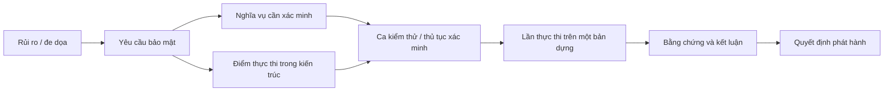

# Mapping requirement sang test

Một yêu cầu bảo mật chỉ có thể được kiểm chứng khi nhóm phát triển biết phải quan sát điều gì, trong điều kiện nào và bằng chứng nào đủ để kết luận đạt. Câu “đã có bài test phân quyền” chưa cho biết bài test đó kiểm tra đúng rủi ro hay chỉ gọi được một API.

Trong chương **Verification framework**, mapping requirement sang test là việc xây dựng quan hệ có thể truy vết từ yêu cầu bảo mật đến cách xác minh, ca kiểm thử, lần thực thi và bằng chứng. Bài học tập trung vào cách biến các yêu cầu về xác thực, phân quyền, bảo vệ dữ liệu, logging và phục hồi thành tiêu chí kiểm thử cụ thể; đồng thời giữ liên kết với rủi ro và các điểm thực thi trong kiến trúc.

## 1. Kết quả cần đạt

Sau bài học, người học có thể:

- Tách một yêu cầu bảo mật thành các nghĩa vụ có thể quan sát và đánh giá.
- Chọn phương pháp xác minh phù hợp với từng nghĩa vụ.
- Thiết kế ca kiểm thử cho hành vi được phép, hành vi bị cấm, điều kiện biên và tình huống lỗi.
- Lập ma trận truy vết từ rủi ro đến yêu cầu, test và bằng chứng.
- Phân biệt độ phủ mapping, độ phủ thực thi và kết quả kiểm chứng.
- Xác định các test cần chạy lại khi yêu cầu, kiến trúc hoặc chính sách thay đổi.

Mapping tốt giúp trả lời hai câu hỏi khác nhau: “Yêu cầu này được kiểm chứng bằng cách nào?” và “Bằng chứng của lần kiểm chứng nào đang được dùng cho bản phát hành này?”.

## 2. Chuỗi truy vết cần xây dựng

Có thể hình dung chuỗi liên kết như sau:



Ví dụ: nguy cơ người dùng tải báo cáo của tenant khác dẫn đến yêu cầu kiểm tra quyền sở hữu tenant ở phía máy chủ. Yêu cầu này phải được kiểm tra trên API lấy trạng thái, API tải xuống và đường đọc dữ liệu thực tế nếu các đường đó tồn tại trong kiến trúc.

| Thành phần | Câu hỏi cần trả lời | Ví dụ |
|---|---|---|
| Rủi ro | Điều gì có thể gây thiệt hại? | Lộ dữ liệu giữa hai tenant |
| Yêu cầu | Hệ thống bắt buộc phải làm hoặc ngăn điều gì? | Từ chối truy cập tài nguyên ngoài tenant được phép |
| Điểm thực thi | Quyết định bảo mật được áp dụng ở đâu? | API, worker, lớp truy vấn, kho đối tượng |
| Nghĩa vụ xác minh | Khía cạnh nào của yêu cầu cần chứng minh? | Chặn đọc chéo tenant; không trả dữ liệu; không tạo tác dụng phụ |
| Test case | Dùng đầu vào và thao tác nào để kiểm tra? | Người dùng tenant A yêu cầu báo cáo thuộc tenant B |
| Test run | Test được chạy trên trạng thái hệ thống nào? | Bản dựng cụ thể, chính sách cụ thể, môi trường cụ thể |
| Bằng chứng | Có thể kiểm tra lại kết luận bằng gì? | Kết quả chạy, truy vấn xác nhận, bản ghi sự kiện đã khử nhạy cảm |

Quan hệ này thường là **nhiều–nhiều**. Một yêu cầu cần nhiều test; một test có thể kiểm tra một phần của nhiều yêu cầu. Khi một test phục vụ nhiều yêu cầu, phải chỉ rõ assertion nào chứng minh nghĩa vụ nào.

Một tên test chứa mã yêu cầu chỉ tạo liên kết định danh. Nó chưa bảo đảm test có đầu vào, oracle và phạm vi phù hợp.

## 3. Chuẩn hóa yêu cầu trước khi mapping

### 3.1. Mẫu yêu cầu có thể kiểm chứng

Một mẫu hữu ích là:

> Khi [điều kiện kích hoạt], [thành phần] phải [hành vi bắt buộc] đối với [đối tượng], theo [chính sách/giới hạn]; kết quả có thể quan sát qua [đầu ra hoặc trạng thái], bao gồm [hành vi khi lỗi].

Ví dụ chưa đủ rõ:

> Hệ thống phải có logging an toàn cho chức năng xuất báo cáo.

Phiên bản rõ hơn:

> Với mỗi quyết định cho phép hoặc từ chối tải báo cáo, dịch vụ phải tạo sự kiện audit chứa mã chủ thể, tenant, hành động, mã tài nguyên, kết quả, thời điểm và mã tương quan. Khi không có danh tính hợp lệ, trường chủ thể dùng giá trị chưa xác định theo schema đã phê duyệt. Sự kiện không chứa access token hoặc nội dung báo cáo. Trong cấu hình vận hành được phê duyệt, sự kiện phải có thể truy vấn tại kho audit trong tối đa 60 giây.

Yêu cầu sau có nhiều nghĩa vụ:

1. Có sự kiện cho cả quyết định cho phép và từ chối.
2. Có đủ các trường bắt buộc.
3. Không chứa các loại dữ liệu bị cấm.
4. Đáp ứng giới hạn thời gian chuyển sự kiện.

Có thể giữ một yêu cầu cha và tạo nghĩa vụ con để mapping, hoặc tách thành các yêu cầu độc lập nếu chúng có chủ sở hữu, ưu tiên hay vòng đời khác nhau. Không nên ghép mọi nghĩa vụ vào một test duy nhất rồi chỉ báo một trạng thái chung.

### 3.2. Những dữ kiện phải chốt

Trước khi viết test, cần xác định:

- **Chủ thể:** người dùng, tài khoản dịch vụ, worker hay quản trị viên.
- **Tài nguyên:** bản ghi, báo cáo, object, khóa, sự kiện hay bản sao lưu.
- **Hành động:** tạo, đọc, tải xuống, sửa quyền, xuất dữ liệu hoặc khôi phục.
- **Điều kiện:** tenant, vai trò, trạng thái tài khoản, thời gian, chính sách và trạng thái phụ thuộc.
- **Điểm quan sát:** phản hồi API, dữ liệu thực tế, tác dụng phụ, audit hoặc cấu hình hiệu lực.
- **Tiêu chí đạt:** điều kiện đủ rõ để hai người độc lập đi đến cùng kết luận.
- **Phạm vi:** đường truy cập nào, môi trường nào và loại dữ liệu nào được bao gồm.
- **Hành vi khi lỗi:** từ chối, trì hoãn, retry, báo lỗi hay kích hoạt chế độ dự phòng nào.

Nếu yêu cầu nói “thu hồi quyền có hiệu lực nhanh”, test không được tự chọn một con số để lấp chỗ trống. Cần làm rõ giới hạn chấp nhận trước. Các con số trong ví dụ của bài này là giả định phục vụ minh họa, không phải ngưỡng bắt buộc cho mọi hệ thống.

## 4. Chọn phương pháp xác minh phù hợp

Không phải yêu cầu nào cũng được chứng minh tốt nhất bằng một API test.

| Phương pháp | Phù hợp khi cần kiểm tra | Bằng chứng điển hình | Giới hạn |
|---|---|---|---|
| Review hoặc inspection | Cấu hình, quy tắc thiết kế, danh sách quyền, chính sách dữ liệu | Phiên bản cấu hình, checklist có kết luận, nhận xét có người chịu trách nhiệm | Review cấu hình chưa chứng minh hành vi runtime |
| Phân tích | Đường tin cậy, phụ thuộc, phạm vi dữ liệu, tác động của thay đổi | Mô hình, lập luận có giả định, kết quả phân tích | Kết luận phụ thuộc độ đầy đủ của mô hình |
| Kiểm thử thực thi | Hành vi có thể kích hoạt và quan sát | Kết quả test gắn với bản dựng và môi trường | Chỉ bao phủ các trường hợp đã thực thi |
| Diễn tập hoặc demonstration | Khôi phục, ứng cứu, quy trình có con người tham gia | Nhật ký diễn tập, thời gian đo, dữ liệu đối chiếu | Một lần diễn tập chưa bao phủ mọi điều kiện sự cố |

Một yêu cầu có thể cần phối hợp nhiều phương pháp. Ví dụ, yêu cầu mã hóa dữ liệu lưu trữ cần xác minh cấu hình có hiệu lực, metadata của object được tạo thực tế và hành vi khi dịch vụ khóa không khả dụng. Việc API trả về thành công không tự chứng minh dữ liệu đã được mã hóa đúng.

Phương pháp xác minh là một phần của mapping. Nếu framework chỉ chấp nhận trường “test ID”, nhóm dễ bỏ sót các nghĩa vụ cần review hoặc diễn tập. Có thể dùng một bảng liên kết chung cho các **verification item**, trong đó test case là một loại item.

## 5. Ví dụ xuyên suốt: dịch vụ xuất báo cáo nhiều tenant

### 5.1. Kiến trúc và giả định

Dịch vụ nhận yêu cầu xuất báo cáo, đưa job vào hàng đợi, cho worker tạo tệp và lưu tệp ở kho đối tượng. Người dùng theo dõi trạng thái rồi tải kết quả qua API của dịch vụ.

Trong phạm vi ví dụ:

- Mỗi báo cáo thuộc đúng một tenant.
- Người dùng cần tư cách thành viên tenant và quyền `report.export`.
- API tải xuống kiểm tra quyền trước khi trả nội dung; dịch vụ không phát hành liên kết tải công khai.
- Worker kiểm tra lại quyền của người yêu cầu trước khi tạo báo cáo.
- Dữ liệu kiểm thử là dữ liệu tổng hợp, có dấu nhận diện khác nhau cho từng tenant.
- Việc thu hồi quyền trong ví dụ phải được áp dụng trước lần kiểm tra quyền tiếp theo; hệ thống thử nghiệm có cơ chế xác nhận phiên bản chính sách đã được nạp.
- Kho đối tượng hỗ trợ mã hóa bằng khóa được tổ chức phê duyệt.
- Kho audit được tách khỏi log gỡ lỗi thông thường.
- Phạm vi diễn tập phục hồi bao gồm dữ liệu job, metadata quyền sở hữu và nội dung báo cáo.

Những giả định này phải trở thành thông tin phiên bản của test fixture hoặc kế hoạch xác minh. Khi kiến trúc thật có CDN, signed URL, cache phân quyền hoặc truy vấn liên vùng, mapping phải bổ sung đường truy cập và điều kiện tương ứng.

### 5.2. Rủi ro dẫn đến yêu cầu

| Mã rủi ro | Kịch bản đe dọa | Hậu quả chính |
|---|---|---|
| R-01 | Người không có phiên hợp lệ tạo hoặc tải báo cáo | Truy cập trái phép |
| R-02 | Người dùng tenant A thay mã báo cáo để đọc dữ liệu tenant B | Lộ dữ liệu giữa các tenant |
| R-03 | Job đã xếp hàng vẫn chạy sau khi người yêu cầu bị thu hồi quyền | Xuất dữ liệu vượt quyền hiện tại |
| R-04 | Tệp có thể tải trực tiếp từ kho hoặc lưu dưới cấu hình mã hóa sai | Bỏ qua kiểm soát và lộ dữ liệu |
| R-05 | Sự kiện bị thiếu hoặc chứa bí mật | Khó điều tra hoặc rò rỉ qua audit |
| R-06 | Phục hồi mất dữ liệu hoặc làm sai quan hệ tenant | Gián đoạn và lộ dữ liệu sau khôi phục |

### 5.3. Tập yêu cầu minh họa

| Mã yêu cầu | Nội dung và tiêu chí chấp nhận chính |
|---|---|
| REQ-EXP-AUTHN-01 | Các API tạo, xem trạng thái và tải báo cáo phải từ chối phiên thiếu, hết hạn hoặc không hợp lệ bằng 401; không tạo job mới hoặc trả nội dung báo cáo từ các yêu cầu bị từ chối. |
| REQ-EXP-AUTHZ-01 | API phải xác minh quyền `report.export` và tenant của tài nguyên ở phía máy chủ. Với phiên hợp lệ, tài nguyên ngoài tenant phải trả 404 theo chính sách che giấu sự tồn tại; thiếu quyền trong cùng tenant trả 403; không lộ dữ liệu hoặc làm thay đổi job. |
| REQ-EXP-AUTHZ-02 | Trước khi bắt đầu tạo báo cáo, worker phải kiểm tra lại quyền và tư cách thành viên hiện tại của người yêu cầu. Nếu quyền đã bị thu hồi, job chuyển trạng thái từ chối theo đặc tả, không sinh tệp báo cáo mới. |
| REQ-EXP-DATA-01 | Tệp báo cáo trong kho phải ở chế độ private; truy cập trực tiếp không có danh tính được cấp quyền phải bị từ chối và không nhận nội dung báo cáo. |
| REQ-EXP-DATA-02 | Mọi tệp báo cáo mới phải dùng cấu hình mã hóa và khóa đã phê duyệt. Nếu không thể áp dụng cấu hình đó, job không được hoàn tất thành công hoặc lưu tệp dưới cấu hình yếu hơn. |
| REQ-EXP-AUDIT-01 | Mỗi quyết định cho phép hoặc từ chối tải báo cáo phải có sự kiện audit với các trường bắt buộc đã nêu ở mục 3; không chứa token hoặc nội dung báo cáo; truy vấn được trong tối đa 60 giây ở cấu hình vận hành đã phê duyệt. |
| REQ-EXP-REC-01 | Sau diễn tập khôi phục trong phạm vi đã định, RPO không quá 15 phút và RTO không quá 60 phút; dữ liệu khôi phục phải đúng nội dung, đúng quan hệ tenant và tiếp tục chịu kiểm soát truy cập. |

Đây là tập yêu cầu để minh họa cách mapping, không phải bộ yêu cầu đầy đủ cho một sản phẩm thực tế. Mỗi yêu cầu vẫn cần người sở hữu, phiên bản, mức ưu tiên và nguồn rủi ro trong hệ thống quản lý yêu cầu.

## 6. Tách nghĩa vụ và thiết kế các chiều kiểm thử

### 6.1. Từ câu yêu cầu đến các câu hỏi kiểm chứng

Với `REQ-EXP-AUTHZ-01`, các nghĩa vụ gồm:

- Chủ thể hợp lệ, có quyền và cùng tenant truy cập được đúng tài nguyên.
- Chủ thể khác tenant không đọc được tài nguyên dù biết đúng mã.
- Chủ thể cùng tenant nhưng thiếu quyền bị từ chối.
- Tenant do client gửi không thể thay thế tenant được xác minh từ danh tính và tài nguyên.
- Quy tắc được áp dụng trên mọi API thuộc phạm vi yêu cầu.
- Yêu cầu bị từ chối không trả nội dung và không làm thay đổi job.

Một test “tải báo cáo của tenant khác trả 404” chỉ bao phủ một phần. Nó không chứng minh API xem trạng thái đã được bảo vệ, hoặc tệp không bị đọc qua đường truy cập trực tiếp.

### 6.2. Ma trận đầu vào

| Chiều kiểm thử | Giá trị cần cân nhắc |
|---|---|
| Xác thực | Thiếu phiên, phiên hết hạn, phiên không hợp lệ, phiên hợp lệ |
| Tenant | Cùng tenant, khác tenant, tenant đã bị thu hồi tư cách thành viên |
| Quyền | Có quyền, thiếu quyền, quyền vừa bị thu hồi |
| Tài nguyên | Có thật, không tồn tại, đang tạo, đã hoàn tất |
| Đường truy cập | Tạo job, xem trạng thái, tải qua API, đọc trực tiếp kho |
| Thời điểm | Trước xếp hàng, sau xếp hàng, trước worker chạy, trước tải xuống |
| Phụ thuộc | Bình thường, dịch vụ khóa lỗi, kho audit chậm, phục hồi sau sự cố |

Không cần mặc định chạy toàn bộ tích Descartes của các chiều. Cần bảo đảm mỗi quy tắc bảo mật và ranh giới tin cậy có trường hợp đại diện; các tổ hợp có rủi ro cao phải được chọn có chủ đích. Kỹ thuật rút gọn tổ hợp không thay thế được test trực tiếp cho một quy tắc cấm rõ ràng.

### 6.3. Positive, negative, boundary và failure

Một bộ test hữu ích thường kết hợp:

- **Positive:** người dùng có quyền, cùng tenant nhận đúng dữ liệu. Trường hợp này giúp phát hiện hệ thống từ chối tất cả nhưng vẫn làm bộ negative test đạt.
- **Negative:** người dùng khác tenant hoặc thiếu quyền không nhận dữ liệu.
- **Boundary:** thời điểm hết hạn phiên, thời điểm đổi quyền hoặc giới hạn 60 giây của audit.
- **Failure:** phụ thuộc lỗi, xử lý bất đồng bộ bị trì hoãn hoặc khôi phục từ bản sao lưu.

Không phải yêu cầu nào cũng có đủ bốn loại. Việc chọn loại test phải dựa trên nghĩa vụ và rủi ro, không dựa vào việc điền đủ bốn ô cho mọi hàng.

## 7. Viết một test case đủ để kết luận

Mỗi test case nên có các thông tin tối thiểu sau:

| Trường | Mục đích |
|---|---|
| Test ID và phiên bản | Giữ định danh ổn định và biết test đã thay đổi hay chưa |
| Requirement ID và nghĩa vụ | Chỉ ra chính xác phần yêu cầu được xác minh |
| Mục tiêu | Mô tả điều cần chứng minh |
| Cấp kiểm thử | Unit, integration, end-to-end, hạ tầng hoặc vận hành |
| Điều kiện trước | Trạng thái quyền, tài nguyên, chính sách, phụ thuộc |
| Dữ liệu và thao tác | Cách tái tạo tình huống |
| Oracle và assertion | Quy tắc quyết định đạt hoặc không đạt |
| Bằng chứng cần lưu | Dữ liệu đủ để kiểm tra lại kết luận |
| Chủ sở hữu | Người/nhóm bảo trì test và xử lý kết quả |

**Oracle** là căn cứ xác định kết quả đúng. Nó có thể là chính sách truy cập đã được phê duyệt, tập dữ liệu mong đợi hoặc bất biến cần giữ. Nếu test tính kết quả mong đợi bằng cách gọi chính hàm phân quyền đang được kiểm tra, nó có thể lặp lại cùng một lỗi.

### 7.1. Ví dụ test đọc chéo tenant

```text
ID: TC-EXP-AUTHZ-04
Requirement: REQ-EXP-AUTHZ-01
Nghĩa vụ: chặn tải chéo tenant và không lộ nội dung
Cấp: integration tại API với kho dữ liệu thử nghiệm

Điều kiện trước:
- Alice có phiên hợp lệ, thuộc tenant A, có report.export.
- Báo cáo B-123 đã hoàn tất, thuộc tenant B.
- Nội dung báo cáo B-123 chứa dấu nhận diện dữ liệu thử nghiệm MARKER-B.
- Báo cáo A-123 thuộc tenant A dùng làm đối chứng cho đường tải hợp lệ.

Thao tác:
1. Alice tải A-123 và xác nhận đúng nội dung đối chứng.
2. Ghi nhận trạng thái B-123 và số job trước thao tác bị cấm.
3. Alice gọi API tải B-123 bằng đúng mã tài nguyên.
4. Đọc lại trạng thái tài nguyên qua fixture quản trị của môi trường thử nghiệm.

Kỳ vọng:
- Bước 1 thành công và trả đúng dữ liệu tenant A.
- Bước 3 trả 404 theo chính sách.
- Phản hồi bước 3 không có nội dung báo cáo, MARKER-B hoặc liên kết tải.
- Trạng thái B-123 và số job không thay đổi do yêu cầu bị từ chối.

Bằng chứng:
- Test run ID, build ID, phiên bản chính sách và fixture.
- Metadata phản hồi đã loại bỏ thông tin nhạy cảm.
- Kết quả đối chiếu trạng thái trước/sau.
```

Fixture quản trị là công cụ của môi trường thử nghiệm, được giới hạn quyền và không cung cấp qua API sản phẩm cho người dùng. Nó giúp quan sát tác dụng phụ mà chủ thể trong test không được phép đọc.

### 7.2. Minh họa assertion bằng mã giả kiểu Java

Đoạn mã sau minh họa cấu trúc test; các API fixture là giả định, không phải mã có thể chạy trực tiếp trong mọi dự án.

```java
@Test
void aliceCannotDownloadReportFromAnotherTenant() {
    Session alice = fixture.session("alice", "tenant-A", "report.export");
    Report own = fixture.completedReport("tenant-A", "MARKER-A");
    Report foreign = fixture.completedReport("tenant-B", "MARKER-B");

    Response allowed = api.download(alice, own.id());
    assertEquals(200, allowed.status());
    assertArrayEquals(own.expectedBytes(), allowed.bodyBytes());

    Snapshot before = fixture.snapshotOf(foreign.id());
    long jobsBefore = fixture.jobCount();

    Response denied = api.download(alice, foreign.id());

    assertEquals(404, denied.status());
    assertFalse(denied.bodyText().contains("MARKER-B"));
    assertFalse(denied.hasDownloadLink());
    assertFalse(denied.containsReportPayload());
    assertEquals(before, fixture.snapshotOf(foreign.id()));
    assertEquals(jobsBefore, fixture.jobCount());
}
```

Assertion không chứa một marker chỉ kiểm tra một dấu hiệu cụ thể. Nó cần đi cùng kiểm tra cấu trúc phản hồi, byte dữ liệu mong đợi và các tác dụng phụ phù hợp. Một marker vắng mặt không đủ chứng minh mọi loại dữ liệu nhạy cảm đều vắng mặt.

Trường hợp giả mạo tenant trong header hoặc body nên có test riêng. Trường hợp xem trạng thái cũng cần test riêng hoặc một bộ test tham số hóa có báo cáo kết quả riêng cho từng endpoint.

## 8. Lập ma trận truy vết requirement–verification

### 8.1. Tách định nghĩa mapping khỏi kết quả chạy

Nên quản lý ít nhất hai lớp thông tin:

1. **Định nghĩa:** yêu cầu phiên bản nào liên kết với test hoặc thủ tục xác minh phiên bản nào, bao phủ nghĩa vụ gì.
2. **Thực thi:** item đó đã chạy ở đâu, khi nào, trên bản dựng nào và tạo bằng chứng gì.

Nếu chỉ có một cột “PASS” nằm cạnh yêu cầu, người đọc khó biết kết quả đó còn áp dụng sau khi đổi chính sách hoặc nâng cấp thành phần lưu trữ hay không.

Ma trận định nghĩa có thể bắt đầu bằng các cột:

```text
risk_id
requirement_id
requirement_revision
obligation
verification_item_id
verification_item_revision
method
level
architecture_scope
acceptance_criteria
owner
```

Bảng kết quả chạy liên kết thêm:

```text
run_id
verification_item_id
build_id
policy_revision
environment_revision
fixture_revision
started_at
finished_at
result
evidence_reference
defect_reference
```

Cách lưu cụ thể có thể là công cụ quản lý yêu cầu, test management hoặc metadata trong repository. Điều quan trọng là truy vấn được hai chiều và không làm mất lịch sử.

### 8.2. Ma trận cho ví dụ xuất báo cáo

Bảng dưới là **định nghĩa mapping**, chưa phải kết quả chạy. Các mã test là minh họa; chúng không hàm ý những test đó đã được triển khai.

| Rủi ro | Yêu cầu / nghĩa vụ | Verification item | Cấp hoặc phương pháp | Tiêu chí và bằng chứng chính |
|---|---|---|---|---|
| R-01 | AUTHN-01: từ chối các loại phiên không hợp lệ trên ba API | TC-EXP-AUTHN-01 | Integration, tham số hóa | Từng tổ hợp API/loại phiên trả 401; không có nội dung, không có job mới; lưu kết quả từng trường hợp |
| R-01 | AUTHN-01: đường hợp lệ vẫn hoạt động | TC-EXP-AUTHN-02 | Integration | Phiên hợp lệ đi tiếp đến kiểm tra quyền và xử lý theo đúng tài nguyên |
| R-02 | AUTHZ-01: người có quyền cùng tenant truy cập được đúng phạm vi | TC-EXP-AUTHZ-01 | Integration | Tạo, xem trạng thái và tải được dữ liệu tổng hợp đúng tenant |
| R-02 | AUTHZ-01: thiếu quyền trong cùng tenant | TC-EXP-AUTHZ-02 | Integration | Các API thuộc phạm vi trả 403; không tạo job, không trả dữ liệu hoặc thay đổi job |
| R-02 | AUTHZ-01: không tin tenant do client tự khai | TC-EXP-AUTHZ-03 | Integration | Giả mạo tenant ở các trường đầu vào được API hỗ trợ không làm mở rộng quyền |
| R-02 | AUTHZ-01: tải chéo tenant | TC-EXP-AUTHZ-04 | Integration | 404, không payload hoặc liên kết, không có tác dụng phụ |
| R-02 | AUTHZ-01: xem trạng thái và tạo yêu cầu cho tenant khác | TC-EXP-AUTHZ-05 | Integration | Kết quả từ chối theo đặc tả từng API; không rò metadata hoặc tạo job trái phép |
| R-03 | AUTHZ-02: quyền đổi trong thời gian job chờ | TC-EXP-AUTHZ-06 | Integration với worker thật trong môi trường thử nghiệm | Sau khi xác nhận chính sách mới, worker từ chối job và không tạo tệp |
| R-03 | AUTHZ-02: đường worker hợp lệ | TC-EXP-AUTHZ-07 | Integration | Quyền còn hiệu lực thì worker tạo đúng báo cáo; tránh kết luận đạt do worker luôn từ chối |
| R-04 | DATA-01: cấu hình private có hiệu lực | IV-EXP-STORAGE-01 | Inspection cấu hình triển khai | Không có policy hoặc ACL cho phép đường đọc công khai; lưu revision cấu hình |
| R-04 | DATA-01: không đọc trực tiếp khi không được cấp quyền | TC-EXP-STORAGE-01 | Integration hạ tầng | Request trực tiếp tới object thật bị từ chối, không có nội dung; đường đọc được phép của dịch vụ có đối chứng |
| R-04 | DATA-02: đúng cấu hình và khóa mã hóa | IV-EXP-ENC-01, TC-EXP-ENC-01 | Inspection và integration hạ tầng | Cấu hình hiệu lực và metadata của object mới đều khớp chính sách phê duyệt |
| R-04 | DATA-02: lỗi khóa không gây fallback yếu hơn | TC-EXP-ENC-02 | Kiểm thử lỗi trong môi trường cô lập | Job không thành công, không có object mới lưu dưới cấu hình bị cấm |
| R-05 | AUDIT-01: có sự kiện và đủ schema | TC-EXP-AUDIT-01 | Integration với kho audit | Với từng quyết định thử nghiệm, tìm được sự kiện đúng correlation ID và đủ trường |
| R-05 | AUDIT-01: không chứa token hoặc nội dung báo cáo | TC-EXP-AUDIT-02, IV-EXP-AUDIT-01 | Integration và review đường ghi audit | Giá trị nhạy cảm của fixture không xuất hiện; đường ghi dùng danh sách trường được phép |
| R-05 | AUDIT-01: độ trễ không quá 60 giây | TC-EXP-AUDIT-03 | Integration trên cấu hình vận hành đại diện | Đo từ lúc phát sinh quyết định đến lúc sự kiện truy vấn được, với điều kiện tải và đồng hồ đã xác định |
| R-06 | REC-01: giới hạn mất dữ liệu và thời gian phục hồi | DR-EXP-01 | Diễn tập phục hồi | RPO, RTO được đo theo mốc thống nhất; có nhật ký và đối chiếu giao dịch |
| R-06 | REC-01: toàn vẹn tenant và kiểm soát sau phục hồi | DR-EXP-02 | Kiểm tra dữ liệu và chạy lại test truy cập | Đối chiếu nội dung, metadata tenant và quyền; chạy lại các test phân quyền quan trọng |

Trong cột yêu cầu, `AUTHN-01`, `AUTHZ-01` và các mã tương tự là cách viết gọn của mã có tiền tố `REQ-EXP-` ở mục 5. Khi lưu trong công cụ, nên dùng mã đầy đủ để tránh nhập nhằng.

Các item `IV` là thủ tục inspection; `DR` là diễn tập. Chúng vẫn cần phiên bản, chủ sở hữu, tiêu chí đạt và bằng chứng như test tự động.

### 8.3. Mức chi tiết vừa đủ

Một ô ghi “đã có integration test” quá rộng để kiểm tra độ phủ. Ngược lại, sao chép từng assertion vào nhiều công cụ làm mapping khó bảo trì.

Một cách cân bằng:

- Yêu cầu giữ tiêu chí chấp nhận và phạm vi.
- Nghĩa vụ con chỉ ra những khía cạnh cần xác minh độc lập.
- Test case giữ dữ liệu, thao tác và assertion.
- Ma trận giữ liên kết, phạm vi bao phủ và người sở hữu.
- Test run giữ kết quả, phiên bản và tham chiếu bằng chứng.

Nếu một bộ test tham số hóa có 12 tổ hợp, báo cáo phải cho thấy kết quả của từng tổ hợp có ý nghĩa bảo mật. Một trạng thái tổng hợp không được che khuất trường hợp bị bỏ qua.

## 9. Kiểm thử các nghĩa vụ khó quan sát

### 9.1. Quyền thay đổi khi job đang chờ

Để kiểm tra `REQ-EXP-AUTHZ-02`, cần kiểm soát thứ tự:

1. Tạo người dùng có quyền và một yêu cầu xuất hợp lệ.
2. Giữ worker ở điểm chờ có kiểm soát trước bước kiểm tra quyền.
3. Thu hồi quyền hoặc tư cách thành viên.
4. Xác nhận thành phần ra quyết định đã nạp phiên bản chính sách mới.
5. Cho worker tiếp tục.
6. Xác nhận job bị từ chối và không có tệp mới được tạo.
7. Chạy đối chứng với người dùng còn quyền để kiểm tra đường thành công.

Không dùng một khoảng chờ tùy ý để suy đoán rằng cache đã cập nhật. Nếu hệ thống cho phép một cửa sổ trễ sau thu hồi, cửa sổ đó phải được quy định trong yêu cầu và test phải kiểm tra cả thời điểm trước và sau giới hạn.

Việc kiểm tra quyền ở API khi tạo job không thay thế việc kiểm tra ở worker tại thời điểm đã đặc tả. Hai điểm thực thi bảo vệ hai thời điểm khác nhau.

### 9.2. Logging không làm lộ dữ liệu

Test audit cần xác định rõ schema cho những tình huống không có danh tính hợp lệ. Ví dụ, trường chủ thể có thể nhận giá trị `unknown` theo hợp đồng sự kiện; không được suy ra danh tính đáng tin cậy từ token chưa xác minh chỉ để điền đủ trường.

Một cách kiểm tra:

- Dùng access token thử nghiệm và nội dung báo cáo tổng hợp có dấu nhận diện riêng.
- Tạo quyết định tải thành công và các loại từ chối thuộc phạm vi.
- Tìm sự kiện theo correlation ID do môi trường thử nghiệm kiểm soát.
- Kiểm tra các trường bắt buộc, kiểu dữ liệu và kết quả quyết định.
- Xác nhận token nguyên vẹn và các giá trị nội dung bị cấm không xuất hiện.
- Review đường serialize audit để xác minh chỉ ghi các trường được cho phép.
- Lưu bằng chứng đã khử nhạy cảm.

Test tìm chuỗi không bao phủ mọi cách biến đổi hoặc mã hóa dữ liệu. Vì vậy, kiểm thử bằng dữ liệu đánh dấu cần được bổ sung bằng việc xác minh thiết kế ghi sự kiện và các nhánh ghi lỗi.

Nếu audit pipeline bị ngắt, phải có yêu cầu riêng quy định hành vi: thao tác bị chặn, sự kiện được đệm hay hệ thống cảnh báo như thế nào. Không suy ra hành vi này chỉ từ yêu cầu “truy vấn được trong 60 giây”.

### 9.3. Đo thời gian chuyển audit

Với ca kiểm thử độ trễ:

```text
latency = thời_điểm_sự_kiện_truy_vấn_được - thời_điểm_quyết_định
Điều kiện đạt của ví dụ: latency <= 60 giây
```

Phải chốt nguồn thời gian và sai số đồng hồ. Có thể dùng một bộ điều khiển đo khoảng thời gian trôi qua bằng đồng hồ đơn điệu, kết hợp sự kiện đồng bộ tại điểm ra quyết định; nếu dùng timestamp giữa nhiều máy thì cần ghi lại giả định đồng bộ thời gian.

Polling làm thời điểm quan sát muộn hơn thời điểm dữ liệu thực sự sẵn sàng. Kế hoạch test phải quy định chu kỳ polling và cách xử lý sai số gần ngưỡng. Không nới ngưỡng sau khi thấy test thất bại.

Một ca đạt ở tải thấp chỉ chứng minh điều kiện đã chạy. Nếu yêu cầu áp dụng dưới tải đỉnh xác định, phải đưa tải đó và các phụ thuộc liên quan vào tiền điều kiện.

### 9.4. RPO, RTO và dữ liệu phục hồi

Cần thống nhất mốc đo trước khi diễn tập. Trong ví dụ:

```text
RPO = t_sự_cố - t_dữ_liệu_mới_nhất_khôi_phục_đầy_đủ
RTO = t_dịch_vụ_được_xác_nhận_sẵn_sàng - t_sự_cố
```

Mốc dữ liệu mới nhất phải là một điểm khôi phục nhất quán. Một bản ghi mới còn sót lại không chứng minh mọi giao dịch trước nó đều đã được phục hồi.

Với ngưỡng RPO 15 phút và RTO 60 phút, bằng chứng cần gồm:

- Chuỗi giao dịch tổng hợp có thời điểm và định danh xác định.
- Thời điểm sự cố và các mốc bắt đầu, kết thúc công việc phục hồi.
- Đối chiếu dữ liệu đã khôi phục với chuỗi giao dịch.
- Kiểm tra báo cáo khớp metadata tenant.
- Xác nhận luồng tạo, xem và tải hoạt động theo chính sách được phê duyệt.
- Kết quả test truy cập trái phép sau phục hồi.

“Dịch vụ sẵn sàng” phải bao gồm việc đạt các điều kiện bảo mật đã định. Một endpoint health trả 200 chưa đủ để kết thúc phép đo RTO.

Việc bản sao lưu cũ có thể phục hồi quyền đã thu hồi cần được xử lý trong yêu cầu phục hồi và thiết kế nguồn dữ liệu quyền. Không mặc định rằng khôi phục dữ liệu ứng dụng đã đồng thời làm cho chính sách truy cập trở nên hiện hành.

## 10. Phân bố test theo cấp kiểm thử

| Cấp | Điều có thể xác minh hiệu quả | Điều chưa đủ để kết luận |
|---|---|---|
| Unit | Quy tắc thuần, quyết định theo ma trận vai trò/tenant, biến đổi dữ liệu | Middleware thật đã gọi quy tắc trên mọi endpoint |
| Integration | Kết nối API–phân quyền–database, worker–policy, ứng dụng–kho audit | Cấu hình triển khai production giống môi trường thử nghiệm |
| End-to-end | Luồng hoàn chỉnh từ tạo job đến tải báo cáo | Mọi tổ hợp vai trò và mọi nhánh lỗi đã được bao phủ |
| Hạ tầng/cấu hình | Quyền kho, khóa mã hóa, cấu hình có hiệu lực, đường truy cập trực tiếp | Mọi logic phân quyền trong ứng dụng là đúng |
| Vận hành | Phục hồi, đối chiếu dữ liệu, quy trình có người tham gia | Quy trình sẽ thành công trong mọi kiểu sự cố |

Ưu tiên cấp thấp nhất có thể quan sát trung thực nghĩa vụ. Dùng cấp cao hơn cho các mối nối và đường truy cập mà cấp thấp không chứng minh được.

Ví dụ, mock kho đối tượng có thể giúp kiểm tra ứng dụng yêu cầu cấu hình mã hóa đúng. Nó chưa chứng minh tài khoản triển khai có quyền dùng khóa thật hoặc policy của bucket đang có hiệu lực. Nghĩa vụ đó cần test với hạ tầng thử nghiệm phù hợp.

Chạy lại cùng một test ở nhiều cấp chỉ hữu ích khi mỗi cấp tạo thêm bằng chứng về một rủi ro khác nhau. Không nên tăng số lượng test chỉ để làm ma trận trông đầy hơn.

## 11. Bằng chứng phải gắn với phiên bản

Một hồ sơ kết quả có thể có dạng:

```yaml
run_id: RUN-EXP-2026-11-27-001
verification_item_id: TC-EXP-AUTHZ-04
verification_item_revision: "3"
requirement_id: REQ-EXP-AUTHZ-01
requirement_revision: "2"
build_id: export-service-build-842
policy_revision: tenant-policy-17
environment_revision: integration-env-31
fixture_revision: synthetic-tenants-8
result: PASS
evidence_reference: evidence://RUN-EXP-2026-11-27-001
```

Các định danh trên là ví dụ dữ liệu, không phải kết quả thực thi của bài học.

Bằng chứng nên đủ để trả lời:

- Test nào, phiên bản nào đã chạy?
- Trên bản dựng, chính sách, schema và môi trường nào?
- Dữ liệu thử nghiệm có phù hợp với điều kiện cần kiểm tra không?
- Kết quả thực tế nào dẫn đến kết luận?
- Có bước bị bỏ qua, retry hoặc phụ thuộc bị thay thế bằng mock không?
- Bằng chứng được lưu ở đâu, ai có quyền đọc và trong bao lâu?

Không đưa access token, mật khẩu hoặc dữ liệu sản xuất vào báo cáo chỉ để tăng khả năng truy vết. Dùng định danh tương quan, dữ liệu tổng hợp và bản trích đã loại bỏ thông tin nhạy cảm.

Bằng chứng được tái sử dụng phải có lý do. Ví dụ, khi chỉ sửa văn bản giao diện không ảnh hưởng luồng xuất báo cáo, nhóm có thể phân tích tác động để giữ một phần bằng chứng cũ. Nếu sửa policy, middleware hoặc đường đọc object, kết quả cũ cho các nghĩa vụ bị ảnh hưởng cần được xem xét lại.

## 12. Đọc độ phủ mà không nhầm với mức an toàn

### 12.1. Tách các loại độ phủ

**Độ phủ mapping theo yêu cầu:**

```text
Số yêu cầu trong phạm vi có ít nhất một verification item hợp lệ
----------------------------------------------------------------
Tổng số yêu cầu trong phạm vi đã chốt
```

Chỉ số này cho biết đã có liên kết, chưa cho biết mọi nghĩa vụ đều được kiểm tra.

**Độ phủ mapping theo nghĩa vụ:**

```text
Số nghĩa vụ có phương pháp xác minh và tiêu chí đạt phù hợp
---------------------------------------------------------
Tổng số nghĩa vụ thuộc phạm vi
```

**Độ phủ thực thi hiện hành:**

```text
Số item bắt buộc đã hoàn tất trên phiên bản/phạm vi được chấp nhận
----------------------------------------------------------------
Tổng số item bắt buộc phải thực thi cho đợt xác minh
```

Cần định nghĩa rõ “hoàn tất”: các item bị skip hoặc blocked không phải là đã xác minh đạt.

Ví dụ, có 10 yêu cầu, mỗi yêu cầu đều liên kết với một test thì độ phủ mapping theo yêu cầu là 100%. Nếu chúng có 24 nghĩa vụ nhưng chỉ 18 nghĩa vụ có cách xác minh phù hợp, độ phủ mapping theo nghĩa vụ mới là 75%.

Nếu có 20 item phải chạy, 15 PASS, 2 FAIL, 2 BLOCKED và 1 chưa chạy, có 17 item đã thực thi cho ra kết luận PASS/FAIL. Kết quả 15 PASS không thể được diễn giải là toàn bộ phạm vi đã đạt.

Độ phủ mã nguồn cũng trả lời một câu hỏi khác. Dòng code được chạy không chứng minh test đã kiểm tra đúng điều kiện phân quyền hoặc có oracle phát hiện được lỗi.

### 12.2. Trạng thái và quy tắc tổng hợp

| Trạng thái | Ý nghĩa |
|---|---|
| NOT_RUN | Chưa thực thi |
| PASS | Đã thực thi và thỏa tiêu chí của item trên phạm vi ghi nhận |
| FAIL | Đã thực thi và vi phạm ít nhất một tiêu chí |
| BLOCKED | Không thể hoàn tất vì thiếu điều kiện hoặc phụ thuộc |
| STALE | Bằng chứng có thể không còn áp dụng do thay đổi liên quan |
| NOT_APPLICABLE | Được xác nhận không thuộc phạm vi, có lý do và người quyết định |

`STALE` không phải kết luận hệ thống đã sai; nó báo rằng cần đánh giá lại tính áp dụng của bằng chứng. Trong công cụ thực tế, nên dùng thống nhất mã `STALE`.

Để kết luận một yêu cầu đã được kiểm chứng đạt trong một đợt:

1. Mọi nghĩa vụ bắt buộc có phương pháp xác minh phù hợp.
2. Mọi item bắt buộc cho các nghĩa vụ đó có bằng chứng hiện hành và đạt.
3. Không có kết quả trái ngược hoặc lỗi chưa giải quyết trong phạm vi.
4. Bản dựng, chính sách và môi trường của bằng chứng phù hợp với quyết định đang đưa ra.

Một test đỏ không bị triệt tiêu bởi nhiều test xanh. Việc chấp nhận rủi ro còn tồn tại là quyết định riêng, có người chịu trách nhiệm và thời hạn; nó không đổi kết quả FAIL thành PASS.

Không nên tính trung bình các yêu cầu để quyết định phát hành. Một yêu cầu cô lập tenant thất bại có thể chặn phát hành dù hầu hết các yêu cầu khác đều đạt.

## 13. Duy trì mapping khi hệ thống thay đổi

### 13.1. Khi yêu cầu đổi

Nếu yêu cầu bổ sung quyền tải theo phòng ban:

- Tăng revision của yêu cầu và ghi rõ nghĩa vụ mới.
- Xác định các test đang liên kết với nghĩa vụ phân quyền.
- Bổ sung fixture và test cho phòng ban được phép, không được phép.
- Đánh giá các đường truy cập tải xuống và worker có bị ảnh hưởng không.
- Đánh dấu bằng chứng cũ cần xem xét; chạy lại các item liên quan.
- Cập nhật kết luận theo bằng chứng mới.

Một liên kết cũ không tự bao phủ nghĩa vụ mới chỉ vì Requirement ID vẫn giữ nguyên.

### 13.2. Khi kiến trúc đổi

Nếu chuyển từ tải qua API sang signed URL:

- Cần xem lại thời điểm kiểm tra quyền và khoảng thời gian quyền truy cập tồn tại.
- Cần đặc tả ai được dùng URL, thời hạn, phạm vi tài nguyên và điều kiện thu hồi.
- Cần kiểm tra đường đọc kho, cache và hành vi sau khi quyền bị thu hồi.
- Cần cập nhật yêu cầu audit để xác định sự kiện nào phản ánh cấp quyền và sự kiện nào phản ánh tải thực tế.
- Các test chỉ quan sát API tải cũ không còn đủ cho đường tải mới.

Thay đổi kiến trúc có thể làm lộ ra yêu cầu còn thiếu. Không nên sửa test để khớp hành vi mới rồi coi việc mapping đã hoàn tất.

### 13.3. Khi phát hiện lỗi lọt qua test

Nếu API xem trạng thái bị lộ metadata tenant khác nhưng test tải xuống vẫn đạt:

1. Liên kết lỗi với rủi ro và yêu cầu bị vi phạm.
2. Xác định nghĩa vụ đã có nhưng chưa được phủ, hay yêu cầu chưa nêu rõ.
3. Bổ sung test tái hiện lỗi với oracle độc lập.
4. Sửa điểm thực thi liên quan.
5. Chạy lại test tái hiện và các item bị tác động.
6. Lưu bằng chứng mới, giữ lịch sử lỗi và kết quả cũ.

Số lượng test tăng là hệ quả của việc vá khoảng trống xác minh. Điều cần cải thiện là khả năng phát hiện lớp lỗi đó khi tái xuất hiện.

## 14. Các lỗi mapping thường gặp

| Lỗi | Vì sao kết luận không vững | Cách chỉnh |
|---|---|---|
| Mỗi yêu cầu chỉ có một happy-path test | Chứng minh luồng hợp lệ nhưng bỏ qua hành vi bị cấm | Tách nghĩa vụ, bổ sung các trường hợp từ chối và lỗi cần thiết |
| Chỉ kiểm tra HTTP status | Có thể bỏ sót dữ liệu trong body, header, liên kết hoặc tác dụng phụ | Kiểm tra đầu ra và trạng thái liên quan |
| Chỉ test trên giao diện | API hoặc worker có thể đi qua đường khác | Mapping theo điểm thực thi và ranh giới tin cậy |
| Mock toàn bộ hệ thống phân quyền | Test khó chứng minh wiring, cấu hình và hành vi thật | Có integration test với thành phần thực tại các mối nối quan trọng |
| Oracle gọi lại đúng logic đang được test | Lỗi có thể xuất hiện đồng thời ở kết quả thực và kết quả mong đợi | Dùng bảng quyền và dữ liệu kỳ vọng được đặc tả độc lập |
| Test từ chối đều đạt vì dịch vụ đang hỏng | Không chứng minh hệ thống thực thi đúng quyền | Có đối chứng cho đường được phép và kiểm tra tiền điều kiện |
| Chỉ gắn Requirement ID ở tên test | Không biết test chứng minh nghĩa vụ nào | Ghi phạm vi, assertion và tiêu chí chấp nhận |
| Dùng kết quả từ bản dựng cũ | Bằng chứng không phản ánh thay đổi hiện tại | Lưu phiên bản và đánh giá tác động |
| Bỏ qua test bị skip | Che khuất khoảng trống chưa kiểm chứng | Hiển thị skip, blocked và chưa chạy trong báo cáo |
| Retry đến khi xanh rồi chỉ giữ lần cuối | Che giấu tính không ổn định hoặc lỗi phụ thuộc | Giữ lịch sử lần chạy và phân loại nguyên nhân |
| Tính phần trăm test PASS thành phần trăm an toàn | Các test có trọng số rủi ro và phạm vi khác nhau | Đánh giá theo nghĩa vụ, mức nghiêm trọng và bằng chứng |
| Có link bằng chứng nhưng không truy cập được | Người đánh giá không kiểm tra lại được kết luận | Xác minh quyền đọc, thời hạn lưu và tính toàn vẹn của hồ sơ |

## 15. Quy trình áp dụng trong vòng đời phát triển

Một quy trình làm việc thực tế có thể đi theo trình tự:

1. **Phân tích rủi ro:** xác định tài sản, chủ thể, hành động và đường tấn công cần ngăn.
2. **Đặc tả yêu cầu:** viết rõ hành vi, phạm vi, điều kiện lỗi và tiêu chí chấp nhận.
3. **Phân rã nghĩa vụ:** xác định các phần cần kết luận độc lập.
4. **Đối chiếu kiến trúc:** tìm các điểm thực thi, đường truy cập và phụ thuộc liên quan.
5. **Chọn phương pháp:** quyết định phần nào dùng test, review, phân tích hoặc diễn tập.
6. **Thiết kế test:** xác định dữ liệu, oracle, đối chứng, điều kiện biên và bằng chứng.
7. **Lập mapping:** liên kết hai chiều, gán chủ sở hữu và revision.
8. **Thực thi:** chạy trên bản dựng và cấu hình được ghi nhận.
9. **Tổng hợp:** nêu rõ đạt, thất bại, chưa chạy, bị chặn và bằng chứng hết tính hiện hành.
10. **Ra quyết định và bảo trì:** xử lý lỗi, quyết định rủi ro còn lại, cập nhật mapping khi có thay đổi.

Ngay trong quá trình refinement, một yêu cầu không tìm được cách kiểm chứng là tín hiệu cần làm rõ. Trong thiết kế kiến trúc, một nghĩa vụ không có điểm quan sát là tín hiệu cần bổ sung khả năng quan sát phù hợp. Trong CI/CD, một item bắt buộc chưa chạy phải hiện ra như khoảng trống cần xử lý.

## 16. Mẫu mapping có thể dùng lại

```text
Requirement ID / revision:
Nguồn rủi ro:
Mục tiêu bảo mật:
Phạm vi kiến trúc:
Giả định và phụ thuộc:
Nghĩa vụ cần xác minh:

Verification item ID / revision:
Phương pháp và cấp:
Điều kiện trước:
Dữ liệu tổng hợp:
Thao tác:
Oracle:
Tiêu chí đạt:
Đối chứng đường hợp lệ:
Kiểm tra dữ liệu và tác dụng phụ:
Bằng chứng cần lưu:
Chủ sở hữu:

Run ID:
Build / policy / environment / fixture revision:
Thời điểm thực thi:
Kết quả:
Tham chiếu bằng chứng:
Lỗi hoặc khoảng trống còn lại:
Điều kiện phải đánh giá lại:
```

Khi sử dụng mẫu, có thể bỏ các trường không phù hợp với một loại item, nhưng phải giữ thông tin đủ để truy vết yêu cầu, phạm vi và kết luận. Một thủ tục review không cần giả vờ là test tự động; một test tự động cũng không thay thế được quyết định phạm vi của người sở hữu yêu cầu.

Mapping có giá trị khi người đọc đi từ một rủi ro đến đúng nghĩa vụ, nhìn thấy cách xác minh và kiểm tra được bằng chứng áp dụng cho phiên bản đang đánh giá. Đó là nền tảng để biến mục tiêu an toàn thông tin thành tiêu chí kỹ thuật có thể kiểm chứng trong suốt vòng đời phát triển.
