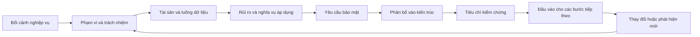
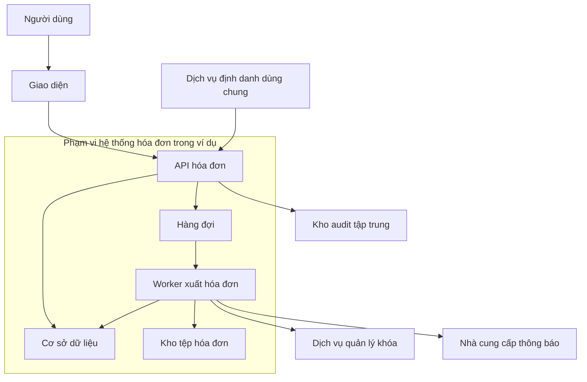

# Prepare

Prepare là bước chuẩn bị để tổ chức và nhóm phát triển có cùng một cách hiểu về hệ thống cần bảo vệ, rủi ro cần quản lý, trách nhiệm ra quyết định và đầu vào cho việc đặc tả yêu cầu bảo mật. Nếu chưa rõ dữ liệu đi đâu, ai chịu trách nhiệm hoặc mức thiệt hại nào có thể chấp nhận, nhóm rất dễ chọn kiểm soát theo thói quen và viết yêu cầu không thể kiểm chứng.

Trong chương **Risk management và compliance**, bài học dùng bước Prepare của **NIST Risk Management Framework (RMF)** làm khung tham chiếu. NIST mô tả mục đích của bước này là chuẩn bị các cấp của tổ chức để quản lý rủi ro về an toàn thông tin và quyền riêng tư. Các đầu ra nổi bật gồm vai trò, chiến lược quản lý rủi ro, mức chấp nhận rủi ro, nhận diện kiểm soát dùng chung và định hướng giám sát liên tục. [Nguồn: NIST — RMF Prepare Step](https://csrc.nist.gov/projects/risk-management/about-rmf/prepare-step).

Phần áp dụng trong bài tập trung vào thiết kế yêu cầu bảo mật: chuyển bối cảnh nghiệp vụ, dữ liệu và mô hình đe dọa thành yêu cầu có chủ sở hữu, có nơi thực thi trong kiến trúc và có tiêu chí kiểm thử. Các biểu mẫu, ngưỡng và tình huống áp dụng bên dưới là ví dụ do bài học xây dựng, không phải bộ biểu mẫu bắt buộc của NIST.

## 1. Mục tiêu học tập

Sau bài học, người học có thể:

- Giải thích Prepare tạo nền tảng gì cho quản lý rủi ro và compliance.
- Xác định phạm vi hệ thống, các bên liên quan, tài sản và vòng đời dữ liệu.
- Phân biệt yêu cầu bắt nguồn từ rủi ro với nghĩa vụ bắt nguồn từ nguồn tuân thủ đã xác định.
- Làm rõ quyền quyết định, quyền chấp nhận rủi ro và trách nhiệm cung cấp bằng chứng.
- Chuyển kết quả chuẩn bị thành yêu cầu về xác thực, phân quyền, dữ liệu, logging và phục hồi.
- Phân bổ yêu cầu cho hệ thống, nền tảng hoặc nhà cung cấp dùng chung.
- Xác định khi nào hồ sơ đủ sẵn sàng cho các hoạt động tiếp theo và khi nào cần cập nhật.

Kết quả mong muốn của Prepare là một tập quyết định và đầu vào có thể sử dụng, không chỉ là tập tài liệu đã điền đủ ô.

## 2. Vị trí của Prepare trong RMF và vòng đời phát triển

### 2.1. Khung tham chiếu

Trong NIST SP 800-37 Revision 2, các nhiệm vụ Prepare được chia thành nhóm cấp tổ chức và nhóm cấp hệ thống. Bảng sau rút gọn tên nhiệm vụ để định hướng tra cứu:

| Nhóm | Mã | Nội dung rút gọn |
|---|---|---|
| Tổ chức | P-1 | Vai trò quản lý rủi ro |
| Tổ chức | P-2 | Chiến lược quản lý rủi ro |
| Tổ chức | P-3 | Rủi ro toàn tổ chức |
| Tổ chức | P-4 | Baseline/profile theo tổ chức |
| Tổ chức | P-5 | Kiểm soát dùng chung |
| Tổ chức | P-6 | Ưu tiên theo mức tác động |
| Tổ chức | P-7 | Chiến lược giám sát liên tục |
| Hệ thống | P-8 | Sứ mệnh/nghiệp vụ |
| Hệ thống | P-9 | Bên liên quan |
| Hệ thống | P-10 | Tài sản |
| Hệ thống | P-11 | Ranh giới phê duyệt |
| Hệ thống | P-12 | Loại thông tin |
| Hệ thống | P-13 | Vòng đời thông tin |
| Hệ thống | P-14 | Rủi ro hệ thống |
| Hệ thống | P-15 | Định nghĩa yêu cầu |
| Hệ thống | P-16 | Kiến trúc doanh nghiệp |
| Hệ thống | P-17 | Phân bổ yêu cầu |
| Hệ thống | P-18 | Đăng ký hệ thống |

P-4 và P-6 là các nhiệm vụ được đánh dấu tùy chọn trong tài liệu tham chiếu. Cách triển khai cần xét bối cảnh và phạm vi áp dụng. [Nguồn: NIST SP 800-37 Rev. 2, mục 3.1](https://nvlpubs.nist.gov/nistpubs/SpecialPublications/NIST.SP.800-37r2.pdf).

### 2.2. Dòng công việc thực tế

Trong một dự án phần mềm, có thể tổ chức công việc như sau:



Sơ đồ này là cách tổ chức hoạt động học và triển khai yêu cầu, không thay thế toàn bộ trình tự hay nhiệm vụ của RMF.

Prepare cần được xem lại khi có thay đổi quan trọng: thêm loại dữ liệu, kết nối nhà cung cấp, mở thị trường, đổi kiến trúc xác thực, thêm tính năng quản trị hoặc phát hiện một đường tấn công mới. Chuẩn bị từ đầu giúp giảm việc sửa thiết kế muộn; cập nhật khi hệ thống thay đổi giúp giữ hồ sơ phù hợp với thực tế.

### 2.3. Chuẩn bị đầu vào và xác nhận kết quả là hai việc khác nhau

Prepare có thể xác định rằng hệ thống phải thu hồi quyền tải dữ liệu trong một thời hạn đã chốt. Việc chứng minh hệ thống thực hiện đúng yêu cầu đó cần bằng chứng kiểm thử hoặc đánh giá ở giai đoạn phù hợp.

Tương tự, hồ sơ ghi “dùng dịch vụ định danh tập trung” chỉ là một quyết định kiến trúc và phụ thuộc. Muốn kết luận đăng nhập an toàn, còn phải xác minh cấu hình, cách ứng dụng kiểm tra danh tính, xử lý phiên và các đường bỏ qua.

Hồ sơ Prepare vì vậy nên phân biệt rõ:

- Đã biết và đã có căn cứ.
- Đã quyết định nhưng chưa triển khai.
- Còn giả định cần xác minh.
- Còn câu hỏi cần người có thẩm quyền trả lời.
- Còn rủi ro cần xử lý trước một mốc đã định.

## 3. Thiết lập bối cảnh và quyền ra quyết định

### 3.1. Bắt đầu từ mục tiêu nghiệp vụ

Trước khi hỏi “dùng thuật toán mã hóa nào”, cần hiểu:

- Hệ thống hỗ trợ quy trình nào?
- Ai phụ thuộc vào kết quả của hệ thống?
- Một quyết định sai hoặc dữ liệu bị sửa có hậu quả gì?
- Dịch vụ ngừng hoạt động bao lâu thì ảnh hưởng đáng kể?
- Dữ liệu nào cần được giữ chính xác, giữ bí mật hoặc truy cập kịp thời?
- Việc xử lý dữ liệu có thể gây bất lợi cho cá nhân dù không xảy ra rò rỉ hay không?
- Hệ thống kết nối với tổ chức và dịch vụ nào khác?

Ví dụ, một cổng hóa đơn doanh nghiệp có thể gây thiệt hại khi lộ hóa đơn, làm sai người nhận, tạo chứng từ trùng hoặc không truy xuất được trong kỳ đối soát. Chỉ tập trung vào mật khẩu đăng nhập sẽ bỏ sót nhiều rủi ro liên quan đến dữ liệu và vận hành.

### 3.2. Làm rõ định hướng và ngưỡng quyết định

Các thuật ngữ về mức chấp nhận rủi ro cần được tổ chức định nghĩa thống nhất. Trong cách dùng của bài học:

- **Định hướng chấp nhận rủi ro:** mô tả loại và mức rủi ro tổ chức sẵn sàng cân nhắc để đạt mục tiêu.
- **Ngưỡng vận hành:** các giới hạn cụ thể dùng để phân loại, xử lý hoặc chuyển cấp quyết định.
- **Chấp nhận rủi ro còn lại:** quyết định đối với một rủi ro cụ thể sau khi đã biết phạm vi, biện pháp và phần chưa xử lý.

Ví dụ về định hướng: dịch vụ có thể chấp nhận một mức chậm trễ nhỏ của tính năng xuất dữ liệu, nhưng không chấp nhận đường đọc chéo tenant chưa được kiểm soát.

Để có thể hành động, cần chuyển định hướng thành quy tắc cụ thể, chẳng hạn:

> Nếu phát hiện người dùng tenant A có thể đọc nội dung tenant B, tính năng bị ảnh hưởng phải được chặn hoặc sửa trước khi phát hành. Người chịu trách nhiệm phát hành không được dựa vào việc “URL khó đoán” để coi rủi ro đã được xử lý.

Đây là quy tắc minh họa của dự án, không phải ngưỡng chung cho mọi tổ chức. Các thời hạn và ngưỡng phục hồi cần được chủ sở hữu nghiệp vụ chốt dựa trên tác động và khả năng cung cấp dịch vụ.

### 3.3. Phân công vai trò

| Vai trò trong ví dụ | Trách nhiệm chính | Quyết định hoặc đầu ra cần cung cấp |
|---|---|---|
| Chủ sở hữu nghiệp vụ | Giải thích giá trị, mức tác động và ưu tiên | Quy trình quan trọng, giới hạn gián đoạn chấp nhận được |
| Chủ sở hữu hệ thống | Chịu trách nhiệm về phạm vi và thực trạng hệ thống | Danh mục thành phần, phụ thuộc, kế hoạch xử lý |
| Người có thẩm quyền quyết định rủi ro | Quyết định trong phạm vi quyền được giao | Chấp nhận, yêu cầu giảm thiểu hoặc chuyển cấp |
| Kiến trúc sư và kỹ sư bảo mật | Chuyển rủi ro thành yêu cầu và điểm thực thi | Mô hình đe dọa, đặc tả, phân bổ yêu cầu |
| Chủ sở hữu dữ liệu và người phụ trách quyền riêng tư | Làm rõ loại dữ liệu, mục đích, vòng đời | Quy tắc thu thập, truy cập, lưu giữ, hủy |
| Người phụ trách compliance | Xác định nguồn nghĩa vụ và cách áp dụng | Danh mục nghĩa vụ có căn cứ và phạm vi |
| Nhóm vận hành/nền tảng | Cung cấp năng lực dùng chung và vận hành | Giới hạn dịch vụ, giám sát, phục hồi, bằng chứng cấu hình |
| Nhóm xác minh | Xác định cách đánh giá yêu cầu | Tiêu chí kiểm thử và kế hoạch bằng chứng |
| Đại diện nhà cung cấp | Làm rõ phần dịch vụ được cam kết | Phạm vi dịch vụ, trách nhiệm và bằng chứng có thể cung cấp |

Đây là phân công minh họa, không phải bảng chức danh bắt buộc của một tiêu chuẩn. Một người có thể đảm nhiệm nhiều vai trò tùy tổ chức, nhưng quyền ra quyết định và người chịu trách nhiệm cuối cùng vẫn cần rõ.

Người triển khai một kiểm soát có thể đề xuất chấp nhận phần hạn chế của kiểm soát đó. Đề xuất này chưa trở thành quyết định cho đến khi người có thẩm quyền xem xét và ghi nhận.

## 4. Xác định phạm vi hệ thống

### 4.1. Những câu hỏi phải trả lời

Một mô tả phạm vi sử dụng được cần thể hiện:

- Các thành phần thuộc hệ thống được quản lý.
- Các môi trường thuộc phạm vi: phát triển, thử nghiệm, vận hành, dự phòng.
- Các tập dữ liệu và nơi lưu trữ liên quan.
- Các giao diện đi vào và đi ra.
- Các dịch vụ dùng chung hoặc nhà cung cấp bên ngoài.
- Những phần trách nhiệm thuộc hệ thống và những phần thuộc bên khác.
- Cách xử lý phụ thuộc khi chúng suy giảm, lỗi hoặc thay đổi chính sách.

“Chạy trên cloud” chưa phải mô tả phạm vi. Vẫn cần biết tài khoản nào, cấu hình nào, quyền quản trị nào và dữ liệu nào thuộc trách nhiệm của nhóm.

### 4.2. Ranh giới phê duyệt và ranh giới tin cậy

**Ranh giới phê duyệt vận hành** xác định phạm vi hệ thống được đưa vào một quyết định quản lý rủi ro hoặc phê duyệt vận hành. Cách xác định phụ thuộc mô hình quản trị và các quan hệ dịch vụ.

**Ranh giới tin cậy** chỉ ra nơi dữ liệu hoặc thao tác đi giữa các vùng có giả định tin cậy khác nhau, chẳng hạn trình duyệt sang API hoặc ứng dụng sang nhà cung cấp.

Hai ranh giới có thể khác nhau. Một hệ thống nằm trong cùng phạm vi quản lý vẫn có nhiều ranh giới tin cậy nội bộ. Một dịch vụ nằm ngoài phạm vi quản lý vẫn có thể tạo rủi ro nghiêm trọng cho hệ thống.

Không được loại một phụ thuộc khỏi phân tích rủi ro chỉ vì phụ thuộc đó nằm ngoài ranh giới phê duyệt.

### 4.3. Ví dụ cổng hóa đơn nhiều tenant

Giả sử cổng hóa đơn có các thành phần:



Sơ đồ là bản đơn giản hóa cho ví dụ. Trong triển khai thật, cần bổ sung các luồng dữ liệu và kết nối quản trị thực sự tồn tại, bao gồm luồng audit từ worker, cơ chế phân phối khóa, backup, cache và công cụ hỗ trợ.

Từ sơ đồ, cần xác định các câu hỏi như:

- Ai cấu hình client của ứng dụng tại dịch vụ định danh?
- Ai quản lý quyền của worker đối với kho tệp?
- Ai sở hữu policy khóa mã hóa?
- Email thông báo có đính kèm hóa đơn hay chỉ báo có dữ liệu mới?
- Dữ liệu nào xuất hiện trong hàng đợi và log lỗi?
- Khi phục hồi, metadata tenant có được khôi phục nhất quán với tệp không?

Sơ đồ có ích khi nó làm lộ ra câu hỏi và trách nhiệm còn thiếu.

## 5. Lập danh mục tài sản và vòng đời thông tin

### 5.1. Phân biệt tài sản với loại thông tin

Tài sản có thể là dữ liệu, phần mềm, tài khoản dịch vụ, khóa, hạ tầng, giao diện hoặc một năng lực nghiệp vụ cần bảo vệ.

Loại thông tin mô tả nội dung được xử lý, chẳng hạn thông tin liên hệ khách hàng, nội dung hóa đơn, lịch sử phân quyền hoặc sự kiện audit. Một loại thông tin có thể xuất hiện trên nhiều tài sản.

Ví dụ, dữ liệu hóa đơn có thể nằm trong database, tệp xuất, bản sao lưu, hàng đợi retry và công cụ hỗ trợ. Chỉ kiểm kê database sẽ tạo cảm giác phạm vi nhỏ hơn thực tế.

### 5.2. Danh mục thông tin minh họa

| Loại thông tin | Mục đích | Vị trí cần xét | Tác động cần phân tích | Câu hỏi còn phải chốt |
|---|---|---|---|---|
| Thông tin liên hệ khách hàng | Gửi thông báo nghiệp vụ | Database, nhà cung cấp thông báo | Lộ danh tính, dùng sai mục đích | Trường nào thật sự cần truyền ra ngoài? |
| Nội dung hóa đơn | Lập, tra cứu, đối soát | Database, tệp, backup | Lộ dữ liệu, sửa sai giá trị | Ai được xem và ai được sửa ở từng trạng thái? |
| Metadata tenant | Cô lập dữ liệu | Database, job, tệp, cache | Gán sai tenant gây truy cập chéo | Kiểm tra tính nhất quán ở đâu? |
| Dữ liệu xác thực/phiên | Xác định danh tính | Dịch vụ định danh, API, client | Chiếm quyền tài khoản | Dữ liệu nào được phép lưu và trong bao lâu? |
| Audit | Truy vết hành động quan trọng | Kho audit, bản xuất điều tra | Mất dấu vết hoặc lộ dữ liệu qua log | Ai được đọc, sửa, xuất, hủy? |
| Khóa và bí mật dịch vụ | Bảo vệ truy cập và mã hóa | Kho bí mật, dịch vụ khóa | Mất khóa, lộ khóa, ngừng dịch vụ | Ai có quyền dùng, xoay vòng và thu hồi? |

Đánh giá tác động ở Prepare có thể bắt đầu từ mô tả định tính và giả định. Những quyết định phân loại chính thức cần được thực hiện theo phương pháp và thẩm quyền mà tổ chức áp dụng, thay vì suy ra tự động từ nhãn “nhạy cảm”.

### 5.3. Theo dõi cả vòng đời

Với từng loại thông tin, cần lần theo:

```text
Thu thập hoặc tạo
→ Kiểm tra và xử lý
→ Lưu trữ
→ Truy cập và chia sẻ
→ Sao chép, xuất và sao lưu
→ Lưu giữ
→ Hủy hoặc kết thúc khả năng truy cập
```

Ở mỗi chặng, ghi nhận người xử lý, mục đích, nơi lưu, thời hạn, quyền truy cập và khả năng tạo bản sao.

Ví dụ: xóa một hóa đơn khỏi database vận hành chưa cho biết tệp xuất, backup, email đính kèm và log có còn dữ liệu hay không. Yêu cầu về hủy dữ liệu phải mô tả phạm vi và cách xử lý các bản sao theo nghĩa vụ và thiết kế đã được chốt.

Nguy cơ quyền riêng tư cũng có thể đến từ việc thu thập quá nhiều hoặc dùng thông tin ngoài mục đích đã định, ngay cả khi mọi tài khoản truy cập đều hợp lệ. Vì vậy, danh mục không nên chỉ có cột “đã mã hóa hay chưa”.

## 6. Nhận diện rủi ro ban đầu

### 6.1. Viết kịch bản thay vì chỉ ghi tên điểm yếu

Một bản ghi “lỗi phân quyền” quá ngắn để định hướng yêu cầu. Nên mô tả:

> Trong điều kiện nào, chủ thể hoặc sự kiện nào có thể tác động lên tài sản nào, qua đường nào và gây hậu quả gì?

Ví dụ:

> Người dùng hợp lệ của tenant A thay mã hóa đơn trong API tải tệp. Nếu API chỉ kiểm tra đăng nhập và không đối chiếu tenant của hóa đơn, người dùng có thể đọc hóa đơn tenant B, làm lộ thông tin khách hàng và giao dịch.

Từ kịch bản này có thể nhận diện rõ tài sản, điều kiện tấn công, điểm thực thi và tiêu chí kiểm chứng. Không cần chờ có mã nguồn hoàn chỉnh để viết kịch bản đầu tiên.

Rủi ro cũng có thể đến từ sự kiện không có chủ ý: cấu hình sai, mất dịch vụ khóa, lỗi đồng bộ, khôi phục thiếu dữ liệu hoặc nhân viên gửi nhầm thông báo.

### 6.2. Risk register ban đầu

| Mã | Kịch bản | Tác động chính | Căn cứ/độ tin cậy hiện có | Hướng xử lý cần làm rõ |
|---|---|---|---|---|
| R-01 | API tải tệp thiếu kiểm tra tenant | Lộ hóa đơn chéo tenant | Có sơ đồ luồng; chưa có bằng chứng triển khai | Kiểm tra tenant tại điểm đọc và kiểm thử truy cập chéo |
| R-02 | Quyền đã thu hồi nhưng job chờ vẫn chạy | Xuất dữ liệu vượt quyền hiện tại | Thiết kế dùng cache quyền; độ trễ chưa chốt | Chốt giới hạn thu hồi và kiểm tra tại worker |
| R-03 | Log lỗi ghi token và toàn bộ nội dung hóa đơn | Lộ dữ liệu qua hệ thống hỗ trợ | Có đề xuất log request body; chưa triển khai | Quy định schema audit và trường cấm |
| R-04 | Nhà cung cấp thông báo nhận toàn bộ hóa đơn dù chỉ cần gửi tin có dữ liệu mới | Xử lý dữ liệu vượt nhu cầu | Mục đích thông báo đã rõ; payload chưa thiết kế | Giới hạn nội dung truyền và quyền phía nhà cung cấp |
| R-05 | Khôi phục database nhưng thiếu tệp hoặc sai metadata tenant | Mất dữ liệu, gián đoạn, truy cập sai | Chưa có thiết kế phục hồi nhất quán | Chốt phạm vi và tiêu chí phục hồi |
| R-06 | Dịch vụ khóa ngừng hoạt động và ứng dụng bỏ mã hóa để tiếp tục | Lưu dữ liệu dưới cấu hình không được phép | Có đề xuất fallback; chưa được quyết định | Đặc tả hành vi khi không thể áp dụng mã hóa |

Mỗi rủi ro cần thêm chủ sở hữu, trạng thái, thời điểm cập nhật và mốc xử lý. Các hàng trên thể hiện tình trạng hiểu biết ban đầu, không phải kết luận rằng hệ thống đang có các lỗ hổng đó.

### 6.3. Đánh giá với mức chắc chắn phù hợp

Có thể dùng mức định tính để ưu tiên, nhưng phải ghi căn cứ:

- Khả năng xảy ra được đánh giá từ đường truy cập, năng lực chủ thể, mức phơi lộ và điều kiện cần.
- Tác động dựa vào phạm vi dữ liệu, hậu quả nghiệp vụ và khả năng phục hồi.
- Độ tin cậy cho biết kết luận đang dựa trên bằng chứng hay giả định.

Nếu dùng điểm số thứ bậc, cần thống nhất ý nghĩa từng mức. Không diễn giải phép nhân hai điểm thứ bậc như một xác suất thiệt hại chính xác.

Cũng cần phân biệt:

- Rủi ro trước các biện pháp đang xét.
- Rủi ro trong trạng thái triển khai hiện tại.
- Rủi ro còn lại dự kiến sau khi thực hiện biện pháp.
- Rủi ro còn lại đã được đánh giá dựa trên bằng chứng.

Một biện pháp mới nằm trong backlog chưa làm giảm rủi ro hiện tại chỉ vì đã được gán người thực hiện.

## 7. Chuẩn bị nguồn nghĩa vụ compliance

### 7.1. Xác định nguồn và tính áp dụng

Một yêu cầu có thể đến từ nhiều nguồn:

- Nghĩa vụ pháp lý được xác định là áp dụng cho hoạt động cụ thể.
- Hợp đồng và cam kết với khách hàng.
- Chính sách nội bộ đã được ban hành.
- Điều kiện của đối tác hoặc nhà cung cấp.
- Framework hay baseline mà tổ chức quyết định áp dụng.
- Mục tiêu giảm rủi ro do tổ chức lựa chọn.

Các nguồn có thẩm quyền và phạm vi khác nhau. Một checklist trên Internet hoặc một bài viết kỹ thuật không tự trở thành nghĩa vụ áp dụng cho sản phẩm.

Trong Prepare, cần lập danh mục nguồn với các thông tin:

| Trường | Nội dung cần ghi |
|---|---|
| Source ID | Định danh ổn định để truy vết |
| Tên và phiên bản | Xác định đúng tài liệu có hiệu lực |
| Điều khoản hoặc đoạn liên quan | Chỉ ra căn cứ cụ thể |
| Điều kiện áp dụng | Loại dịch vụ, dữ liệu, chủ thể, địa điểm, hợp đồng hoặc phạm vi tổ chức |
| Người xác nhận | Người chịu trách nhiệm về cách hiểu và phạm vi áp dụng |
| Nghĩa vụ được diễn giải | Điều hệ thống hoặc quy trình phải đáp ứng |
| Yêu cầu liên quan | Các Requirement ID thực hiện nghĩa vụ |
| Ngày rà soát và trigger | Khi nào cần kiểm tra lại tính áp dụng |
| Bằng chứng mong đợi | Cấu hình, test, hồ sơ hoặc thủ tục cần cung cấp |

Không cần đưa nguyên văn tài liệu dài vào đặc tả kỹ thuật. Cần giữ liên kết đủ chính xác để người có trách nhiệm kiểm tra được cách diễn giải.

### 7.2. Ví dụ diễn giải nguồn thành yêu cầu

Giả sử hợp đồng minh họa `CON-01` quy định quyền quản trị phải được bảo vệ bằng xác thực tăng cường, và chính sách nội bộ `POL-LOG-02` cấm ghi bí mật xác thực vào log.

Từ đó, nhóm cần xác định:

- Hành động nào thuộc quản trị?
- Sự kiện xác thực nào đủ mạnh theo chính sách?
- Chứng cứ xác thực được kiểm tra ở phía nào?
- Có tài khoản dịch vụ hoặc cơ chế hỗ trợ nào cần đặc tả riêng?
- Log nào thuộc phạm vi cấm?
- Nhánh lỗi, tracing và hệ thống hỗ trợ có tạo bản sao bí mật không?
- Test nào và review nào chứng minh các yêu cầu đã được đáp ứng?

Các mã nguồn này là ví dụ hư cấu phục vụ bài học. Chúng không đại diện cho điều khoản của một đạo luật hay tiêu chuẩn cụ thể.

### 7.3. Xử lý xung đột và ngoại lệ

Có thể xuất hiện xung đột giữa mục tiêu nghiệp vụ, quy tắc dữ liệu và khả năng kỹ thuật, ví dụ yêu cầu hủy dữ liệu vận hành trong một thời hạn nhưng backup có lịch lưu giữ khác.

Cần ghi rõ:

1. Nguồn nào đặt ra từng nghĩa vụ.
2. Phạm vi của từng loại bản sao dữ liệu.
3. Người có thẩm quyền xác nhận cách xử lý.
4. Biện pháp kỹ thuật và quy trình tương ứng.
5. Cách kiểm chứng.
6. Vấn đề còn mở và mốc phải giải quyết.

Một quyết định chấp nhận rủi ro trong nội bộ không tự làm mất hiệu lực của nghĩa vụ áp dụng. Cơ chế ngoại lệ chỉ được dùng trong phạm vi mà nguồn nghĩa vụ và thẩm quyền quản trị cho phép.

Nếu chưa xác định được tính áp dụng hoặc cách xử lý, giữ trạng thái “cần làm rõ” thay vì đánh dấu “đã tuân thủ”.

## 8. Từ rủi ro và nghĩa vụ đến yêu cầu bảo mật

### 8.1. Mẫu yêu cầu có thể sử dụng

Một yêu cầu nên nêu:

> Khi [điều kiện], [thành phần hoặc quy trình] phải [hành vi] đối với [đối tượng], trong [giới hạn]; kết quả được kiểm chứng bằng [tiêu chí quan sát].

Các trường quản lý đi kèm:

```text
Requirement ID / revision
Nguồn nghiệp vụ, rủi ro hoặc nghĩa vụ
Phạm vi và giả định
Nội dung yêu cầu
Tiêu chí chấp nhận
Chủ sở hữu
Điểm thực thi dự kiến
Phương pháp kiểm chứng
Phụ thuộc và câu hỏi còn mở
```

“Có cơ chế xác thực tốt” chưa đủ rõ. “Các API hóa đơn thuộc danh sách được bảo vệ phải từ chối phiên thiếu, hết hạn hoặc không hợp lệ và không trả nội dung hóa đơn” tạo ra một nghĩa vụ có thể quan sát.

Nếu yêu cầu có quá nhiều kết quả độc lập, nên tách thành các yêu cầu hoặc nghĩa vụ con để phân bổ và xác minh chính xác.

### 8.2. Bộ yêu cầu ban đầu cho ví dụ

Các ngưỡng thời gian trong bảng là giả định thiết kế của ví dụ, cần được người có trách nhiệm xác nhận trước khi trở thành yêu cầu chính thức.

| Mã | Yêu cầu và tiêu chí chấp nhận chính | Nguồn chính |
|---|---|---|
| REQ-AUTHN-01 | API được bảo vệ phải kiểm tra phiên theo hợp đồng định danh đã chốt; phiên thiếu, hết hạn hoặc không hợp lệ bị từ chối bằng 401, không tạo job hoặc trả nội dung hóa đơn. | Mục tiêu bảo vệ dữ liệu; mô hình đe dọa |
| REQ-AUTHN-02 | Trước hành động thay đổi quyền quản trị, dịch vụ phải xác minh sự kiện xác thực tăng cường được chính sách chấp nhận, còn hiệu lực trong cửa sổ 5 phút; thông tin này không được tin chỉ từ trường do client tự gửi. | CON-01 |
| REQ-AUTHZ-01 | API và worker chỉ được xử lý hóa đơn thuộc tenant mà chủ thể có quyền tương ứng; tenant do client khai không được dùng làm căn cứ duy nhất; dữ liệu trả về phải thuộc đúng phạm vi được phép. | R-01 |
| REQ-AUTHZ-02 | Chậm nhất 60 giây sau khi hệ thống nguồn xác nhận thu hồi quyền có hiệu lực, các quyết định truy cập hóa đơn mới tại API và worker phải áp dụng việc thu hồi đó. Quyết định đang thực hiện cần được đặc tả riêng. | R-02; ngưỡng do nghiệp vụ chốt |
| REQ-DATA-01 | Tệp hóa đơn mới phải áp dụng cấu hình mã hóa và khóa được phê duyệt; nếu không thể áp dụng, thao tác không được hoàn tất thành công hoặc lưu dưới cấu hình yếu hơn. | R-06; chính sách dữ liệu |
| REQ-DATA-02 | Thông báo gửi qua nhà cung cấp chỉ chứa các trường đã phê duyệt cho mục đích thông báo; không gửi toàn bộ hóa đơn khi luồng nghiệp vụ chỉ cần thông báo có dữ liệu mới. | R-04 |
| REQ-AUDIT-01 | Mỗi thay đổi quyền quản trị phải tạo sự kiện gồm chủ thể đã xác minh, đối tượng, hành động, kết quả, thời điểm và mã tương quan; không chứa token hoặc nội dung hóa đơn. Quyền đọc/ghi/hủy audit phải được đặc tả riêng. | POL-LOG-02; R-03 |
| REQ-REC-01 | Trong phạm vi phục hồi đã chốt, RPO không quá 15 phút và RTO không quá 60 phút; dữ liệu hóa đơn, tệp và metadata tenant phải nhất quán, và kiểm soát truy cập phải hoạt động trước khi xác nhận dịch vụ sẵn sàng. | R-05; mục tiêu liên tục nghiệp vụ |

Đây là tập yêu cầu minh họa để thấy kết quả Prepare có thể sử dụng ra sao. Nó chưa bao phủ toàn bộ quản lý phiên, dữ liệu, audit, lưu giữ, ứng cứu hoặc vận hành của một sản phẩm.

### 8.3. Giữ câu hỏi chưa giải quyết ở trạng thái mở

Ví dụ, tổ chức chưa chốt thời hạn lưu từng loại hóa đơn và audit. Khi đó:

```text
OPEN-RET-01
Nội dung: Chưa xác định lịch lưu giữ/hủy theo từng loại dữ liệu và bản sao.
Người xử lý: Chủ sở hữu dữ liệu phối hợp người phụ trách compliance.
Ảnh hưởng: Chưa thể chốt yêu cầu hủy dữ liệu và lịch backup liên quan.
Mốc cần quyết định: Trước khi phê duyệt thiết kế lưu trữ.
Trạng thái: OPEN
```

Không chọn một số ngày tùy ý rồi ghi thành yêu cầu chính thức. Cũng không coi việc đã lập ticket là đã giải quyết câu hỏi.

## 9. Phân bổ yêu cầu vào kiến trúc và dịch vụ dùng chung

### 9.1. Yêu cầu phải có nơi thực thi

Một yêu cầu có thể được thực hiện tại nhiều nơi:

- Logic ứng dụng.
- Cấu hình nền tảng.
- Dịch vụ dùng chung.
- Quy trình vận hành.
- Cam kết của nhà cung cấp.
- Tổ hợp của các phần trên.

Phân bổ yêu cầu cần nêu rõ phần nào thuộc ai, giả định nào đi kèm và bằng chứng nào xác nhận phần đó hoạt động.

| Yêu cầu | Ứng dụng/hệ thống | Nền tảng hoặc dịch vụ dùng chung | Bằng chứng dự kiến |
|---|---|---|---|
| AUTHN-01 | Kiểm tra thông tin phiên đúng hợp đồng và bảo vệ mọi API thuộc phạm vi | Cung cấp danh tính, cấu hình phiên và cơ chế xác minh | Test phiên hợp lệ/không hợp lệ; review cấu hình client |
| AUTHN-02 | Kiểm tra độ mới và loại sự kiện trước hành động quản trị | Cung cấp dấu hiệu xác thực tăng cường đáng tin cậy | Test thiếu, hết hạn, giả mạo tín hiệu; review policy |
| AUTHZ-01 | Áp dụng tenant và quyền tại API, worker, truy vấn | Cung cấp dữ liệu quyền hoặc dịch vụ policy nếu có | Test chéo tenant, test dữ liệu đầu ra, review điểm thực thi |
| AUTHZ-02 | Không dùng cache quá giới hạn và kiểm tra tại thời điểm đã định | Phát hành trạng thái quyền hiện hành, có thông tin phiên bản/thời điểm | Test thu hồi quyền có kiểm soát thời gian |
| DATA-01 | Yêu cầu mã hóa đúng và xử lý lỗi khóa theo đặc tả | Cung cấp khóa, cấu hình kho và quyền sử dụng | Inspection cấu hình hiệu lực; test object thực; test lỗi khóa |
| DATA-02 | Chỉ gửi payload theo danh sách trường cho phép | Nhà cung cấp xử lý trong phạm vi đã xác định | Test payload; kiểm tra cấu hình tích hợp và cam kết liên quan |
| AUDIT-01 | Tạo sự kiện có schema và loại bỏ dữ liệu cấm | Tiếp nhận, lưu và bảo vệ kho audit theo trách nhiệm được chốt | Test sự kiện và review quyền kho |
| REC-01 | Kiểm tra tính nhất quán và quyền sau khôi phục | Cung cấp backup, hạ tầng và công cụ phục hồi | Diễn tập có đo thời gian, đối chiếu dữ liệu và test truy cập |

Các mã viết gọn trong bảng tương ứng với Requirement ID có tiền tố `REQ-` tại mục 8.

### 9.2. Kế thừa kiểm soát có điều kiện

Một hệ thống có thể sử dụng năng lực chung, ví dụ dịch vụ định danh, kho audit hoặc quản lý khóa. Để sử dụng bằng chứng của bên cung cấp, cần hiểu:

- Năng lực nào được cung cấp và phạm vi nào được bao phủ?
- Môi trường hoặc cấu hình nào đủ điều kiện?
- Bên sử dụng phải cấu hình gì?
- Những hành vi nào vẫn thuộc trách nhiệm ứng dụng?
- Bằng chứng hiện hành là gì?
- Ai thông báo khi cấu hình hoặc mức bảo đảm thay đổi?
- Khi dịch vụ không đáp ứng, hệ thống xử lý ra sao?

Ví dụ, dịch vụ định danh hỗ trợ MFA không có nghĩa mọi thao tác quản trị của ứng dụng đã yêu cầu MFA. Ứng dụng vẫn phải kiểm tra đúng tín hiệu, đúng thời điểm và bảo vệ các đường quản trị liên quan.

Một chứng nhận hoặc báo cáo của nhà cung cấp cần được đối chiếu với dịch vụ, phạm vi và thời kỳ được đánh giá. Tên nhà cung cấp xuất hiện trên tài liệu không đủ để kết luận toàn bộ hệ thống của khách hàng đã đáp ứng mọi nghĩa vụ.

### 9.3. Theo dõi khoảng trống phân bổ

Nếu yêu cầu thu hồi quyền áp dụng trong 60 giây nhưng dịch vụ policy chỉ cam kết đồng bộ trong 5 phút, cần ghi khoảng trống thiết kế. Có thể phải thay đổi cơ chế, giới hạn chức năng hoặc chuyển vấn đề lên người có thẩm quyền.

Không phân bổ phần khó cho “nền tảng” rồi bỏ qua kiểm tra năng lực thực tế. Phân bổ chỉ có giá trị khi bên nhận xác nhận trách nhiệm và giới hạn thực hiện.

## 10. Chuẩn bị tiêu chí kiểm chứng và bằng chứng

### 10.1. Xác định cách chứng minh ngay từ yêu cầu

Prepare chưa cần tạo toàn bộ bộ test hoàn chỉnh, nhưng mỗi yêu cầu quan trọng nên có phương pháp kiểm chứng dự kiến. Điều này giúp phát hiện sớm các câu yêu cầu mơ hồ hoặc không có điểm quan sát.

| Nghĩa vụ | Cách kiểm chứng dự kiến | Đầu vào cần chuẩn bị |
|---|---|---|
| Chặn đọc chéo tenant | Integration test trên API và worker | Hai tenant, quyền khác nhau, dữ liệu tổng hợp có dấu nhận diện |
| Áp dụng thu hồi quyền trong 60 giây | Test có điều khiển thứ tự và thời gian | Mốc thu hồi từ nguồn quyền, phiên bản cache/policy, cơ chế giữ worker ở điểm chờ |
| Không ghi token vào audit | Kiểm tra sự kiện và review đường serialize | Token thử nghiệm, schema sự kiện, đường ghi lỗi |
| Tệp được mã hóa đúng | Inspection cấu hình và test với kho thực trong môi trường thử nghiệm | Khóa và cấu hình được phê duyệt, quyền truy cập metadata object |
| Phục hồi đúng dữ liệu và thời gian | Diễn tập phục hồi | Dữ liệu kiểm tra, kịch bản sự cố, mốc đo và tiêu chí sẵn sàng |

Với test bị từ chối, cần cả kiểm tra đầu ra và tác dụng phụ. Ví dụ, API trả 403 nhưng vẫn đưa job vào hàng đợi thì chưa đáp ứng yêu cầu “không tạo job”.

Cũng cần có đối chứng cho đường được phép. Một dịch vụ hỏng khiến mọi request đều thất bại có thể làm các test từ chối đạt mà không chứng minh phân quyền đúng.

### 10.2. Phân biệt các loại bằng chứng

| Loại hồ sơ | Nó chứng minh được gì? |
|---|---|
| Biên bản chốt yêu cầu | Các bên có trách nhiệm đã thống nhất điều phải đáp ứng |
| Sơ đồ kiến trúc và bảng phân bổ | Yêu cầu dự kiến được thực hiện ở đâu |
| Cấu hình có phiên bản | Một trạng thái cấu hình cụ thể đã được khai báo hoặc triển khai, tùy loại bằng chứng |
| Kết quả kiểm thử | Hành vi quan sát được trên bản dựng, dữ liệu và môi trường đã ghi nhận |
| Kết quả diễn tập | Quy trình và năng lực phục hồi trong kịch bản đã thực hiện |
| Quyết định rủi ro | Người có thẩm quyền đã quyết định cách xử lý rủi ro trong phạm vi ghi nhận |

Không dùng biên bản thiết kế để thay cho kết quả thực thi. Không dùng kết quả thực thi từ một phiên bản khác mà không đánh giá tác động của thay đổi.

### 10.3. Chuẩn bị khả năng quan sát an toàn

Nhóm có thể cần correlation ID, metadata phiên bản policy, trạng thái job, log quyết định và dữ liệu đối chiếu phục hồi. Những điểm quan sát này nên được thiết kế có chủ đích.

Bằng chứng không cần chứa bí mật thực. Dùng dữ liệu tổng hợp, định danh tương quan và bản trích đã loại bỏ dữ liệu nhạy cảm. Quyền đọc bằng chứng và thời hạn lưu cũng cần được quản lý.

Nếu không có cách xác định phiên bản quyền mà worker đang dùng, việc chứng minh giới hạn 60 giây sẽ khó. Prepare có thể tạo ra yêu cầu bổ sung về khả năng quan sát trước khi nhóm viết test.

## 11. Chuẩn bị giám sát và điều kiện đánh giá lại

### 11.1. Chọn tín hiệu gắn với rủi ro

Giám sát nên trả lời các câu hỏi có thể hành động:

| Rủi ro/nghĩa vụ | Tín hiệu cần cân nhắc | Hành động khi bất thường |
|---|---|---|
| Truy cập chéo tenant | Quyết định từ chối có ngữ cảnh tenant đã kiểm soát; phát hiện bất nhất tenant | Điều tra, chặn đường lỗi nếu xác nhận vi phạm |
| Quyền thu hồi áp dụng chậm | Độ trễ phát hành/nạp policy; phiên bản cache | Cảnh báo và áp dụng hành vi suy giảm đã chốt |
| Audit không đầy đủ | Hàng đợi sự kiện, lỗi chuyển tiếp, kiểm tra đối chiếu | Xử lý pipeline theo yêu cầu bảo đảm audit |
| Mã hóa cấu hình sai | Kiểm tra drift và metadata object | Ngăn thao tác không đáp ứng chính sách và xử lý dữ liệu bị ảnh hưởng |
| Backup/phục hồi không đáp ứng | Lỗi backup, độ mới bản sao, kết quả diễn tập | Khắc phục năng lực và đánh giá lại mức rủi ro |

Đếm số lần bị từ chối không đủ chứng minh không có truy cập trái phép. Một đường phân quyền bị bỏ qua có thể không tạo ra sự kiện từ chối nào. Vì vậy, giám sát cần phối hợp với kiểm thử và kiểm tra cấu hình.

### 11.2. Chốt người nhận và tần suất

Mỗi nhóm tín hiệu cần có:

- Người hoặc nhóm chịu trách nhiệm tiếp nhận.
- Điều kiện phát cảnh báo và cách tránh bỏ sót sự kiện quan trọng.
- Thời hạn phản hồi phù hợp với mức tác động.
- Quy trình điều tra và chuyển cấp.
- Cách bảo vệ dữ liệu trong tín hiệu.
- Thời điểm xem lại ngưỡng, cách đo và hiệu quả cảnh báo.

Không thu thập mọi request body chỉ vì “có thể cần điều tra”. Dữ liệu giám sát phải phù hợp mục đích và yêu cầu bảo vệ dữ liệu đã chốt.

### 11.3. Trigger quay lại Prepare

Hồ sơ chuẩn bị cần được xem lại khi:

- Thêm loại thông tin hoặc mục đích xử lý.
- Thêm tenant có đặc điểm vận hành khác đáng kể.
- Thêm đường truy cập như tải trực tiếp, API đối tác hoặc thao tác hỗ trợ.
- Đổi dịch vụ định danh, nhà cung cấp, vùng triển khai hoặc cơ chế backup.
- Đổi nguồn nghĩa vụ hay phạm vi hợp đồng.
- Thay đổi yêu cầu về gián đoạn hoặc mức mất dữ liệu.
- Có sự cố, kết quả test trái ngược hoặc bằng chứng về giả định sai.

Mục đích là cập nhật phần bị ảnh hưởng. Không cần mặc định viết lại mọi tài liệu khi chỉ có một thay đổi nhỏ, nhưng phải có căn cứ xác định phạm vi tác động.

## 12. Bộ đầu ra và điều kiện sẵn sàng

### 12.1. Hồ sơ Prepare gọn nhưng sử dụng được

| Đầu ra | Nội dung tối thiểu hữu ích |
|---|---|
| Hồ sơ hệ thống | Định danh hệ thống, chủ sở hữu, mục tiêu nghiệp vụ, trạng thái và nơi quản lý hồ sơ |
| Bảng vai trò và quyết định | Ai cung cấp thông tin, ai thực hiện, ai có thẩm quyền quyết định |
| Mô tả phạm vi | Thành phần, môi trường, dữ liệu, giao diện và phụ thuộc |
| Danh mục tài sản/thông tin | Tài sản quan trọng, loại thông tin, vị trí, chủ sở hữu và vòng đời |
| Mô hình đe dọa/risk register ban đầu | Kịch bản, tác động, căn cứ, chủ sở hữu và cách xử lý dự kiến |
| Danh mục nguồn nghĩa vụ | Nguồn, phiên bản, tính áp dụng, người xác nhận |
| Tập yêu cầu ban đầu | ID, nguồn, phạm vi, tiêu chí, trạng thái và câu hỏi mở |
| Bảng phân bổ | Điểm thực thi, trách nhiệm, phụ thuộc và phần dùng chung |
| Kế hoạch kiểm chứng | Phương pháp, điều kiện, bằng chứng và người thực hiện |
| Định hướng giám sát | Tín hiệu quan trọng, chủ sở hữu và trigger đánh giá lại |

Có thể quản lý các đầu ra trong công cụ hoặc kho hồ sơ mà tổ chức đang sử dụng. Việc đăng ký hệ thống cần liên kết đến một định danh ổn định và chủ sở hữu, giúp các nhóm tìm được đúng hồ sơ khi thay đổi hoặc xảy ra sự cố.

### 12.2. Tiêu chí đi tiếp

Nhóm có thể đặt các tiêu chí sẵn sàng sau:

1. Phạm vi và luồng dữ liệu chính đã được người có trách nhiệm xác nhận.
2. Tài sản, loại thông tin và phụ thuộc quan trọng đã được nhận diện.
3. Vai trò quyết định rủi ro và người sở hữu hệ thống đã rõ.
4. Rủi ro đáng kể có chủ sở hữu và hướng xử lý.
5. Các nguồn nghĩa vụ quan trọng đã được xác định tính áp dụng hoặc có blocker rõ ràng.
6. Yêu cầu quan trọng có tiêu chí chấp nhận và phương pháp kiểm chứng dự kiến.
7. Các phần phân bổ cho nền tảng hoặc nhà cung cấp có xác nhận về trách nhiệm và giới hạn.
8. Câu hỏi còn mở có người xử lý, mốc quyết định và đánh giá ảnh hưởng.
9. Hồ sơ có định danh, phiên bản và cơ chế cập nhật.

Tiêu chí đi tiếp nên gắn với mốc công việc. Ví dụ, chưa chốt lịch lưu giữ có thể chặn phê duyệt thiết kế lưu trữ, trong khi chưa chốt một chi tiết giao diện không liên quan đến dữ liệu có thể được xử lý sau.

“Đủ sẵn sàng để thiết kế tiếp” không phải kết luận rằng hệ thống đã kiểm chứng đạt hoặc được phép vận hành. Báo cáo phải nêu đúng loại quyết định đang được đưa ra.

## 13. Mẫu hồ sơ Prepare

Mẫu sau có thể được rút gọn theo quy mô, miễn là vẫn giữ được phạm vi, căn cứ và trách nhiệm:

```text
PREPARE RECORD

System ID:
System name:
Record revision:
System owner:
Business owner:
Risk decision authority:
Date / next review:

1. Business context
- Mission or business process:
- Users and affected parties:
- Critical outcomes:
- Disruption and data-loss assumptions:

2. Scope
- Components and environments:
- Data stores and interfaces:
- External/shared services:
- Approval boundary:
- Trust boundaries:
- Responsibility assumptions:

3. Information and assets
- Information types:
- Purposes:
- Owners:
- Locations and copies:
- Retention/disposal questions:

4. Risk and obligations
- Risk register reference:
- Applicable source register:
- Risk thresholds and escalation:
- Evidence confidence:
- Unresolved applicability questions:

5. Requirements
- Requirement IDs/revisions:
- Source links:
- Acceptance criteria:
- Architecture allocation:
- Shared-control conditions:
- Verification approach:

6. Operation and governance
- Monitoring strategy:
- Change/review triggers:
- System registration reference:
- Open decisions and blockers:
- Owners and due dates:

7. Handoff
- Receiving team:
- Versioned inputs:
- Decisions confirmed:
- Assumptions to validate:
- Work not yet implemented or verified:
```

Mẫu không nên biến thành nơi sao chép nguyên trạng mọi tài liệu. Dùng tham chiếu có phiên bản để giữ một nguồn dữ liệu chính cho từng loại quyết định.

## 14. Những lỗi thường gặp

| Lỗi | Hệ quả | Cách xử lý |
|---|---|---|
| Bắt đầu bằng danh sách công cụ | Kiểm soát không gắn với rủi ro thực | Chốt nghiệp vụ, tài sản và kịch bản trước |
| Coi sơ đồ triển khai là toàn bộ phạm vi | Bỏ sót con người, dữ liệu, quy trình và nhà cung cấp | Bổ sung luồng thông tin và trách nhiệm |
| Để nhóm bảo mật quyết định mọi rủi ro | Người hiểu tác động nghiệp vụ không tham gia | Chốt thẩm quyền và trách nhiệm theo loại quyết định |
| Dùng cùng một yêu cầu cho mọi hệ thống | Ngưỡng và cách thực hiện không phù hợp | Ghi rõ nguồn, phạm vi, tham số và giả định |
| Tự chọn thời hạn lưu hoặc RTO/RPO | Đặc tả thiếu căn cứ và khó đáp ứng | Chốt cùng chủ sở hữu dữ liệu/nghiệp vụ và người có trách nhiệm |
| Gọi mọi khuyến nghị là nghĩa vụ tuân thủ | Ưu tiên sai và tạo cam kết không rõ | Phân biệt nguồn bắt buộc, chính sách và lựa chọn giảm rủi ro |
| Coi nhà cung cấp xử lý toàn bộ bảo mật | Bỏ sót cấu hình và tích hợp của ứng dụng | Lập bảng trách nhiệm và điều kiện sử dụng năng lực chung |
| Ghi kiểm soát dự kiến như đã triển khai | Rủi ro hiện tại bị báo cáo thấp hơn thực tế | Tách kế hoạch, triển khai và bằng chứng |
| Đánh dấu đóng câu hỏi khi mới có ticket | Che khuất đầu vào còn thiếu | Chỉ đóng khi có quyết định hoặc kết quả được ghi nhận |
| Không cập nhật khi thêm luồng dữ liệu | Yêu cầu và phạm vi trở nên lỗi thời | Đặt trigger đánh giá tác động |
| Cố hoàn tất tài liệu rồi mới nói chuyện với các bên | Các giả định sai tồn tại quá lâu | Dùng hồ sơ làm công cụ trao đổi và chốt quyết định từng phần |

## 15. Bàn giao sang thiết kế và xác minh

Một lần bàn giao có ích cần chỉ ra điều đã được chốt, điều còn mở và bên nhận cần làm tiếp. Ví dụ với cổng hóa đơn:

```text
Đã chốt:
- Phạm vi API, worker, dữ liệu hóa đơn và kho tệp.
- Quyền truy cập phải xét tenant và quyền của chủ thể.
- Thu hồi quyền áp dụng cho quyết định mới trong tối đa 60 giây.
- Phục hồi bao gồm tính nhất quán giữa database, metadata và tệp.

Cần triển khai/thiết kế chi tiết:
- Cơ chế nạp và hết hạn cache quyền.
- Kiểm tra tenant tại các đường xử lý thực tế.
- Cấu hình khóa và hành vi khi không dùng được khóa.
- Schema audit và quyền bảo vệ kho audit.

Còn mở:
- Lịch lưu giữ từng loại dữ liệu và bản sao.
- Cam kết cụ thể của dịch vụ thông báo.
- Cách xử lý các thao tác đang chạy tại thời điểm thu hồi quyền.

Chưa có kết luận:
- Các yêu cầu đã được triển khai đúng.
- Các ngưỡng đã đạt trong kiểm thử hoặc diễn tập.
- Hệ thống đã được phê duyệt vận hành.
```

Các điểm còn mở phải được đưa vào kế hoạch phù hợp, không được biến mất khi chuyển nhóm hoặc chuyển giai đoạn. Thiết kế chi tiết cần giữ liên kết từ rủi ro và nghĩa vụ đến Requirement ID; kế hoạch xác minh tiếp tục liên kết Requirement ID đến test, bằng chứng và kết quả.

Prepare làm cho các quyết định bảo mật có căn cứ: hệ thống nào đang được xét, dữ liệu nào cần bảo vệ, ai chịu trách nhiệm, rủi ro nào dẫn đến yêu cầu nào và cách nào sẽ dùng để kiểm chứng. Khi các đầu vào này rõ ràng, nhóm mới có nền tảng vững để chọn kiểm soát, triển khai, đánh giá và duy trì chúng trong vòng đời phát triển.
