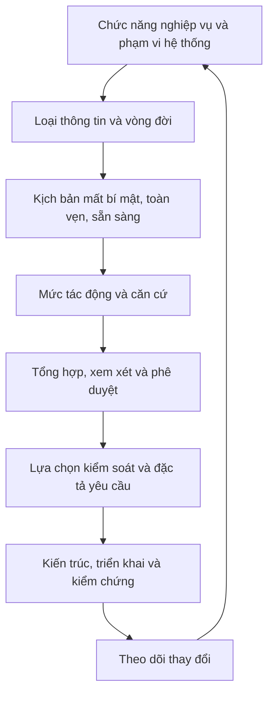

# Categorize

## 1. Xác định mức tác động trước khi đặc tả biện pháp bảo vệ

**Categorize** là hoạt động phân loại thông tin và hệ thống theo tác động tiềm tàng khi mất tính bí mật, toàn vẹn hoặc sẵn sàng. Kết quả phải giải thích được thông tin nào cần bảo vệ, chức năng nghiệp vụ nào phụ thuộc vào nó và hậu quả đối với tổ chức, cá nhân cùng các bên liên quan.

Trong chương **Risk management và compliance** của module yêu cầu bảo mật, phân loại là một đầu vào để chuyển mục tiêu an toàn thông tin thành yêu cầu cụ thể. Nhãn mức tác động chỉ hữu ích khi nhóm phát triển có thể lần theo nó đến quyết định kiến trúc, yêu cầu xác thực, phân quyền, bảo vệ dữ liệu, logging và phục hồi.

Ví dụ, câu “cổng thanh toán có mức tác động cao” chưa cho biết phải kiểm thử điều gì. Hồ sơ cần chỉ ra rằng sửa trái phép tài khoản thụ hưởng có thể dẫn đến chi trả sai hàng loạt, rồi liên kết hậu quả đó với yêu cầu phê duyệt, ràng buộc nội dung được duyệt và kiểm tra tại điểm thực hiện chi trả.

Bài dùng **NIST RMF trong SP 800-37 Rev. 2**, **FIPS 199** và phương pháp của **SP 800-60 Vol. 1 Rev. 1** làm khung tham chiếu có phiên bản. Ví dụ, mã yêu cầu và ngưỡng vận hành trong bài là thiết kế minh họa. Chúng không phải bảng phân loại mặc định cho mọi doanh nghiệp hay kết luận đáp ứng một nghĩa vụ pháp lý cụ thể.

### Mục tiêu học tập

Sau bài này, người học có thể:

1. Mô tả phạm vi hệ thống và các loại thông tin cần phân loại.
2. Lập luận riêng cho tác động mất bí mật, toàn vẹn và sẵn sàng.
3. Tổng hợp kết quả, ghi nhận giả định và xác định người phê duyệt.
4. Truy vết mức tác động sang rủi ro, yêu cầu bảo mật và bằng chứng kiểm thử.
5. Nhận biết thay đổi nào làm quyết định phân loại cần được xem xét lại.

## 2. Phân biệt các kết quả thường bị gọi chung là phân loại

| Hoạt động | Câu hỏi chính | Ví dụ kết quả |
|---|---|---|
| Gắn nhãn dữ liệu | Dữ liệu được phép chia sẻ, sử dụng và lưu ở đâu? | Public, Internal, Restricted theo chính sách tổ chức |
| Security categorization | Mất từng thuộc tính bảo mật gây hậu quả đến mức nào? | C = Moderate, I = High, A = Moderate |
| Đánh giá rủi ro | Kịch bản đe dọa có khả năng và hậu quả ra sao trong bối cảnh cụ thể? | Rủi ro sửa lệnh chi trả cần xử lý trước phát hành |
| Đánh giá lỗ hổng | Một điểm yếu kỹ thuật có đặc tính và mức nghiêm trọng nào? | Lỗi kiểm tra quyền trên API phê duyệt |
| Xác định nghĩa vụ áp dụng | Cam kết, chính sách hoặc quy định nào chi phối hoạt động xử lý này? | Điều khoản hợp đồng về dữ liệu, truy cập và bằng chứng |
| Chấp nhận rủi ro | Ai chấp nhận phần rủi ro còn lại, trong phạm vi và thời hạn nào? | Quyết định có owner, điều kiện và ngày hết hiệu lực |

Không có phép đổi cố định từ nhãn Restricted thành High, từ điểm lỗ hổng thành mức tác động hệ thống, hoặc từ một chứng nhận của nhà cung cấp thành kết luận an toàn cho sản phẩm. Mỗi kết quả trả lời một câu hỏi và cần căn cứ riêng.

Thông tin đã công khai vẫn có thể đòi hỏi tính toàn vẹn cao. Nếu một tệp công khai quyết định tài khoản nhận tiền, việc sửa nội dung có thể gây hậu quả nghiêm trọng dù đọc nội dung không tạo thêm thiệt hại đáng kể.

Tương tự, một hệ thống ít bị tấn công vẫn có thể có tác động cao nếu sự cố xảy ra. Việc chưa quan sát thấy tấn công không giải thích được hậu quả của một lệnh chi trả bị sửa thành công.

## 3. Vị trí của Categorize trong quản lý rủi ro

Trong RMF được tham chiếu, các bước gồm Prepare, Categorize, Select, Implement, Assess, Authorize và Monitor. Categorize cung cấp căn cứ cho lựa chọn kiểm soát; nó cần thông tin về hệ thống và nghiệp vụ, thay vì chờ đến lúc kiểm thử mới gắn nhãn. [Nguồn: NIST — Categorize Step](https://csrc.nist.gov/projects/risk-management/about-rmf/categorize-step).

SP 800-37 Rev. 2 chia Categorize thành ba nhiệm vụ sau. [Nguồn: SP 800-37 Rev. 2, mục 3.2 và bảng E-2](https://nvlpubs.nist.gov/nistpubs/SpecialPublications/NIST.SP.800-37r2.pdf).

| Nhiệm vụ | Kết quả cần có | Trách nhiệm chính theo khung tham chiếu |
|---|---|---|
| C-1 — System Description | Mô tả đặc điểm hệ thống | System Owner |
| C-2 — Security Categorization | Kết quả phân loại hệ thống và thông tin được ghi nhận | System Owner; Information Owner hoặc Steward |
| C-3 — Security Categorization Review and Approval | Quyết định phân loại đã được xem xét và phê duyệt | Authorizing Official hoặc đại diện; vai trò phụ trách privacy cấp cơ quan đối với hệ thống xử lý PII |

Trong doanh nghiệp, có thể ánh xạ trách nhiệm sang chủ sản phẩm, chủ dữ liệu, kiến trúc sư, security, privacy và người có thẩm quyền quản trị rủi ro. Cần ghi rõ ai cung cấp căn cứ và ai quyết định; không chỉ thay mọi vai trò bằng tên một nhóm chung chung.

Luồng làm việc minh họa của nhóm sản phẩm:



Một hồ sơ phân loại được phê duyệt không đồng nghĩa hệ thống đã được phép vận hành hoặc đã kiểm chứng mọi kiểm soát. Ví dụ, nhóm có thể thống nhất I = High nhưng việc kiểm thử chống sửa lệnh chi trả vẫn chưa hoàn thành.

## 4. Bắt đầu bằng phạm vi có thể kiểm tra

### 4.1. Mô tả hệ thống theo công việc mà nó thực hiện

Giả sử tổ chức xây **Payment Approval Portal**, cổng tiếp nhận và phê duyệt đề nghị thanh toán. Luồng chính gồm tạo đề nghị, đính kèm chứng từ, cập nhật người thụ hưởng, phê duyệt và gửi lệnh đến bộ phận thực hiện chi trả.

Phạm vi minh họa bao gồm API, giao diện quản trị, cơ sở dữ liệu, kho chứng từ, hàng đợi gửi lệnh, worker xử lý, bản xuất và bản sao lưu do nhóm chịu trách nhiệm. Dịch vụ định danh, dịch vụ quản lý khóa và cổng ngân hàng được ghi nhận là phụ thuộc bên ngoài với giao diện, chủ sở hữu và trách nhiệm bảo vệ tương ứng.

Một mô tả chỉ liệt kê container hoặc máy chủ sẽ bỏ sót ý nghĩa nghiệp vụ. Ngược lại, chỉ ghi “ứng dụng tài chính” sẽ không đủ để xác định bản sao dữ liệu trong hàng đợi hay quyền mà worker cần khi gửi lệnh.

### 4.2. Những câu hỏi phạm vi phải trả lời

| Khía cạnh | Điều phải ghi nhận trong ví dụ |
|---|---|
| Chức năng | Cổng chỉ đề xuất và phê duyệt hay còn có quyền thực hiện chi trả? |
| Danh tính | Nhân viên, người duyệt, quản trị viên, workload và tài khoản hỗ trợ nào tham gia? |
| Ranh giới dữ liệu | Dữ liệu của đơn vị hoặc tenant nào được xử lý chung? |
| Luồng liên kết | Ai gửi dữ liệu đến cổng, ai dùng kết quả, qua giao diện nào? |
| Bản sao | Payload trong hàng đợi, CSV tải về, chứng từ, log, backup và môi trường phục hồi |
| Quyền quản trị | Ai có thể thay cấu hình, cấp quyền, khôi phục dữ liệu hoặc đọc dump? |
| Phụ thuộc | Hệ thống định danh, khóa, email và dịch vụ chi trả ảnh hưởng thế nào đến luồng chính? |
| Điều kiện vận hành | Giờ chốt lệnh, thời gian làm việc, số giao dịch và quy trình thủ công dự phòng |

Đưa ngân hàng ra ngoài ranh giới quản trị không loại bỏ hậu quả từ một lệnh sai do cổng tạo ra. Nhóm cần phân tích cả dữ liệu cổng gửi đi và điều kiện bên nhận tin cậy kết quả đó.

### 4.3. Kiểm kê loại thông tin theo ngữ nghĩa

“Bảng SQL”, “JSON” và “PDF” là cách biểu diễn. Loại thông tin cần được mô tả theo mục đích: hồ sơ người thụ hưởng, đề nghị thanh toán, quyết định phê duyệt, chứng từ hoặc thông tin quản trị quyền.

Một loại thông tin có thể xuất hiện ở nhiều nơi. Quyết định phê duyệt có thể nằm trong database, sự kiện hàng đợi, file đối soát và log. Mỗi nơi giữ dữ liệu cần một quyết định xử lý; không mặc định mọi bản sao có cùng tập người được phép đọc.

Trong ví dụ, nhóm lập danh mục `IT-01` đến `IT-05`, gắn mỗi loại với owner, nơi xuất hiện, vòng đời, bên sử dụng và căn cứ đánh giá. Danh mục chưa biết rõ chủ sở hữu phải được ghi là còn thiếu thông tin, thay vì tự cho mức thấp.

## 5. Đánh giá ba chiều tác động

### 5.1. Bí mật, toàn vẹn và sẵn sàng

- **Confidentiality — C:** hậu quả khi thông tin được tiết lộ cho bên ngoài phạm vi được phép.
- **Integrity — I:** hậu quả khi thông tin bị sửa hoặc hủy trái phép, bao gồm dữ liệu làm căn cứ cho quyết định nghiệp vụ.
- **Availability — A:** hậu quả khi không thể truy cập hoặc sử dụng thông tin, chức năng đúng lúc cần.

FIPS 199 dùng ba mức tác động: **Low** cho ảnh hưởng bất lợi có giới hạn, **Moderate** cho ảnh hưởng nghiêm trọng và **High** cho ảnh hưởng rất nghiêm trọng hoặc thảm họa. Các mức cần được diễn giải trong bối cảnh tổ chức và cá nhân chịu ảnh hưởng. [Nguồn: FIPS 199, mục 3](https://nvlpubs.nist.gov/nistpubs/FIPS/NIST.FIPS.199.pdf).

Hồ sơ của cổng thanh toán phải mô tả các hậu quả cụ thể trước khi chọn mức:

| Chiều | Kịch bản minh họa | Căn cứ cần thu thập |
|---|---|---|
| C | Tải về toàn bộ hồ sơ thụ hưởng và chứng từ ngoài quyền | Loại thông tin, số người bị ảnh hưởng, khả năng lạm dụng và nghĩa vụ xử lý |
| I | Thay tài khoản nhận tiền sau khi giao dịch được duyệt | Quy mô chi trả, khả năng phát hiện, khả năng đảo ngược và tác động dây chuyền |
| A | Không gửi được lệnh trước thời điểm chốt | Thời hạn nghiệp vụ, hàng tồn đọng, phương án thay thế và hậu quả khi trễ |

Một câu trả lời “có ảnh hưởng tài chính” chưa đủ. Cần biết ảnh hưởng nhỏ, đáng kể hay khiến tổ chức không thực hiện được chức năng chính; đồng thời xét người bị hại, các đơn vị liên quan và thời gian khắc phục.

### 5.2. Thời điểm và thời lượng làm thay đổi hậu quả

Với cổng minh họa, ngừng 30 phút trong thời gian ít giao dịch có thể xử lý bằng cách chờ. Cùng thời lượng trước giờ chốt lệnh có thể làm trễ thanh toán hàng loạt. Vì vậy, đánh giá A phải có cửa sổ nghiệp vụ và loại sự cố đang xét.

Các con số như 30 phút chỉ mô tả kịch bản. Không có quy tắc phổ quát rằng một số phút gián đoạn tự tương ứng với Low, Moderate hoặc High. Chủ nghiệp vụ phải giải thích hậu quả và khả năng duy trì chức năng trong điều kiện đó.

Đối với I, cần hỏi khi nào lỗi được phát hiện. Một bản ghi sai được chặn trước khi gửi lệnh khác với bản ghi sai đã được các hệ thống khác dùng để chi trả. Đánh giá không được kết thúc ở ranh giới màn hình nhập liệu.

### 5.3. Giữ riêng tác động và hiệu quả kiểm soát

Trong ví dụ, mã hóa storage là một kiểm soát bảo vệ bí mật. Nó không làm biến mất hậu quả nếu hồ sơ thụ hưởng thực sự bị tiết lộ qua một API có quyền giải mã.

Tương tự, hệ thống có backup vẫn cần đánh giá hậu quả khi chức năng chi trả không sử dụng được đúng hạn. Việc backup có giúp phục hồi trong giới hạn cho phép hay không là điều phải được chứng minh bằng thiết kế và diễn tập.

SP 800-60 lưu ý việc đánh giá tác động nói chung độc lập với cơ chế dùng để giảm hậu quả của xâm phạm. Mức đề xuất ban đầu cần được xem xét theo bối cảnh; việc tổng hợp thông tin, chức năng trọng yếu và yếu tố thời gian có thể làm mức hệ thống cần tăng. [Nguồn: SP 800-60 Vol. 1 Rev. 1, mục 4.2–4.4](https://nvlpubs.nist.gov/nistpubs/Legacy/SP/nistspecialpublication800-60v1r1.pdf).

## 6. Tổng hợp kết quả mà không làm mất căn cứ

### 6.1. Giữ ba thành phần trước khi dùng một mức chung

Theo FIPS 199, mức hệ thống cho từng mục tiêu lấy mức cao nhất trong các loại thông tin tương ứng, gọi là **high-water mark**. Ở cấp hệ thống, mỗi mục tiêu dùng Low, Moderate hoặc High; không dùng Not Applicable. [Nguồn: FIPS 199, phần Security Categorization Applied to Information Systems](https://nvlpubs.nist.gov/nistpubs/FIPS/NIST.FIPS.199.pdf).

```text
C_system = max(C của các loại thông tin trong phạm vi)
I_system = max(I của các loại thông tin trong phạm vi)
A_system = max(A của các loại thông tin trong phạm vi)

Thứ tự: Low < Moderate < High
```

Đây là bước tổng hợp theo từng chiều; sau đó vẫn cần xem xét các yếu tố hệ thống đã nêu. Không lấy trung bình các mức, không dùng số lượng loại thông tin Low để làm loãng một loại High.

Khi cần một **system impact level** chung trong cách tiếp cận được minh họa bởi NIST, lấy mức cao nhất của ba thành phần. Hồ sơ vẫn phải giữ vector CIA để các quyết định tiếp theo thấy rõ mục tiêu nào dẫn đến mức đó. [Nguồn: NIST RMF Categorize Step FAQs, câu 11 và 21](https://csrc.nist.gov/CSRC/media/Projects/risk-management/documents/02-Categorize%20Step/NIST%20RMF%20Categorize%20Step-FAQs.pdf).

### 6.2. Ví dụ đã có giả định nghiệp vụ

Giả định cổng có quyền phát hành lệnh chi trả, xử lý số tiền lớn so với khả năng tài chính của tổ chức. Việc chi trả sai hàng loạt có thể khiến tổ chức không thực hiện được một chức năng chính. Khi gián đoạn, tổ chức còn phương án thủ công đã được đánh giá để duy trì một phần hoạt động thiết yếu.

Bảng sau là kết quả giả định của một phiên làm việc giữa chủ nghiệp vụ, chủ dữ liệu và security. Mức được chọn theo hậu quả trong tình huống này, không theo tên loại dữ liệu.

| Mã | Loại thông tin | C | I | A | Căn cứ chính trong ví dụ |
|---|---|---|---|---|---|
| IT-01 | Hồ sơ người thụ hưởng | Moderate | High | Moderate | Lộ thông tin gây thiệt hại đáng kể; sửa tài khoản có thể chuyển hướng chi trả hàng loạt |
| IT-02 | Lệnh thanh toán và quyết định duyệt | Moderate | High | Moderate | Nội dung và trạng thái duyệt quyết định lệnh được thực hiện |
| IT-03 | Chứng từ đính kèm | Moderate | Moderate | Low | Lộ hoặc sửa gây thiệt hại đáng kể; có nguồn đối chiếu và khả năng nộp lại theo giả định |
| IT-04 | Audit nghiệp vụ | Moderate | High | Moderate | Là đầu vào bắt buộc cho đối soát và kiểm soát phát hành lệnh trong thiết kế này |
| IT-05 | Nội dung trợ giúp đã công bố | Low | Low | Low | Sai lệch có giới hạn, không được dùng làm căn cứ hay cấu hình chi trả |

Kết quả tổng hợp ban đầu:

```text
SC(Payment Approval Portal) = {
    (confidentiality, Moderate),
    (integrity, High),
    (availability, Moderate)
}

System impact level minh họa = High
```

Nhóm tiếp tục xét dữ liệu tổng hợp, quyền quản trị, phụ thuộc và cửa sổ chốt lệnh. Trong tình huống giả định này, phiên xem xét không tìm thấy căn cứ tăng C hoặc A; hồ sơ ghi cả kết luận lẫn lý do. Nếu phương án thủ công chưa được xác minh, phần lập luận về A còn thiếu bằng chứng và chưa đủ điều kiện phê duyệt.

Không suy rằng mọi audit log đều có I = High. Kết quả của IT-04 xuất phát từ vai trò cụ thể của log trong kiểm soát chi trả ở thiết kế này. Một hệ thống khác phải phân tích lại luồng sử dụng bằng chứng của mình.

### 6.3. Dữ liệu tổng hợp và chức năng dùng chung

Một bản ghi chi trả riêng lẻ có thể tạo hậu quả khác với toàn bộ lịch sử giao dịch của tổ chức. Trong phiên xem xét, nhóm cần phân tích cả việc lộ từng hồ sơ lẫn lộ toàn bộ bản xuất mà quản trị viên có thể tạo.

Một worker xử lý nhiều đơn vị có thể có quyền lớn hơn từng người dùng. Nếu worker dùng chung khóa hoặc tài khoản có thể phát hành lệnh cho mọi tenant, phạm vi hậu quả phải phản ánh capability đó. Tách giao diện thành nhiều màn hình không đủ chứng minh đã tách hậu quả.

Nếu kiến trúc thay đổi để tạo các ranh giới độc lập thực sự, cần mô tả lại quyền, luồng dữ liệu và phụ thuộc. Với cổng đang xét, việc tách riêng kho hướng dẫn chỉ có ý nghĩa khi nó không giữ credential hoặc cấu hình có thể tác động tới hệ thống chi trả.

## 7. Ghi quyết định để người khác có thể tái lập

### 7.1. Hồ sơ tối thiểu của nhóm sản phẩm

Hồ sơ nên cho phép một người không tham gia cuộc họp trả lời: vì sao mức này được chọn, căn cứ đến từ đâu và có còn phù hợp với hệ thống hiện tại hay không.

| Thành phần | Nội dung trong hồ sơ minh họa |
|---|---|
| Đối tượng | Tên hệ thống, owner, phiên bản phạm vi và môi trường |
| Căn cứ | Chức năng nghiệp vụ, sơ đồ dữ liệu, đánh giá tác động và nghĩa vụ đã xác định |
| Danh mục thông tin | Loại thông tin, owner, vị trí, bản sao và bên sử dụng |
| Lập luận CIA | Hậu quả, mức theo từng chiều và giả định liên quan |
| Tổng hợp | Vector hệ thống, mức chung nếu dùng, yếu tố điều chỉnh |
| Điểm chưa rõ | Vấn đề, người cần trả lời, hạn xử lý và cách quản lý trong thời gian chờ |
| Truy vết | Risk ID, requirement ID, quyết định kiến trúc và bằng chứng cần có |
| Phê duyệt | Vai trò quyết định, phiên bản được duyệt, ngày và điều kiện hiệu lực |
| Thay đổi | Sự kiện phải xem xét lại và lịch sử lý do điều chỉnh |

### 7.2. Mẫu record minh họa

Mẫu dưới đây là schema nội bộ của ví dụ, không phải định dạng bắt buộc của NIST. Các ID là tham chiếu giả định để thể hiện cách truy vết.

```yaml
decision_id: CAT-PAY-001
system: Payment Approval Portal
scope_revision: boundary-v3
method_reference:
  - NIST SP 800-37 Rev. 2
  - FIPS 199
  - NIST SP 800-60 Vol. 1 Rev. 1
business_function: Approve and issue payment instructions
information_types:
  - IT-01
  - IT-02
  - IT-03
  - IT-04
  - IT-05
security_category:
  confidentiality: MODERATE
  integrity: HIGH
  availability: MODERATE
overall_impact: HIGH
rationale_references:
  - BIA-PAY-003
  - INFO-INVENTORY-PAY-002
  - THREAT-PAY-004
assumptions:
  - Manual fallback supports essential payments during the defined outage window
  - Published help content cannot change payment routing
review_state: PENDING_APPROVAL
decision_owner_role: Business system owner
required_review_roles:
  - Information owner
  - Security representative
  - Privacy representative
  - Designated risk authority
requirement_references:
  - SR-AUTH-01
  - SR-AUTHZ-01
  - SR-DATA-01
  - SR-AUDIT-01
  - SR-REC-01
```

`PENDING_APPROVAL` có nghĩa là hồ sơ mới được đề xuất. Không dùng một record đã có đủ trường để thay cho quyết định phê duyệt. Khi phê duyệt, lưu đúng phiên bản hồ sơ và bằng chứng người có thẩm quyền đã xem xét; khi thay phạm vi, quyết định cũ không tự bao phủ phần mới.

Trong hồ sơ thực, giả định về phương án thủ công phải liên kết đến bằng chứng đánh giá cụ thể. Đường dẫn hoặc mã tài liệu chỉ là cơ chế truy cập căn cứ; chúng không chứng minh nội dung căn cứ còn đúng.

## 8. Chuyển phân loại thành yêu cầu có thể kiểm chứng

### 8.1. Chuỗi truy vết cần đi hết đến hành vi

```text
IT-02: lệnh chi trả
  -> I = High vì sửa lệnh có thể chuyển hướng chi trả hàng loạt
  -> R-PAY-02: thay nội dung lệnh sau khi đã được duyệt
  -> SR-AUTHZ-01: nội dung được duyệt phải trùng nội dung được phát hành
  -> Điểm cưỡng chế: dịch vụ phát hành lệnh và kho quyết định duyệt
  -> TV-PAY-02: sửa tài khoản hoặc số tiền sau duyệt phải bị chặn
  -> Bằng chứng: kết quả API, trạng thái nghiệp vụ, audit và không phát lệnh
```

Mức I = High không tự chỉ định một cơ chế kỹ thuật duy nhất. Nhóm cần kết hợp threat model và kiến trúc để chọn nơi cưỡng chế. Trong ví dụ, kiểm tra chỉ ở giao diện sẽ bỏ sót worker, API nội bộ hoặc thao tác retry.

### 8.2. Ma trận yêu cầu của cổng minh họa

| Yêu cầu | Rủi ro và thuộc tính liên quan | Hành vi được đặc tả | Bằng chứng kiểm chứng |
|---|---|---|---|
| SR-AUTH-01 — Xác thực thao tác duyệt | R-PAY-01: chiếm phiên của người có quyền duyệt; I | Mỗi thao tác duyệt phải có danh tính đã xác minh và bằng chứng xác thực tăng cường còn hiệu lực theo policy sản phẩm | Phiên hợp lệ, hết hiệu lực, thiếu bằng chứng hoặc sai chủ thể; kiểm tra quyết định và tác động phụ |
| SR-AUTHZ-01 — Ràng buộc quyền và nội dung | R-PAY-02: vượt quyền, duyệt chéo tenant hoặc thay lệnh; C/I | Điểm phát hành phải kiểm tra tenant, quyền đối với lệnh, version nội dung và quyết định duyệt; thay dữ liệu liên quan phải làm quyết định cũ không còn dùng được | Gọi trực tiếp API/worker; sửa số tiền, người thụ hưởng hoặc version sau duyệt; không được phát lệnh |
| SR-DATA-01 — Bảo vệ bản sao dữ liệu | R-PAY-03: đọc storage, backup hoặc bản xuất ngoài quyền; C | Các vị trí giữ IT-01/IT-02 trong danh mục phải dùng profile bảo vệ dữ liệu và policy truy cập đã phê duyệt, kể cả đường giải mã | Kiểm tra cấu hình, quyền đọc và khả năng dùng khóa; thử truy cập bằng principal ngoài phạm vi |
| SR-AUDIT-01 — Ghi và bảo vệ quyết định | R-PAY-04: sửa hoặc thiếu bằng chứng chi trả; I | Lưu actor, tenant, lệnh/version, quyết định, thời điểm và correlation ID; không cho principal nghiệp vụ sửa bản ghi đã chốt; loại secret khỏi log | Kiểm tra event tại các nhánh thành công/từ chối; thử sửa/xóa bằng role nghiệp vụ; kiểm tra dữ liệu nhạy cảm |
| SR-REC-01 — Khôi phục chức năng chi trả | R-PAY-05: gián đoạn hoặc restore sai trạng thái; A/I | Khôi phục luồng thiết yếu cùng dữ liệu, quyền và phụ thuộc theo RTO/RPO được chủ nghiệp vụ chấp nhận; không phát lại lệnh đã hoàn tất | Diễn tập restore và đối soát trên dữ liệu thử đại diện; đo thời gian, điểm dữ liệu và lệnh trùng |

Các yêu cầu trên là khung sản phẩm cần được làm rõ bằng profile và tham số. Ví dụ, “xác thực tăng cường còn hiệu lực” phải liên kết tới policy định nghĩa phương thức chấp nhận, tuổi bằng chứng và binding với chủ thể/thao tác. Bài không suy một mức xác thực tiêu chuẩn chỉ từ nhãn High.

### 8.3. Làm rõ tiêu chí đo thay vì để tính từ quyết định thay hành vi

Giả sử chủ nghiệp vụ chọn **RTO tối đa 2 giờ** và **RPO tối đa 15 phút** cho luồng chi trả thiết yếu. Đây là mục tiêu riêng của ví dụ, không phải giá trị do mức A = Moderate tự tạo ra.

- RTO cần có mốc bắt đầu gián đoạn và định nghĩa “luồng thiết yếu hoạt động lại”, bao gồm quyền truy cập và phụ thuộc cần thiết.
- RPO cần chỉ rõ tập dữ liệu được bảo vệ và cách xác định khoảng mất dữ liệu tính tới thời điểm gián đoạn.
- Khôi phục còn phải giữ tính toàn vẹn: những giao dịch đã phát hành trước sự cố không được phát hành thêm lần nữa chỉ vì cơ sở dữ liệu được restore về một mốc cũ.

Tiêu chí chấp nhận của một ca thử có thể được viết như sau:

```text
ID: TV-PAY-02
Liên kết: CAT-PAY-001 / IT-02 / R-PAY-02 / SR-AUTHZ-01

Given:
  Lệnh P của tenant A, version 7 đã được người có quyền phê duyệt.
  Quyết định duyệt ràng buộc với nội dung của version 7.

When:
  Người gọi sửa tài khoản thụ hưởng để tạo version 8,
  rồi yêu cầu phát hành bằng quyết định duyệt của version 7.

Then:
  Dịch vụ phát hành từ chối theo hợp đồng lỗi đã đặc tả.
  Không gửi lệnh chi trả ra ngoài và không đánh dấu đã phát hành.
  Lưu audit của lần từ chối, tham chiếu đúng lệnh và các version.
  Không ghi tài khoản đầy đủ, credential hoặc secret vào audit.
```

Ca thử này kiểm chứng một yêu cầu. Nó không tự chứng minh toàn hệ thống đã đáp ứng I = High, không thay cho kiểm tra các đường cập nhật khác, quản trị quyền hoặc tính nhất quán khi có cạnh tranh đồng thời.

## 9. Liên kết với baseline, privacy và compliance

### 9.1. Mức phân loại là đầu vào cho lựa chọn kiểm soát

SP 800-53B cung cấp ba security control baseline theo mức tác động và hướng dẫn tailoring; privacy baseline được mô tả độc lập với mức tác động hệ thống. Baseline là điểm xuất phát cho lựa chọn, không phải toàn bộ đặc tả sản phẩm. [Nguồn: NIST SP 800-53B — Control Baselines for Information Systems and Organizations](https://csrc.nist.gov/pubs/sp/800/53/b/upd1/final).

Trong cổng minh họa, một baseline có thể chỉ ra nhóm kiểm soát truy cập hoặc audit cần xét. Nhóm vẫn phải xác định tài nguyên nào được kiểm soát, tenant nào được đọc, ai có quyền duyệt, log ở đâu và bằng chứng nào chứng minh hành vi đúng.

Không đánh dấu đạt chỉ vì control xuất hiện trong bảng ánh xạ. Bằng chứng cần liên kết tới cấu hình hoặc triển khai đúng phạm vi và các kết quả đánh giá liên quan.

### 9.2. Privacy cần xem cả hoạt động xử lý hợp lệ

Ví dụ, cổng dùng hồ sơ người thụ hưởng để tạo báo cáo đánh giá nhân viên không nằm trong mục đích đã xác định. Rủi ro đối với cá nhân có thể xuất hiện dù không có ai vượt quyền kỹ thuật hoặc phá mã hóa.

Vì vậy, nhóm minh họa giữ một nhánh đánh giá riêng về mục đích sử dụng, người chịu ảnh hưởng, dữ liệu cần thu thập, thời hạn giữ và bên nhận. Không dùng kết quả C = Moderate để kết luận mọi vấn đề về xử lý dữ liệu cá nhân đã được giải quyết.

Khi chưa rõ dữ liệu trong chứng từ thuộc phạm vi nào, chủ dữ liệu và vai trò privacy cần xử lý điểm chưa rõ. Không giải quyết bằng cách gắn tất cả PDF cùng một nhãn rồi bỏ qua nội dung thực tế.

### 9.3. Lập danh mục nghĩa vụ theo điều kiện áp dụng

Một registry nghĩa vụ của cổng có thể ghi:

| Trường | Mục đích |
|---|---|
| Nguồn và phiên bản | Xác định đúng hợp đồng, chính sách hoặc văn bản cần đối chiếu |
| Điều kiện áp dụng | Loại thông tin, chủ thể, hoạt động xử lý và bên liên quan nào làm nghĩa vụ có hiệu lực |
| Phạm vi | Hệ thống, môi trường, nhà cung cấp và bản sao dữ liệu nào chịu tác động |
| Yêu cầu dẫn xuất | Requirement ID, owner và tiêu chí chấp nhận tương ứng |
| Bằng chứng | Tài liệu, cấu hình, kiểm thử hoặc hồ sơ vận hành cần lưu |
| Thời điểm xem xét | Mốc hiệu lực và sự kiện làm kết luận cần cập nhật |

Một điều khoản lưu chứng từ trong hợp đồng phải được phân tích cùng yêu cầu hạn chế truy cập và xóa dữ liệu đã hết mục đích. Không tự đặt thời hạn giữ bằng mức CIA hoặc chọn một con số chỉ vì sản phẩm khác đang dùng.

Đối với nhà cung cấp lưu trữ hoặc dịch vụ định danh, cần ghi rõ phần trách nhiệm của họ và phần sản phẩm phải cấu hình. Chứng nhận của nhà cung cấp không tự chứng minh nhóm đã giới hạn quyền giải mã, đã tắt log payload hay đã kiểm thử restore đúng luồng chi trả.

## 10. Xem xét và phê duyệt dựa trên hồ sơ

Một phiên xem xét tốt tập trung vào căn cứ có thể kiểm tra, không dừng ở việc biểu quyết High hay Moderate.

| Nội dung xem xét | Điều cần chứng minh trong cổng minh họa |
|---|---|
| Phạm vi | Bản xuất, hàng đợi, backup và công cụ quản trị đã được xét |
| Thông tin | Danh mục bao phủ cả dữ liệu nghiệp vụ lẫn dữ liệu/quyền hỗ trợ chi trả |
| Hậu quả | Có kịch bản riêng cho C, I, A và tác động tới người liên quan |
| Giả định | Phương án thủ công, nguồn đối chiếu và giới hạn quyền có căn cứ |
| Tổng hợp | Không lấy trung bình; có xem xét quy mô và phụ thuộc |
| Nhất quán | Hai hệ thống có cùng hậu quả không bị cho mức khác nhau chỉ vì khác nhóm sở hữu |
| Truy vết | Mỗi hậu quả trọng yếu có liên kết tới rủi ro và nhu cầu bảo vệ |
| Quyết định | Người có thẩm quyền phê duyệt đúng revision; điểm chưa rõ có cách xử lý |

Nếu chủ nghiệp vụ chưa xác nhận khả năng duy trì thanh toán thiết yếu khi gián đoạn, record có thể giữ trạng thái chờ bổ sung căn cứ. Không biến “chưa biết” thành Low hoặc dùng chữ ký của người không có thẩm quyền để hoàn tất thủ tục.

Trong trường hợp bất đồng, ghi các lập luận và bằng chứng còn thiếu. Ví dụ, nhóm vận hành cho rằng có thể restore trong hai giờ nhưng chủ nghiệp vụ chỉ có thể chịu gián đoạn một giờ trước mốc chốt. Vấn đề cần giải quyết là điều kiện nghiệp vụ và khả năng phục hồi, thay vì đổi nhãn A để khiến hai bên trông có vẻ thống nhất.

## 11. Duy trì quyết định trong vòng đời phát triển

Phân loại ban đầu có thể đúng tại thời điểm thiết kế nhưng không còn bao phủ một thay đổi sản phẩm. NIST khuyến nghị xem xét lại hoạt động quản lý rủi ro, gồm categorization, trong vận hành và khi xuất hiện sự kiện liên quan. [Nguồn: NIST RMF Categorize Step FAQs, câu 8](https://csrc.nist.gov/CSRC/media/Projects/risk-management/documents/02-Categorize%20Step/NIST%20RMF%20Categorize%20Step-FAQs.pdf).

Đối với cổng thanh toán, nhóm đặt các trigger xem xét sau:

- Thêm quyền phát hành lệnh tự động vào hệ thống trước đây chỉ tạo đề nghị.
- Thêm loại chứng từ hoặc trường dữ liệu có hậu quả tiết lộ khác trước.
- Mở rộng từ một đơn vị sang nhiều tenant và tăng tổng giá trị chi trả.
- Dùng lịch sử giao dịch cho một mục đích phân tích mới hoặc chia sẻ thêm bên nhận.
- Thay dịch vụ định danh, quản lý khóa, kho lưu trữ hoặc quy trình khôi phục.
- Thay giờ chốt lệnh, quy trình thủ công, thời hạn lưu hoặc điều khoản hợp đồng.
- Phát hiện sự cố cho thấy phạm vi hậu quả hoặc giả định kiểm soát trước đây không đúng.

Một thay đổi như tăng số tenant cần được đánh giá về hậu quả tổng hợp trước khi kết luận phải tăng mức. Không phải mọi thay đổi đều làm đổi vector CIA, nhưng hồ sơ phải thể hiện đã xét câu hỏi đó và lý do giữ hoặc đổi quyết định.

Quy trình thay đổi của ví dụ ghi `CAT-PAY-001` cùng revision phạm vi trong quyết định kiến trúc và các yêu cầu liên quan. Khi thay đổi được duyệt, cập nhật danh mục thông tin, threat model, yêu cầu và kế hoạch kiểm chứng bị ảnh hưởng. Một nhãn High giữ nguyên không có nghĩa công việc truy vết cũng giữ nguyên.

## 12. Sai lầm thường gặp và cách sửa

| Sai lầm | Hệ quả | Cách sửa trong hồ sơ |
|---|---|---|
| Chỉ phân loại theo tên bảng hoặc định dạng file | Bỏ mất mục đích sử dụng và bản sao ngoài database | Gắn loại thông tin với nghiệp vụ, owner và toàn bộ vòng đời |
| Dữ liệu công khai nên cả CIA đều Low | Bỏ sót hậu quả sửa nội dung hoặc ngừng chức năng | Viết kịch bản riêng cho từng chiều |
| Có mã hóa nên hạ mức C | Trộn hậu quả của tiết lộ với hiệu quả một kiểm soát | Giữ lập luận tác động; đánh giá kiểm soát và rủi ro còn lại riêng |
| Chọn High cho mọi thứ để khỏi phân tích | Khó thấy ưu tiên và không giải thích được yêu cầu | Ghi căn cứ theo từng chiều và phân bổ bảo vệ theo phạm vi |
| Chọn mức thấp để vừa ngân sách | Tạo nhu cầu bảo vệ sai với hậu quả thực | Giữ kết quả có căn cứ; xử lý ngân sách và quyết định rủi ro qua đúng thẩm quyền |
| Lấy trung bình các mức của dữ liệu | Làm mất một hậu quả trọng yếu trong hệ thống | Tổng hợp theo từng mục tiêu và xét yếu tố hệ thống |
| Nhà cung cấp đã được đánh giá nên bỏ qua phụ thuộc | Bỏ sót cấu hình, quyền và phần trách nhiệm của sản phẩm | Ghi hợp đồng giao diện, trách nhiệm và bằng chứng liên quan |
| Hoàn tất bảng phân loại là đã đạt compliance | Thiếu triển khai, kiểm chứng và bằng chứng nghĩa vụ | Truy vết từ nguồn áp dụng đến yêu cầu và kết quả thực tế |
| Không cập nhật sau khi thêm chức năng | Quyết định cũ không phản ánh khả năng gây hại mới | Đưa trigger xem xét phân loại vào quy trình thay đổi |

## 13. Sản phẩm đầu ra cần bàn giao

Với ví dụ trong bài, nhóm bàn giao một bộ hồ sơ gồm mô tả phạm vi có revision, danh mục loại thông tin, lập luận CIA, kết quả tổng hợp, giả định và bằng chứng, quyết định xem xét/phê duyệt cùng các liên kết tới requirement ID.

Người triển khai phải tìm được điểm cưỡng chế cho yêu cầu; người kiểm thử phải tìm được kết quả mong đợi và dữ liệu thử; người quản trị rủi ro phải thấy căn cứ chọn mức cùng các điều kiện có thể làm nó thay đổi.

Giá trị của Categorize nằm ở khả năng nối hậu quả nghiệp vụ với việc bảo vệ có thể kiểm chứng. Trong cổng thanh toán, vector `(Moderate, High, Moderate)` trở nên hữu ích khi nó dẫn đến ràng buộc quyết định duyệt với nội dung lệnh, giới hạn quyền theo tenant, bảo vệ bản sao dữ liệu, giữ audit đáng tin cậy và phục hồi mà không chi trả trùng.
