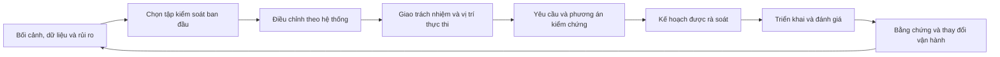

# Select — Lựa chọn kiểm soát để hình thành yêu cầu bảo mật có thể kiểm chứng

## 1. Mục tiêu của Select trong thiết kế yêu cầu bảo mật

Một nhóm có thể biết hệ thống lưu dữ liệu nhạy cảm, đã vẽ luồng dữ liệu và liệt kê nhiều đe dọa nhưng vẫn chưa thống nhất phải xây dựng những bảo vệ nào. Câu “cần bảo mật tốt hơn” không giúp lập trình viên biết điều kiện phải thực thi, người kiểm thử biết thế nào là đạt, hoặc người chịu trách nhiệm biết phần rủi ro nào còn tồn tại.

**Select** là bước lựa chọn kiểm soát. Trong bài này, thuật ngữ được dùng theo Risk Management Framework (RMF) của NIST: chọn và điều chỉnh các kiểm soát phù hợp với rủi ro, rồi ghi nhận phương án bảo vệ. Đây là cách hiểu được áp dụng cho đề bài “Select” trong chương **Risk management và compliance**. [NIST mô tả mục đích bước Select tại trang RMF Select Step](https://csrc.nist.gov/Projects/risk-management/about-rmf/select-step).

Trong phạm vi module **Security Requirements** thuộc thiết kế bảo mật, bài học tập trung vào việc chuyển mục tiêu an toàn thông tin và mô hình đe dọa thành yêu cầu cụ thể. Kết quả phải nối được rủi ro với xác thực, phân quyền, bảo vệ dữ liệu, logging, phục hồi, kiến trúc và tiêu chí kiểm thử trong vòng đời phát triển.

Sau bài học, người học có thể:

- Phân biệt mục tiêu bảo vệ, yêu cầu, kiểm soát và giải pháp triển khai.
- Chọn tập kiểm soát xuất phát từ rủi ro và các nghĩa vụ đã xác định.
- Giải thích quyết định áp dụng, điều chỉnh, kế thừa hoặc thay thế một kiểm soát.
- Phân bổ trách nhiệm giữa nền tảng dùng chung, ứng dụng và bên cung cấp ngoài.
- Viết yêu cầu có điều kiện, kết quả mong đợi và cách kiểm chứng.
- Bàn giao một phương án được quản lý phiên bản, có phần chưa rõ và kế hoạch theo dõi.

Các mã rủi ro, mã yêu cầu, vai trò và ngưỡng trong ví dụ dưới đây đều do bài học đặt ra. Chúng không phải mã kiểm soát NIST hay mức bắt buộc của một tiêu chuẩn.

## 2. Phân biệt các lớp quyết định

### 2.1. Từ mục tiêu tới bằng chứng

| Lớp | Câu hỏi cần trả lời | Ví dụ trong dịch vụ hồ sơ khách hàng |
| --- | --- | --- |
| Mục tiêu bảo vệ | Cần giữ điều gì? | Hồ sơ của tenant A không bị tenant B đọc hoặc xuất |
| Rủi ro | Điều gì có thể làm mục tiêu thất bại? | Worker xuất dữ liệu tin tenantId do client gửi |
| Yêu cầu | Hệ thống phải có hành vi nào? | Mỗi lần xuất phải kiểm tra quyền trên tenant và tập hồ sơ thực tế |
| Kiểm soát | Cơ chế quản lý rủi ro nào được chọn? | Thực thi kiểm soát truy cập tại điểm sử dụng dữ liệu |
| Thiết kế triển khai | Cơ chế đó được hiện thực ra sao? | API và worker dùng bộ quyết định quyền, truy vấn được ràng buộc tenant |
| Bằng chứng | Dựa vào đâu kết luận cơ chế hoạt động? | Kết quả thử chéo tenant, cấu hình thực tế và bản ghi quyết định đã lọc |

Một kiểm soát có thể đáp ứng nhiều yêu cầu; một yêu cầu cũng có thể cần nhiều kiểm soát phối hợp. Ví dụ, ngăn xuất hồ sơ trái phép có thể cần xác thực, phân quyền, giới hạn phạm vi truy vấn, quản lý liên kết tải và audit.

Không nên lấy tên một sản phẩm thay cho yêu cầu. “Dùng nhà cung cấp định danh X” không nói rõ dịch vụ kiểm tra token thế nào, xử lý tài khoản bị vô hiệu hóa ra sao hoặc ai chịu trách nhiệm khi cấu hình liên kết định danh thay đổi.

### 2.2. Kế hoạch không phải kết quả đã được xác minh

Nên phân biệt ít nhất các trạng thái nội bộ sau:

| Trạng thái | Ý nghĩa có thể khẳng định |
| --- | --- |
| Được đề xuất | Có một phương án để thảo luận |
| Được chọn và phê duyệt trong kế hoạch | Có quyết định về phương án sẽ thực hiện |
| Đã triển khai | Có cấu hình hoặc mã thực thi trong phạm vi xác định |
| Đã đánh giá | Có hoạt động đánh giá với phạm vi và kết quả cụ thể |
| Đang được theo dõi | Có cách phát hiện thay đổi hoặc suy giảm sau đánh giá |

Một dòng trong tài liệu không tự chuyển hệ thống tới trạng thái “đã triển khai”. Một ca kiểm thử dự kiến cũng không phải báo cáo kiểm thử đã chạy.

Đối với bài học này, Select kết thúc bằng phương án đủ rõ để triển khai và đánh giá. Các kết luận về hiệu lực thực tế phải chờ bằng chứng của những hoạt động tương ứng.

## 3. Vị trí trong RMF và các công việc của Select

RMF Revision 2 có các bước Prepare, Categorize, Select, Implement, Assess, Authorize và Monitor. Select nhận bối cảnh đã chuẩn bị và kết quả phân loại; những thay đổi về hệ thống có thể khiến nhóm quay lại quyết định trước đó. [NIST SP 800-37 Revision 2](https://csrc.nist.gov/pubs/sp/800/37/r2/final).

Theo mục 3.3 của tài liệu này, Select gồm sáu công việc:

| Mã RMF | Công việc |
| --- | --- |
| S-1 | Lựa chọn kiểm soát |
| S-2 | Điều chỉnh kiểm soát |
| S-3 | Phân bổ kiểm soát |
| S-4 | Ghi nhận phương án triển khai |
| S-5 | Xây dựng chiến lược giám sát liên tục cấp hệ thống |
| S-6 | Rà soát và phê duyệt kế hoạch |

Tên công việc trong bảng được diễn giải ngắn từ [NIST SP 800-37 Revision 2, mục 3.3](https://nvlpubs.nist.gov/nistpubs/SpecialPublications/NIST.SP.800-37r2.pdf). Những mẫu yêu cầu và cách tổ chức hồ sơ ở các phần sau là ví dụ áp dụng do bài học xây dựng.



Sơ đồ diễn đạt luồng làm việc trong ví dụ. Một quyết định ở Select cần được xem lại nếu kiến trúc, dữ liệu, đe dọa hoặc giả định quan trọng thay đổi.

## 4. Chuẩn bị đầu vào bằng một ví dụ xuyên suốt

### 4.1. Hệ thống giả định

Một dịch vụ quản lý hồ sơ khách hàng phục vụ nhiều tổ chức, mỗi tổ chức là một tenant. Người dùng có thể đọc hồ sơ, cập nhật thông tin và yêu cầu xuất báo cáo. Xuất báo cáo được thực hiện bất đồng bộ.

Các thành phần gồm:

- Nhà cung cấp định danh dùng chung cho đăng nhập.
- API tiếp nhận yêu cầu và kiểm tra quyền.
- Worker đọc dữ liệu, tạo file và ghi trạng thái công việc.
- Cơ sở dữ liệu và kho file xuất.
- Dịch vụ quản lý khóa, pipeline audit và hệ thống sao lưu.
- Nhóm hỗ trợ vận hành có một số quyền quản trị riêng.

Trong phạm vi ví dụ, nền tảng bên ngoài vẫn có thể cung cấp một phần bảo vệ. Tuy nhiên, giao diện, cấu hình và trách nhiệm tích hợp với các thành phần đó đều phải được xét.

### 4.2. Thông tin cần biết trước khi chọn

| Đầu vào | Thông tin cần có | Hậu quả nếu thiếu |
| --- | --- | --- |
| Phạm vi hệ thống | API, worker, kho file, công cụ quản trị và môi trường liên quan | Chỉ bảo vệ giao diện nhưng bỏ đường xử lý phía sau |
| Dữ liệu và mục đích xử lý | Loại hồ sơ, trường nhạy cảm, người được sử dụng và vòng đời | Chọn sai cách lưu, ghi log hoặc xóa |
| Phân loại tác động | Hậu quả khi mất bí mật, toàn vẹn hoặc sẵn sàng | Chọn tập bảo vệ theo cảm giác |
| Mô hình đe dọa | Chủ thể, điểm vào, ranh giới tin cậy và kịch bản lạm dụng | Không thấy đường vượt kiểm soát |
| Nghĩa vụ áp dụng | Điều khoản, chính sách, chủ thể xác nhận và phạm vi | Gắn nhãn compliance nhưng không biết phải đáp ứng điều gì |
| Kiến trúc và dịch vụ dùng chung | Vị trí thực thi, giao diện và phần được cung cấp sẵn | Tưởng một bên khác đã làm |
| Khả năng vận hành | Năng lực lưu trữ, giám sát, ứng cứu và phục hồi | Chọn cơ chế không thể duy trì |

Nếu chưa biết một đầu vào, ghi rõ người cần xác nhận và ảnh hưởng tới quyết định. Không điền một mức phân loại hoặc một thời hạn lưu chỉ để hoàn thành biểu mẫu.

Ví dụ, chưa biết hồ sơ cần giữ bao lâu thì yêu cầu xóa có thể đang ở trạng thái chờ quyết định. Nhóm vẫn có thể mô tả cơ chế quản lý vòng đời, nhưng chưa được tuyên bố thời hạn cụ thể đã được phê duyệt.

### 4.3. Danh sách rủi ro làm việc

| Mã nội bộ | Kịch bản | Tác động chính |
| --- | --- | --- |
| R-01 | Người dùng tenant A thay ID để xuất hồ sơ tenant B | Lộ hồ sơ ngoài phạm vi được phép |
| R-02 | Tài khoản đã bị vô hiệu hóa vẫn dùng phiên còn hiệu lực | Truy cập tiếp tục sau khi quyền cần chấm dứt |
| R-03 | Link tải hoặc file xuất bị chia sẻ ngoài phạm vi | Lộ dữ liệu sau khi công việc xuất hoàn tất |
| R-04 | Thao tác nhạy cảm không có dấu vết đáng tin cậy | Không xác định được ai đã truy cập hoặc xuất gì |
| R-05 | Lưu bản sao quá lâu hoặc xóa không nhất quán | Dữ liệu tồn tại ngoài vòng đời đã quyết định |
| R-06 | Dữ liệu chính và quyền truy cập bị hỏng sau sự cố | Không khôi phục được dịch vụ đúng trạng thái bảo vệ |

Đây là điểm xuất phát cho ví dụ, không phải danh sách đầy đủ cho mọi dịch vụ. Cần xét cả người trong tổ chức, lỗi cấu hình, thao tác vô ý và sự cố phụ thuộc.

## 5. Chọn tập kiểm soát ban đầu

### 5.1. Ghi rõ nguồn và phiên bản

Có thể bắt đầu từ một baseline đã được tổ chức chấp thuận, từ một phương pháp lựa chọn riêng được quản trị rõ ràng, hoặc từ tập kiểm soát được yêu cầu trong phạm vi dự án. Điều quan trọng là người đọc biết phương án được hình thành theo căn cứ nào.

Khi sử dụng hệ tài liệu NIST, cần phân biệt:

| Tài liệu | Vai trò trong việc chọn |
| --- | --- |
| SP 800-37 | Mô tả quy trình RMF |
| SP 800-53 | Cung cấp danh mục kiểm soát |
| SP 800-53B | Cung cấp baseline và hướng dẫn điều chỉnh |

SP 800-53B có ba baseline bảo mật theo mức tác động low, moderate, high và một baseline về privacy không được chọn bằng cùng ba mức đó. Không dùng điểm xác suất khai thác để thay cho phân loại tác động. [Thông tin về baseline trong NIST SP 800-53B](https://csrc.nist.gov/pubs/sp/800/53/b/upd1/final).

Đối với dự án áp dụng một hệ quy chiếu khác, hãy giữ đúng tên, phiên bản và quy tắc của hệ đó. Không tự gọi hệ thống là “moderate” theo NIST chỉ vì dữ liệu được nhóm đánh giá là quan trọng.

Hồ sơ lựa chọn tối thiểu nên chỉ ra:

- Tài liệu hoặc chính sách nguồn và phiên bản đã dùng.
- Lý do nguồn đó phù hợp với phạm vi hệ thống.
- Kết quả phân loại hoặc quyết định đầu vào có liên quan.
- Những điều chỉnh và giả định cần tiếp tục theo dõi.
- Người có thẩm quyền xác nhận phương án.

### 5.2. Đối chiếu nghĩa vụ và rủi ro theo hai chiều

Một danh sách chỉ bắt đầu từ rủi ro có thể bỏ sót nghĩa vụ bắt buộc. Một danh sách chỉ bắt đầu từ biểu mẫu compliance có thể bỏ sót đường tấn công riêng của kiến trúc.

Trong ví dụ, tổ chức giả định có chính sách O-01 yêu cầu mọi lần xuất hồ sơ nhạy cảm phải có bằng chứng truy vết. Đây là chính sách nội bộ do bài học đặt ra, không phải một điều luật cụ thể.

Nhóm cần kiểm tra cả hai chiều:

1. Mỗi nghĩa vụ áp dụng đã dẫn tới yêu cầu và người chịu trách nhiệm nào?
2. Mỗi rủi ro đáng xử lý đã có phương án bảo vệ nào?
3. Mỗi kiểm soát được chọn có căn cứ và phạm vi gì?
4. Có yêu cầu nào chỉ được ghi tên nhưng chưa có thành phần thực thi không?

Không kết luận đã đáp ứng một nghĩa vụ chỉ vì cùng một từ khóa xuất hiện trong tài liệu thiết kế.

### 5.3. Không tối ưu theo số lượng kiểm soát

Chọn nhiều mục không bảo đảm bao phủ nhiều đường gây hại. Ba cơ chế cùng nằm trước API có thể vẫn không ngăn worker truy vấn chéo tenant.

Nên kiểm tra một số kịch bản từ đầu tới cuối:

- Người gọi đã đăng nhập nhưng không có quyền trên đối tượng.
- Quyền bị thay đổi trong lúc công việc chờ xử lý.
- API từ chối nhưng một đường truy cập trực tiếp tới kho file vẫn tồn tại.
- Pipeline audit lỗi trong khi worker tạo file.
- Khôi phục bản sao làm xuất hiện dữ liệu hoặc quyền đã bị thu hồi.

Mục tiêu là có tập bảo vệ phối hợp phù hợp với rủi ro và nghĩa vụ trong phạm vi đã xác định.

## 6. Điều chỉnh kiểm soát theo bối cảnh

### 6.1. Tailoring phải có căn cứ

Tailoring là điều chỉnh tập đã chọn cho bối cảnh cụ thể. Hướng dẫn SP 800-53B đề cập việc xác định phần dùng chung, xét phạm vi, chọn kiểm soát bù, điền tham số và bổ sung kiểm soát. Quyết định loại bỏ hoặc thay đổi cần có lý do có thể bảo vệ được. [NIST SP 800-53B, mục 2.4](https://nvlpubs.nist.gov/nistpubs/SpecialPublications/NIST.SP.800-53B.pdf).

Trong hồ sơ dự án, nên tách bốn câu hỏi:

- Kiểm soát có áp dụng với hệ thống không?
- Nếu áp dụng, ai thực hiện và ở đâu?
- Cần chốt tham số nào?
- Nếu phương án chuẩn không dùng được, cách thay thế và phần rủi ro còn lại là gì?

Một kiểm soát được nhà cung cấp thực hiện không vì thế trở thành “không áp dụng”. Nó có thể vẫn áp dụng và được đáp ứng một phần hoặc toàn bộ thông qua cơ chế dùng chung.

### 6.2. Ví dụ sổ quyết định điều chỉnh

| Quyết định nội bộ | Ví dụ | Điều phải ghi nhận |
| --- | --- | --- |
| Giữ nguyên mục tiêu | Mỗi yêu cầu truy cập cần được kiểm tra quyền | Phạm vi API, worker và kho file |
| Cụ thể hóa tham số | Phiên của tài khoản bị vô hiệu hóa phải mất khả năng truy cập trong thời hạn đã chọn | Thời hạn, điểm bắt đầu đo, nguồn trạng thái và cách kiểm thử |
| Bổ sung bảo vệ | Kiểm tra lại quyền khi worker bắt đầu xuất | Kịch bản hàng đợi làm quyết định ban đầu trở nên cũ |
| Kế thừa một phần | Dùng cơ chế xác thực của nền tảng | Phạm vi cam kết và phần ứng dụng vẫn phải làm |
| Thay bằng phương án bù | Một thành phần cũ chưa hỗ trợ cơ chế dự kiến | Mục tiêu được bù, giới hạn, bằng chứng, người chấp thuận và hạn xem lại |
| Xác nhận không áp dụng | Một phương thức truy cập không tồn tại trong kiến trúc được duyệt | Bằng chứng về phạm vi và điều kiện khiến quyết định hết đúng |

“Chưa kịp làm”, “khó kiểm thử” hoặc “đã mua sản phẩm” không tự chứng minh một kiểm soát không áp dụng.

### 6.3. Điền tham số để yêu cầu có nghĩa thực thi

Các phát biểu sau chưa đủ để bàn giao:

> “Thu hồi quyền nhanh chóng.”  
> “Lưu log theo quy định.”  
> “Khôi phục trong thời gian hợp lý.”

Cần bổ sung giá trị hoặc quy tắc ra quyết định. Ví dụ dự án có thể chọn:

| Tham số minh họa | Giá trị giả định | Điểm cần làm rõ |
| --- | --- | --- |
| Thời hạn chặn tài khoản đã vô hiệu hóa | Không quá 5 phút | Đo từ khi sự kiện vô hiệu hóa được ghi nhận bền vững tại nguồn định danh |
| Hiệu lực link tải xuất dữ liệu | Tối đa 10 phút | Link vẫn cần kiểm tra người dùng và quyền ở mỗi lần tải |
| RPO cho hồ sơ chính | Không quá 1 giờ | Mức mất dữ liệu tối đa theo mốc khôi phục phù hợp |
| RTO cho luồng đọc hồ sơ ưu tiên | Không quá 4 giờ | Đo từ mốc gián đoạn đã định tới khi luồng phục vụ và kiểm soát liên quan được xác minh |

Các giá trị này là giả định học tập. Chúng cần được đánh giá với kiến trúc, chi phí, độ tin cậy của nguồn trạng thái và nhu cầu nghiệp vụ trước khi dùng trong một dự án thật.

Không ghi một giá trị rồi để cách triển khai làm nó không thể đạt. Ví dụ, token tự chứa có hiệu lực dài và không có cơ chế cập nhật trạng thái tài khoản sẽ cần được xem xét lại nếu muốn đáp ứng thời hạn thu hồi ngắn.

## 7. Phân bổ kiểm soát và trách nhiệm

### 7.1. Phân biệt phần dùng chung và phần riêng

Trong ví dụ, nhóm có thể phân bổ như sau:

| Dạng phân bổ | Phần được thực hiện | Ví dụ |
| --- | --- | --- |
| Common | Một cơ chế được cung cấp dùng chung cho nhiều hệ thống | Nền tảng quản lý danh tính tổ chức |
| System-specific | Cơ chế riêng của hệ thống đang thiết kế | Kiểm tra quyền đọc hồ sơ theo tenant |
| Hybrid | Một phần dùng chung, một phần do hệ thống hoàn thiện | Đăng nhập dùng nền tảng; ứng dụng xác minh token và xử lý quyền nghiệp vụ |

Dạng phân bổ không cho biết kiểm soát đã được triển khai hiệu quả hay chưa. Cần gắn nó với trách nhiệm và bằng chứng trong phạm vi cụ thể.

### 7.2. Không để trách nhiệm biến mất ở giao diện

| Mục tiêu | Bên cung cấp dùng chung | Nhóm ứng dụng | Bằng chứng dự kiến |
| --- | --- | --- | --- |
| Chấm dứt quyền của tài khoản bị vô hiệu hóa | Cung cấp trạng thái và giao diện thu hồi theo hợp đồng | Kiểm tra hoặc cập nhật trạng thái đủ thường xuyên; xử lý cache | Thử từ lúc vô hiệu hóa tới lúc API và tải file từ chối |
| Bảo vệ file xuất | Cung cấp kho lưu và cơ chế mã hóa | Đặt quyền đối tượng, giới hạn vòng đời, kiểm tra tải | Kiểm tra cấu hình và thử truy cập ngoài tenant |
| Audit có thể điều tra | Vận hành collector và kho bằng chứng | Tạo đúng sự kiện, bảo vệ vùng đệm, thể hiện trạng thái đúng | Đối chiếu tác động nghiệp vụ và sự kiện có thể truy vấn |
| Khôi phục dịch vụ | Cung cấp khả năng lưu và phục hồi hạ tầng | Khôi phục dữ liệu, khóa, cấu hình và quyền ứng dụng | Diễn tập luồng nghiệp vụ sau phục hồi |

Một báo cáo của nhà cung cấp có thể hỗ trợ đánh giá phần họ cung cấp. Nó không tự chứng minh ứng dụng cấu hình đúng hoặc không có đường bỏ qua.

Mỗi phần kế thừa nên có người xác nhận: dùng dịch vụ nào, phiên bản hoặc gói cấu hình nào, điều kiện sử dụng, nghĩa vụ phía khách hàng và khi nào cần xem lại.

## 8. Chuyển lựa chọn thành yêu cầu cụ thể

### 8.1. Mẫu phát biểu

Một yêu cầu có thể dùng cấu trúc:

> Trong **phạm vi và điều kiện** xác định, **thành phần chịu trách nhiệm** phải tạo **hành vi hoặc kết quả** theo **tham số**, kể cả ở **đường lỗi liên quan**; kiểm chứng bằng **phương pháp và tiêu chí đạt**.

Không nhất thiết dồn tất cả vào một câu dài. Có thể tách câu chuẩn tắc, tham số và tiêu chí chấp nhận thành các trường liên kết với nhau.

Ví dụ dưới đây là một tập yêu cầu học tập; không phải baseline đầy đủ của hệ thống.

### 8.2. Xác thực và chấm dứt phiên

> **SR-01:** Sau khi trạng thái vô hiệu hóa tài khoản được ghi nhận bền vững tại nguồn định danh, mọi điểm đọc hồ sơ, tạo yêu cầu xuất và tải file phải từ chối truy cập bằng phiên của tài khoản đó trong tối đa 5 phút.

Cần đặc tả thêm:

- Những loại phiên và token thuộc phạm vi.
- Nguồn trạng thái nào là có thẩm quyền.
- Cách tính thời gian khi có cache hoặc đồng bộ trễ.
- Phản ứng khi không lấy được trạng thái đủ mới.
- Cách ngăn một đường tải file dùng quyền cũ lâu hơn API.

**Kiểm chứng dự kiến:** tạo phiên hợp lệ, vô hiệu hóa tài khoản và đo ở từng điểm truy cập. Ghi nhận cả trường hợp cache cũ, token còn hạn và nguồn định danh tạm không trả lời.

Một lần đăng xuất trên trình duyệt không chứng minh yêu cầu này. Cần thử khả năng sử dụng lại credential phiên trong phạm vi đã định.

### 8.3. Phân quyền theo tenant ở cả API và worker

> **SR-02:** Mỗi thao tác đọc hoặc xuất hồ sơ phải kiểm tra quyền của chủ thể trên tenant và tập dữ liệu thực tế. Giá trị tenantId hoặc objectId do client gửi không được tự trở thành căn cứ cấp quyền.

Với công việc bất đồng bộ, cần có quyết định về quyền khi tiếp nhận và khi worker bắt đầu thực hiện. Trong ví dụ này, worker phải xác nhận lại quyền hiện hành trước khi tạo file; nếu không xác định được quyền thì không tạo đầu ra mới.

**Kiểm chứng dự kiến:**

- Thay ID hồ sơ sang tenant khác.
- Giữ nguyên ID công việc nhưng đổi người truy vấn trạng thái.
- Thu hồi quyền sau khi yêu cầu được xếp hàng và trước khi worker xử lý.
- Gọi trực tiếp đường tải hoặc đường quản trị có liên quan.

Tiêu chí đạt phải bao gồm không trả dữ liệu và không tạo tác động xuất trái phép. Chỉ kiểm tra mã lỗi HTTP chưa đủ.

### 8.4. Bảo vệ đầu ra và khóa

> **SR-03:** File xuất chỉ được tải qua điểm kiểm tra danh tính, quyền và trạng thái file ở mỗi lần tải; liên kết tham chiếu hết hiệu lực sau tối đa 10 phút và không được dùng như một quyền mang theo độc lập.

Thiết kế cần bảo vệ cả bản lưu, đường truyền và quyền quản lý khóa theo cấu hình đã phê duyệt. Không cấp quyền đọc trực tiếp kho file cho người dùng cuối nếu điều đó bỏ qua yêu cầu kiểm tra mỗi lần tải.

**Kiểm chứng dự kiến:** thử tải khi link hết hạn, tài khoản bị thu hồi quyền, file thuộc tenant khác và qua đường truy cập trực tiếp tới nơi lưu. Xem cấu hình quyền quản lý khóa và kiểm tra cơ chế từ chối khi khóa cần thiết không khả dụng.

Chỉ bật mã hóa khi lưu không ngăn người có quyền giải mã bị cấu hình quá rộng đọc nhầm file.

### 8.5. Audit gắn với tác động thực tế

> **SR-04:** Mỗi lần tạo file xuất phải liên kết được với chủ thể, tenant, phạm vi xuất, quyết định quyền và trạng thái kết quả bằng các định danh ổn định; sự kiện thành công chỉ được ghi khi điều kiện hoàn tất đã định được đáp ứng.

Ví dụ kiến trúc có thể ghi bền vững ý định và trạng thái công việc, rồi chuyển tiếp audit qua một cơ chế có thể gửi lại. Nếu chưa bảo đảm bằng chứng bắt buộc, không tạo tác động mới theo chính sách của nghiệp vụ này.

Khi file đã được tạo nhưng chuyển tiếp audit tạm lỗi, phải giữ đúng trạng thái và bảo toàn bằng chứng đã có. Không giả định lỗi logger làm file tự biến mất hoặc cho phép ghi một kết luận sai.

**Kiểm chứng dự kiến:** gây lỗi trước và sau mốc tạo file; khởi động lại worker; đối chiếu công việc và audit; kiểm tra dữ liệu nhạy cảm không xuất hiện ngoài schema cho phép.

### 8.6. Vòng đời dữ liệu

> **SR-05:** Mỗi nhóm hồ sơ và file xuất phải có chính sách vòng đời xác định phạm vi bản sao, điều kiện giữ, điều kiện xóa, người xác nhận và cách xử lý khi có yêu cầu tạm dừng xóa hợp lệ.

Thời hạn cụ thể chỉ được chốt khi nghĩa vụ và mục đích lưu đã được xác nhận. Khi chưa có quyết định đó, hồ sơ Select phải thể hiện đây là điểm còn mở có người chịu trách nhiệm.

**Kiểm chứng dự kiến:** theo dõi một dữ liệu thử qua kho chính, file xuất, bản sao và quá trình phục hồi. Xác nhận dữ liệu thuộc diện phải xóa không quay lại phục vụ chỉ vì khôi phục bản sao cũ; cơ chế đối soát phải tôn trọng các điều kiện giữ đang có hiệu lực.

Không hứa xóa ngay khỏi mọi bản sao nếu kiến trúc sao lưu không có khả năng đáp ứng. Cần mô tả đúng giới hạn, thời hạn và biện pháp quản lý tương ứng.

### 8.7. Phục hồi có giữ điều kiện bảo mật

> **SR-06:** Trong kịch bản mất kho dữ liệu chính thuộc phạm vi diễn tập, dịch vụ phải đáp ứng RPO tối đa 1 giờ và RTO tối đa 4 giờ cho luồng đọc hồ sơ ưu tiên, đồng thời khôi phục đúng cơ chế xác thực, phân quyền và audit cần thiết cho luồng đó.

Bài học giả định mốc bắt đầu RTO là thời điểm gián đoạn được bộ kiểm thử sự cố ghi nhận. Mốc kết thúc là lúc luồng ưu tiên hoạt động và các điều kiện bảo vệ bắt buộc đã được xác minh, thay vì chỉ thấy tiến trình cơ sở dữ liệu khởi động.

**Kiểm chứng dự kiến:** phục hồi trong môi trường tách biệt bằng dữ liệu thử, khóa và cấu hình cần thiết; đo mất dữ liệu thực tế; thử truy cập chéo tenant; kiểm tra thao tác bằng tài khoản đã bị vô hiệu hóa.

Bản sao tồn tại không chứng minh phục hồi thành công. Cần biết bản sao có đọc được, có khóa phù hợp và có giữ nhất quán dữ liệu với quyền hay không.

## 9. Ghi nhận một quyết định lựa chọn

### 9.1. Mẫu hồ sơ có thể đọc và bàn giao

Mẫu YAML sau mô tả một quyết định thiết kế. Đây là nội dung minh họa trong bài, không phải cấu trúc bắt buộc của RMF hoặc một cấu hình có thể triển khai trực tiếp.

```yaml
selectionId: SEL-02
title: Phân quyền xuất hồ sơ theo tenant
revision: 1
state: PLANNED
scope:
  - export-api
  - export-worker
  - download-endpoint
riskRefs:
  - R-01
  - R-03
requirementRefs:
  - SR-02
  - SR-03
decision:
  selected: true
  rationale: >
    API, worker và đường tải đều có thể tạo hoặc cung cấp
    dữ liệu nên mỗi điểm phải thực thi quyền phù hợp.
allocation:
  type: system-specific
  accountableRole: system-owner
  implementationRoles:
    - application-team
    - platform-storage-team
parameters:
  downloadLinkMaxAgeMinutes: 10
  workerAuthorization: recheck-before-file-creation
failureBehavior:
  policyUnavailable: do-not-create-new-export
  tenantMismatch: deny-without-returning-data
verificationPlan:
  - cross-tenant-export-denied
  - revoked-permission-in-queued-job-denied
  - direct-storage-access-denied
monitoringPlan:
  - detect-storage-policy-drift
  - observe-authorization-decision-failures
reviewTriggers:
  - new-export-path
  - tenant-model-change
  - storage-access-policy-change
```

Trường state là trạng thái của quyết định minh họa. Danh sách verificationPlan chỉ nêu hoạt động dự kiến, chưa phải bằng chứng những kiểm tra đó đã chạy.

Khi đưa vào dự án, cần liên kết các tên kiểm tra với đặc tả và kết quả thực tế. Các vai trò phải được gán cho nhóm hoặc người cụ thể theo cơ chế quản trị của tổ chức.

### 9.2. Ma trận truy vết theo kịch bản

| Rủi ro | Yêu cầu | Vị trí thực thi chính | Bằng chứng dự kiến |
| --- | --- | --- | --- |
| R-01: chéo tenant | SR-02 | API, worker, tầng truy vấn, điểm tải | Thử thay ID, thu hồi quyền khi chờ xử lý và kiểm tra tác động |
| R-02: phiên cũ còn dùng được | SR-01 | Tích hợp định danh và mọi điểm truy cập dữ liệu | Đo thời hạn từ vô hiệu hóa tới từ chối |
| R-03: file xuất bị lộ | SR-03 | Điểm tải, kho file và quản lý khóa | Thử link cũ, quyền sai và truy cập kho trực tiếp |
| R-04: thiếu dấu vết | SR-04 | Trạng thái công việc, nơi lưu audit và chuyển tiếp | Đối soát file, trạng thái và sự kiện sau lỗi |
| R-05: sai vòng đời | SR-05 | Chính sách lưu/xóa, kho dữ liệu, sao lưu | Theo dõi dữ liệu thử qua xóa và phục hồi |
| R-06: phục hồi thiếu bảo vệ | SR-06 | Sao lưu, cấu hình, định danh và luồng ứng dụng | Diễn tập phục hồi và thử lại bất biến bảo mật |

Ma trận giúp tìm chỗ thiếu nhưng không nên biến thành đếm số liên kết. Một hàng có đủ ô vẫn có thể vô nghĩa nếu “bằng chứng” chỉ là ảnh màn hình không thể hiện hành vi cần bảo vệ.

## 10. Chuẩn bị cách đánh giá và theo dõi từ Select

### 10.1. Lập kế hoạch bằng chứng phù hợp

Nên phối hợp nhiều loại hoạt động thay vì chỉ dựa vào một lần chạy công cụ.

| Hoạt động dự kiến | Có thể làm rõ | Giới hạn |
| --- | --- | --- |
| Xem tài liệu và cấu hình | Phạm vi, tham số và vị trí thiết kế | Chưa chứng minh hành vi ở mọi đường thực thi |
| Trao đổi với bên vận hành | Trách nhiệm, cách xử lý khi lỗi và điều kiện phụ thuộc | Lời mô tả cần được đối chiếu với thực tế |
| Thử hành vi | Kết quả khi có đầu vào, quyền hoặc trạng thái cụ thể | Có phạm vi dữ liệu, môi trường và thời điểm |
| Diễn tập sự cố | Cách phối hợp và phục hồi qua nhiều thành phần | Cần kịch bản, mốc đo và điều kiện diễn tập rõ |
| Quan sát vận hành | Sự thay đổi, độ trễ, sai lệch và trạng thái phụ thuộc | Thiếu dữ liệu quan sát có thể tạo vùng mù |

Mỗi yêu cầu nên nêu điều kiện ban đầu, hành động, kết quả mong đợi và tiêu chí đạt. Bằng chứng sau này cần gắn với phiên bản hệ thống, cấu hình và thời điểm được đánh giá.

Không dùng dữ liệu khách hàng thật chỉ để làm ví dụ dễ quan sát nếu dữ liệu thử có thể đáp ứng mục tiêu kiểm tra.

### 10.2. Đặt chiến lược giám sát theo điều gì có thể thay đổi

Với dịch vụ ví dụ, kế hoạch giám sát có thể bao gồm:

| Đối tượng theo dõi | Thay đổi hoặc suy giảm cần thấy | Cách phản ứng dự kiến |
| --- | --- | --- |
| Cấu hình định danh | Đổi nguồn tin cậy hoặc độ mới trạng thái tài khoản không đạt | Đánh giá lại SR-01 và chặn đường không bảo đảm |
| Chính sách kho file | Có quyền đọc vượt phạm vi dự kiến | Thu hồi quyền sai, xác định phạm vi và xem lại SR-03 |
| Đường xuất mới | Một worker hoặc endpoint chưa nằm trong phân bổ | Cập nhật phạm vi và kiểm chứng trước khi đưa vào dùng |
| Pipeline audit | Backlog, thiếu sự kiện hoặc trạng thái không nhất quán | Thực hiện chính sách SR-04 và đối soát |
| Cơ chế sao lưu | Lần phục hồi thử thất bại hoặc vượt mục tiêu | Điều tra, sửa phương án và đánh giá lại SR-06 |

Mỗi tín hiệu cần người tiếp nhận và hành động. Một dashboard tồn tại không đủ nếu không ai xử lý khi điều kiện bảo vệ không còn đúng.

Tần suất kiểm tra nên dựa trên tốc độ thay đổi và hậu quả của khoảng trống. Kiểm tra theo lịch có thể kết hợp với kiểm tra khi cấu hình, phiên bản, hợp đồng hoặc kiến trúc thay đổi.

### 10.3. Không biến chỉ số thành cam kết sai

Ví dụ, độ trễ thu hồi quyền trung bình thấp không chứng minh mọi tài khoản bị chặn trong 5 phút. Nếu yêu cầu quy định thời hạn tối đa, phương án đo và xử lý vi phạm phải phù hợp với cách phát biểu đó.

Tương tự:

- Không có cảnh báo có thể là do nguồn quan sát bị mất.
- Nhiều sự kiện audit không chứng minh mọi tác động đều có bằng chứng.
- Một lần restore nhanh không chứng minh mọi loại sự cố đều đáp ứng RTO.
- Một báo cáo quét sạch không chứng minh quyền theo tenant đúng.

Các giới hạn này cần được ghi trong kế hoạch để tránh dùng bằng chứng sai mục đích.

## 11. Rà soát phương án và xử lý phần còn mở

### 11.1. Các góc nhìn cần tham gia

Một phương án Select có thể đúng về mặt kỹ thuật nhưng thiếu chủ thể có khả năng vận hành. Cũng có thể đáp ứng một danh sách nghĩa vụ nhưng chưa bảo vệ được luồng nghiệp vụ thực tế.

Trong ví dụ, phiên rà soát cần các vai trò sau:

- Chủ hệ thống xác nhận phạm vi và nguồn lực.
- Chủ dữ liệu xác nhận mục đích, quyền sử dụng và vòng đời.
- Kiến trúc sư và nhóm phát triển xác nhận vị trí thực thi.
- Nhóm nền tảng xác nhận phần dùng chung và giao diện trách nhiệm.
- Người kiểm thử hoặc đánh giá xác nhận phương pháp dự kiến có khả năng phân biệt đạt và không đạt.
- Người phụ trách rủi ro hoặc nghĩa vụ xác nhận cách xử lý phần chưa đáp ứng.

Đây là phân công minh họa. Khi áp dụng một quy trình RMF chính thức, phải dùng vai trò và thẩm quyền theo quy trình được tổ chức xác lập.

### 11.2. Rủi ro còn lại và ngoại lệ

Giả sử thành phần lưu file cũ chưa hỗ trợ mô hình kiểm tra quyền ở mỗi lần tải. Nhóm không được chỉ ghi “chấp nhận rủi ro” rồi coi SR-03 đã đạt.

Hồ sơ cần phân biệt:

1. Yêu cầu hoặc mục tiêu nào chưa được đáp ứng.
2. Kịch bản gây hại nào còn có thể xảy ra.
3. Phương án thay thế đang đề xuất và giới hạn của nó.
4. Người có thẩm quyền quyết định trong phạm vi đó.
5. Thời hạn, người xử lý và điều kiện xem lại.
6. Các nghĩa vụ có cho phép cách xử lý đề xuất hay không.

Nếu đây mới là dự báo dựa trên thiết kế, hãy gọi đúng là đánh giá dự kiến. Chưa có thử nghiệm thì không ghi rằng phương án bù đã chứng minh hiệu quả.

Sự đồng ý của chủ hệ thống không tự thay đổi một nghĩa vụ đang áp dụng. Cần giải quyết vấn đề theo thẩm quyền và quy trình liên quan.

### 11.3. Kế hoạch được phê duyệt vẫn cần điều kiện triển khai

Ví dụ, kế hoạch có thể ghi “chọn SR-05 nhưng chưa chốt thời hạn lưu cho một nhóm hồ sơ”. Khi đó phải nêu rõ phần nào được phép triển khai tiếp và phần nào chưa đủ điều kiện hoàn tất.

Trước khi xem phương án là sẵn sàng bàn giao, kiểm tra:

- Có phạm vi và phiên bản đầu vào được xác nhận.
- Các nghĩa vụ và rủi ro quan trọng được đối chiếu với yêu cầu.
- Tham số đã chốt hoặc có điểm mở được giao người xử lý.
- Không có kiểm soát áp dụng bị đánh dấu không áp dụng chỉ vì dùng dịch vụ ngoài.
- Mỗi điểm thực thi có bên chịu trách nhiệm.
- Có cách kiểm chứng, cách theo dõi và giới hạn của bằng chứng dự kiến.
- Quyết định điều chỉnh, phần chưa đáp ứng và người có thẩm quyền được ghi rõ.

Đó là điều kiện bàn giao phương án. Nó chưa phải kết luận hệ thống đã an toàn để vận hành.

## 12. Đưa kết quả Select vào vòng đời phát triển

### 12.1. Bàn giao theo đơn vị có thể thực hiện

Một yêu cầu như SR-02 nên được nối tới công việc cụ thể: sửa API, ràng buộc truy vấn, kiểm tra lại ở worker, bảo vệ đường tải và chuẩn bị dữ liệu thử. Từng việc có thể thuộc nhóm khác nhau nhưng đều phải quy về cùng kết quả bảo vệ.

Hồ sơ bàn giao nên giữ được chuỗi:

```text
Rủi ro hoặc nghĩa vụ
    -> Yêu cầu có tham số
    -> Quyết định chọn và điều chỉnh kiểm soát
    -> Thành phần cùng bên chịu trách nhiệm
    -> Công việc triển khai
    -> Đặc tả kiểm chứng
    -> Bằng chứng thực tế sau này
    -> Theo dõi và điều kiện xem lại
```

Không cần nhân bản toàn bộ mô tả ở mọi nơi. Có thể dùng liên kết ổn định giữa các hồ sơ, miễn người làm và người đánh giá truy được phiên bản tương ứng.

### 12.2. Những thay đổi cần quay lại Select

Trong dịch vụ hồ sơ, các thay đổi sau có thể làm quyết định cũ không còn phù hợp:

- Thêm loại dữ liệu hoặc mục đích sử dụng mới.
- Thêm một tenant model, vai trò hoặc kênh truy cập mới.
- Chuyển từ xử lý đồng bộ sang hàng đợi.
- Cho phép nhà cung cấp mới tham gia luồng dữ liệu.
- Thay đổi cách quản lý khóa, sao lưu hoặc lưu file xuất.
- Phát hiện đường vượt kiểm soát qua kiểm thử hoặc sự cố.
- Thay đổi nghĩa vụ, hợp đồng hay khả năng cung cấp bằng chứng.

Nhóm cần xác định rủi ro, yêu cầu và phần phân bổ nào bị ảnh hưởng; không mặc định phải viết lại mọi thứ hoặc giữ nguyên mọi quyết định.

### 12.3. Những nhầm lẫn cần tránh

| Nhầm lẫn | Vì sao gây sai lệch | Cách làm rõ |
| --- | --- | --- |
| Chọn sản phẩm trước rồi dùng tính năng của nó làm toàn bộ yêu cầu | Bỏ sót mục tiêu mà sản phẩm không bao phủ | Viết kết quả bảo vệ và kiểm chứng trước khi chốt phương án |
| Copy baseline không điều chỉnh | Giữ giả định không đúng với hệ thống | Ghi bối cảnh và căn cứ của từng quyết định quan trọng |
| Gọi phần nhà cung cấp làm là không áp dụng | Làm mất trách nhiệm và bằng chứng kế thừa | Ghi phạm vi dùng chung và nghĩa vụ tích hợp |
| Chỉ kiểm tra API | Bỏ worker, đường tải và công cụ quản trị | Theo kịch bản qua toàn bộ ranh giới thực thi |
| Đánh dấu đạt ngay khi duyệt kế hoạch | Nhầm ý định với hiệu lực | Quản lý riêng trạng thái chọn, triển khai và đánh giá |
| Chọn ngưỡng không có căn cứ | Tạo yêu cầu không thể vận hành hoặc không đủ bảo vệ | Gắn tham số với nhu cầu, khả năng và phương pháp đo |

Một đầu ra Select hữu ích là phương án mà người phát triển biết phải xây gì, người vận hành biết phải duy trì gì và người đánh giá biết cần bằng chứng nào. Khi các mối nối đó còn thiếu, danh sách kiểm soát dù dài vẫn chưa đủ để chuyển mục tiêu bảo mật thành công việc có thể kiểm chứng.
