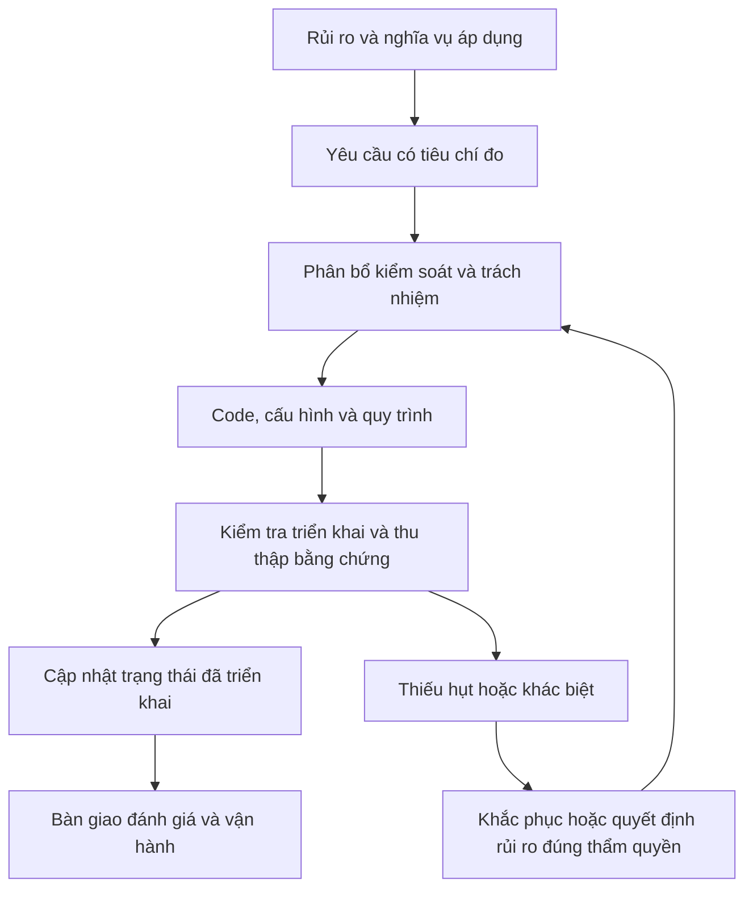

# Implement

## 1. Từ quyết định kiểm soát đến trạng thái được triển khai

Trong chương **Risk management và compliance**, Implement là hoạt động biến yêu cầu bảo mật và quyết định xử lý rủi ro thành những kiểm soát thực sự tồn tại trong hệ thống, quy trình và hoạt động vận hành. Kết quả cần chỉ ra kiểm soát được đặt ở đâu, bảo vệ phạm vi nào, ai chịu trách nhiệm và bằng chứng nào mô tả trạng thái đã triển khai.

Bài học thuộc module `SECURITY_SECURITY_DESIGN_SECURITY_REQUIREMENTS`, tập trung vào việc chuyển mục tiêu an toàn thông tin và mô hình đe dọa thành yêu cầu cụ thể, đo được, có thể kiểm chứng; kết nối xác thực, phân quyền, bảo vệ dữ liệu, logging và phục hồi với rủi ro, kiến trúc và kiểm thử trong vòng đời phát triển.

Trong NIST Risk Management Framework, bước Implement có hai kết quả chính: triển khai các kiểm soát trong kế hoạch bảo mật và quyền riêng tư, đồng thời cập nhật kế hoạch để phản ánh cách chúng đã được triển khai. Đây là một khung tham chiếu hữu ích cho bài học, không phải tuyên bố rằng mọi dự án đều có nghĩa vụ áp dụng NIST RMF. [NIST RMF — Implement Step](https://csrc.nist.gov/Projects/risk-management/about-rmf/implement-step).

Sau bài học, người học có thể:

- Phân rã một yêu cầu bảo mật thành công việc có chủ sở hữu, phụ thuộc và tiêu chí hoàn tất.
- Phân bổ kiểm soát cho ứng dụng, nền tảng, nhà cung cấp và quy trình con người.
- Duy trì truy vết từ rủi ro hoặc nghĩa vụ đến yêu cầu, cấu hình, kiểm thử và bằng chứng.
- Triển khai thay đổi có khả năng quan sát, phát hiện cấu hình lệch và xử lý thất bại.
- Ghi nhận thiếu hụt, ngoại lệ và rủi ro còn lại mà không đồng nhất chúng với trạng thái đạt.

**Quy ước:** các mã rủi ro, nghĩa vụ, vai trò và ngưỡng trong ví dụ là giả định minh họa. Những giá trị như 60 giây, 15 phút hay 4 giờ cần được dự án lựa chọn và xác nhận trước khi dùng để nghiệm thu; chúng không phải thời hạn pháp lý mặc định.

## 2. Làm rõ ranh giới của Implement

Chọn một kiểm soát, triển khai kiểm soát và kết luận kiểm soát có hiệu lực là ba việc khác nhau. Một thư viện đã được thêm vào dependency hoặc một ticket đã đóng chưa chứng minh rằng mọi đường truy cập đều được bảo vệ.

| Hoạt động | Câu hỏi chính | Đầu ra điển hình |
| --- | --- | --- |
| Lựa chọn và điều chỉnh kiểm soát | Cần bảo vệ điều gì, trước rủi ro nào, với mức yêu cầu nào? | Yêu cầu, phạm vi, kiểm soát đã chọn và lý do |
| Implement | Kiểm soát được thực hiện cụ thể ở đâu và bằng cách nào? | Code, cấu hình, quy trình, chủ sở hữu và mô tả trạng thái thực tế |
| Đánh giá | Kiểm soát có đúng yêu cầu và tạo kết quả mong đợi không? | Kết quả kiểm tra, phát hiện và giới hạn bằng chứng |
| Quyết định vận hành hoặc phát hành | Rủi ro hiện tại có được chấp nhận trong phạm vi thẩm quyền không? | Quyết định cùng điều kiện, trách nhiệm và thời hạn |
| Theo dõi | Trạng thái có tiếp tục phù hợp khi hệ thống thay đổi không? | Tín hiệu vận hành, kiểm tra lại và hành động khắc phục |

Trong RMF, bước Assess xem xét kiểm soát có được triển khai đúng, vận hành như dự định và đáp ứng yêu cầu hay không. Việc kiểm thử trong quá trình xây dựng hỗ trợ mục tiêu đó, nhưng hồ sơ “đã triển khai” không tự thay thế kết luận đánh giá. [NIST RMF — Assess Step](https://csrc.nist.gov/projects/risk-management/about-rmf/assess-step).

## 3. Xác định đầu vào trước khi chia công việc

Một công việc Implement có thể bắt đầu khi nhóm hiểu được ít nhất năm yếu tố: yêu cầu, phạm vi, rủi ro nguồn, người quyết định và cách nhận biết kết quả.

| Đầu vào | Thông tin cần có | Nếu thiếu |
| --- | --- | --- |
| Danh mục tài sản và luồng dữ liệu | Dữ liệu, API, tác vụ nền, kho lưu, môi trường và bên nhận | Có thể triển khai đúng một chỗ nhưng bỏ sót đường khác |
| Rủi ro và quyết định xử lý | Kịch bản đe dọa, tác động, giả định và phản ứng đã chọn | Không có cơ sở ưu tiên hoặc đánh giá mức giảm rủi ro |
| Yêu cầu bảo mật | Hành vi, chủ thể, điều kiện, ngưỡng và đường lỗi | Ticket dễ biến thành tên công nghệ thay cho kết quả |
| Nghĩa vụ áp dụng | Nguồn, phiên bản, phạm vi và người xác nhận cách diễn giải | Dễ gắn nhãn tuân thủ cho điều khoản không áp dụng hoặc đã đổi |
| Kiến trúc và kiểm soát hiện hữu | Điểm thực thi, dịch vụ dùng chung và giới hạn kế thừa | Có thể triển khai trùng hoặc tin vào kiểm soát chưa bao phủ hệ thống |
| Kế hoạch xác minh và vận hành | Phương pháp kiểm tra, người nhận bàn giao, cảnh báo và phục hồi | Kiểm soát chỉ hoạt động trên môi trường của người viết |

Nếu yêu cầu còn mơ hồ, nhóm cần làm rõ phần đó và ghi nhận giả định trước khi triển khai phần phụ thuộc. Ví dụ, “log đầy đủ” phải được cụ thể thành những loại sự kiện, trường bắt buộc, dữ liệu không được ghi, quyền truy cập và hành vi khi đích log mất kết nối.

## 4. Tình huống xuyên suốt: dịch vụ quản lý tài liệu nhiều tenant

Giả sử một dịch vụ lưu tài liệu nội bộ cho nhiều tổ chức. Người dùng thuộc tenant A chỉ được thao tác tài liệu của A trong phạm vi quyền được giao. Có API đọc, worker xuất báo cáo, kho đối tượng, dịch vụ định danh, hệ thống log và backup.

Các rủi ro đã nhận diện:

- `R-01`: thay mã tài liệu để đọc dữ liệu tenant khác.
- `R-02`: tài khoản quản trị bị chiếm quyền và thực hiện thay đổi đặc quyền.
- `R-03`: thao tác tải hoặc xuất dữ liệu không được ghi nhận, hoặc log làm lộ token.
- `R-04`: backup tồn tại nhưng không phục hồi được dữ liệu, khóa hoặc chính sách truy cập.
- `R-05`: dữ liệu hết mục đích vẫn còn trong bản xuất hoặc bản phục hồi.

Nguồn yêu cầu có thể gồm chính sách nội bộ và cam kết hợp đồng đã được người có trách nhiệm xác nhận áp dụng. Trong bài, `OBL-01` là cam kết cách ly tenant và `OBL-02` là yêu cầu nội bộ về khả năng điều tra hoạt động đặc quyền. Đây là mã minh họa, không phải số điều khoản của một tiêu chuẩn.



## 5. Chuyển yêu cầu thành gói triển khai

### 5.1. Phân biệt yêu cầu, kiểm soát và công việc

Với `R-01`, có thể phân rã như sau:

| Cấp độ | Ví dụ |
| --- | --- |
| Mục tiêu | Dữ liệu của các tenant phải được cách ly theo quyền nghiệp vụ |
| Yêu cầu `SR-01` | Mọi lần đọc hoặc xuất tài liệu phải được máy chủ cho phép theo chủ thể, tenant, đối tượng và hành động; trường hợp bị cấm không trả nội dung hoặc tạo tệp xuất |
| Kiểm soát `CTRL-01` | Điểm quyết định quyền phía máy chủ và điều kiện tenant trong truy vấn dữ liệu |
| Công việc ứng dụng | Áp dụng kiểm tra quyền cho API đọc, tải tệp và worker xuất |
| Công việc dữ liệu | Bổ sung ràng buộc truy vấn và danh mục tenant cho tài liệu cũ |
| Công việc nền tảng | Chặn truy cập công khai trực tiếp đến kho đối tượng |
| Công việc xác minh | Thử truy cập khác tenant, đường trực tiếp, tác vụ nền và thu hồi quyền |
| Công việc vận hành | Theo dõi lỗi quyết định quyền, cấu hình lệch và các lần xuất bị từ chối |

### 5.2. Mẫu gói triển khai

Mỗi gói nên có:

1. Mã và phiên bản yêu cầu; tài sản, môi trường và đường truy cập trong phạm vi.
2. Rủi ro hoặc nghĩa vụ nguồn, cùng giả định cần giữ đúng.
3. Người chịu trách nhiệm kết quả và các nhóm thực hiện.
4. Thiết kế kiểm soát, điểm thực thi và các dịch vụ phụ thuộc.
5. Công việc code, cấu hình, chuyển đổi dữ liệu và tài liệu vận hành.
6. Tiêu chí kiểm tra, bằng chứng cần tạo và người tiếp nhận đánh giá.
7. Kế hoạch triển khai, hành vi lỗi, điều kiện dừng và phương án khôi phục an toàn.
8. Khác biệt so với thiết kế ban đầu, thiếu hụt còn mở và liên kết quyết định xử lý.

Ví dụ tiêu chí cho `SR-01`: tất cả API đọc và đường xuất trong danh mục phải từ chối chủ thể không có quyền; không trả nội dung, liên kết tải hoặc tạo tác dụng phụ chứa dữ liệu. Trong tình huống này, quyền bị thu hồi phải có hiệu lực trên các lần truy cập mới trong tối đa 60 giây; mốc đo bắt đầu khi thay đổi quyền được ghi nhận bền vững.

Cần xác định chính xác ý nghĩa “lần truy cập mới”. Dữ liệu đã tải xuống hợp lệ không thể được thu hồi chỉ bằng việc cập nhật quyền trên máy chủ. Luồng tải dài, cache quyền và worker đang chạy phải có chính sách riêng được đưa vào tiêu chí kiểm tra.

## 6. Phân bổ trách nhiệm và kiểm soát kế thừa

### 6.1. Có chủ sở hữu cho kết quả, không chỉ cho ticket

| Vai trò | Trách nhiệm trong Implement |
| --- | --- |
| Chủ sở hữu hệ thống | Điều phối phạm vi, phụ thuộc, nguồn lực và trạng thái triển khai |
| Chủ sở hữu rủi ro | Theo dõi tác động kinh doanh, phương án xử lý và quyết định trong thẩm quyền |
| Chủ sở hữu kiểm soát | Chịu trách nhiệm kiểm soát hoạt động, có bằng chứng và được duy trì |
| Nhóm phát triển | Triển khai hành vi ứng dụng và kiểm tra liên quan |
| Nhóm nền tảng/SRE | Cấu hình hạ tầng, danh tính workload, giám sát và khả năng phục hồi |
| Chủ sở hữu dữ liệu | Xác định mục đích, quyền sử dụng và vòng đời dữ liệu |
| Nhóm bảo mật, quyền riêng tư và tuân thủ | Làm rõ yêu cầu, rà soát thiết kế, nghĩa vụ và sai lệch |
| Người đánh giá | Kiểm tra bằng chứng và kết luận theo phạm vi, phương pháp đã chốt |

Một người có thể giữ nhiều vai trò ở dự án nhỏ, nhưng vẫn phải ghi rõ đang đưa ra loại quyết định nào. Người đóng ticket triển khai không mặc nhiên có thẩm quyền chấp nhận mọi rủi ro còn lại hoặc xác nhận đáp ứng nghĩa vụ bên ngoài.

### 6.2. Kiểm soát riêng, dùng chung và phối hợp

NIST RMF phân biệt việc triển khai ở cấp hệ thống với các kiểm soát dùng chung; kiểm soát có thể được thực hiện phối hợp giữa nhiều bên. Khi kiểm soát dùng chung chưa đáp ứng đủ nhu cầu, hệ thống cần xử lý khoảng trống cụ thể. [NIST RMF Implement Step — FAQs](https://csrc.nist.gov/CSRC/media/Projects/risk-management/documents/04-Implement%20Step/NIST%20RMF%20Implement%20Step-FAQs.pdf).

| Dạng phân bổ | Ví dụ | Phần phải xác minh tại hệ thống |
| --- | --- | --- |
| Riêng cho hệ thống | Quy tắc ai được tải một tài liệu | API và worker có thực thi đúng trên đối tượng thực tế không |
| Dùng chung/kế thừa | Dịch vụ định danh tổ chức cung cấp MFA | Ứng dụng có bắt buộc đi qua cấu hình phù hợp, còn tài khoản hoặc đường truy cập nào bỏ qua không |
| Phối hợp | Nền tảng cung cấp mã hóa kho lưu; ứng dụng quản lý quyền đọc | Quyền kho, quyền sử dụng khóa và quyền nghiệp vụ có cùng bảo vệ dữ liệu không |

Để kế thừa kiểm soát, hồ sơ cần nêu nhà cung cấp, dịch vụ, phiên bản hoặc phạm vi cam kết, môi trường được bao phủ, trách nhiệm của bên sử dụng và bằng chứng còn giá trị. Một báo cáo của nhà cung cấp không tự chứng minh cấu hình tenant của khách hàng đúng.

Ví dụ, nền tảng hỗ trợ MFA nhưng ứng dụng còn tài khoản quản trị cục bộ dùng mật khẩu đơn lẻ thì yêu cầu MFA cho quản trị vẫn có khoảng trống. Nhóm phải loại bỏ đường đó hoặc có giải pháp khác được xem xét theo đúng yêu cầu.

## 7. Lập thứ tự triển khai theo rủi ro và phụ thuộc

Không nên ưu tiên chỉ theo độ dễ của ticket hoặc số kiểm soát có thể đánh dấu hoàn tất. Cần xem xét tác động, khả năng bị khai thác, mức phơi lộ hiện tại, nghĩa vụ có thời hạn, thời gian thực hiện và các phụ thuộc.

Trong tình huống dịch vụ tài liệu, một thứ tự hợp lý có thể là:

1. Xác định nguồn danh tính và tenant đáng tin cậy; làm sạch dữ liệu tài liệu thiếu tenant.
2. Chặn truy cập công khai và đường truy cập trực tiếp bỏ qua kiểm soát ứng dụng.
3. Triển khai phân quyền cho API đọc, tải và worker; kiểm tra đường lỗi.
4. Bổ sung sự kiện kiểm toán và quy tắc không ghi dữ liệu bí mật.
5. Hoàn thiện quy trình thu hồi quyền, xóa dữ liệu, backup và phục hồi.
6. Xác nhận bằng chứng theo phạm vi và xử lý thiếu hụt trước khi mở rộng sử dụng.

Mỗi hạng mục cần thể hiện phụ thuộc và lý do chờ. “Bị chặn bởi nền tảng” chưa đủ; nên nêu cấu hình hoặc API còn thiếu, người phụ trách, mốc dự kiến và biện pháp tạm thời. Khi độ trễ làm tăng phơi lộ, chủ sở hữu rủi ro cần được thông tin để quyết định trong phạm vi thẩm quyền.

Biện pháp bù phải có mục tiêu và giới hạn rõ. Giới hạn IP quản trị có thể giảm một số đường truy cập khi chưa hoàn tất MFA, nhưng không cung cấp cùng khả năng chống sử dụng mật khẩu đã lộ từ một địa chỉ được phép.

## 8. Hiện thực kiểm soát trong ứng dụng và nền tảng

### 8.1. Xác thực và phân quyền

Việc lấy `tenantId` từ request không xác minh quyền trên tenant đó. Nhóm cần phân biệt dữ liệu người gọi đưa vào với thuộc tính đã được xác thực và quan hệ thành viên đang có hiệu lực.

Mã giả sau minh họa thứ tự xử lý; tên hàm không đại diện cho API của một thư viện cụ thể:

```text
actor = authenticate(request.credentials)
target = load_minimal_document_metadata(request.document_id)
decision = authorize(actor, action="read", target=target)

if decision is not permitted:
    record_safe_denial(actor.reference, request.document_id)
    return controlled_denial_without_document_content

document = load_document_with_authorized_scope(
    id=target.id,
    allowed_scope=decision.scope,
    expected_policy_revision=decision.policy_revision
)

if document is unavailable_or_no_longer_permitted:
    return controlled_denial_without_document_content

return project_allowed_fields(document, decision.field_permissions)
```

Trong triển khai thực tế, cần giải quyết thay đổi quyền hoặc thuộc tính tài liệu giữa lúc kiểm tra và lúc sử dụng. Có thể dùng điều kiện truy vấn, phiên bản chính sách, giao dịch hoặc kiểm tra lại phù hợp với mô hình nhất quán; không mặc nhiên cho rằng kết quả kiểm tra quyền cũ vẫn đúng.

Worker không được tin rằng một message chứa `tenantId` và `userId` là bằng chứng quyền. Nó cần kiểm tra nguồn tác vụ, liên kết với yêu cầu hợp lệ, và quyền còn hiệu lực theo chính sách đã chốt. Hệ thống cũng phải chặn truy cập kho đối tượng bằng con đường bỏ qua API đã bảo vệ.

### 8.2. Biến từng nhóm yêu cầu thành hành vi cụ thể

| Nhóm | Ví dụ công việc triển khai | Trường hợp lỗi phải có quyết định |
| --- | --- | --- |
| Xác thực | Kết nối IdP, bắt buộc MFA cho quản trị theo phạm vi, vô hiệu hóa đường đăng nhập cũ | IdP mất kết nối, token hết hạn, tài khoản khẩn cấp |
| Phân quyền | Chính sách tenant/đối tượng/hành động, lọc trường và điều kiện truy vấn | Quyền bị thu hồi, cache cũ, tác vụ chạy muộn |
| Bảo vệ dữ liệu | Mã hóa kho và trường theo rủi ro, tách quyền khóa, xử lý tệp tạm | Không có quyền giải mã, khóa lỗi, dữ liệu cũ khác phiên bản |
| Logging | Schema sự kiện, correlation ID, lọc bí mật, quyền đọc và lưu giữ | Đích log ngừng nhận, bộ đệm đầy, đường exception lộ payload |
| Phục hồi | Backup, quy trình phục hồi khóa, kiểm tra quyền và dữ liệu đã xóa | Snapshot hỏng, thiếu khóa, phục hồi ra cấu hình quyền cũ |
| Cấu hình | Baseline theo môi trường, quản lý thay đổi và kiểm tra lệch | Thay đổi trực tiếp, cấu hình thiếu, secret không khả dụng |

Yêu cầu cần quy định khi nào từ chối thao tác, khi nào có thể giảm chức năng và dữ liệu nào vẫn được phép xử lý. Ví dụ, mất dịch vụ khóa có thể làm thao tác đọc trường nhạy cảm thất bại có kiểm soát; không được tự ghi plaintext để giữ hệ thống “hoạt động”.

Với log kiểm toán, cần chốt thao tác đặc quyền có bị chặn khi mất đích log hay được dùng bộ đệm bền vững có bảo vệ. Nếu dùng bộ đệm, phải quy định dung lượng, quyền, thời hạn, retry, giám sát và hành vi khi bộ đệm đầy.

### 8.3. Quy trình sử dụng quyền khẩn cấp

Với tài khoản khẩn cấp, cần nêu người được sử dụng, điều kiện kích hoạt, phạm vi, thời gian hiệu lực, ghi nhận hoạt động, cách thu hồi và bước rà soát sau sử dụng. Không biến tài khoản khẩn cấp thành đường vận hành thường xuyên bỏ qua các kiểm soát đã cam kết.

## 9. Quản lý code, cấu hình và triển khai thay đổi

Code ứng dụng, chính sách quyền, cấu hình hạ tầng và quy trình vận hành đều là một phần của kiểm soát. Cần quản lý phiên bản và liên kết chúng với yêu cầu để biết bản phát hành nào thực thi thiết kế nào.

NIST SSDF cung cấp các thực hành phát triển phần mềm an toàn có thể tích hợp vào vòng đời phát triển hiện có. Trong bài, cách đưa yêu cầu vào review, kiểm tra và hồ sơ phát hành là một phương án áp dụng thực tế, không phải một mẫu pipeline bắt buộc từ NIST. [NIST SP 800-218 — SSDF v1.1](https://csrc.nist.gov/pubs/sp/800/218/final).

### 9.1. Thiết lập baseline và phát hiện lệch

Baseline cần mô tả trạng thái mong muốn tại từng môi trường: danh tính dịch vụ, quyền kho dữ liệu, chính sách khóa, điểm kết thúc TLS, đích log, thời hạn lưu và những tính năng bảo mật bắt buộc.

Không đưa giá trị secret vào hồ sơ bằng chứng hoặc kho mã nguồn. Có thể lưu tên tham chiếu, phiên bản secret và chính sách quyền để kiểm tra cấu hình mà không phơi bày nội dung.

Cần so sánh cấu hình mong muốn với trạng thái triển khai thực tế. Nếu có thay đổi khẩn cấp trực tiếp, phải ghi nhận người thực hiện, lý do, phạm vi và cách đưa trạng thái trở lại luồng quản lý. Một cấu hình tồn tại trong repository nhưng chưa được áp dụng không được coi là đã triển khai.

### 9.2. Triển khai có điều kiện dừng rõ

Với thay đổi phân quyền, kế hoạch có thể gồm môi trường thử tương đương, dữ liệu tổng hợp, kiểm thử tích hợp, nhóm người dùng thí điểm, theo dõi từ chối bất thường và mở rộng có điều kiện. Đường bảo vệ dữ liệu vẫn phải đúng trong mọi giai đoạn.

Chế độ chỉ quan sát có thể giúp so sánh quyết định chính sách mới với hành vi hiện tại, nhưng nó không thực thi kiểm soát. Nếu hệ thống hiện tại đã có lỗ hổng cách ly tenant, việc ghi log “lẽ ra phải từ chối” không làm rủi ro đó biến mất.

Điều kiện dừng có thể là phát hiện một trường hợp truy cập sai tenant, mất sự kiện kiểm toán bắt buộc hoặc tỷ lệ lỗi vượt ngưỡng vận hành đã chốt. Kế hoạch phải chỉ ra ai theo dõi, ai được dừng và trạng thái an toàn sau khi dừng.

Rollback cũng phải giữ yêu cầu bảo mật. Nếu phiên bản cũ không có kiểm tra tenant, quay lại phiên bản đó sẽ khôi phục lỗ hổng. Phương án an toàn có thể là tạm đóng tính năng xuất, chặn đường truy cập hoặc sửa tiến thay vì rollback mù quáng.

## 10. Gắn triển khai với kiểm tra và bằng chứng

### 10.1. Ma trận truy vết

| Nguồn | Yêu cầu | Kiểm soát và nơi thực thi | Cách kiểm tra | Bằng chứng chính |
| --- | --- | --- | --- | --- |
| R-01, OBL-01 | SR-01: cách ly tenant | CTRL-01 ở API, worker, truy vấn và kho tệp | Hoán đổi mã đối tượng; gọi thẳng; thu hồi quyền trước khi worker chạy | Danh mục đường truy cập, kết quả từ chối và xác nhận không tạo tệp |
| R-02, OBL-02 | SR-02: bảo vệ thao tác quản trị | MFA theo phạm vi, quyền đặc quyền, quy trình khẩn cấp | Thử đường đăng nhập cũ, quyền sai và kích hoạt khẩn cấp | Cấu hình IdP, kết quả thử và hồ sơ rà soát quyền |
| R-03, OBL-02 | SR-03: truy vết không lộ bí mật | Schema sự kiện tại API, worker và bộ thu thập | Gây lỗi với canary tổng hợp; kiểm tra cả log và trace | Schema, danh sách đích, kết quả tìm canary và tính đủ sự kiện |
| R-04 | SR-04: phục hồi bảo vệ đầy đủ | Backup, khóa, runbook và điều kiện mở dịch vụ | Phục hồi trong môi trường cách ly; thử đọc và thử quyền | Điểm dữ liệu phục hồi, dòng thời gian, kiểm tra toàn vẹn và quyền |
| R-05 | SR-05: thực thi vòng đời dữ liệu | Job xóa, chính sách bản xuất và bản ghi xóa phục vụ restore | Xóa đồng thời với xuất; restore snapshot trước lúc xóa | Danh mục bản sao, trạng thái xóa và kết quả sau phục hồi |

Thử nghiệm phải kiểm tra hành vi cho phép và từ chối. Một phản hồi lỗi chưa đủ nếu hệ thống đã tạo tệp nhạy cảm ở nền. Với mã hóa, ảnh cấu hình chưa đủ nếu danh tính không nên đọc dữ liệu vẫn có quyền gọi giải mã.

### 10.2. Mẫu hồ sơ trạng thái đã triển khai

Ví dụ sau mô tả cấu trúc hồ sơ, không phải bằng chứng một hệ thống thực tế đã được kiểm tra:

```yaml
requirement_id: SR-01
requirement_revision: 2
risk_ids: [R-01]
obligation_ids: [OBL-01]
control_id: CTRL-01
scope:
  environment: production
  entry_points: [read_api, download_api, export_worker]
implementation:
  owner_role: document_service_team
  policy_revision: "điền phiên bản chính sách thực tế"
  build_revision: "điền commit đã triển khai"
  data_migration_revision: "điền phiên bản chuyển đổi dữ liệu"
  inherited_controls: [organization_identity_service]
  known_gaps: []
verification:
  result: NOT_RUN
  evidence_references: []
operations:
  runbook_reference: "điền mã runbook thực tế"
  drift_check_reference: "điền mã kiểm tra cấu hình thực tế"
  responder_role: document_service_oncall
```

`known_gaps: []` trong mẫu chỉ là vị trí để ghi dữ liệu; không phải khẳng định hệ thống không có thiếu hụt. Hồ sơ thật phải ghi rõ phần chưa làm, phần kế thừa chưa được xác minh và những tiêu chí chưa có bằng chứng.

Bằng chứng cần gắn với phiên bản triển khai, môi trường, thời gian, phạm vi dữ liệu tổng hợp, người thực hiện và phương pháp. Nếu môi trường thử khác production về chính sách quyền hoặc cấu hình khóa, phải ghi rõ ảnh hưởng của khác biệt trước khi suy rộng kết quả.

### 10.3. Đo mức hoàn thành với mẫu số rõ

Có thể theo dõi riêng số yêu cầu đã có triển khai, số có bằng chứng phù hợp, số tiêu chí còn thất bại và số ngoại lệ còn hiệu lực. Không gộp tất cả thành một nhãn “đã tuân thủ”.

Ví dụ, yêu cầu cách ly tenant có ba đường trong phạm vi: đọc API, tải tệp và worker xuất. Nếu mới hoàn thành hai đường, báo cáo là 2/3 đường đã triển khai; không báo 100% chỉ vì ticket của API đã đóng.

Trạng thái triển khai và trạng thái đánh giá nên tách nhau. Một kiểm soát có thể đã triển khai nhưng chưa kiểm tra; có thể đã kiểm tra và thất bại; cũng có thể chỉ áp dụng cho một phần phạm vi. Ngoại lệ đã được chấp nhận vẫn phải hiển thị cùng khoảng trống liên quan.

## 11. Cập nhật hồ sơ tuân thủ và xử lý sai lệch

### 11.1. Ghi đúng cách hệ thống đang hoạt động

Mô tả trạng thái đã triển khai cần trả lời: kiểm soát chạy ở thành phần nào, cấu hình nào kích hoạt, dữ liệu nào được bảo vệ, ai vận hành, kiểm soát nào kế thừa và giới hạn nào còn tồn tại.

Ví dụ, thiết kế ban đầu có dịch vụ quyết định quyền tập trung nhưng triển khai thực tế dùng thư viện chính sách tại từng dịch vụ. Hồ sơ phải cập nhật cách phân phối phiên bản, phát hiện lệch và thu hồi chính sách cũ; không giữ sơ đồ cũ rồi coi đó là bằng chứng.

Trong RMF, nhiệm vụ cập nhật thông tin triển khai nhấn mạnh trạng thái thực tế thay vì chỉ mô tả kế hoạch. Thông tin này là cơ sở để đánh giá và theo dõi về sau. [NIST RMF Implement Step — FAQs](https://csrc.nist.gov/CSRC/media/Projects/risk-management/documents/04-Implement%20Step/NIST%20RMF%20Implement%20Step-FAQs.pdf).

### 11.2. Ánh xạ nghĩa vụ có phạm vi

Sổ nghĩa vụ nên có nguồn và phiên bản, phạm vi áp dụng, cách diễn giải đã xác nhận, yêu cầu liên quan, bằng chứng và người phụ trách. Một kiểm soát có thể hỗ trợ nhiều nghĩa vụ nhưng không tự đáp ứng toàn bộ mỗi nghĩa vụ.

Ví dụ, MFA cho quản trị hỗ trợ bảo vệ truy cập đặc quyền. Nó không thay thế quy trình cấp quyền, rà soát quyền, thu hồi tài khoản, điều tra hoạt động hoặc các yêu cầu khác của một cam kết quản trị truy cập.

### 11.3. Quản lý thiếu hụt và ngoại lệ

Mỗi thiếu hụt cần có yêu cầu bị ảnh hưởng, phạm vi, nguyên nhân, tác động, hành động khắc phục, người phụ trách, mốc hoàn tất và tiêu chí đóng. Khi có biện pháp tạm thời, phải mô tả mức bảo vệ và giới hạn của nó.

Hồ sơ ngoại lệ cần bổ sung người có thẩm quyền nhận rủi ro, thời hạn, điều kiện sử dụng, cách giám sát và trigger xem xét lại. Chấp nhận rủi ro nội bộ không tự miễn nghĩa vụ pháp lý hoặc cam kết với bên ngoài.

Nếu hết hạn mà chưa khắc phục, hệ thống phải kích hoạt quy trình đã chốt: chuyển cấp xử lý, hạn chế tính năng hoặc xin quyết định mới đúng thẩm quyền. Không tự gia hạn bằng cách đổi ngày trong ticket.

Rủi ro còn lại phải dựa trên kiểm soát đang tồn tại và bằng chứng hiện có, không dựa trên tính năng dự kiến. Nếu dùng thang định tính hoặc thứ bậc, cần giữ quy tắc của phương pháp đánh giá; không biến phép nhân điểm thành tỷ lệ phần trăm giảm rủi ro có vẻ chính xác.

## 12. Bàn giao sang vận hành và đánh giá

Một kiểm soát cần có người tiếp nhận, quyền vận hành, runbook, tín hiệu giám sát và khả năng kiểm tra lại. Các thay đổi nhà cung cấp, cấu hình, đường truy cập hoặc dữ liệu có thể làm bằng chứng cũ không còn đủ.

Với `SR-04`, giả định dự án chọn RPO tối đa 15 phút và RTO tối đa 4 giờ. Hồ sơ phải ghi rõ điểm dữ liệu cần phục hồi, thời điểm bắt đầu đo, điều kiện kết thúc và quy mô diễn tập. Khôi phục DB nhưng thiếu khóa hoặc làm sống lại dữ liệu đã xóa không được xem là phục hồi đầy đủ.

Nhóm vận hành cần biết khi nào kiểm tra lại: thêm tenant hoặc loại dữ liệu, đổi chính sách quyền, mở API mới, chuyển kho lưu, thay IdP, đổi khóa, tăng quy mô phục hồi hoặc có phát hiện bảo mật mới. Lịch định kỳ hữu ích nhưng không thay thế kiểm tra do thay đổi quan trọng.

Gói bàn giao tối thiểu gồm:

- Yêu cầu và rủi ro nguồn, cùng phạm vi đang được bảo vệ.
- Danh mục điểm thực thi, phiên bản code, cấu hình và kiểm soát kế thừa.
- Mô tả trạng thái thực tế, khác biệt so với thiết kế và khoảng trống còn mở.
- Kiểm thử, bằng chứng, giới hạn và các tiêu chí chưa được xác minh.
- Runbook, cảnh báo, người phản hồi, phương án dừng hoặc khôi phục an toàn.
- Kế hoạch khắc phục, ngoại lệ có thời hạn và người quyết định tương ứng.

## 13. Các lỗi triển khai thường gặp

| Lỗi | Hệ quả | Cách sửa |
| --- | --- | --- |
| Ticket chỉ ghi tên sản phẩm | Không biết kiểm soát giải quyết rủi ro nào hoặc đã đủ chưa | Gắn yêu cầu, phạm vi và tiêu chí hành vi vào gói triển khai |
| Có gateway nên bỏ kiểm tra ở worker | Đường bất đồng bộ hoặc trực tiếp vượt kiểm soát | Kiểm kê mọi entry point và phân bổ kiểm soát tương ứng |
| Tin mọi thuộc tính tenant do client gửi | Có thể truy cập dữ liệu ngoài phạm vi | Xác minh quan hệ chủ thể–tenant và đối tượng ở máy chủ |
| Dùng chung nghĩa là không còn trách nhiệm | Cấu hình ứng dụng hoặc ngoại lệ bị bỏ sót | Ghi rõ phần kế thừa, điều kiện sử dụng và trách nhiệm còn lại |
| Chỉ kiểm tra luồng thành công | Bỏ sót lỗi phụ thuộc và đường rò rỉ | Có ca từ chối, retry, thu hồi quyền và thất bại phụ thuộc |
| Bật log toàn bộ để có bằng chứng | Tạo kho bí mật hoặc dữ liệu nhạy cảm ngoài kiểm soát | Dùng schema tối thiểu và kiểm tra đường exception/telemetry |
| Rollback về phiên bản thiếu bảo vệ | Khôi phục rủi ro đã biết | Chốt trạng thái dừng an toàn và kiểm tra yêu cầu khi rollback |
| Đóng việc theo code merge | Chưa chứng minh cấu hình thực tế và vận hành | Xác nhận phiên bản đã triển khai, bằng chứng và chủ sở hữu nhận bàn giao |
| Ngoại lệ được báo như kiểm soát đạt | Che khuất rủi ro còn lại | Tách trạng thái, phạm vi, thời hạn và quyết định nhận rủi ro |
| Giữ tài liệu theo thiết kế ban đầu | Người đánh giá kiểm tra một hệ thống không còn tồn tại | Cập nhật hồ sơ theo trạng thái thực tế và quản lý phiên bản |

## 14. Tiêu chí kết thúc công việc Implement

Công việc Implement của một yêu cầu có thể chuyển sang đánh giá khi kiểm soát đã được thực hiện trong phạm vi đã chốt, trạng thái thực tế được ghi rõ và người khác có thể kiểm tra lại các tuyên bố triển khai.

Trước khi bàn giao, cần xác nhận:

- Mỗi yêu cầu có chủ sở hữu, điểm thực thi và công việc bao phủ toàn bộ phạm vi.
- Code, cấu hình, chuyển đổi dữ liệu và quy trình liên quan có phiên bản xác định.
- Hành vi khi từ chối quyền và khi phụ thuộc lỗi đã được thiết kế và kiểm tra tương ứng.
- Kiểm soát kế thừa có phạm vi và trách nhiệm được ghi nhận.
- Bằng chứng đủ truy vết tới môi trường, bản triển khai, tiêu chí và phương pháp kiểm tra.
- Hồ sơ phản ánh đúng trạng thái đã triển khai, kể cả thiếu hụt và khác biệt.
- Vận hành nhận bàn giao được giám sát, xử lý lỗi, khôi phục và kiểm tra cấu hình lệch.
- Ngoại lệ cùng rủi ro còn lại được chuyển đến người có thẩm quyền, không bị che dưới nhãn hoàn tất.

Giá trị của Implement nằm ở việc tạo ra khả năng bảo vệ có thể vận hành và kiểm chứng. Chuỗi liên kết từ rủi ro đến yêu cầu, kiểm soát, cấu hình thực tế và bằng chứng giúp nhóm phát triển biết phải làm gì, người đánh giá biết phải kiểm tra gì và người quản lý biết rủi ro nào vẫn còn.
