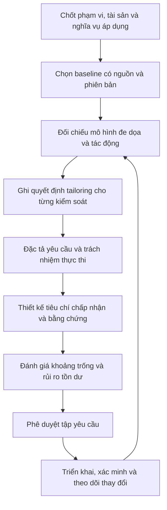

# Control tailoring: điều chỉnh biện pháp kiểm soát thành yêu cầu bảo mật phù hợp

## 1. Mục tiêu của bài học

Một danh mục kiểm soát có thể yêu cầu xác thực mạnh, giới hạn quyền, mã hóa, ghi nhật ký và phục hồi dữ liệu. Danh mục đó chưa trả lời đầy đủ: áp dụng cho tài khoản nào, tại ranh giới nào, với tham số bao nhiêu, ai chịu trách nhiệm và bằng chứng nào chứng minh yêu cầu đã được đáp ứng.

**Control tailoring** là quá trình điều chỉnh một tập kiểm soát xuất phát theo phạm vi hệ thống, dữ liệu, mô hình đe dọa, tác động nghiệp vụ và các ràng buộc áp dụng. Kết quả cần là một tập kiểm soát có lý do lựa chọn, tham số rõ ràng và đủ cơ sở để đặc tả thành yêu cầu bảo mật có thể kiểm thử.

Trong thiết kế yêu cầu bảo mật, tailoring nối ba lớp công việc:

- Quản trị rủi ro xác định điều gì có thể xảy ra và mức tổn thất nào cần ngăn chặn hoặc giới hạn.
- Kiến trúc xác định nơi thực thi kiểm soát, các phụ thuộc và ranh giới tin cậy.
- Đặc tả yêu cầu xác định hành vi bắt buộc, điều kiện chấp nhận và bằng chứng xác minh.

Sau bài học, người học có thể phân biệt tailoring với miễn trừ, chọn cách điều chỉnh phù hợp, viết yêu cầu đo được và duy trì liên kết từ rủi ro tới kiểm thử. Các con số trong ví dụ là **giả định phục vụ bài học**, cần được quyết định lại theo bối cảnh thực tế; chúng không phải ngưỡng tuân thủ chung.

## 2. Hiểu đúng phạm vi của tailoring

### 2.1. Tập kiểm soát xuất phát là điểm bắt đầu

Baseline là tập kiểm soát ban đầu được tổ chức chọn để định hướng bảo vệ cho một loại hệ thống hoặc mức tác động. Baseline có thể kết hợp chính sách nội bộ, yêu cầu hợp đồng, nghĩa vụ áp dụng và kết quả phân tích rủi ro. Cần ghi rõ nguồn và phiên bản để biết một quyết định tailoring đã dựa trên điều gì.

Một baseline dùng cho nhiều hệ thống thường có phần mô tả tổng quát. Ví dụ, “kiểm soát truy cập vào dữ liệu nhạy cảm” cần được cụ thể hóa khác nhau giữa cổng nhân sự, kho phân tích, ứng dụng học tập nhiều khách hàng và tiến trình xử lý nền.

Tailoring không mặc nhiên làm giảm mức bảo vệ. Nó có thể bổ sung kiểm soát, tăng yêu cầu tại một luồng rủi ro cao, phân định trách nhiệm hoặc bỏ một mục thực sự không áp dụng sau khi đã chứng minh điều kiện.

### 2.2. Phân biệt các hoạt động dễ nhầm

| Hoạt động | Câu hỏi chính | Đầu ra điển hình |
| --- | --- | --- |
| Chọn kiểm soát | Cần những nhóm kiểm soát nào để xử lý rủi ro và nghĩa vụ? | Tập kiểm soát xuất phát có nguồn |
| Tailoring | Kiểm soát này áp dụng ra sao cho hệ thống cụ thể? | Phạm vi, tham số, bổ sung, trách nhiệm và lý do |
| Đặc tả yêu cầu | Hệ thống hoặc quy trình phải đáp ứng điều gì có thể xác minh? | Yêu cầu có định danh và tiêu chí chấp nhận |
| Thiết kế, triển khai | Thành phần và cơ chế nào thực thi yêu cầu? | Thiết kế, cấu hình, mã nguồn, quy trình vận hành |
| Ngoại lệ | Vì sao một yêu cầu đang áp dụng chưa được đáp ứng? | Phê duyệt có phạm vi, hạn dùng, xử lý bù và kế hoạch khắc phục |
| Chấp nhận rủi ro | Ai có thẩm quyền chịu phần rủi ro còn lại? | Quyết định chịu trách nhiệm về rủi ro tồn dư |

Có thể đã chọn đúng nhóm kiểm soát nhưng tailoring sai. Chẳng hạn, yêu cầu ghi nhật ký được áp dụng cho API tải tệp nhưng bỏ qua tiến trình nền tạo tệp. Khi xảy ra rò rỉ, nhật ký chỉ cho biết tệp đã được tải, không cho biết ai yêu cầu tạo dữ liệu và dữ liệu thuộc khách hàng nào.

Cũng có thể tailoring hợp lý nhưng triển khai sai: yêu cầu kiểm tra quyền theo từng tổ chức đã rõ, song ứng dụng chỉ kiểm tra vai trò toàn cục. Hai vấn đề này cần bằng chứng và cách sửa khác nhau.

## 3. Các dạng điều chỉnh thường gặp

Một quyết định tailoring có thể kết hợp nhiều dạng sau. Tên gọi trong quy trình của từng tổ chức có thể khác; điều quan trọng là ghi được thay đổi, lý do và ảnh hưởng tới rủi ro.

| Dạng điều chỉnh | Ví dụ trong đặc tả yêu cầu | Bằng chứng cần giữ |
| --- | --- | --- |
| Xác định phạm vi áp dụng | Áp dụng xác thực tăng cường cho người xuất dữ liệu cá nhân và mọi phiên quản trị | Danh sách chủ thể, chức năng, tài sản và đường truy cập liên quan |
| Gán tham số | Quyết định thời hạn truy cập tạm thời, độ trễ thu hồi quyền, chu kỳ kiểm tra phục hồi | Lý do theo rủi ro, khả năng vận hành và cách đo |
| Bổ sung kiểm soát | Thêm kiểm tra ranh giới tổ chức ở cả lúc tạo tác vụ xuất và lúc tải kết quả | Kịch bản đe dọa mà baseline chưa bao phủ đủ |
| Làm rõ cách thực hiện | Tách xác thực người dùng khỏi danh tính của tiến trình nền | Luồng danh tính và vị trí thực thi |
| Kế thừa kiểm soát | Dùng dịch vụ danh tính chung nhưng ứng dụng vẫn kiểm tra quyền trên tài nguyên | Cam kết của dịch vụ dùng chung và trách nhiệm phần ứng dụng |
| Dùng kiểm soát bù | Bổ sung cổng phê duyệt độc lập và giới hạn môi trường để xử lý một hạn chế đã được đánh giá | Phân tích hiệu lực thay thế, hạn chế, kiểm thử và phê duyệt |
| Xác định không áp dụng | Một yêu cầu về thiết bị đầu cuối không áp dụng cho thành phần không có thiết bị thuộc phạm vi đó | Ranh giới rõ, điều kiện loại trừ và cách kiểm tra lại |

### 3.1. Không áp dụng khác với chưa triển khai

“Không có thời gian thực hiện” hoặc “sản phẩm chưa hỗ trợ” không chứng minh một kiểm soát không áp dụng. Nếu rủi ro và nghĩa vụ vẫn tồn tại, đó là khoảng trống cần xử lý, không phải lý do gắn nhãn `N/A`.

Ví dụ, tiến trình nền không có người ngồi nhập mã xác thực nên không áp dụng nguyên xi cơ chế MFA tương tác cho chính tiến trình. Tuy nhiên, mục tiêu xác thực danh tính tiến trình vẫn áp dụng. Yêu cầu thay thế có thể bao gồm danh tính workload riêng, thông tin xác thực ngắn hạn, giới hạn đối tượng nhận token và thu hồi khi workload bị xâm phạm. Người quản trị có khả năng thay đổi workload vẫn thuộc phạm vi bảo vệ dành cho con người.

Một mục được đánh dấu không áp dụng cần kèm điều kiện: “Thành phần X chỉ xử lý dữ liệu tổng hợp đã được phê duyệt, không nhận dữ liệu nhận dạng cá nhân.” Nếu điều kiện này thay đổi, quyết định phải được mở lại.

### 3.2. Kiểm soát bù phải bù được mục tiêu cụ thể

Không thể gọi một biện pháp là bù chỉ vì nó có liên quan tới bảo mật. Nhật ký giúp điều tra nhưng thường không thay thế đầy đủ khả năng ngăn một người không có quyền đọc dữ liệu.

Đánh giá kiểm soát bù cần xét:

- Mục tiêu ban đầu và kịch bản tấn công mà kiểm soát gốc xử lý.
- Những đường đi nào được chặn, đường đi nào chỉ được phát hiện sau đó.
- Tốc độ phát hiện, khả năng can thiệp và mức tổn thất có thể xảy ra trước can thiệp.
- Các phụ thuộc chung có thể khiến cả kiểm soát gốc lẫn kiểm soát bù thất bại.
- Bằng chứng thực nghiệm và thẩm quyền cho phép dùng phương án thay thế.

Khi một nghĩa vụ bắt buộc không cho phép thay thế, nhóm dự án không thể dùng nhãn “tailoring” hoặc một phê duyệt nội bộ để tự bỏ nghĩa vụ đó. Đơn vị có trách nhiệm về nghĩa vụ phải xác định tính áp dụng và điều kiện thay thế nếu có.

## 4. Chuẩn bị đầu vào trước khi điều chỉnh

Không nên bắt đầu bằng việc xóa những dòng khó thực hiện trong một bảng kiểm. Trước hết cần mô tả được hệ thống và tác động khi kiểm soát thất bại.

### 4.1. Bối cảnh tối thiểu

| Đầu vào | Nội dung cần biết | Tác dụng đối với tailoring |
| --- | --- | --- |
| Tài sản và dữ liệu | Loại dữ liệu, người sở hữu, độ nhạy cảm, thời gian cần giữ | Quyết định phạm vi bảo vệ và các bản sao cần bao phủ |
| Chức năng nghiệp vụ | Luồng quan trọng, hành vi quản trị, thao tác khó đảo ngược | Chọn điểm cần xác thực, phê duyệt và ghi dấu vết |
| Kiến trúc | API, worker, kho dữ liệu, hàng đợi, dịch vụ dùng chung | Xác định nơi thực thi và phụ thuộc |
| Mô hình đe dọa | Chủ thể đe dọa, khả năng, điểm vào và đường vượt ranh giới | Kiểm tra kiểm soát có bao phủ kịch bản thực tế không |
| Tác động nghiệp vụ | Tổn thất do lộ dữ liệu, sai dữ liệu hoặc gián đoạn | Chọn cường độ và thứ tự ưu tiên xử lý |
| Yêu cầu áp dụng | Chính sách, hợp đồng, nghĩa vụ đã được xác nhận | Đặt giới hạn cho quyền điều chỉnh |
| Vận hành | Nhân sự trực, quy trình cấp quyền, xử lý sự cố, năng lực phục hồi | Kiểm tra yêu cầu có thể thực hiện liên tục không |

Nếu thông tin còn thiếu, ghi giả định và người chịu trách nhiệm xác nhận. Không biến một giả định thuận tiện, chẳng hạn “chỉ có mạng nội bộ truy cập”, thành kết luận đã được chứng minh.

### 4.2. Xác định đơn vị áp dụng

Một kiểm soát có thể áp dụng ở mức tổ chức, nền tảng dùng chung, ứng dụng, tenant, tài nguyên hoặc từng giao dịch. Cần xác định đơn vị đó trước khi dùng những câu như “hệ thống đã có MFA” hay “dữ liệu đã được mã hóa”.

Dịch vụ danh tính có thể thực hiện MFA, nhưng ứng dụng vẫn phải yêu cầu mức xác thực phù hợp và xác minh kết quả. Kho đối tượng có thể mã hóa ổ đĩa, nhưng ứng dụng vẫn phải ngăn cấp quyền tải tệp cho khách hàng khác. Không thể suy từ kiểm soát của một thành phần rằng toàn bộ luồng đã an toàn.

## 5. Quy trình từ baseline tới yêu cầu kiểm chứng được



### Bước 1: Chốt phạm vi và điều kiện biên

Ghi những thành phần, dữ liệu, vai trò và môi trường nào nằm trong phạm vi. Liệt kê cả bản sao, kênh quản trị và hoạt động hỗ trợ. Một kho sao lưu hoặc công cụ hỗ trợ khách hàng có thể làm mất hiệu lực của yêu cầu bảo vệ trên luồng chính nếu bị bỏ qua.

### Bước 2: Đánh giá từng kiểm soát theo kịch bản rủi ro

Với mỗi kiểm soát, trả lời: nó xử lý kịch bản nào, thực thi ở đâu và thất bại có thể dẫn tới tác động gì? Nếu không thể liên kết tới rủi ro hoặc nghĩa vụ, cần làm rõ nguồn lựa chọn trước khi kết luận giữ hay bỏ.

Ngược lại, một đe dọa có tác động lớn nhưng chưa có kiểm soát tương ứng là dấu hiệu cần bổ sung. Baseline không bảo đảm đã liệt kê mọi tình huống của ứng dụng.

### Bước 3: Ghi quyết định và lý do

Mỗi quyết định nên có định danh, kiểm soát nguồn, loại điều chỉnh, phạm vi, các tham số và lý do. Khi một kiểm soát được áp dụng khác nhau cho nhiều loại chủ thể, tách các nhánh để tránh diễn giải mơ hồ.

Ví dụ, có thể tách yêu cầu xác thực cho người quản trị, người dùng xuất dữ liệu và worker xử lý xuất. Cả ba phục vụ mục tiêu xác minh đúng chủ thể nhưng bằng chứng cần kiểm tra sẽ khác nhau.

### Bước 4: Viết yêu cầu ở mức hành vi

Mẫu diễn đạt hữu ích:

> Khi [điều kiện], [chủ thể hoặc thành phần] phải [hành vi bắt buộc] đối với [đối tượng và phạm vi], trong [giới hạn hoặc tham số], kể cả [tình huống lỗi liên quan]. Xác minh bằng [phương pháp và bằng chứng].

Ví dụ “phải dùng thư viện phân quyền X” chỉ nêu một lựa chọn triển khai. Yêu cầu cần nói rõ những truy cập nào phải bị từ chối, kiểm tra dựa trên thuộc tính gì và điều gì xảy ra khi thiếu thông tin quyết định quyền. Nếu công nghệ cụ thể là ràng buộc bắt buộc, ghi nó riêng cùng nguồn ràng buộc.

### Bước 5: Gắn phương pháp xác minh ngay khi viết

Một yêu cầu không có cách xác minh thường còn thiếu điều kiện biên hoặc quá rộng. Bằng chứng có thể là kiểm thử tự động, đánh giá cấu hình, quan sát thực thi, diễn tập phục hồi hoặc kiểm tra hồ sơ vận hành. Chọn cách xác minh phù hợp với bản chất yêu cầu.

Kiểm tra một cấu hình sao lưu không chứng minh đã phục hồi được dữ liệu. Chạy một ca kiểm thử từ chối truy cập không chứng minh mọi đường tải tệp đều kiểm tra quyền. Cần kết hợp bằng chứng theo phạm vi đã đặc tả.

### Bước 6: Xử lý khoảng trống và phê duyệt

Kiến trúc sư hoặc nhóm bảo mật có thể đánh giá cơ chế; người sở hữu rủi ro nghiệp vụ cần quyết định trong thẩm quyền của mình về rủi ro tồn dư. Trách nhiệm này không nên được thay bằng một dấu xác nhận chung chung của người triển khai.

Một tập yêu cầu được phê duyệt vẫn có thể có khoảng trống chưa đóng. Các khoảng trống phải hiển thị rõ, gắn điều kiện phát hành và có ngoại lệ hợp lệ nếu quy trình cho phép. Việc đã phê duyệt không tự tạo ra bằng chứng kiểm soát đang hoạt động.

## 6. Ví dụ xuyên suốt: chức năng xuất dữ liệu học viên

### 6.1. Bối cảnh và đe dọa

Giả sử một nền tảng học tập phục vụ nhiều tổ chức. Quản trị viên của từng tổ chức có thể yêu cầu xuất danh sách học viên. API tạo tác vụ, worker đọc dữ liệu, ghi tệp vào kho đối tượng rồi cho phép người yêu cầu tải kết quả. Nhân viên hỗ trợ đôi khi cần hỗ trợ điều tra sự cố. Một tác vụ xuất có thể chạy sau khi người yêu cầu đã bị thu hồi quyền.

Dữ liệu xuất gồm họ tên, địa chỉ liên hệ và tiến độ học. Trong bài toán này, dữ liệu được tổ chức phân loại là nhạy cảm. Nhóm xác định các kịch bản:

| Rủi ro | Kịch bản | Tác động cần giới hạn |
| --- | --- | --- |
| R-01 | Quản trị viên tổ chức A thay định danh để lấy tệp của tổ chức B | Lộ dữ liệu qua ranh giới khách hàng |
| R-02 | Tài khoản có quyền xuất bị chiếm đoạt | Trích xuất dữ liệu nhạy cảm với danh tính hợp lệ |
| R-03 | Nhân viên hỗ trợ giữ quyền rộng và sử dụng ngoài mục đích đã duyệt | Lạm dụng đặc quyền và khó quy trách nhiệm |
| R-04 | Quyền đã thu hồi nhưng liên kết hoặc tác vụ cũ vẫn cho tải | Tiếp tục tiết lộ dữ liệu sau khi mất quyền |
| R-05 | Kẻ tấn công xóa dữ liệu và bản sao mà ứng dụng có quyền xóa | Gián đoạn kéo dài hoặc mất dữ liệu vượt mức chấp nhận |
| R-06 | Thiếu dấu vết tạo, xử lý và tải tệp | Không xác định được phạm vi sự cố và chủ thể liên quan |

### 6.2. Ma trận quyết định tailoring

Các tham số dưới đây được nhóm giả định đã thống nhất với người sở hữu nghiệp vụ sau phân tích tác động. Trong dự án thật, quyết định phải ghi người duyệt và cơ sở chọn tham số.

| Kiểm soát xuất phát | Điều chỉnh cho chức năng xuất | Liên kết rủi ro | Phần việc cần cụ thể hóa |
| --- | --- | --- | --- |
| Xác thực mạnh | Yêu cầu kết quả MFA còn hiệu lực cho thao tác tạo tác vụ xuất; người hỗ trợ phải đáp ứng điều kiện tương tự khi được cấp quyền | R-02, R-03 | Mức xác thực, độ mới, cách xác minh và xử lý khi dịch vụ danh tính lỗi |
| Quyền tối thiểu | Quyền xuất theo tổ chức; quyền hỗ trợ chỉ có thời hạn và phạm vi được phê duyệt | R-01, R-03 | Kiểm tra quyền ở API, worker và cổng tải; cơ chế phê duyệt độc lập |
| Bảo vệ dữ liệu | Bao phủ tệp tạm, kết quả xuất, đường truyền và dữ liệu trong bản sao lưu | R-01, R-05 | Chủ thể được giải mã, quản lý khóa và chính sách xóa |
| Thu hồi quyền | Tác vụ, phiên và điểm tải phải tôn trọng thay đổi quyền trong giới hạn đã thống nhất | R-04 | Độ trễ, cache, liên kết có thời hạn và chế độ lỗi |
| Ghi dấu vết | Liên kết việc cấp quyền hỗ trợ, tạo tác vụ, xử lý, tải và thu hồi bằng định danh tương quan | R-03, R-06 | Trường sự kiện, bảo vệ log, giới hạn dữ liệu và phát hiện thiếu log |
| Phục hồi | Bản sao phục hồi không thể bị tài khoản ứng dụng xóa theo cùng đường tấn công | R-05 | Tách thẩm quyền, giữ khóa cần thiết và kiểm thử phục hồi |

Chỉ ghi “giữ nguyên kiểm soát phân quyền” sẽ không thể hiện vấn đề quan trọng của kiến trúc bất đồng bộ: worker và điểm tải hoạt động vào những thời điểm khác nhau, trong khi quyền có thể đã đổi.

### 6.3. Đặc tả một số yêu cầu sau tailoring

**SR-AUTH-01 — Xác thực cho thao tác xuất.** Khi tiếp nhận yêu cầu tạo tác vụ xuất dữ liệu học viên, API phải xác minh danh tính người gọi, kết quả MFA đáp ứng chính sách đã chọn và thời điểm hoàn thành MFA không quá 10 phút trước thời điểm tiếp nhận. Nếu thiếu hoặc không xác minh được thông tin cần thiết, API phải từ chối tạo tác vụ. Việc chỉ xác thực ở giao diện không đáp ứng yêu cầu này.

Bằng chứng chấp nhận gồm yêu cầu gọi trực tiếp API với MFA hợp lệ, quá hạn, thiếu bằng chứng và bằng chứng không xác minh được. Giá trị 10 phút là thời hạn độ mới của MFA trong ví dụ, không phải thời gian sống chung cho mọi token.

**SR-AUTHZ-01 — Ranh giới tổ chức.** API tạo tác vụ, worker trước khi đọc dữ liệu và cổng tải trước khi cấp nội dung phải kiểm tra chủ thể có quyền xuất còn hiệu lực đối với đúng tổ chức sở hữu dữ liệu. Không được coi việc biết định danh tác vụ hoặc tệp là bằng chứng có quyền. Truy cập bị từ chối không được trả dữ liệu học viên hoặc thông tin nhạy cảm trong thông báo lỗi.

Bằng chứng chấp nhận phải bao phủ thay đổi định danh tổ chức, tác vụ và tệp; danh tính của tổ chức khác; quyền bị thu hồi; trường hợp worker nhận thông điệp không khớp tổ chức đã đăng ký. Các kiểm tra quyền cần dựa trên quan hệ được tin cậy, không dựa riêng vào trường tenant do người gọi gửi.

**SR-AUTHZ-02 — Độ trễ thu hồi.** Với yêu cầu tải mới, việc thu hồi quyền xuất phải có hiệu lực trên tất cả điểm cấp nội dung trong tối đa 60 giây kể từ khi thay đổi quyền được ghi nhận thành công tại nguồn có thẩm quyền. Không xác minh được quyền còn hiệu lực thì từ chối yêu cầu tải mới. Yêu cầu này bao gồm các đường truy cập được tạo trước thời điểm thu hồi.

Giới hạn này không thu hồi dữ liệu đã được tải về trước đó. Hành vi đối với luồng tải đang mở phải được đặc tả riêng nếu phân tích rủi ro yêu cầu ngắt luồng. Nếu dùng URL ký sẵn có thời hạn vượt quá giới hạn và không thể vô hiệu hóa theo yêu cầu, thiết kế chưa đáp ứng SR-AUTHZ-02; cần đổi cơ chế cấp nội dung hoặc đánh giá lại yêu cầu theo quy trình phê duyệt.

**SR-PRIV-01 — Quyền hỗ trợ tạm thời.** Mỗi lần nhân viên hỗ trợ truy cập chức năng xuất thay mặt một tổ chức phải gắn với yêu cầu công việc, người phê duyệt độc lập, tổ chức đích và danh sách thao tác được phép. Mỗi lần cấp chỉ có hiệu lực tối đa 30 phút. Khi hết hạn, mọi yêu cầu mới phải bị từ chối theo giới hạn thu hồi đã đặc tả. Không được tự gia hạn quyền bằng một thao tác không có phê duyệt tương ứng.

Bằng chứng gồm thử tự phê duyệt, truy cập sai tổ chức, dùng quyền sau hạn, gia hạn không hợp lệ và đối chiếu người thực hiện thực tế với người được hỗ trợ. Một quy trình khẩn cấp, nếu cần, phải có yêu cầu riêng về điều kiện kích hoạt, phạm vi, thời hạn và giám sát.

**SR-DATA-01 — Bảo vệ bản xuất.** Mọi tệp chứa dữ liệu học viên do chức năng xuất tạo ra, kể cả tệp tạm và bản sao liên quan trong phạm vi hệ thống, phải được bảo vệ khi lưu trữ và truyền theo chính sách mật mã đã được tổ chức phê duyệt. Chỉ các danh tính phục vụ chức năng đã được cấp quyền mới được lấy nội dung rõ; đường tải công khai không được phép. Đặc tả triển khai phải chỉ ra cách quản lý khóa, danh tính được phép giải mã và cách kiểm soát bản sao tạm.

Bằng chứng gồm kiểm tra cấu hình, kiểm thử truy cập bằng danh tính ngoài phạm vi và rà soát đường ghi tệp tạm. Mã hóa lưu trữ không thay thế yêu cầu kiểm tra quyền tải.

**SR-LOG-01 — Dấu vết của thao tác xuất.** Mỗi quyết định cho phép hoặc từ chối xuất, mỗi lần worker bắt đầu hoặc kết thúc xử lý và mỗi lần cho phép hoặc từ chối tải phải phát sinh sự kiện có thời điểm, định danh người thực hiện, tổ chức đích, thao tác, tài nguyên, kết quả và định danh tương quan. Không ghi mật khẩu, token, URL chứa bí mật truy cập hoặc nội dung danh sách học viên vào log.

Trong ví dụ, các thao tác thành công cấp quyền hỗ trợ hoặc tiết lộ dữ liệu mới chỉ được tiếp tục sau khi sự kiện tương ứng đã được ghi bền vững vào kênh audit. Khi kênh này không khả dụng, hệ thống phải từ chối thao tác đó và phát tín hiệu vận hành qua đường đã thiết kế. Việc chuyển sự kiện từ kênh audit sang kho tra cứu, thời hạn giữ và quyền đọc log cần yêu cầu riêng để tránh gom nhiều cam kết vào một câu không thể đo.

**SR-REC-01 — Mục tiêu phục hồi.** Trong kịch bản mất kho dữ liệu chính thuộc phạm vi diễn tập đã thống nhất, chức năng quản lý dữ liệu học viên phải phục hồi được tới trạng thái cho phép thực hiện các thao tác nghiệp vụ thiết yếu trong tối đa 2 giờ từ lúc công bố bắt đầu phục hồi; điểm dữ liệu khôi phục không được cũ hơn 15 phút so với thời điểm gián đoạn. Hai giá trị này lần lượt là mục tiêu thời gian phục hồi và mục tiêu điểm phục hồi của ví dụ.

Phạm vi phục hồi phải bao gồm dữ liệu cần thiết, danh tính dịch vụ, khóa và cấu hình để hệ thống hoạt động an toàn. Bằng chứng cần có phục hồi thực tế, mốc thời gian, điểm dữ liệu được khôi phục và kiểm tra phân quyền sau phục hồi. Không thể suy ra đạt mục tiêu chỉ từ thông báo sao lưu thành công. Mục tiêu tính từ lúc công bố phục hồi cũng cần được đọc cùng yêu cầu riêng về phát hiện và ra quyết định, vì thời gian ngừng dịch vụ tổng cộng có thể dài hơn.

### 6.4. Một lựa chọn thiết kế không đáp ứng yêu cầu

Nhóm ban đầu định gửi URL ký sẵn sống 24 giờ qua email cho người yêu cầu. URL có thể được dùng trực tiếp ở kho đối tượng mà không quay qua cổng kiểm tra quyền.

Lựa chọn này xung đột với giới hạn thu hồi 60 giây trong SR-AUTHZ-02 nếu URL không thể bị vô hiệu hóa trong giới hạn đó. Rút thời gian sống của phiên đăng nhập không giải quyết được đường truy cập trực tiếp bằng URL đã phát hành.

Các hướng xử lý có thể gồm cổng tải kiểm tra quyền cho từng yêu cầu mới, hoặc cơ chế cấp truy cập ngắn hạn có tính cả độ trễ cache và lan truyền thu hồi. Mọi phương án vẫn phải kiểm tra tổng giới hạn từ thời điểm ghi nhận thu hồi tới thời điểm điểm tải từ chối. Không thể phân bổ toàn bộ 60 giây cho tuổi thọ URL rồi bỏ qua các độ trễ khác.

Nếu kiến trúc không đáp ứng và nghiệp vụ muốn đổi giới hạn, nhóm phải quay lại đánh giá tác động của việc tiếp tục tải sau thu hồi, xác định nghĩa vụ liên quan và xin phê duyệt yêu cầu mới. Không được tự sửa tiêu chí kiểm thử để hợp thức hóa thiết kế đã chọn.

## 7. Chọn tham số theo rủi ro và khả năng đo

Một tham số hữu ích phải có định nghĩa đo, lý do và người chịu trách nhiệm. Những giá trị tròn dễ nhớ không tự tạo ra cơ sở quản trị rủi ro.

| Tham số | Câu hỏi cần giải quyết | Sai lầm thường gặp |
| --- | --- | --- |
| Độ mới của xác thực | Thao tác có nhạy cảm tới mức cần xác thực lại? Đồng hồ nào được tin cậy? | Dùng tuổi của phiên làm bằng chứng MFA gần đây |
| Thời hạn đặc quyền | Người dùng cần đủ thời gian cho tác vụ nào? Có kiểm soát gia hạn không? | Hết hạn trên giao diện nhưng token cũ vẫn dùng được |
| Độ trễ thu hồi | Bắt đầu và kết thúc đo ở đâu? Cache và đường truy cập trực tiếp nào tồn tại? | Chỉ đo việc cập nhật cơ sở dữ liệu quyền |
| Thời gian giữ dữ liệu, log | Mục đích sử dụng, nhu cầu điều tra và yêu cầu áp dụng là gì? | Chọn giữ vô hạn hoặc dùng một thời hạn cho mọi dữ liệu |
| Mục tiêu phục hồi | Chức năng tối thiểu nào cần trở lại? Tình huống mất mát nào được bao phủ? | Chỉ phục hồi dữ liệu mà chưa có khóa, cấu hình và danh tính |
| Độ trễ cảnh báo | Bắt đầu từ sự kiện, nhận log hay phát hiện quy tắc? Ai xử lý sau cảnh báo? | Đo thời gian gửi email rồi gọi đó là thời gian ứng phó |

Phân biệt **giới hạn bắt buộc** với **chỉ số phân bố**. Nếu yêu cầu là mọi yêu cầu tải mới phải phản ánh thu hồi trong tối đa 60 giây, kết quả “95% trường hợp đạt” không chứng minh đáp ứng giới hạn đó. Nếu nhóm muốn dùng mục tiêu theo phân bố, cần đặc tả rõ phần còn lại được xử lý thế nào và lý do chấp nhận.

Kiểm thử không thể liệt kê mọi trạng thái có thể có của hệ thống phân tán. Vì vậy, bằng chứng về giới hạn cần kết hợp thiết kế cơ chế, cấu hình có liên quan, kiểm thử các đường và điều kiện lỗi đã xác định, cùng giám sát vận hành. Không nên biến một lần đo tốt thành bảo đảm tuyệt đối.

## 8. Quản lý trách nhiệm đối với kiểm soát dùng chung

Kế thừa kiểm soát thường giúp triển khai nhất quán, nhưng chỉ có ý nghĩa khi ranh giới trách nhiệm rõ ràng.

| Kiểm soát | Bên cung cấp dùng chung | Trách nhiệm của ứng dụng | Bằng chứng cần đối chiếu |
| --- | --- | --- | --- |
| Xác thực | Dịch vụ danh tính thực hiện xác thực và cung cấp kết quả | Kiểm tra tính hợp lệ, đối tượng nhận và điều kiện xác thực của thao tác | Cấu hình tích hợp và ca từ chối bằng chứng không hợp lệ |
| Mã hóa lưu trữ | Nền tảng cung cấp cơ chế mã hóa | Chọn cấu hình đúng, giới hạn quyền và bao phủ tệp tạm | Cấu hình thực tế, quyền truy cập và các đường ghi dữ liệu |
| Audit | Hạ tầng cung cấp kênh tiếp nhận, lưu giữ và tra cứu | Phát đủ sự kiện, gắn đúng chủ thể và tránh lộ bí mật | Kiểm thử sự kiện đầu cuối và xử lý lỗi kênh audit |
| Sao lưu | Dịch vụ tạo và giữ bản sao theo cấu hình | Xác định dữ liệu cần sao lưu, quyền xóa, khóa và phục hồi nghiệp vụ | Diễn tập khôi phục với cấu hình và quyền thực tế |

Đơn vị dùng dịch vụ phải biết những điều kiện nào làm cam kết kế thừa không còn đúng: tắt audit, dùng kho khác chưa được quản lý, tạo danh tính có quyền vượt phạm vi hoặc chuyển vùng lưu trữ. Những điều kiện này phải trở thành điểm kiểm soát thay đổi.

## 9. Hồ sơ quyết định và khả năng truy vết

Một hồ sơ tailoring gọn nhưng đủ nên cho người khác trả lời được vì sao kiểm soát tồn tại, đã thay đổi gì và bằng chứng nào chứng minh hiệu lực.

### 9.1. Mẫu hồ sơ một quyết định

| Trường | Ví dụ nội dung |
| --- | --- |
| Định danh | TAIL-EXPORT-04 |
| Nguồn kiểm soát | Baseline nội bộ, phiên bản được dự án chốt, mục thu hồi quyền |
| Phạm vi | Tạo tác vụ xuất, xử lý nền và cấp nội dung cho người dùng |
| Rủi ro liên quan | R-04: vẫn tải được dữ liệu sau khi mất quyền |
| Quyết định | Bổ sung kiểm tra quyền tại cổng tải; gán giới hạn thu hồi cho yêu cầu mới |
| Tham số | Tối đa 60 giây từ ghi nhận thu hồi thành công tới hiệu lực tại điểm cấp nội dung |
| Lý do | Tệp chứa dữ liệu nhạy cảm; tác vụ và URL có thể tồn tại sau thay đổi quyền |
| Yêu cầu liên quan | SR-AUTHZ-01, SR-AUTHZ-02 |
| Phụ thuộc kiến trúc | Nguồn quyền có thẩm quyền, cache, cổng tải và cơ chế cấp URL |
| Phương pháp xác minh | Kiểm tra thiết kế, cấu hình và kiểm thử thu hồi trên các đường tải |
| Chủ thể chịu trách nhiệm | Người sở hữu rủi ro duyệt; nhóm ứng dụng và nền tảng thực hiện phần được giao |
| Điều kiện xem xét lại | Thay cơ chế tải, mô hình tenant, nguồn quyền hoặc thời hạn truy cập |

Trong hồ sơ thực tế, tên người, ngày duyệt, phiên bản và nơi lưu bằng chứng phải được điền bằng dữ liệu thật. Bảng minh họa không thay cho một quyết định đã được phê duyệt.

### 9.2. Chuỗi truy vết cần giữ hai chiều

```text
Rủi ro R-04
  -> Kiểm soát thu hồi quyền trong baseline
  -> Quyết định TAIL-EXPORT-04
  -> Yêu cầu SR-AUTHZ-02
  -> Thiết kế cổng tải và đồng bộ quyền
  -> Ca kiểm thử + cấu hình + kết quả đo
  -> Bằng chứng phát hành và giám sát vận hành
```

Theo chiều ngược lại, từ một ca kiểm thử cần tìm được yêu cầu và rủi ro mà nó xử lý. Từ một thay đổi thiết kế cần tìm được các quyết định phải xem xét lại. Nếu chỉ liên kết tên kiểm soát với một ticket triển khai, nhóm vẫn có thể không biết ticket đó đã chứng minh mục tiêu nào.

Một chỉ số tiến độ như “tỷ lệ yêu cầu có bằng chứng xác minh hợp lệ” có thể hỗ trợ quản lý. Nó không nên được dùng để kết luận các yêu cầu chưa đạt còn lại ít quan trọng: một khoảng trống phân quyền qua tenant có thể quyết định toàn bộ điều kiện phát hành.

## 10. Ngoại lệ, rủi ro tồn dư và thay đổi sau phát hành

### 10.1. Khi yêu cầu chưa được đáp ứng

Nếu một môi trường chưa có khả năng ghi audit bền vững theo SR-LOG-01, việc thêm dòng “đã có log ứng dụng” không đủ để đóng yêu cầu. Nhóm cần xác định khoảng trống và phương án thực tế: hoàn thiện kênh audit, giới hạn chức năng hoặc áp dụng ngoại lệ theo thẩm quyền nếu được phép.

Hồ sơ ngoại lệ cần có yêu cầu bị ảnh hưởng, phạm vi, lý do, tác động, kiểm soát tạm thời, rủi ro tồn dư, người phê duyệt, thời hạn và kế hoạch khắc phục. Hết hạn phải có hành vi xử lý rõ, chẳng hạn ngừng cấp quyền tạm thời hoặc yêu cầu đánh giá lại trước khi tiếp tục. Gia hạn cần quyết định mới dựa trên bằng chứng cập nhật.

Tailoring được phê duyệt làm thay đổi tập yêu cầu áp dụng. Ngoại lệ ghi nhận một yêu cầu đang áp dụng nhưng chưa đáp ứng. Hai trạng thái này không nên được trộn để làm báo cáo trông hoàn tất.

### 10.2. Những thay đổi buộc phải xem lại

- Thêm loại dữ liệu nhạy cảm hoặc mục đích sử dụng mới.
- Mở chức năng cho vai trò, khách hàng, quốc gia hoặc nhà cung cấp mới có liên quan tới phạm vi nghĩa vụ.
- Chuyển từ tải qua ứng dụng sang tải trực tiếp, thêm API hoặc kênh quản trị.
- Đổi dịch vụ danh tính, cơ chế quyền, kiến trúc cache hoặc mô hình đa tổ chức.
- Đổi mục tiêu phục hồi, nơi lưu bản sao hoặc quyền quản lý khóa.
- Có sự cố, lỗ hổng hoặc bằng chứng cho thấy giả định trước đây không đúng.
- Chính sách, hợp đồng hoặc nghĩa vụ áp dụng thay đổi sau khi được đơn vị chịu trách nhiệm xác nhận.

Mỗi lần xem lại cần cập nhật phiên bản quyết định, yêu cầu, thiết kế và bằng chứng liên quan. Không chỉ sửa một con số trong bảng mà bỏ qua kiểm thử hoặc hướng dẫn vận hành đang dựa trên số cũ.

## 11. Các lỗi phổ biến và cách sửa

| Biểu hiện | Vì sao không đủ | Cách sửa |
| --- | --- | --- |
| “Áp dụng theo mức độ phù hợp” | Không biết ai quyết định và phạm vi nào được chọn | Ghi rõ điều kiện, phạm vi và người chịu trách nhiệm |
| “Dùng SSO nên đã đáp ứng xác thực” | Chưa chứng minh mức và độ mới xác thực cho thao tác nhạy cảm | Đặc tả bằng chứng xác thực ứng dụng phải kiểm tra |
| “Không áp dụng vì chưa có công cụ” | Nhầm hạn chế triển khai với tính áp dụng | Giữ khoảng trống, xử lý hoặc xin ngoại lệ đúng thẩm quyền |
| “Đã có log nên có thể nới phân quyền” | Phát hiện sau không tự bù được tổn thất do lộ dữ liệu | Đánh giá mục tiêu, thời gian can thiệp và hiệu lực thay thế |
| “Dữ liệu có mã hóa nên không cần kiểm tra tenant” | Người dùng hợp lệ vẫn có thể đọc sai dữ liệu qua ứng dụng | Giữ yêu cầu phân quyền trên tài nguyên và từng đường cấp nội dung |
| “Thu hồi quyền trong một phút” | Chưa xác định mốc đo, đường truy cập và luồng đang chạy | Định nghĩa điểm bắt đầu, kết thúc, phạm vi và tình huống lỗi |
| “Sao lưu thành công là đạt phục hồi” | Chưa chứng minh đọc được bản sao và vận hành an toàn | Phục hồi thử, đo mục tiêu và kiểm tra dữ liệu, quyền, khóa |
| “Nhà cung cấp chịu trách nhiệm toàn bộ” | Bỏ sót phần cấu hình và tích hợp của ứng dụng | Lập ranh giới trách nhiệm và điều kiện kế thừa |
| “Test đã pass nên không còn rủi ro” | Bằng chứng bị giới hạn bởi phạm vi và giả định | Ghi rủi ro tồn dư, giới hạn bằng chứng và điều kiện xem lại |

## 12. Bài tập tự thực hành

Một nhóm muốn thêm chức năng để nhân viên hỗ trợ tải bản xuất của khách hàng trong sự cố. Họ đề xuất quyền toàn cục sống 8 giờ, URL tải sống 24 giờ và chỉ ghi log khi đăng nhập. Dữ liệu đã được mã hóa tại kho lưu trữ. Người sở hữu nghiệp vụ yêu cầu thu hồi khả năng tải mới trong tối đa 60 giây khi kết thúc hỗ trợ.

Hãy thực hiện các bước sau:

1. Chỉ ra tài sản, chủ thể, ranh giới tin cậy và những giả định cần xác nhận.
2. Liệt kê ít nhất ba kịch bản rủi ro, bao gồm truy cập sai khách hàng và dùng đường tải còn hiệu lực sau thu hồi.
3. Chọn các kiểm soát cần giữ, bổ sung hoặc gán tham số; giải thích vì sao mã hóa lưu trữ không thay cho kiểm tra quyền tải.
4. Viết yêu cầu riêng cho cấp quyền hỗ trợ, phân quyền theo tổ chức, thu hồi, audit và phục hồi nếu chức năng mới làm đổi phạm vi phục hồi.
5. Với từng yêu cầu, ghi điều kiện chấp nhận, phương pháp đo và ít nhất một tình huống lỗi cần xác minh.
6. Đánh giá thiết kế URL tải so với giới hạn 60 giây; chỉ ra mọi độ trễ phải tính, không chỉ thời gian sống của URL.
7. Nêu ai phê duyệt quyết định tailoring và ai có thẩm quyền chấp nhận rủi ro tồn dư trong quy trình của tổ chức.

Một bài làm đạt cần tạo được chuỗi từ kịch bản rủi ro tới yêu cầu, thiết kế và bằng chứng. Việc chỉ đổi “8 giờ” thành một số nhỏ hơn chưa chứng minh đã xử lý rủi ro.

## 13. Điểm kiểm tra khi bàn giao yêu cầu

Trước khi bàn giao tập yêu cầu sau tailoring, người viết cần kiểm tra:

- Tập kiểm soát xuất phát có nguồn, phiên bản và phạm vi rõ ràng.
- Mỗi điều chỉnh có lý do gắn với rủi ro hoặc nghĩa vụ đã xác định.
- Các mục không áp dụng có điều kiện chứng minh và điểm kích hoạt xem xét lại.
- Kiểm soát bù được đánh giá về hiệu lực, phụ thuộc và rủi ro còn lại.
- Các yêu cầu xác thực, phân quyền, bảo vệ dữ liệu, audit và phục hồi bao phủ đủ luồng và bản sao liên quan.
- Tham số có định nghĩa đo, cơ sở lựa chọn và người chịu trách nhiệm.
- Trách nhiệm kế thừa và phần ứng dụng phải thực hiện đã được phân định.
- Tiêu chí chấp nhận bao gồm đường từ chối, thay đổi quyền và tình huống lỗi quan trọng.
- Khoảng trống, ngoại lệ và điều kiện phát hành còn mở được ghi nhận minh bạch.
- Chuỗi truy vết và điều kiện cập nhật được giữ cùng phiên bản yêu cầu.

Đầu ra của control tailoring là một tập yêu cầu mà người thiết kế biết phải thực thi ở đâu, người kiểm thử biết cần chứng minh điều gì và người sở hữu rủi ro biết mình đang chấp nhận phần rủi ro nào. Chất lượng của đầu ra nằm ở tính phù hợp, độ rõ và bằng chứng có thể thu thập, không nằm ở số lượng dòng đã đánh dấu hoàn thành.
