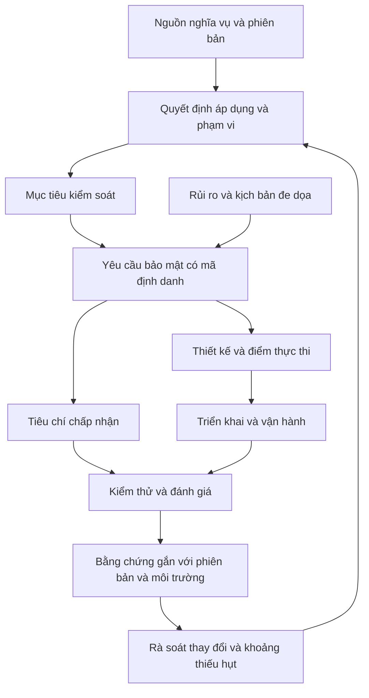

# Compliance requirement

## 1. Yêu cầu tuân thủ trong thiết kế bảo mật

**Compliance requirement** là yêu cầu có thể truy vết đến một nghĩa vụ tuân thủ áp dụng cho tổ chức, sản phẩm hoặc một phạm vi xử lý cụ thể. Nguồn nghĩa vụ có thể là quy định pháp luật, điều khoản hợp đồng, một bộ yêu cầu được tổ chức cam kết đáp ứng hoặc chính sách nội bộ có thẩm quyền.

Trong thiết kế yêu cầu bảo mật, công việc không dừng ở câu “hệ thống phải tuân thủ”. Nhóm phát triển phải xác định:

- Nghĩa vụ nào áp dụng và ai đã xác nhận cách hiểu.
- Tài sản, dữ liệu, chủ thể, môi trường và luồng xử lý nào thuộc phạm vi.
- Hệ thống và quy trình vận hành phải thể hiện hành vi gì.
- Khi nào hành vi được xem là đạt hoặc không đạt.
- Bằng chứng nào chứng minh yêu cầu đã được triển khai và đang được duy trì.

Một yêu cầu tuân thủ tốt phải nối được nghĩa vụ với rủi ro, quyết định kiến trúc, tiêu chí kiểm thử và trách nhiệm vận hành. Việc gắn tên một tiêu chuẩn vào tài liệu chưa tạo ra mối nối đó.

Bài học này tập trung vào phương pháp đặc tả kỹ thuật. Các điều khoản, mã nguồn nghĩa vụ, tên hệ thống và ngưỡng số trong ví dụ đều là **giả định phục vụ học tập**, không phải diễn giải một văn bản pháp luật hay ngưỡng bắt buộc của một tiêu chuẩn thực tế.

### Phân biệt các khái niệm gần nhau

| Khái niệm | Câu hỏi cần trả lời | Ví dụ |
| --- | --- | --- |
| Nghĩa vụ tuân thủ | Vì sao phải đáp ứng? | Hợp đồng yêu cầu kiểm soát người được phép xuất dữ liệu |
| Mục tiêu kiểm soát | Kết quả bảo vệ cần đạt là gì? | Chỉ người có thẩm quyền được xuất dữ liệu của đúng khách hàng |
| Yêu cầu bảo mật | Hệ thống phải làm gì, ở đâu và theo điều kiện nào? | API xuất dữ liệu phải kiểm tra quyền và phạm vi khách hàng ở phía máy chủ cho từng yêu cầu |
| Biện pháp kiểm soát | Thực hiện yêu cầu bằng cách nào? | Bộ kiểm tra chính sách phân quyền, nhật ký quyết định và quy trình phê duyệt |
| Tiêu chí chấp nhận | Quan sát điều gì để kết luận đạt? | Người có quyền của khách hàng A vẫn bị từ chối khi xuất dữ liệu của B |
| Bằng chứng | Dựa vào đâu để kiểm chứng kết luận? | Kết quả kiểm thử gắn với bản phát hành, cấu hình triển khai và bản ghi sự kiện |

Một nghĩa vụ có thể dẫn đến nhiều yêu cầu. Một yêu cầu cũng có thể phục vụ nhiều nghĩa vụ và nhiều rủi ro. Không nên ép quan hệ này thành một bảng đánh dấu một đối một.

## 2. Tuân thủ và quản lý rủi ro bổ sung cho nhau

Yêu cầu phát sinh từ rủi ro thường bắt đầu bằng kịch bản: kẻ tấn công đánh cắp phiên đăng nhập của nhân viên hỗ trợ và xuất dữ liệu khách hàng. Yêu cầu phát sinh từ tuân thủ thường bắt đầu bằng nghĩa vụ: chỉ người được phê duyệt mới được xuất dữ liệu và phải lưu bằng chứng truy cập.

Hai cách tiếp cận có thể dẫn tới cùng biện pháp, nhưng căn cứ quyết định khác nhau:

| Tình huống | Cách xử lý trong đặc tả |
| --- | --- |
| Nghĩa vụ áp dụng đã được xác nhận | Ghi nguồn, phạm vi và tiêu chí đáp ứng bắt buộc |
| Mô hình đe dọa cho thấy rủi ro cao hơn mức kiểm soát tối thiểu | Bổ sung yêu cầu bảo mật và ghi căn cứ rủi ro |
| Chưa biết nghĩa vụ có áp dụng hay không | Đánh dấu chờ xác nhận, chỉ định người xử lý và thời hạn |
| Hệ thống chưa đáp ứng một nghĩa vụ đã áp dụng | Ghi khoảng thiếu hụt, tác động và kế hoạch xử lý; không tự chuyển thành đạt |
| Nhóm muốn chấp nhận rủi ro còn lại | Ghi quyết định theo thẩm quyền, đồng thời kiểm tra riêng nghĩa vụ tuân thủ |

Phê duyệt chấp nhận rủi ro trong nội bộ không tự sửa một điều khoản hợp đồng hoặc làm biến mất nghĩa vụ bên ngoài. Nếu định dùng một biện pháp thay thế, phải kiểm tra nguồn nghĩa vụ có cho phép cách thay thế đó và ai có quyền chấp thuận.

Ngược lại, đáp ứng đầy đủ các nghĩa vụ đã liệt kê cũng không chứng minh rằng mọi mối đe dọa đều đã được xử lý. Threat model có thể phát hiện rủi ro chưa được văn bản nguồn đề cập.

## 3. Xác định khả năng áp dụng trước khi viết yêu cầu

Không thể xác định phạm vi tuân thủ chỉ từ tên công nghệ hoặc vị trí máy chủ. Cần mô tả hệ thống đủ rõ để người chịu trách nhiệm về nghĩa vụ đưa ra quyết định có căn cứ.

### Thông tin đầu vào cần có

1. **Chủ thể và trách nhiệm:** bên cung cấp dịch vụ, khách hàng, bên xử lý phụ, người vận hành và bên phê duyệt.
2. **Dữ liệu:** loại dữ liệu, mục đích xử lý, mức độ nhạy cảm và dữ liệu phát sinh từ logging, backup hoặc báo cáo.
3. **Luồng dữ liệu:** thu thập, truyền, lưu trữ, truy cập, xuất, chia sẻ, sao lưu, phục hồi và xóa.
4. **Phạm vi triển khai:** môi trường production, môi trường thử nghiệm có dữ liệu thật, công cụ hỗ trợ và hệ thống quản trị.
5. **Bên phụ thuộc:** nhà cung cấp định danh, lưu trữ, giám sát và các dịch vụ xử lý dữ liệu.
6. **Thời gian:** thời điểm nghĩa vụ có hiệu lực, thời hạn hợp đồng, kỳ lưu giữ và các mốc xử lý bắt buộc.

Từ đó lập sổ nghĩa vụ với trạng thái rõ ràng:

| Trường | Ý nghĩa |
| --- | --- |
| Mã nghĩa vụ | Định danh ổn định để liên kết yêu cầu và bằng chứng |
| Nguồn và vị trí | Tài liệu nào, phiên bản nào, điều khoản hoặc mục nào |
| Trạng thái áp dụng | Áp dụng, không áp dụng có căn cứ hoặc chờ xác nhận |
| Phạm vi | Dịch vụ, dữ liệu, chủ thể, môi trường và bên phụ thuộc liên quan |
| Người xác nhận | Vai trò có trách nhiệm xác nhận cách hiểu và khả năng áp dụng |
| Ngày xác nhận và ngày rà soát | Mốc quyết định và điều kiện cần xem lại |
| Điểm chưa rõ | Câu hỏi đang mở, người xử lý và hạn giải quyết |

“Không áp dụng” cần có lý do và người xác nhận. “Chờ xác nhận” là việc còn mở, không phải cách ngầm loại một nghĩa vụ khỏi phạm vi phát hành.

Nếu hợp đồng chỉ nói “xóa kịp thời”, nhóm kỹ thuật chưa được tự ghi một số ngày rồi coi đó là diễn giải đã được duyệt. Có thể đề xuất ngưỡng để thảo luận, nhưng phải giữ trạng thái đề xuất cho tới khi cách hiểu được xác nhận.

## 4. Chuỗi chuyển đổi từ nghĩa vụ đến kiểm chứng

Một chuỗi truy vết hữu ích gồm:

Thực hiện lần lượt:

1. Ghi nguồn nghĩa vụ và giữ được nội dung hoặc tham chiếu có thể tra cứu.
2. Xác nhận cách hiểu và phạm vi áp dụng.
3. Tách nghĩa vụ tổng quát thành các kết quả bảo vệ cần đạt.
4. Viết các yêu cầu đơn nghĩa, có chủ thể và điều kiện kiểm chứng.
5. Chỉ ra thành phần kiến trúc chịu trách nhiệm thực thi.
6. Thiết kế phép kiểm tra cả trường hợp được phép và bị cấm.
7. Thu bằng chứng phù hợp với loại yêu cầu.
8. Duy trì liên kết khi nguồn nghĩa vụ, kiến trúc hoặc phạm vi dữ liệu thay đổi.

Không chuyển thẳng từ câu chữ hợp đồng sang một sản phẩm bảo mật cụ thể. Ví dụ, mua một hệ thống quản lý danh tính chưa chứng minh rằng quyền của người nghỉ việc được thu hồi ở mọi API và tác vụ nền trong thời gian yêu cầu.

## 5. Cấu trúc một yêu cầu tuân thủ có thể kiểm chứng

Một mẫu câu hữu ích là:

> Khi **điều kiện hoặc sự kiện** xảy ra, **thành phần chịu trách nhiệm** phải thực hiện **hành vi quan sát được** đối với **đối tượng trong phạm vi**, theo **ngưỡng hoặc quy tắc đã xác định**; kết quả được kiểm chứng bằng **phương pháp và bằng chứng cụ thể**.

Hồ sơ yêu cầu nên chứa:

| Thành phần | Cần ghi cụ thể |
| --- | --- |
| Mã và phiên bản | Định danh yêu cầu, phiên bản nội dung, trạng thái phê duyệt |
| Nguồn | Mã nghĩa vụ, vị trí trong nguồn, phiên bản nguồn và quyết định áp dụng |
| Rủi ro liên quan | Kịch bản lạm dụng hoặc hậu quả cần giảm |
| Phạm vi | Chủ thể, dữ liệu, dịch vụ, API, giao diện quản trị và môi trường |
| Hành vi bắt buộc | Điều hệ thống hoặc quy trình phải thực hiện |
| Điểm thực thi | Nơi quyết định được đưa ra và nơi quyết định được áp dụng |
| Ngưỡng | Giá trị, đơn vị, mốc bắt đầu và điều kiện kết thúc phép đo |
| Tình huống lỗi | Hành vi khi dịch vụ phụ thuộc lỗi, timeout hoặc thiếu dữ liệu |
| Tiêu chí chấp nhận | Điều kiện đạt, không đạt và dữ liệu thử |
| Bằng chứng | Loại hiện vật, nơi lưu, quyền truy cập và thời gian còn giá trị |
| Trách nhiệm | Người triển khai, xác minh, vận hành và phê duyệt |
| Ngoại lệ | Căn cứ cho phép, phạm vi, thẩm quyền và ngày hết hiệu lực nếu có |

### Ví dụ sửa một yêu cầu mơ hồ

**Chưa đủ rõ:**

> Hệ thống phải thu hồi quyền nhanh chóng theo yêu cầu tuân thủ.

**Có thể kiểm chứng:**

> Kể từ thời điểm dịch vụ quản trị danh tính tiếp nhận thành công yêu cầu thu hồi quyền xuất dữ liệu của một người dùng trong một khách hàng, trong tối đa 15 phút, mọi điểm thực thi thuộc phạm vi phải từ chối các lần xuất dữ liệu tiếp theo bằng quyền đã bị thu hồi. Phạm vi bao gồm API đồng bộ, phiên đang tồn tại và việc kiểm tra quyền tại thời điểm tác vụ xuất nền bắt đầu. Kiểm thử phải đo từ mốc tiếp nhận yêu cầu thu hồi đến lần kiểm tra quyết định quyền ở các điểm thực thi.

Ngưỡng 15 phút ở đây là giả định. Khi đưa vào dự án thật, phải xác nhận nó đến từ nghĩa vụ nào hoặc từ quyết định thiết kế nội bộ nào.

Yêu cầu còn cần quyết định riêng cho một tác vụ đã bắt đầu trước khi thu hồi: được hoàn thành, bị hủy hay chỉ được tiếp tục một phần. Bỏ trống trường hợp này tạo ra hai cách hiểu khác nhau giữa nhóm phát triển và nhóm kiểm thử.

## 6. Ví dụ xuyên suốt: dịch vụ quản lý bảng lương

Giả sử một dịch vụ SaaS quản lý bảng lương cho nhiều khách hàng. Các thành phần gồm cổng quản trị, API, worker xuất báo cáo, cơ sở dữ liệu, kho tệp, hệ thống định danh, kho nhật ký và hệ thống sao lưu.

Hợp đồng giả định **C-DEMO-01, bản 1** đã được các bên có trách nhiệm xác nhận cách hiểu như sau:

| Mã nghĩa vụ | Nội dung giả định đã xác nhận |
| --- | --- |
| OBL-01, mục 4.1 | Người dùng con người khi truy cập chức năng đặc quyền phải dùng xác thực nhiều yếu tố |
| OBL-02, mục 4.2 | Quyền xuất bảng lương phải được phê duyệt bởi người khác người yêu cầu, giới hạn theo khách hàng và được thu hồi trong tối đa 15 phút sau khi tiếp nhận yêu cầu thu hồi hợp lệ |
| OBL-03, mục 4.3 | Dữ liệu bảng lương phải được bảo vệ bằng mã hóa khi truyền và khi lưu, kể cả bản sao lưu, với khóa được quản lý theo phương án đã phê duyệt |
| OBL-04, mục 5.1 | Thay đổi quyền, xuất dữ liệu và các lần thử những thao tác này phải được ghi nhận; nhật ký tối thiểu được lưu 180 ngày kể từ thời điểm sự kiện |
| OBL-05, mục 6.1 | Dữ liệu bảng lương phải được xóa trong tối đa 30 ngày sau khi yêu cầu kết thúc dịch vụ được tiếp nhận hợp lệ, bao gồm các bản sao trong phạm vi; ngoại lệ giữ lại phải có căn cứ và phê duyệt theo quy trình đã thống nhất |
| OBL-06, mục 7.1 | Dịch vụ quan trọng phải có RTO tối đa 4 giờ và RPO tối đa 15 phút trong kịch bản phục hồi đã thống nhất |

Phạm vi lưu giữ nhật ký tối thiểu được xác định riêng với dữ liệu bảng lương: nhật ký không chứa nội dung bảng lương. Chính sách lưu giữ đã được xác nhận cho ví dụ này yêu cầu xóa nhật ký khi đủ 180 ngày, trừ ngoại lệ giữ lại hợp lệ. Vì vậy không mặc nhiên dùng nghĩa vụ lưu nhật ký để giữ nguyên mọi dữ liệu của khách hàng.

Các giá trị trên chỉ dùng trong ví dụ. Việc lấy chúng áp dụng cho một hệ thống khác cần quay lại bước xác định nguồn và khả năng áp dụng.

### 6.1. Xác thực đặc quyền: SEC-COMP-IAM-01

**Nguồn:** OBL-01.

**Yêu cầu:** Các điểm truy cập tương tác của người dùng con người vào chức năng đặc quyền phải kiểm tra rằng ngữ cảnh xác thực đáp ứng điều kiện nhiều yếu tố đã được phê duyệt. API phải thực thi điều kiện này ở phía máy chủ; không dựa vào việc giao diện đã ẩn nút hoặc đã chuyển hướng tới trang đăng nhập.

Phạm vi bao gồm cổng quản trị và API cho các thao tác quản trị tương ứng. Các đường truy cập khẩn cấp phải được liệt kê và có yêu cầu riêng đã được phê duyệt; một tài khoản dùng chung bỏ qua kiểm tra không thể âm thầm nằm ngoài phạm vi.

Danh tính máy và worker không bị ghép cơ học vào quy trình MFA của con người. Chúng cần bộ yêu cầu xác thực và phân quyền riêng, đồng thời không được cung cấp đường đi thay thế để người dùng vượt qua kiểm soát đặc quyền.

**Tiêu chí chấp nhận:**

- Ngữ cảnh xác thực hợp lệ đáp ứng nhiều yếu tố và quyền phù hợp được phép thực hiện thao tác.
- Phiên chỉ đáp ứng một yếu tố bị từ chối dù người dùng đã có vai trò quản trị.
- Gọi thẳng API hoặc dùng một tuyến quản trị khác không bỏ qua điều kiện.
- Bằng chứng xác thực hết hiệu lực hoặc không thể xác minh không được coi là đáp ứng.

Bằng chứng gồm ma trận đường truy cập, cấu hình chính sách và kết quả kiểm thử các tuyến tương ứng.

### 6.2. Phân quyền và thu hồi: SEC-COMP-IAM-02

**Nguồn:** OBL-02. **Rủi ro liên quan:** nhân viên tự cấp quyền, truy cập chéo khách hàng và quyền cũ tiếp tục hoạt động sau khi đã bị thu hồi.

**Yêu cầu:** Chỉ kích hoạt quyền xuất bảng lương sau phê duyệt của một người khác người yêu cầu, có quyền phê duyệt trong đúng khách hàng. Mọi yêu cầu xuất phải được kiểm tra quyền ở phía máy chủ, bao gồm quyền trên khách hàng và tập dữ liệu cụ thể.

Mốc bắt đầu đo thu hồi là thời điểm dịch vụ quản trị tiếp nhận thành công yêu cầu hợp lệ và trả mã xác nhận. Hạn 15 phút áp dụng cho tất cả điểm thực thi đã liệt kê, kể cả cache quyền, phiên đang tồn tại và worker nhận tác vụ từ hàng đợi.

Để làm rõ tình huống tác vụ đang chạy, ví dụ chọn thêm **quyết định thiết kế nội bộ**: worker phải kiểm tra lại quyền trước khi công bố tệp kết quả; liên kết tải cũng phải xác minh quyền hiện hành. Nếu đã quá hạn thu hồi, kết quả không được cung cấp cho người đã mất quyền. Đây là cách thực hiện được dự án lựa chọn, không phải câu chữ bổ sung vào OBL-02.

**Kiểm chứng:** thử tự phê duyệt, dùng người phê duyệt của khách hàng khác, tái sử dụng phiên cũ và thực thi tác vụ được đưa vào hàng đợi trước thời điểm thu hồi. Kết quả phải gắn với thời điểm phát lệnh thu hồi, mã xác nhận và quyết định quyền tại từng điểm thực thi.

### 6.3. Bảo vệ dữ liệu: SEC-COMP-DATA-01

**Nguồn:** OBL-03.

**Yêu cầu:** Luồng truyền và nơi lưu dữ liệu bảng lương trong phạm vi phải sử dụng cơ chế mã hóa và quản lý khóa theo cấu hình đã được phê duyệt, bao gồm API, kết nối nội bộ mang dữ liệu, cơ sở dữ liệu, tệp xuất, vùng lưu tạm và bản sao lưu.

Hồ sơ phê duyệt phải khóa phiên bản baseline, danh sách cấu hình cho phép, phạm vi khóa, quyền sử dụng khóa và cách xử lý lỗi. Cụm từ “mã hóa theo chuẩn mới nhất” không đủ làm tiêu chí kiểm thử vì không xác định được một bộ cấu hình ổn định.

Trong một dự án thật, chưa có baseline cụ thể thì phần này vẫn là **đầu vào cần hoàn tất trước khi phê duyệt yêu cầu**, không được đánh dấu là đã kiểm chứng chỉ nhờ nhắc tới baseline.

**Tiêu chí chấp nhận:**

- Các tuyến truyền trong danh mục từ chối cách truy cập không được bảo vệ hoặc cấu hình nằm ngoài baseline được duyệt.
- Tệp xuất và bản sao lưu được tạo theo cấu hình mã hóa đã xác nhận.
- Danh tính không có quyền sử dụng khóa không đọc được dữ liệu qua luồng dịch vụ được bảo vệ.
- Khi không thể sử dụng dịch vụ quản lý khóa, luồng xử lý dừng hoặc báo lỗi theo thiết kế; không chuyển sang ghi dữ liệu rõ để hoàn thành giao dịch.

Bằng chứng cần kết hợp kiểm tra cấu hình, kiểm thử hành vi và đánh giá quyền sử dụng khóa. Chỉ thử đọc trực tiếp một tệp không đủ chứng minh toàn bộ các bản sao đều được bảo vệ.

### 6.4. Logging và khả năng truy cứu: SEC-COMP-AUD-01

**Nguồn:** OBL-04.

**Yêu cầu:** Thay đổi quyền, xuất dữ liệu và các lần thử thực hiện các thao tác đó phải sinh sự kiện có tối thiểu mã sự kiện, thời điểm, định danh chủ thể, định danh khách hàng, loại hành động, định danh đối tượng và kết quả. Mã liên kết được dùng để nối yêu cầu, tác vụ nền và kết quả thực thi.

Nội dung bảng lương, mật khẩu, token truy cập và khóa bí mật không được đưa vào nhật ký. Trường tự do phải được kiểm soát để không trở thành đường ghi dữ liệu nhạy cảm ngoài ý muốn.

Nhật ký phải được giữ trong 180 ngày kể từ thời điểm sự kiện và được bảo vệ khỏi sửa hoặc xóa trái phép. Vai trò vận hành ứng dụng không mặc nhiên có quyền xóa kho nhật ký. Việc truy cập hoặc quản trị kho nhật ký cũng phải có cơ chế kiểm soát và bằng chứng.

Dự án bổ sung hai **ngưỡng vận hành nội bộ** cho ví dụ:

- Sự kiện phải đến kho tập trung trong tối đa 60 giây ở điều kiện vận hành đã xác định.
- Một truy vấn điều tra thuộc bộ truy vấn chuẩn phải trả kết quả trong tối đa 10 phút trên toàn khoảng nhật ký còn phải giữ.

Các ngưỡng 60 giây và 10 phút phục vụ vận hành; nguồn của chúng là quyết định nội bộ, không phải OBL-04.

Với thao tác xuất dữ liệu, thiết kế trong ví dụ yêu cầu ghi bền vững sự kiện trước khi công bố kết quả. Nếu chưa thể bảo đảm điều đó, kết quả xuất chưa được cung cấp. Hàng đợi bền vững, thử lại, định danh chống trùng và cảnh báo tồn đọng phải được đặc tả để không mất sự kiện khi kho tập trung tạm ngừng hoạt động.

**Kiểm chứng:** gây lỗi kho nhật ký, khởi động lại worker, gửi lại tác vụ, thử xóa nhật ký bằng vai trò vận hành và kiểm tra các trường nhạy cảm bằng dữ liệu thử có dấu nhận diện.

### 6.5. Xóa dữ liệu và bản sao: SEC-COMP-DEL-01

**Nguồn:** OBL-05.

**Yêu cầu:** Trong tối đa 30 ngày kể từ thời điểm tiếp nhận hợp lệ yêu cầu kết thúc dịch vụ, dữ liệu bảng lương trong phạm vi phải được xóa tại các nơi lưu đang hoạt động và các bản sao thuộc phạm vi đã thống nhất. Yêu cầu phải có danh mục nơi lưu, cách xác minh và người chịu trách nhiệm đối với từng loại bản sao.

Phạm vi cần xem xét gồm cơ sở dữ liệu, kho tệp, tệp xuất, vùng lưu tạm, bản sao đọc, chỉ mục tìm kiếm, cache và bản sao lưu. Đánh dấu một dòng là “đã xóa” nhưng vẫn giữ nội dung ở nơi khác chưa đáp ứng yêu cầu này.

Nếu kiến trúc giữ bản sao lưu lâu hơn thời hạn đã cam kết và không có cơ chế xóa thích hợp, đó là khoảng thiếu hụt thiết kế. Không tự coi dữ liệu đã mã hóa là đã bị xóa. Nếu chọn phương án hủy khóa, cần một đặc tả và bằng chứng riêng về phạm vi khóa, mọi bản sao khóa và khả năng khôi phục còn lại; tên biện pháp không thay thế kết quả cần chứng minh.

Khi có ngoại lệ giữ lại hợp lệ theo nguồn nghĩa vụ, quyết định phải chỉ rõ căn cứ, dữ liệu, phạm vi truy cập, người phê duyệt và điều kiện kết thúc. Chỉ phần dữ liệu được quyết định giữ lại mới được xử lý theo ngoại lệ.

Nhật ký tối thiểu trong ví dụ có mục đích và lịch lưu giữ riêng đã được xác nhận. Phải chứng minh rằng nó không chứa dữ liệu bảng lương bị yêu cầu xóa; không thể đặt toàn bộ payload vào log rồi viện dẫn thời hạn 180 ngày.

**Kiểm chứng:** tạo dữ liệu thử có dấu nhận diện, kích hoạt quy trình xóa, kiểm tra từng nơi lưu và kiểm tra bản sao lưu đại diện theo thiết kế. Với tập bản sao còn tồn tại trong quá trình xóa, phục hồi phải diễn ra ở vùng cách ly và áp dụng lại quyết định xóa trước khi mở truy cập nghiệp vụ. Kiểm soát phục hồi này bổ sung cho yêu cầu xóa, không thay thế nghĩa vụ hoàn tất xóa trong 30 ngày.

### 6.6. Phục hồi có ràng buộc bảo mật: SEC-COMP-BCP-01

**Nguồn:** OBL-06.

**Yêu cầu:** Trong kịch bản phục hồi đã thống nhất, dịch vụ phải phục hồi trong RTO tối đa 4 giờ, với mức mất dữ liệu không vượt RPO 15 phút. Phạm vi phục hồi phải bao gồm các phụ thuộc cần thiết để dịch vụ hoạt động an toàn.

Để phép đo có ý nghĩa, ví dụ thống nhất:

- Mốc bắt đầu RTO là thời điểm phát sinh sự cố mô phỏng.
- Mốc kết thúc RTO là khi các giao dịch nghiệp vụ kiểm chứng chạy thành công và các kiểm soát xác thực, phân quyền, mã hóa, logging liên quan hoạt động đạt tiêu chí.
- RPO được đánh giá bằng dữ liệu và trạng thái giao dịch đã khôi phục so với mốc sự cố, kèm kiểm tra tính nhất quán.
- Việc chỉ khởi động được máy chủ hoặc kết nối được cơ sở dữ liệu chưa kết thúc phép đo RTO.

Dự án chọn diễn tập mỗi quý như một yêu cầu vận hành nội bộ. Tần suất này là giả định riêng, không suy ra từ hai con số RTO và RPO trong OBL-06.

**Kiểm chứng:** khôi phục từ bản sao trong kịch bản đã duyệt, đo thời gian, đối chiếu giao dịch và xác minh rằng người đã mất quyền không lấy lại quyền chỉ vì hệ thống vừa phục hồi.

## 7. Ma trận truy vết giúp tránh bỏ sót

Với ví dụ trên, có thể tổ chức một lát cắt của ma trận như sau:

| Nghĩa vụ | Yêu cầu | Điểm thực thi chính | Bằng chứng dự kiến | Chủ trì xác minh |
| --- | --- | --- | --- | --- |
| OBL-01 | SEC-COMP-IAM-01 | Cổng quản trị, API, bộ kiểm tra ngữ cảnh xác thực | Ma trận tuyến truy cập, cấu hình và kiểm thử vượt qua điều kiện | Nhóm IAM và kiểm thử bảo mật |
| OBL-02 | SEC-COMP-IAM-02 | Dịch vụ quyền, API, worker, cổng tải tệp | Lịch sử phê duyệt, phép đo thu hồi, kiểm thử chéo khách hàng | Nhóm ứng dụng |
| OBL-03 | SEC-COMP-DATA-01 | Luồng truyền, kho dữ liệu, vùng tạm, hệ thống backup và khóa | Baseline được duyệt, cấu hình thực tế, kết quả kiểm thử lỗi khóa | Nhóm nền tảng |
| OBL-04 | SEC-COMP-AUD-01 | Ứng dụng, hàng đợi, kho nhật ký | Sự kiện mẫu, thử nghiệm gián đoạn, cấu hình lưu giữ và quyền truy cập | Nhóm vận hành |
| OBL-05 | SEC-COMP-DEL-01 | Mọi nơi lưu và quy trình xóa, phục hồi | Danh mục bản sao, báo cáo xóa, bằng chứng xử lý ngoại lệ | Chủ sở hữu dữ liệu |
| OBL-06 | SEC-COMP-BCP-01 | Ứng dụng và các phụ thuộc trong phạm vi phục hồi | Biên bản diễn tập, mốc thời gian, kết quả đối chiếu dữ liệu | Nhóm vận hành dịch vụ |

Ma trận là chỉ mục truy vết. Nó không thay thế nội dung đặc tả, kết quả kiểm thử hay quyết định phê duyệt.

Một dấu hiệu thiếu sót là nghĩa vụ không liên kết tới yêu cầu nào. Dấu hiệu khác là yêu cầu có mã nhưng không có tiêu chí kiểm chứng hoặc không có nơi thực thi trong kiến trúc.

Cũng cần kiểm tra chiều ngược lại: một thay đổi ở worker xuất báo cáo có thể ảnh hưởng đồng thời đến phân quyền, audit, tệp tạm và xóa dữ liệu, dù nó chỉ được xem là thay đổi tính năng xuất tệp.

## 8. Thiết kế phép kiểm chứng phù hợp với từng yêu cầu

Không phải yêu cầu nào cũng chứng minh được bằng một bài kiểm thử tự động. Cần chọn phương pháp theo loại tuyên bố cần xác nhận.

| Loại tuyên bố | Phương pháp phù hợp | Giới hạn cần ghi nhận |
| --- | --- | --- |
| API từ chối truy cập không đủ quyền | Kiểm thử tích hợp và kiểm thử bảo mật trên các điểm thực thi | Đạt ở một tuyến không chứng minh các tuyến khác đều đạt |
| Tự phê duyệt bị ngăn chặn | Kiểm thử luồng và kiểm tra quy tắc phân tách trách nhiệm | Cần xét cả sửa dữ liệu qua công cụ quản trị |
| Nhật ký được giữ đủ 180 ngày | Kiểm tra cấu hình, quyền xóa, cơ chế hết hạn và bằng chứng vận hành theo thời gian | Mô phỏng tăng tốc chỉ xác minh logic, không thay thế lịch sử vận hành thật |
| Mọi bản sao dữ liệu đều được xóa | Kiểm kê dữ liệu, thử nghiệm xóa và kiểm tra từng cơ chế sao chép | Một truy vấn không tìm thấy dữ liệu chưa chứng minh mọi bản sao đã biến mất |
| Dịch vụ đáp ứng RTO và RPO | Diễn tập phục hồi có đo lường và đối chiếu giao dịch | Một lần diễn tập chỉ hỗ trợ kết luận cho phạm vi và kịch bản đã thực hiện |
| Chỉ người được phê duyệt có quyền đặc biệt | Kiểm tra quyền thực tế, lịch sử phê duyệt và đối chiếu danh sách | Tài liệu quy trình đẹp không chứng minh quy trình đã được thực hiện |

### Bộ tình huống chấp nhận cho yêu cầu thu hồi quyền

Với SEC-COMP-IAM-02, nên có ít nhất các tình huống:

1. Thu hồi quyền và thử thao tác bằng một yêu cầu mới.
2. Giữ nguyên phiên đã đăng nhập trước khi thu hồi và thử lại.
3. Thử tại từng nút đang có cache quyền.
4. Thử tác vụ nằm trong hàng đợi từ trước thời điểm thu hồi.
5. Thử tải tệp đã được tạo bằng liên kết còn thời hạn.
6. Thử trong lúc dịch vụ cung cấp quyết định quyền gặp lỗi.
7. Phục hồi hệ thống từ bản sao rồi đối chiếu quyết định quyền hiện hành.

Thống nhất cách đồng bộ hoặc đối chiếu đồng hồ và sai số phép đo. Nếu log của hai thành phần lệch nhau, việc trừ hai timestamp có thể tạo kết luận sai về giới hạn 15 phút.

Ở tình huống lỗi phụ thuộc, hành vi phải được xác định trước. Một giá trị cache không thể xác minh không được mặc nhiên trở thành quyền không thời hạn. Thiết kế phải nói rõ giới hạn hiệu lực của quyết định cũ và cách vẫn đáp ứng hạn thu hồi.

## 9. Bằng chứng phải chứng minh đúng tuyên bố

Một gói bằng chứng hữu ích thường trả lời được:

- Đang chứng minh yêu cầu nào và phiên bản nào.
- Mã nguồn, bản dựng, cấu hình, môi trường và phạm vi dữ liệu nào đã được kiểm tra.
- Ai thực hiện, vào thời điểm nào, theo phương pháp nào.
- Kết quả thực tế là gì, có lỗi hoặc giới hạn nào.
- Hiện vật được lưu ở đâu và ai có quyền đọc hoặc sửa.
- Thay đổi nào sẽ làm bằng chứng cần được đánh giá lại.

Ví dụ một kết quả “PASS” không kèm mã bản dựng không giúp xác định bản đang triển khai có phải bản đã kiểm thử. Ảnh chụp màn hình cho thấy một tùy chọn được bật cũng không chứng minh cấu hình ấy đã được áp dụng ở mọi môi trường và mọi tài nguyên.

Bằng chứng phải được bảo vệ như một tài sản: hạn chế dữ liệu nhạy cảm, phân quyền truy cập và kiểm soát sửa đổi. Không đưa token thật, khóa bí mật hay toàn bộ dữ liệu bảng lương vào báo cáo kiểm thử chỉ để làm bằng chứng.

Thời hạn lưu bằng chứng cần có căn cứ riêng. Thời hạn 180 ngày của nhật ký trong ví dụ không tự động trở thành thời hạn lưu mọi báo cáo kiểm thử, quyết định phê duyệt hay biên bản diễn tập.

### Đánh giá bằng chứng từ nhà cung cấp

Tài liệu hoặc báo cáo của nhà cung cấp có thể hỗ trợ việc đánh giá một phần kiểm soát. Cần kiểm tra:

- Dịch vụ, tính năng và khoảng thời gian trong báo cáo có trùng phạm vi sử dụng hay không.
- Trách nhiệm nào thuộc nhà cung cấp, trách nhiệm nào vẫn thuộc khách hàng sử dụng dịch vụ.
- Cấu hình, phân quyền và tích hợp của hệ thống có đáp ứng phần trách nhiệm còn lại hay không.
- Bằng chứng có còn phù hợp sau thay đổi kiến trúc hoặc gói dịch vụ không.

Việc một nhà cung cấp có chứng nhận không tự chứng minh ứng dụng đã cấu hình đúng quyền, xóa dữ liệu đúng hạn hoặc phục hồi được khóa.

## 10. Xử lý xung đột, khoảng thiếu hụt và ngoại lệ

Các yêu cầu có thể xung đột về phạm vi hoặc cách thực hiện. Ví dụ: cần lưu bằng chứng truy cập nhưng đồng thời phải xóa dữ liệu bảng lương; cần hỗ trợ khẩn cấp nhưng vẫn phải kiểm soát quyền đặc biệt.

Cách xử lý có trình tự:

1. Ghi rõ hai yêu cầu và nguồn của từng yêu cầu.
2. So sánh phạm vi dữ liệu, chủ thể, mục đích và mốc thời gian.
3. Xác định xung đột nằm ở nghĩa vụ, cách hiểu hay kiến trúc hiện tại.
4. Đưa phương án tới đúng người chịu trách nhiệm xác nhận nghĩa vụ và thiết kế.
5. Cập nhật quyết định, yêu cầu, tiêu chí kiểm thử và ma trận truy vết.
6. Giữ trạng thái chưa đáp ứng nếu chưa có cách giải quyết hợp lệ.

Trong ví dụ nhật ký và xóa dữ liệu, phương án đã được xác nhận là log chỉ chứa trường tối thiểu cho truy cứu và có lịch lưu riêng. Nếu ứng dụng hiện ghi toàn bộ bảng lương vào log, vấn đề cần sửa là thiết kế logging; không thể chỉ đổi tên dữ liệu để coi là đã giải quyết xung đột.

Một hồ sơ ngoại lệ, khi nguồn nghĩa vụ và thẩm quyền cho phép, cần ghi ít nhất:

| Nội dung | Mục đích |
| --- | --- |
| Yêu cầu và phạm vi chưa đáp ứng | Tránh ngoại lệ chung cho toàn hệ thống |
| Căn cứ cho phép xem xét ngoại lệ | Xác nhận có cơ sở xử lý |
| Rủi ro và tác động | Thấy rõ hậu quả trong thời gian chưa đáp ứng |
| Biện pháp tạm thời | Giảm rủi ro với cơ chế kiểm chứng cụ thể |
| Người có thẩm quyền phê duyệt | Bảo đảm quyết định đúng trách nhiệm |
| Ngày kết thúc hoặc điều kiện hết hiệu lực | Ngăn ngoại lệ kéo dài không được rà soát |
| Kế hoạch khắc phục và bằng chứng đóng | Xác định khi nào kết thúc khoảng thiếu hụt |

Không dùng ngoại lệ để đổi một phép kiểm thử thất bại thành “PASS”. Kết quả kỹ thuật và quyết định cho phép tiếp tục trong phạm vi nhất định là hai thông tin cần được ghi riêng.

## 11. Duy trì yêu cầu trong vòng đời phát triển

Yêu cầu tuân thủ phải đi cùng thay đổi sản phẩm và vận hành.

| Giai đoạn | Việc cần thực hiện | Đầu ra có thể xem xét |
| --- | --- | --- |
| Xác định phạm vi | Xác nhận nghĩa vụ, dữ liệu và trách nhiệm | Sổ nghĩa vụ và quyết định áp dụng |
| Phân tích yêu cầu | Viết hành vi, ngưỡng, mốc đo và tiêu chí chấp nhận | Hồ sơ yêu cầu có mã định danh |
| Thiết kế | Xác định điểm thực thi và phân chia trách nhiệm | Sơ đồ luồng dữ liệu, quyết định kiến trúc |
| Phát triển | Liên kết thay đổi với yêu cầu | Mã nguồn, cấu hình, kiểm thử liên quan |
| Trước phát hành | Xác minh tiêu chí, bằng chứng và khoảng thiếu hụt | Gói bằng chứng cho bản phát hành |
| Vận hành | Theo dõi hiệu lực kiểm soát, lỗi và thay đổi cấu hình | Số đo, cảnh báo, lịch sử vận hành |
| Thay đổi hoặc ngừng dịch vụ | Phân tích lại tác động, quyền và dữ liệu | Yêu cầu cập nhật, báo cáo xóa hoặc bàn giao |

Các tác nhân kích hoạt rà soát gồm thay đổi hợp đồng, loại dữ liệu, khách hàng, nhà cung cấp, khu vực xử lý, luồng xuất dữ liệu, cách sao lưu hoặc phương thức xác thực.

Ví dụ, thêm chức năng gửi báo cáo qua email làm phát sinh một bản sao và một tuyến phân phối mới. Trước khi phát hành cần xem lại quyền người nhận, bảo vệ dữ liệu, logging, thời hạn lưu và quy trình xóa. Kết quả kiểm thử cho luồng tải tệp cũ không bao phủ tự động luồng email.

Nên tách các trạng thái sau:

- Yêu cầu đã được xác nhận.
- Biện pháp đã được triển khai.
- Kiểm chứng đã đạt cho một phiên bản và phạm vi.
- Kiểm soát đang vận hành theo kết quả quan sát.
- Kết luận tuân thủ được người có trách nhiệm chấp thuận.

Không gom tất cả thành một nhãn “compliant” duy nhất mà không chỉ rõ thời điểm và căn cứ.

## 12. Những lỗi đặc tả thường gặp

| Cách viết hoặc cách làm | Vì sao thiếu | Cách cải thiện |
| --- | --- | --- |
| “Tuân thủ đầy đủ các quy định liên quan” | Không có danh sách nghĩa vụ, phạm vi và phép kiểm chứng | Lập sổ nghĩa vụ và liên kết tới yêu cầu cụ thể |
| “Sử dụng công nghệ bảo mật đạt chuẩn” | Không xác định hành vi hay baseline được duyệt | Chỉ rõ kết quả bảo vệ và cấu hình có phiên bản |
| Chỉ ghi tên tiêu chuẩn trong ticket | Không biết phần nào áp dụng và ai chịu trách nhiệm | Ghi mục nguồn, quyết định áp dụng và tiêu chí chấp nhận |
| “Có logging” | Chưa biết ghi gì, khi nào, giữ bao lâu và khi lỗi thì sao | Đặc tả sự kiện, trường dữ liệu, lưu giữ, quyền và lỗi phụ thuộc |
| “Xóa dữ liệu trong 30 ngày” nhưng không xét backup | Có thể bỏ sót nơi giữ dữ liệu | Liệt kê bản sao, cơ chế xóa và cách kiểm chứng |
| Chỉ kiểm tra người có quyền thao tác thành công | Chưa xác nhận điều cấm được thực thi | Thêm kiểm thử vượt quyền, chéo khách hàng và phiên cũ |
| Đánh dấu đạt dựa trên chứng nhận của nhà cung cấp | Chưa kiểm tra phạm vi và trách nhiệm của ứng dụng | Đối chiếu kiểm soát được cung cấp với phần phải tự thực hiện |
| Dùng bằng chứng cũ sau thay đổi lớn | Bằng chứng có thể không còn hỗ trợ kết luận hiện tại | Đánh giá lại theo thay đổi và thu bổ sung bằng chứng |
| Dùng chấp nhận rủi ro thay cho xác nhận nghĩa vụ | Hai quyết định có căn cứ và thẩm quyền khác nhau | Ghi riêng trạng thái đáp ứng và quyết định xử lý rủi ro |

## 13. Tự thực hành chuyển đổi một nghĩa vụ

Xét câu giả định:

> Chỉ nhân viên được ủy quyền mới được truy cập hồ sơ lương; mọi truy cập phải có thể truy cứu.

Trước khi viết giải pháp, hãy chỉ ra các câu hỏi còn thiếu:

1. “Nhân viên” gồm những nhóm nào, có bao gồm nhân viên nhà cung cấp không?
2. Ai có quyền ủy quyền, quyền có giới hạn theo khách hàng và thời gian không?
3. “Truy cập” gồm đọc từng hồ sơ, tìm kiếm, xuất tệp, xử lý nền và hỗ trợ kỹ thuật nào?
4. Mọi truy cập thành công và các lần bị từ chối có phải ghi nhận không?
5. Nhật ký phải chứa những trường nào, giữ bao lâu và ai được truy cập?
6. Khi bộ kiểm tra quyền hoặc kho nhật ký gặp lỗi, thao tác phải ứng xử thế nào?
7. Ai xác nhận các điểm trên và tài liệu nào lưu quyết định?

Sau khi các câu trả lời được xác nhận, tách thành các yêu cầu về cấp quyền, thực thi quyền và thu hồi; các yêu cầu về sinh sự kiện, bảo vệ nhật ký và lưu giữ. Với mỗi yêu cầu, xác định ít nhất một phép kiểm tra hành vi được phép, một phép kiểm tra hành vi bị cấm nếu có và hiện vật cần giữ làm bằng chứng.

Chưa có câu trả lời về thời hạn lưu thì yêu cầu logging chưa đủ điều kiện chốt tiêu chí lưu giữ. Có thể hoàn thiện các phần đã rõ mà vẫn giữ điểm này là việc cần giải quyết.

## 14. Tiêu chí hoàn thành bản đặc tả

Một tập yêu cầu tuân thủ sẵn sàng cho triển khai và kiểm chứng khi:

- Mỗi nghĩa vụ áp dụng có nguồn, phiên bản, phạm vi và người xác nhận.
- Mỗi yêu cầu có mã định danh, hành vi quan sát được và liên kết về nguồn.
- Mọi ngưỡng quan trọng có đơn vị, mốc đo và căn cứ rõ ràng.
- Kiến trúc chỉ ra điểm thực thi cho API, worker, công cụ quản trị và bên phụ thuộc trong phạm vi.
- Tiêu chí chấp nhận xét cả lỗi, đường đi bỏ qua, bản sao dữ liệu và trạng thái sau phục hồi khi có liên quan.
- Bằng chứng dự kiến được xác định cùng người tạo, nơi lưu và điều kiện phải làm mới.
- Các câu hỏi mở, khoảng thiếu hụt và ngoại lệ được ghi đúng trạng thái, không bị che bởi một nhãn hoàn thành chung.

Một yêu cầu tốt cho phép người triển khai biết cần xây gì, người kiểm thử biết cách kết luận đạt hay không đạt, người vận hành biết cần duy trì điều gì và người chịu trách nhiệm tuân thủ biết kết luận đó dựa trên nguồn nghĩa vụ nào.
