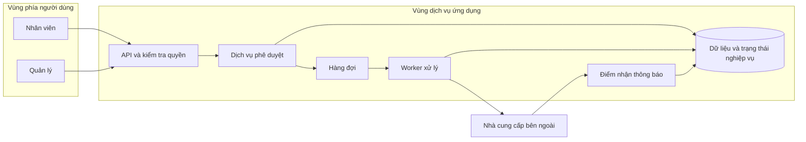

# Compliance không thay thế threat modeling

## 1. Đạt yêu cầu tuân thủ có ý nghĩa gì đối với bảo mật?

Một hệ thống có thể có chính sách phân quyền, mã hóa dữ liệu, ghi log và sao lưu, nhưng vẫn cho phép người dùng sửa giá trị giao dịch sau khi giao dịch đã được phê duyệt. Những biện pháp kiểm soát đó đều có giá trị; vấn đề nằm ở một hành vi nghiệp vụ chưa được đặc tả và kiểm chứng đầy đủ.

Trong kỹ nghệ yêu cầu bảo mật, cần trả lời đồng thời hai nhóm câu hỏi:

- **Tuân thủ:** Những nghĩa vụ và tiêu chí nào áp dụng? Hệ thống hoặc tổ chức đã đáp ứng chúng trong phạm vi được đánh giá chưa? Bằng chứng nào hỗ trợ kết luận đó?
- **Mô hình hóa đe dọa:** Với kiến trúc, dữ liệu, luồng nghiệp vụ và tác nhân cụ thể, điều gì có thể gây hại? Kẻ tấn công có thể vượt ranh giới tin cậy hoặc lạm dụng chức năng ở đâu? Cần yêu cầu gì để ngăn chặn, phát hiện hoặc phục hồi?

Hai nhóm câu hỏi có liên hệ nhưng không đồng nhất. Một kết quả đánh giá tuân thủ không tự chứng minh mọi tình huống tấn công đã được nhận diện. Một mô hình đe dọa tốt cũng không tự chứng minh hệ thống đã triển khai đúng hoặc hoàn thành mọi nghĩa vụ áp dụng.

Mục tiêu là biến cả nghĩa vụ và rủi ro thành yêu cầu bảo mật cụ thể, có chủ sở hữu, có liên kết kiến trúc và có tiêu chí kiểm chứng. Điều này giúp tránh kết luận quá rộng như “đã qua kiểm tra nên không còn rủi ro”.

Sau bài học, người học có thể:

- Phân biệt phạm vi kết luận của đánh giá tuân thủ và mô hình đe dọa.
- Nhận diện những rủi ro đặc thù mà danh sách kiểm tra tổng quát có thể chưa diễn giải đến.
- Chuyển một tình huống lạm dụng thành yêu cầu xác thực, phân quyền, bảo vệ dữ liệu, logging hoặc phục hồi.
- Liên kết nghĩa vụ, mối đe dọa, biện pháp kiểm soát và bằng chứng trong vòng đời phát triển.
- Xử lý khoảng trống mà không dùng chấp nhận rủi ro để tự ý bỏ nghĩa vụ bắt buộc.

## 2. Ba khái niệm cần phân biệt

### 2.1. Compliance: đáp ứng nghĩa vụ và tiêu chí áp dụng

Compliance là việc đáp ứng các nghĩa vụ hoặc tiêu chí đã được xác định là áp dụng cho một tổ chức, hệ thống hoặc hoạt động. Nguồn có thể gồm quy định, hợp đồng, chính sách nội bộ hoặc khuôn khổ mà tổ chức cam kết thực hiện.

Trước khi kết luận “đáp ứng”, cần biết:

- Nguồn yêu cầu và cách diễn giải đã được xác nhận.
- Hệ thống, dữ liệu, quy trình và bên liên quan nằm trong phạm vi.
- Thời điểm hoặc khoảng thời gian được đánh giá.
- Tiêu chí, phương pháp và bằng chứng được sử dụng.
- Ngoại lệ, phát hiện và giới hạn của kết luận.

Không nên đồng nhất một bảng tự kiểm tra nội bộ, một cuộc đánh giá và một chứng nhận. Mỗi loại có cơ sở, phạm vi và giá trị riêng. Nếu viện dẫn một kết quả, phải diễn đạt đúng điều mà kết quả đó thực sự xác nhận.

### 2.2. Threat modeling: phân tích cách hệ thống có thể bị gây hại

Threat modeling là hoạt động có cấu trúc nhằm phân tích:

1. Những gì hệ thống cần bảo vệ.
2. Hệ thống hoạt động như thế nào.
3. Ai hoặc điều gì có thể gây ra kết quả có hại.
4. Những đường tấn công, điều kiện sai và hành vi lạm dụng có thể xảy ra.
5. Biện pháp xử lý, yêu cầu phát sinh và phần rủi ro còn lại.

Mô hình đe dọa cần bám vào hệ thống cụ thể. “Có nguy cơ truy cập trái phép” mới là mô tả chung. “Quản lý của tenant B có thể gửi mã phiếu thuộc tenant A tới API phê duyệt vì dịch vụ chỉ kiểm tra vai trò manager” là một tình huống có thể dẫn đến thay đổi yêu cầu và kiểm thử.

Mô hình này cũng phải xét các giả định như danh tính dịch vụ có thể bị lạm dụng, thông điệp có thể đến trễ hoặc lặp, và người dùng hợp lệ có thể thực hiện chuỗi thao tác gây hại.

### 2.3. Kiểm chứng triển khai: kiểm tra hệ thống có thực hiện đúng yêu cầu không

Tài liệu nêu rằng “mọi thao tác được phân quyền phía máy chủ” chưa chứng minh mọi endpoint đã thực thi điều đó.

Kiểm chứng triển khai dùng các hoạt động phù hợp như kiểm thử, rà soát mã, kiểm tra cấu hình và quan sát vận hành để đánh giá yêu cầu. Hoạt động này cần cả đầu vào từ nghĩa vụ áp dụng lẫn mô hình đe dọa.

| Góc nhìn | Câu hỏi chính | Đầu ra điển hình | Giới hạn cần nhớ |
| --- | --- | --- | --- |
| Tuân thủ | Đã đáp ứng nghĩa vụ và tiêu chí áp dụng chưa? | Danh mục nghĩa vụ, ánh xạ kiểm soát, phát hiện và kết luận có phạm vi | Không tự bao phủ mọi đường tấn công hoặc thay đổi về sau |
| Mô hình đe dọa | Hệ thống cụ thể có thể bị gây hại bằng cách nào? | Tài sản, luồng dữ liệu, ranh giới tin cậy, tình huống đe dọa và phương án xử lý | Không tự chứng minh mã và cấu hình thực hiện đúng |
| Kiểm chứng triển khai | Hành vi thực tế có đáp ứng yêu cầu không? | Kết quả kiểm thử, rà soát, cấu hình và quan sát có ngữ cảnh | Kết luận phụ thuộc phiên bản, môi trường, phạm vi và chất lượng phép kiểm tra |

## 3. Vì sao một danh sách kiểm tra chưa đủ?

### 3.1. Biện pháp tổng quát cần được cụ thể hóa cho nghiệp vụ

Yêu cầu “có phân quyền” chưa xác định được:

- Một quản lý được duyệt phiếu nào?
- Quyền có bị giới hạn theo tenant, đơn vị, hạn mức hoặc trạng thái phiếu không?
- Người tạo phiếu có được tự duyệt không?
- Quyền của người dùng được xử lý thế nào khi chuyển sang công việc chạy nền?
- Một quyết định phê duyệt còn hợp lệ không nếu số tiền hoặc người nhận thay đổi?

Checklist có thể yêu cầu kiểm soát truy cập và kiểm tra nó rất kỹ. Tuy nhiên, đội sản phẩm vẫn phải chuyển yêu cầu đó thành các quy tắc của chính nghiệp vụ đang xây dựng.

Không nên hiểu rằng mọi khuôn khổ tuân thủ đều bỏ qua phân tích rủi ro. Một nghĩa vụ áp dụng có thể đã yêu cầu đánh giá rủi ro hoặc thiết kế an toàn. Khi đó threat modeling có thể là một cách thực hiện hoặc hỗ trợ nghĩa vụ ấy; nó không phải công việc đứng ngoài quy trình tuân thủ.

### 3.2. Các biện pháp riêng lẻ có thể không bảo vệ được cả luồng

Giả sử API đầu vào kiểm tra đúng tenant, nhưng worker đọc hàng đợi lại tin một trường tenant do phía gọi tự cung cấp. Kiểm soát truy cập ở API chưa đủ để bảo đảm dữ liệu được xử lý đúng trong worker.

Tương tự:

- Kênh truyền được mã hóa nhưng ứng dụng vẫn trả dữ liệu cho sai người.
- Người quản trị có xác thực mạnh nhưng một tài khoản nhân viên vẫn lạm dụng chức năng hợp lệ.
- Có audit log nhưng log không ghi phiên bản nội dung đã phê duyệt.
- Có backup nhưng quy trình phục hồi làm hệ thống xử lý lại một nghiệp vụ đã hoàn tất.

Threat modeling giúp xem các thành phần và biện pháp kiểm soát trong một chuỗi hành vi, nhất là khi dữ liệu vượt qua ranh giới tin cậy.

### 3.3. Bằng chứng có phạm vi thời gian và kiến trúc

Một báo cáo có thể hỗ trợ kết luận về cấu hình tại thời điểm kiểm tra hoặc hoạt động trong một kỳ được đánh giá. Không nên tự mở rộng kết luận đó sang mọi phiên bản, mọi môi trường hoặc mọi thời điểm sau này.

Việc thêm một đường tải mới, worker mới, nhà cung cấp mới hoặc vai trò mới có thể làm thay đổi bề mặt tấn công. Cần đánh giá tác động thay đổi và xác định phần nghĩa vụ, mô hình đe dọa, yêu cầu và bằng chứng phải được cập nhật.

### 3.4. Không thể suy ngược từ “chưa thấy lỗi” thành “không có đe dọa”

Không có phát hiện trong một lần kiểm tra có thể do:

- Tình huống gây hại chưa nằm trong phạm vi.
- Bộ kiểm thử chỉ chạy các trường hợp hợp lệ.
- Dữ liệu mẫu không tạo ra điều kiện cần để quan sát lỗi.
- Cách quan sát không phát hiện được hành vi.
- Giả định kiến trúc đã sai nhưng chưa được rà soát.

Cần ghi rõ các giới hạn này thay vì gán cho kết quả kiểm tra một mức bảo đảm lớn hơn cơ sở của nó.

## 4. Kết hợp nghĩa vụ, rủi ro và yêu cầu

Có thể tổ chức việc đặc tả theo ba lớp liên kết:

| Lớp | Nội dung | Ví dụ |
| --- | --- | --- |
| Nghĩa vụ và tiêu chí áp dụng | Điều phải đáp ứng cùng phạm vi và cơ sở áp dụng | Các hành động phê duyệt phải có khả năng truy vết theo chính sách nội bộ đã duyệt |
| Phân tích rủi ro của hệ thống | Cách tài sản hoặc mục tiêu nghiệp vụ có thể bị xâm hại | Người dùng sửa số tiền sau khi quản lý đã duyệt |
| Yêu cầu kỹ thuật và kiểm chứng | Hành vi cụ thể để đáp ứng nghĩa vụ và xử lý rủi ro | Phê duyệt gắn với phiên bản nội dung; thay đổi trường quan trọng phải làm mất hiệu lực phê duyệt |

Một yêu cầu có thể phục vụ nhiều nghĩa vụ hoặc nhiều mối đe dọa. Ngược lại, một mối đe dọa có thể cần nhiều yêu cầu phối hợp.

Ví dụ, chống xử lý hoàn ứng lặp có thể cần đồng thời:

- Định danh nghiệp vụ ổn định.
- Kiểm soát chuyển trạng thái.
- Lưu dấu kết quả xử lý có độ bền phù hợp.
- Cơ chế phối hợp với nhà cung cấp.
- Đối soát khi kết quả bên ngoài chưa rõ.
- Quy trình phục hồi không kích hoạt lại nghiệp vụ đã hoàn tất.

Việc chỉ thêm một yêu cầu “có idempotency” mà không làm rõ phạm vi, thời hạn và hành vi khi lỗi có thể vẫn để lại khoảng trống.

Nếu một nghĩa vụ đã được xác định là bắt buộc, nhóm không được tự bỏ nó chỉ vì đánh giá xác suất tấn công thấp. Nếu thấy nghĩa vụ hoặc cách diễn giải chưa phù hợp với kiến trúc, cần đưa vấn đề đến người có thẩm quyền xác nhận phạm vi, cách thực hiện hoặc ngoại lệ được phép.

## 5. Ví dụ: hệ thống phê duyệt hoàn ứng nhiều tenant

### 5.1. Kiến trúc giả định

Một nền tảng phục vụ nhiều doanh nghiệp, mỗi doanh nghiệp là một tenant:

1. Nhân viên tạo phiếu hoàn ứng.
2. Quản lý xem và phê duyệt theo phạm vi được giao.
3. Dịch vụ phê duyệt đưa công việc vào hàng đợi.
4. Worker gửi yêu cầu xử lý tới một nhà cung cấp bên ngoài.
5. Hệ thống nhận thông báo kết quả và cập nhật trạng thái.
6. Dữ liệu, quyết định và lịch sử được lưu để vận hành và phục hồi.

Sơ đồ chỉ thể hiện các luồng chính:

Sơ đồ chưa mô tả đầy đủ mọi ranh giới. Ngoài ranh giới trình duyệt–máy chủ và hệ thống–nhà cung cấp, cần xem xét:

- Ranh giới giữa tenant A và tenant B.
- Ranh giới giữa người tạo phiếu và người được quyền phê duyệt.
- Ranh giới giữa yêu cầu người dùng và quyền thực thi của worker.
- Ranh giới giữa thông điệp nhận được và dữ liệu được coi là tin cậy.
- Ranh giới giữa trạng thái đã sao lưu và trạng thái thực tế bên ngoài sau phục hồi.

Hai dịch vụ ở cùng mạng nội bộ vẫn có thể có quyền và mức tin cậy khác nhau. Một tenant có thể không có hạ tầng riêng nhưng vẫn phải có ranh giới bảo vệ dữ liệu và quyền.

### 5.2. Danh sách kiểm tra ban đầu

Giả sử nhóm có bằng chứng cho các mục sau:

| Mục được kiểm tra | Kết quả có phạm vi |
| --- | --- |
| Tài khoản quản trị dùng xác thực mạnh | Đã xác nhận trên các tài khoản quản trị nằm trong mẫu |
| Có mô hình vai trò nhân viên và quản lý | Cấu hình vai trò tồn tại và các trường hợp cơ bản đã được thử |
| Dữ liệu lưu trữ được mã hóa | Cấu hình đã xác nhận cho các kho trong phạm vi |
| Hành động phê duyệt có log | Đã quan sát các sự kiện trong kịch bản được chọn |
| Có backup và thử khôi phục | Đã khôi phục dữ liệu trong một lần diễn tập theo phạm vi đã ghi |

Đây là một danh sách minh họa, không đại diện cho mọi cuộc đánh giá tuân thủ. Một cuộc đánh giá khác có thể yêu cầu phạm vi sâu hơn.

Các kết quả trên có giá trị, nhưng tự chúng chưa trả lời việc phiếu đã duyệt có thể bị sửa hay việc thông điệp lặp có thể gây xử lý hai lần.

### 5.3. Những tình huống threat modeling làm rõ

| Mã đe dọa | Tác nhân và điều kiện | Hành vi gây hại | Tác động |
| --- | --- | --- | --- |
| T-01 | Quản lý hợp lệ ở tenant B biết mã phiếu tenant A | Gọi API phê duyệt bằng mã phiếu của tenant khác | Vượt ranh giới tenant |
| T-02 | Người tạo phiếu cũng có vai trò quản lý | Tự phê duyệt trong nghiệp vụ cấm tự duyệt | Vượt quy tắc phân tách trách nhiệm |
| T-03 | Người tạo có thể chỉnh sửa sau phê duyệt | Đổi số tiền, loại tiền hoặc người nhận trước khi worker đọc | Nội dung thực thi khác nội dung được duyệt |
| T-04 | Thông điệp bị gửi lặp hoặc worker thử lại sau timeout | Cùng nghiệp vụ tạo thêm yêu cầu xử lý bên ngoài | Hoàn ứng lặp hoặc trạng thái không nhất quán |
| T-05 | Tác nhân gửi thông báo giả hoặc phát lại thông báo cũ | Làm hệ thống ghi nhận kết quả sai | Sai trạng thái và sai quyết định tiếp theo |
| T-06 | Người có quyền đọc log vượt nhu cầu nghiệp vụ | Lấy dữ liệu nhạy cảm hoặc bí mật tích hợp từ log | Rò rỉ thông tin và tăng khả năng lạm dụng |
| T-07 | Phục hồi dữ liệu cũ trong khi bên ngoài đã xử lý | Worker gửi lại nghiệp vụ mà hệ thống tưởng chưa xử lý | Tạo tác động lặp sau phục hồi |

Các tình huống này bao gồm cả kẻ tấn công chủ động và điều kiện lỗi có thể dẫn đến kết quả có hại. Nhóm cần xác định trường hợp nào nằm trong phạm vi mô hình và phần nào thuộc phân tích độ tin cậy liên quan.

## 6. Chuyển tình huống đe dọa thành yêu cầu đo được

Các yêu cầu sau là minh họa cho kiến trúc giả định trên. Chính sách và tiêu chí thực tế phải được xác nhận cho hệ thống cụ thể.

### 6.1. SEC-APP-01: kiểm tra quyền trên đối tượng và tenant

**Yêu cầu:** Mọi thao tác đọc, sửa và phê duyệt phiếu phải được kiểm tra ở phía máy chủ theo danh tính đã xác thực, tenant được phép, quyền nghiệp vụ, quan hệ với đối tượng và trạng thái hiện tại. Trường tenant do phía gọi gửi không được tự trở thành căn cứ cấp quyền.

**Kiểm chứng:**

- Quản lý có quyền phù hợp phê duyệt được phiếu đúng phạm vi.
- Quản lý tenant B không đọc, sửa hoặc duyệt được phiếu tenant A.
- Nhân viên không có quyền duyệt bị từ chối dù gọi API trực tiếp.
- Khi bị từ chối, trạng thái phiếu không đổi và phản hồi không làm lộ dữ liệu ngoài phạm vi.
- Các đường xử lý thay thế và công việc nền áp dụng quy tắc liên quan trong mô hình đã đặc tả.

Kiểm tra vai trò manager đơn lẻ không đủ để chứng minh các điều kiện trên.

### 6.2. SEC-APP-02: ngăn tự phê duyệt theo quy tắc nghiệp vụ

**Yêu cầu:** Với loại phiếu áp dụng quy tắc cấm tự duyệt, người tạo không được phê duyệt phiếu của chính mình, kể cả khi đồng thời có vai trò quản lý. Quy tắc phải được thực thi tại nơi chuyển trạng thái phê duyệt.

**Kiểm chứng:** Tạo tài khoản có cả hai vai trò, lập phiếu và gửi yêu cầu tự duyệt. Hệ thống phải từ chối, không tạo quyết định hợp lệ và có sự kiện từ chối phù hợp.

Nếu có trường hợp được phép ủy quyền hoặc ngoại lệ, phải đặc tả rõ điều kiện, người có thẩm quyền và cách ghi nhận. Không mặc định mọi tổ chức có cùng quy tắc.

### 6.3. SEC-APP-03: gắn phê duyệt với nội dung thực thi

**Yêu cầu:** Quyết định phê duyệt phải gắn với một phiên bản xác định của các trường quan trọng, gồm tenant, số tiền, loại tiền và người nhận. Việc thay đổi các trường này phải tạo phiên bản mới chưa được phê duyệt. Worker chỉ được thực thi phiên bản đã được phê duyệt hợp lệ và còn được phép xử lý.

**Kiểm chứng:**

1. Phê duyệt phiên bản V1 của một phiếu.
2. Thay đổi số tiền để tạo V2.
3. Xác nhận V2 chưa có phê duyệt hợp lệ.
4. Kích hoạt xử lý và đối chiếu dữ liệu gửi đến nhà cung cấp mô phỏng.
5. Kiểm tra cả trường hợp chỉnh sửa và thực thi diễn ra đồng thời.

Kết quả không được sử dụng dữ liệu V2 dưới quyết định phê duyệt của V1. Hệ thống cũng cần quy tắc rõ về việc V1 bị hủy hay còn được phép thực thi khi V2 được tạo.

Điểm cốt lõi là tính liên kết giữa quyết định và dữ liệu được dùng. Chỉ ghi một cờ `approved = true` rồi đọc các trường có thể thay đổi sẽ không thể hiện đầy đủ yêu cầu này.

### 6.4. SEC-APP-04: xử lý thông điệp lặp và kết quả chưa rõ

**Yêu cầu:** Cùng một nghiệp vụ hoàn ứng đã được phê duyệt phải có định danh xử lý ổn định, gắn với tenant và phiên bản nghiệp vụ. Trong phạm vi vận hành đã đặc tả, việc nhận lặp thông điệp hoặc thử lại không được tự tạo thêm một tác động hoàn ứng bên ngoài cho cùng nghiệp vụ.

Phải đặc tả:

- Cách nhận diện cùng một nghiệp vụ và thời gian giữ thông tin chống lặp.
- Cách kiểm soát hai worker xử lý đồng thời.
- Cách sử dụng cơ chế chống lặp của nhà cung cấp nếu có và giới hạn của cơ chế đó.
- Cách xử lý khi đã gửi yêu cầu nhưng chưa biết bên ngoài có thực hiện hay không.
- Cách đối soát trước khi cho phép gửi lại trong trạng thái chưa rõ.

**Kiểm chứng:** Dùng nhà cung cấp mô phỏng để gửi trùng thông điệp, chạy worker đồng thời và tạo timeout sau khi bên ngoài đã ghi nhận yêu cầu. Đối chiếu số tác động nghiệp vụ, định danh gửi đi và trạng thái lưu trong hệ thống.

Nếu nhà cung cấp không hỗ trợ cơ chế cần thiết để bảo đảm hành vi mong muốn, thiết kế phải thể hiện giới hạn và phương án đối soát. Không được tuyên bố “exactly once” cho tác động bên ngoài chỉ vì hàng đợi có một tùy chọn chống lặp.

### 6.5. SEC-INT-01: xác minh và ràng buộc thông báo kết quả

**Yêu cầu:** Điểm nhận thông báo chỉ được cập nhật trạng thái từ thông báo có nguồn được xác minh theo cơ chế tích hợp đã chọn, có nội dung toàn vẹn và khớp với nghiệp vụ đang được theo dõi. Thông báo sai nghiệp vụ, sai tenant, sai thông tin quan trọng hoặc chuyển trạng thái không hợp lệ phải bị từ chối hoặc đưa vào quy trình xử lý bất thường đã đặc tả.

Việc tiếp nhận lại một thông báo hợp lệ đã xử lý phải có hành vi an toàn, không tạo thêm tác động hoặc làm trạng thái quay lùi.

**Kiểm chứng:** Thử thông báo hợp lệ, nội dung bị thay đổi, xác minh nguồn thất bại, mã nghiệp vụ không tồn tại, dữ liệu không khớp, thông báo lặp và thông báo đến sai thứ tự. Kiểm tra cả phản hồi lẫn trạng thái dữ liệu sau xử lý.

Xác minh nguồn chỉ là một điều kiện. Một thông báo thực sự từ nhà cung cấp vẫn có thể không phù hợp với trạng thái hiện tại hoặc nghiệp vụ đang được cập nhật.

### 6.6. SEC-AUD-01: ghi nhận quyết định có ích cho truy vết

**Yêu cầu:** Các hành động tạo, chỉnh sửa trường quan trọng, phê duyệt, từ chối và xử lý kết quả phải có sự kiện audit chứa các trường cần thiết để liên kết actor hoặc danh tính dịch vụ, tenant, phiếu, phiên bản, hành động, kết quả và correlation ID.

Đồng thời phải đặc tả quyền đọc, quyền ghi hoặc thay đổi hồ sơ, thời hạn lưu giữ và các trường dữ liệu bị cấm.

**Kiểm chứng:**

- Chạy luồng hợp lệ và các tình huống T-01, T-03, T-04, T-05.
- Đối chiếu sự kiện với đúng phiên bản phiếu và kết quả nghiệp vụ.
- Xác nhận không ghi bí mật tích hợp hoặc dữ liệu nhạy cảm ngoài nhu cầu đã phê duyệt.
- Thử quyền truy cập kho audit theo các vai trò đã đặc tả.
- Kiểm tra cách phát hiện hoặc xử lý khi đường thu nhận audit gặp lỗi.

Một log “approve succeeded” không có đối tượng và phiên bản có thể không đủ để xác định nội dung thực sự được duyệt.

### 6.7. SEC-DATA-01: giới hạn dữ liệu theo mục đích và danh tính

**Yêu cầu:** Mỗi API và thành phần chạy nền chỉ được nhận hoặc truy cập các trường dữ liệu cần cho chức năng đã được cấp quyền. Các bản sao, log và backup phải được đưa vào phạm vi chính sách bảo vệ dữ liệu tương ứng.

**Kiểm chứng:** Đối chiếu lược đồ phản hồi, quyền truy cập của worker và các vị trí lưu bản sao với luồng dữ liệu đã mô hình hóa. Thử dùng danh tính không có nhu cầu nghiệp vụ để truy cập các trường nhạy cảm.

Mã hóa vẫn là biện pháp quan trọng trong phạm vi áp dụng. Tuy nhiên, nó không thay thế kiểm tra việc một danh tính hợp lệ có đang được cấp quá nhiều dữ liệu hay không.

### 6.8. SEC-REC-01: phục hồi không kích hoạt lại tác động đã hoàn tất

**Yêu cầu:** Sau khi phục hồi dữ liệu, các nghiệp vụ có thể đã được bên ngoài xử lý nhưng chưa thể xác nhận từ trạng thái phục hồi phải được nhận diện và đối soát trước khi cho phép gửi lại. Hệ thống không được chỉ dựa vào trạng thái cũ “chưa xử lý” để tự động thực hiện lại.

**Kiểm chứng:**

1. Tạo bản sao lưu ở thời điểm trước một nghiệp vụ.
2. Cho nhà cung cấp mô phỏng ghi nhận hoàn tất nghiệp vụ.
3. Phục hồi bản sao lưu và khởi động quy trình phục hồi được thiết kế.
4. Kiểm tra nghiệp vụ chưa rõ kết quả được đưa vào trạng thái chờ đối soát.
5. Xác nhận không có tác động lặp khi nối lại xử lý.
6. Đối chiếu kết quả đối soát với dữ liệu và audit sau phục hồi.

Nếu yêu cầu có ngưỡng thời gian phục hồi hoặc mức mất dữ liệu chấp nhận được, phải định nghĩa mốc đo và kiểm chứng thêm các ngưỡng đó. Việc đạt ngưỡng thời gian không tự chứng minh tính đúng đắn của trạng thái nghiệp vụ sau khôi phục.

## 7. Giữ khả năng truy vết giữa hai nguồn yêu cầu

Không cần tạo hai bộ yêu cầu độc lập cho tuân thủ và threat modeling. Một danh mục yêu cầu có thể giữ liên kết đến cả hai nguồn.

Bảng sau sử dụng các nghĩa vụ nội bộ giả định để minh họa:

| Nguồn nghĩa vụ hoặc mục tiêu | Mối đe dọa liên quan | Yêu cầu cụ thể | Điểm kiến trúc chịu trách nhiệm | Kiểm chứng chính |
| --- | --- | --- | --- | --- |
| Chỉ người có thẩm quyền được phê duyệt | T-01, T-02 | SEC-APP-01, SEC-APP-02 | API, dịch vụ chuyển trạng thái | Quyền trên đối tượng, tenant và tự duyệt |
| Chỉ thực thi nội dung đã được duyệt | T-03 | SEC-APP-03 | Kho phiên bản, dịch vụ phê duyệt, worker | Thay đổi sau duyệt và xử lý đồng thời |
| Hạn chế tác động nghiệp vụ lặp | T-04 | SEC-APP-04 | Worker, lưu trạng thái, tích hợp | Phát lại, timeout và cạnh tranh giữa worker |
| Kết quả bên ngoài được xử lý đúng | T-05 | SEC-INT-01 | Điểm nhận thông báo, chuyển trạng thái | Giả nguồn, thay nội dung, lặp và sai thứ tự |
| Quyết định có thể truy vết | T-01 đến T-05 | SEC-AUD-01 | Nguồn sự kiện và kho audit | Liên kết actor, phiếu, phiên bản và kết quả |
| Dữ liệu được giới hạn theo nhu cầu | T-06 và truy cập quá quyền | SEC-DATA-01 | API, worker, log và kho lưu | Lược đồ dữ liệu, danh tính dịch vụ, bản sao |
| Phục hồi giữ được tính đúng nghiệp vụ | T-07 | SEC-REC-01 | Quy trình phục hồi và đối soát | Diễn tập khôi phục với trạng thái bên ngoài khác bản sao lưu |

Một liên kết trong bảng không phải bằng chứng yêu cầu đã được đáp ứng. Cần theo dõi riêng các trạng thái như:

- Đã xác định nguồn yêu cầu.
- Đã đặc tả và được phê duyệt.
- Đã triển khai.
- Đã kiểm chứng trên phiên bản và môi trường xác định.
- Chưa đạt, chưa đủ bằng chứng hoặc có ngoại lệ được quản lý.

Nhờ vậy, “đã có kiểm soát trong tài liệu” không bị nhầm thành “đã kiểm chứng kiểm soát hoạt động”.

Nếu threat modeling phát hiện một tình huống chưa có nghĩa vụ tương ứng trong danh mục hiện tại, vẫn có thể tạo yêu cầu từ rủi ro. Không được bỏ tình huống chỉ vì không tìm thấy một dòng checklist phù hợp.

Ngược lại, không tìm thấy đường tấn công rõ ràng không phải cơ sở tự động loại một nghĩa vụ bắt buộc.

## 8. Áp dụng trong vòng đời phát triển

### Bước 1: Xác định nghĩa vụ và phạm vi

Lập danh mục các nghĩa vụ áp dụng và người có thẩm quyền xác nhận cách diễn giải. Ghi rõ phạm vi hệ thống, dữ liệu, bên thứ ba và khoảng thời gian liên quan.

Không suy đoán rằng một điều khoản hoặc chứng nhận tự áp dụng cho toàn bộ sản phẩm. Nếu phụ thuộc bên ngoài không nằm trong phạm vi một kết quả đánh giá, phải giữ rõ giới hạn đó khi dùng kết quả.

### Bước 2: Mô hình hóa luồng và mục tiêu cần bảo vệ

Mô tả tài sản, hành động nghiệp vụ, danh tính, luồng dữ liệu và ranh giới tin cậy. Với mỗi luồng quan trọng, ghi điều gì phải luôn đúng.

Ví dụ về các điều kiện cần giữ:

- Chỉ người có thẩm quyền trong đúng phạm vi được duyệt.
- Nội dung thực thi đúng với nội dung được phê duyệt.
- Một lần thử lại không tự tạo thêm tác động nghiệp vụ.
- Phục hồi dữ liệu không làm mất khả năng phân biệt việc đã và chưa thực hiện.

Các điều kiện này giúp thảo luận về mục tiêu trước khi lựa chọn công nghệ.

### Bước 3: Tạo tình huống gây hại và kiểm tra giả định

Xem xét ít nhất các trường hợp liên quan đến kiến trúc:

- Người dùng hợp lệ lạm dụng quyền hoặc sửa dữ liệu định danh.
- Yêu cầu vượt tenant hoặc vượt trạng thái nghiệp vụ.
- Dịch vụ có quyền rộng hơn người khởi tạo.
- Thông điệp bị lặp, bị thay đổi, đến trễ hoặc sai thứ tự.
- Phụ thuộc bên ngoài phản hồi không rõ kết quả.
- Bí mật hoặc dữ liệu nhạy cảm đi vào log, bản sao hoặc hồ sơ hỗ trợ.
- Phục hồi tạo ra trạng thái khác với bên ngoài.

Không phải mọi hệ thống đều cần cùng danh sách. Chọn tình huống dựa trên luồng thực tế và ghi các giả định quan trọng để có thể rà soát lại.

### Bước 4: Đặc tả yêu cầu và lựa chọn xử lý

Mỗi yêu cầu cần nói rõ đối tượng, điều kiện, hành vi, ngưỡng nếu có và cách kiểm chứng. Liên kết nó với nghĩa vụ hoặc đe dọa nguồn, nơi thực thi và chủ sở hữu.

Phân tích rủi ro hỗ trợ ưu tiên và lựa chọn thiết kế. Những nghĩa vụ bắt buộc vẫn phải được xử lý theo quy trình áp dụng; nhóm không được tự biến chúng thành hạng mục tùy chọn.

Nếu chọn biện pháp thay thế, phải xác định nó có được phép hay không và có đáp ứng mục tiêu cần bảo vệ không. Một tính năng có vẻ “bảo mật hơn” ở chỗ khác chưa chắc bù được khoảng trống đang xét.

### Bước 5: Viết tiêu chí nghiệm thu cùng lúc với thiết kế

Đối với mỗi yêu cầu, xác định:

- Trường hợp được phép và trường hợp phải bị từ chối.
- Trạng thái trước và sau thao tác.
- Hành vi khi dữ liệu thay đổi hoặc yêu cầu chạy đồng thời.
- Hành vi khi phụ thuộc lỗi, timeout hoặc phản hồi lặp.
- Bằng chứng cần giữ và giới hạn của phép kiểm tra.

Đừng đợi sau khi triển khai mới hỏi “làm thế nào biết yêu cầu này đã đạt?”. Khi cách kiểm chứng không rõ, yêu cầu hoặc thiết kế thường vẫn còn phần mơ hồ.

### Bước 6: Kiểm chứng và xử lý kết quả

Chạy các hoạt động kiểm chứng phù hợp, giữ liên kết đến phiên bản, cấu hình và môi trường. Một test không đạt cần phát hiện và hành động khắc phục; một test không chạy cần được ghi là chưa có kết quả.

Nếu có chấp nhận rủi ro, phải ghi người có thẩm quyền, phạm vi, lý do, thời hạn và điều kiện xem xét lại. Quyết định đó không biến kết quả kiểm chứng thất bại thành đạt.

### Bước 7: Cập nhật khi có thay đổi và trong vận hành

Một số tác nhân kích hoạt rà soát lại:

| Thay đổi hoặc sự kiện | Phần cần xem xét |
| --- | --- |
| Thêm vai trò hoặc cơ chế ủy quyền | Ma trận quyền, phân tách trách nhiệm, các đường vượt quyền |
| Thêm tenant hoặc thay cách xác định tenant | Ranh giới dữ liệu, định danh và kiểm tra trên đối tượng |
| Chuyển xử lý đồng bộ sang hàng đợi | Quyền worker, dữ liệu trong thông điệp, lặp và sai thứ tự |
| Đổi nhà cung cấp | Xác minh nguồn, hợp đồng trạng thái, chống lặp và đối soát |
| Thay đổi luồng backup hoặc phục hồi | Tính đúng đắn của trạng thái, bản sao dữ liệu, xử lý sau phục hồi |
| Có sự cố hoặc tình huống lạm dụng mới | Giả định bị phá vỡ, yêu cầu còn thiếu, khả năng phát hiện |
| Thay đổi nghĩa vụ áp dụng | Phạm vi, cách diễn giải, kiểm soát và bằng chứng cần bổ sung |

Không nhất thiết lập lại toàn bộ mô hình cho mọi thay đổi nhỏ. Cần đánh giá tác động và cập nhật phần liên quan, với mức độ phù hợp với rủi ro.

## 9. Xử lý khoảng trống và xung đột

### 9.1. Checklist đạt nhưng tình huống đe dọa chưa được xử lý

Ví dụ, kiểm tra vai trò đã đạt nhưng tình huống T-03 cho phép sửa số tiền sau duyệt.

Hành động phù hợp:

1. Giữ nguyên kết quả kiểm tra vai trò trong đúng phạm vi của nó.
2. Tạo phát hiện riêng về việc quyết định không gắn với nội dung.
3. Liên kết phát hiện với yêu cầu mới hoặc yêu cầu cần cụ thể hóa.
4. Xác định tác động, chủ sở hữu, biện pháp tạm thời và ưu tiên xử lý.
5. Kiểm chứng lại sau khi sửa, gồm cả điều kiện đồng thời có liên quan.
6. Xem xét liệu khoảng trống này có làm thay đổi một kết luận tuân thủ đã nêu hay không.

Không cần phủ nhận mọi bằng chứng cũ. Cần sửa cách diễn giải nếu kết luận trước đó đã vượt quá phạm vi bằng chứng.

### 9.2. Yêu cầu từ tuân thủ và bảo vệ dữ liệu có vẻ mâu thuẫn

Ví dụ, một bên yêu cầu truy vết đầy đủ còn nhóm vận hành đề xuất ghi toàn bộ nội dung yêu cầu vào log.

Trước hết, xác định thông tin thật sự cần để truy vết. Có thể cần actor, hành động, đối tượng, phiên bản và kết quả mà không cần ghi bí mật tích hợp hoặc toàn bộ dữ liệu nhạy cảm.

Nếu vẫn còn xung đột, đưa vấn đề đến người phụ trách nghĩa vụ và chủ sở hữu dữ liệu để thống nhất cách đáp ứng. Không tự bỏ logging, cũng không mặc định “tuân thủ” cho phép thu mọi dữ liệu.

### 9.3. Nhà cung cấp có chứng nhận nhưng còn giả định tích hợp

Một kết quả đánh giá của nhà cung cấp có thể hỗ trợ lựa chọn và quản lý phụ thuộc trong phạm vi đã xác nhận. Tuy vậy, đội phát triển vẫn phải xem xét:

- Tích hợp có dùng đúng tính năng và cấu hình thuộc phạm vi không?
- Bí mật tích hợp được bảo vệ và sử dụng thế nào?
- Thông báo bên ngoài được xác minh và ánh xạ ra sao?
- Ai chịu trách nhiệm khi timeout hoặc trạng thái hai bên khác nhau?
- Hệ thống có xử lý được giới hạn của cơ chế chống lặp không?

Không tự mở rộng một kết quả đánh giá của bên thứ ba thành bảo đảm cho toàn bộ tích hợp.

## 10. Trách nhiệm phải có chủ sở hữu

| Vai trò hoặc trách nhiệm | Đóng góp chính |
| --- | --- |
| Chủ sở hữu nghiệp vụ | Xác định tác động, quy tắc phê duyệt và điều kiện nghiệp vụ phải giữ |
| Người phụ trách nghĩa vụ | Xác nhận nguồn, phạm vi và cách diễn giải yêu cầu áp dụng |
| Kiến trúc và phát triển | Mô tả luồng thực tế, chọn điểm thực thi và triển khai hành vi |
| Người phân tích bảo mật | Hỗ trợ xây dựng tình huống đe dọa, kiểm tra giả định và phương án xử lý |
| Kiểm thử | Thiết kế phép kiểm tra hành vi hợp lệ, bị cấm, cạnh tranh và lỗi |
| Vận hành | Kiểm chứng cấu hình hiệu lực, logging, quyền dịch vụ và phục hồi |
| Người quyết định rủi ro | Quyết định trong phạm vi thẩm quyền, quản lý ngoại lệ và thời hạn |

Một người có thể đảm nhiệm nhiều trách nhiệm trong nhóm nhỏ. Điều cần tránh là một yêu cầu không có ai chịu trách nhiệm hoặc không rõ ai được quyền chấp nhận phần chưa đáp ứng.

Các phân tích kỹ thuật cần đủ thông tin để người quyết định hiểu tác động và giới hạn. “Đã có chứng nhận” hoặc “nhóm bảo mật đã xem” không thay thế một quyết định có phạm vi cụ thể.

## 11. Những suy luận sai thường gặp

| Suy luận | Khoảng trống | Cách sửa |
| --- | --- | --- |
| Có mã hóa nên dữ liệu đã an toàn | Danh tính hợp lệ vẫn có thể nhận dữ liệu sai phạm vi | Kiểm chứng phân quyền, mục đích sử dụng và các bản sao |
| Có vai trò nên không thể vượt quyền | Thiếu tenant, đối tượng, quan hệ và trạng thái | Đặc tả quyền theo các điều kiện cần thiết |
| Có xác thực mạnh nên người dùng không thể lạm dụng | Người dùng có thể lạm dụng quyền hợp lệ | Phân tích chuỗi nghiệp vụ và quy tắc quyết định |
| Có log nên truy được mọi việc | Thiếu trường, nguồn hoặc quyền bảo vệ log | Đặc tả sự kiện và thử khả năng đối chiếu |
| Backup khôi phục được nên phục hồi đã an toàn | Trạng thái có thể khác bên ngoài hoặc gây xử lý lặp | Diễn tập tính đúng nghiệp vụ và đối soát |
| Không có mục checklist nên chưa cần xử lý | Rủi ro đặc thù chưa được ghi vào yêu cầu | Tạo yêu cầu từ tình huống đe dọa và ưu tiên theo rủi ro |
| Rủi ro thấp nên được bỏ nghĩa vụ | Chưa có cơ sở thay đổi yêu cầu bắt buộc | Xác nhận lại phạm vi hoặc phương án được phép |
| Mô hình đe dọa đã xong nên hệ thống đã đạt | Chưa kiểm chứng triển khai và cấu hình | Liên kết yêu cầu với bằng chứng thực tế |
| Đếm nhiều kiểm soát đạt nghĩa là rủi ro nhỏ | Các kiểm soát có tác động và phạm vi khác nhau | Đánh giá đường tấn công còn mở và phần rủi ro còn lại |

Không nên quy đổi “9 trong 10 mục đạt” thành “an toàn 90%”. Một khoảng trống duy nhất trên luồng quan trọng có thể tạo tác động lớn hơn nhiều mục đã đạt cộng lại.

## 12. Checklist rà soát đặc tả

Trước khi coi một tập yêu cầu bảo mật đủ cơ sở để triển khai và nghiệm thu, kiểm tra:

- [ ] Nghĩa vụ áp dụng có nguồn, phạm vi và người xác nhận.
- [ ] Tài sản, dữ liệu nhạy cảm và mục tiêu nghiệp vụ cần bảo vệ được mô tả.
- [ ] Luồng thực tế gồm cả worker, bên thứ ba, log, backup và phục hồi khi có liên quan.
- [ ] Ranh giới tenant, danh tính, vai trò và mức tin cậy được xác định.
- [ ] Các giả định quan trọng có thể được rà soát và kiểm chứng.
- [ ] Tình huống lạm dụng xét cả người dùng hợp lệ và quyền của dịch vụ.
- [ ] Yêu cầu phát sinh từ rủi ro được giữ dù chưa có một dòng checklist tương ứng.
- [ ] Nghĩa vụ bắt buộc không bị loại chỉ bằng một đánh giá rủi ro nội bộ.
- [ ] Mỗi yêu cầu có hành vi, điều kiện, nơi thực thi và tiêu chí nghiệm thu rõ.
- [ ] Kiểm chứng bao gồm trường hợp bị cấm, lặp, cạnh tranh hoặc lỗi theo kiến trúc.
- [ ] Kết luận ghi rõ phiên bản, môi trường, thời gian và giới hạn bằng chứng.
- [ ] Khoảng trống có chủ sở hữu, quyết định, thời hạn và điều kiện xem xét lại.
- [ ] Có tác nhân kích hoạt cập nhật khi kiến trúc, nghĩa vụ hoặc tình huống đe dọa thay đổi.
