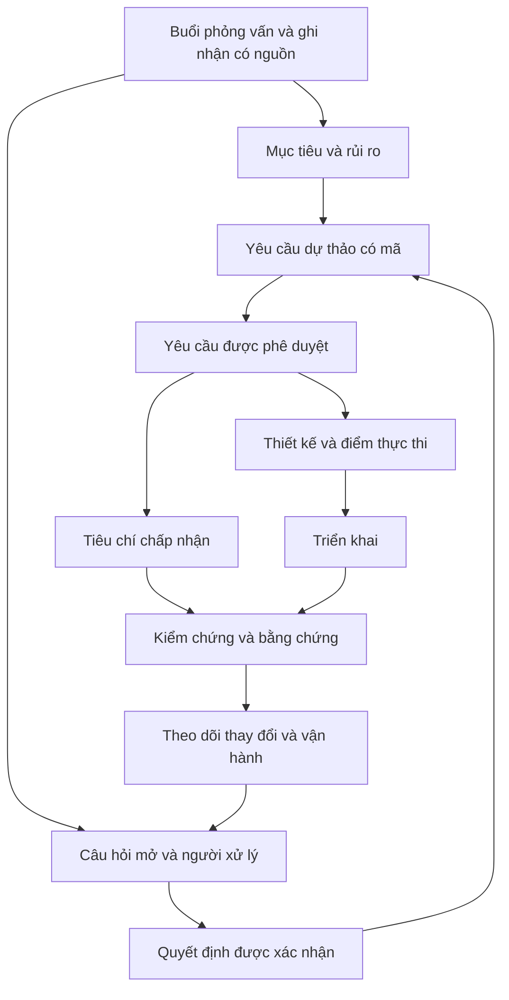

# Phỏng vấn stakeholder

## 1. Phỏng vấn để làm rõ nhu cầu bảo mật

Trong vòng đời yêu cầu, **phỏng vấn stakeholder** là hoạt động trao đổi có mục tiêu với những người sử dụng, vận hành, xây dựng, quản lý hoặc chịu tác động từ hệ thống. Mục đích là hiểu công việc thực tế, tài sản cần bảo vệ, hành vi không được phép, hậu quả khi có sự cố và các ràng buộc cần đưa vào yêu cầu bảo mật.

Kết quả cần đạt không chỉ là một biên bản hội thoại. Nhóm phân tích phải hình thành được chuỗi liên kết:

> Thông tin từ stakeholder → mục tiêu và rủi ro → yêu cầu dự thảo → điểm cần xác nhận → tiêu chí kiểm chứng.

Ví dụ, câu “chỉ kế toán được xuất báo cáo” chưa đủ làm yêu cầu triển khai. Cần biết kế toán của đơn vị nào, được xuất loại dữ liệu nào, ai cấp quyền, quyền còn hiệu lực trong bao lâu, thao tác qua giao diện hay API và có cần kiểm tra lại khi tải tệp đã tạo hay không.

Phỏng vấn có giá trị khi giúp phát hiện những chỗ chưa rõ này trước khi chúng trở thành giả định trong mã nguồn hoặc cấu hình.

Sau bài học, người học cần có khả năng:

- Chọn người cần phỏng vấn theo kiến thức, trách nhiệm và quyền quyết định.
- Đặt câu hỏi trung lập về xác thực, phân quyền, dữ liệu, logging và phục hồi.
- Phân biệt hiện trạng, mong muốn, giả định và quyết định đã được xác nhận.
- Chuyển phát biểu chung chung thành yêu cầu bảo mật có thể đo và kiểm chứng.
- Giữ liên kết giữa thông tin thu thập, rủi ro, kiến trúc và tiêu chí kiểm thử.

Các cuộc trao đổi, mã yêu cầu và ngưỡng số trong bài là **ví dụ giả định để học phương pháp**, không phải chính sách mặc định cho mọi tổ chức.

## 2. Chọn stakeholder theo điều họ biết và điều họ được quyết định

Một chức danh có thể cung cấp thông tin rất quan trọng nhưng không có quyền quyết định toàn bộ yêu cầu. Người vận hành biết hệ thống hiện phục hồi mất bao lâu; chủ sở hữu nghiệp vụ mới có thể xác nhận mức gián đoạn chấp nhận được trong phạm vi trách nhiệm của mình.

Nên lập bản đồ stakeholder trước khi đặt lịch:

| Nhóm hoặc vai trò | Thông tin cần khai thác | Điều cần xác nhận thêm |
| --- | --- | --- |
| Người trực tiếp sử dụng | Luồng công việc, thao tác thường xuyên, cách xử lý ngoại lệ | Những cách làm hiện tại có được phép và còn phù hợp không |
| Chủ sở hữu nghiệp vụ | Mục tiêu, mức thiệt hại, thứ tự ưu tiên, thời gian gián đoạn chấp nhận được | Phạm vi quyền quyết định và người phê duyệt cuối cùng |
| Chủ sở hữu dữ liệu | Loại dữ liệu, người được truy cập, mục đích sử dụng, vòng đời dữ liệu | Căn cứ cho lưu giữ, chia sẻ và xóa dữ liệu |
| Nhóm phát triển hoặc kiến trúc | Luồng gọi, điểm thực thi, phụ thuộc và giới hạn kỹ thuật | Thông tin nào là hiện trạng, thông tin nào là phương án đề xuất |
| Nhóm vận hành | Giám sát, cấp quyền vận hành, sao lưu, phục hồi, xử lý sự cố | Năng lực nào đã có bằng chứng, năng lực nào mới là ước lượng |
| Nhóm bảo mật | Kịch bản đe dọa, kiểm soát hiện có, rủi ro và yêu cầu nền | Những kiểm soát nào bắt buộc, những điểm nào cần đánh giá thêm |
| Nhóm hỗ trợ khách hàng | Trường hợp khẩn cấp, thao tác thay người dùng, yêu cầu truy cập dữ liệu | Giới hạn hỗ trợ, phê duyệt và bằng chứng cần lưu |
| Vai trò phụ trách nghĩa vụ tuân thủ | Cách hiểu và phạm vi của nghĩa vụ liên quan | Nguồn, phiên bản, người xác nhận và những điểm còn chờ làm rõ |

Không cần phỏng vấn mọi vai trò trong mọi dự án. Cần bảo đảm những câu hỏi quan trọng có người đủ thông tin và đúng thẩm quyền trả lời.

Một người có thể kiêm nhiều vai trò. Khi đó vẫn nên ghi rõ họ phát biểu với tư cách nào: mô tả cách làm hiện tại, đề xuất một thay đổi hay phê duyệt một yêu cầu.

### Tránh chỉ gặp người quản lý

Người quản lý có thể mô tả quy trình chính thức, trong khi người làm việc trực tiếp biết các thao tác thực tế: tải tệp về máy cá nhân, chia sẻ tài khoản vì thiếu quyền, xử lý yêu cầu qua tin nhắn hoặc giữ bản sao để làm báo cáo tháng.

Các khác biệt này là đầu vào cần phân tích. Không mặc định quy trình đang diễn ra là quy trình được chấp thuận; cũng không quy trách nhiệm cá nhân trước khi hiểu điều kiện dẫn đến cách làm đó.

## 3. Chuẩn bị phạm vi và mục tiêu của buổi phỏng vấn

Một buổi phỏng vấn hiệu quả cần có câu hỏi cần giải quyết, thay vì chỉ có tên chủ đề “bảo mật”.

### 3.1. Xác định một phạm vi có thể trao đổi cụ thể

Ví dụ:

> Làm rõ ai được xuất hồ sơ thanh toán, cách cấp và thu hồi quyền, những bản sao được tạo ra, bằng chứng truy cập cần lưu và hành vi khi thành phần phụ thuộc gặp lỗi.

Phạm vi này giúp chọn đúng người tham gia và giữ cuộc trao đổi tập trung. Nếu phát hiện vấn đề xác thực hoặc phục hồi liên quan, ghi lại mối liên hệ và xác định phần cần hỏi tiếp.

### 3.2. Chuẩn bị thông tin nền được phép sử dụng

Các đầu vào hữu ích gồm sơ đồ luồng công việc, sơ đồ dữ liệu, mô hình đe dọa hiện có, yêu cầu đang áp dụng và các sự cố đã được mô tả bằng dữ liệu phù hợp để chia sẻ.

Không yêu cầu stakeholder gửi mật khẩu, token, khóa bí mật hoặc dữ liệu khách hàng thật chỉ để minh họa. Có thể dùng dữ liệu giả lập, ảnh đã che thông tin hoặc cùng quan sát một thao tác trong phạm vi được cho phép.

### 3.3. Ghi trước điều đã biết và điều chưa biết

| Loại thông tin | Ví dụ trước buổi phỏng vấn |
| --- | --- |
| Đã biết, có nguồn | Tính năng xuất dữ liệu tạo tệp qua một worker nền |
| Giả định cần kiểm tra | Quyền xuất chỉ được kiểm tra khi người dùng bấm nút |
| Câu hỏi nghiệp vụ | Khi người dùng bị thu hồi quyền, có được tải tệp đã tạo không? |
| Câu hỏi kỹ thuật | Worker kiểm tra quyền vào thời điểm nào? |
| Quyết định cần có | Mốc bắt đầu và giới hạn thời gian thu hồi quyền |

Đừng biến giả định thành câu khẳng định trong câu hỏi. Thay vì hỏi “Vì worker không kiểm tra quyền nên phải thêm kiểm tra, đúng không?”, hãy hỏi “Worker hiện nhận quyết định quyền từ đâu và kiểm tra lại ở thời điểm nào?”.

### 3.4. Chọn hình thức và thời lượng

Phỏng vấn riêng phù hợp khi cần hiểu công việc của từng vai trò hoặc khi chênh lệch quyền lực khiến người tham gia khó nói về vấn đề. Buổi trao đổi chung phù hợp để đối chiếu thông tin và giải quyết một quyết định đã được chuẩn bị đủ dữ liệu.

Một lịch 45 phút có thể được chia như sau:

| Thời lượng giả định | Nội dung |
| --- | --- |
| 5 phút | Thống nhất mục tiêu, phạm vi và cách ghi nhận |
| 10 phút | Đi qua một tình huống công việc thực tế |
| 15 phút | Khai thác dữ liệu, quyền, tình huống lỗi và ngoại lệ |
| 10 phút | Làm rõ ngưỡng, trách nhiệm và cách kiểm chứng |
| 5 phút | Đọc lại kết luận, câu hỏi mở và bước tiếp theo |

Thời lượng là cách tổ chức minh họa. Một luồng phức tạp có thể cần nhiều buổi với mục tiêu riêng.

## 4. Đặt câu hỏi trung lập và đi từ công việc đến rủi ro

Một trình tự hữu ích là hỏi về công việc trước, sau đó đào sâu tài sản, quyền hạn, tình huống không mong muốn và bằng chứng.

### 4.1. Mở đầu bằng tình huống cụ thể

Câu hỏi mở giúp stakeholder mô tả theo cách hiểu của họ:

- “Anh/chị có thể đi qua lần gần nhất cần xuất hồ sơ thanh toán không?”
- “Dữ liệu đi qua những bước nào từ lúc tạo yêu cầu đến lúc người nhận sử dụng?”
- “Ai thường tham gia khi yêu cầu có vấn đề?”
- “Bước nào gây chậm trễ hoặc khiến mọi người phải làm ngoài quy trình?”

Sau đó hỏi chi tiết một tình huống thay vì gom nhiều giả định vào một câu.

Ví dụ:

> “Tệp được tạo xong rồi người yêu cầu chuyển sang bộ phận khác. Khi họ mở lại liên kết tải, hệ thống nên làm gì?”

Tình huống này giúp khám phá vòng đời quyền và bản sao dữ liệu mà không yêu cầu người nghiệp vụ biết trước khái niệm cache, token hay hàng đợi.

### 4.2. Hỏi cả việc được phép và việc phải bị ngăn

Chỉ hỏi “ai được truy cập” thường chưa đủ. Cần làm rõ các ranh giới:

- Người có quyền của khách hàng A có thể xử lý dữ liệu của khách hàng B không?
- Người gửi yêu cầu có được tự phê duyệt cấp quyền cho mình không?
- Nhân viên hỗ trợ có được xem toàn bộ dữ liệu hay chỉ thông tin cần cho một yêu cầu?
- Một tác vụ đã nằm trong hàng đợi có còn được thực hiện sau khi quyền bị thu hồi không?
- Khi hệ thống không xác định được quyền hiện hành, người dùng còn được thực hiện thao tác nào?

Các câu trả lời phải gắn với một hành động và phạm vi cụ thể. “Admin được làm mọi thứ” cần được tách thành những quyền thực tế, chứ không kết thúc quá trình phân tích.

### 4.3. Đào sâu từ tính từ sang điều kiện quan sát được

| Stakeholder nói | Câu hỏi tiếp theo |
| --- | --- |
| “Phải bảo mật” | Cần bảo vệ dữ liệu hay thao tác nào, trước ai và trong tình huống nào? |
| “Thu hồi ngay” | Mốc bắt đầu là lúc nào, chậm tối đa bao lâu, phạm vi nào phải ngừng chấp nhận quyền? |
| “Ghi đầy đủ log” | Sự kiện nào, trường nào, ai cần tra cứu, trong bao lâu và dữ liệu nào không được ghi? |
| “Không được mất dữ liệu” | Đang nói đến giao dịch nào, sự cố nào và mức mất dữ liệu chấp nhận được là bao nhiêu? |
| “Khôi phục nhanh” | Chức năng nào phải hoạt động trở lại và lấy dấu hiệu nào làm mốc kết thúc? |
| “Chỉ người có thẩm quyền” | Ai cấp thẩm quyền, theo phạm vi nào và khi nào thẩm quyền hết hiệu lực? |

Không tự diễn giải “ngay” thành một số giây hoặc “đầy đủ” thành ghi toàn bộ payload. Nếu chưa chốt được ngưỡng, ghi rõ câu hỏi mở và người cần xác nhận.

### 4.4. Tránh câu hỏi dẫn dắt giải pháp

**Dẫn dắt:**

> “Chúng ta cần dùng MFA cho mọi tài khoản để bảo mật hơn, đúng không?”

**Trung lập hơn:**

> “Những thao tác nào gây thiệt hại lớn nếu bị người khác thực hiện dưới danh tính người dùng? Với các thao tác đó, hiện cần xác minh danh tính ở mức nào và có ràng buộc nào đã được phê duyệt?”

Sau khi hiểu mục tiêu và ràng buộc, nhóm mới đánh giá phương án xác thực. Nếu đã tồn tại yêu cầu MFA bắt buộc trong phạm vi, dùng buổi phỏng vấn để làm rõ cách áp dụng và ngoại lệ, không đưa lại nghĩa vụ đã xác nhận thành một cuộc biểu quyết.

## 5. Khai thác đủ các miền yêu cầu bảo mật

Có thể dùng bảng sau làm khung câu hỏi, điều chỉnh theo luồng công việc đang phân tích.

| Miền yêu cầu | Câu hỏi để bắt đầu | Điểm cần làm rõ |
| --- | --- | --- |
| Xác thực | Hệ thống biết người hoặc dịch vụ đang thao tác là ai bằng cách nào? | Vòng đời danh tính, tài khoản dùng chung, thao tác nhạy cảm, mất thiết bị, khôi phục tài khoản |
| Phân quyền | Ai được làm gì với dữ liệu của ai? | Phạm vi khách hàng, quyền trên đối tượng, phê duyệt, thu hồi, tác vụ nền và truy cập hỗ trợ |
| Bảo vệ dữ liệu | Dữ liệu được tạo, truyền, lưu và chia sẻ ở những đâu? | Phân loại, bản sao, môi trường thử nghiệm, vùng tạm, xuất tệp, mã hóa và quản lý khóa |
| Logging | Khi có nghi vấn, ai cần biết điều gì đã xảy ra? | Sự kiện, định danh, mốc thời gian, kết quả, bảo vệ log, tra cứu, dữ liệu cần loại khỏi log |
| Phục hồi | Sau sự cố, cần phục hồi chức năng và trạng thái nào? | RTO, RPO, thứ tự phụ thuộc, khóa, quyền, nhật ký, cách xác minh sau phục hồi |
| Tích hợp và nhà cung cấp | Một bên khác nhận dữ liệu hoặc thực hiện thao tác thay hệ thống thế nào? | Danh tính dịch vụ, giới hạn quyền, lỗi phụ thuộc, trách nhiệm và bằng chứng |

Với RTO, cần làm rõ thời gian tối đa từ mốc bắt đầu sự cố đã thống nhất đến lúc chức năng được xác nhận phục hồi. Với RPO, cần làm rõ mức mất dữ liệu chấp nhận được, thường biểu diễn bằng khoảng thời gian, cùng cách đối chiếu dữ liệu thực tế.

Không yêu cầu stakeholder nghiệp vụ chọn thuật toán mã hóa hoặc thiết kế giao thức. Họ cần giúp xác nhận tài sản, hậu quả và ràng buộc. Nhóm kỹ thuật chịu trách nhiệm đề xuất phương án đáp ứng và trình bày tác động để người có thẩm quyền ra quyết định.

### Gắn câu hỏi với mô hình đe dọa

Với mỗi hành động quan trọng, có thể hỏi:

1. Ai có động cơ hoặc khả năng thực hiện ngoài ý muốn?
2. Nếu danh tính bị chiếm dụng hoặc quyền bị cấp sai, điều gì xảy ra?
3. Dữ liệu có thể bị xem, sửa, xuất hoặc xóa ở bước nào?
4. Làm sao phát hiện và tái dựng được sự việc?
5. Làm sao khôi phục mà không đưa trở lại quyền đã thu hồi hoặc dữ liệu đã quyết định xóa?

Câu trả lời là đầu vào cho phân tích rủi ro. Chưa có bằng chứng không đồng nghĩa sự kiện chắc chắn đã xảy ra; chưa từng có sự cố được ghi nhận cũng không chứng minh rủi ro không tồn tại.

## 6. Điều phối cuộc phỏng vấn và quan sát công việc

Người điều phối cần tạo điều kiện để stakeholder mô tả chính xác, đồng thời giữ rõ mục tiêu của buổi làm việc.

### Trước khi vào nội dung

- Nêu mục đích, phạm vi và cách sử dụng kết quả.
- Thống nhất cách ghi chép, người được xem biên bản và có ghi âm hay không.
- Nhắc dùng ví dụ đã che dữ liệu hoặc dữ liệu giả lập.
- Làm rõ cuộc trao đổi dùng để hiểu công việc và yêu cầu, tránh biến thành đánh giá cá nhân.

Không tự ghi âm hoặc đưa nội dung cuộc trao đổi lên một công cụ khác khi chưa thống nhất cách thu thập và sử dụng.

### Trong khi trao đổi

Cho stakeholder trình bày một luồng hoàn chỉnh trước khi đi sâu từng điểm. Khi nghe một kết luận chung, yêu cầu ví dụ cụ thể hoặc cách họ biết kết luận đó.

Có thể nhờ họ mô tả hoặc minh họa thao tác bằng dữ liệu phù hợp:

> “Ở bước này, anh/chị có thể chỉ ra thông tin nào cho biết mình đang làm việc với đúng khách hàng không?”

Quan sát giúp kiểm tra sự khác biệt giữa điều người dùng nghĩ hệ thống làm và điều hệ thống thực sự thể hiện. Tuy nhiên, một lần quan sát không đủ khẳng định mọi trường hợp đều hành xử giống nhau.

Nếu người tham gia chuyển sang đề xuất giải pháp, ghi nhận rồi quay lại mục tiêu:

> “Tôi ghi lại đề xuất thêm một bước phê duyệt. Hậu quả nào khiến bước này cần thiết, và những trường hợp nào cần áp dụng?”

Nếu phát hiện một sự cố đang diễn ra, chuyển thông tin qua quy trình xử lý phù hợp của tổ chức. Buổi thu thập yêu cầu không thay thế công việc ứng cứu.

### Khi có người ghi chép riêng

Phân công một người điều phối và một người ghi chép có thể giúp giảm bỏ sót. Người ghi chép cần đánh dấu câu nào là phát biểu của stakeholder, câu nào là suy luận của nhóm và câu nào cần kiểm tra thêm. Không sửa lời người tham gia thành một quyết định mạnh hơn điều họ đã nói.

## 7. Ghi nhận thông tin với trạng thái và nguồn rõ ràng

Biên bản nên bảo toàn được ý nghĩa và mức độ chắc chắn của thông tin.

| Loại ghi nhận | Ví dụ | Cách sử dụng |
| --- | --- | --- |
| Mô tả hiện trạng | Nhân viên cho biết đang tải tệp rồi gửi lại cho quản lý | Kiểm tra luồng thực tế và các bản sao phát sinh |
| Mục tiêu nghiệp vụ | Chỉ người thuộc nhóm được giao nhiệm vụ mới được xuất dữ liệu | Đầu vào để làm rõ quyền và phạm vi |
| Sự cố được kể lại | Có lần người chuyển bộ phận vẫn tải được báo cáo cũ | Ghi nguồn, thời điểm và yêu cầu xác minh; chưa coi là bằng chứng kỹ thuật |
| Ràng buộc có nguồn | Người có thẩm quyền dẫn một chính sách đã phê duyệt | Xác nhận phiên bản và phạm vi của chính sách |
| Đề xuất | Dừng quyền trong tối đa 10 phút | Đưa vào danh sách cần đánh giá và xác nhận |
| Giả định | Liên kết tải có thể sử dụng mà không kiểm tra lại quyền | Chuyển thành câu hỏi hoặc nhiệm vụ kiểm tra |
| Quyết định đã xác nhận | Chủ sở hữu có thẩm quyền phê duyệt ngưỡng và phạm vi thu hồi | Cập nhật yêu cầu và tiêu chí chấp nhận theo quyết định |

Một biểu mẫu ghi nhận tối thiểu có thể là:

```text
Mã ghi nhận:
Buổi phỏng vấn và ngày:
Người cung cấp thông tin, vai trò:
Phát biểu hoặc nội dung quan sát:
Loại thông tin: hiện trạng / mục tiêu / giả định / đề xuất / quyết định
Luồng và dữ liệu liên quan:
Rủi ro hoặc hậu quả được nêu:
Tài liệu hoặc bằng chứng tham chiếu:
Điểm cần làm rõ:
Người cần xác nhận:
Hạn xử lý:
Liên kết yêu cầu dự thảo:
Trạng thái:
```

Không nhất thiết dùng nguyên mẫu này trong mọi công cụ. Điều quan trọng là không mất nguồn, phạm vi, trạng thái và trách nhiệm xử lý.

Nếu hai người đưa ra thông tin khác nhau, giữ cả hai cùng nguồn tương ứng. Đừng ghi câu dung hòa mơ hồ chỉ để biên bản trông thống nhất.

## 8. Ví dụ phỏng vấn về quyền xuất hồ sơ thanh toán

Giả sử một dịch vụ SaaS có nhiều khách hàng. Nhân viên tài chính yêu cầu xuất hồ sơ thanh toán; worker tạo tệp và cung cấp liên kết tải. Tính năng có API, giao diện và kênh hỗ trợ vận hành.

Nhóm phân tích gặp người dùng tài chính, người quản lý tài chính, nhóm hỗ trợ và người phụ trách vận hành. Đoạn hội thoại giả định sau minh họa cách đào sâu:

**Người phân tích:** “Anh/chị có thể mô tả lần xuất hồ sơ gần nhất?”

**Nhân viên tài chính:** “Tôi chọn kỳ thanh toán rồi tải tệp để đối chiếu. Có lúc tệp được tạo khá lâu nên tôi mở lại liên kết sau.”

**Người phân tích:** “Từ lúc gửi yêu cầu đến lúc tải, điều gì có thể thay đổi về quyền của người yêu cầu?”

**Người quản lý tài chính:** “Người đó có thể chuyển nhóm. Chúng tôi muốn họ không tiếp tục lấy được dữ liệu sau khi quyền đã bị thu hồi.”

**Người phân tích:** “Đối với tệp đã tạo và tác vụ đang chạy, mong muốn đó áp dụng như thế nào?”

**Người quản lý tài chính:** “Tôi muốn áp dụng cho cả hai. Giới hạn 10 phút từ lúc hệ thống tiếp nhận lệnh thu hồi là đề xuất của tôi; cần người phụ trách chính sách quyền xác nhận.”

**Người vận hành:** “Hiện một số quyết định quyền được cache. Tôi chưa có số đo cho mọi điểm truy cập, cần kiểm tra API, worker và đường tải.”

**Người phân tích:** “Tôi ghi ngưỡng 10 phút là đề xuất, và năng lực thu hồi hiện tại là chưa xác minh. Ai xác nhận phạm vi và ai thu số đo?”

**Người quản lý tài chính:** “Chủ sở hữu chính sách quyền xác nhận phạm vi; nhóm ứng dụng và vận hành kiểm tra các điểm thực thi.”

**Nhóm hỗ trợ:** “Khi khách hàng gặp lỗi, chúng tôi cần kiểm tra yêu cầu xuất để biết đang kẹt ở đâu.”

**Người phân tích:** “Để chẩn đoán, nhóm cần đọc nội dung hồ sơ hay chỉ cần trạng thái tác vụ và mã lỗi?”

**Nhóm hỗ trợ:** “Phần lớn chỉ cần trạng thái, thời điểm và mã lỗi. Trường hợp phải xem nội dung cần có xử lý riêng.”

Đoạn trao đổi tạo ra ba kết quả khác nhau: nhu cầu thu hồi quyền, thông tin kỹ thuật cần xác minh và một ngoại lệ hỗ trợ chưa được đặc tả. Không nên gom chúng thành câu “hỗ trợ có quyền truy cập mọi báo cáo, còn người dùng bị thu hồi sau 10 phút”.

## 9. Chuyển ghi nhận thành yêu cầu dự thảo

Sau buổi phỏng vấn, không sao chép nguyên mọi câu nói vào backlog dưới dạng mệnh lệnh. Cần tách thông tin, kiểm tra cách hiểu và xác định trạng thái.

### 9.1. Lập bảng chuyển đổi

| Ghi nhận từ ví dụ | Ý nghĩa cần phân tích | Đầu ra phù hợp |
| --- | --- | --- |
| Người dùng có thể tải tệp sau khi tác vụ hoàn tất khá lâu | Quyền cần được xem xét tại thời điểm cung cấp dữ liệu | Yêu cầu phân quyền cho đường tải và câu hỏi về liên kết cũ |
| Người quản lý muốn chặn quyền cũ trên cả tác vụ đang chạy | Thu hồi phải bao phủ nhiều điểm thực thi | Yêu cầu dự thảo về thu hồi và xử lý kết quả xuất |
| Ngưỡng 10 phút mới là đề xuất | Chưa có quyết định cuối cùng về giới hạn thời gian | Điểm mở gắn với người có thẩm quyền xác nhận |
| Một số quyết định quyền được cache | Có khả năng chậm cập nhật quyền | Nhiệm vụ đo lường và phân tích giới hạn cache |
| Hỗ trợ phần lớn chỉ cần trạng thái và mã lỗi | Có thể giảm nhu cầu đọc dữ liệu nghiệp vụ | Phương án quyền chẩn đoán giới hạn, cần xác nhận riêng |
| Trường hợp phải xem nội dung chưa có quy trình | Ngoại lệ có thể tạo đường truy cập rộng | Câu hỏi về phê duyệt, phạm vi, thời hạn và audit |

### 9.2. Dự thảo yêu cầu phân quyền

**Mã:** SEC-EXP-AUTHZ-01.  
**Trạng thái:** dự thảo, chờ xác nhận phạm vi và quy tắc quyền.

> Hệ thống chỉ được cung cấp hồ sơ thanh toán cho một người dùng khi quyết định phân quyền hợp lệ cho phép người đó thực hiện thao tác tương ứng trên dữ liệu thuộc đúng khách hàng. Kiểm tra phải được thực thi ở phía máy chủ trên API yêu cầu xuất, tại điểm worker quyết định cung cấp kết quả và trên đường tải tệp.

**Rủi ro liên quan:** lấy dữ liệu của khách hàng khác hoặc dùng một đường đi không kiểm tra quyền.

**Điểm cần hoàn tất:**

- Tên quyền và quy tắc xác định khách hàng từ ngữ cảnh đáng tin cậy.
- Cách gắn tập dữ liệu và tệp kết quả với khách hàng.
- Hành vi khi không lấy được một quyết định quyền còn hiệu lực.
- Những đường truy cập vận hành hoặc tích hợp cần có yêu cầu tương ứng.

**Tiêu chí kiểm chứng dự kiến:**

- Người có quyền phù hợp được xuất dữ liệu trong phạm vi.
- Người chỉ có quyền của khách hàng A không được xuất hoặc tải tệp của B.
- Gọi trực tiếp API, sửa định danh đối tượng hoặc dùng lại liên kết không bỏ qua kiểm tra quyền.
- Worker không cung cấp kết quả cho một yêu cầu có phạm vi quyền không hợp lệ.

Đây chưa phải một yêu cầu được phê duyệt hoàn chỉnh nếu các quy tắc còn mở chưa được chốt. Phần rõ có thể được phân tích và thử nghiệm kỹ thuật, nhưng không che phần thiếu bằng một nhãn hoàn thành.

### 9.3. Dự thảo yêu cầu thu hồi quyền

**Mã:** SEC-EXP-REV-01.  
**Trạng thái:** dự thảo; ngưỡng 10 phút và cách xử lý tác vụ đang chạy chờ xác nhận.

> Trong tối đa 10 phút kể từ khi hệ thống tiếp nhận thành công một lệnh thu hồi quyền hợp lệ và trả mã xác nhận, các điểm thực thi trong phạm vi phải ngừng cho phép cung cấp hồ sơ thanh toán dựa trên quyền đã bị thu hồi.

Trong bản dự thảo này, phạm vi được đề xuất gồm API, phiên đang tồn tại, cache quyết định quyền, worker và đường tải tệp. Phương án được đề xuất cho tác vụ đang chạy là kiểm tra lại trước khi cung cấp kết quả và không công bố kết quả cho chủ thể đã mất quyền.

Cần xác định người có thẩm quyền xác nhận phương án. Không tự chuyển lời “tôi muốn áp dụng cho cả hai” thành quyết định kỹ thuật cuối cùng khi chưa đối chiếu tính khả thi và trách nhiệm.

Mốc tiếp nhận lệnh phải có dấu hiệu quan sát được, chẳng hạn mã xác nhận và bản ghi thời gian của dịch vụ tiếp nhận. Thời điểm người quản trị mở màn hình hoặc bắt đầu nhập biểu mẫu không phải cùng mốc đo.

Nếu ngưỡng được thay đổi sau khi xem xét tác động, phải cập nhật yêu cầu, quyết định, bộ kiểm thử và phần truyền đạt tới các nhóm liên quan.

### 9.4. Dự thảo yêu cầu logging

**Mã:** SEC-EXP-AUD-01.  
**Trạng thái:** dự thảo, còn thiếu quyết định lưu giữ và hành vi khi ghi log lỗi.

> Các yêu cầu xuất, quyết định từ chối và kết quả cung cấp tệp phải tạo sự kiện đủ để liên kết chủ thể, khách hàng, tập dữ liệu, thời điểm, hành động, kết quả và mã liên kết của luồng xử lý. Nhật ký không được chứa nội dung hồ sơ thanh toán hoặc thông tin xác thực bí mật.

Các trường được đề xuất nhằm hỗ trợ truy cứu và chẩn đoán. Cần xác nhận nhu cầu điều tra, quyền xem log, cách bảo vệ log, thời gian lưu và khả năng tra cứu.

Không tự thêm “lưu 90 ngày” hoặc “ghi toàn bộ request” chỉ vì người tham gia yêu cầu “có log”. Đó là các quyết định mới, cần có căn cứ và người xác nhận.

### 9.5. Phân biệt yêu cầu phục hồi với ước lượng kỹ thuật

Giả sử một người nghiệp vụ đề nghị khôi phục trong 2 giờ, còn người vận hành ước tính cấu hình hiện tại cần khoảng 6 giờ.

| Phát biểu | Đúng vai trò của thông tin |
| --- | --- |
| “Nghiệp vụ chỉ chịu được gián đoạn tối đa 2 giờ” | Nhu cầu và tác động cần được người có thẩm quyền xác nhận |
| “Hiện phục hồi có thể mất khoảng 6 giờ” | Ước lượng năng lực, cần đo hoặc diễn tập để có bằng chứng |
| “Nên mua thêm hạ tầng” | Một phương án, chưa phải yêu cầu nghiệp vụ |
| “Chọn mức nào để phát hành?” | Quyết định cần đối chiếu nhu cầu, rủi ro, nguồn lực và thẩm quyền |

Phỏng vấn phải làm rõ chức năng cần phục hồi, mốc thời gian, phụ thuộc và cách xác nhận hệ thống hoạt động an toàn. Không lấy thời gian khởi động máy chủ làm toàn bộ thời gian phục hồi dịch vụ.

## 10. Khai thác cách kiểm chứng ngay trong phỏng vấn

Hỏi stakeholder “làm sao biết hệ thống đã đáp ứng?” thường giúp phát hiện điều kiện còn thiếu.

Ví dụ:

> “Nếu đã thu hồi quyền, anh/chị sẽ kiểm tra tình huống nào để tin rằng người dùng không còn lấy được dữ liệu?”

Người dùng có thể nghĩ tới việc bấm lại nút xuất; người vận hành nghĩ tới cache; người phát triển nghĩ tới tác vụ nền. Kết hợp các góc nhìn tạo ra phạm vi kiểm thử đầy đủ hơn.

Với yêu cầu thu hồi dự thảo, có thể đề xuất:

| Tình huống | Kết quả cần xác nhận | Bằng chứng dự kiến |
| --- | --- | --- |
| Yêu cầu xuất mới sau khi hết giới hạn thu hồi | Bị từ chối nếu dựa trên quyền đã mất | Mã lệnh thu hồi, thời gian và quyết định quyền |
| Phiên được tạo trước khi thu hồi | Không duy trì quyền vượt giới hạn đã chốt | Kết quả gọi API bằng phiên cũ |
| Worker đã nhận tác vụ nhưng chưa cung cấp kết quả | Hành xử theo quyết định về tác vụ đang chạy | Mốc xử lý của worker và trạng thái công bố tệp |
| Liên kết tải được tạo trước khi thu hồi | Không cung cấp dữ liệu sau khi quyền không còn hợp lệ | Kết quả tải và sự kiện liên quan |
| Một nút còn cache quyền cũ | Không vượt giới hạn thu hồi đã được phê duyệt | Kết quả trên từng nhóm điểm thực thi |
| Dịch vụ quyết định quyền gặp lỗi | Thực hiện hành vi lỗi đã được đặc tả | Kết quả thử lỗi phụ thuộc và log quyết định |

Trong phỏng vấn, mục tiêu là xác nhận kỳ vọng quan sát được và phạm vi. Nhóm kỹ thuật và kiểm thử sẽ thiết kế cách tạo dữ liệu thử, kiểm soát đồng hồ, mô phỏng lỗi và thu hiện vật.

Không phải mọi tuyên bố đều chứng minh được bằng một bài kiểm thử:

- Quyền được cấp sau phê duyệt cần kiểm tra lịch sử và danh tính người phê duyệt.
- Dữ liệu được giữ hoặc xóa theo thời hạn cần xem cấu hình, cơ chế thực thi và bằng chứng vận hành.
- Dịch vụ có thể phục hồi cần diễn tập theo kịch bản, đo thời gian và đối chiếu dữ liệu.
- Nhà cung cấp thực hiện một phần kiểm soát cần có bằng chứng phù hợp với đúng dịch vụ và trách nhiệm.

Câu “nhóm nói đã có” là đầu vào để tìm bằng chứng, không phải bản thân bằng chứng hoàn tất.

## 11. Quản lý câu hỏi mở và theo dõi việc xác nhận

Một câu hỏi chưa có đáp án không làm buổi phỏng vấn thất bại. Vấn đề là bỏ quên nó hoặc để người triển khai tự quyết định mà không ghi nhận.

Ví dụ danh sách theo dõi sau buổi phỏng vấn:

| Mã | Câu hỏi hoặc việc cần làm | Người xử lý | Điều kiện cần hoàn tất |
| --- | --- | --- | --- |
| OPEN-01 | Ngưỡng 10 phút có được chấp thuận và áp dụng cho những điểm nào? | Chủ sở hữu chính sách quyền | Trước khi phê duyệt SEC-EXP-REV-01 |
| OPEN-02 | API, worker và đường tải hiện kiểm tra quyền ở đâu? | Nhóm ứng dụng | Trước khi chốt thiết kế thực thi |
| OPEN-03 | Quyền cache và phiên cũ có độ trễ thu hồi thực tế bao nhiêu? | Nhóm ứng dụng và vận hành | Có số đo để đánh giá phương án |
| OPEN-04 | Hỗ trợ cần quyền chẩn đoán nào, khi nào phải xem nội dung? | Chủ sở hữu dữ liệu và nhóm hỗ trợ | Có phạm vi và quy trình ngoại lệ được xác nhận |
| OPEN-05 | Log cần được giữ bao lâu và ai được truy cập? | Chủ sở hữu dữ liệu và vai trò phụ trách nghĩa vụ liên quan | Trước khi phê duyệt yêu cầu logging |
| OPEN-06 | Khi dịch vụ quyền không phản hồi, thao tác xuất phải làm gì? | Chủ sở hữu nghiệp vụ cùng nhóm bảo mật và kiến trúc | Có quyết định hành vi lỗi và tiêu chí kiểm thử |

Trong công việc thực tế, cần gán người cụ thể và mốc thời gian cụ thể, thay vì để trách nhiệm nằm chung ở một phòng ban.

Có thể dùng các trạng thái: mới ghi nhận, đang xác minh, chờ quyết định, đã quyết định hoặc đã đóng. Một câu hỏi chỉ được đóng khi có câu trả lời, nguồn và cập nhật cần thiết; gửi email nhắc việc chưa phải hoàn tất.

Nếu phải triển khai thử trước khi mọi quyết định được chốt, phải phân biệt rõ phạm vi thử nghiệm, giả định đang dùng và điều kiện để đưa vào sử dụng. Không dùng kết quả thử như bằng chứng rằng người có thẩm quyền đã chấp thuận yêu cầu.

## 12. Xử lý khác biệt và xung đột giữa stakeholder

Các bên có thể có mục tiêu cùng hợp lý nhưng tạo ra yêu cầu khác nhau:

- Nhóm hỗ trợ muốn xử lý nhanh.
- Chủ sở hữu dữ liệu muốn giảm người được xem hồ sơ.
- Nhóm vận hành muốn quy trình đơn giản khi có sự cố.
- Nhóm bảo mật muốn quyền giới hạn và có thể truy cứu.

Không giải quyết bằng cách chọn người nói nhiều nhất hoặc biểu quyết mọi kiểm soát.

### 12.1. Tách xung đột về sự thật khỏi xung đột về mục tiêu

Nếu một bên nói “liên kết luôn kiểm tra quyền”, bên khác nói “ai có liên kết cũng tải được”, cần kiểm tra hành vi kỹ thuật.

Nếu một bên muốn “hỗ trợ luôn được xem nội dung” còn bên khác muốn “chỉ được xem theo từng vụ việc”, đó là quyết định về nhu cầu, phạm vi quyền và rủi ro. Thêm một bài kiểm thử không tự giải quyết được khác biệt này.

### 12.2. Đưa ra phương án với tác động rõ ràng

Với ví dụ hỗ trợ, các phương án có thể gồm:

| Phương án đề xuất | Lợi ích cần đánh giá | Rủi ro hoặc chi phí cần đánh giá |
| --- | --- | --- |
| Chỉ cung cấp trạng thái, mã lỗi và dữ liệu đã che | Giảm nhu cầu xem dữ liệu nghiệp vụ | Một số trường hợp cần bước xử lý bổ sung |
| Cấp quyền xem nội dung theo từng yêu cầu hỗ trợ đã phê duyệt | Giới hạn quyền theo mục đích và vụ việc | Cần cơ chế cấp quyền, hết hạn và audit |
| Chủ sở hữu dữ liệu trực tiếp cung cấp thông tin đã chọn | Người hỗ trợ nhận đúng phần cần thiết | Có thể tăng thời gian xử lý |

Đây là các phương án để xem xét, không phải kết luận rằng một phương án luôn đủ. Cần người có thẩm quyền chọn, chỉ rõ phạm vi, tiêu chí chấp nhận và rủi ro còn lại.

### 12.3. Ghi quyết định có căn cứ

Biên bản quyết định nên nêu vấn đề, phương án, tác động, nguồn ràng buộc, người quyết định và điều kiện cần xem lại.

Khi có nghĩa vụ đã được xác nhận, không coi việc chấp nhận rủi ro nội bộ là cách tự thay đổi nghĩa vụ đó. Nếu chưa biết nghĩa vụ có cho phép một phương án hay không, chuyển thành điểm cần xác minh với đúng vai trò.

Thứ tự ưu tiên cần căn cứ vào tác động, rủi ro, phụ thuộc và những cam kết áp dụng. Nhãn “bảo mật” không làm mọi yêu cầu tự động có cùng mức ưu tiên; một câu “có thể để sau” cũng không đủ để hạ một yêu cầu bắt buộc.

## 13. Xác nhận lại cách hiểu với stakeholder

Trước khi kết thúc buổi phỏng vấn hoặc trong lượt rà soát ngắn sau đó, người phân tích nên đọc lại kết luận bằng ngôn ngữ dễ kiểm tra.

Ví dụ:

> “Tôi hiểu rằng người đã mất quyền không được tiếp tục lấy hồ sơ, kể cả qua tệp đã tạo. Giới hạn 10 phút hiện là đề xuất và chưa được chủ sở hữu chính sách xác nhận. Nhóm ứng dụng sẽ kiểm tra các điểm thực thi; yêu cầu dự thảo chưa được đánh dấu là đã phê duyệt.”

Cách nhắc lại này giữ được cả nội dung lẫn trạng thái.

Sau đó xác nhận theo từng tình huống:

- Người dùng có quyền của A thử tải tệp của B.
- Người dùng bị thu hồi quyền khi worker đang chạy.
- Nhóm hỗ trợ chỉ có mã yêu cầu và cần chẩn đoán lỗi.
- Dịch vụ quyền hoặc kho nhật ký không phản hồi.
- Hệ thống vừa phục hồi từ bản sao cũ.

Tránh chỉ hỏi “mọi người đồng ý không?” rồi dùng sự im lặng làm bằng chứng phê duyệt. Cần xác định ai xác nhận nội dung nào, bằng cách nào và còn điều kiện nào chưa đáp ứng.

Phân biệt hai hoạt động:

| Hoạt động | Mục đích |
| --- | --- |
| Xác nhận ghi nhận đúng | Người tham gia xác nhận biên bản phản ánh đúng thông tin họ đã cung cấp |
| Phê duyệt yêu cầu | Người có thẩm quyền chấp thuận hành vi, phạm vi, ngưỡng và trách nhiệm trong yêu cầu |

Một người dùng xác nhận biên bản không đồng nghĩa họ được quyền duyệt thời hạn lưu dữ liệu hoặc chấp thuận rủi ro cho toàn dịch vụ.

## 14. Giữ truy vết trong vòng đời yêu cầu

Kết quả phỏng vấn phải đi tiếp vào quản lý yêu cầu, thiết kế và kiểm chứng.



Một lát cắt truy vết cho ví dụ:

| Ghi nhận | Rủi ro hoặc mục tiêu | Yêu cầu | Thiết kế cần liên kết | Kiểm chứng |
| --- | --- | --- | --- | --- |
| INT-01: người dùng mở lại liên kết sau khi tạo tệp | Không cung cấp dữ liệu khi quyền không còn hợp lệ | SEC-EXP-AUTHZ-01 | Điểm kiểm tra quyền trên đường tải | Kiểm thử liên kết cũ và truy cập chéo khách hàng |
| INT-02: thu hồi phải tác động tới tác vụ đang chạy | Tránh duy trì quyền cũ qua worker | SEC-EXP-REV-01 | Cách cập nhật quyền, xử lý cache và công bố kết quả | Đo độ trễ và thử các trạng thái tác vụ |
| INT-03: hỗ trợ chủ yếu cần trạng thái và mã lỗi | Giảm truy cập dữ liệu vượt nhu cầu chẩn đoán | Yêu cầu quyền hỗ trợ còn chờ xác nhận | Giao diện chẩn đoán, dữ liệu được phép hiển thị | Kiểm thử phạm vi quyền hỗ trợ |
| INT-04: cần truy cứu thao tác xuất | Có thể xác định chủ thể và kết quả | SEC-EXP-AUD-01 | Sinh sự kiện, liên kết luồng và kho nhật ký | Kiểm tra sự kiện và dữ liệu không được ghi |

Khi phát hiện đường xuất mới, không nhất thiết phỏng vấn lại mọi người từ đầu. Phân tích xem giả định, quyết định và yêu cầu nào bị tác động, rồi trao đổi với các vai trò liên quan.

Ví dụ, thêm gửi tệp qua một kênh tích hợp có thể làm thay đổi người nhận, điểm kiểm tra quyền, bản sao dữ liệu và bằng chứng cung cấp tệp. Các kết luận cho đường tải cũ không tự bao phủ kênh mới.

Biên bản có thể chứa thông tin nhạy cảm về quy trình hoặc điểm yếu. Cần giới hạn người truy cập, che dữ liệu không cần thiết và chuyển sang tài liệu yêu cầu phần thông tin đủ để triển khai, thay vì phổ biến toàn bộ bản ghi thô.

## 15. Những lỗi thường gặp khi phỏng vấn

| Lỗi | Hậu quả | Cách sửa |
| --- | --- | --- |
| Chỉ phỏng vấn người quản lý | Bỏ sót thao tác thực tế và ngoại lệ | Bổ sung người trực tiếp sử dụng và vận hành |
| Hỏi ngay nên dùng sản phẩm hoặc công nghệ nào | Có giải pháp trước khi hiểu mục tiêu | Hỏi công việc, tài sản, hậu quả và ràng buộc trước |
| Hỏi nhiều ý trong một câu | Không biết stakeholder đã trả lời phần nào | Tách câu hỏi và đi theo một tình huống |
| Ghi “nhanh”, “đủ”, “an toàn” làm tiêu chí | Người triển khai và kiểm thử hiểu khác nhau | Hỏi ngưỡng, mốc đo, phạm vi và dấu hiệu quan sát |
| Xem hiện trạng là yêu cầu đã được chấp thuận | Hợp thức hóa cách làm có thể chưa phù hợp | Ghi loại thông tin và kiểm tra căn cứ |
| Xem ước lượng kỹ thuật là khả năng đã chứng minh | Đặt cam kết thiếu bằng chứng | Gắn nhiệm vụ đo hoặc diễn tập |
| Chỉ hỏi luồng thành công | Bỏ sót lỗi, thu hồi quyền và truy cập ngoài phạm vi | Hỏi đường bị cấm, ngoại lệ và phụ thuộc lỗi |
| Im lặng khi có thông tin trái nhau | Yêu cầu mâu thuẫn đi vào triển khai | Giữ nguồn của từng thông tin và phân công xác minh |
| Tự chốt số để tài liệu trông hoàn chỉnh | Thêm quyết định không có thẩm quyền | Giữ trạng thái dự thảo và câu hỏi mở |
| Thu thập dữ liệu thật không cần thiết | Tăng phạm vi lộ thông tin | Dùng dữ liệu giả, che thông tin và giới hạn ghi nhận |
| Gửi biên bản rồi coi như đã phê duyệt | Mất trách nhiệm xác nhận | Ghi rõ ai cần xác nhận hoặc phê duyệt phần nào |
| Không nối kết quả với backlog và kiểm thử | Cuộc trao đổi không tạo ra thay đổi có thể kiểm chứng | Tạo mã, liên kết yêu cầu, trách nhiệm và tiêu chí chấp nhận |

## 16. Điều kiện hoàn tất một lượt phỏng vấn

Một lượt phỏng vấn có thể kết thúc dù vẫn còn câu hỏi mở, miễn là kết quả đã được ghi đúng và công việc tiếp theo có trách nhiệm rõ ràng.

Trước khi đóng lượt làm việc, kiểm tra:

- Đã biết thông tin đến từ ai, trong vai trò nào và cho luồng công việc nào.
- Đã ghi được tài sản, mục tiêu, hành vi không được phép và hậu quả quan trọng.
- Đã hỏi các tình huống lỗi, truy cập ngoài phạm vi và ngoại lệ liên quan.
- Đã phân biệt hiện trạng, giả định, đề xuất và quyết định.
- Đã làm rõ các ngưỡng hoặc ghi người cần xác nhận phần còn thiếu.
- Đã có yêu cầu dự thảo và cách kiểm chứng dự kiến cho những nội dung đủ rõ.
- Đã chỉ định người xử lý, mốc thời gian và điều kiện đóng câu hỏi mở.
- Đã xác nhận cách hiểu với người tham gia, đồng thời phân biệt xác nhận biên bản với phê duyệt yêu cầu.
- Đã liên kết kết quả với bước tiếp theo của vòng đời yêu cầu.

Chất lượng cuộc phỏng vấn thể hiện ở khả năng giảm giả định và làm rõ quyết định. Một câu trả lời “chưa biết, cần người này xác nhận” có nguồn và trách nhiệm rõ ràng hữu ích hơn một yêu cầu có vẻ hoàn chỉnh nhưng được tạo từ suy đoán.
