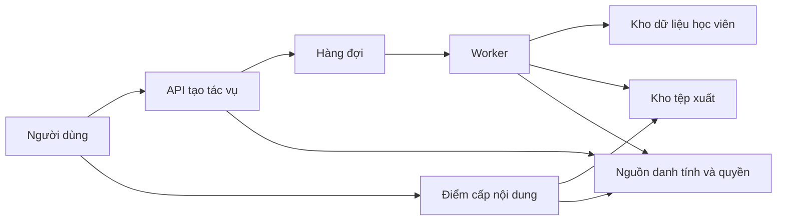
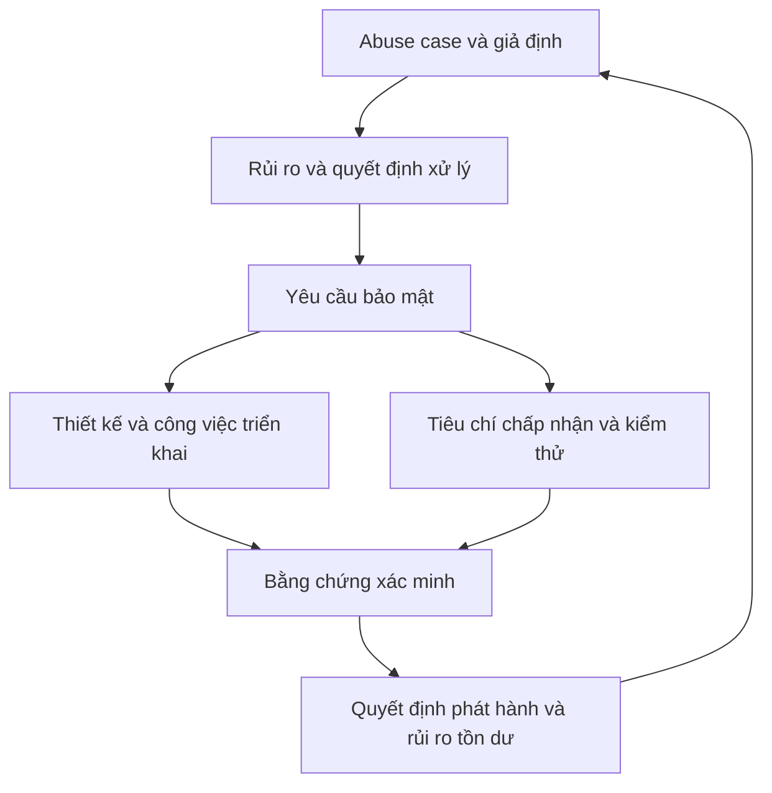

# Abuse case workshop: từ kịch bản lạm dụng đến yêu cầu bảo mật có thể kiểm chứng

## 1. Mục tiêu và vị trí trong vòng đời yêu cầu

Một chức năng có thể hoạt động đúng với người dùng thiện chí nhưng vẫn tạo ra đường lạm dụng. Chức năng xuất báo cáo giúp quản trị viên lấy dữ liệu của tổ chức mình; cùng chức năng đó có thể bị dùng để tải dữ liệu của tổ chức khác, tiếp tục tải sau khi mất quyền hoặc trích xuất hàng loạt bằng một tài khoản bị chiếm đoạt.

**Abuse case workshop** là buổi làm việc có cấu trúc để những người hiểu nghiệp vụ, thiết kế, kiểm thử và vận hành cùng xác định cách một chức năng có thể bị sử dụng nhằm gây hại. Đầu ra cần đi xa hơn danh sách ý tưởng tấn công: mỗi kịch bản quan trọng phải dẫn tới quyết định xử lý, yêu cầu bảo mật, cách xác minh và người chịu trách nhiệm.

Trong module đặc tả yêu cầu bảo mật, workshop tạo cầu nối giữa mục tiêu an toàn thông tin, mô hình đe dọa và công việc phát triển. Nó đặc biệt hữu ích khi chuẩn bị một chức năng mới, thay đổi quyền truy cập, thêm loại dữ liệu hoặc sửa kiến trúc làm đổi ranh giới tin cậy.

Sau bài học, người học có thể:

- Chọn phạm vi và chuẩn bị đầu vào vừa đủ cho một workshop.
- Mô tả abuse case bằng hành vi, điều kiện và hậu quả cụ thể.
- Phân biệt điều đã biết, giả định và câu hỏi cần xác minh.
- Chuyển abuse case thành yêu cầu về xác thực, phân quyền, dữ liệu, audit và phục hồi.
- Giữ liên kết giữa rủi ro, thiết kế, tiêu chí kiểm thử và thay đổi trong suốt vòng đời yêu cầu.

Workshop là hoạt động khám phá và đặc tả. Một buổi họp tốt không tự chứng minh rằng hệ thống đã an toàn hoặc các yêu cầu đã được triển khai.

## 2. Abuse case là gì và khác gì với lỗi chức năng?

### 2.1. Từ mục đích hợp lệ tới mục đích gây hại

Use case mô tả cách chủ thể đạt mục tiêu nghiệp vụ hợp lệ. Abuse case mô tả cách một chủ thể có động cơ gây hại khai thác chức năng, quyền hoặc luồng xử lý để đạt kết quả trái với mục tiêu bảo vệ.

| Góc nhìn | Ví dụ | Câu hỏi khi viết yêu cầu |
| --- | --- | --- |
| Use case hợp lệ | Quản trị viên tổ chức A xuất danh sách học viên của A | Ai được xuất, xuất dữ liệu nào và khi nào? |
| Abuse case | Quản trị viên A dùng định danh tác vụ của B để lấy dữ liệu B | Hệ thống phải ngăn truy cập qua ranh giới tổ chức ở những điểm nào? |
| Lỗi chức năng | Tệp xuất thiếu một cột mà người dùng được phép xem | Điều kiện dữ liệu và kết quả đúng là gì? |
| Sự cố vận hành | Worker dừng giữa chừng làm tác vụ chưa hoàn tất | Có thể tiếp tục hoặc phục hồi mà vẫn giữ đúng quyền và tính toàn vẹn không? |

Một lỗi chức năng hoặc sự cố vận hành cũng có thể tạo điều kiện cho lạm dụng. Ví dụ, xử lý lại một thông điệp không đúng cách có thể cấp quyền hai lần hoặc tái tạo một tệp đã hết hạn. Workshop cần xét mối liên hệ này, thay vì chỉ tập trung vào dữ liệu đầu vào có ký tự bất thường.

### 2.2. Phân biệt abuse case, đe dọa, lỗ hổng và rủi ro

- **Abuse case** là câu chuyện có chủ thể, hành vi, đường thực hiện và kết quả gây hại.
- **Đe dọa** là khả năng xảy ra hành động hoặc sự kiện có thể gây hại cho tài sản.
- **Lỗ hổng** là điểm yếu có thể bị khai thác, chẳng hạn điểm tải tệp không kiểm tra quyền trên tài nguyên.
- **Rủi ro** xét kịch bản gây hại cùng khả năng xảy ra và tác động trong bối cảnh cụ thể.

Workshop có thể phát hiện một đường lạm dụng chưa biết có tồn tại trong mã nguồn hay không. Khi đó cần ghi “giả thuyết cần xác minh”, không ghi thành lỗ hổng đã xác nhận. Nhóm vẫn có thể đặc tả hành vi bắt buộc để thiết kế không tạo ra đường lạm dụng đó.

Thuật ngữ abuse case và misuse case có thể được dùng gần nhau tùy quy trình. Nhóm nên thống nhất cách dùng ngay đầu buổi, nhất là có đưa sai sót vô ý vào phạm vi hay chỉ tập trung vào hành vi cố ý. Tên gọi không thay thế việc mô tả rõ điều gì xảy ra và gây hại cho ai.

### 2.3. Quan hệ với mô hình đe dọa và kiểm thử

Mô hình đe dọa cung cấp bức tranh về tài sản, chủ thể, luồng dữ liệu và ranh giới tin cậy. Workshop dùng bức tranh đó để thảo luận sâu các hành vi lạm dụng của một phạm vi cụ thể. Những phát hiện trong workshop có thể làm mô hình đe dọa thay đổi khi nhóm nhận ra đường đi hoặc giả định bị bỏ sót.

Kiểm thử sau đó thu thập bằng chứng về yêu cầu đã đặc tả. Workshop không thay thế kiểm thử, đánh giá mã nguồn hay kiểm tra cấu hình; ngược lại, kết quả từ các hoạt động đó có thể đưa thêm kịch bản vào lần workshop tiếp theo.

## 3. Chọn phạm vi đủ hẹp để tạo được quyết định

Phạm vi “toàn bộ bảo mật của nền tảng” thường quá rộng cho một buổi làm việc. Phạm vi tốt gắn với một luồng, một thay đổi hoặc một tập tài sản có ranh giới rõ.

Ví dụ phạm vi phù hợp:

- Tạo, xử lý và tải báo cáo chứa dữ liệu cá nhân.
- Mời thành viên vào tổ chức và thay đổi vai trò của thành viên.
- Khôi phục tài khoản sau khi mất phương thức xác thực.
- Cấp quyền hỗ trợ tạm thời cho nhân viên vận hành.
- Khôi phục dịch vụ từ bản sao lưu sau sự cố phá hoại dữ liệu.

Ghi rõ điểm bắt đầu, kết thúc, vai trò, dữ liệu và môi trường. Với chức năng xuất báo cáo, phạm vi có thể bắt đầu từ khi API nhận yêu cầu, đi qua hàng đợi và worker, tới lúc cấp nội dung tải và xóa bản xuất. Chỉ xét màn hình bấm nút xuất sẽ bỏ qua phần lớn vòng đời của tệp.

Những gì nằm ngoài phạm vi vẫn phải được ghi nếu là phụ thuộc. Ví dụ, workshop có thể không thiết kế lại dịch vụ danh tính, nhưng phải nêu giả định về cách ứng dụng nhận biết danh tính, mức xác thực và việc thu hồi quyền. Nếu chưa xác nhận được giả định, tạo đầu việc xác minh cùng người phụ trách.

Một tuyên bố phạm vi có thể viết như sau:

> Buổi làm việc xem xét luồng xuất báo cáo học viên theo từng tổ chức, từ tạo tác vụ tới tải và hết hạn tệp. Các chủ thể gồm quản trị viên tổ chức, nhân viên hỗ trợ và worker. Dịch vụ danh tính và kho lưu trữ là phụ thuộc; các điều kiện bảo mật mà luồng xuất dựa vào phải được xác nhận.

## 4. Thành phần tham gia và đầu vào cần chuẩn bị

### 4.1. Mời người có thể giải thích hành vi và nhận trách nhiệm

| Vai trò | Đóng góp chính | Câu hỏi họ cần trả lời |
| --- | --- | --- |
| Đại diện sản phẩm hoặc nghiệp vụ | Mục tiêu hợp lệ, tác động và trường hợp ngoại lệ | Điều gì gây tổn thất và chức năng tối thiểu nào phải giữ? |
| Kỹ sư hiểu thiết kế | Luồng dữ liệu, API, xử lý nền và các phụ thuộc | Quyết định quyền và dữ liệu thực sự đi qua đâu? |
| Người kiểm thử | Điều kiện biên, tiêu chí chấp nhận và cách tái hiện | Cần quan sát gì để kết luận yêu cầu đạt? |
| Người phụ trách bảo mật | Dẫn dắt phân tích đe dọa và mục tiêu bảo vệ | Kịch bản nào chưa được bao phủ hoặc đang dựa trên giả định yếu? |
| Đại diện vận hành | Khả năng quan sát, xử lý sự cố và phục hồi | Kiểm soát có hoạt động khi dịch vụ phụ thuộc lỗi không? |
| Người sở hữu dữ liệu hoặc rủi ro | Phạm vi dữ liệu và quyết định trong thẩm quyền | Phần rủi ro tồn dư nào được chấp nhận, bởi ai? |
| Điều phối viên và người ghi nhận | Giữ phạm vi, phân bổ thời gian và ghi quyết định | Mỗi kết luận có căn cứ, đầu ra và người phụ trách chưa? |

Một người có thể đảm nhận nhiều vai trò nếu vẫn bảo đảm đủ góc nhìn. Tuy nhiên, người viết mã không mặc nhiên có thẩm quyền chấp nhận rủi ro nghiệp vụ; người điều phối cũng không tự thay người có thẩm quyền phê duyệt.

### 4.2. Gói đầu vào vừa đủ

Chuẩn bị trước những thông tin sau, dùng sơ đồ và mô tả ngắn nếu có thể:

1. Mục tiêu nghiệp vụ, điều kiện thành công và các thao tác nhạy cảm.
2. Tài sản cần bảo vệ, loại dữ liệu và chủ thể sở hữu.
3. Sơ đồ luồng dữ liệu có API, worker, hàng đợi, kho lưu trữ và bên thứ ba liên quan.
4. Vai trò, quyền hiện có và các chuyển trạng thái như cấp, đổi, hết hạn, thu hồi.
5. Mục tiêu bảo mật, yêu cầu đã có và những ràng buộc đã được xác nhận.
6. Sự cố hoặc phát hiện trước đây liên quan trực tiếp tới phạm vi, nếu có.
7. Danh sách giả định, phần chưa biết và quyết định cần đạt trong buổi họp.

Không cần chờ tài liệu hoàn hảo mới bắt đầu. Nhưng nếu không biết dữ liệu thuộc ai hoặc không có người giải thích được luồng chính, buổi họp sẽ khó tạo yêu cầu đáng tin cậy. Khi đó có thể dùng buổi đầu để làm rõ bối cảnh và lên lịch xử lý phần còn thiếu.

Chỉ dùng dữ liệu minh họa và thông tin đã được phép chia sẻ trong buổi làm việc. Mô tả đường lạm dụng ở mức cần thiết cho thiết kế; mọi thao tác xác minh trên hệ thống thật phải nằm trong phạm vi được ủy quyền.

## 5. Kịch bản điều phối workshop 120 phút

Lịch sau là ví dụ cho một luồng nghiệp vụ có phạm vi đã chuẩn bị. Thời lượng và số lượng kịch bản cần điều chỉnh theo độ phức tạp, không phải định mức bắt buộc.

| Thời gian | Hoạt động | Đầu ra cần có |
| --- | --- | --- |
| 0–10 phút | Xác nhận mục tiêu, phạm vi và cách ghi nhận | Phạm vi và mục tiêu bảo vệ được đồng thuận |
| 10–25 phút | Đi qua luồng hợp lệ và ranh giới tin cậy | Sơ đồ đã sửa, danh sách tài sản và giả định |
| 25–45 phút | Từng người đề xuất hành vi lạm dụng rồi chia sẻ | Danh sách kịch bản thô, chưa vội loại bỏ |
| 45–70 phút | Chuẩn hóa kịch bản, gộp trùng và làm rõ đường đi | Abuse case có chủ thể, tiền điều kiện và hậu quả |
| 70–90 phút | Đánh giá tác động, khả năng xảy ra và mức chắc chắn | Danh sách ưu tiên cùng căn cứ và phần chưa biết |
| 90–110 phút | Chuyển các kịch bản quan trọng thành yêu cầu và cách xác minh | Bản nháp yêu cầu, tiêu chí chấp nhận và liên kết |
| 110–120 phút | Chốt quyết định, người phụ trách và việc cần làm tiếp | Danh sách hành động và điều kiện hoàn tất |

### 5.1. Tránh để người nói nhiều quyết định toàn bộ nội dung

Cho mỗi người một khoảng thời gian tự ghi ý tưởng trước khi thảo luận. Mỗi ý tưởng nên mô tả hành vi và hậu quả, không chỉ nêu tên một kỹ thuật. Điều phối viên lần lượt lấy ý kiến từ nghiệp vụ, phát triển, kiểm thử và vận hành để tránh bỏ sót những đường chỉ một nhóm biết.

Nếu cuộc thảo luận chuyển thành tranh luận chọn công nghệ, ghi lại lựa chọn cần đánh giá rồi quay về mục tiêu bảo vệ. Nhóm cần thống nhất hệ thống phải ngăn điều gì trước khi quyết định dùng cơ chế nào.

### 5.2. Phân loại điều chưa biết để không dừng cả buổi

Mỗi thông tin chưa rõ nên được ghi theo ba phần: câu hỏi, ảnh hưởng tới quyết định và người xác minh. Ví dụ:

> Chưa biết URL tải có thể bị vô hiệu hóa trước khi hết hạn hay không. Thông tin này quyết định khả năng đáp ứng yêu cầu thu hồi. Nhóm lưu trữ xác minh trước khi chốt thiết kế tải.

Nếu thiếu thông tin khiến không thể đánh giá rủi ro đáng tin cậy, giữ kết luận ở trạng thái tạm thời. Không biến việc chưa chứng minh được đường lạm dụng thành bằng chứng rằng đường đó không tồn tại.

## 6. Cách đặt câu hỏi để phát hiện đường lạm dụng

### 6.1. Đi từ mục tiêu của chủ thể gây hại

Hỏi “ai muốn đạt kết quả gây hại nào?” trước khi hỏi “dùng công cụ gì?”. Chủ thể có thể là người ngoài chưa đăng nhập, người dùng hợp lệ, tài khoản bị chiếm đoạt, nhân viên có đặc quyền, bên tích hợp hoặc một workload bị kiểm soát.

| Góc nhìn | Câu hỏi gợi mở | Kịch bản có thể xuất hiện |
| --- | --- | --- |
| Danh tính và xác thực | Có thể lợi dụng khôi phục tài khoản hoặc phiên cũ để có quyền thao tác không? | Tài khoản bị chiếm đoạt vẫn dùng phiên trước thay đổi bảo mật |
| Phân quyền | Biết định danh của tài nguyên khác có đủ để truy cập không? | Tải bản xuất của tổ chức khác |
| Quy trình nghiệp vụ | Có thể bỏ qua phê duyệt hoặc đổi dữ liệu sau khi được duyệt không? | Phê duyệt cho A nhưng tạo báo cáo của B |
| Thời gian và trạng thái | Quyền thay đổi giữa lúc tạo tác vụ và lúc xử lý thì sao? | Worker dùng quyền đã hết hiệu lực |
| Dữ liệu và bản sao | Dữ liệu có xuất hiện trong tệp tạm, log, cache hoặc bản sao lưu không? | Tệp chính được bảo vệ nhưng bản tạm bị đọc ngoài phạm vi |
| Tài nguyên và tính sẵn sàng | Một chủ thể có thể làm cạn tài nguyên hoặc ảnh hưởng khách hàng khác không? | Tạo nhiều tác vụ nặng để chiếm hàng đợi |
| Audit và phát hiện | Có thể thao tác mà không để lại chủ thể hoặc tổ chức đích không? | Dùng quyền hỗ trợ nhưng log chỉ ghi danh tính dịch vụ |
| Phục hồi | Phục hồi có tái kích hoạt quyền hoặc dữ liệu đáng lẽ đã hết hiệu lực không? | Khôi phục cấu hình cũ làm sống lại quyền đã thu hồi |

### 6.2. Đi qua từng ranh giới tin cậy

Không coi tất cả lời gọi bên trong hệ thống đều đáng tin cậy. Với luồng bất đồng bộ, cần xét thông tin do API đưa vào hàng đợi, cách worker xác nhận tài nguyên và cách điểm tải liên hệ người dùng với tệp.

Các câu hỏi hữu ích gồm:

- Thành phần nhận đang tin trường dữ liệu nào do phía gửi kiểm soát?
- Danh tính kỹ thuật của worker có bị nhầm với quyền nghiệp vụ của người yêu cầu không?
- Quyền được kiểm tra khi nhận yêu cầu hay tại thời điểm tiết lộ dữ liệu?
- Có đường truy cập phụ bỏ qua thành phần đang thực thi kiểm soát không?
- Khi dịch vụ quyền, dịch vụ danh tính hoặc kênh audit lỗi, hệ thống sẽ làm gì?
- Khi thử lại, xử lý trùng hoặc khôi phục trạng thái cũ, quyết định quyền có còn đúng không?

Không cần ép mỗi câu hỏi thành một kịch bản mới. Nếu nhiều câu hỏi chỉ tới cùng một đường và hậu quả, gộp lại nhưng giữ các biến thể quan trọng cho kiểm thử.

## 7. Mẫu ghi nhận một abuse case đủ dùng

Một câu như “hacker đánh cắp dữ liệu” chưa giúp nhóm thiết kế hoặc kiểm thử. Mẫu sau làm rõ chuỗi hành vi và cơ sở đánh giá.

| Trường | Nội dung cần ghi |
| --- | --- |
| Định danh và tên | Tên ngắn, ổn định, mô tả hành vi gây hại |
| Luồng hợp lệ liên quan | Chức năng hoặc bước nghiệp vụ đang bị lợi dụng |
| Tài sản và mục tiêu bảo vệ | Dữ liệu, quyền, dịch vụ hoặc khả năng quy trách nhiệm cần giữ |
| Chủ thể và khả năng | Người dùng thường, người có quyền, tài khoản bị chiếm đoạt hoặc workload |
| Tiền điều kiện | Chủ thể cần biết gì, có quyền gì, tiếp cận thành phần nào |
| Chuỗi hành vi | Các bước ở mức thiết kế đủ chỉ ra đường tới hậu quả |
| Ranh giới bị vượt | Tổ chức, tài nguyên, vai trò, thời hạn quyền hoặc vùng tin cậy |
| Hậu quả | Tổn thất cụ thể đối với nghiệp vụ và chủ thể bị ảnh hưởng |
| Kiểm soát hiện có và bằng chứng | Điều đã triển khai, điều mới được thiết kế, điều chưa được xác nhận |
| Giả định và câu hỏi mở | Những điểm có thể làm đánh giá thay đổi |
| Hướng xử lý | Ngăn chặn, giới hạn, phát hiện, phục hồi hoặc quyết định khác có thẩm quyền |
| Yêu cầu và xác minh | Định danh yêu cầu, tiêu chí chấp nhận và cách thu thập bằng chứng |
| Người phụ trách và trạng thái | Ai hoàn thiện, xác minh, phê duyệt; việc gì còn mở |

Nên ghi một kết quả gây hại chính cho mỗi abuse case. Các bước tấn công hoặc biến thể có thể chia sẻ giữa nhiều kịch bản; liên kết chúng thay vì sao chép thành những bản ghi khó cập nhật.

## 8. Ví dụ: workshop cho luồng xuất báo cáo học viên

### 8.1. Luồng hợp lệ và mục tiêu bảo vệ

Giả sử nền tảng phục vụ nhiều tổ chức. Quản trị viên yêu cầu xuất báo cáo, API tạo tác vụ, worker đọc dữ liệu rồi ghi tệp vào kho lưu trữ. Người dùng tải tệp qua một điểm cấp nội dung. Nhân viên hỗ trợ chỉ được truy cập khi có phê duyệt theo từng tổ chức.

Các mục tiêu bảo vệ gồm: chỉ tiết lộ đúng dữ liệu được phép; phản ánh thay đổi quyền; tránh để một tổ chức làm gián đoạn tổ chức khác; giữ đủ dấu vết điều tra; và phục hồi mà không làm sống lại quyền đã bị thu hồi.



Sơ đồ thể hiện các điểm cần thảo luận, không mặc nhiên khẳng định chúng đã kiểm tra quyền đúng. Nhóm cần xác nhận tổ chức sở hữu tác vụ, dữ liệu và tệp được ràng buộc với nhau như thế nào.

### 8.2. AC-EXP-01 — Lấy báo cáo của tổ chức khác

**Chủ thể:** quản trị viên hợp lệ của tổ chức A. **Tiền điều kiện:** có thể gọi điểm tải và có được định danh tệp hoặc tác vụ thuộc B. Việc có được định danh này là giả định cần xem xét; định danh khó đoán không được dùng làm cơ sở duy nhất cho quyền truy cập.

**Chuỗi hành vi:** chủ thể gửi yêu cầu tải tham chiếu tệp của B. Nếu điểm tải chỉ xác thực đã đăng nhập hoặc chỉ kiểm tra quyền xuất toàn cục, nội dung của B có thể được trả cho A.

**Hậu quả:** lộ dữ liệu học viên qua ranh giới tổ chức. **Khoảng trống cần xác minh:** điểm tải có kiểm tra quyền trên tài nguyên và tổ chức sở hữu thực tế hay chỉ dựa trên tham số người dùng gửi.

**Hướng xử lý:** ràng buộc tác vụ, dữ liệu và tệp với tổ chức sở hữu; kiểm tra quyền tại các điểm liên quan; từ chối yêu cầu không đủ điều kiện; ghi sự kiện có thể truy vết nhưng không lộ dữ liệu trong lỗi.

### 8.3. AC-EXP-02 — Tải sau khi quyền đã bị thu hồi

**Chủ thể:** người từng có quyền xuất hoặc người đang giữ thông tin truy cập đã được cấp. **Tiền điều kiện:** có tác vụ, phiên hoặc đường tải còn tồn tại trước thời điểm thu hồi.

**Chuỗi hành vi:** người dùng tạo tác vụ khi còn quyền. Sau khi quyền bị thu hồi, worker vẫn tạo báo cáo hoặc đường tải cũ vẫn trả nội dung mà không kiểm tra lại điều kiện cấp dữ liệu.

**Hậu quả:** tiếp tục tiết lộ dữ liệu sau khi cơ sở cấp quyền không còn. **Giả định cần xác minh:** tuổi thọ cache, khả năng thu hồi đường tải trực tiếp và hành vi của tác vụ đang chạy.

**Hướng xử lý:** xác định thời điểm cần đánh giá lại quyền, giới hạn độ trễ thu hồi trên mọi đường cấp nội dung và quy định xử lý khi nguồn quyền không khả dụng. Việc xử lý tệp hoặc tác vụ cũ không được chỉ dựa vào thay đổi giao diện.

### 8.4. AC-EXP-03 — Làm cạn năng lực xử lý xuất báo cáo

**Chủ thể:** tài khoản có quyền tạo tác vụ của một tổ chức. **Tiền điều kiện:** có thể gửi nhiều yêu cầu hợp lệ hoặc yêu cầu có phạm vi dữ liệu rất lớn.

**Chuỗi hành vi:** chủ thể liên tục tạo tác vụ đắt tài nguyên. Nếu không có giới hạn và phân bổ phù hợp, hàng đợi, kết nối cơ sở dữ liệu hoặc dung lượng lưu trữ có thể bị chiếm, khiến khách hàng khác không hoàn thành công việc.

**Hậu quả:** suy giảm tính sẵn sàng, tăng chi phí hoặc chậm hoạt động nghiệp vụ. **Điều cần xác minh:** giới hạn theo tài khoản, theo tổ chức, số tác vụ đang chạy và cách đo công việc thực tế. Giới hạn ở một địa chỉ mạng có thể không phản ánh đúng đơn vị cần bảo vệ.

**Hướng xử lý:** phân bổ tài nguyên theo tổ chức, giới hạn công việc đang chờ và đang chạy, kiểm soát kích thước đầu ra, hủy tác vụ theo quyền và quan sát ảnh hưởng liên tổ chức. Tham số cụ thể cần dữ liệu tải và quyết định nghiệp vụ.

### 8.5. Mở rộng sang audit và phục hồi

Từ ba kịch bản trên, nhóm có thể nhận ra hai câu hỏi xuyên suốt: có xác định được ai đã yêu cầu, ai thực hiện và dữ liệu thuộc tổ chức nào không; sau phục hồi có tái tạo quyền, đường tải hoặc trạng thái tác vụ đã hết hiệu lực không?

Không nên dừng ở yêu cầu “ghi thêm log” hoặc “có backup”. Nhóm cần đặc tả sự kiện, danh tính, dữ liệu được phép ghi, xử lý khi audit lỗi, trạng thái quyền sau phục hồi và bằng chứng phục hồi thực tế. Nếu không đủ thời gian, ghi các kịch bản bổ sung và giao người hoàn thiện trước mốc phê duyệt yêu cầu.

## 9. Đánh giá ưu tiên mà không tạo cảm giác chắc chắn giả

Workshop cần giúp nhóm quyết định xử lý việc nào trước, nhưng bỏ phiếu nhiều không đồng nghĩa một rủi ro lớn hơn. Căn cứ cần gồm tài sản, tác động, khả năng tiếp cận, tiền điều kiện và hiệu lực kiểm soát có bằng chứng.

| Khía cạnh | Câu hỏi đánh giá |
| --- | --- |
| Tác động | Một lần thành công ảnh hưởng dữ liệu, tiền, dịch vụ hoặc khả năng quy trách nhiệm tới mức nào? |
| Phạm vi ảnh hưởng | Chỉ một tài nguyên, một tổ chức hay nhiều khách hàng? |
| Khả năng xảy ra | Chủ thể có thể tiếp cận đường đi dễ tới đâu và cần những điều kiện gì? |
| Khả năng phát hiện và giới hạn | Có biết kịp và ngăn được thiệt hại tiếp tục không? |
| Hiệu lực kiểm soát | Có bằng chứng thực thi hay mới chỉ có mô tả thiết kế? |
| Mức chắc chắn | Kết luận dựa trên quan sát, tài liệu đã xác nhận hay giả định chưa kiểm tra? |

Tách đánh giá rủi ro khỏi mức chắc chắn. “Chưa rõ điểm tải có kiểm tra tenant” là vấn đề thiếu bằng chứng; nó không tự chứng minh rủi ro thấp hoặc cao. Tác động có thể lớn trong khi khả năng xảy ra còn cần xác minh, và đầu việc xác minh đó có thể rất khẩn cấp.

Nếu tổ chức dùng ma trận hoặc thang điểm, áp dụng nhất quán với mô tả mức độ đã thống nhất. Không tự nhân các con số thứ bậc rồi coi kết quả là xác suất hoặc tổn thất định lượng. Ghi lý do để người duyệt hiểu vì sao một kịch bản được ưu tiên.

Mỗi kịch bản cần hướng xử lý rõ: thay đổi thiết kế để loại bỏ đường lạm dụng, bổ sung hoặc tăng hiệu lực kiểm soát, giới hạn chức năng, xác minh thêm hoặc chấp nhận phần rủi ro trong thẩm quyền. Các nghĩa vụ bắt buộc đã được xác nhận không bị loại bỏ chỉ vì điểm ưu tiên nội bộ thấp.

## 10. Chuyển abuse case thành yêu cầu cụ thể

### 10.1. Đi qua mục tiêu bảo vệ trước khi chọn giải pháp

Chuỗi chuyển đổi có thể dùng trong workshop:

```text
Hành vi lạm dụng
  -> Tài sản và hậu quả
  -> Mục tiêu bảo vệ
  -> Hành vi bắt buộc của hệ thống hoặc quy trình
  -> Tiêu chí chấp nhận và bằng chứng
  -> Người thực hiện, người xác minh và mốc quyết định
```

Với AC-EXP-01, “đổi sang định danh khó đoán” có thể giảm một cách khám phá tài nguyên nhưng không đáp ứng đầy đủ mục tiêu chỉ tiết lộ dữ liệu cho chủ thể được phép. Yêu cầu cốt lõi phải mô tả kiểm tra quyền trên tài nguyên và tổ chức, độc lập với cách chủ thể biết định danh.

Với AC-EXP-02, “giảm thời gian sống của phiên” không bao phủ đường tải đã cấp nếu đường đó dùng cơ chế riêng. Yêu cầu phải nói rõ đường cấp nội dung nào cần phản ánh thu hồi và trong bao lâu.

### 10.2. Một bộ yêu cầu minh họa

Các ngưỡng thời gian sau là giả định cho ví dụ, cần được xác nhận theo rủi ro và năng lực vận hành trong dự án thực tế.

**SR-EXP-01 — Quyền tải theo tài nguyên.** Trước khi cấp nội dung báo cáo, điểm tải phải xác minh danh tính người gọi và quyền xuất đối với tổ chức sở hữu báo cáo. Tổ chức sở hữu phải được lấy từ quan hệ tài nguyên do hệ thống quản lý, không chỉ từ tham số người gọi cung cấp. Nếu không xác minh được điều kiện cho phép, điểm tải phải từ chối và không tiết lộ nội dung báo cáo.

**SR-EXP-02 — Quyền của tác vụ xử lý nền.** Trước khi đọc dữ liệu để thực hiện tác vụ xuất, worker phải xác minh tác vụ gắn với đúng tổ chức và người yêu cầu vẫn đủ điều kiện thực hiện thao tác. Danh tính kỹ thuật của worker không được dùng để thay thế quyền nghiệp vụ của người yêu cầu. Tác vụ không đáp ứng điều kiện phải được dừng theo trạng thái thất bại đã đặc tả.

**SR-EXP-03 — Hiệu lực thu hồi.** Việc thu hồi quyền xuất phải được phản ánh tại mọi đường cấp nội dung trong tối đa 60 giây kể từ khi thay đổi được ghi nhận thành công tại nguồn quyền có thẩm quyền, đối với các yêu cầu tải mới. Yêu cầu bao gồm đường truy cập đã được cấp trước đó; không xác minh được quyền còn hiệu lực thì từ chối yêu cầu tải mới.

Yêu cầu này không thể thu hồi dữ liệu đã tải về. Nếu nghiệp vụ cần dừng cả luồng đang mở, phải đặc tả riêng thời điểm, cơ chế và giới hạn ngắt luồng. Tổng giới hạn 60 giây phải tính mọi độ trễ liên quan, không chỉ tuổi thọ token hoặc cache.

**SR-EXP-04 — Xác thực cho thao tác nhạy cảm.** API tạo báo cáo nhạy cảm phải yêu cầu bằng chứng xác thực đáp ứng mức đã được phê duyệt và độ mới không quá 10 phút. API phải tự xác minh điều kiện; một dấu xác nhận từ giao diện không đủ. Chính sách cụ thể về phương thức xác thực và cách xử lý khi dịch vụ danh tính lỗi phải có nguồn và phiên bản được tham chiếu.

**SR-EXP-05 — Dấu vết xuất báo cáo.** Quyết định cho phép hoặc từ chối tạo tác vụ, kết quả xử lý của worker và quyết định cấp hoặc từ chối nội dung phải phát sinh sự kiện audit. Sự kiện cần có thời điểm, chủ thể thực hiện, người yêu cầu nếu khác, tổ chức đích, tác vụ hoặc tài nguyên, hành động, kết quả và định danh tương quan. Không ghi token, bí mật truy cập hoặc nội dung báo cáo vào sự kiện.

Thời hạn giữ sự kiện, độ trễ đưa vào kho tra cứu, quyền đọc và hành vi khi kênh audit lỗi phải được tách thành yêu cầu riêng. Tuyên bố “có audit” chưa xác định được các cam kết này.

**SR-EXP-06 — Bảo vệ các bản sao.** Tệp kết quả và tệp tạm chứa dữ liệu báo cáo phải nằm trong phạm vi kiểm soát truy cập và bảo vệ dữ liệu đã phê duyệt. Tài khoản ngoài chức năng không được đọc nội dung rõ. Yêu cầu về mã hóa, quản lý khóa, thời hạn tồn tại và xóa phải chỉ ra các loại bản sao liên quan, tránh chỉ bảo vệ tệp kết quả trên luồng chính.

**SR-EXP-07 — Phục hồi không làm sống lại quyền cũ.** Trước khi mở lại chức năng tải sau phục hồi, hệ thống phải đối chiếu trạng thái quyền và hiệu lực của các đường tải với nguồn quyết định hiện hành đã được xác định. Những đường tải không thể xác nhận còn hợp lệ phải bị vô hiệu hóa hoặc bị từ chối. Bài diễn tập phải bao gồm quyền đã bị thu hồi sau thời điểm tạo bản sao lưu.

Mục tiêu thời gian và điểm phục hồi cần được đặc tả theo tác động nghiệp vụ riêng. SR-EXP-07 nêu điều kiện an toàn khi mở lại chức năng; nó không tự xác định hệ thống phải phục hồi nhanh đến mức nào.

### 10.3. Phát hiện yêu cầu còn thiếu tham số

Sau AC-EXP-03, bản nháp “phải giới hạn số tác vụ xuất” vẫn chưa đủ. Cần quyết định đơn vị giới hạn, loại tác vụ, số đang chờ, số đang chạy, kích thước dữ liệu, cách xử lý vượt giới hạn và khả năng ảnh hưởng khách hàng khác.

Có thể ghi một đầu việc đặc tả như sau:

> Nhóm sản phẩm và vận hành xác định hạn mức theo tổ chức từ dữ liệu tải đại diện; nhóm phát triển đề xuất cách thực thi trên mọi điểm tiếp nhận tác vụ; kiểm thử xác nhận hành vi khi vượt hạn và mức ảnh hưởng chéo theo tiêu chí được phê duyệt.

Đây là đầu việc còn mở, chưa phải yêu cầu sẵn sàng triển khai. Trước khi chốt yêu cầu, phải điền các giá trị, điều kiện tải và tiêu chí đo thực tế. Không để ký hiệu chờ xác nhận trong một bản đặc tả được báo cáo là đã hoàn tất.

## 11. Viết tiêu chí chấp nhận và chọn bằng chứng

### 11.1. Từ một yêu cầu tới nhiều điều kiện kiểm tra

Một abuse case có thể dẫn tới nhiều yêu cầu; một yêu cầu có thể xử lý nhiều abuse case. Vì vậy, cần ánh xạ rõ thay vì ép quan hệ một đối một.

| Liên kết | Điều kiện cần xác minh | Bằng chứng phù hợp |
| --- | --- | --- |
| AC-EXP-01 → SR-EXP-01 | Người A không tải được báo cáo B dù biết định danh | Kiểm thử API và điểm cấp nội dung, kết quả không tiết lộ dữ liệu |
| AC-EXP-01 → SR-EXP-02 | Thông điệp tác vụ không thể chuyển sang dữ liệu của tổ chức khác | Kiểm tra ràng buộc thiết kế và kiểm thử worker |
| AC-EXP-02 → SR-EXP-03 | Đường tải cũ từ chối trong giới hạn thu hồi | Mốc thời gian tại nguồn quyền và điểm cấp nội dung, cấu hình cache liên quan |
| AC-EXP-01, AC-EXP-02 → SR-EXP-05 | Tìm được chuỗi tạo, xử lý, tải và từ chối theo đúng chủ thể | Sự kiện tương quan và kiểm tra không có bí mật trong log |
| Kịch bản phục hồi → SR-EXP-07 | Khôi phục bản sao cũ không khôi phục quyền tải đã thu hồi | Biên bản diễn tập với trạng thái trước và sau phục hồi |

### 11.2. Ví dụ tiêu chí theo điều kiện, hành động, kết quả

```text
TC-EXP-01 — Từ chối tải qua ranh giới tổ chức

Cho trước:
  - Người U có quyền xuất của tổ chức A, không có quyền của B.
  - Báo cáo R thuộc B và tồn tại trong môi trường kiểm thử.

Khi:
  - U gọi trực tiếp điểm cấp nội dung, tham chiếu R.

Thì:
  - Yêu cầu bị từ chối theo quy ước phản hồi đã đặc tả.
  - Không trả nội dung báo cáo hoặc thông tin nhạy cảm trong lỗi.
  - Có sự kiện audit liên hệ được người U, tài nguyên R và kết quả.
```

```text
TC-EXP-02 — Thu hồi với đường tải đã cấp

Cho trước:
  - Người U có đường tải đã được cấp khi còn quyền.
  - Quyền được thu hồi thành công tại nguồn có thẩm quyền ở T0.

Khi:
  - Thực hiện các yêu cầu tải mới qua từng đường cấp nội dung.

Thì:
  - Kể từ T0 + 60 giây, không đường nào được cấp nội dung cho U.
  - Có đủ mốc đo và thông tin cấu hình để đánh giá giới hạn.
  - Trường hợp không lấy được quyết định quyền cũng bị từ chối.
```

Một lần chạy tại đúng mốc không đủ chứng minh mọi điều kiện phân tán. Cần kết hợp kiểm thử các đường đã xác định, biên hết hạn, độ lệch đồng hồ có liên quan, trạng thái cache và hành vi lỗi với đánh giá thiết kế. Không dùng kết quả trung bình để chứng minh một giới hạn tối đa cho mọi yêu cầu.

### 11.3. Bao phủ đường thành công, từ chối và lỗi

Ngoài đường lạm dụng chính, cần giữ đường hợp lệ để tránh thiết kế chặn luôn nghiệp vụ. Đồng thời kiểm tra quyền bị thu hồi trong lúc chờ xử lý, thử lại sau thất bại, dịch vụ phụ thuộc lỗi, audit không khả dụng và phục hồi dữ liệu cũ nếu các điều kiện đó thuộc phạm vi yêu cầu.

Phương pháp xác minh cần phù hợp với cam kết. Rà soát cấu hình mã hóa không chứng minh đúng phân quyền; kiểm tra mã nguồn không chứng minh khôi phục được khóa; có một sự kiện log không chứng minh toàn bộ các quyết định quan trọng đều được ghi nhận.

## 12. Ghi nhận, bàn giao và duy trì liên kết

### 12.1. Không để quyết định chỉ nằm trong biên bản họp

Kết quả workshop nên được đưa vào nơi quản lý yêu cầu và rủi ro mà nhóm đang sử dụng. Mỗi abuse case có định danh ổn định; các yêu cầu, thiết kế, đầu việc và bằng chứng tham chiếu định danh đó theo cả hai chiều.



Một đầu việc bàn giao cần mô tả đầu ra phải đạt. “Xem lại bảo mật export” quá rộng; “hoàn thiện yêu cầu thu hồi trên mọi đường tải, xác nhận giới hạn và tiêu chí đo trước khi duyệt thiết kế” giúp người nhận biết khi nào công việc hoàn tất.

### 12.2. Theo dõi trạng thái mà không nhầm với an toàn đã được chứng minh

Tùy quy trình, nhóm có thể dùng các trạng thái như mới ghi nhận, cần xác minh, đã có quyết định, yêu cầu đã phê duyệt, đang triển khai và đã xác minh. Mỗi trạng thái cần điều kiện chuyển rõ ràng.

Không đóng abuse case chỉ vì đã tạo một ticket hoặc viết một yêu cầu. Khi công việc đã hoàn thành, ghi bằng chứng, phiên bản áp dụng, người xác minh và rủi ro còn lại. Nếu chấp nhận rủi ro hoặc có ngoại lệ tạm thời, ghi đúng thẩm quyền, phạm vi, thời hạn và điều kiện xem lại theo quy trình của tổ chức.

Một số con số có thể hỗ trợ theo dõi: số kịch bản chưa có người phụ trách, số giả định quá hạn xác minh, số yêu cầu quan trọng chưa có tiêu chí chấp nhận và số bằng chứng không còn đúng với thiết kế hiện tại. Số lượng abuse case được tạo ra không tự phản ánh chất lượng workshop.

### 12.3. Khi nào cần mở lại workshop hoặc quyết định cũ?

- Có đường truy cập, loại dữ liệu hoặc vai trò mới.
- Thay điểm kiểm tra quyền, tuổi thọ truy cập hoặc cách tải tệp.
- Tách thêm worker, tích hợp bên ngoài hoặc thay dịch vụ danh tính.
- Đổi cơ chế sao lưu, khóa, phục hồi hoặc nguồn quyền có thẩm quyền.
- Có sự cố hay kết quả kiểm thử làm sai một giả định quan trọng.
- Mục tiêu nghiệp vụ hoặc yêu cầu áp dụng đã được xác nhận có thay đổi.

Không phải thay đổi nào cũng cần họp lại toàn bộ. Có thể đánh giá tác động tới các abuse case và yêu cầu liên quan, rồi tổ chức phiên tập trung nếu phạm vi đủ rõ. Điều kiện quan trọng là không giữ nguyên kết luận dựa trên giả định đã hết hiệu lực.

## 13. Những lỗi thường làm workshop mất tác dụng

| Lỗi | Hệ quả | Cách điều chỉnh |
| --- | --- | --- |
| Chỉ mời nhóm bảo mật | Thiếu luồng nghiệp vụ, vận hành và hành vi thật của hệ thống | Mời người hiểu và chịu trách nhiệm cho các phần liên quan |
| Phạm vi là toàn hệ thống | Nhiều ý tưởng nhưng không đủ thời gian làm rõ | Chọn luồng hoặc thay đổi có ranh giới cụ thể |
| Chỉ nói “SQL injection”, “DDoS”, “mất dữ liệu” | Không biết chủ thể, đường đi và tài sản bị ảnh hưởng | Viết lại thành câu chuyện hành vi và hậu quả |
| Gạt bỏ vì “đang ở mạng nội bộ” | Bỏ qua tài khoản hợp lệ, đặc quyền và workload bị kiểm soát | Xác minh giả định và xét đúng ranh giới tin cậy |
| Nhảy ngay vào sản phẩm hoặc thư viện | Có giải pháp nhưng chưa rõ yêu cầu nó đáp ứng | Chốt mục tiêu bảo vệ và hành vi bắt buộc trước |
| Gọi giả thuyết là lỗ hổng đã xác nhận | Báo cáo sai mức chắc chắn, khó ưu tiên đúng | Tách điều biết, điều giả định và việc cần kiểm tra |
| Chỉ xét đường xử lý đồng bộ | Bỏ tác vụ cũ, thử lại, cache và thu hồi | Đi hết vòng đời tài nguyên và các chuyển trạng thái |
| Đề xuất “ghi log” cho mọi rủi ro | Không ngăn được tiết lộ dữ liệu trước khi phát hiện | Phân biệt ngăn chặn, phát hiện, giới hạn và phục hồi |
| Không có người phụ trách và mốc hoàn thiện | Ý tưởng không trở thành công việc triển khai | Chốt đầu ra, người nhận và điểm quyết định |
| Đóng kịch bản khi đã viết yêu cầu | Nhầm đặc tả với bằng chứng đáp ứng | Chỉ cập nhật trạng thái theo điều kiện và bằng chứng đã thống nhất |

## 14. Thực hành và điều kiện hoàn tất

### 14.1. Bài tập chuẩn bị workshop

Một nền tảng cho phép chủ tổ chức mời thành viên qua email. Liên kết mời có vai trò được cấp sẵn. Người gửi có thể thu hồi lời mời, còn hệ thống có worker gửi lại thư khi thất bại. Nhân viên hỗ trợ được phép tạo lời mời thay khách hàng khi có phê duyệt.

Hãy chuẩn bị một workshop cho luồng này:

1. Viết phạm vi, mục tiêu hợp lệ và tài sản cần bảo vệ.
2. Vẽ luồng từ tạo lời mời tới chấp nhận, hết hạn và thu hồi; thể hiện nguồn quyết định quyền.
3. Ghi ít nhất ba abuse case liên quan đến sai tổ chức, vai trò được cấp và sử dụng lời mời sau khi mất hiệu lực.
4. Phân biệt giả thuyết chưa xác minh với hành vi hệ thống đã được xác nhận.
5. Với một abuse case quan trọng, viết yêu cầu bảo mật và tiêu chí chấp nhận bao gồm đường hợp lệ, từ chối và lỗi phụ thuộc.
6. Chỉ ra ảnh hưởng của worker thử lại, nhật ký và phục hồi trạng thái cũ.
7. Lập đầu việc sau buổi họp với đầu ra, người chịu trách nhiệm và mốc cần quyết định.

Không cần giả định mọi đường lạm dụng đều đang tồn tại. Mục tiêu là đưa ra các giả thuyết có cơ sở, xác định điều cần chứng minh và viết yêu cầu đủ rõ để ngăn những kết quả gây hại đã nhận diện.

### 14.2. Điều kiện hoàn tất một vòng workshop

Một vòng làm việc có thể được bàn giao khi:

- Phạm vi, tài sản, luồng và ranh giới tin cậy đã được ghi nhận.
- Các kịch bản quan trọng có chủ thể, tiền điều kiện, đường thực hiện và hậu quả rõ.
- Kiểm soát hiện có được phân biệt với kiểm soát dự kiến và giả định chưa xác minh.
- Ưu tiên và hướng xử lý có căn cứ, cùng người có trách nhiệm cho quyết định còn mở.
- Yêu cầu được chọn để hoàn thiện có tiêu chí chấp nhận và phương pháp xác minh, hoặc có đầu việc cụ thể để bổ sung phần thiếu.
- Liên kết giữa abuse case, rủi ro, yêu cầu và công việc đã được tạo.
- Các câu hỏi mở, mốc theo dõi và điều kiện xem lại không bị thất lạc trong biên bản.

Nếu còn giả định ảnh hưởng lớn chưa được xác nhận, chỉ bàn giao kết quả tạm thời và nêu rõ phần đó chưa sẵn sàng phê duyệt. Giá trị của workshop nằm ở việc biến cách hệ thống có thể bị lạm dụng thành những quyết định bảo vệ có trách nhiệm và có bằng chứng kiểm chứng trong vòng đời phát triển.
