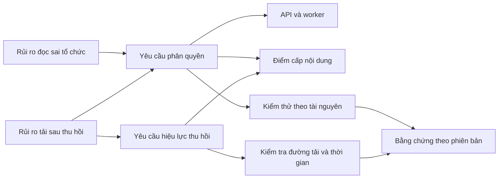

# Traceability matrix: truy vết yêu cầu bảo mật từ rủi ro đến bằng chứng

## 1. Vì sao cần ma trận truy vết?

Một nhóm đã viết yêu cầu xác thực, thêm middleware phân quyền và chạy bộ kiểm thử thành công. Khi chuẩn bị phát hành, người duyệt vẫn cần biết: các thay đổi này xử lý rủi ro nào, đã bao phủ mọi đường truy cập chưa và kết quả kiểm thử có đúng với phiên bản sắp triển khai không?

**Traceability matrix**, hay ma trận truy vết, là cách tổ chức các liên kết giữa yêu cầu và những đối tượng liên quan trong vòng đời phát triển. Với bảo mật, những đối tượng đó thường gồm mục tiêu bảo vệ, nguồn yêu cầu, rủi ro, kiểm soát, thiết kế, công việc triển khai, tiêu chí xác minh, kết quả thực thi và quyết định về rủi ro còn lại.

Ma trận giúp trả lời hai nhóm câu hỏi:

- Đi xuôi: một rủi ro hoặc nghĩa vụ đã dẫn đến những yêu cầu nào, được thực thi ở đâu và được chứng minh bằng gì?
- Đi ngược: một cơ chế, phép kiểm tra hoặc bằng chứng đang phục vụ yêu cầu nào, và vì sao yêu cầu đó tồn tại?

Điểm quan trọng là **một liên kết không tự chứng minh quan hệ đó đúng hoặc đủ**. Một ô ghi tên ca kiểm thử chỉ cho thấy có tham chiếu tới kiểm thử; cần đọc tiêu chí, phạm vi và kết quả để biết nó có chứng minh yêu cầu hay không.

Sau bài học, người học có thể thiết kế ma trận vừa đủ, giữ định danh và phiên bản ổn định, đánh giá độ bao phủ, phát hiện khoảng trống và sử dụng truy vết để quyết định thay đổi hoặc phát hành. Các định danh, số liệu và ngưỡng trong ví dụ là dữ liệu minh họa, không phải quy định chung cho mọi hệ thống.

## 2. Ma trận là một cách nhìn của mạng liên kết

### 2.1. Các đối tượng cần phân biệt

| Đối tượng | Vai trò | Ví dụ minh họa |
| --- | --- | --- |
| Mục tiêu bảo vệ | Nêu kết quả an toàn cần đạt | Không tiết lộ báo cáo cho tổ chức khác |
| Nguồn yêu cầu | Giải thích căn cứ và thẩm quyền | Chính sách nội bộ đã được phê duyệt, hợp đồng hoặc quyết định nghiệp vụ |
| Rủi ro, kịch bản đe dọa | Mô tả điều có thể gây hại và tác động | Tải tệp của khách hàng khác bằng định danh tác vụ |
| Kiểm soát | Biện pháp xử lý rủi ro ở mức khái quát | Phân quyền theo tài nguyên và tổ chức |
| Yêu cầu bảo mật | Nêu hành vi hoặc thuộc tính bắt buộc có thể xác minh | Điểm tải phải kiểm tra quyền đối với tổ chức sở hữu báo cáo |
| Thiết kế | Chỉ ra nơi và cách thực thi | Cổng tải lấy quyền từ nguồn có thẩm quyền |
| Triển khai | Ghi nhận phần mềm, cấu hình hoặc quy trình cụ thể | Thay đổi API, worker và chính sách kho lưu trữ |
| Tiêu chí và phương pháp xác minh | Xác định cần chứng minh điều gì, bằng cách nào | Kiểm thử chéo tổ chức, kiểm tra cấu hình và đánh giá thiết kế |
| Kết quả và bằng chứng | Ghi nhận điều đã quan sát ở một phạm vi cụ thể | Kết quả một lần chạy trên bản dựng xác định |
| Quyết định xử lý | Ghi trách nhiệm với khoảng trống và rủi ro tồn dư | Chặn phát hành hoặc ngoại lệ có phạm vi, thời hạn |

Không cần ép tất cả các đối tượng vào một bảng rất rộng. Có thể dùng nhiều bảng liên kết, cơ sở dữ liệu hoặc công cụ quản lý yêu cầu, rồi tạo các góc nhìn phục vụ từng câu hỏi.

### 2.2. Quan hệ thường là nhiều với nhiều

Một yêu cầu có thể xử lý nhiều rủi ro. Một rủi ro có thể cần nhiều yêu cầu phối hợp. Một yêu cầu phân quyền có thể được thực thi ở API, worker và điểm tải, đồng thời cần nhiều phép xác minh. Ngược lại, một buổi diễn tập phục hồi có thể cung cấp bằng chứng cho cả thời gian phục hồi, tính toàn vẹn và quyền truy cập sau khôi phục.



Nếu một ô chứa nhiều liên kết, cần giữ rõ vai trò của từng liên kết. Việc gắn một kiểm thử vào hai yêu cầu không có nghĩa kiểm thử đó đã chứng minh đầy đủ cả hai.

### 2.3. Truy vết hai chiều phải có ý nghĩa

Từ yêu cầu có thể tìm ra tất cả thành phần bắt buộc thực thi. Từ một thành phần có thể tìm ra các yêu cầu bị ảnh hưởng khi nó thay đổi. Từ một rủi ro có thể tìm ra kiểm soát hiện có và khoảng trống còn mở.

Hai chiều không bắt buộc phải nhập thủ công hai lần. Công cụ có thể sinh liên kết ngược từ một nguồn dữ liệu duy nhất. Điều cần bảo đảm là truy vấn được đúng quan hệ, không tạo hai danh sách độc lập rồi để chúng lệch nhau.

## 3. Chọn độ chi tiết trước khi dựng bảng

Một hàng quá rộng như “hệ thống phải bảo mật” không thể được xác minh có ý nghĩa. Một hàng quá nhỏ như “dòng mã gọi hàm kiểm tra quyền” lại phụ thuộc quá chặt vào triển khai và không nói rõ mục tiêu bảo vệ.

Đơn vị phù hợp thường là một yêu cầu có nghĩa độc lập và tiêu chí chấp nhận rõ. Khi yêu cầu chứa nhiều cam kết độc lập, nên tách để có thể theo dõi riêng.

Ví dụ, câu “phải ghi log an toàn, lưu đủ lâu, tìm nhanh và cảnh báo kịp thời” nên được tách thành yêu cầu về sự kiện bắt buộc, dữ liệu không được ghi, kiểm soát đọc và sửa log, thời hạn giữ, độ trễ tra cứu và độ trễ cảnh báo. Một phép kiểm tra trường sự kiện không chứng minh được tất cả các cam kết này.

Phạm vi của từng yêu cầu cũng phải rõ: người dùng hay workload, môi trường nào, tài nguyên nào, đường truy cập nào và điều kiện lỗi nào. Khi cùng một yêu cầu áp dụng cho nhiều điểm thực thi, có thể giữ yêu cầu cha rồi liệt kê các phần thực thi bắt buộc. Không đóng yêu cầu cha chỉ vì một phần đã đạt.

Một ma trận tối thiểu nên cho phép biết:

1. Yêu cầu có nguồn và phạm vi nào.
2. Nó xử lý rủi ro hoặc mục tiêu bảo vệ nào.
3. Ai thực hiện, tại thành phần nào.
4. Điều kiện nào cần được xác minh và bằng phương pháp gì.
5. Bằng chứng nào còn hiệu lực đối với phiên bản đang đánh giá.
6. Khoảng trống nào còn tồn tại và ai quyết định xử lý.

## 4. Thiết kế cấu trúc dữ liệu và định danh

### 4.1. Giữ định danh ổn định, quản lý phiên bản riêng

Định danh dùng để tham chiếu đối tượng lâu dài; phiên bản dùng để phân biệt nội dung tại từng thời điểm. Ví dụ `SR-EXP-03` có thể giữ nguyên định danh khi nhóm sửa giới hạn thu hồi, nhưng phải có bản sửa đổi mới và ghi tác động tới thiết kế, kiểm thử, bằng chứng.

Không tái sử dụng định danh của yêu cầu đã bỏ cho một yêu cầu khác. Khi tách hoặc thay thế yêu cầu, giữ quan hệ kế thừa như “thay thế”, “được tách thành” và lý do. Những liên kết lịch sử giúp hiểu vì sao một bản phát hành cũ đã được phê duyệt.

Số dòng trong bảng tính hoặc số thứ tự hiển thị không phù hợp làm định danh duy nhất vì dễ thay đổi khi sắp xếp và chèn hàng.

### 4.2. Một mô hình gọn gồm ba bảng

| Bảng | Trường chính | Mục đích |
| --- | --- | --- |
| Đối tượng | Định danh, loại, phiên bản, mô tả, phạm vi, người phụ trách, trạng thái | Quản lý nội dung gốc và vòng đời |
| Liên kết | Nguồn, phiên bản nguồn, loại quan hệ, đích, phiên bản đích, phạm vi, lý do | Ghi quan hệ cụ thể, có thể kiểm tra |
| Bằng chứng | Định danh lần thực thi, đối tượng được xác minh, phiên bản, môi trường, thời điểm, kết quả, vị trí lưu | Gắn kết luận với điều thực sự đã quan sát |

Các bảng có thể được biểu diễn thành nhiều trang tính hoặc các loại bản ghi trong công cụ sẵn có. Điểm chính là tránh trộn định nghĩa ca kiểm thử với kết quả của một lần chạy.

Ví dụ, `TC-REV-02` là ca kiểm thử; `RUN-117` là một lần chạy ca đó. Ca kiểm thử có thể được sửa đổi, chạy nhiều lần và cho kết quả khác nhau trên các bản dựng khác nhau.

### 4.3. Đặt tên cho loại quan hệ

Những quan hệ hữu ích gồm:

- Nguồn yêu cầu **làm căn cứ cho** yêu cầu bảo mật.
- Yêu cầu **xử lý** rủi ro hoặc **cụ thể hóa** mục tiêu bảo vệ.
- Thiết kế hoặc thành phần **thực thi** yêu cầu.
- Ca kiểm thử hoặc phương pháp đánh giá **xác minh** một tiêu chí của yêu cầu.
- Kết quả thực thi **cung cấp bằng chứng cho** tiêu chí trong phạm vi đã chạy.
- Ngoại lệ **áp dụng đối với** khoảng trống của một yêu cầu trong phạm vi xác định.
- Yêu cầu mới **thay thế** hoặc **được tách từ** yêu cầu cũ.

Quan hệ chung chung “có liên quan” có thể dùng để điều hướng, nhưng không đủ để tính độ bao phủ hoặc chứng minh yêu cầu đã đáp ứng.

## 5. Xây dựng ma trận theo từng bước

### Bước 1: Chốt phạm vi đánh giá

Xác định hệ thống, chức năng, bản phát hành, môi trường và tập yêu cầu áp dụng. Ghi thời điểm hoặc phiên bản chốt. Nếu tập yêu cầu thay đổi trong lúc đánh giá, phải biết hàng nào được thêm, sửa, bỏ hoặc đang chờ quyết định.

Phân biệt rõ tập yêu cầu hiện hành với danh sách đề xuất. Một ý tưởng chưa được phê duyệt không nên âm thầm trở thành yêu cầu bắt buộc; một yêu cầu đang áp dụng cũng không được tự bỏ khỏi mẫu số để cải thiện báo cáo.

### Bước 2: Liên kết nguồn và rủi ro

Với mỗi yêu cầu, ghi nguồn đủ cụ thể để tìm lại nội dung và phiên bản áp dụng. Không chỉ ghi “theo compliance”. Nếu nguồn là nghĩa vụ bên ngoài, người có trách nhiệm cần xác nhận tính áp dụng và phạm vi; ma trận chỉ lưu lại kết quả đó, không tự quyết định nghĩa vụ.

Với rủi ro, liên kết tới kịch bản có tài sản, chủ thể, hành vi và tác động rõ. “Mất an toàn thông tin” quá rộng để đánh giá liệu một yêu cầu đã xử lý được phần nào.

### Bước 3: Liên kết thiết kế và phần thực thi

Chỉ ra thành phần, ranh giới tin cậy và nơi quyết định được thực thi. Với một luồng có API, hàng đợi, worker và kho tệp, cần biết điểm nào kiểm tra danh tính, điểm nào kiểm tra quyền trên tài nguyên và đường nào cấp nội dung trực tiếp.

Một ticket hoàn tất chỉ cho thấy công việc được đánh dấu xong theo quy trình ticket. Muốn kết luận triển khai đáp ứng yêu cầu, cần đối chiếu thiết kế, mã nguồn hoặc cấu hình có liên quan và kết quả xác minh phù hợp.

### Bước 4: Liên kết tiêu chí và phương pháp xác minh

Mỗi cam kết trong yêu cầu cần được bao phủ bởi tiêu chí tương ứng. Phương pháp có thể là kiểm thử hành vi, đánh giá thiết kế, kiểm tra cấu hình, quan sát vận hành, kiểm tra hồ sơ hoặc diễn tập.

Ví dụ, không ghi bí mật vào log cần kiểm tra cả dữ liệu sự kiện và đường lỗi liên quan. Phục hồi được trong thời gian mục tiêu cần diễn tập thực tế với mốc đo và phạm vi nghiệp vụ; một ca kiểm thử đơn vị không thay thế bằng chứng này.

### Bước 5: Gắn kết quả với phiên bản thực tế

Lưu định danh bản dựng, bộ cấu hình có liên quan, môi trường, bộ dữ liệu kiểm thử, phiên bản tiêu chí và thời điểm thực thi. Cần biết đường đi nào đã chạy, đường nào không chạy, có bỏ qua hoặc bị chặn hay không.

Thành công trên một môi trường có thể cung cấp bằng chứng cho môi trường khác chỉ khi có đánh giá tính tương đương phù hợp. Khác biệt về chính sách lưu trữ, nguồn quyền hoặc cấu hình cache có thể làm kết luận thay đổi.

### Bước 6: Ghi kết luận và công việc còn mở

Người có trách nhiệm đánh giá mức đáp ứng trên toàn bộ phạm vi yêu cầu, không chỉ đọc kết quả xanh của một lần chạy. Nếu chưa đủ bằng chứng, giữ trạng thái chưa xác minh hoặc một phần. Nếu có thất bại, ghi phần thất bại, tác động và đầu việc xử lý.

Quyết định phát hành sau đó cần xét các khoảng trống và thẩm quyền chấp nhận rủi ro. Ma trận cung cấp đầu vào; nó không thay người có trách nhiệm ra quyết định.

## 6. Ví dụ xuyên suốt: xuất báo cáo học viên

### 6.1. Bối cảnh và tập yêu cầu

Giả sử một nền tảng phục vụ nhiều tổ chức. Quản trị viên tạo tác vụ xuất báo cáo; worker đọc dữ liệu và tạo tệp; người dùng tải qua điểm cấp nội dung. Hệ thống có dịch vụ danh tính, nguồn quyền, kho tệp, kênh audit và bản sao lưu.

Các rủi ro được dùng trong ví dụ:

- `R-01`: tài khoản bị chiếm đoạt được dùng để xuất dữ liệu nhạy cảm.
- `R-02`: người của tổ chức A đọc báo cáo thuộc B.
- `R-03`: đường tải cũ tiếp tục hoạt động sau thu hồi quyền.
- `R-04`: dữ liệu bị lộ qua tệp tạm, bản sao hoặc truy cập lưu trữ ngoài phạm vi.
- `R-05`: không quy được thao tác xuất, xử lý và tải cho đúng chủ thể.
- `R-06`: mất dữ liệu hoặc gián đoạn kéo dài do không phục hồi được an toàn.

Nhóm chốt sáu yêu cầu minh họa cho bản phát hành đang xét:

| Định danh | Nội dung tóm tắt | Điểm cần đo hoặc xác minh |
| --- | --- | --- |
| SR-01 v2 | Tạo báo cáo nhạy cảm phải có bằng chứng MFA phù hợp, hoàn thành không quá 10 phút trước yêu cầu | Kiểm tra tại API; từ chối bằng chứng thiếu, quá hạn hoặc không hợp lệ |
| SR-02 v3 | API, worker và điểm tải phải kiểm tra quyền đối với đúng tổ chức sở hữu tài nguyên | Đường hợp lệ, sai tổ chức, thiếu quyền và tác vụ có thông tin không khớp |
| SR-03 v1 | Thu hồi quyền có hiệu lực với yêu cầu tải mới trên mọi đường cấp nội dung trong tối đa 60 giây | Tính từ ghi nhận thành công tại nguồn quyền tới hiệu lực ở điểm cấp nội dung |
| SR-04 v2 | Tệp kết quả, tệp tạm và bản sao trong phạm vi phải đáp ứng chính sách bảo vệ dữ liệu đã chốt | Bao phủ truy cập, mã hóa và quyền giải mã theo chính sách được tham chiếu |
| SR-05 v1 | Các quyết định tạo, xử lý, cấp nội dung phải có dấu vết theo đúng chủ thể và tổ chức, không chứa bí mật | Bao phủ các loại sự kiện bắt buộc và hành vi khi kênh audit lỗi |
| SR-06 v2 | Khôi phục nghiệp vụ thiết yếu an toàn trong tối đa 2 giờ, dữ liệu phục hồi không cũ hơn 15 phút trước gián đoạn | Phạm vi diễn tập, mốc bắt đầu, điểm dữ liệu, khóa và quyền sau phục hồi |

Đây là bảng tóm tắt. Nội dung đầy đủ của mỗi yêu cầu phải định nghĩa phạm vi, điều kiện lỗi và tiêu chí chi tiết. Các giá trị 10 phút, 60 giây, 2 giờ và 15 phút là giả định được chọn cho bài học.

### 6.2. Góc nhìn từ yêu cầu tới thiết kế và xác minh

| Yêu cầu | Rủi ro | Phần thiết kế thực thi | Phương pháp xác minh dự kiến | Người phụ trách |
| --- | --- | --- | --- | --- |
| SR-01 v2 | R-01 | D-ID-01: xác minh bằng chứng tại API | TC-ID-01, TC-ID-02 và kiểm tra cấu hình tích hợp | Nhóm danh tính và API |
| SR-02 v3 | R-02 | D-AZ-02: ràng buộc tổ chức tại API, worker, điểm tải | Bộ TC-AZ và rà soát các đường cấp nội dung | Nhóm ứng dụng |
| SR-03 v1 | R-03 | D-REV-03: nguồn quyền, cache và cơ chế tải | Bộ TC-REV, đánh giá giới hạn các độ trễ | Nhóm ứng dụng và nền tảng |
| SR-04 v2 | R-04 | D-DATA-04: kho chính, tệp tạm, bản sao, quyền khóa | Kiểm tra cấu hình, quyền và đường ghi tệp | Nhóm dữ liệu và nền tảng |
| SR-05 v1 | R-05 | D-AUD-05: sự kiện tương quan và đường xử lý lỗi audit | Bộ TC-AUD và kiểm tra dữ liệu sự kiện | Nhóm ứng dụng và vận hành |
| SR-06 v2 | R-06 | D-DR-06: dữ liệu, khóa, danh tính, cấu hình phục hồi | DR-01: diễn tập và kiểm tra nghiệp vụ sau phục hồi | Nhóm vận hành và chủ nghiệp vụ |

Bảng này có đủ liên kết thiết kế và phương pháp dự kiến cho cả sáu yêu cầu. Nó chưa cho biết yêu cầu nào đã được đáp ứng. Cần góc nhìn bằng chứng riêng.

### 6.3. Góc nhìn kết quả của một bản phát hành

Giả sử nhóm đang đánh giá bản dựng `build-42`, với tập cấu hình `cfg-9`. Các kết luận sau chỉ áp dụng cho phạm vi và phiên bản đã được lưu cùng bằng chứng.

| Yêu cầu | Bằng chứng minh họa | Kết luận hiện tại | Việc còn mở |
| --- | --- | --- | --- |
| SR-01 v2 | E-101: API xử lý đúng bằng chứng hợp lệ, thiếu, quá hạn và không hợp lệ; cấu hình đã đối chiếu | Đã xác minh trong phạm vi | Theo dõi thay đổi tích hợp danh tính |
| SR-02 v3 | E-102: bộ kiểm tra API, worker, điểm tải và đánh giá đường truy cập đều đạt | Đã xác minh trong phạm vi | Mở lại khi thêm đường cấp nội dung |
| SR-03 v1 | E-103: đường tải qua ứng dụng đạt; đường tải trực tiếp vẫn cấp nội dung sau giới hạn | Không đạt | Sửa đường tải trực tiếp và xác minh lại |
| SR-04 v2 | Chưa có kết quả thực thi của phương pháp đánh giá đã lập | Đã triển khai, chưa xác minh | Thu thập cấu hình và thử quyền của tệp tạm, bản sao |
| SR-05 v1 | E-105: sự kiện trên đường bình thường đạt; chưa kiểm tra lỗi kênh audit | Đã xác minh một phần | Xác minh hành vi lỗi và bảo đảm không bỏ thao tác cần audit |
| SR-06 v2 | E-106: diễn tập đạt 83 phút, điểm phục hồi cũ hơn gián đoạn 11 phút; kiểm tra khóa và quyền đạt | Đã xác minh trong phạm vi | Giữ lịch diễn tập và mở lại khi kiến trúc đổi |

Ở SR-06, điểm bắt đầu đo 83 phút phải trùng với mốc bắt đầu đã đặc tả. Nếu mốc là lúc công bố bắt đầu phục hồi, không được báo con số đó như tổng thời gian gián đoạn bao gồm phát hiện và ra quyết định. Bằng chứng cũng chỉ bao phủ kịch bản mất mát đã diễn tập.

SR-03 cho thấy một sai sót thường gặp: kiểm thử tại thành phần chính đạt nhưng yêu cầu áp dụng cho mọi đường cấp nội dung. Kết luận toàn yêu cầu phải là không đạt khi còn một đường trong phạm vi vi phạm giới hạn.

## 7. Bằng chứng cần có ngữ cảnh và khả năng kiểm tra lại

### 7.1. Tách định nghĩa kiểm tra khỏi lần thực thi

| Trường bằng chứng | Ví dụ | Vì sao cần |
| --- | --- | --- |
| Định danh bằng chứng | E-103 | Tham chiếu ổn định từ ma trận |
| Yêu cầu và phiên bản | SR-03 v1 | Biết cam kết nào đang được đánh giá |
| Tiêu chí và phiên bản phương pháp | TC-REV-02 v2, đánh giá D-REV-03 | Tránh dùng kết quả của phép kiểm tra đã lỗi thời |
| Bản dựng, cấu hình | build-42, cfg-9 | Gắn kết quả với trạng thái triển khai |
| Môi trường và dữ liệu | Môi trường đánh giá, hai tổ chức giả lập, các đường tải trong phạm vi | Hiểu điều kiện và giới hạn của phép kiểm tra |
| Thời điểm và mốc đo | T0 tại nguồn quyền, thời điểm yêu cầu tới từng điểm cấp nội dung | Đánh giá đúng giới hạn thu hồi |
| Kết quả và phạm vi | Đường A đạt, đường B không đạt | Tránh che thất bại trong kết quả tổng hợp |
| Vị trí lưu và người đánh giá | Tham chiếu tới báo cáo được kiểm soát truy cập | Có thể xem lại và chịu trách nhiệm kết luận |

Không nên chỉ lưu ảnh chụp chữ “PASS” hoặc một đường dẫn tới lần chạy mới nhất. Cần tham chiếu tới lần chạy cụ thể và giữ báo cáo đủ lâu theo mục đích, chính sách và yêu cầu áp dụng đã xác nhận.

### 7.2. Hiệu lực bằng chứng không chỉ phụ thuộc tuổi

Bằng chứng mới có thể không phù hợp nếu kiểm tra sai phiên bản hoặc bỏ một đường truy cập. Bằng chứng cũ có thể còn được sử dụng trong phạm vi hẹp nếu những thành phần và giả định liên quan chưa đổi, có đánh giá tác động rõ ràng.

Những thay đổi cần xem xét lại bằng chứng gồm: sửa nội dung yêu cầu, đổi chính sách, thêm API, thay nguồn quyền, thay tuổi thọ cache, đổi kho tệp, đổi cấu hình audit hoặc thay cơ chế phục hồi. Không mặc định mọi thay đổi đều buộc chạy lại mọi phép kiểm tra, nhưng phải đánh giá phần bị ảnh hưởng.

Một trạng thái như “cần xác minh lại” nên giữ được bằng chứng lịch sử cùng lý do nó không còn đủ cho quyết định hiện tại. Không xóa kết quả cũ rồi làm mất lịch sử đánh giá.

### 7.3. Bảo vệ chính ma trận và kho bằng chứng

Ma trận có thể tiết lộ ranh giới hệ thống, khoảng trống và đường lạm dụng. Kho bằng chứng có thể chứa định danh nội bộ hoặc dữ liệu kiểm thử nhạy cảm. Cần kiểm soát ai được đọc, sửa, duyệt và xóa, đồng thời giữ lịch sử thay đổi phù hợp.

Không đặt mật khẩu, token, khóa hoặc dữ liệu khách hàng vào các ô để tiện tái hiện. Ma trận nên trỏ tới bằng chứng đã xử lý dữ liệu và được cấp quyền phù hợp. Việc người duyệt không có quyền xem bằng chứng là một trở ngại xác minh cần giải quyết, không phải lý do coi đường dẫn là bằng chứng đã đủ.

## 8. Đo độ bao phủ mà không nhầm với mức an toàn

### 8.1. Định nghĩa rõ mẫu số

Một chỉ số có nghĩa cần ghi phạm vi, phiên bản và điều kiện được tính vào tử số. Ví dụ:

```text
Độ bao phủ phương pháp xác minh
  = Số yêu cầu áp dụng có phương pháp và tiêu chí xác minh phù hợp
    / Tổng số yêu cầu áp dụng trong tập đã chốt

Tỷ lệ yêu cầu đã xác minh đầy đủ
  = Số yêu cầu có bằng chứng còn hiệu lực cho toàn bộ tiêu chí bắt buộc
    / Tổng số yêu cầu áp dụng trong tập đã chốt
```

Có phương pháp được ghi tên chưa chắc là có phương pháp phù hợp. Điều kiện tính phải bao gồm đánh giá rằng phương pháp bao phủ các cam kết của yêu cầu.

Với ví dụ sáu yêu cầu, nếu cả sáu đã có tiêu chí và phương pháp phù hợp, độ bao phủ phương pháp là `6/6`. Nếu cả sáu đã có thiết kế được liên kết, độ bao phủ liên kết thiết kế cũng là `6/6`. Nhưng chỉ SR-01, SR-02 và SR-06 đã xác minh đầy đủ, nên tỷ lệ đã xác minh là `3/6 = 50%`.

Năm yêu cầu có ít nhất một kết quả thực thi, còn SR-04 chưa có. Chỉ số `5/6` này chỉ phản ánh sự hiện diện kết quả, bao gồm cả kết quả thất bại hoặc một phần. Nó không được đặt tên là tỷ lệ tuân thủ hoặc tỷ lệ đạt.

### 8.2. Không để tỷ lệ tổng hợp che yêu cầu quan trọng

Một yêu cầu phân quyền chưa đạt có thể đủ để chặn phát hành dù nhiều yêu cầu ít quan trọng khác đã hoàn tất. Quy tắc phát hành cần xét mức quan trọng, nghĩa vụ bắt buộc và khoảng trống cụ thể; không chỉ đặt ngưỡng phần trăm chung.

Không lấy số ca kiểm thử đạt chia cho số ca đã chạy rồi gọi đó là độ bao phủ yêu cầu. Một yêu cầu có thể có hàng chục phép kiểm tra tương tự nhưng thiếu một đường truy cập quyết định. Các ca bị bỏ qua, bị chặn và chưa được tạo cũng không xuất hiện trong tỷ lệ đó nếu mẫu số chỉ gồm ca đã chạy.

### 8.3. Xử lý không áp dụng và ngoại lệ minh bạch

Yêu cầu chỉ được loại khỏi tập áp dụng sau khi có căn cứ, phạm vi và phê duyệt theo quy trình. “Chưa triển khai”, “chưa có công cụ” hoặc “chưa chạy test” không phải lý do không áp dụng.

Một ngoại lệ được phê duyệt không biến yêu cầu chưa đạt thành đã xác minh. Nên hiển thị riêng yêu cầu áp dụng, không áp dụng, chưa đạt có ngoại lệ và đã đạt có bằng chứng. Khi phạm vi hoặc điều kiện ngoại lệ thay đổi, trạng thái cần được xem lại.

Nếu có báo cáo theo trọng số, phải công khai cách tính và giới hạn diễn giải. Trọng số là hỗ trợ quản lý, không tự chuyển thành xác suất hệ thống bị tấn công hoặc phần trăm rủi ro đã loại bỏ.

## 9. Dùng truy vết để phân tích tác động thay đổi

Giả sử nhóm đổi thiết kế để cấp URL tải trực tiếp thay vì đi qua cổng ứng dụng. Từ D-REV-03 và D-AZ-02, ma trận cho thấy cần xem lại SR-02, SR-03, các kịch bản đọc sai tổ chức và tải sau thu hồi, cùng các phép kiểm tra liên quan. Cơ chế audit của SR-05 cũng có thể bị ảnh hưởng vì hành vi cấp nội dung đã chuyển sang thành phần khác.

Quy trình cập nhật có thể gồm:

1. Ghi thay đổi, lý do và phiên bản đối tượng bị sửa.
2. Đi theo liên kết để tìm yêu cầu, rủi ro, thiết kế và bằng chứng phụ thuộc.
3. Đánh giá phần nào còn đúng, phần nào cần sửa hoặc xác minh lại.
4. Cập nhật tiêu chí và phạm vi kiểm tra nếu đường thực thi thay đổi.
5. Thu thập bằng chứng mới và ghi quyết định cho khoảng trống còn lại.
6. Chốt lại tập yêu cầu và bằng chứng cho bản phát hành.

Không được sửa yêu cầu thành yếu hơn chỉ để khớp thiết kế đã chọn mà không đánh giá lại tác động và xin quyết định đúng thẩm quyền. Cũng không cần sao chép toàn bộ ma trận sang một tệp mới cho mỗi lần thay đổi nếu công cụ đã giữ được lịch sử và ảnh chụp trạng thái theo phiên bản.

Trường hợp tách yêu cầu cần chú ý dữ liệu lịch sử. Nếu SR-05 được tách thành yêu cầu trường sự kiện và yêu cầu hành vi khi audit lỗi, bằng chứng trước đây chỉ đủ cho phần sự kiện không được tự động đánh dấu đạt cho cả hai yêu cầu mới.

## 10. Vai trò của ma trận trong quyết định phát hành

### 10.1. Tạo một trạng thái đánh giá có thể xem lại

Trước phát hành, cần biết chính xác tập yêu cầu áp dụng, bản dựng, cấu hình, kết quả và các quyết định còn hiệu lực. Một ma trận luôn hiển thị dữ liệu mới nhất nhưng không giữ trạng thái tại thời điểm duyệt sẽ khó giải thích một quyết định trong quá khứ.

Trạng thái đánh giá nên cho thấy:

- Các yêu cầu quan trọng và nghĩa vụ đã xác định có bằng chứng phù hợp hay chưa.
- Các kết quả thất bại, chưa chạy, bị chặn và xác minh một phần.
- Phạm vi không được bao phủ hoặc chưa có kết luận.
- Ngoại lệ, biện pháp tạm thời, hạn dùng và người phê duyệt.
- Phụ thuộc dùng chung và điều kiện kế thừa kiểm soát.
- Chủ thể chịu trách nhiệm với quyết định phát hành và rủi ro tồn dư.

### 10.2. Áp dụng vào ví dụ

Trong ví dụ, SR-03 chưa đạt vì đường tải trực tiếp tiếp tục tiết lộ dữ liệu sau giới hạn. Nếu quy tắc phát hành coi yêu cầu này là điều kiện bắt buộc, nhóm phải sửa hoặc thay đổi phạm vi phát hành để không còn đường vi phạm, rồi xác minh lại.

Nếu quy trình cho phép xem xét ngoại lệ, hồ sơ phải chỉ rõ tổ chức, dữ liệu, đường tải, thời hạn, kiểm soát tạm thời, tác động và người có thẩm quyền. Ngoại lệ không tự miễn trừ nghĩa vụ bên ngoài đã được xác nhận là bắt buộc.

SR-04 chưa có bằng chứng và SR-05 mới xác minh một phần cũng phải hiện rõ. Không thể kết luận phát hành an toàn chỉ vì SR-01, SR-02 và SR-06 đạt hoặc vì mọi yêu cầu đều có ticket triển khai.

### 10.3. Giữ phân biệt giữa trạng thái triển khai và kết luận xác minh

Có thể theo dõi hai trục riêng:

| Trục | Trạng thái minh họa |
| --- | --- |
| Triển khai | Chưa làm, đang làm, đã triển khai, đã thay thế |
| Xác minh | Chưa đánh giá, đạt một phần, không đạt, đạt trong phạm vi, cần xác minh lại |

Thông tin áp dụng và ngoại lệ nên là các thuộc tính riêng. Cách này tránh một cột “Done” vừa có nghĩa mã đã gộp, vừa có nghĩa kiểm thử đạt, vừa có nghĩa rủi ro đã được chấp nhận.

## 11. Duy trì ma trận trong công việc hằng ngày

Ma trận dễ lỗi thời nếu chỉ được cập nhật trước kỳ kiểm tra. Nên gắn cập nhật vào những điểm đã có trong vòng đời yêu cầu: đề xuất yêu cầu, duyệt thiết kế, thay đổi triển khai, xác minh và duyệt phát hành.

| Vai trò | Trách nhiệm cần rõ |
| --- | --- |
| Người sở hữu yêu cầu | Nội dung, phạm vi, nguồn, phiên bản và tiêu chí chấp nhận |
| Nhóm bảo mật hoặc quản lý rủi ro | Liên kết kịch bản, mục tiêu bảo vệ và khoảng trống |
| Nhóm thiết kế, phát triển | Các phần thực thi và ảnh hưởng của thay đổi |
| Người xác minh | Phương pháp, kết quả, ngữ cảnh và giới hạn bằng chứng |
| Vận hành, nền tảng | Kiểm soát dùng chung, cấu hình và diễn tập liên quan |
| Người có thẩm quyền quyết định | Phê duyệt trong phạm vi, ngoại lệ và rủi ro tồn dư |

### 11.1. Những kiểm tra có thể tự động hóa

Các kiểm tra cấu trúc hữu ích gồm định danh duy nhất, liên kết không trỏ tới đối tượng không tồn tại, phiên bản hợp lệ, yêu cầu hiện hành có người phụ trách, bằng chứng có bản dựng và trạng thái không dùng giá trị không xác định.

Có thể phát hiện yêu cầu không có nguồn, rủi ro quan trọng chưa có hướng xử lý, tiêu chí chưa có phương pháp xác minh, yêu cầu thay đổi nhưng bằng chứng vẫn tham chiếu bản cũ, hoặc ngoại lệ hết hạn.

Tự động hóa không thể chỉ từ sự hiện diện của liên kết mà kết luận thiết kế đúng, kiểm thử đủ sâu hoặc rủi ro đã được xử lý. Những đánh giá này cần hiểu nội dung và có người chịu trách nhiệm.

### 11.2. Đừng duy trì hai nguồn sự thật thủ công

Nếu yêu cầu ở một công cụ và kết quả kiểm thử ở công cụ khác, nên chọn nơi quản lý gốc cho từng loại đối tượng và dùng định danh, tham chiếu hoặc đồng bộ có kiểm soát. Một bản xuất ra bảng tính có thể phục vụ báo cáo, nhưng cần ghi thời điểm và phạm vi để không bị hiểu là dữ liệu trực tiếp.

Khi không có công cụ chuyên dụng, một bảng tính có lịch sử phiên bản và quy tắc nhập liệu vẫn có thể đáp ứng quy mô nhỏ. Ưu tiên chất lượng quan hệ, trách nhiệm và bằng chứng trước khi tăng độ phức tạp của công cụ.

## 12. Những lỗi thường gặp và cách sửa

| Biểu hiện | Vấn đề | Cách sửa |
| --- | --- | --- |
| Một hàng “Security” liên kết mọi kiểm thử | Không biết yêu cầu cụ thể nào được chứng minh | Tách thành yêu cầu có phạm vi và tiêu chí rõ |
| Chỉ có yêu cầu và ticket | Thiếu nguồn, rủi ro và bằng chứng đáp ứng | Thêm các quan hệ cần cho câu hỏi quyết định |
| Có ca kiểm thử nên đánh dấu đạt | Nhầm kế hoạch với kết quả thực thi | Gắn lần chạy, phiên bản và kết luận theo phạm vi |
| Liên kết tới kết quả mới nhất | Kết luận quá khứ có thể đổi khi lần chạy mới xuất hiện | Giữ tham chiếu tới lần thực thi cụ thể |
| Kiểm tra API đạt nên đóng yêu cầu toàn luồng | Bỏ worker, đường tải trực tiếp hoặc luồng quản trị | Liệt kê mọi điểm thực thi bắt buộc và bằng chứng tương ứng |
| Yêu cầu sửa nhưng bằng chứng vẫn xanh | Không đánh giá tác động phiên bản | Đánh dấu cần xem lại và xác minh phần bị ảnh hưởng |
| Không đạt được đổi thành không áp dụng | Làm sai tập yêu cầu và mẫu số báo cáo | Tách tính áp dụng khỏi mức đáp ứng, giữ căn cứ phê duyệt |
| Ngoại lệ được tính như đã đạt | Che khoảng trống và hạn dùng | Báo cáo riêng ngoại lệ và phần rủi ro còn lại |
| Mọi ô đều có liên kết nên coi là hoàn tất | Liên kết có thể sai nghĩa hoặc không đủ phạm vi | Đánh giá nội dung, loại quan hệ và giới hạn bằng chứng |
| Sao chép bí mật vào ma trận | Tạo thêm nơi lộ thông tin nhạy cảm | Dùng tham chiếu được cấp quyền và dữ liệu đã xử lý |

## 13. Bài tập tự thực hành

Một hệ thống cho phép cấp quyền quản trị tạm thời. Quyền được phê duyệt bởi người khác, tự hết hạn và phải có audit. Nhóm muốn đổi từ kiểm tra quyền tại mỗi yêu cầu sang cache quyền ở các nút ứng dụng. Sau sự cố, hệ thống có thể khôi phục cấu hình từ bản sao lưu.

Hãy thực hiện:

1. Viết ít nhất bốn yêu cầu riêng cho phê duyệt, phạm vi quyền, hết hạn hoặc thu hồi, audit và điều kiện an toàn sau phục hồi.
2. Xác định rủi ro và nguồn quyết định cho từng yêu cầu; ghi giả định chưa xác nhận.
3. Dựng một góc nhìn từ yêu cầu tới thiết kế và phương pháp xác minh.
4. Dựng bảng kết quả trong đó một yêu cầu đạt, một yêu cầu chỉ đạt một phần và một yêu cầu chưa có bằng chứng; ghi rõ phần còn mở.
5. Cho một ví dụ về bằng chứng không còn đủ sau thay đổi cache dù ca kiểm thử trước đây đã đạt.
6. Tính riêng độ bao phủ phương pháp và tỷ lệ yêu cầu đã xác minh đầy đủ, nêu rõ mẫu số.
7. Phân tích những liên kết cần theo dõi khi đổi thời hạn quyền hoặc khôi phục bản sao cũ.
8. Viết quyết định phát hành có căn cứ từ các khoảng trống, không chỉ từ tỷ lệ tổng hợp.

Bài làm cần giữ được truy vết hai chiều và không dùng trạng thái “đã triển khai” thay cho “đã xác minh”. Mọi giá trị thời gian cần có mốc đo, phạm vi và cơ sở lựa chọn, không chỉ là một con số trong ô.

## 14. Điểm kiểm tra khi bàn giao ma trận

Một ma trận có thể phục vụ đánh giá khi:

- Tập yêu cầu áp dụng, phiên bản và phạm vi phát hành đã được xác định.
- Định danh ổn định; thay thế, tách và loại bỏ yêu cầu có lịch sử.
- Mỗi yêu cầu có nguồn, phạm vi, người phụ trách và tiêu chí chấp nhận phù hợp.
- Các liên kết rủi ro, thiết kế, thực thi và xác minh có loại quan hệ rõ.
- Những điểm thực thi bắt buộc trên toàn luồng được bao phủ, kể cả phụ thuộc và đường truy cập phụ.
- Kết quả gắn với lần thực thi, bản dựng, cấu hình và phiên bản yêu cầu cụ thể.
- Thất bại, thiếu bằng chứng, xác minh một phần và bằng chứng cần xem lại được hiển thị.
- Chỉ số có định nghĩa tử số, mẫu số và giới hạn diễn giải.
- Ngoại lệ, tính không áp dụng và rủi ro tồn dư có căn cứ, thẩm quyền và điều kiện xem lại.
- Có người cập nhật, lịch sử thay đổi và cách bảo vệ ma trận cùng kho bằng chứng.

Giá trị của ma trận truy vết nằm ở khả năng giải thích một quyết định: vì sao yêu cầu tồn tại, nó được thực thi ở đâu, điều gì đã được chứng minh và điều gì còn chưa chắc chắn. Một bảng có đầy đủ đường dẫn chỉ hữu ích khi các liên kết đó đúng nghĩa, đúng phiên bản và đủ phạm vi cho quyết định đang đưa ra.
