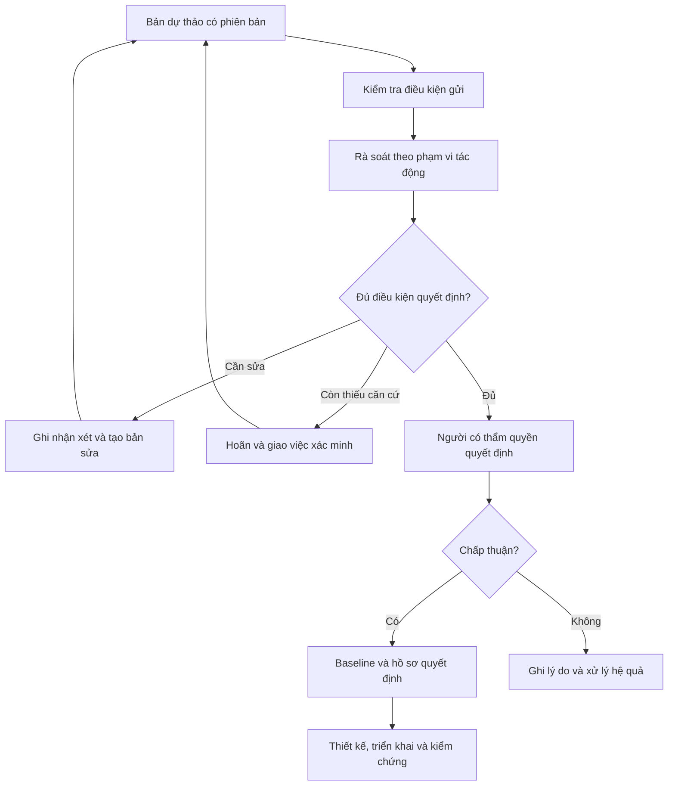

# Phê duyệt requirement

## 1. Phê duyệt yêu cầu bảo mật là quyết định gì?

**Phê duyệt requirement** là quyết định có thẩm quyền chấp thuận một phiên bản cụ thể của yêu cầu để làm căn cứ cho thiết kế, triển khai và kiểm chứng trong một phạm vi xác định.

Đối với yêu cầu bảo mật, quyết định này cần trả lời được:

- Yêu cầu bảo vệ mục tiêu hoặc xử lý rủi ro nào?
- Phạm vi, hành vi bắt buộc và ngưỡng chấp nhận đã rõ chưa?
- Các bên liên quan có hiểu cùng một nội dung không?
- Có thể triển khai, kiểm thử và vận hành yêu cầu đó không?
- Ai chịu trách nhiệm và ai được quyền chấp thuận?
- Bản nội dung nào được duyệt và thay đổi nào cần duyệt lại?

Một chữ ký hoặc nhãn “Approved” không làm cho câu “hệ thống phải an toàn” trở thành đặc tả có thể triển khai. Chất lượng của quyết định phụ thuộc vào nội dung được xem xét, thẩm quyền, căn cứ và khả năng truy vết.

Trong vòng đời yêu cầu bảo mật, phê duyệt tạo ra một mốc để các nhóm cùng làm việc trên một cách hiểu đã thống nhất. Sau mốc đó, việc triển khai và kiểm chứng vẫn phải tiếp tục.

### Phân biệt những quyết định thường bị gộp chung

| Hoạt động | Đối tượng được xem xét | Kết luận có thể đưa ra |
| --- | --- | --- |
| Rà soát yêu cầu | Nội dung, nguồn, phạm vi, khả năng kiểm chứng | Phát hiện thiếu sót, đưa nhận xét hoặc khuyến nghị |
| Phê duyệt yêu cầu | Một phiên bản yêu cầu đủ điều kiện theo quy trình | Chấp thuận dùng làm căn cứ trong phạm vi đã ghi |
| Phê duyệt thiết kế | Cách kiến trúc thực hiện các yêu cầu | Chấp thuận phương án và trách nhiệm thực thi |
| Xác minh triển khai | Hành vi thực tế so với tiêu chí chấp nhận | Đạt hoặc không đạt trên bản dựng, cấu hình và môi trường đã kiểm tra |
| Chấp nhận rủi ro | Rủi ro còn lại trong một phạm vi và thời gian | Chấp nhận theo thẩm quyền và điều kiện được phép |
| Cho phép phát hành | Bản phát hành và các điều kiện đưa vào sử dụng | Cho phép phát hành theo quy trình của tổ chức |

Phê duyệt một yêu cầu chưa triển khai là hoạt động bình thường. Đối tượng được chấp thuận là điều hệ thống phải đáp ứng, không phải một tuyên bố rằng hệ thống hiện đã đáp ứng.

Các mã, tình huống, hồ sơ và ngưỡng số trong bài là **ví dụ giả định phục vụ học tập**. Chúng không phải quy trình hoặc ngưỡng mặc định cho mọi tổ chức.

## 2. Phê duyệt tạo ra một baseline có thể truy vết

**Baseline yêu cầu** là tập phiên bản yêu cầu đã được xác lập để dùng làm căn cứ tại một mốc nhất định. Baseline có thể áp dụng cho một tính năng, một dịch vụ hoặc một bản phát hành.

Baseline cần cho phép xác định:

1. Danh sách yêu cầu và phiên bản nằm trong phạm vi.
2. Nguồn mục tiêu, rủi ro, nghĩa vụ hoặc quyết định liên quan.
3. Nội dung và tiêu chí chấp nhận đã được phê duyệt.
4. Người phê duyệt, vai trò, thời điểm và kết quả quyết định.
5. Các phụ thuộc, điều kiện và vấn đề còn mở được ghi đúng trạng thái.
6. Cách quản lý thay đổi kể từ mốc phê duyệt.

Không nên để một đường dẫn luôn trỏ vào “bản mới nhất” là căn cứ duy nhất. Nếu nội dung ở đó bị sửa, người kiểm thử có thể không biết tiêu chí hiện thấy có phải tiêu chí đã được duyệt hay không.

Có thể quản lý baseline bằng công cụ yêu cầu, hệ thống ticket hoặc kho phiên bản, tùy môi trường. Điều quan trọng là giữ được nội dung lịch sử và liên kết quyết định với đúng phiên bản.

Một nhóm yêu cầu đã có baseline vẫn có thể có các trạng thái triển khai khác nhau: chưa thực hiện, đang thực hiện, đã kiểm chứng hoặc đang có khoảng thiếu hụt. Trạng thái phê duyệt và trạng thái thực hiện cần được theo dõi riêng.

## 3. Ai có quyền phê duyệt?

Trước khi gửi yêu cầu, cần xác định người có trách nhiệm xem xét và người có quyền quyết định. Không mặc định người viết tài liệu hoặc người quản trị công cụ được quyền chấp thuận mọi nội dung.

| Vai trò | Nội dung thường cần xem xét |
| --- | --- |
| Chủ sở hữu nghiệp vụ | Mục tiêu, tác động, mức chấp nhận gián đoạn và thứ tự ưu tiên |
| Chủ sở hữu dữ liệu | Phạm vi dữ liệu, quyền sử dụng, chia sẻ, lưu giữ và xóa |
| Người phụ trách bảo mật | Mối đe dọa, mức bảo vệ, đường đi bỏ qua và rủi ro còn lại |
| Kiến trúc sư hoặc đầu mối kỹ thuật | Khả năng thực hiện, điểm thực thi và phụ thuộc |
| Nhóm kiểm thử | Tính rõ ràng, dữ liệu thử, điều kiện đạt và khả năng thu bằng chứng |
| Người vận hành dịch vụ | Khả năng duy trì, giám sát, xử lý lỗi và phục hồi |
| Vai trò phụ trách nghĩa vụ áp dụng | Nguồn, cách hiểu, phạm vi và thẩm quyền xử lý nghĩa vụ liên quan |

Các vai trò này không nhất thiết đều phải là người phê duyệt cuối cùng cho từng yêu cầu. Quy trình cần phân biệt người cung cấp ý kiến, người xác nhận một khía cạnh và người có quyền chấp thuận toàn bộ quyết định trong phạm vi.

### Xác định thẩm quyền theo phạm vi

Ví dụ:

- Chủ sở hữu sản phẩm có thể chấp thuận mục tiêu nghiệp vụ nhưng chưa chắc có quyền thay đổi chính sách quản lý khóa.
- Nhóm phát triển xác nhận tính khả thi không đồng nghĩa họ được chấp nhận rủi ro thay cho chủ sở hữu dịch vụ.
- Nhân viên vận hành báo cáo thời gian phục hồi thực tế không đồng nghĩa họ được tự đặt mức gián đoạn mà nghiệp vụ phải chấp nhận.
- Người tham gia cuộc họp đồng ý với biên bản chưa chắc là người có thẩm quyền phê duyệt yêu cầu.

Với yêu cầu ảnh hưởng lớn đến quyền đặc biệt, dữ liệu nhạy cảm hoặc phục hồi dịch vụ, thường cần góc nhìn của nhiều vai trò. Mức rà soát phải phù hợp với tác động, không chỉ dựa vào số dòng của yêu cầu.

Một yêu cầu mới đổi thời hạn thu hồi quyền từ 5 phút thành 1 giờ có thể chỉ sửa vài ký tự nhưng làm thay đổi đáng kể rủi ro và cam kết.

### Giữ trách nhiệm quyết định rõ ràng

Hồ sơ cần xác định người cụ thể hoặc định danh công việc gắn với một người có thẩm quyền, thay vì chỉ ghi “team đã đồng ý”.

Nếu một người kiêm nhiều vai trò, cần ghi họ đang xác nhận nội dung nào. Khi quy trình yêu cầu xem xét độc lập, việc đổi tên vai trò trên biểu mẫu không thay thế sự độc lập đó.

## 4. Điều kiện để một yêu cầu sẵn sàng được phê duyệt

Yêu cầu chưa cần có toàn bộ mã nguồn hoặc mọi chi tiết triển khai. Tuy nhiên, phải đủ rõ để các bên hiểu điều đang chấp thuận và cách đánh giá kết quả về sau.

### 4.1. Có nguồn và mục đích

Cần liên kết tới một hoặc nhiều căn cứ:

- Mục tiêu bảo vệ đã xác nhận.
- Kịch bản đe dọa hoặc rủi ro.
- Nghĩa vụ áp dụng đã được xác nhận.
- Quyết định nghiệp vụ hoặc chính sách nội bộ có thẩm quyền.
- Bài học từ sự cố hoặc đánh giá đã có nguồn.

Yêu cầu không có nguồn dễ trở thành một lựa chọn kỹ thuật mang tính cá nhân. Ngược lại, chỉ có tên rủi ro mà chưa có hành vi bắt buộc cũng chưa đủ.

### 4.2. Có phạm vi và điểm thực thi

Cần biết yêu cầu áp dụng cho chủ thể, dữ liệu, môi trường và đường truy cập nào.

Ví dụ, “kiểm tra quyền khi xuất dữ liệu” cần làm rõ API, worker, đường tải, công cụ quản trị và dịch vụ bên ngoài có tham gia cung cấp dữ liệu hay không.

Điểm thực thi có thể được xác định ở mức trách nhiệm kiến trúc. Chưa cần chốt tên lớp trong mã nguồn, nhưng không thể bỏ trống nơi kiểm soát sẽ được áp dụng.

### 4.3. Có hành vi và tiêu chí đo được

Các từ “nhanh”, “an toàn”, “đầy đủ” hoặc “phù hợp” cần được thay bằng điều kiện quan sát được hoặc một baseline cụ thể đã khóa phiên bản.

Nếu có ngưỡng, cần ghi:

- Giá trị và đơn vị.
- Mốc bắt đầu, mốc kết thúc.
- Phạm vi tính toán.
- Điều kiện vận hành hoặc kịch bản đo.
- Cách thu bằng chứng và xử lý sai số khi cần.

Ngưỡng chưa xác nhận phải được giữ là điểm mở. Không tự chọn một con số để tài liệu có vẻ hoàn chỉnh.

### 4.4. Có hành vi khi lỗi hoặc thiếu thông tin

Yêu cầu cần xem xét những trường hợp liên quan như:

- Không xác minh được danh tính hoặc quyền.
- Dịch vụ quản lý khóa không phản hồi.
- Kho nhật ký bị gián đoạn.
- Cache chứa quyết định cũ.
- Hàng đợi thử lại tác vụ.
- Hệ thống đang phục hồi từ bản sao.
- Người dùng chuyển vai trò trong lúc thao tác diễn ra.

Nếu chỉ mô tả luồng thành công, hai nhóm có thể đưa ra hai hành vi lỗi trái ngược mà đều nghĩ mình làm đúng.

### 4.5. Có cơ sở về tính khả thi và vận hành

Đầu mối kỹ thuật cần chỉ ra phương án khả thi hoặc công việc xác minh cần hoàn tất trước khi quyết định. Với một điểm chưa chắc chắn có thể làm thay đổi bản chất yêu cầu, nên làm thử nghiệm kỹ thuật hoặc phân tích bổ sung trước khi chốt.

Không bắt buộc xây xong tính năng để phê duyệt yêu cầu. Cũng không nên ghi một cam kết không có cơ sở rồi để nhóm triển khai tự giải quyết mọi mâu thuẫn.

### 4.6. Có chủ sở hữu và phương pháp kiểm chứng

Cần biết ai chịu trách nhiệm triển khai, ai đánh giá kết quả và ai vận hành kiểm soát.

Tiêu chí chấp nhận cần có phương pháp kiểm chứng dự kiến: kiểm thử, kiểm tra cấu hình, rà soát quyền, đối chiếu hồ sơ hoặc diễn tập. Một tuyên bố chưa có cách đánh giá thường còn thiếu định nghĩa.

## 5. Những câu hỏi cần rà soát theo miền bảo mật

| Miền | Câu hỏi trước phê duyệt |
| --- | --- |
| Xác thực | Chủ thể nào, thao tác nào, mức xác minh nào, vòng đời phiên và đường khôi phục tài khoản có thuộc phạm vi không? |
| Phân quyền | Quyền trên hành động và đối tượng nào, theo khách hàng nào, ai cấp, ai thu hồi, những đường đi nào phải thực thi? |
| Dữ liệu | Dữ liệu nằm ở đâu, có bản sao nào, yêu cầu truyền, lưu, khóa, xóa và ngoại lệ được xác định thế nào? |
| Logging | Sự kiện và trường nào bắt buộc, trường nào không được ghi, giữ bao lâu, ai được truy cập, mất kết nối thì xử lý ra sao? |
| Phục hồi | Kịch bản nào, RTO và RPO nào, mốc đo nào, cần phục hồi những phụ thuộc và kiểm soát bảo mật nào? |

Các câu hỏi này giúp phát hiện phạm vi thiếu, không phải một danh sách buộc mọi yêu cầu đơn lẻ phải mô tả tất cả các miền.

Một yêu cầu về đường tải có thể tham chiếu yêu cầu xác thực và logging đã được duyệt. Khi đó cần chỉ đúng mã và phiên bản để tránh sao chép nhiều bản rồi để nội dung khác nhau.

Với dữ liệu và phục hồi, cần xem xét cùng nhau. Nếu bản sao cũ làm sống lại quyền đã thu hồi hoặc dữ liệu phải xóa, yêu cầu phục hồi có thể làm vô hiệu mục tiêu của các yêu cầu khác.

## 6. Quy trình phê duyệt một phiên bản yêu cầu

Một quy trình có thể tổ chức theo các bước sau:

1. **Chuẩn bị bản dự thảo:** có mã, phiên bản, nguồn, nội dung và tiêu chí chấp nhận.
2. **Kiểm tra điều kiện gửi:** xác nhận các trường bắt buộc, người xem xét và phạm vi quyết định.
3. **Rà soát liên quan:** nghiệp vụ, bảo mật, kỹ thuật, kiểm thử, dữ liệu và vận hành tham gia theo tác động.
4. **Xử lý nhận xét:** ghi phản hồi, sửa nội dung và lưu các điểm chưa thống nhất.
5. **Trình đúng phiên bản:** chỉ rõ nội dung cuối cùng đề nghị chấp thuận.
6. **Ra quyết định:** chấp thuận, yêu cầu sửa, từ chối hoặc hoãn, cùng lý do và trách nhiệm.
7. **Xác lập baseline:** khóa liên kết giữa phiên bản nội dung và quyết định.
8. **Bàn giao thực hiện:** chuyển yêu cầu cùng tiêu chí, phụ thuộc và nghĩa vụ tạo bằng chứng.
9. **Quản lý thay đổi:** đánh giá tác động và phê duyệt lại khi cần.



Không lấy việc quá hạn phản hồi hoặc không có ý kiến làm bằng chứng phê duyệt nếu quy trình chưa xác định rõ cơ chế đó và thẩm quyền áp dụng.

### Tách đồng thuận rà soát khỏi quyết định

Một reviewer có thể kết luận “không còn nhận xét kỹ thuật”. Điều đó không tự đồng nghĩa đã có người chấp thuận phạm vi nghiệp vụ hoặc rủi ro liên quan.

Ngược lại, người phê duyệt không nên bỏ qua một vấn đề chưa giải quyết chỉ bằng cách đánh dấu tất cả nhận xét là đã đóng. Mỗi nhận xét quan trọng cần có cách xử lý hoặc quyết định có căn cứ.

## 7. Kết quả quyết định và cách dùng trạng thái

Tên trạng thái tùy công cụ. Ý nghĩa cần được định nghĩa đủ rõ để mọi nhóm sử dụng giống nhau.

| Kết quả | Ý nghĩa | Công việc tiếp theo |
| --- | --- | --- |
| APPROVED | Chấp thuận đúng phiên bản và phạm vi đã ghi | Đưa vào baseline và thực hiện theo kế hoạch |
| CHANGES_REQUIRED | Chưa chấp thuận; cần sửa các điểm được chỉ ra | Tạo bản sửa, phản hồi nhận xét và trình lại |
| DEFERRED | Chưa quyết định do thiếu căn cứ hoặc phụ thuộc | Giao người xử lý và mốc xem xét lại |
| REJECTED | Không chấp thuận phương án yêu cầu được trình | Ghi lý do, xử lý nguồn nhu cầu hoặc đề xuất phương án khác |

Từ chối một câu đặc tả không có nghĩa rủi ro hoặc nghĩa vụ nguồn đã biến mất. Ví dụ, yêu cầu bị từ chối vì cách viết không kiểm chứng được vẫn cần một bản thay thế để xử lý mục tiêu bảo vệ.

### Cẩn trọng với “phê duyệt có điều kiện”

Chỉ dùng kết quả này khi quy trình tổ chức định nghĩa rõ:

- Điều gì đã được chấp thuận.
- Điều kiện còn lại là gì.
- Ai phải hoàn tất và ai xác nhận.
- Hạn và giai đoạn mà điều kiện phải được đáp ứng.
- Những hoạt động nào được phép tiếp tục.
- Hệ quả khi điều kiện không được đáp ứng.

Không dùng phê duyệt có điều kiện để che các phần cốt lõi chưa rõ, chẳng hạn chưa biết ai được truy cập dữ liệu, thời hạn thu hồi là bao lâu hoặc hành vi khi kiểm tra quyền lỗi.

Các điều kiện kiểm chứng triển khai trước phát hành cần được ghi đúng là điều kiện ở giai đoạn đó. Một yêu cầu đã được duyệt không tự động mất hiệu lực chỉ vì chưa có bài kiểm thử triển khai; nhưng bản phát hành cũng chưa được kết luận đạt khi chưa có kết quả cần thiết.

### Tránh một trường trạng thái chứa nhiều ý nghĩa

Theo dõi riêng khi cần:

```text
Trạng thái yêu cầu: đã được phê duyệt
Phiên bản được duyệt: 3
Trạng thái triển khai: đang thực hiện
Trạng thái kiểm chứng: chưa chạy
Trạng thái phát hành: chưa xem xét
```

Những trạng thái trong ví dụ mô tả vòng đời nghiệp vụ của yêu cầu. Chúng không phải trạng thái của một tệp bài học hoặc một quy trình xuất bản tài liệu.

## 8. Ví dụ: phê duyệt yêu cầu thu hồi quyền xuất dữ liệu

Giả sử một dịch vụ quản lý hồ sơ khách hàng có nhiều tenant. Người dùng yêu cầu xuất dữ liệu qua API; worker tạo tệp; cổng tải cung cấp kết quả.

Mô hình đe dọa chỉ ra rủi ro **RISK-DEMO-17**: người đã mất quyền vẫn nhận được dữ liệu qua phiên cũ, cache, tác vụ nền hoặc liên kết tải.

Chủ sở hữu nghiệp vụ và người phụ trách bảo mật đã xác nhận quyết định đầu vào **BIZ-DEMO-09**: giới hạn thu hồi được chọn cho tình huống này là tối đa 5 phút. Đây là ngưỡng giả định của ví dụ.

### 8.1. Những bản dự thảo chưa đủ điều kiện

**Phiên bản 1:**

> Quyền xuất phải được thu hồi nhanh chóng.

Nhận xét: thiếu ngưỡng, mốc đo, đường truy cập và cách xác minh.

**Phiên bản 2:**

> API phải từ chối xuất dữ liệu trong tối đa 5 phút sau khi thu hồi quyền.

Nhận xét: chưa rõ mốc bắt đầu; bỏ sót worker, tệp đã tạo, đường tải và trạng thái đang truyền. API từ chối tạo tác vụ mới nhưng đường tải vẫn cung cấp dữ liệu thì mục tiêu bảo vệ chưa được đáp ứng.

Hai phiên bản này cần sửa trước khi phê duyệt. Việc có con số trong phiên bản 2 chưa làm phạm vi trở nên đầy đủ.

### 8.2. Phiên bản 3 được trình phê duyệt

**Mã:** SEC-EXP-REV-01.  
**Phiên bản:** 3.  
**Nguồn:** RISK-DEMO-17 bản 1 và BIZ-DEMO-09 bản 1.  
**Phạm vi:** dữ liệu xuất của tenant bị tác động; API xuất, worker và mọi đường cung cấp tệp trong danh mục kiến trúc của tính năng.

**Nội dung yêu cầu:**

> Trong tối đa 5 phút kể từ mốc t0, mọi điểm thực thi trong phạm vi phải ngừng cung cấp dữ liệu dựa trên quyền xuất đã bị thu hồi. Mốc t0 là thời điểm hệ thống ghi nhận bền vững lệnh thu hồi hợp lệ và trả mã xác nhận. Hệ thống phải lưu được mốc này cùng định danh lệnh để kiểm chứng.

Các quy tắc bổ sung làm rõ hành vi:

1. API không chấp nhận yêu cầu xuất mới dựa trên quyền đã hết hiệu lực sau giới hạn thu hồi.
2. Worker phải kiểm tra quyền theo quy tắc hiệu lực đã xác định trước khi công bố kết quả.
3. Liên kết tải đã tạo không được bỏ qua quyết định quyền hiện hành.
4. Với lượt tải đang diễn ra, điểm phục vụ tệp phải ngừng phát thêm dữ liệu trước khi hết giới hạn thu hồi.
5. Phiên, cache và cơ chế thử lại không được kéo dài quyền vượt giới hạn.
6. Khi không thể xác minh quyết định quyền đáp ứng giới hạn hiệu lực, hệ thống không được tiếp tục cung cấp dữ liệu theo một quyền chưa được xác minh.
7. Các lần từ chối và quyết định ngừng cung cấp phải được liên kết với mã yêu cầu hoặc tác vụ để hỗ trợ kiểm chứng.

Phạm vi này điều khiển dữ liệu còn được hệ thống cung cấp. Bản sao người dùng đã nhận trước đó cần được quản lý bằng các yêu cầu xử lý dữ liệu tương ứng; phê duyệt yêu cầu thu hồi không tạo ra khả năng thu lại mọi bản sao đã ra khỏi hệ thống.

Phần logging chi tiết có thể tham chiếu một yêu cầu đã được duyệt riêng. Nếu tham chiếu như vậy, phải chỉ rõ mã và phiên bản, không chỉ viết “theo quy định logging”.

### 8.3. Kiểm tra đủ phạm vi kiến trúc

Nhóm kỹ thuật cần xác nhận danh mục điểm thực thi có đầy đủ không:

| Thành phần | Trách nhiệm cần được xác nhận |
| --- | --- |
| API xuất | Kiểm tra quyền khi nhận yêu cầu và gắn đúng phạm vi tenant |
| Worker | Kiểm tra quyền ở thời điểm cung cấp kết quả theo đặc tả |
| Kho trạng thái quyền hoặc dịch vụ quyền | Cung cấp quyết định và cơ chế cập nhật đáp ứng giới hạn |
| Cache, phiên và token | Không tạo cửa sổ quyền cũ vượt giới hạn đã chốt |
| Cổng tải và kho tệp | Kiểm soát liên kết cũ, lượt tải mới và lượt đang diễn ra |
| Hệ thống nhật ký | Lưu được các mốc cần thiết và kết quả thực thi |

Nếu hệ thống phát liên kết cho phép tải trực tiếp từ kho tệp mà không còn điểm kiểm soát phù hợp, đó là vấn đề khả thi phải giải quyết trước khi chấp thuận phương án yêu cầu và thiết kế tương ứng.

Chỉ đặt thời gian sống cache bằng 5 phút chưa chứng minh toàn hệ thống thu hồi trong 5 phút. Còn phải xét độ trễ cập nhật, thời điểm bắt đầu cache, thử lại, hàng đợi và các đường cung cấp dữ liệu khác.

### 8.4. Tiêu chí chấp nhận đi kèm

| Tình huống | Kết quả kỳ vọng | Bằng chứng dự kiến |
| --- | --- | --- |
| Yêu cầu mới sau hạn thu hồi | Bị từ chối nếu chỉ dựa trên quyền đã bị thu hồi | Mã lệnh, t0, thời điểm kiểm tra và kết quả API |
| Phiên tạo trước t0 | Không duy trì khả năng xuất hoặc tải vượt giới hạn | Kết quả thao tác bằng phiên cũ |
| Tác vụ vào hàng đợi trước t0 | Không công bố dữ liệu trái quy tắc sau hạn | Mốc xử lý và quyết định của worker |
| Liên kết tải cũ | Không cung cấp dữ liệu sau khi quyền không còn hiệu lực | Kết quả tải và sự kiện liên quan |
| Lượt tải đang chạy | Điểm phục vụ tệp ngừng phát thêm dữ liệu trong giới hạn | Dấu thời gian tại điểm kiểm soát và quan sát luồng |
| Cache hoặc nút xử lý có quyền cũ | Không tạo đường cung cấp vượt giới hạn | Kiểm thử trên các nhóm điểm thực thi |
| Dịch vụ quyền gặp lỗi | Không tiếp tục cung cấp dựa trên quyền không xác minh được | Kết quả thử lỗi phụ thuộc |
| Lệnh thu hồi thuộc tenant A | Không làm thay đổi quyền của tenant B ngoài phạm vi quyết định | Kiểm thử cô lập tenant |

Bộ kiểm thử cần thống nhất đồng hồ, sai số và điểm quan sát. Số byte đã đến máy người dùng có thể chịu ảnh hưởng của bộ đệm; tiêu chí trong ví dụ đo việc ngừng phát thêm dữ liệu tại điểm kiểm soát của hệ thống.

Ở giai đoạn phê duyệt yêu cầu, cần có đặc tả và phương pháp kiểm chứng đủ rõ. Kết quả kiểm thử triển khai sẽ được tạo sau khi có bản thực hiện tương ứng.

## 9. Rà soát và quyết định trên ví dụ

Giả sử phiên bản 3 được gửi tới các vai trò liên quan. Mỗi bên cần xem xét một phần trách nhiệm cụ thể.

| Vai trò | Nội dung xem xét | Kết quả cần ghi |
| --- | --- | --- |
| Chủ sở hữu nghiệp vụ | Mục tiêu và giới hạn 5 phút có phù hợp với quyết định đầu vào không | Xác nhận phạm vi và tác động nghiệp vụ |
| Người phụ trách bảo mật | Có đường đi nào tiếp tục cung cấp dữ liệu sau thu hồi không | Nhận xét về phạm vi, lỗi và rủi ro còn lại |
| Đầu mối kỹ thuật | Các thành phần có thể thực thi giới hạn và ngừng lượt tải đang chạy không | Cơ sở khả thi, phụ thuộc và trách nhiệm |
| Nhóm kiểm thử | Có thể đo t0, hạn và hành vi ở từng điểm không | Chấp thuận phương pháp kiểm chứng hoặc yêu cầu sửa |
| Người vận hành | Có quan sát được lỗi và xử lý khi cơ chế quyền bị gián đoạn không | Yêu cầu giám sát và trách nhiệm vận hành |

Một tình huống có thể xảy ra:

> Nhóm kỹ thuật phát hiện đường tải trực tiếp không thể kiểm tra lại quyền theo cách hiện tại. Kết quả là CHANGES_REQUIRED hoặc DEFERRED để phân tích phương án, thay vì APPROVED chỉ vì phần lớn các API đã rõ.

Nếu sau đó có phương án khả thi và nội dung thay đổi, phải trình đúng phiên bản mới. Người phê duyệt cần biết họ đang chấp thuận bản 3 hay một bản đã được sửa tiếp.

Khi các nhận xét trọng yếu đã được xử lý, người có thẩm quyền có thể chấp thuận yêu cầu. Hồ sơ ghi rõ quyết định đó áp dụng cho phiên bản nào, trong baseline nào và chưa phải kết luận hệ thống đã kiểm chứng đạt.

### Không bỏ qua rủi ro chỉ vì đã chấp thuận một giới hạn

Giới hạn 5 phút vẫn tạo một khoảng thời gian quyền cũ có thể còn hiệu lực theo thiết kế. Cần nhận diện rủi ro còn lại này và xử lý theo thẩm quyền của tổ chức.

Nếu một nghĩa vụ nguồn đòi giới hạn chặt hơn, quyết định nội bộ chọn 5 phút không tự thay đổi nghĩa vụ đó. Khi ấy cần xem lại yêu cầu và nguồn áp dụng, không chỉ bổ sung một chữ ký nội bộ.

## 10. Hồ sơ phê duyệt tối thiểu

Hồ sơ phải đủ để người không tham gia cuộc họp vẫn biết quyết định đã được đưa ra như thế nào.

| Trường | Nội dung cần lưu |
| --- | --- |
| Mã quyết định | Định danh để liên kết và tra cứu |
| Đối tượng được phê duyệt | Mã yêu cầu, phiên bản và nội dung có thể truy xuất đúng bản |
| Phạm vi | Dịch vụ, tính năng, dữ liệu và môi trường liên quan |
| Căn cứ | Rủi ro, nguồn yêu cầu, quyết định nghiệp vụ hoặc nghĩa vụ |
| Người quyết định | Định danh, vai trò và căn cứ thẩm quyền |
| Thời điểm | Thời gian ra quyết định |
| Kết quả | Chấp thuận, cần sửa, hoãn hoặc từ chối |
| Lý do và nhận xét | Vì sao chấp thuận hoặc vì sao chưa chấp thuận |
| Điều kiện và phụ thuộc | Nội dung, người xử lý, mốc và hệ quả nếu có |
| Liên kết baseline | Tập phiên bản dùng làm căn cứ |
| Dấu vết rà soát | Nhận xét quan trọng và cách giải quyết |

Ví dụ biểu diễn bằng YAML dưới đây chỉ minh họa một hồ sơ nghiệp vụ:

```yaml
decisionId: DEC-SEC-DEMO-014
requirement:
  id: SEC-EXP-REV-01
  revision: 3
  artifactRef: BL-SEC-DEMO-03/SEC-EXP-REV-01@3
baselineId: BL-SEC-DEMO-03
scope:
  feature: customer-record-export
  tenantModel: isolated
  enforcementPoints:
    - export-api
    - export-worker
    - file-delivery
sourceRefs:
  - RISK-DEMO-17@1
  - BIZ-DEMO-09@1
decision: APPROVED
decidedAt: "2026-11-20T10:00:00+07:00"
approvers:
  - actor: BIZ-OWNER-DEMO
    authority: business-scope
  - actor: SECURITY-OWNER-DEMO
    authority: security-requirement
reviewRefs:
  - REVIEW-TECH-DEMO-08
  - REVIEW-TEST-DEMO-06
  - REVIEW-OPS-DEMO-04
acceptanceSpecRef: TEST-SPEC-DEMO-REV-01@2
conditions: []
implementationState: NOT_STARTED
verificationState: NOT_RUN
```

Danh mục điểm thực thi trong hồ sơ tóm tắt phải liên kết tới mô tả đầy đủ; không được bỏ sót cache hoặc kho tệp chỉ vì chúng không có một dòng riêng trong biểu mẫu.

Hệ thống quản lý cần bảo vệ dấu vết quyết định và lịch sử nội dung theo cách phù hợp. Có thể dùng lịch sử phiên bản, định danh hiện vật bất biến hoặc mã băm để kiểm tra toàn vẹn. Mã băm giúp đối chiếu nội dung; riêng nó không chứng minh người có thẩm quyền đã đồng ý hoặc nội dung đã đúng.

Không lưu bí mật, token hay dữ liệu khách hàng vào hồ sơ phê duyệt. Các hiện vật nhạy cảm cần được tham chiếu bằng quyền truy cập phù hợp.

## 11. Quản lý thay đổi sau phê duyệt

Một yêu cầu đã phê duyệt vẫn có thể cần thay đổi. Cần tạo phiên bản mới và đánh giá tác động thay vì sửa âm thầm nội dung cũ.

### Những thay đổi thường cần xem xét lại

| Thay đổi | Tác động cần phân tích |
| --- | --- |
| Đổi giới hạn thu hồi từ 5 phút sang 30 phút | Cửa sổ rủi ro, nguồn ngưỡng, tiêu chí kiểm thử và cam kết liên quan |
| Bổ sung gửi tệp qua một kênh tích hợp | Điểm cung cấp dữ liệu, người nhận, bản sao và khả năng thu hồi |
| Chuyển từ tải qua cổng kiểm soát sang liên kết kho tệp | Nơi thực thi quyền, lượt tải đang chạy và khả năng vượt qua kiểm soát |
| Bỏ kiểm tra quyền ở worker | Phạm vi bảo vệ và thời điểm quyết định quyền |
| Thay đổi loại dữ liệu hoặc nhóm người dùng | Mức nhạy cảm, quyền và rủi ro |
| Thay đổi nguồn nghĩa vụ | Khả năng áp dụng và các yêu cầu dẫn xuất |
| Thay đổi phương án backup hoặc phục hồi | Quyền cũ, dữ liệu đã xóa và khả năng tái lập trạng thái an toàn |

### Trình tự xử lý

1. Ghi yêu cầu thay đổi và lý do.
2. Xác định phiên bản baseline hiện hành bị tác động.
3. Phân tích ảnh hưởng tới rủi ro, thiết kế, kiểm thử, dữ liệu và vận hành.
4. Tạo bản nội dung mới và ghi phần thay đổi.
5. Gửi đúng vai trò rà soát và quyết định theo mức tác động.
6. Xác lập baseline mới nếu được chấp thuận.
7. Cập nhật kế hoạch triển khai, tiêu chí kiểm thử và tài liệu vận hành.
8. Giữ bản lịch sử và kết quả kiểm chứng gắn với baseline cũ.

Nếu nhiều thay đổi diễn ra song song, người phê duyệt phải thấy đúng bản hợp nhất cuối cùng. Phê duyệt bản 3 trong lúc tài liệu đã chuyển sang bản 4 không được tự coi là phê duyệt bản 4.

Sửa chính tả không đổi nghĩa có thể đi theo luồng nhẹ nếu quy trình cho phép và vẫn có lịch sử. Sửa điều kiện, phạm vi, thời gian hoặc quyền không nên được xếp thành thay đổi trình bày chỉ để tránh rà soát.

## 12. Khi triển khai không đạt yêu cầu đã phê duyệt

Giả sử kiểm thử phát hiện một đường tải vẫn cung cấp dữ liệu sau 12 phút, trong khi yêu cầu đã duyệt là tối đa 5 phút.

Cách ghi đúng là:

```text
Yêu cầu: đã phê duyệt, phiên bản 3
Giới hạn được duyệt: 5 phút
Kết quả kiểm chứng: không đạt
Quan sát: đường tải vẫn cung cấp dữ liệu tại phút thứ 12
Phạm vi ảnh hưởng: bản dựng và cấu hình được kiểm tra
Việc cần xử lý: lỗi thực thi hoặc đề nghị thay đổi có phân tích tác động
```

Không sửa tiêu chí thành 15 phút chỉ để đổi kết quả hiện tại thành đạt.

Có thể cần sửa triển khai, điều chỉnh kiến trúc hoặc đề nghị thay đổi yêu cầu trên cơ sở mới. Nếu thay đổi được chấp thuận, phải giữ kết quả lịch sử: bản triển khai trước đó không đạt tiêu chí cũ tại thời điểm kiểm tra.

### Ngoại lệ và quyết định phát hành

Khi có khoảng thiếu hụt, việc tiếp tục phát hành cần được xử lý riêng theo thẩm quyền và các ràng buộc áp dụng.

Một hồ sơ xem xét ngoại lệ cần chỉ rõ:

- Yêu cầu và phần chưa đáp ứng.
- Phạm vi người dùng, dữ liệu và môi trường bị ảnh hưởng.
- Hậu quả, khả năng xảy ra và biện pháp tạm thời.
- Căn cứ cho phép xem xét ngoại lệ.
- Người có quyền quyết định.
- Thời hạn, điều kiện hết hiệu lực và kế hoạch khắc phục.
- Bằng chứng cần có để đóng ngoại lệ.

Kết quả kiểm thử vẫn là không đạt đối với yêu cầu hiện hành. Quyết định cho phép hoạt động trong phạm vi cụ thể không biến hành vi kỹ thuật đó thành đạt.

Tương tự, việc yêu cầu đã được phê duyệt không phải lý do để bỏ qua một rủi ro mới phát hiện. Cần phân tích tác động và cập nhật quyết định theo vòng đời thay đổi.

## 13. Những dấu hiệu phê duyệt hình thức

| Dấu hiệu | Vấn đề | Cách cải thiện |
| --- | --- | --- |
| “Đã họp và mọi người đồng ý” | Không biết ai có thẩm quyền và đồng ý bản nào | Lưu đối tượng, phiên bản, người quyết định và kết quả |
| Chỉ có nhãn Approved | Không biết nội dung và căn cứ quyết định | Liên kết nhãn với hồ sơ và hiện vật có phiên bản |
| Yêu cầu vẫn chứa nhiều TBC trọng yếu | Phạm vi hoặc tiêu chí còn bỏ ngỏ | Chuyển về cần sửa hoặc hoãn, giao việc xác nhận |
| Reviewer tự đóng nhận xét bằng cách xóa | Mất dấu vấn đề và cách xử lý | Giữ lịch sử, phản hồi và căn cứ đóng nhận xét |
| Nhóm kỹ thuật duyệt cả mức rủi ro nghiệp vụ | Thẩm quyền chưa đúng | Tách xác nhận khả thi khỏi quyết định rủi ro |
| Chỉ xem đường giao diện | Bỏ sót API, worker hoặc đường tải trực tiếp | Rà soát danh mục điểm thực thi và luồng dữ liệu |
| Phê duyệt bản mới nhất nhưng không khóa bản | Có thể duyệt một nội dung và triển khai nội dung khác | Gắn quyết định với phiên bản bất biến |
| Coi đã duyệt là đã đạt kiểm thử | Gộp các giai đoạn khác nhau | Theo dõi trạng thái phê duyệt, triển khai và kiểm chứng riêng |
| Hạ ngưỡng sau khi thử nghiệm thất bại mà không rà soát | Quyết định không phản ánh tác động | Tạo đề nghị thay đổi và giữ kết quả lịch sử |
| Ngoại lệ không có người xử lý hoặc ngày kết thúc | Khoảng thiếu hụt trở thành trạng thái kéo dài | Gán trách nhiệm, hạn và điều kiện đóng |

Một quy trình phê duyệt tốt không được đo chỉ bằng số chữ ký hoặc tốc độ chuyển trạng thái. Cần xem quyết định có rõ, đúng thẩm quyền, truy vết được và giúp các nhóm triển khai cùng một cách hiểu hay không.

## 14. Tự kiểm tra một đề nghị phê duyệt

Xét yêu cầu dự thảo:

> Hệ thống phải ghi đầy đủ nhật ký truy cập và khôi phục nhanh sau sự cố.

Trước khi chấp thuận, cần nhận ra đây là ít nhất hai nhóm yêu cầu khác nhau: logging và phục hồi. Cả hai đều còn thiếu điều kiện kiểm chứng.

Với logging, cần làm rõ sự kiện, chủ thể, trường dữ liệu, kết quả, dữ liệu không được ghi, thời gian lưu, quyền xem và hành vi khi kho nhật ký lỗi.

Với phục hồi, cần làm rõ dịch vụ, kịch bản, RTO, RPO, mốc đo, trạng thái dữ liệu và các kiểm soát bảo mật cần hoạt động trở lại.

Cách xử lý phù hợp là yêu cầu tách và bổ sung nội dung, chỉ định người xác nhận từng phần, rồi trình lại đúng phiên bản. Một nhận xét “đồng ý về nguyên tắc” có thể ghi nhận sự đồng thuận với mục tiêu, nhưng chưa đủ để coi đặc tả trên là baseline hoàn chỉnh.

Khi đã có bản sửa, người phê duyệt cần xem nội dung thực tế và các điểm được giải quyết, không chỉ kiểm tra rằng tác giả đã bấm nút “resolved”.

## 15. Tiêu chí hoàn tất phê duyệt

Một quyết định phê duyệt yêu cầu bảo mật có thể sử dụng làm căn cứ khi:

- Đối tượng được duyệt có mã, phiên bản và nội dung truy xuất đúng bản.
- Nguồn mục tiêu, rủi ro hoặc nghĩa vụ đã được xác nhận trong phạm vi.
- Hành vi bắt buộc, đối tượng, điểm thực thi và tình huống lỗi đã đủ rõ.
- Ngưỡng quan trọng có giá trị, đơn vị, mốc đo và căn cứ.
- Có phương pháp kiểm chứng và tiêu chí chấp nhận phù hợp.
- Các bên liên quan đã xử lý nhận xét trọng yếu và ghi đúng các việc còn mở.
- Người phê duyệt có thẩm quyền đối với quyết định.
- Hồ sơ thể hiện kết quả, thời điểm, lý do và điều kiện nếu có.
- Baseline, trách nhiệm thực hiện và luồng quản lý thay đổi đã được xác lập.
- Trạng thái yêu cầu được tách rõ khỏi kết quả triển khai, kiểm chứng và phát hành.

Phê duyệt hoàn tất khi các nhóm có cùng một căn cứ rõ ràng để xây dựng và đánh giá hệ thống. Giá trị của mốc phê duyệt nằm ở quyết định có thể truy vết và nội dung có thể kiểm chứng, được duy trì xuyên suốt các thay đổi sau đó.
