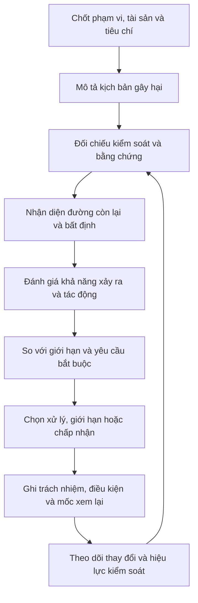

# Đánh giá residual risk trong vòng đời yêu cầu bảo mật

## 1. Residual risk là gì?

**Residual risk**, hay rủi ro tồn dư, là phần rủi ro còn lại sau khi xét tác động của các biện pháp xử lý và kiểm soát trong một phạm vi đã xác định. Một hệ thống có xác thực, phân quyền, mã hóa, audit và sao lưu vẫn có thể bị lạm dụng, gián đoạn hoặc mất dữ liệu do giới hạn của kiểm soát, sai cấu hình, đường truy cập bị bỏ sót hoặc những giả định không còn đúng.

Đánh giá residual risk cần trả lời bốn câu hỏi:

1. Kịch bản gây hại nào vẫn có thể xảy ra?
2. Kiểm soát nào thực sự đang hoạt động, với bằng chứng và giới hạn gì?
3. Khả năng xảy ra và tác động còn lại có phù hợp với tiêu chí chấp nhận không?
4. Ai phải quyết định, cần điều kiện gì và khi nào phải đánh giá lại?

Trong thiết kế yêu cầu bảo mật, kết quả đánh giá không chỉ là một nhãn “thấp”, “trung bình” hoặc “cao”. Nó cần dẫn đến việc hoàn thiện yêu cầu, bổ sung kiểm thử, sửa kiến trúc, giới hạn phạm vi phát hành hoặc ghi nhận quyết định có thẩm quyền về rủi ro còn lại.

Ví dụ, yêu cầu thu hồi quyền trong tối đa 60 giây không được coi là đáp ứng chỉ vì ứng dụng đã cập nhật cơ sở dữ liệu quyền. Nếu URL tải trực tiếp vẫn hoạt động thêm 10 phút, đường tiết lộ dữ liệu sau thu hồi còn tồn tại. Đây là thông tin vừa liên quan đến mức đáp ứng yêu cầu, vừa liên quan đến rủi ro nghiệp vụ.

Các con số, định danh và tình huống trong bài là giả định minh họa. Chúng không phải ngưỡng tuân thủ hoặc tiêu chí chấp nhận chung cho mọi hệ thống.

## 2. Chốt mốc tham chiếu để không nhầm các loại rủi ro

### 2.1. Rủi ro ban đầu, tồn dư hiện tại và tồn dư mục tiêu

Tổ chức có thể dùng thuật ngữ khác nhau cho các mốc đánh giá. Trước khi so sánh, cần ghi rõ mỗi mốc đang giả định những kiểm soát nào.

| Mốc đánh giá | Cách hiểu dùng trong bài | Điều cần công khai |
| --- | --- | --- |
| Rủi ro ban đầu hoặc inherent risk | Rủi ro của kịch bản trước tập biện pháp xử lý đang được xem xét | Có loại trừ mọi kiểm soát hay chỉ tập kiểm soát dự kiến bổ sung? |
| Rủi ro tồn dư hiện tại | Rủi ro còn lại với kiểm soát đang có, xét theo bằng chứng hiện hành | Kiểm soát nào đã xác minh, phần nào còn thiếu bằng chứng? |
| Rủi ro tồn dư mục tiêu | Mức rủi ro dự kiến sau các thay đổi chưa hoàn tất | Giả định thiết kế, điều kiện triển khai và xác minh nào phải đúng? |
| Rủi ro được quyết định chấp nhận | Rủi ro được chủ thể có thẩm quyền đồng ý chịu trong phạm vi và điều kiện xác định | Thẩm quyền, hạn dùng, điều kiện giám sát và đánh giá lại |

Không dùng cùng một nhãn “residual risk” cho cả hiện trạng và thiết kế tương lai mà không ghi mốc. Một kế hoạch giảm rủi ro chưa được triển khai không làm giảm rủi ro hiện tại chỉ vì kế hoạch đã được duyệt.

Nếu tổ chức định nghĩa inherent risk là không có bất kỳ kiểm soát nào, cần áp dụng nhất quán định nghĩa đó. Không so trực tiếp điểm đánh giá theo định nghĩa này với điểm của nhóm khác chỉ loại trừ một số kiểm soát ứng dụng.

### 2.2. Rủi ro tồn dư khác với khoảng trống yêu cầu

**Khoảng trống yêu cầu** là việc một cam kết đang áp dụng chưa được đáp ứng hoặc chưa có đủ bằng chứng đáp ứng. **Rủi ro tồn dư** mô tả khả năng và hậu quả gây hại còn lại trong bối cảnh đó.

Một yêu cầu có thể được kiểm chứng là đáp ứng nhưng vẫn không loại bỏ hết rủi ro. Chẳng hạn, MFA làm khó một số đường chiếm tài khoản, nhưng không tự ngăn người có quyền hợp lệ cố ý xuất dữ liệu ngoài mục đích được phép.

Ngược lại, một yêu cầu chưa đáp ứng có thể cần xử lý ngay dù nhóm đang đánh giá khả năng xảy ra tương đối thấp, nhất là khi đó là điều kiện bắt buộc đã được xác nhận. Nhãn rủi ro không thay cho kết luận đáp ứng yêu cầu.

### 2.3. Chấp nhận rủi ro khác với giảm rủi ro

Chấp nhận là một quyết định chịu trách nhiệm về phần rủi ro còn lại. Nó không tự làm giảm khả năng xảy ra, không tự sửa lỗ hổng và không biến bằng chứng thất bại thành thành công.

Một ngoại lệ có thời hạn cũng không đồng nghĩa yêu cầu đã đạt. Cần theo dõi riêng trạng thái áp dụng, mức đáp ứng, quyết định ngoại lệ và rủi ro tồn dư để báo cáo không che mất khoảng trống.

## 3. Xác định phạm vi và đầu vào đánh giá

Đánh giá phải gắn với một hệ thống hoặc luồng, phiên bản, môi trường, tập dữ liệu, chủ thể và thời điểm cụ thể. Cùng một cơ chế có thể phù hợp cho dữ liệu công khai nhưng không phù hợp cho dữ liệu nhạy cảm của nhiều khách hàng.

### 3.1. Những đầu vào tối thiểu

| Đầu vào | Nội dung cần biết | Nếu thiếu thì ảnh hưởng gì? |
| --- | --- | --- |
| Tài sản và tác động | Dữ liệu, dịch vụ, quyền, chủ thể bị ảnh hưởng và tổn thất nghiệp vụ | Không đánh giá được hậu quả thực tế |
| Kịch bản đe dọa | Chủ thể, tiền điều kiện, đường đi và kết quả gây hại | Đánh giá dễ biến thành nhận xét chung chung |
| Yêu cầu đang áp dụng | Hành vi bắt buộc, tham số, phạm vi và nguồn quyết định | Không biết phần nào chưa đạt hoặc không được phép bỏ |
| Kiến trúc và luồng dữ liệu | API, worker, kho dữ liệu, cache, kênh quản trị và bên tích hợp | Có thể bỏ sót đường vượt kiểm soát |
| Kiểm soát hiện có | Nơi thực thi, cấu hình, trách nhiệm và phụ thuộc | Không biết biện pháp có bao phủ kịch bản không |
| Bằng chứng xác minh | Kiểm thử, đánh giá cấu hình, diễn tập, quan sát vận hành và phiên bản | Không phân biệt thiết kế kỳ vọng với hiệu lực thực tế |
| Tiêu chí rủi ro | Cách đánh giá, mức chấp nhận, thẩm quyền và điều kiện phát hành | Không có căn cứ để kết luận hoặc phê duyệt |
| Thay đổi và khoảng trống | Việc chưa hoàn tất, giả định chưa xác nhận, ngoại lệ hiện hành | Dễ ghi nhận nhầm rủi ro mục tiêu thành hiện tại |

Không cần thu thập mọi tài liệu của hệ thống để bắt đầu. Tuy nhiên, phần thông tin thiếu có ảnh hưởng tới kết luận phải được ghi rõ cùng người xác minh và mốc cần hoàn tất.

### 3.2. Tách khẩu vị rủi ro khỏi giới hạn cụ thể

Khẩu vị rủi ro thể hiện định hướng chung về loại và mức rủi ro tổ chức sẵn sàng chịu để đạt mục tiêu. Giới hạn chấp nhận hoặc ngưỡng chịu đựng cụ thể chuyển định hướng đó thành điều kiện có thể dùng cho một quyết định. Cách dùng thuật ngữ cần theo quy trình của tổ chức.

Ví dụ, định hướng “hạn chế nghiêm ngặt việc lộ dữ liệu qua ranh giới khách hàng” chưa đủ để duyệt một bản phát hành. Cần biết những yêu cầu nào bắt buộc, mức nào phải chuyển cấp phê duyệt và có cho phép ngoại lệ trong tình huống đang xét hay không.

Người đánh giá không tự đặt lại tiêu chí sau khi thấy kết quả bất lợi. Nếu cần đổi tiêu chí, phải có căn cứ, đánh giá tác động và quyết định đúng thẩm quyền.

## 4. Quy trình đánh giá từ kịch bản tới quyết định



### Bước 1: Viết kịch bản có thể phân tích

Mẫu hữu ích là:

> Trong [phạm vi], [chủ thể và khả năng] có thể lợi dụng [điều kiện hoặc đường đi] để gây [kết quả], làm ảnh hưởng [tài sản và chủ thể], trong khi [kiểm soát hiện có hoặc giới hạn].

Ví dụ: người từng có quyền xuất giữ URL đã được cấp và tiếp tục tải báo cáo sau khi quyền bị thu hồi, vì kho tệp không kiểm tra lại quyền nghiệp vụ tại thời điểm cấp nội dung.

Không chỉ ghi “mất dữ liệu” hoặc “rủi ro xác thực”. Cần biết đường đi nào được đánh giá để chọn bằng chứng và biện pháp có liên quan.

### Bước 2: Xác định kiểm soát nào ảnh hưởng tới đường đi

Liệt kê biện pháp ngăn chặn, giới hạn, phát hiện, ứng phó và phục hồi. Nêu rõ chúng tác động vào bước nào và không xử lý bước nào.

MFA tại lúc tạo báo cáo không tự thu hồi URL đã cấp. Mã hóa lưu trữ không ngăn một URL còn hợp lệ trả dữ liệu rõ cho người đang giữ URL. Audit có thể giúp xác định sự cố, nhưng thường không lấy lại dữ liệu đã được tiết lộ.

### Bước 3: Kiểm tra hiệu lực bằng chứng

Đối chiếu thiết kế với cấu hình và hành vi đã quan sát. Bằng chứng phải gắn với phiên bản, môi trường và phạm vi đang đánh giá. Nếu chỉ có đề xuất thiết kế, ghi đó là cơ sở dự báo cho rủi ro mục tiêu, không phải hiệu lực đã chứng minh của hiện trạng.

### Bước 4: Mô tả phần rủi ro còn lại

Sau mỗi kiểm soát, viết lại đường gây hại còn khả thi: ai còn có thể thực hiện, cần điều kiện gì, trong khoảng thời gian nào và gây hậu quả đến đâu. Ghi các giả định có thể làm kết luận đổi, chẳng hạn khả năng chia sẻ URL hoặc quyền xóa bản sao lưu.

### Bước 5: Đánh giá và so với tiêu chí

Dùng phương pháp đã thống nhất để đánh giá khả năng xảy ra, tác động và mức chắc chắn. Sau đó kiểm tra riêng yêu cầu bắt buộc và giới hạn thẩm quyền. Một mức đánh giá tổng hợp không tự cho phép bỏ điều kiện phát hành.

### Bước 6: Chọn hành động và ghi quyết định

Đầu ra cần có hành động, người chịu trách nhiệm, thời hạn, điều kiện xác minh và mốc xem lại. Nếu chưa đủ thông tin để quyết định, ghi trạng thái cần xác minh cùng công việc cụ thể. Không đổi phần chưa biết thành kết luận rủi ro thấp cho tiện báo cáo.

## 5. Đánh giá hiệu lực kiểm soát bằng bằng chứng

### 5.1. Ba lớp câu hỏi về một kiểm soát

Một kiểm soát có thể đúng ý tưởng nhưng triển khai thiếu hoặc suy giảm trong vận hành. Nên tách ba lớp:

1. **Phù hợp về thiết kế:** cơ chế có thực sự xử lý đường gây hại đang xét không?
2. **Đúng về triển khai:** các thành phần, cấu hình và quyền có thực thi thiết kế không?
3. **Duy trì trong vận hành:** kiểm soát có tiếp tục hoạt động khi lỗi phụ thuộc, thay đổi tải, đổi cấu hình hoặc phục hồi không?

| Kiểm soát | Bằng chứng có thể dùng | Điều chưa thể suy ra chỉ từ bằng chứng đó |
| --- | --- | --- |
| Xác thực mạnh | Kiểm thử API từ chối bằng chứng thiếu, quá hạn hoặc không hợp lệ | Không chứng minh mọi thao tác của người đã đăng nhập đều được phép |
| Phân quyền theo tổ chức | Kiểm thử tài nguyên chéo tổ chức và rà soát điểm cấp dữ liệu | Không chứng minh đường quản trị hoặc worker bị bỏ ngoài phạm vi cũng an toàn |
| Thu hồi quyền | Mốc đo từ nguồn quyền tới mọi điểm cấp nội dung, kèm cấu hình cache | Một lần đo tốt không chứng minh mọi điều kiện lỗi đều đạt |
| Audit | Sự kiện tương quan, kiểm tra nội dung, quyền truy cập và lỗi kênh ghi | Có log không đồng nghĩa phát hiện hoặc can thiệp kịp thời |
| Phục hồi | Diễn tập thực tế, kiểm tra dữ liệu, khóa, danh tính và quyền | Sao lưu thành công không tự chứng minh phục hồi nghiệp vụ thành công |

### 5.2. Độ bao phủ quan trọng hơn số lượng biện pháp

Ba lớp kiểm soát cùng kiểm tra tại API tạo tác vụ vẫn có thể bỏ ngỏ đường tải trực tiếp. Không cộng số lượng lớp bảo vệ để suy ra mức giảm rủi ro nếu chúng không bao phủ đường cần bảo vệ.

Kiểm soát cũng có thể phụ thuộc chung. Nếu kiểm tra quyền, audit và cảnh báo đều dùng một danh tính có thể bị chiếm đoạt, một sự cố có thể làm suy yếu nhiều lớp cùng lúc. Khi đánh giá kết hợp, cần xét lỗi chung thay vì giả định các lớp độc lập.

Một biện pháp phát hiện chỉ giảm được phần tác động tiếp tục xảy ra nếu có đường phản ứng đủ nhanh và có quyền can thiệp. Cảnh báo sau khi toàn bộ tệp đã tải xong có giá trị điều tra, nhưng không ngăn được lần tiết lộ đã hoàn tất.

### 5.3. Thiếu bằng chứng không đồng nghĩa không có kiểm soát

Khi không đủ bằng chứng, có thể chưa kết luận được kiểm soát có hiệu lực đến đâu. Cần phân biệt trạng thái chưa được xác minh với đã xác nhận thất bại. Hai trạng thái này có hành động tiếp theo khác nhau nhưng đều không đủ để tuyên bố yêu cầu đã đáp ứng.

Mức bất định lớn có thể làm quyết định cần thận trọng hơn, đặc biệt với tác động nghiêm trọng. Nó không phải lý do tự động gán mức cao nhất trong mọi trường hợp; cần ghi căn cứ và cách xử lý bất định theo tiêu chí đã chọn.

## 6. Đánh giá khả năng xảy ra, tác động và bất định

### 6.1. Khả năng xảy ra phải gắn với điều kiện

Hãy hỏi chủ thể có thể tiếp cận đường đi thế nào, có cần tài khoản hay đặc quyền không, thao tác có thể tự động hóa hoặc lặp lại không, kiểm soát hiện tại cản trở ở đâu và có bằng chứng vận hành nào liên quan.

Một đường chỉ cần tài khoản người dùng thường khác với đường cần chiếm quyền quản trị nền tảng. Tuy nhiên, tiền điều kiện khó đạt không làm tác động của một lần thành công biến mất.

Nếu chưa từng ghi nhận sự cố, cần kiểm tra năng lực phát hiện trước khi suy ra khả năng thấp. Không thấy log của một hành vi có thể là do không có sự kiện được ghi hoặc không giữ đủ dữ liệu để tìm lại.

### 6.2. Tác động cần xét đúng quy mô và thời điểm

Các chiều tác động có thể gồm lộ dữ liệu, thay đổi dữ liệu, gián đoạn nghiệp vụ, mất khả năng quy trách nhiệm và ảnh hưởng tới những chủ thể liên quan. Chọn thước đo phù hợp với tổ chức, chẳng hạn số khách hàng bị ảnh hưởng, loại dữ liệu, thời gian ngừng hoạt động hoặc công việc phục hồi.

Phân biệt giới hạn số lượng với giới hạn hậu quả. Chỉ cho tải một tệp không hẳn là tác động nhỏ nếu tệp chứa toàn bộ hồ sơ nhạy cảm của một tổ chức. Giới hạn thời gian của URL cũng không giới hạn được việc sao chép và giữ dữ liệu sau khi tải thành công.

Phục hồi tốt có thể giảm gián đoạn hoặc mất dữ liệu do phá hoại. Nó không xóa được hậu quả của dữ liệu đã bị đọc trái phép. Vì vậy, không dùng cùng một lập luận giảm tác động cho mọi chiều bảo mật.

### 6.3. Dùng thang định tính một cách nhất quán

Nếu tổ chức dùng thang thấp, trung bình, cao, mỗi mức cần có mô tả đủ cụ thể cho khả năng xảy ra và tác động. Ma trận kết hợp các mức phải được thống nhất trước, cùng quy tắc chuyển cấp và ngoại lệ.

Không tự nhân các mức thứ bậc rồi coi kết quả là xác suất hoặc tổn thất kỳ vọng. Hai kịch bản có cùng nhãn tổng hợp vẫn có thể cần quyết định khác nhau vì một kịch bản ảnh hưởng dữ liệu của nhiều khách hàng hoặc vi phạm điều kiện bắt buộc.

Đánh giá nên ghi ít nhất: mức khả năng, mức tác động, kết luận theo tiêu chí, lý do, mức chắc chắn và các thông tin có thể làm kết luận thay đổi. Việc lưu lý do thường quan trọng hơn một con số đứng riêng.

### 6.4. Tránh phép trừ phần trăm không có cơ sở

Không tính “rủi ro ban đầu 100 điểm, MFA giảm 40%, mã hóa giảm 30%, nên còn 30 điểm” nếu không có mô hình, dữ liệu và quan hệ nhân quả phù hợp. Hiệu lực của biện pháp phụ thuộc đường tấn công, phạm vi, cấu hình và các lỗi chung.

Nếu dùng định lượng, cần xác định đơn vị, khoảng thời gian, phân bố hoặc khoảng ước lượng, dữ liệu đầu vào và các giả định phụ thuộc. Không biến một tỷ lệ kiểm thử đạt thành xác suất hệ thống không bị tấn công.

Trong nhiều quyết định yêu cầu bảo mật, đánh giá định tính có lý do rõ và công khai bất định hữu ích hơn một con số rất chính xác nhưng không có dữ liệu hỗ trợ.

## 7. Ví dụ: rủi ro tải báo cáo sau khi mất quyền

### 7.1. Phạm vi và yêu cầu đang áp dụng

Giả sử nền tảng học tập phục vụ nhiều tổ chức. Quản trị viên yêu cầu xuất báo cáo, worker tạo tệp, ứng dụng cấp URL tải trực tiếp từ kho đối tượng. Báo cáo chứa dữ liệu học viên được tổ chức phân loại là nhạy cảm.

Yêu cầu `SR-REV-01` quy định: với các yêu cầu tải mới, mọi đường cấp nội dung phải phản ánh việc thu hồi quyền trong tối đa 60 giây kể từ lúc thay đổi được ghi nhận thành công tại nguồn quyền có thẩm quyền. Nếu không xác minh được quyền còn hiệu lực, phải từ chối yêu cầu tải mới.

Yêu cầu này không bao gồm việc thu hồi dữ liệu đã tải về. Hành vi của luồng tải đang mở cần được đặc tả riêng nếu nghiệp vụ yêu cầu ngắt luồng.

### 7.2. Kiểm soát và bằng chứng hiện tại

| Thành phần hoặc biện pháp | Điều đã xác minh trong ví dụ | Giới hạn đối với kịch bản |
| --- | --- | --- |
| MFA khi tạo báo cáo | API kiểm tra bằng chứng theo chính sách của thao tác | Không kiểm tra lại người đang giữ URL ở lần tải sau |
| Phân quyền khi tạo tác vụ | Chỉ tạo báo cáo cho tổ chức được phép | Không tự làm mất hiệu lực đường tải đã cấp |
| URL tải trực tiếp | Hết hạn sau 10 phút; không có cơ chế thu hồi theo người dùng trong thiết kế hiện tại | Một URL vừa cấp có thể tiếp tục cho tải mới sau giới hạn 60 giây |
| Mã hóa tại kho lưu trữ | Cấu hình đáp ứng chính sách cho dữ liệu lưu | Kho vẫn trả nội dung rõ qua URL còn hợp lệ |
| Audit tải | Có sự kiện tải nhưng chưa có phản ứng tự động chặn URL theo thu hồi | Hỗ trợ điều tra, không ngăn lần tiết lộ đã hoàn tất |

Thông tin này cho phép kết luận yêu cầu chưa đạt trên đường tải trực tiếp. Không cần đợi một sự cố thật mới ghi nhận khoảng trống đã quan sát được.

### 7.3. Kịch bản tồn dư hiện tại

**Định danh:** RR-EXPORT-01. **Chủ thể:** người từng có quyền hoặc người đã nhận được URL có khả năng cấp nội dung. **Tiền điều kiện:** có URL chưa hết hạn tại thời điểm thu hồi. **Hành vi còn khả thi:** gửi yêu cầu tải mới qua kho đối tượng sau khi người dùng đã mất quyền. **Hậu quả:** tiếp tục nhận dữ liệu nhạy cảm trong thời gian URL còn hiệu lực, rồi có thể giữ bản sao ngoài hệ thống.

Tác động cần dựa trên nội dung và quy mô báo cáo, không chỉ dựa trên cửa sổ 10 phút. Khả năng xảy ra cần xét tần suất cấp URL, khả năng sao chép URL, tình huống thu hồi quyền và khả năng lạm dụng sau khi mất quyền. Các dữ liệu này còn thiếu thì ghi mức chắc chắn tương ứng.

Kết luận quyết định trong ví dụ: chưa đáp ứng điều kiện phát hành `SR-REV-01`; không được gắn nhãn đã đạt chỉ vì API phân quyền và MFA đều đã qua kiểm thử. Mức rủi ro tổng hợp phải được xác định theo tiêu chí tổ chức, không tự suy ra từ thời hạn URL.

### 7.4. Phương án xử lý và rủi ro mục tiêu

Nhóm đề xuất đưa tải qua cổng kiểm tra quyền, giới hạn cache trong ngân sách thu hồi và loại bỏ đường tải trực tiếp còn hiệu lực ngoài kiểm soát. Đường lỗi của nguồn quyền phải từ chối yêu cầu tải mới theo yêu cầu.

Trước khi triển khai và xác minh, đây là cơ sở của **rủi ro tồn dư mục tiêu**. Cần ghi các điều kiện: không còn đường cấp nội dung bỏ qua kiểm tra, mọi cache nằm trong giới hạn, danh tính được xác minh đúng và hành vi lỗi phù hợp.

Giả sử sau thay đổi, kiểm thử trên các đường trong phạm vi quan sát được độ trễ lớn nhất là 45 giây. Kết quả này cung cấp bằng chứng cho những trường hợp đã chạy; nó không tự chứng minh giới hạn tuyệt đối trong mọi tình huống. Cần đánh giá thêm thiết kế giới hạn độ trễ, cấu hình thực tế, trường hợp biên và lỗi phụ thuộc liên quan.

Ngay cả khi yêu cầu 60 giây đã được xác minh phù hợp trong phạm vi, vẫn có thể còn rủi ro: người dùng tải trước khi thu hồi có hiệu lực, người có quyền hợp lệ lạm dụng quyền, hoặc dữ liệu đã ra khỏi hệ thống bị sao chép. Những kịch bản này cần yêu cầu và quyết định riêng nếu nằm trong phạm vi bảo vệ.

### 7.5. Hồ sơ so sánh ba mốc

| Mốc | Điều được phép kết luận | Điều không được suy diễn |
| --- | --- | --- |
| Hiện tại, URL trực tiếp 10 phút | Có đường vi phạm giới hạn thu hồi đã đặc tả | Không thể nói MFA hoặc mã hóa đã làm yêu cầu thu hồi đạt |
| Thiết kế cổng tải chưa hoàn tất | Có phương án giảm đường gây hại, kèm giả định cần chứng minh | Không thể báo rủi ro hiện tại đã giảm theo thiết kế tương lai |
| Sau triển khai và xác minh | Cập nhật đánh giá với bằng chứng và phạm vi thực tế | Không thể nói không còn mọi rủi ro tiết lộ dữ liệu |

## 8. Chuyển kết quả đánh giá thành yêu cầu bảo mật

Phân tích residual risk có giá trị khi phần còn lại được chuyển thành hành vi cần thực thi hoặc quyết định có trách nhiệm. Tránh kết thúc bằng yêu cầu mơ hồ như “tăng cường bảo mật” hoặc “giám sát thêm”.

### 8.1. Phân quyền và thu hồi

**SR-EXP-01 — Kiểm tra quyền trên tài nguyên.** Trước khi cấp nội dung báo cáo, điểm tải phải kiểm tra danh tính người gọi và quyền đối với đúng tổ chức sở hữu tài nguyên. Quan hệ sở hữu phải dựa trên dữ liệu do hệ thống quản lý, không chỉ trên trường do người gọi cung cấp.

**SR-EXP-02 — Giới hạn thu hồi.** Mọi yêu cầu tải mới phải tôn trọng thay đổi quyền trong giới hạn đã chốt, tính từ nguồn quyền tới điểm cấp nội dung. Đặc tả phải liệt kê các đường tải, ngân sách độ trễ và hành vi khi không lấy được quyết định quyền.

Bằng chứng gồm kiểm thử tài nguyên chéo tổ chức, đường tải được tạo trước thu hồi, trạng thái cache, đường trực tiếp và lỗi nguồn quyền. Chỉ đo thời gian cập nhật cơ sở dữ liệu không đủ.

### 8.2. Xác thực và danh tính kỹ thuật

**SR-EXP-03 — Tách danh tính dịch vụ khỏi quyền nghiệp vụ.** Worker phải sử dụng danh tính kỹ thuật có phạm vi phù hợp để truy cập dữ liệu; trước khi xử lý, phải xác nhận tác vụ và người yêu cầu đáp ứng điều kiện nghiệp vụ đã đặc tả. Không coi quyền rộng của worker là bằng chứng người yêu cầu được phép xuất mọi dữ liệu.

Mức xác thực của người dùng cần được đặc tả theo thao tác nhạy cảm và chính sách đã chọn. MFA không phải biện pháp thay thế cho kiểm tra quyền trên tài nguyên.

### 8.3. Bảo vệ dữ liệu và giới hạn hậu quả

**SR-EXP-04 — Bao phủ các bản sao.** Tệp kết quả, tệp tạm và bản sao liên quan trong phạm vi phải tuân theo chính sách truy cập, mã hóa, quản lý khóa và vòng đời dữ liệu đã phê duyệt. Đặc tả cần chỉ ra danh tính nào có thể đọc nội dung rõ và điều kiện xóa hoặc hết hạn.

Nếu cần giới hạn dữ liệu trong báo cáo, nêu trường nào được phép xuất cho từng mục đích và cách kiểm tra. Giảm dữ liệu có thể giảm hậu quả, nhưng không thay thế yêu cầu đúng chủ thể và đúng tổ chức.

### 8.4. Audit, phát hiện và phản ứng

**SR-EXP-05 — Dấu vết có thể liên hệ.** Quyết định tạo báo cáo, xử lý, cho phép tải và từ chối tải phải có sự kiện liên hệ được chủ thể thực hiện, người yêu cầu nếu khác, tổ chức đích, tài nguyên, kết quả và thời điểm. Không ghi token, URL chứa bí mật hoặc nội dung báo cáo vào log.

**SR-EXP-06 — Phản ứng có điều kiện đo.** Nếu dùng phát hiện để giới hạn rủi ro, cần đặc tả riêng điều kiện phát hiện, mốc bắt đầu đo, thời hạn phát tín hiệu, người nhận, khả năng can thiệp và hành vi khi kênh quan sát lỗi. Không gọi thời gian gửi thông báo là thời gian đã ngăn được sự cố.

### 8.5. Phục hồi và trạng thái quyền

**SR-EXP-07 — Phục hồi an toàn.** Trước khi mở lại chức năng cấp nội dung sau phục hồi, phải đối chiếu hiệu lực quyền và đường tải với nguồn quyết định hiện hành. Tài nguyên không xác nhận được điều kiện cho phép phải bị từ chối hoặc vô hiệu hóa theo thiết kế đã chốt.

Mục tiêu thời gian và điểm phục hồi phải gắn với chức năng nghiệp vụ, phạm vi mất mát và mốc đo. Diễn tập cần bao gồm dữ liệu, khóa, danh tính và cấu hình cần thiết, không chỉ việc khôi phục các bảng dữ liệu.

## 9. Chọn phương án xử lý rủi ro còn lại

Các phương án có thể phối hợp, nhưng mỗi phương án cần chỉ ra phần rủi ro nó xử lý.

| Phương án | Ví dụ | Điều cần giữ rõ |
| --- | --- | --- |
| Tránh hoặc bỏ hoạt động gây rủi ro | Chưa mở chức năng tải trực tiếp trong bản phát hành này | Kiểm tra không còn đường phụ tạo cùng hậu quả |
| Giảm rủi ro | Thêm kiểm tra quyền tại điểm tải và giới hạn cache | Hiệu lực cần được xác minh trước khi ghi nhận kết quả |
| Giới hạn phạm vi | Chỉ cho xuất tập dữ liệu đã tối thiểu hóa trong điều kiện được duyệt | Không tự kết luận dữ liệu còn lại là không nhạy cảm |
| Chia sẻ hoặc chuyển một phần | Dùng dịch vụ có trách nhiệm bảo vệ đã thỏa thuận | Hợp đồng và nhà cung cấp không tự loại bỏ trách nhiệm tích hợp hoặc mọi hậu quả |
| Chấp nhận | Đồng ý chịu phần rủi ro đã mô tả theo thẩm quyền | Không làm yêu cầu chưa đạt thành đạt, cần điều kiện và mốc xem lại |

Đánh giá phương án nên xét mức giảm dự kiến, thời gian thực hiện, chi phí vận hành, phụ thuộc và rủi ro mới. Ví dụ, cổng tải kiểm tra quyền có thể làm giảm đường sử dụng URL cũ nhưng cũng cần thiết kế tính sẵn sàng và hành vi khi nguồn quyền lỗi.

Không gọi mọi biện pháp bổ sung là kiểm soát bù tương đương. Nếu mục tiêu gốc là ngăn tiết lộ dữ liệu, việc chỉ tăng thời gian giữ log thường không đạt cùng mục tiêu. Cần chỉ ra phần được bù, phần chưa được bù và điều kiện cho phép phương án thay thế.

Khi một nghĩa vụ áp dụng không cho phép bỏ hoặc thay thế yêu cầu, phê duyệt rủi ro nội bộ không tự tạo quyền miễn trừ. Đơn vị có trách nhiệm về nghĩa vụ cần xác nhận điều kiện áp dụng và phương án được phép.

## 10. Hồ sơ chấp nhận rủi ro và ngoại lệ có thời hạn

### 10.1. Nội dung cần có để quyết định có thể xem lại

| Trường hồ sơ | Nội dung cần ghi |
| --- | --- |
| Định danh và phiên bản | Bản ghi rủi ro, lần đánh giá và lịch sử thay đổi |
| Phạm vi | Chức năng, dữ liệu, tổ chức, môi trường, bản dựng và cấu hình |
| Kịch bản còn lại | Chủ thể, tiền điều kiện, hành vi và hậu quả sau kiểm soát |
| Yêu cầu liên quan | Cam kết nào đã đạt, chưa đạt hoặc chưa đủ bằng chứng |
| Kiểm soát và bằng chứng | Thiết kế, thực thi, kết quả, ngày đánh giá và giới hạn |
| Mức đánh giá | Khả năng, tác động, mức tổng hợp theo tiêu chí, lý do và bất định |
| Phương án đã xem xét | Hướng giảm, tránh, giới hạn hoặc chia sẻ; lý do chọn hoặc chưa chọn |
| Rủi ro hiện tại và mục tiêu | Tách rõ hiện trạng với kỳ vọng sau thay đổi |
| Người sở hữu và người duyệt | Vai trò, thẩm quyền và trách nhiệm theo dõi |
| Điều kiện có hiệu lực | Biện pháp tạm thời, giới hạn sử dụng và bằng chứng cần duy trì |
| Thời hạn và kích hoạt xem lại | Ngày hết hạn, sự cố, thay đổi dữ liệu hoặc kiến trúc |
| Kế hoạch khắc phục | Công việc, người thực hiện, mốc hoàn thành và điều kiện đóng |
| Hành vi khi điều kiện mất | Dừng chức năng, thu hẹp phạm vi hoặc chuyển cấp theo quyết định đã duyệt |

Một chữ ký hoặc nhãn “business accepted” thiếu phạm vi và điều kiện không giải thích được người duyệt đã đồng ý chịu điều gì. Không giả định người có quyền duyệt lịch phát hành cũng có quyền chấp nhận mọi loại rủi ro.

### 10.2. Chấp nhận lâu dài và ngoại lệ tạm thời

Một phần rủi ro có thể được chấp nhận như đặc tính còn lại của hoạt động, trong giới hạn và quy trình xem lại của tổ chức. Một khoảng trống đang có kế hoạch khắc phục thường cần ngoại lệ tạm thời nếu được phép. Không nên để ngoại lệ tự gia hạn vô hạn mà không đánh giá lại.

Ví dụ, nếu chỉ cho phép thử nghiệm với dữ liệu giả lập và người dùng nội bộ đã chỉ định, hồ sơ phải nêu giới hạn đó. Khi chuyển sang dữ liệu thật hoặc mở thêm khách hàng, quyết định cũ không mặc nhiên còn hiệu lực.

### 10.3. Ai làm gì?

- Người phụ trách kỹ thuật giải thích thiết kế, hiện trạng, khả năng khắc phục và các phụ thuộc.
- Người xác minh đánh giá bằng chứng và giới hạn kết luận.
- Nhóm bảo mật hoặc quản lý rủi ro phân tích kịch bản, tiêu chí và phần tồn dư.
- Người sở hữu dữ liệu hoặc nghiệp vụ làm rõ tác động và chịu trách nhiệm trong phạm vi được giao.
- Người có thẩm quyền phê duyệt quyết định theo quy trình và giới hạn của tổ chức.

Các vai trò có thể được tổ chức khác nhau, nhưng người triển khai không nên tự coi kết quả kỹ thuật là quyết định chấp nhận rủi ro thay cho người có trách nhiệm.

## 11. Gắn đánh giá với quyết định phát hành và truy vết

### 11.1. Giữ chuỗi từ rủi ro tới bằng chứng

```text
RR-EXPORT-01: tải sau thu hồi
  -> SR-REV-01: giới hạn thu hồi trên mọi đường cấp nội dung
  -> Thiết kế cổng tải, nguồn quyền và cache
  -> Tiêu chí về đường cũ, đường trực tiếp và lỗi phụ thuộc
  -> Kết quả theo bản dựng, cấu hình và môi trường
  -> Đánh giá tồn dư cập nhật
  -> Quyết định phát hành hoặc xử lý khoảng trống
```

Từ một bằng chứng cần tìm được yêu cầu và rủi ro mà nó hỗ trợ. Từ một thay đổi thiết kế cần tìm được những kết luận phải xem lại. Không dùng đường dẫn tới “kết quả mới nhất” thay cho tham chiếu tới lần đánh giá cụ thể khi cần giải thích quyết định phát hành trước đây.

### 11.2. Điều kiện quyết định cần được kiểm tra riêng

Trước phát hành, phân biệt các trường hợp:

| Tình trạng | Hướng xử lý cần xem xét |
| --- | --- |
| Yêu cầu bắt buộc chưa đạt, không có cơ chế ngoại lệ phù hợp | Sửa, bỏ đường vi phạm hoặc giới hạn phạm vi phát hành |
| Thiếu bằng chứng ảnh hưởng kết luận quan trọng | Xác minh thêm hoặc giữ quyết định ở trạng thái chưa đủ cơ sở |
| Rủi ro trong giới hạn nhưng vẫn còn khoảng trống yêu cầu | Xử lý khoảng trống theo quy trình, không tự đánh dấu yêu cầu đạt |
| Ngoại lệ được phép và còn hiệu lực | Kiểm tra phạm vi, điều kiện, biện pháp tạm thời và thẩm quyền |
| Yêu cầu đã đạt nhưng rủi ro tồn dư vượt giới hạn | Tăng biện pháp, thay hoạt động hoặc chuyển cấp quyết định |

Không lấy tỷ lệ yêu cầu đã kiểm thử đạt để suy ra tỷ lệ rủi ro đã loại bỏ. Một yêu cầu phân quyền chưa đạt có thể quyết định toàn bộ điều kiện phát hành dù nhiều yêu cầu khác đã hoàn tất.

### 11.3. Rủi ro tổng hợp và phụ thuộc chung

Nhiều kịch bản có thể cùng chịu ảnh hưởng từ một nguồn quyền, khóa, danh tính quản trị hoặc dịch vụ audit. Khi từng rủi ro được xem riêng, có thể bỏ qua tác động đồng thời của một sự cố chung.

Không cộng hoặc lấy trung bình các nhãn rủi ro thứ bậc để tạo một kết luận tổng thể. Cần xem các phụ thuộc, tổ hợp sự cố có ý nghĩa và giới hạn nghiệp vụ chung. Nếu không đủ dữ liệu để định lượng, mô tả rõ kịch bản tổng hợp cần xử lý.

## 12. Theo dõi residual risk sau quyết định

Một đánh giá đúng tại thời điểm duyệt có thể không còn đúng khi dữ liệu, tải, chủ thể hoặc kiến trúc thay đổi. Theo dõi cần tập trung vào giả định và hiệu lực kiểm soát đã dùng để ra quyết định.

### 12.1. Tín hiệu theo dõi hữu ích

| Điều cần duy trì | Tín hiệu có thể quan sát | Giới hạn diễn giải |
| --- | --- | --- |
| Hiệu lực thu hồi | Độ trễ theo các đường cấp nội dung, lỗi đồng bộ và trạng thái cache | Không chỉ nhìn trung bình nếu yêu cầu là giới hạn tối đa |
| Đúng phạm vi quyền | Lần từ chối chéo tổ chức, thay đổi chính sách, đường truy cập mới | Ít lần từ chối không tự chứng minh ít lạm dụng |
| Tính đầy đủ audit | Khoảng trống sự kiện, lỗi kênh ghi, độ trễ tra cứu | Log có mặt không đồng nghĩa phản ứng kịp thời |
| Bảo vệ bản sao | Kho hoặc tệp ngoài danh mục, thay đổi quyền và khóa | Cấu hình kho chính không chứng minh mọi bản sao được bảo vệ |
| Khả năng phục hồi | Kết quả diễn tập, bản sao có thể đọc, khóa và danh tính cần thiết | Sao lưu thành công chưa đủ chứng minh phục hồi an toàn |
| Điều kiện ngoại lệ | Hạn dùng, phạm vi người dùng, dữ liệu và công việc khắc phục | Không tự gia hạn khi điều kiện hoặc người chịu trách nhiệm đổi |

Theo dõi phải có người nhận, hành động và điều kiện chuyển cấp. Một bảng chỉ số không được xem lại hoặc không dẫn tới can thiệp không đủ cơ sở để ghi nhận tác dụng giảm rủi ro.

### 12.2. Những sự kiện cần đánh giá lại

- Thêm loại dữ liệu, khách hàng, vai trò hoặc mục đích sử dụng.
- Thêm API, đường tải trực tiếp, kênh quản trị hoặc tích hợp bên ngoài.
- Đổi nguồn quyền, cache, cơ chế xác thực hoặc thời hạn truy cập.
- Đổi quyền quản lý khóa, kho sao lưu hoặc quy trình phục hồi.
- Có sự cố, kết quả kiểm thử hoặc quan sát làm sai giả định cũ.
- Biện pháp tạm thời suy giảm, ngoại lệ hết hạn hoặc kế hoạch khắc phục trễ.
- Tiêu chí nghiệp vụ hoặc nghĩa vụ áp dụng đã được xác nhận có thay đổi.

Chu kỳ xem lại định kỳ có thể bổ sung cho các kích hoạt này. Chu kỳ cần phù hợp với mức rủi ro và tốc độ thay đổi; không nên chờ tới kỳ xem lại khi đã có bằng chứng quan trọng làm kết luận cũ mất hiệu lực.

## 13. Các lỗi thường gặp khi đánh giá rủi ro tồn dư

| Biểu hiện | Vì sao sai hoặc chưa đủ | Cách sửa |
| --- | --- | --- |
| Có MFA, mã hóa và log nên rủi ro thấp | Chưa chỉ ra các biện pháp xử lý đường gây hại nào | Đối chiếu từng bước của kịch bản và bằng chứng hiệu lực |
| Kế hoạch đã duyệt nên ghi mức mục tiêu là mức hiện tại | Biện pháp có thể chưa hoạt động hoặc chưa được xác minh | Tách hiện trạng, mục tiêu và điều kiện chuyển mốc |
| Không có sự cố nên khả năng thấp | Có thể thiếu phát hiện hoặc dữ liệu quan sát | Đánh giá khả năng tiếp cận và năng lực phát hiện |
| URL chỉ sống vài phút nên hậu quả nhỏ | Một lần tải có thể lộ dữ liệu lớn và giữ được lâu dài | Đánh giá nội dung, quy mô và hậu quả sau tải |
| Cảnh báo thay cho ngăn truy cập | Có thể chỉ phát hiện sau tổn thất không đảo ngược | Đánh giá thời gian phát hiện, can thiệp và phần tác động còn ngăn được |
| Một lần đo đạt nên bảo đảm mọi trường hợp | Chưa bao phủ đường khác, lỗi và điều kiện biên | Kết hợp thiết kế, cấu hình và kiểm thử theo phạm vi |
| Điểm thấp cho phép bỏ yêu cầu bắt buộc | Trộn đánh giá rủi ro với thẩm quyền về yêu cầu | Kiểm tra riêng tính áp dụng và cơ chế ngoại lệ |
| Người triển khai tự chấp nhận phần còn lại | Có thể không có thẩm quyền chịu rủi ro nghiệp vụ | Xác định người sở hữu và người phê duyệt phù hợp |
| Chấp nhận một lần rồi không xem lại | Điều kiện đã thay đổi có thể làm rủi ro tăng | Ghi hạn dùng, kích hoạt và người theo dõi |
| Dùng tỷ lệ test pass làm tỷ lệ giảm rủi ro | Số ca đạt không biểu diễn xác suất hoặc tác động | Theo dõi bằng chứng và đánh giá kịch bản bằng tiêu chí phù hợp |

## 14. Thực hành và điều kiện bàn giao đánh giá

### 14.1. Bài tập phân tích

Một hệ thống cấp quyền hỗ trợ tạm thời trong 30 phút. Quyền có phê duyệt, nhân viên phải dùng MFA và hoạt động được ghi audit. Tuy nhiên, token ở một công cụ hỗ trợ vẫn có hiệu lực 8 giờ, chưa có cơ chế thu hồi ngay. Bản sao lưu cấu hình được tạo mỗi ngày, và nhóm chưa diễn tập trường hợp phục hồi làm xuất hiện lại quyền đã bị thu hồi.

Hãy thực hiện:

1. Chọn phạm vi, tài sản, chủ thể và kịch bản gây hại cụ thể.
2. Tách kiểm soát đã xác minh, kiểm soát mới có mô tả và giả định chưa kiểm tra.
3. Viết rủi ro tồn dư hiện tại, giải thích giới hạn của MFA và audit đối với token còn hiệu lực.
4. Xác định thông tin cần để đánh giá khả năng xảy ra, tác động và mức chắc chắn.
5. Viết yêu cầu đo được cho hết hạn hoặc thu hồi trên công cụ hỗ trợ; nêu mốc bắt đầu, kết thúc và hành vi lỗi.
6. Đề xuất phương án giảm rủi ro và ghi rõ rủi ro mục tiêu cùng điều kiện cần xác minh.
7. Thiết kế kiểm tra phục hồi quyền và phân biệt mục tiêu thời gian phục hồi với điều kiện mở lại an toàn.
8. Lập hồ sơ quyết định, nêu người có thẩm quyền, thời hạn và việc phải làm nếu điều kiện tạm thời mất hiệu lực.

Không đủ cơ sở để kết luận rủi ro thấp chỉ từ thời hạn cấp quyền 30 phút. Cần kiểm tra mọi đường thực thi quyền, bao gồm token, phiên, công cụ phụ và trạng thái khôi phục từ bản sao cũ.

### 14.2. Điểm kiểm tra trước khi bàn giao

- Phạm vi, phiên bản, dữ liệu và thời điểm đánh giá đã rõ.
- Kịch bản có chủ thể, tiền điều kiện, đường đi và hậu quả cụ thể.
- Mốc rủi ro ban đầu, hiện tại và mục tiêu được định nghĩa nhất quán.
- Kiểm soát được đánh giá về thiết kế, triển khai, vận hành và phụ thuộc chung.
- Bằng chứng phù hợp với phiên bản và không bị diễn giải vượt phạm vi.
- Khả năng xảy ra, tác động, lý do và bất định được ghi riêng đủ để xem lại.
- Khoảng trống yêu cầu được phân biệt với mức rủi ro và quyết định chấp nhận.
- Phương án xử lý có người phụ trách, thời hạn và điều kiện xác minh.
- Thẩm quyền, điều kiện ngoại lệ và giới hạn nghĩa vụ được kiểm tra.
- Liên kết tới yêu cầu, thiết kế, kiểm thử và quyết định phát hành được giữ.
- Có tín hiệu theo dõi, mốc hết hạn và điều kiện đánh giá lại.

Một đánh giá residual risk có thể sử dụng được khi người ra quyết định hiểu điều gì vẫn có thể xảy ra, bằng chứng nào hỗ trợ kết luận và mình đang chịu trách nhiệm cho phạm vi nào. Kết quả cần tiếp tục sống cùng yêu cầu và kiến trúc, thay vì trở thành một nhãn rủi ro được giữ nguyên sau mọi thay đổi.
