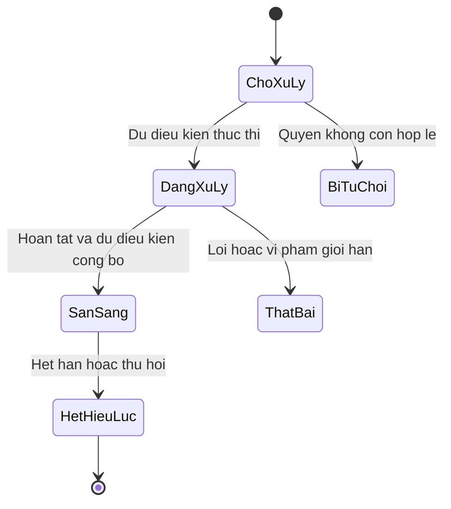

# Boundary test: kiểm thử biên của yêu cầu bảo mật

## 1. Boundary test kiểm tra điều gì?

**Boundary test** kiểm tra hành vi tại và gần những điểm mà quy tắc của hệ thống thay đổi. Một giá trị có thể hợp lệ ở phía này nhưng không hợp lệ ở phía kia; một quyền có thể còn hiệu lực trước một thời điểm nhưng hết hiệu lực ngay tại thời điểm đó. Sai khác rất nhỏ ở biên có thể tạo ra hậu quả lớn nếu đó là điểm quyết định xác thực, phân quyền hoặc tiết lộ dữ liệu.

Ví dụ, hệ thống cho phép tối đa 5 tác vụ xuất đang chạy cho một tổ chức. Nếu kiểm tra sai điều kiện hoặc cập nhật không nguyên tử, tác vụ thứ 6 vẫn có thể được nhận. Nếu thời hạn tải được hiểu khác nhau giữa API và kho lưu trữ, một đường tải có thể tiếp tục cấp dữ liệu khi đường khác đã từ chối.

Trong kiểm thử yêu cầu bảo mật, mục tiêu không chỉ là tìm lỗi lệch một đơn vị. Cần xác nhận rằng hệ thống thực thi đúng giới hạn đã đặc tả, không tạo tác dụng phụ khi từ chối và không bỏ sót một đường truy cập nằm trong phạm vi yêu cầu.

Bài học sử dụng hai góc nhìn có liên quan nhưng cần phân biệt:

- **Phân tích giá trị biên:** kiểm tra quanh điểm bắt đầu, kết thúc hoặc ngưỡng của một miền giá trị có thứ tự.
- **Kiểm tra ranh giới bảo vệ:** kiểm tra chuyển tiếp giữa chủ thể, tổ chức, tài nguyên, vai trò hoặc vùng tin cậy. Đây không nhất thiết là bài toán giá trị nhỏ hơn hay lớn hơn một số.

Sau bài học, người học có thể chuyển một yêu cầu bảo mật thành mô hình biên, chọn dữ liệu thử, viết kết quả mong đợi và đánh giá giới hạn của bằng chứng. Các số liệu và quy tắc trong ví dụ là giả định cho bài học, cần được quyết định lại theo bối cảnh thực tế.

## 2. Biến câu chữ yêu cầu thành mô hình biên

### 2.1. Ghi rõ miền, đơn vị và điều kiện so sánh

Trước khi viết kiểm thử, hãy tìm những từ như “tối đa”, “ít nhất”, “trước”, “không quá”, “hết hạn”, “chỉ”, “cùng tổ chức” và “sau khi thu hồi”. Mỗi từ cần được chuyển thành điều kiện đủ rõ để kết luận đúng hoặc sai.

| Thành phần cần đặc tả | Câu hỏi cần trả lời | Ví dụ |
| --- | --- | --- |
| Đại lượng hoặc thuộc tính | Đang so sánh cái gì? | Số tác vụ đang chạy, kích thước tệp, tuổi bằng chứng xác thực |
| Miền giá trị | Số nguyên, thời điểm, chuỗi hay một tập vai trò? | Số lượng là số nguyên, không phải số thực bất kỳ |
| Đơn vị và độ phân giải | Byte hay ký tự? Giây hay mili giây? | Giới hạn tệp tính theo byte sau giải mã lớp truyền |
| Biên và tính bao gồm | Giá trị đúng bằng ngưỡng có được phép không? | Kích thước bằng giới hạn được chấp nhận |
| Nguồn có thẩm quyền | Giá trị nào được tin cậy để quyết định? | Đồng hồ máy chủ, tổ chức sở hữu trong dữ liệu hệ thống |
| Điểm thực thi | Kiểm tra tại giao diện, API, worker hay kho dữ liệu? | Mọi đường cấp nội dung thuộc phạm vi đều phải kiểm tra |
| Trạng thái và thời điểm | Quy tắc dùng lúc tạo, xử lý hay tải? | Quyền có thể bị thu hồi giữa lúc xếp hàng và thực thi |
| Hành vi lỗi | Không đo hoặc không xác minh được thì làm gì? | Từ chối tải mới khi không xác minh được quyền |

“Tệp không được quá lớn” chưa đủ để tạo kiểm thử biên. “Phần nội dung tài liệu sau giải mã lớp truyền có kích thước tối đa B byte” đã rõ hơn, nhưng vẫn cần hành vi khi vượt giới hạn, cách xử lý luồng và chính sách với nội dung nén nếu được hỗ trợ.

### 2.2. Một điều kiện biên có thể có nhiều lớp

Một yêu cầu tải có thể đồng thời cần danh tính hợp lệ, quyền đúng tổ chức, thời hạn chưa hết và tài nguyên chưa bị xóa. Kiểm tra từng điều kiện riêng giúp tìm lỗi cục bộ; kiểm tra tổ hợp giúp tìm sai thứ tự, nhánh bỏ qua hoặc lỗi trạng thái.

Không mặc định điều kiện ở giao diện là điều kiện bảo vệ cuối cùng. Người kiểm thử cần gọi đường xử lý phía máy chủ trực tiếp trong môi trường được phép, đồng thời kiểm tra worker, đường quản trị hoặc đường tải khác nếu yêu cầu áp dụng cho các đường đó.

## 3. Chọn giá trị quanh biên số

### 3.1. Khoảng số nguyên có hai đầu bao gồm

Giả sử API nhận tham số số hàng mỗi trang theo yêu cầu:

> `pageSize` phải là số nguyên trong khoảng từ 1 đến 100, bao gồm hai đầu. Giá trị ngoài khoảng phải bị từ chối, không tự động đổi thành giá trị gần nhất.

Tập dữ liệu biên cơ bản gồm:

| Giá trị | Vị trí | Kết quả mong đợi |
| --- | --- | --- |
| 0 | Ngay dưới cận dưới | Từ chối |
| 1 | Đúng cận dưới | Chấp nhận |
| 2 | Ngay trong cận dưới | Chấp nhận |
| 99 | Ngay trong cận trên | Chấp nhận |
| 100 | Đúng cận trên | Chấp nhận |
| 101 | Ngay trên cận trên | Từ chối |

Với khoảng ngắn, một số điểm có thể trùng nhau; lấy tập giá trị duy nhất thay vì tạo nhiều ca giống hệt chỉ để đủ số lượng. Nên có một giá trị đại diện ở giữa để xác nhận đường hợp lệ thông thường, nhưng nó không thay thế các ca ở biên.

Nếu yêu cầu cho phép chuẩn hóa hoặc giới hạn tự động thay vì từ chối, kết quả mong đợi phải theo đúng quy tắc đã phê duyệt. Không tự chọn hành vi thuận tiện cho kiểm thử khi yêu cầu chưa quyết định.

### 3.2. Biên không phải lúc nào cũng cách nhau một đơn vị

Với số nguyên, điểm liền kề thường là `b - 1`, `b`, `b + 1`. Với thời gian hoặc số có phần thập phân, cần chọn bước theo độ phân giải thật của hợp đồng và cơ chế lưu trữ. Không dùng một giá trị epsilon tùy ý rồi mặc định đó là giá trị liền kề của hệ thống.

Nếu API nhận mili giây nhưng tầng lưu trữ làm tròn xuống giây, cần kiểm tra cách chuyển đổi tại biên. Nếu dữ liệu dùng số thập phân có độ chính xác cố định, chọn điểm biểu diễn được theo độ chính xác đó. Không dùng sai số số thực để hợp thức hóa một quy tắc bảo mật vốn cần giới hạn chính xác.

### 3.3. Giá trị xa biên và biểu diễn không hợp lệ là lớp bổ sung

Với `pageSize`, còn cần xem số âm, giá trị rất lớn, số có phần lẻ, chuỗi, `null` và trường bị thiếu. Những ca này kiểm tra miền đầu vào và xử lý biểu diễn, không phải tất cả đều là giá trị biên theo nghĩa hẹp.

Giá trị rất lớn có thể làm lộ lỗi ép kiểu hoặc tràn khi chuyển đổi. Kết quả đúng không chỉ là “không trả dữ liệu”: hệ thống không được chuyển thành một giá trị được phép ngoài ý muốn, bỏ qua giới hạn hoặc làm hỏng trạng thái xử lý.

## 4. Biên dữ liệu: thiếu, rỗng, Unicode và chuẩn hóa

### 4.1. Không gộp mọi dạng rỗng thành một trường hợp

Các đầu vào sau có thể có ý nghĩa khác nhau:

- Không có trường trong yêu cầu.
- Có trường nhưng giá trị là `null`.
- Chuỗi rỗng hoặc chỉ chứa khoảng trắng.
- Danh sách rỗng hoặc danh sách có phần tử rỗng.
- Giá trị được cung cấp nhưng không phân tích được theo kiểu đã đặc tả.

Nếu trường không có được thay bằng mặc định, cần kiểm tra mặc định đó có an toàn và có đúng hợp đồng không. Nếu trường tổ chức đích bị thiếu, việc dùng tổ chức trước đó trong cache có thể tạo truy cập sai phạm vi.

Số bản ghi trả về bằng 0 cũng không đồng nghĩa đầu vào sai. Một truy vấn hợp lệ có thể không tìm được dữ liệu. Phân biệt miền tham số với số lượng kết quả để tránh đặt kết quả mong đợi sai.

### 4.2. Ký tự, code point, đơn vị UTF-16 và byte không giống nhau

Nếu yêu cầu giới hạn độ dài mà không nói cách đếm, kiểm thử chưa có cơ sở rõ ràng. Những chuỗi trông ngắn vẫn có thể có nhiều cách biểu diễn.

| Chuỗi minh họa | Số Unicode code point | Số đơn vị UTF-16 | Số byte UTF-8 |
| --- | --- | --- | --- |
| `A` | 1 | 1 | 1 |
| `é` dưới dạng U+00E9 | 1 | 1 | 2 |
| `e` rồi U+0301 | 2 | 2 | 3 |
| `🙂` dưới dạng U+1F642 | 1 | 2 | 4 |

Trong Java, `String.length()` đếm đơn vị UTF-16, không phải số byte UTF-8 hoặc số ký tự người dùng nhìn thấy. Ngay cả số code point cũng có thể khác số cụm ký tự hiển thị.

Nếu giới hạn là byte, tạo dữ liệu thử sao cho **số byte thực tế** nằm ngay dưới, đúng và ngay trên ngưỡng. Nếu giới hạn là số cụm ký tự hiển thị, cần một quy tắc phân đoạn được thống nhất; không lấy kết quả của một phép đếm khác làm thay thế.

### 4.3. Chuẩn hóa cần nhất quán giữa các tầng

Những bước như bỏ khoảng trắng, giải mã, chuẩn hóa Unicode hoặc đổi chữ hoa chữ thường có thể làm giá trị thay đổi trước khi được so sánh. Cần biết kiểm tra giới hạn áp dụng trước hay sau bước nào.

Ví dụ, nếu định danh được chuẩn hóa trước khi kiểm tra duy nhất, kiểm thử phải dùng các đầu vào khác nhau nhưng có thể về cùng dạng chuẩn. Nếu chính sách không cho phép biến đổi một loại bí mật hoặc định danh, không tự thêm chuẩn hóa vào kết quả mong đợi.

Với dữ liệu không hợp lệ về mã hóa, cần kiểm tra hành vi theo hợp đồng tại điểm tiếp nhận. Không để một tầng thay ký tự lỗi trong khi tầng khác từ chối hoặc diễn giải khác, rồi dùng các cách hiểu khác nhau để kiểm tra quyền.

## 5. Biên thời gian của xác thực, hết hạn và thu hồi

### 5.1. Thời hạn hiệu lực có điểm bắt đầu và kết thúc

Giả sử một quyền tạm thời có khoảng hiệu lực:

```text
notBefore <= now < expiresAt
```

Quyền bắt đầu có hiệu lực tại `notBefore`, hết hiệu lực đúng tại `expiresAt`. Đây là quy tắc được chọn cho ví dụ, không được áp dụng ngầm cho mọi loại thời hạn.

Với độ phân giải mili giây, các ca cần có:

| Điểm kiểm tra | Kết quả theo quy tắc ví dụ |
| --- | --- |
| 1 ms trước `notBefore` | Chưa có hiệu lực |
| Đúng `notBefore` | Có hiệu lực |
| 1 ms sau `notBefore` | Có hiệu lực nếu chưa hết hạn |
| 1 ms trước `expiresAt` | Có hiệu lực |
| Đúng `expiresAt` | Hết hiệu lực |
| 1 ms sau `expiresAt` | Hết hiệu lực |

Nếu có độ lệch đồng hồ được chấp nhận, phải ghi rõ cách áp dụng và ngưỡng; sau đó kiểm tra quanh biên đã được điều chỉnh. Không thêm khoảng dung sai vào ca kiểm thử chỉ vì môi trường chạy thiếu ổn định.

### 5.2. Độ mới của xác thực có thể có tính bao gồm khác

Yêu cầu “MFA hoàn thành không quá 10 phút trước thao tác” có thể được đặc tả là:

```text
0 <= now - authenticatedAt <= 10 phút
```

Tại đúng 10 phút, bằng chứng vẫn đáp ứng điều kiện độ mới của ví dụ. Tại 10 phút cộng một đơn vị thời gian theo hợp đồng, phải yêu cầu xử lý theo nhánh xác thực lại hoặc từ chối đã đặc tả.

Cần kiểm tra cả thời điểm xác thực nằm trong tương lai. Không coi một tuổi âm là “còn rất mới” nếu hợp đồng không cho phép. Danh tính, tính toàn vẹn và nguồn của thời điểm xác thực phải được xác minh ở lớp phù hợp; phép so sánh thời gian riêng lẻ không chứng minh bằng chứng là đáng tin cậy.

### 5.3. Giới hạn độ trễ thu hồi khác với thời điểm hết hạn

Giả sử yêu cầu quy định mọi yêu cầu tải mới phải phản ánh việc thu hồi trong tối đa 60 giây kể từ khi thay đổi được ghi nhận thành công tại nguồn quyền có thẩm quyền, gọi mốc đó là `T0`.

| Thời điểm | Cách đánh giá |
| --- | --- |
| Trước `T0 + 60 giây` | Hệ thống có thể đã từ chối sớm; không được bắt buộc nó phải tiếp tục cho phép |
| Đúng `T0 + 60 giây` | Phải từ chối yêu cầu tải mới của chủ thể đã mất quyền |
| Sau `T0 + 60 giây` | Tiếp tục phải từ chối, không được sống lại qua cache hoặc đường khác |

Đây là một giới hạn hoàn tất lan truyền, không phải cam kết cho phép truy cập suốt 60 giây. Viết kiểm thử bắt buộc thành công ở giây 59 sẽ đặt ra hành vi mà yêu cầu không hề đòi hỏi.

Mốc đo phải bao gồm mọi độ trễ trong phạm vi: cập nhật, lan truyền, cache, token hoặc đường tải đã cấp. Nếu URL trực tiếp không thể bị vô hiệu hóa trong giới hạn, việc API từ chối đúng hạn chưa đủ để toàn yêu cầu đạt.

### 5.4. Yêu cầu tải mới khác với luồng đang mở

Một yêu cầu về thu hồi cho tải mới không tự xác định có phải ngắt luồng dữ liệu đang truyền hay không. Nếu cần ngắt, đặc tả thời điểm kiểm tra, phần dữ liệu có thể đã gửi và giới hạn can thiệp.

Dữ liệu đã tải về trước khi bị thu hồi không thể được lấy lại chỉ bằng thay đổi quyền phía máy chủ. Kết quả mong đợi cần phản ánh giới hạn này để không tạo một cam kết không thể chứng minh bằng kiểm thử hệ thống hiện tại.

## 6. Biên hạn mức, bộ đếm và xử lý đồng thời

### 6.1. Phân biệt số hiện có với số sau khi nhận thêm

Giả sử mỗi tổ chức được phép có tối đa 5 tác vụ đang chạy. Nếu thao tác mới sẽ làm tăng bộ đếm một đơn vị, điều kiện nhận là số đang chạy **nhỏ hơn 5**, sau đó dành chỗ và tăng số đếm một cách nhất quán.

| Số đang chạy trước yêu cầu | Kết quả mong đợi |
| --- | --- |
| 0 | Có thể nhận nếu đáp ứng các điều kiện khác |
| 4 | Nhận một tác vụ, tổng thành 5 |
| 5 | Từ chối hoặc xếp chờ theo chính sách; không làm tổng đang chạy thành 6 |
| Lớn hơn 5 | Phát hiện trạng thái vi phạm hoặc xử lý phục hồi theo đặc tả; không âm thầm coi là bình thường |

Kiểm tra đúng biểu thức ở một hàm chưa đủ. Hai yêu cầu đồng thời có thể cùng thấy số 4 rồi cùng được nhận nếu đọc, kiểm tra và dành chỗ không được bảo đảm nguyên tử theo thiết kế.

### 6.2. Ca kiểm thử đồng thời tại biên

Một ca tích hợp có thể chuẩn bị tổ chức A đang có 4 tác vụ và đồng thời gửi hai yêu cầu hợp lệ, dùng điểm đồng bộ kiểm thử để hai yêu cầu tranh cùng một chỗ còn lại.

Kết quả cần xác nhận:

- Không có thời điểm xử lý nào được phép làm tổng tác vụ đang chạy của A vượt 5 theo quy tắc đã chốt.
- Chỉ một yêu cầu được nhận vào trạng thái đang chạy; yêu cầu còn lại có hành vi đúng chính sách.
- Không tạo hai tài nguyên, hai khoản giữ chỗ hoặc trạng thái nửa chừng ngoài ý muốn.
- Khi một yêu cầu thất bại hoặc bị hủy, chỗ dành được giải phóng đúng quy tắc.
- Hạn mức của tổ chức B không bị giảm nhầm bởi bộ đếm của A.

Không kết luận an toàn chỉ từ một lần chạy không thấy lỗi. Cần xem cơ chế nguyên tử, phạm vi giao dịch hoặc phối hợp phân tán, cùng những trường hợp thử lại và lỗi giữa các bước có liên quan.

### 6.3. Biên cửa sổ giới hạn tốc độ

Với giới hạn số yêu cầu theo thời gian, cần biết cửa sổ cố định hay trượt, đơn vị tính theo tài khoản hay tổ chức, thời điểm ghi nhận và quy tắc với yêu cầu bị từ chối.

Một hệ thống cửa sổ cố định có thể cho hành vi khác cửa sổ trượt ở ngay trước và sau mốc chuyển cửa sổ. Kết quả mong đợi phải theo thuật toán và mục tiêu đã được đặc tả, không theo một bộ dữ liệu biên dùng chung cho mọi bộ giới hạn.

Thử thay danh tính, phiên hoặc điểm tiếp nhận trong phạm vi được phép nếu yêu cầu phải giữ hạn mức thống nhất qua các đường đó. Giới hạn trên giao diện hoặc một nút ứng dụng có thể không đáp ứng yêu cầu trên toàn hệ thống.

## 7. Biên kích thước, luồng và phục hồi

### 7.1. Đo đúng lớp dữ liệu

Giả sử phần nội dung tài liệu được phép có tối đa `B = 1.048.576` byte sau khi giải mã lớp truyền. Tạo dữ liệu thử có kích thước thực tế `B - 1`, `B`, `B + 1` byte tại lớp đó.

Không dùng toàn bộ kích thước yêu cầu mạng thay cho kích thước tài liệu nếu hợp đồng loại trừ phần bao gói. Không tin riêng trường khai báo độ dài nếu hệ thống cần bảo vệ theo số byte thực tế đã nhận.

Nếu cho phép nội dung nén, cần các giới hạn riêng phù hợp cho dữ liệu nén, dữ liệu sau giải nén và tài nguyên xử lý. Một tệp nhỏ trên đường truyền có thể tạo đầu ra lớn; kiểm thử giới hạn trước giải nén không chứng minh giới hạn sau giải nén.

### 7.2. Biên không trùng với ranh giới từng khối truyền

Với xử lý luồng, byte làm vượt ngưỡng có thể xuất hiện giữa một khối hoặc đúng lúc chuyển khối. Tạo những cách chia khối khác nhau nhưng giữ cùng nội dung để kiểm tra tổng kích thước được tính nhất quán.

Khi vượt giới hạn, kiểm tra cả việc dừng tiếp nhận theo thiết kế, dọn tệp tạm, hoàn trả hạn mức và không công bố tài nguyên chưa hoàn chỉnh như tài nguyên hợp lệ. Một phản hồi lỗi đúng nhưng vẫn để lại tệp có thể tải là thất bại bảo mật.

### 7.3. Biên của mục tiêu phục hồi

Kiểm thử biên cũng áp dụng cho yêu cầu phục hồi. Ví dụ, nếu điểm dữ liệu phục hồi không được cũ hơn 15 phút so với thời điểm gián đoạn, cần xác định điểm dữ liệu nào là cơ sở và kiểm tra các mức ngay dưới, đúng và vượt giới hạn.

Với thời gian phục hồi, phải định nghĩa mốc bắt đầu và chức năng tối thiểu cần hoạt động lại. Hoàn tất sao chép tệp chưa chắc đồng nghĩa nghiệp vụ đã sẵn sàng, có khóa giải mã, đúng danh tính và đúng phân quyền.

Một diễn tập hoàn tất sớm hơn giới hạn cung cấp bằng chứng cho kịch bản đã chạy. Nó không chứng minh mọi tình huống mất mát đều phục hồi trong giới hạn. Khi cần, kết hợp diễn tập với đánh giá thiết kế, phụ thuộc và năng lực vận hành.

## 8. Ranh giới chủ thể, tổ chức và tài nguyên

### 8.1. Đây là biên quyền, không phải phép cộng trừ định danh

Với yêu cầu phân quyền, điểm quan trọng là quan hệ giữa chủ thể và tài nguyên. Định danh lớn hơn hoặc nhỏ hơn một đơn vị không tự phản ánh biên quyền.

Một ma trận kiểm tra có thể gồm:

| Chủ thể | Tài nguyên | Quan hệ | Kết quả mong đợi theo yêu cầu |
| --- | --- | --- | --- |
| Quản trị viên A | Báo cáo của A | Đúng tổ chức, đủ quyền | Cho phép nếu các điều kiện khác hợp lệ |
| Quản trị viên A | Báo cáo của B | Khác tổ chức | Từ chối, không tiết lộ nội dung |
| Thành viên thường A | Báo cáo của A | Cùng tổ chức, thiếu quyền xuất | Từ chối |
| Người vừa bị thu hồi | Báo cáo trước đây được phép | Quyền không còn hiệu lực | Theo giới hạn thu hồi đã đặc tả |
| Worker | Tác vụ yêu cầu dữ liệu B nhưng đăng ký cho A | Thông tin quan hệ không khớp | Không xử lý theo đặc quyền rộng của worker |

Biết định danh tài nguyên không phải bằng chứng được phép truy cập. Kiểm thử nên chuẩn bị tài nguyên tồn tại ngoài phạm vi của chủ thể, thay vì chỉ gửi định danh không tồn tại rồi coi phản hồi lỗi là phân quyền đúng.

### 8.2. Kiểm tra cả phản hồi và tác dụng phụ

Một yêu cầu bị từ chối không được tạo báo cáo ngầm, cấp URL, tăng quyền hoặc gửi thông báo chứa dữ liệu nhạy cảm. Cần quan sát cơ sở dữ liệu, hàng đợi, kho tệp hoặc các hiệu ứng nghiệp vụ tương ứng trong phạm vi kiểm thử.

Thông báo lỗi phải theo hợp đồng và không tiết lộ dữ liệu ngoài quyền. Không mặc định mọi hệ thống phải dùng cùng một mã phản hồi để tránh lộ sự tồn tại; điều cần thiết là quy tắc rõ, nhất quán và được xác minh phù hợp.

Kiểm tra cache cũng phải theo đúng ranh giới. Một kết quả cho phép của người A hoặc tổ chức A không được tái sử dụng cho người B hoặc tổ chức B chỉ vì cùng định danh cục bộ hoặc cùng đường gọi.

## 9. Tổ hợp biên và chuyển trạng thái

### 9.1. Chọn tổ hợp theo đường gây hại

Kiểm tra từng chiều độc lập có thể bỏ sót lỗi chỉ xuất hiện khi các điều kiện cùng xảy ra. Những tổ hợp đáng chú ý gồm:

- Quyền vừa hết hạn đúng lúc worker bắt đầu đọc dữ liệu.
- Hai yêu cầu tranh chỗ cuối cùng trong hạn mức của cùng tổ chức.
- Tệp vượt một byte nhưng đã tạo bản ghi và gửi sự kiện hoàn tất.
- Người dùng bị thu hồi, cache vẫn còn kết quả cũ và dịch vụ quyền tạm lỗi.
- Phục hồi bản sao cũ làm xuất hiện lại tài nguyên hoặc quyền đã hết hiệu lực.

Không cần chạy tích Descartes của mọi giá trị trong mọi chiều. Có thể dùng phân vùng và chọn tổ hợp có lý do, nhưng phải giữ các tổ hợp nhiều điều kiện cần thiết để tái hiện đường lạm dụng quan trọng. Bao phủ từng cặp không bảo đảm phát hiện lỗi cần ba điều kiện đồng thời.

### 9.2. Vẽ trạng thái trước khi viết ca thử



Sơ đồ là ví dụ để thảo luận, không phải quy tắc mặc định cho mọi tác vụ. Cần đặc tả điều gì xảy ra nếu quyền đổi trong trạng thái đang xử lý hoặc nếu thất bại được thử lại. Không để thử lại chuyển tài nguyên đã hết hiệu lực trở về trạng thái tải được nếu không có điều kiện cho phép tương ứng.

### 9.3. Kiểm tra điều kiện tại thời điểm có ý nghĩa

Kiểm tra quyền lúc nhận yêu cầu không tự bảo đảm quyền còn hợp lệ lúc worker dùng dữ liệu hoặc lúc cấp nội dung. Đây là vấn đề thay đổi trạng thái giữa kiểm tra và sử dụng.

Ca kiểm thử cần điều khiển được thứ tự sự kiện: tạo tác vụ, giữ worker ở điểm chờ, thay đổi quyền, rồi cho worker tiếp tục. Kết quả mong đợi phải theo yêu cầu đã chốt về thời điểm đánh giá lại quyền, không theo thời điểm thuận tiện cho triển khai.

## 10. Thiết kế một ca kiểm thử biên có thể kết luận

### 10.1. Ghi rõ điều kiện và nguồn kết quả mong đợi

Một ca thử cần tối thiểu:

1. Định danh yêu cầu và phiên bản áp dụng.
2. Biên, miền, đơn vị và tính bao gồm đang kiểm tra.
3. Dữ liệu, chủ thể, tài nguyên và trạng thái ban đầu.
4. Hành động cùng điểm thực thi được gọi.
5. Kết quả chức năng, dữ liệu và tác dụng phụ mong đợi.
6. Sự kiện audit hoặc tín hiệu vận hành bắt buộc nếu thuộc yêu cầu.
7. Cách điều khiển thời gian, đồng thời hoặc lỗi phụ thuộc.
8. Điều kiện dọn dữ liệu và bằng chứng cần lưu.

Nếu không thể viết kết quả mong đợi tại đúng ngưỡng, đó có thể là khoảng trống đặc tả. Ghi câu hỏi và hoàn thiện yêu cầu trước khi dùng ca thử làm điều kiện chấp nhận.

### 10.2. Ví dụ danh mục truy vết

| Ca thử | Yêu cầu minh họa | Điểm biên | Điều phải chứng minh |
| --- | --- | --- | --- |
| BT-PAGE-01 | SR-PAGE-01 | 0, 1, 2, 99, 100, 101 | Miền số nguyên và tính bao gồm hai đầu |
| BT-TIME-01 | SR-TEMP-01 | Trước, đúng, sau hết hạn | Không cấp quyền từ đúng thời điểm hết hạn |
| BT-FRESH-01 | SR-AUTH-01 | Tuổi 10 phút và ngay sau | Độ mới xác thực theo quy tắc đã chốt |
| BT-REV-01 | SR-REV-01 | Tại và sau hạn lan truyền | Mọi đường tải mới phản ánh thu hồi |
| BT-QUOTA-01 | SR-QUOTA-01 | Chỗ cuối cùng có hai yêu cầu đồng thời | Không vượt hạn mức, không rò chỗ dành |
| BT-SIZE-01 | SR-DATA-01 | B - 1, B, B + 1 byte | Giới hạn đúng lớp dữ liệu, không để lại tài nguyên hợp lệ ngoài ý muốn |
| BT-AZ-01 | SR-AZ-01 | Cùng và khác tổ chức, đủ và thiếu quyền | Quyền trên tài nguyên, không chỉ tính tồn tại |
| BT-STATE-01 | SR-JOB-01 | Thu hồi giữa xếp hàng và xử lý | Đánh giá quyền ở thời điểm yêu cầu quy định |

Tên ca thử và số lượng liên kết không tự chứng minh bao phủ. Cần đọc dữ liệu, bước thực hiện và kết quả để biết từng cam kết đã được xác minh đến đâu.

## 11. Tự động hóa thời gian bằng đồng hồ điều khiển được

### 11.1. Ví dụ Java cho điều kiện hiệu lực

Đoạn mã sau minh họa kiểm tra khoảng hiệu lực `notBefore <= now < expiresAt` bằng đồng hồ cố định. Nó chỉ kiểm tra điều kiện thời gian; không thực hiện xác minh chữ ký, danh tính, quyền tài nguyên hay thu hồi.

```java
import java.time.Clock;
import java.time.Instant;
import java.time.ZoneOffset;

public final class BoundaryTimeExample {
    static boolean isWithinWindow(
            Clock clock, Instant notBefore, Instant expiresAt) {
        Instant now = clock.instant();
        return !now.isBefore(notBefore) && now.isBefore(expiresAt);
    }

    static void verify(
            Instant now,
            Instant notBefore,
            Instant expiresAt,
            boolean expected) {
        Clock clock = Clock.fixed(now, ZoneOffset.UTC);
        boolean actual = isWithinWindow(clock, notBefore, expiresAt);
        if (actual != expected) {
            throw new AssertionError("Unexpected result at " + now);
        }
    }

    public static void main(String[] args) {
        Instant start = Instant.parse("2030-01-01T10:00:00Z");
        Instant end = start.plusSeconds(600);

        verify(start.minusMillis(1), start, end, false);
        verify(start, start, end, true);
        verify(start.plusMillis(1), start, end, true);
        verify(end.minusMillis(1), start, end, true);
        verify(end, start, end, false);
        verify(end.plusMillis(1), start, end, false);
    }
}
```

Không dùng khoảng ngủ để cố bắt đúng thời điểm hết hạn trong kiểm thử đơn vị. Đồng hồ điều khiển được giúp kiểm tra đúng điểm và tránh phụ thuộc tốc độ máy chạy. Dữ liệu đầu vào không hợp lệ, thứ tự hai mốc và hành vi lỗi cần hợp đồng và ca thử riêng nếu hàm hoặc lớp tiếp nhận chịu trách nhiệm xử lý chúng.

### 11.2. Giới hạn của kiểm thử hàm thuần

Hàm thời gian đúng không chứng minh toàn luồng đúng. Tầng gọi có thể không dùng hàm đó, truyền thời điểm từ nguồn không tin cậy, làm tròn sai hoặc bỏ qua kiểm tra trên một đường khác.

Vì vậy, nên có các lớp bằng chứng phù hợp: kiểm thử đơn vị cho điều kiện, kiểm thử tích hợp cho chuyển đổi và nguồn thời gian, kiểm thử hệ thống cho các đường thực thi thuộc phạm vi. Chọn lớp theo yêu cầu và rủi ro, không sao chép cùng một ca qua mọi lớp chỉ để tăng số lượng.

## 12. Thu thập bằng chứng và tránh kết quả thiếu ổn định

### 12.1. Ghi đủ ngữ cảnh của một lần thực thi

Bằng chứng nên có phiên bản yêu cầu, ca thử, bản dựng, cấu hình, môi trường, dữ liệu biên, đơn vị đo và kết quả. Với biên thời gian, cần mốc đo đáng tin cậy; với đồng thời, cần thứ tự hoặc điểm đồng bộ có thể giải thích.

Giữ riêng các trạng thái đạt, không đạt, chưa chạy, bị chặn và chỉ xác minh một phần. Không coi ca bị bỏ qua hoặc không chuẩn bị được dữ liệu là đạt. Nếu kỳ vọng còn mơ hồ, ghi khoảng trống yêu cầu thay vì sửa kỳ vọng theo kết quả đang có.

### 12.2. Không làm mờ biên để che môi trường thiếu ổn định

Một phép đo có độ bất định lớn hơn khoảng cần phân biệt sẽ không đủ cơ sở kết luận tại biên. Cần cải thiện cách điều khiển hoặc đo, chọn lớp kiểm thử phù hợp, hay ghi kết luận giới hạn; không tự nới ngưỡng yêu cầu.

Trong hệ thống phân tán, phải biết đồng hồ nào làm cơ sở và độ lệch nào có thể ảnh hưởng phép đo. Dùng trung bình hoặc phân vị không chứng minh một cam kết tối đa cho mọi yêu cầu nếu hợp đồng không được viết theo phân vị.

Khi phát hiện lỗi không ổn định, giữ bằng chứng và tìm nguyên nhân. Chạy lại đến khi có một lần xanh rồi bỏ kết quả đỏ sẽ che chính lỗi tranh chấp hoặc thời gian mà kiểm thử biên cần tìm.

### 12.3. Kiểm tra cả audit và dữ liệu nhạy cảm

Nếu yêu cầu đòi ghi nhận quyết định bị từ chối, ca biên nên xác minh sự kiện có đủ chủ thể, tài nguyên, kết quả và định danh tương quan phù hợp. Không ghi token, bí mật hoặc dữ liệu khách hàng vào báo cáo chỉ để chứng minh ca thử.

Một ca từ chối đúng nhưng log chứa nội dung bị cấm vẫn có thể vi phạm yêu cầu khác. Truy vết các kết quả riêng để không che một thất bại bằng một thành công trên cùng yêu cầu mạng.

## 13. Các lỗi thường gặp

| Lỗi | Hệ quả | Cách sửa |
| --- | --- | --- |
| Chỉ thử giá trị ngay ngoài khoảng | Không phát hiện từ chối sai ở đúng cận | Kiểm tra dưới, đúng và trong biên phù hợp |
| Không quyết định dấu bằng | Kỳ vọng khác nhau giữa các nhóm | Đặc tả tính bao gồm trước khi chốt ca thử |
| Dùng số ký tự thay cho byte | Giới hạn có thể sai với dữ liệu đa byte | Đo đúng đơn vị và lớp dữ liệu |
| Gộp thiếu, null và rỗng | Bỏ sót nhánh mặc định hoặc nhánh xử lý riêng | Phân vùng biểu diễn theo hợp đồng |
| Dùng đồng hồ thật và ngủ | Ca thử dễ thiếu ổn định, không chạm đúng biên | Điều khiển thời gian tại lớp phù hợp |
| Bắt buộc cho phép trước hạn thu hồi | Tạo cam kết mà yêu cầu không có | Phân biệt thời hạn hoàn tất với khoảng phải còn quyền |
| Chỉ thử một yêu cầu khi gần đầy | Bỏ lỗi tranh chấp chỗ cuối cùng | Kiểm tra đồng thời và cơ chế dành chỗ |
| Chỉ nhìn mã phản hồi | Bỏ tệp tạm, tác vụ hoặc quyền đã tạo ngoài ý muốn | Kiểm tra trạng thái và tác dụng phụ |
| Chỉ dùng tài nguyên không tồn tại | Không chứng minh từ chối tài nguyên thật ngoài quyền | Chuẩn bị tài nguyên ngoài phạm vi của chủ thể |
| Giao diện chặn nên coi API đạt | Có đường gọi trực tiếp bỏ qua kiểm tra | Kiểm tra tại điểm thực thi yêu cầu |
| Một đường đạt nên đóng toàn yêu cầu | Bỏ worker, đường trực tiếp hoặc kênh quản trị | Liệt kê các đường trong phạm vi và bằng chứng tương ứng |
| Sửa ngưỡng kiểm thử theo kết quả | Hợp thức hóa lỗi hoặc làm yếu yêu cầu | Đánh giá lại yêu cầu theo quy trình nếu thật sự cần đổi |

## 14. Thực hành và điều kiện bàn giao

### 14.1. Bài tập thiết kế ca thử

Một hệ thống cấp quyền hỗ trợ cho đúng một tổ chức trong 30 phút. Nhân viên phải có bằng chứng MFA không quá 10 phút trước thao tác cấp quyền. Mỗi tổ chức chỉ được có tối đa 3 phiên hỗ trợ đang hoạt động. Khi quyền bị thu hồi, mọi yêu cầu đọc dữ liệu mới phải phản ánh thay đổi trong tối đa 60 giây. Tệp xuất có giới hạn kích thước được nghiệp vụ xác nhận; quyền và cấu hình có thể được khôi phục từ bản sao lưu.

Hãy thực hiện:

1. Chỉ ra các biên giá trị, thời gian, bộ đếm, trạng thái và quyền truy cập.
2. Ghi quy tắc bao gồm hoặc loại trừ tại từng thời điểm; nêu phần nào còn cần làm rõ.
3. Tạo dữ liệu ngay dưới, đúng và ngay trên mỗi ngưỡng có thứ tự.
4. Phân biệt mốc hết hạn 30 phút với giới hạn lan truyền thu hồi 60 giây.
5. Thiết kế ca hai yêu cầu tranh chỗ cuối cùng trong hạn mức 3 phiên.
6. Thiết kế ca tài nguyên tồn tại nhưng thuộc tổ chức khác, kể cả đường tải đã cấp trước đó.
7. Định nghĩa kích thước tệp theo đơn vị và lớp dữ liệu, rồi kiểm tra vượt giới hạn cùng tác dụng phụ.
8. Kiểm tra phục hồi không làm sống lại quyền đã hết hiệu lực; ghi nguồn quyền hiện hành cần đối chiếu.
9. Liên kết từng ca với yêu cầu, bằng chứng cần lưu và trạng thái kết luận.

Không cần giả định mọi biến thể đều đang có lỗi. Mục tiêu là tạo những ca có khả năng phân biệt đúng sai theo yêu cầu và bao phủ các đường gây hại quan trọng.

### 14.2. Điểm kiểm tra khi bàn giao bộ kiểm thử biên

- Các biên có miền, đơn vị, độ phân giải và tính bao gồm rõ ràng.
- Kết quả mong đợi được suy từ yêu cầu đã xác nhận, không từ hành vi hiện tại.
- Có dữ liệu tại và quanh biên, cùng các dạng thiếu hoặc sai kiểu có liên quan.
- Biên thời gian dùng nguồn thời gian và mốc đo phù hợp.
- Hạn mức được kiểm tra với đồng thời, thử lại và lỗi giữa các bước nếu thuộc phạm vi.
- Ranh giới tổ chức, chủ thể và tài nguyên được kiểm tra bằng dữ liệu tồn tại thật trong môi trường thử.
- Các chuyển trạng thái quan trọng và tổ hợp có cơ sở rủi ro được bao phủ.
- Từ chối không tạo tác dụng phụ hoặc làm lộ dữ liệu ngoài hợp đồng.
- Có truy vết tới yêu cầu và bằng chứng theo phiên bản thực thi.
- Những giới hạn đo, đường chưa kiểm tra và câu hỏi đặc tả còn mở được ghi nhận.

Một bộ boundary test hữu ích phải chỉ ra chính xác nơi quy tắc đổi, hành vi bắt buộc tại điểm đó và bằng chứng quan sát được. Giá trị của nó nằm ở việc chứng minh giới hạn bảo vệ được thực thi đúng trên phạm vi yêu cầu, đồng thời làm lộ những điều kiện còn chưa được đặc tả đủ rõ.
