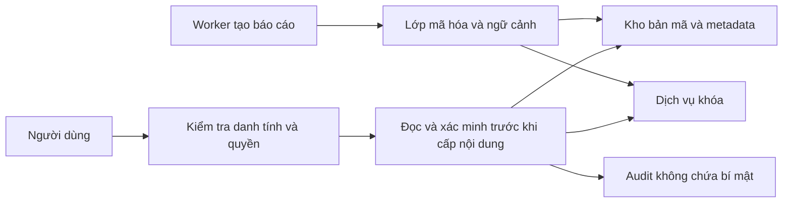

# Cryptography test: kiểm chứng yêu cầu sử dụng mật mã trong hệ thống

## 1. Kiểm thử mật mã nhằm chứng minh điều gì?

**Cryptography test** trong kiểm thử yêu cầu bảo mật là tập hoạt động xác minh rằng hệ thống dùng các cơ chế mật mã đúng mục đích, đúng chính sách và đúng phạm vi đã đặc tả. Nó không chỉ kiểm tra một hàm mã hóa có giải mã lại được dữ liệu hay không.

Một phép thử mã hóa rồi giải mã thành công chưa trả lời được những câu hỏi quan trọng: dữ liệu bị sửa có bị từ chối không, ngữ cảnh của tổ chức có được ràng buộc đúng không, ai có thể dùng khóa, khóa cũ có còn phục hồi được bản sao lưu, và lỗi dịch vụ khóa có làm ứng dụng chuyển sang lưu dữ liệu rõ hay không?

Trong module yêu cầu bảo mật, đầu ra cần là bằng chứng gắn với từng cam kết về bí mật, toàn vẹn, xác thực nguồn, danh tính kết nối và vòng đời khóa. Những bằng chứng đó phục vụ quyết định thiết kế và phát hành; chúng không phải chứng minh toán học rằng một thuật toán an toàn trước mọi đối thủ.

Sau bài học, người học có thể:

- Chuyển mục tiêu bảo vệ thành yêu cầu mật mã có điều kiện chấp nhận rõ.
- Tách kiểm thử primitive, tích hợp thư viện, giao thức và luồng nghiệp vụ.
- Thiết kế ca đúng, ca sai và ca lỗi cho mã hóa, xác minh, khóa và kết nối.
- Xác định điều không thể kết luận chỉ từ kiểm thử chức năng hoặc mẫu dữ liệu.
- Liên kết bằng chứng với rủi ro, kiến trúc, cấu hình và phiên bản triển khai.

Các thuật ngữ, định danh và cấu hình trong ví dụ phục vụ việc học. Khi triển khai thực tế, thuật toán, tham số và thời hạn phải theo chính sách mật mã được tổ chức phê duyệt cho thời điểm, dữ liệu và môi trường áp dụng.

## 2. Bắt đầu từ mục tiêu và yêu cầu, không từ tên thuật toán

### 2.1. Phân biệt các thuộc tính cần bảo vệ

| Mục tiêu | Cơ chế có thể liên quan | Điều phải được kiểm chứng |
| --- | --- | --- |
| Bí mật dữ liệu | Mã hóa lưu trữ hoặc truyền tải | Chủ thể không có quyền không nhận được dữ liệu rõ qua các đường trong phạm vi |
| Toàn vẹn và xác thực dữ liệu | Mã hóa có xác thực, MAC hoặc chữ ký | Sửa dữ liệu hoặc dùng sai ngữ cảnh bị phát hiện và xử lý đúng |
| Xác minh phía kết nối | Cơ chế xác thực trong kênh bảo vệ | Đúng đối tác và đúng danh tính mong đợi, không chỉ có kênh mã hóa |
| Bảo vệ mật khẩu lưu trữ | Hàm dẫn xuất hoặc băm mật khẩu theo chính sách | Lưu đúng định dạng, tham số và xác minh đúng mật khẩu |
| Cô lập quyền dùng khóa | Dịch vụ khóa, danh tính và chính sách truy cập | Chỉ danh tính được cấp quyền dùng đúng thao tác, đúng khóa |
| Khả năng phục hồi | Bản sao mã hóa, khóa và cấu hình cần thiết | Khôi phục được dữ liệu hợp lệ mà không mở sai quyền truy cập |

Mã hóa không thay thế phân quyền. Một người dùng không được phép vẫn có thể nhận dữ liệu rõ nếu ứng dụng giải mã và trả dữ liệu mà không kiểm tra quyền. Ngược lại, dữ liệu đã mã hóa không tự có tính toàn vẹn nếu cơ chế được chọn không cung cấp thuộc tính đó hoặc ứng dụng bỏ qua kết quả xác minh.

### 2.2. Ví dụ yêu cầu có thể xác minh

| Định danh | Cam kết minh họa | Bằng chứng cần có |
| --- | --- | --- |
| CR-01 | Tệp báo cáo phải dùng cơ chế bảo vệ bí mật và toàn vẹn được chính sách cho phép | Cấu hình, đường gọi thực tế, kiểm thử sửa dữ liệu và xử lý lỗi |
| CR-02 | Bản mã phải được ràng buộc với đúng tổ chức, tài nguyên và phiên bản định dạng | Kiểm thử đổi ngữ cảnh, đổi tài nguyên và đường kiểm tra quyền |
| CR-03 | Chỉ danh tính được phép mới dùng được thao tác mật mã tương ứng với khóa | Kiểm tra chính sách và thử danh tính ngoài phạm vi |
| CR-04 | Việc sinh và dùng nonce phải đáp ứng quy tắc của cơ chế đã chọn | Đánh giá thiết kế, kiểm tra đồng thời, khởi động lại và khôi phục trạng thái |
| CR-05 | Mọi kết nối thuộc phạm vi phải đáp ứng chính sách kênh bảo vệ và xác minh đúng phía đối tác | Kiểm thử kết nối hợp lệ, sai danh tính và cấu hình không được phép |
| CR-06 | Xoay vòng khóa không làm bản ghi được phép giữ trở nên không thể đọc ngoài dự kiến | Kiểm thử dữ liệu cũ, dữ liệu mới, quyền và phục hồi |
| CR-07 | Mật khẩu phải được lưu bằng cơ chế dẫn xuất hoặc băm mật khẩu theo chính sách, không lưu dạng rõ | Kiểm tra bản ghi, tham số và hành vi xác minh |

Các câu trên là bản tóm tắt. Đặc tả đầy đủ cần chỉ ra phạm vi dữ liệu, lớp thực thi, chính sách và phiên bản, nguồn có thẩm quyền, hành vi lỗi và tiêu chí chi tiết. Không dùng cụm “mã hóa mạnh” làm kết quả mong đợi duy nhất.

## 3. Tổ chức các lớp kiểm thử và nguồn kết quả mong đợi

### 3.1. Không tự viết primitive để phục vụ sản phẩm

Ứng dụng thường tích hợp thư viện hoặc dịch vụ mật mã đã được lựa chọn và đánh giá. Công việc kiểm thử tập trung vào việc lựa chọn, cấu hình và sử dụng đúng, cùng hành vi của toàn luồng. Một nhóm ứng dụng không nên xem việc tự viết thuật toán rồi cho vài dữ liệu mẫu chạy qua là thay thế cho đánh giá mật mã chuyên môn.

| Lớp xác minh | Câu hỏi chính | Giới hạn |
| --- | --- | --- |
| Primitive hoặc provider | Kết quả có khớp bộ vector tham chiếu được chọn không? | Không chứng minh ứng dụng quản lý khóa và quyền đúng |
| Lớp tích hợp | Chế độ, tham số, định dạng và lỗi được xử lý đúng không? | Có thể chưa bao phủ cấu hình triển khai thật |
| Dịch vụ và quyền khóa | Danh tính nào dùng được khóa, khi nào và qua thao tác nào? | Chính sách đúng chưa chứng minh không có bản rõ trong luồng khác |
| Giao thức kết nối | Có xác minh đúng đối tác, chính sách và điều kiện bắt tay không? | Kết nối đúng không tự chứng minh phân quyền nghiệp vụ |
| Luồng đầu cuối | Dữ liệu được bảo vệ từ tiếp nhận tới lưu, đọc, xuất và phục hồi ra sao? | Chỉ bao phủ phiên bản, cấu hình và kịch bản đã đánh giá |

### 3.2. Vector tham chiếu khác với phép thử vòng kín

Phép thử vòng kín có dạng giải mã kết quả vừa mã hóa rồi so với đầu vào. Nó hữu ích để kiểm tra tương thích cơ bản, nhưng hai phía cùng sai theo một cách vẫn có thể cho kết quả khớp.

Vector tham chiếu có kết quả đã biết giúp đối chiếu độc lập hơn. Hồ sơ kiểm thử cần ghi nguồn, phiên bản, bộ dữ liệu và cơ chế cụ thể được vector bao phủ. Không dùng một vector cho chế độ hoặc định dạng khác rồi coi đó là xác minh đầy đủ.

Với cơ chế ngẫu nhiên hoặc phụ thuộc nonce, muốn so sánh chính xác kết quả cần bộ đầu vào cố định đúng theo định nghĩa phép thử. Không đưa nonce hoặc khóa cố định của bộ kiểm thử vào cấu hình sản phẩm.

### 3.3. Mock chỉ chứng minh được phần hợp đồng mà nó mô phỏng

Mock dịch vụ khóa có thể giúp thử nhánh timeout, từ chối quyền hoặc định dạng phản hồi. Nó không chứng minh chính sách quyền thật, khóa thật hay hành vi của dịch vụ đang triển khai.

Nên phân biệt kiểm thử dùng đối tượng thay thế với kiểm thử tích hợp dùng khóa thử nghiệm và cấu hình được kiểm soát. Mỗi kết quả cần ghi lớp nào đã được xác minh, tránh dùng một ca với mock để đóng yêu cầu về quyền dùng khóa trong môi trường thật.

## 4. Kiểm thử mã hóa có xác thực và ràng buộc ngữ cảnh

### 4.1. Kiểm tra đường hợp lệ nhưng không dừng ở đó

Với cơ chế mã hóa có xác thực, thường cần kiểm tra dữ liệu rõ, bản mã, nonce, thẻ xác thực và dữ liệu liên kết nếu cơ chế có sử dụng. Dữ liệu liên kết, thường gọi là AAD, được xác thực cùng bản mã nhưng không vì thế mà được giữ bí mật.

Một tập ca cơ bản gồm:

- Mã hóa và giải mã đúng dữ liệu với khóa và ngữ cảnh hợp lệ.
- Dữ liệu rỗng nếu hợp đồng cho phép, dữ liệu có byte bằng không và dữ liệu nhị phân.
- Dữ liệu Unicode và dữ liệu đi qua các bước tuần tự hóa thực tế.
- Bản mã bị đổi, thiếu, cắt cụt hoặc ghép thêm dữ liệu theo từng lớp định dạng.
- Thẻ xác thực thiếu, sai độ dài hoặc bị thay đổi.
- Nonce sai hoặc ngữ cảnh liên kết khác với lúc mã hóa.
- Khóa không đúng hoặc phiên bản khóa không thể sử dụng theo chính sách.

Kết quả mong đợi không chỉ là có lỗi. Với một báo cáo được đặc tả phải xác minh toàn bộ trước khi công bố, hệ thống không được trả dữ liệu rõ hữu ích, tạo tệp tải được hoặc ghi nội dung chưa được xác thực sang log trước khi từ chối.

### 4.2. Ràng buộc đúng tổ chức và tài nguyên

Giả sử báo cáo thuộc tổ chức A và tài nguyên R. Ngữ cảnh được xác thực có thể bao gồm định danh tổ chức, định danh tài nguyên và phiên bản định dạng theo thiết kế đã chọn. Khi đổi sang tổ chức B hoặc tài nguyên khác, giải mã không được thành công trong ngữ cảnh mới.

Cần kiểm tra cách mã hóa ngữ cảnh thành byte. Ghép chuỗi mơ hồ hoặc thứ tự trường không thống nhất có thể làm hai ngữ cảnh khác nhau bị hiểu như nhau, hoặc làm dữ liệu hợp lệ không thể đọc. Dùng quy tắc biểu diễn rõ, có phiên bản và kiểm tra các giá trị rỗng, thiếu hoặc khác kiểu có liên quan.

AAD không thay thế phân quyền. Nếu ứng dụng cho người không có quyền yêu cầu mã hóa hoặc giải mã tùy ý dưới ngữ cảnh của tổ chức khác, việc cơ chế mật mã xác thực đúng ngữ cảnh chưa bảo vệ được ranh giới nghiệp vụ.

### 4.3. Toàn vẹn không tự ngăn phát lại

Một thông điệp cũ nhưng còn nguyên vẹn có thể vẫn xác minh thành công về mặt mật mã. Nếu nghiệp vụ không cho phép xử lý lại, cần yêu cầu riêng về số thứ tự, định danh giao dịch, thời hạn hoặc trạng thái đã dùng, cùng kiểm thử phát lại.

Không viết ca kiểm thử bắt buộc mọi lần giải mã lại cùng một bản mã phải thất bại nếu hợp đồng cho phép đọc nhiều lần. Phân biệt xác thực dữ liệu với tính mới và tính duy nhất của một hành động nghiệp vụ.

### 4.4. Xử lý luồng và dữ liệu từng phần

Nếu định dạng chia dữ liệu thành nhiều phần được xác thực riêng, cần biết cam kết là toàn vẹn từng phần hay toàn vẹn toàn đối tượng. Kiểm thử đổi thứ tự, bỏ phần, lặp phần, cắt phần cuối và tráo phần giữa hai đối tượng theo phạm vi thiết kế.

Một phần xác thực thành công không tự chứng minh toàn bộ báo cáo đã đầy đủ. Nếu yêu cầu chỉ cho công bố đối tượng hoàn chỉnh, phải có cách xác nhận cấu trúc và hoàn tất toàn bộ trước khi đánh dấu tài nguyên sẵn sàng.

## 5. Nonce, ngẫu nhiên và những điều mẫu dữ liệu không chứng minh được

### 5.1. Quy tắc nonce phụ thuộc cơ chế đã chọn

Một số cơ chế yêu cầu không lặp nonce với cùng khóa; các cơ chế khác có yêu cầu riêng về độ ngẫu nhiên, cấu trúc hoặc cách dùng giá trị khởi tạo. Không áp dụng một quy tắc chung cho mọi thuật toán hoặc chế độ.

Với một thiết kế có yêu cầu duy nhất theo khóa, kiểm thử cần xét:

- Nhiều luồng hoặc nhiều nút cùng mã hóa bằng cùng phạm vi khóa.
- Khởi động lại tiến trình hoặc khôi phục snapshot chứa trạng thái bộ đếm cũ.
- Thử lại sau khi mất phản hồi nhưng thao tác đã thực hiện.
- Xoay vòng khóa và cách xác định phạm vi duy nhất theo từng phiên bản khóa.
- Nhân bản môi trường hoặc cấu hình làm nhiều bộ sinh dùng cùng trạng thái.

Kiểm tra không thấy trùng trong một mẫu lớn chỉ là bằng chứng cho mẫu đó. Nó không chứng minh thiết kế bảo đảm duy nhất trong mọi điều kiện, đặc biệt sau rollback hoặc đồng thời phân tán.

### 5.2. Không dùng phép kiểm tra ngẫu nhiên đơn giản làm chứng nhận an toàn

Một chuỗi trông ngẫu nhiên hoặc vượt vài kiểm tra thống kê không chứng minh nguồn ngẫu nhiên phù hợp cho mật mã. Cần xác minh ứng dụng dùng nguồn được phê duyệt, không dùng seed cố định ngoài môi trường thử và xử lý đúng khi nguồn cần thiết không khả dụng.

Nếu yêu cầu chọn một cơ chế mã hóa ngẫu nhiên, có thể kiểm tra các lần mã hóa được tổ chức đúng theo thiết kế và nguồn ngẫu nhiên thực sự được sử dụng. Không lấy điều kiện “mọi bản mã phải khác nhau” áp cho một cơ chế có tính xác định được cho phép bởi hợp đồng.

### 5.3. Đánh giá thiết kế đi cùng kiểm thử lỗi

Với bộ đếm hoặc trạng thái cấp nonce, cần xem cách lưu bền vững và phối hợp giữa các nút. Ca khởi động lại và rollback cần được thiết kế có chủ đích; chỉ chạy hàm mã hóa nhiều lần trong một tiến trình sẽ không chạm tới lỗi này.

Nếu không đủ cơ sở đánh giá điều kiện an toàn của cơ chế, giữ yêu cầu ở trạng thái chưa đủ bằng chứng và chuyển phần thiết kế tới người có chuyên môn phù hợp. Không suy ra hiệu lực chỉ từ việc thư viện không báo lỗi.

## 6. Kiểm thử toàn bộ vòng đời khóa

### 6.1. Tạo, lưu, sử dụng và giới hạn quyền

Một khóa có thể an toàn về thuật toán nhưng bị lộ hoặc bị dùng ngoài mục đích. Kiểm thử phải đối chiếu danh tính được phép, thao tác được phép, phạm vi dữ liệu và chính sách khóa thực tế.

| Giai đoạn | Ca cần xem xét | Kết quả mong đợi theo yêu cầu |
| --- | --- | --- |
| Tạo hoặc nhập khóa | Tạo sai tham số, nhập nguồn không được phép, dùng cấu hình thử | Bị từ chối hoặc bị chặn theo chính sách |
| Lưu và phân phối | Khóa hoặc dữ liệu khóa xuất hiện trong cấu hình, log, tệp tạm | Không xuất hiện ngoài nơi và danh tính được phép |
| Sử dụng | Danh tính đúng, sai tổ chức, sai thao tác, môi trường khác | Chỉ các tổ hợp được cấp quyền mới thành công |
| Xoay vòng | Dữ liệu mới dùng phiên bản mới, dữ liệu cũ đọc theo chính sách | Không mất khả năng đọc hợp lệ hoặc dùng nhầm khóa |
| Thu hồi hoặc vô hiệu hóa | Khóa bị khóa sử dụng, phiên hoặc cache còn giữ quyền hay vật liệu khóa | Hành vi đúng giới hạn và điều kiện đã đặc tả |
| Phục hồi và kết thúc | Mất dịch vụ chính, khôi phục khóa, ngừng giữ dữ liệu | Đáp ứng yêu cầu phục hồi và vòng đời đã duyệt |

Danh tính được phép mã hóa không mặc nhiên được phép giải mã, quản trị hoặc xuất khóa. Cần thử từng thao tác thực tế thay vì coi một phép gọi thành công là đã xác minh toàn bộ chính sách.

### 6.2. Envelope encryption và dữ liệu khóa

Trong mô hình mã hóa phong bì, dữ liệu thường được bảo vệ bằng khóa dữ liệu; khóa dữ liệu được bảo vệ tiếp bởi một khóa bọc hoặc dịch vụ quản lý khóa. Kiểm thử cần phân biệt bản khóa dữ liệu được bọc với khóa dữ liệu dạng rõ và metadata chọn phiên bản.

Các ca đáng chú ý gồm tráo khóa dữ liệu đã bọc giữa hai đối tượng, sai phiên bản khóa bọc, sửa metadata, dịch vụ khóa từ chối và phản hồi lỗi giữa các bước. Không được để lỗi lấy khóa làm hệ thống lưu hoặc trả dữ liệu rõ như một chế độ dự phòng.

Nếu có cache khóa hoặc kết quả truy cập, đặc tả phải nêu thời gian và điều kiện sử dụng, cách thu hồi, phạm vi danh tính và hành vi khi dịch vụ khóa lỗi. Việc khóa bị vô hiệu hóa ở nguồn không tự chứng minh mọi nơi đang giữ vật liệu khóa cũng ngừng sử dụng ngay lập tức.

### 6.3. Xoay vòng không đồng nghĩa xóa ngay khóa cũ

Khóa mới có thể được dùng cho dữ liệu mới trong khi khóa cũ còn cần để đọc dữ liệu được phép giữ. Kiểm thử phải theo chính sách chuyển đổi, không mặc định mọi dữ liệu cũ phải bị mã hóa lại ngay hoặc mọi khóa cũ phải bị xóa ngay.

Nếu có yêu cầu ngừng đọc dữ liệu sau một quyết định hủy khóa, cần xét mọi phiên bản khóa, bản sao, cache và đường phục hồi nằm trong phạm vi. Không chỉ xóa một tham chiếu trong ứng dụng rồi kết luận dữ liệu ở mọi nơi đã không thể đọc.

### 6.4. Phục hồi dữ liệu mã hóa cần cả khóa và quyền

Diễn tập phải kiểm tra bản sao dữ liệu, metadata, phiên bản khóa, danh tính dịch vụ và cấu hình đủ để giải mã đúng trong môi trường phục hồi được phép. Đồng thời xác nhận không tái mở quyền đã thu hồi hoặc nới quyền chỉ để bài diễn tập thành công.

Nếu bản sao còn nhưng khóa cần thiết đã mất hoặc không thể được sử dụng hợp lệ, mục tiêu phục hồi có thể không đạt. Đây là khoảng trống yêu cầu và thiết kế, không phải lỗi có thể bỏ qua vì bước sao lưu báo thành công.

## 7. Kiểm thử bảo vệ dữ liệu trên đường truyền

### 7.1. Xác định mọi đoạn kết nối trong phạm vi

Một kết nối bảo vệ giữa trình duyệt và điểm kết thúc TLS không chứng minh đoạn sau đó tới ứng dụng hoặc kho dữ liệu cũng đáp ứng chính sách. Vẽ các đoạn kết nối, nơi kết thúc bảo vệ và danh tính cần xác minh tại từng đoạn.

| Đường kết nối | Điều cần kiểm tra |
| --- | --- |
| Người dùng tới điểm tiếp nhận | Chính sách kênh, chứng thư và danh tính máy chủ mong đợi |
| Điểm tiếp nhận tới dịch vụ | Đoạn nội bộ có nằm trong yêu cầu bảo vệ không, xác minh đối tác thế nào |
| Dịch vụ tới kho dữ liệu hoặc khóa | Cấu hình phía client, danh tính đích và quyền ứng dụng |
| Tác vụ nền tới dịch vụ ngoài | Không dùng cấu hình bỏ xác minh, không rò dữ liệu qua đường chuyển hướng |
| Kết nối có xác thực hai phía | Đúng danh tính mỗi phía và ánh xạ danh tính đó tới quyền được phép |

### 7.2. Ca hợp lệ, sai danh tính và cấu hình bị cấm

Chuẩn bị chứng thư và môi trường thử được kiểm soát để xác minh các trường hợp: đối tác hợp lệ, chứng thư hết hạn hoặc chưa có hiệu lực, tên hoặc danh tính không khớp, chuỗi tin cậy không được chấp nhận và thiếu chứng thư phía client khi hợp đồng yêu cầu.

Đồng thời kiểm tra việc từ chối phiên bản giao thức, cấu hình hoặc đường truyền không được chính sách cho phép. Bộ giá trị cụ thể phải lấy từ chính sách đang áp dụng; một danh sách nhúng trong bài học không thay thế việc cập nhật chính sách.

Khi thử một client, phải kiểm tra chính cấu hình xác minh của client đó. Nếu công cụ kiểm thử tắt xác minh chứng thư để kết nối được, kết quả không chứng minh ứng dụng đang xác minh danh tính máy chủ đúng.

### 7.3. Lỗi phải xảy ra trước khi lộ dữ liệu cần bảo vệ

Không chỉ nhìn việc kết nối cuối cùng có báo lỗi. Xác nhận bí mật hoặc dữ liệu nhạy cảm không được gửi trên một đoạn không được phép trước khi chuyển hướng, thử lại hoặc báo lỗi.

Kênh mã hóa tới sai đối tác vẫn có thể làm lộ dữ liệu. Vì vậy, “bắt tay thành công” hoặc “có TLS” không đủ để đóng yêu cầu về đúng danh tính kết nối.

## 8. Kiểm thử chữ ký, MAC và hàm băm

### 8.1. Xác minh đúng byte và đúng nguồn tin cậy

Với chữ ký hoặc MAC, kiểm thử cần có dữ liệu hợp lệ, dữ liệu bị sửa, chữ ký hoặc MAC bị sửa, thiếu trường bắt buộc, sai khóa và sai ngữ cảnh theo cơ chế đã chọn. Cần xác định chính xác byte nào được bảo vệ và quy tắc biểu diễn dữ liệu có cấu trúc.

Nếu có header hoặc metadata chọn thuật toán, khóa hay phiên bản, không cho dữ liệu không tin cậy tự quyết định bỏ qua chính sách. Kiểm thử các lựa chọn ngoài danh sách cho phép và sự ràng buộc giữa khóa, bên phát hành hoặc đối tượng mà hệ thống tin cậy.

Hai bản JSON có thể tương đương ở mức ý nghĩa nhưng khác byte. Thiết kế phải xác định ký byte gốc hay một dạng chuẩn; kiểm thử theo đúng hợp đồng đó thay vì tự tuần tự hóa lại rồi mong mọi biểu diễn đều được chấp nhận.

### 8.2. Chữ ký hợp lệ chưa đủ cho chấp nhận nghiệp vụ

Một thông điệp có chữ ký đúng vẫn có thể dành cho bên nhận khác, đã hết hạn hoặc đã được xử lý. Nếu hệ thống sử dụng token hoặc thông điệp có ngữ nghĩa này, cần ca riêng cho bên phát hành, bên nhận, thời hạn, mục đích và phát lại theo yêu cầu.

Không trộn lỗi xác minh mật mã với lỗi phân quyền, nhưng cần kiểm tra chúng phối hợp đúng trên toàn luồng. Thông điệp chỉ được dùng khi mọi điều kiện bắt buộc đều đáp ứng.

### 8.3. Hàm băm thông thường không tự xác thực người gửi

Một checksum hoặc digest không có bí mật có thể giúp phát hiện thay đổi vô ý khi có giá trị tham chiếu đáng tin cậy. Nếu kẻ tấn công sửa được cả dữ liệu lẫn digest đi kèm, phép so sánh đơn thuần không cung cấp xác thực nguồn như MAC hoặc chữ ký phù hợp.

Vì vậy, yêu cầu “kiểm tra toàn vẹn” phải nói rõ đối thủ có thể sửa gì và nguồn nào được tin cậy. Không dùng một phép thử digest khớp để đóng yêu cầu chống sửa đổi chủ động khi mô hình đe dọa không được đáp ứng.

## 9. Kiểm thử lưu trữ và xác minh mật khẩu

### 9.1. Không nhầm mật khẩu với dữ liệu cần giải mã lại

Với yêu cầu lưu mật khẩu, cơ chế thường nhằm xác minh đầu vào mà không lưu mật khẩu dạng rõ hoặc thiết kế khả năng giải mã lấy lại mật khẩu. Cần đối chiếu cơ chế dẫn xuất hoặc băm mật khẩu, định dạng lưu và tham số với chính sách đã chọn.

Một phép băm nhanh dùng cho checksum không tự phù hợp với mục tiêu chống đoán mật khẩu ngoại tuyến. Kiểm thử chức năng không đủ để kết luận tham số có mức bảo vệ phù hợp; cần đánh giá chính sách, tài nguyên và mô hình đe dọa.

### 9.2. Những ca nên có

- Mật khẩu đúng được xác minh, mật khẩu sai bị từ chối.
- Cùng một mật khẩu được tạo ở các bản ghi khác nhau theo cơ chế salt đã đặc tả, không vô tình dùng cấu hình cố định ngoài môi trường thử.
- Salt và tham số được lưu đúng định dạng; salt không được coi là bí mật thay cho khóa.
- Tham số cũ còn được xử lý theo chính sách chuyển đổi, việc nâng cấp không làm mất khả năng đăng nhập hợp lệ ngoài dự kiến.
- Đầu vào rỗng, dài, Unicode và biểu diễn khác nhau được xử lý theo hợp đồng nhất quán.
- Mật khẩu và vật liệu nhạy cảm không xuất hiện trong log, báo cáo lỗi hoặc dữ liệu kiểm thử được chia sẻ.
- Giới hạn tài nguyên và hành vi với nhiều yêu cầu xác minh đồng thời đáp ứng yêu cầu vận hành và chống lạm dụng.

Không tự bỏ khoảng trắng, đổi chữ hoặc chuẩn hóa mật khẩu nếu hợp đồng không quy định. Kiểm thử cần xác minh đúng cách hệ thống tiếp nhận và biểu diễn đầu vào, tránh việc đăng ký và đăng nhập dùng hai quy tắc khác nhau.

### 9.3. Kết luận cần đúng phạm vi

Một bản ghi không chứa chuỗi mật khẩu ở dạng dễ tìm chưa chứng minh đã dùng đúng cơ chế. Cần kiểm tra cấu hình, đường thực thi và định dạng thực tế. Ngược lại, không sao chép mật khẩu thật vào công cụ tìm kiếm log để tạo bằng chứng; dùng dữ liệu thử được kiểm soát.

## 10. Ví dụ đầu cuối: bảo vệ báo cáo học viên

### 10.1. Luồng và ngữ cảnh thử

Giả sử worker tạo báo cáo cho tổ chức A. Ứng dụng mã hóa báo cáo bằng cơ chế có xác thực đã được phê duyệt, lưu metadata có phiên bản và chỉ cấp dữ liệu rõ sau khi kiểm tra quyền. Dịch vụ khóa quản lý thao tác cần thiết; log chỉ giữ định danh và kết quả, không giữ nội dung hoặc bí mật.



Cần các tổ chức A và B, tài nguyên riêng, danh tính được phép và không được phép, khóa thử hoặc tham chiếu khóa thử, dữ liệu nhị phân có thể nhận diện và một kho bằng chứng được kiểm soát.

### 10.2. Pseudocode cho một nhóm ca âm

Đoạn sau mô tả ý định kiểm thử qua lớp tích hợp thật trong môi trường thử. Hàm `rejectWithoutPlaintext` phải kiểm tra cả lỗi, đầu ra và các tác dụng phụ liên quan; nó không chỉ bắt một ngoại lệ bất kỳ.

```text
contextA = encodeContext(tenant=A, object=R1, format=1)
contextB = encodeContext(tenant=B, object=R1, format=1)

blob = encrypt(testKeyA, samplePlaintext, contextA)
assert decrypt(testKeyA, blob, contextA) == samplePlaintext

rejectWithoutPlaintext(
    decrypt(testKeyA, alterCiphertext(blob), contextA))

rejectWithoutPlaintext(
    decrypt(testKeyA, alterAuthenticationTag(blob), contextA))

rejectWithoutPlaintext(
    decrypt(testKeyA, blob, contextB))

rejectWithoutPlaintext(
    decrypt(differentTestKey, blob, contextA))

assert unauthorizedIdentity.cannotReadReport(R1)
assert unauthorizedIdentity.cannotUseKey(testKeyA)
assert noSecretOrPlaintextInLogs()
```

`differentTestKey` phải thực sự là khóa khác theo fixture đã xác nhận. Các thao tác sửa dữ liệu phải thay đúng phần cần kiểm tra và giữ các phần khác hợp lệ khi có thể, để biết đang kiểm tra xác thực mật mã hay chỉ lỗi phân tích định dạng.

### 10.3. Mở rộng tới lỗi và vòng đời

| Nhóm ca | Điều kiện | Điều phải quan sát |
| --- | --- | --- |
| Quyền dữ liệu | Người A tham chiếu báo cáo B | Từ chối trước khi tiết lộ nội dung, không nhờ quyền rộng của dịch vụ để đọc hộ |
| Ngữ cảnh | Tráo metadata hoặc bản mã giữa hai báo cáo | Không chấp nhận dữ liệu dưới ngữ cảnh sai |
| Dịch vụ khóa lỗi | Timeout, từ chối quyền hoặc khóa không dùng được | Không chuyển sang lưu rõ, không công bố tài nguyên chưa hoàn tất |
| Xoay vòng | Tạo báo cáo trước và sau đổi phiên bản khóa | Dữ liệu mới dùng cấu hình mới, dữ liệu cũ đọc theo chính sách |
| Phục hồi | Khôi phục kho bản mã và các phụ thuộc cần thiết | Đọc được dữ liệu được phép, quyền hiện hành vẫn được tôn trọng |
| Audit | Thành công và thất bại mật mã | Có sự kiện phù hợp, không lộ khóa, token hoặc dữ liệu báo cáo |

## 11. Biên dữ liệu, lỗi và tài nguyên

### 11.1. Dữ liệu đầu vào và định dạng

Kiểm tra dữ liệu rỗng nếu được phép, kích thước quanh giới hạn, dữ liệu nhị phân, metadata thiếu hoặc sai kiểu, phiên bản định dạng không hỗ trợ và độ dài trường bất hợp lệ. Nếu định dạng có độ dài khai báo, đối chiếu với dữ liệu thực tế và hành vi khi cắt cụt.

Không mặc định dữ liệu rỗng luôn bị cấm hoặc luôn được phép. Cơ chế có thể hỗ trợ một đầu vào mà ứng dụng không cho phép; kết quả mong đợi phải theo cả hợp đồng thư viện và yêu cầu nghiệp vụ ở lớp tương ứng.

### 11.2. Không để lỗi tạo đường tiết lộ

Lỗi xác minh không được làm ứng dụng thử một cơ chế yếu hơn ngoài chính sách hoặc trả dữ liệu chưa xác thực. Cần kiểm tra nhánh dự phòng, thử lại, thông báo lỗi và việc dọn dữ liệu tạm.

Thông báo bên ngoài nên theo hợp đồng, không lộ vật liệu khóa hoặc nội dung. Chi tiết phục vụ điều tra có thể được ghi ở nơi được kiểm soát nếu được phép, nhưng không được biến log thành bản sao dữ liệu rõ.

### 11.3. Hiệu năng cần đo cùng cấu hình an toàn

Đo độ trễ và tài nguyên với chính cấu hình mật mã được phê duyệt, kích thước dữ liệu đại diện và số lượng đồng thời phù hợp. Một kết quả nhanh hơn đạt được bằng tắt xác minh, giảm tham số ngoài chính sách hoặc bỏ kiểm tra chứng thư không phải cải thiện đáp ứng yêu cầu.

Với kiểm thử tài nguyên, giới hạn môi trường và dữ liệu thử phải được kiểm soát. Kết quả timeout cần được phân biệt với lỗi xác thực hoặc dữ liệu hỏng, để tránh kết luận sai và không tạo cơ chế thử lại vô hạn.

## 12. Bằng chứng và giới hạn kết luận

### 12.1. Hồ sơ một lần xác minh

Nên ghi định danh yêu cầu, chính sách mật mã và phiên bản, thư viện hoặc provider, cấu hình, bản dựng, môi trường, tham chiếu khóa thử, nguồn vector nếu dùng, dữ liệu thử và kết quả. Chỉ lưu định danh hoặc metadata khóa phù hợp, không lưu khóa bí mật vào hồ sơ thông thường.

Phân biệt rõ kiểm thử chức năng, kiểm tra cấu hình, đánh giá thiết kế và diễn tập. Một hàng “PASS” không cho biết loại bằng chứng hoặc đường thực thi nào đã được kiểm tra.

Ví dụ liên kết:

```text
Rủi ro tráo bản mã giữa hai tổ chức
  -> CR-02: ràng buộc ngữ cảnh tổ chức và tài nguyên
  -> Thiết kế biểu diễn ngữ cảnh, kiểm tra quyền và metadata
  -> Ca đổi tổ chức, đổi tài nguyên, sai phiên bản và dữ liệu bị sửa
  -> Kết quả theo bản dựng, cấu hình và lớp tích hợp
  -> Đánh giá phần còn lại và quyết định phát hành
```

### 12.2. Những điều không thể kết luận từ vài phép thử

- Mã hóa rồi giải mã thành công không chứng minh thuật toán, quản lý khóa và toàn bộ luồng đều an toàn.
- Không tìm thấy chuỗi dữ liệu rõ trong một mẫu không chứng minh mọi bản sao đều được mã hóa.
- Không thấy nonce trùng trong mẫu không chứng minh thiết kế không thể tái sử dụng nonce.
- Kết quả thống kê ngẫu nhiên không tự chứng nhận nguồn phù hợp cho mật mã.
- Một phép đo thời gian không chứng minh không có kênh rò rỉ qua thời gian; đánh giá loại này cần thiết kế và phương pháp chuyên biệt.
- Một công cụ kiểm tra TLS không chứng minh mọi client của ứng dụng xác minh đúng danh tính đích.
- Một kết quả đúng trên môi trường thử không tự áp dụng cho cấu hình khóa và quyền của môi trường khác.

Khi thay provider, chính sách, định dạng, cơ chế nonce, dịch vụ khóa, cấu hình TLS hoặc cách phục hồi, cần đánh giá tác động tới bằng chứng cũ. Không phải thay đổi nào cũng buộc chạy lại mọi ca, nhưng phần bị ảnh hưởng phải được xác định và xác minh phù hợp.

### 12.3. Điều kiện đóng yêu cầu

Chỉ kết luận đạt trong phạm vi khi mọi tiêu chí bắt buộc có bằng chứng phù hợp và các đường liên quan được bao phủ. Nếu mới kiểm tra vòng kín nhưng chưa kiểm tra quyền khóa hoặc lỗi xác thực, giữ trạng thái một phần hoặc chưa đủ bằng chứng.

Rủi ro còn lại và ngoại lệ, nếu có, phải được báo cáo riêng theo thẩm quyền. Không dùng việc chấp nhận rủi ro để đổi một phép kiểm tra thất bại thành thành công.

## 13. Những lỗi kiểm thử thường gặp

| Lỗi | Vì sao chưa đủ hoặc nguy hiểm | Cách sửa |
| --- | --- | --- |
| Chỉ thử mã hóa rồi giải mã | Hai phía có thể cùng cấu hình sai; bỏ toàn vẹn và quyền | Thêm vector phù hợp, ca âm và kiểm thử toàn luồng |
| Thấy bản mã khác nhau là kết luận an toàn | Chưa chứng minh nguồn ngẫu nhiên, nonce hoặc chế độ dùng đúng | Đánh giá quy tắc cơ chế và thiết kế sinh giá trị |
| Dùng khóa cố định của fixture ngoài môi trường thử | Biến dữ liệu thử thành cấu hình sản phẩm | Tách nguồn và quyền khóa theo môi trường, kiểm tra cấu hình triển khai |
| Sửa dữ liệu nhưng chỉ xác nhận có ngoại lệ | Có thể lỗi ở parser hoặc đã tiết lộ dữ liệu trước lỗi | Xác định lớp cần kiểm tra và quan sát đầu ra, trạng thái |
| AAD đúng nên coi phân quyền đúng | Người gọi trái phép có thể yêu cầu dịch vụ dùng đúng ngữ cảnh hộ | Kiểm tra quyền nghiệp vụ và quyền khóa riêng |
| Có TLS nhưng bỏ xác minh đối tác | Có thể mã hóa tới sai phía | Kiểm tra danh tính, chuỗi tin cậy và cấu hình client |
| Dùng digest làm bằng chứng xác thực nguồn | Đối thủ có thể sửa cả dữ liệu lẫn digest nếu nguồn không tin cậy | Đặc tả mô hình đe dọa và cơ chế xác thực phù hợp |
| Mock khóa thành công nên đóng yêu cầu quyền | Chưa thử chính sách và danh tính thật trong môi trường đánh giá | Có kiểm thử tích hợp được kiểm soát |
| Xoay khóa mới rồi bỏ khóa cũ ngay | Có thể làm mất khả năng đọc dữ liệu cần giữ | Kiểm thử chính sách chuyển đổi và phục hồi |
| KMS lỗi thì lưu rõ để giữ dịch vụ | Làm mất thuộc tính bảo vệ đang bắt buộc | Đặc tả hành vi lỗi an toàn và kiểm tra nhánh dự phòng |
| Chạy nhanh bằng cấu hình yếu hơn | Không đo cấu hình sẽ được phép triển khai | Đo cùng chính sách, tham số và điều kiện thực tế |
| Đưa khóa hoặc dữ liệu thật vào báo cáo | Tạo thêm nơi lộ bí mật | Dùng dữ liệu thử và tham chiếu được cấp quyền |

## 14. Thực hành và điều kiện bàn giao

### 14.1. Bài tập thiết kế bộ kiểm thử

Một dịch vụ lưu báo cáo cho nhiều tổ chức, sử dụng mã hóa có xác thực và dịch vụ quản lý khóa. Worker có quyền tạo báo cáo, API tải có quyền đọc sau khi kiểm tra người dùng. Nhóm chuẩn bị thêm xoay vòng khóa, thay cấu hình TLS của client và phục hồi báo cáo từ bản sao lưu.

Hãy thực hiện:

1. Viết yêu cầu riêng cho bí mật, toàn vẹn, ngữ cảnh tổ chức, quyền dùng khóa và hành vi lỗi.
2. Chọn các lớp bằng chứng cần thiết; nêu ca nào dùng mock và ca nào phải dùng tích hợp thật trong môi trường thử.
3. Thiết kế ca dữ liệu hợp lệ, bản mã bị sửa, thẻ bị sửa, sai khóa và sai ngữ cảnh.
4. Chỉ ra vì sao kiểm tra AAD không thay thế kiểm tra quyền đọc báo cáo.
5. Xác định quy tắc nonce của cơ chế đã chọn và cách đánh giá đồng thời, khởi động lại, rollback.
6. Viết ca từ chối đối tác TLS sai danh tính và cấu hình không được phép theo chính sách áp dụng.
7. Kiểm tra dữ liệu trước và sau xoay vòng, cùng trường hợp dịch vụ khóa không khả dụng.
8. Thiết kế diễn tập phục hồi có khóa, metadata, danh tính và quyền hiện hành.
9. Ghi bằng chứng, giới hạn kết luận và phần rủi ro còn lại cho từng yêu cầu.

Không cần tự chọn thuật toán hoặc tham số chỉ để hoàn thành bài tập. Nếu đầu vào đó chưa được quyết định, ghi thành câu hỏi thiết kế phải được xác nhận trước khi chốt tiêu chí chấp nhận.

### 14.2. Điểm kiểm tra khi bàn giao

- Mục tiêu bảo vệ và mô hình đe dọa được phân biệt rõ.
- Chính sách, cơ chế, tham số và phạm vi áp dụng có nguồn và phiên bản.
- Có kiểm tra độc lập phù hợp, không chỉ phép thử vòng kín.
- Các ca sửa dữ liệu, sai ngữ cảnh, sai khóa và lỗi xác minh được bao phủ.
- Không tiết lộ dữ liệu rõ hoặc tạo tài nguyên hợp lệ ngoài ý muốn khi thất bại.
- Quy tắc nonce và nguồn ngẫu nhiên được đánh giá bằng thiết kế cùng các phép thử liên quan.
- Quyền dùng khóa, xoay vòng, thu hồi, cache và phục hồi được kiểm tra theo yêu cầu.
- Kênh truyền kiểm tra cả chính sách và danh tính đối tác trên các đoạn thuộc phạm vi.
- Audit và bằng chứng không chứa bí mật hoặc dữ liệu thật ngoài phạm vi được phép.
- Kết quả gắn với bản dựng, cấu hình, môi trường và giới hạn kết luận rõ ràng.

Một bộ cryptography test hữu ích cho biết hệ thống đã thực thi thuộc tính bảo vệ nào, trên dữ liệu và đường đi nào, với bằng chứng gì. Nó đồng thời làm rõ những phần còn phụ thuộc vào thiết kế, chính sách, chuyên môn mật mã và vận hành, để quyết định phát hành không dựa trên việc một hàm mã hóa đơn lẻ đã chạy thành công.
