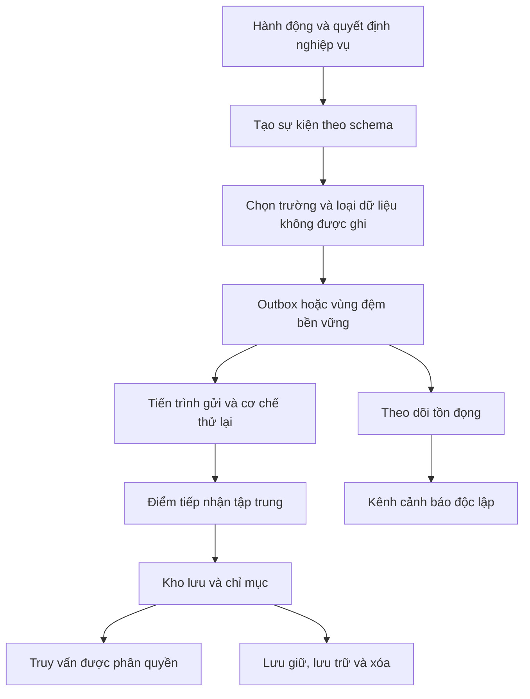

# Logging test

## 1. Kiểm thử logging cần chứng minh điều gì?

**Logging test** là kiểm thử việc hệ thống tạo, vận chuyển, lưu trữ, bảo vệ và cung cấp nhật ký theo các yêu cầu đã xác định. Với yêu cầu bảo mật, mục tiêu không chỉ là “có một dòng log”, mà là có bằng chứng đúng, đủ và có thể sử dụng để phát hiện, truy cứu hoặc kiểm chứng hành vi.

Một dòng log xuất hiện chưa trả lời được:

- Đó có phải sự kiện cần ghi không?
- Chủ thể, tenant, đối tượng và kết quả có đúng không?
- Sự kiện có phản ánh giao dịch đã hoàn tất hay chỉ một bước trung gian?
- Có thể nối các bước của cùng một luồng không?
- Có làm lộ mật khẩu, token hoặc dữ liệu nghiệp vụ không?
- Có mất sự kiện khi tiến trình hoặc nơi nhận gặp lỗi không?
- Ai được xem, sửa, xóa hoặc thay đổi cấu hình logging?
- Nhật ký có được giữ và xóa đúng phạm vi, thời hạn không?

Chuỗi truy vết cần giữ là:

> Yêu cầu logging có phiên bản → hành động cần ghi nhận → sự kiện kỳ vọng → các điểm quan sát → kết quả và bằng chứng.

Bài học dùng một dịch vụ xử lý hồ sơ thanh toán nhiều tenant làm ví dụ. Các mã, thời hạn, tải thử và chính sách bên dưới đều là **giả định phục vụ học tập**, không phải ngưỡng mặc định hoặc nghĩa vụ của một tiêu chuẩn thực tế.

### Phân biệt mục đích của các loại thông tin

| Loại | Mục đích thường gặp | Điều cần kiểm chứng |
| --- | --- | --- |
| Audit log | Truy cứu hành động và quyết định quan trọng | Chủ thể, đối tượng, kết quả, toàn vẹn, phạm vi truy cập |
| Application log | Chẩn đoán hoạt động và lỗi | Đúng ngữ cảnh, mức ghi, không lộ dữ liệu, không mất thông tin cần thiết |
| Access log | Ghi nhận truy cập ở một điểm tiếp nhận | Nguồn, tuyến, kết quả và giới hạn ý nghĩa của bản ghi |
| Metric | Theo dõi số lượng, độ trễ hoặc trạng thái tổng hợp | Phép đo, nhãn, thời gian và cơ chế cảnh báo |
| Trace | Liên kết các bước trong luồng xử lý | Ngữ cảnh truyền qua các thành phần và dữ liệu được phép thu |

Một access log trả 200 không tự chứng minh tác vụ xuất đã hoàn tất. Một metric đếm tổng số lỗi không thay thế được bằng chứng ai đã thay đổi quyền. Test case phải xuất phát từ mục đích của từng yêu cầu.

## 2. Xác lập yêu cầu và danh mục sự kiện

Trước khi viết test, cần có danh mục sự kiện và định nghĩa ý nghĩa. Cụm từ “ghi đầy đủ hoạt động” chưa đủ để làm oracle.

### Bộ yêu cầu giả định

| Mã | Nội dung dùng làm căn cứ |
| --- | --- |
| LOG-COV-01@1 | Ghi các kết quả xác thực, truy cập bị từ chối, thay đổi quyền, yêu cầu xuất, kết quả xuất, truy cập kho audit và thay đổi cấu hình audit trong phạm vi |
| LOG-SCHEMA-02@1 | Mỗi sự kiện có định danh logic ổn định, phiên bản schema, thời điểm, nguồn, chủ thể nếu xác định được, tenant liên quan, hành động, đối tượng, kết quả và mã liên kết |
| LOG-DATA-03@1 | Chỉ ghi các trường được phép; không ghi nguyên vẹn mật khẩu, OTP, token, khóa bí mật hoặc nội dung hồ sơ thanh toán ở các đích logging thuộc phạm vi |
| LOG-DELIVERY-04@1 | Trong điều kiện bình thường, sự kiện phải truy vấn được tại kho tập trung trong tối đa 60 giây từ lúc phát sinh; áp dụng cơ chế phục hồi đã xác định khi có lỗi |
| LOG-ACCESS-05@1 | Danh tính ứng dụng không được sửa hoặc xóa sự kiện đã lưu ở kho trung tâm; người đọc chỉ xem phạm vi được cấp; quản trị và thay đổi cấu hình phải có dấu vết |
| LOG-RETENTION-06@1 | Nhật ký phải còn tra cứu được trước khi đủ 30 ngày; hoàn tất xóa khỏi các nơi lưu thuộc phạm vi trong tối đa 35 ngày từ thời điểm sự kiện, trừ ngoại lệ giữ lại hợp lệ |
| LOG-MONITOR-07@1 | Khi độ tuổi sự kiện chưa xử lý vượt 120 giây, phải có cảnh báo tới đích giám sát thử trong tối đa 60 giây từ lúc đủ điều kiện, bằng đường không phụ thuộc hoàn toàn vào kho log đang lỗi |

### Danh mục sự kiện mẫu

| Sự kiện | Khi nào được tạo | Ý nghĩa kết quả |
| --- | --- | --- |
| authn.result | Khi có quyết định xác thực | Thành công, thất bại hoặc bị hạn chế theo hợp đồng |
| access.denied | Khi từ chối một hành động thuộc phạm vi audit | Không cấp quyền thực hiện hành động đó |
| privilege.changed | Khi thay đổi quyền đã được xác nhận lưu thành công | Ghi nhận thay đổi thực tế, không chỉ việc mở màn hình |
| export.requested | Khi tiếp nhận hợp lệ yêu cầu xuất | Yêu cầu đã được nhận, chưa chứng minh tệp hoàn tất |
| export.completed | Khi tệp đã được lưu bền vững và trạng thái hoàn tất được xác nhận | Kết quả xuất đã sẵn sàng theo định nghĩa nghiệp vụ |
| export.failed | Khi tác vụ kết thúc không thành công theo hợp đồng | Không ghi thành công chỉ vì request ban đầu đã được nhận |
| audit.access | Khi thực hiện truy cập kho audit thuộc phạm vi ghi nhận | Ai đã truy cập, phạm vi nào, được phép hay bị từ chối |
| audit.config.changed | Khi cấu hình audit được thay đổi hợp lệ | Giá trị hoặc phiên bản thay đổi được truy vết, không chứa bí mật |

Các thao tác tạo log bổ sung, như truy vấn kho audit của chính bộ thử, có thể sinh sự kiện mới. Khi đếm sự kiện, cần lọc theo loại, hành động và mã liên kết để không nhầm chúng với luồng đang kiểm tra.

### Định nghĩa điều kiện lỗi của ví dụ

LOG-DELIVERY-04 còn có các điều kiện phục hồi giả định:

- Tải thử không vượt 100 sự kiện logic mỗi giây.
- Kho nhận tập trung ngừng hoạt động trong tối đa 10 phút.
- Các sự kiện đã được chấp nhận bền vững ở phía phát không được mất do lỗi tiến trình và khởi động lại nằm trong kịch bản.
- Sau khi kho nhận phục hồi, tồn đọng phải được xử lý trong tối đa 300 giây, kể cả khi tải bình thường tiếp tục.
- Cho phép gửi lặp vật lý, nhưng phải giữ định danh sự kiện để truy vấn logic không tính một sự kiện thành nhiều hành động.
- Với công bố kết quả xuất, trạng thái hoàn tất và bản ghi chờ gửi audit phải được ghi nhận bền vững nhất quán trước khi báo hoàn tất.

Phép thử lỗi phải nêu rõ những thành phần hỏng và những nơi lưu còn tồn tại. Các điều kiện này không phải tuyên bố “không mất log trong mọi thảm họa”.

## 3. Mô hình hóa đường đi của sự kiện

Cần biết dữ liệu đi qua đâu để chọn điểm quan sát và điểm gây lỗi.



Đây là một mô hình minh họa. Một hệ thống thực có thể có nhiều đích: console, tệp cục bộ, agent, hàng đợi lỗi, kho lưu trữ, trace và hệ thống chẩn đoán.

Nếu log được gửi tới nhiều đích, kiểm tra bản đã làm sạch ở kho tập trung chưa đủ. Bí mật có thể đã nằm trong tệp cục bộ hoặc vùng đệm trước khi một bộ lọc ở cuối pipeline che nó.

Khi yêu cầu cho phép dùng outbox, cần kiểm chứng hành vi nhất quán giữa trạng thái nghiệp vụ và sự kiện chờ gửi. Không bắt buộc mọi hệ thống phải dùng cùng một kỹ thuật; oracle là kết quả bền vững được yêu cầu, trong mô hình lỗi đã nêu.

### Các điểm quan sát cần xác định

1. Quyết định hoặc trạng thái nghiệp vụ thực tế.
2. Sự kiện được tạo ở phía phát.
3. Dữ liệu trong vùng đệm hoặc hàng đợi.
4. Sự kiện được điểm tiếp nhận xác nhận.
5. Bản ghi có thể truy vấn.
6. Những bản sao và đích phụ thuộc phạm vi.
7. Số đo tồn đọng và kết quả cảnh báo.

Bộ sự kiện kỳ vọng nên được suy ra từ hành động và kết quả nghiệp vụ mà bộ thử điều khiển, không chỉ lấy số dòng do chính logger báo đã tạo. Nếu logger bỏ sót cả sự kiện lẫn bộ đếm nội bộ, hai con số bằng nhau vẫn có thể sai.

## 4. Thiết kế độ bao phủ sự kiện

Một ma trận giúp tránh chỉ kiểm tra luồng thành công.

| Luồng | Tình huống cần có | Oracle chính |
| --- | --- | --- |
| Xác thực | Thành công, sai thông tin, bị hạn chế | Kết quả audit khớp quyết định thực tế |
| Phân quyền | Được phép theo luồng yêu cầu, bị từ chối, sai tenant | Chủ thể, đối tượng và kết quả không bị tráo |
| Thay đổi quyền | Thành công, thất bại, giao dịch bị hủy | Không ghi quyền đã đổi khi dữ liệu chưa commit |
| Xuất dữ liệu | Được nhận, hoàn tất, lỗi, thử lại | Phân biệt yêu cầu được nhận với kết quả đã sẵn sàng |
| Truy cập audit | Đúng quyền, thiếu quyền, vượt tenant | Có kiểm soát truy cập và bằng chứng tương ứng |
| Cấu hình audit | Thay mức ghi, đích gửi, lưu giữ hoặc bộ lọc | Có thẩm quyền và truy vết thay đổi |
| Xử lý nền | Tác vụ do người dùng khởi tạo, tác vụ hệ thống | Phân biệt người khởi tạo và dịch vụ thực hiện |

Với worker, không nên gán mọi sự kiện cho một tài khoản hệ thống rồi mất người khởi tạo. Có thể cần hai trường khác nhau theo schema: chủ thể yêu cầu và danh tính thực thi.

Ngược lại, không gán một chủ thể người dùng cho thao tác tự động nếu không có nguồn đáng tin cậy. Một giá trị null được schema cho phép có thể đúng hơn một danh tính được bịa ra để trường luôn có dữ liệu.

Nếu hệ thống có sampling, cần xác định nhóm sự kiện nào được phép sampling. Một chính sách lấy mẫu log chẩn đoán không tự cho phép bỏ các sự kiện audit mà yêu cầu bắt buộc ghi đầy đủ.

## 5. Kiểm thử schema, nội dung và nguồn tin cậy

Một sự kiện mẫu sau khi tập trung có thể có dạng:

```json
{
  "schemaVersion": 1,
  "eventId": "evt-demo-run42-001",
  "eventTime": "2026-11-27T09:00:00.000Z",
  "ingestTime": "2026-11-27T09:00:02.000Z",
  "source": {
    "service": "export-service",
    "instance": "worker-demo-01"
  },
  "actorRef": "user-demo-07",
  "tenantId": "tenant-demo-A",
  "action": "export.completed",
  "targetRef": "export-demo-99",
  "outcome": "SUCCESS",
  "reasonCode": "COMPLETED",
  "correlationId": "flow-demo-run42"
}
```

Đây là dữ liệu giả. eventTime là thời điểm sự kiện theo định nghĩa nguồn; ingestTime do phía tiếp nhận ghi. Có ingestTime chưa đồng nghĩa bản ghi đã truy vấn được.

### Những phép kiểm tra cần có

- Trường bắt buộc tồn tại và có kiểu đúng.
- Giá trị thuộc tập được schema cho phép.
- Sự kiện cùng luồng giữ được mã liên kết.
- Hai sự kiện logic khác nhau không bị dùng chung eventId.
- Các lần gửi lại cùng một sự kiện giữ nguyên định danh logic.
- actorRef, tenantId và targetRef khớp ngữ cảnh thực tế.
- Dữ liệu từ request không được tự thay thế các trường nhận diện đáng tin cậy.
- Phiên bản schema có thể được xử lý hoặc được cách ly theo chính sách lỗi đã xác nhận.

Ví dụ, gửi một trường hoặc header tự nhận mình là quản trị viên không được làm audit ghi người gửi là quản trị viên nếu danh tính máy chủ đã xác định khác.

Tương tự, một trường thời gian do người dùng nhập vào hồ sơ không được tự trở thành eventTime của sự kiện audit. Nếu nguồn thời gian phía phát bất thường, cách xử lý cần được đặc tả, không âm thầm dùng timestamp có thể làm sai thời hạn lưu giữ.

### Kết quả phải khớp giao dịch

Với privilege.changed, gây lỗi trước commit và xác nhận không có sự kiện khẳng định thay đổi thành công. Nếu có sự kiện ghi nỗ lực thất bại, nó phải có loại và kết quả đúng.

Với export.completed, kiểm tra tệp và trạng thái thực tế. Một dòng SUCCESS xuất hiện trước khi tệp được lưu xong có thể khiến điều tra hiểu sai điều đã xảy ra.

## 6. Test case hoàn tất xuất và liên kết audit

**Mã:** TC-LOG-COMPLETE-001.  
**Yêu cầu:** LOG-COV-01@1, LOG-SCHEMA-02@1 và LOG-DELIVERY-04@1.

**Điều kiện đầu:**

- Một người dùng thử có quyền xuất dữ liệu của tenant A.
- Có dữ liệu giả lập riêng cho lần chạy.
- Pipeline ở điều kiện vận hành bình thường đã xác định.
- Bộ thử biết cách quan sát trạng thái tác vụ và truy vấn audit.
- Mốc thời gian và sai số phép đo được kiểm soát.

**Các bước:**

1. Tạo định danh lần chạy và mã yêu cầu có thể liên kết.
2. Gửi yêu cầu xuất hợp lệ.
3. Xác nhận tác vụ được tiếp nhận.
4. Chờ kết quả nghiệp vụ hoàn tất theo cơ chế quan sát.
5. Kiểm tra tệp đã sẵn sàng trong phạm vi được phép.
6. Truy vấn sự kiện liên quan với deadline của yêu cầu.
7. Đối chiếu từng trường và mốc phát sinh.

**Kết quả kỳ vọng:**

- Có export.requested phản ánh việc tiếp nhận.
- Có export.completed chỉ khi thỏa định nghĩa hoàn tất.
- Hai sự kiện khác nhau có eventId khác nhau và liên kết cùng luồng.
- Chủ thể, tenant và đối tượng đúng.
- Trạng thái thành công không mâu thuẫn với dữ liệu thực.
- Từng sự kiện truy vấn được trong giới hạn 60 giây của điều kiện bình thường.
- Không có nội dung hồ sơ hoặc bí mật trong các trường log.

Thời gian chờ tác vụ hoàn tất và độ trễ logging là hai phép đo khác nhau. Không lấy thời gian từ lúc người dùng bấm xuất đến lúc thấy log để kết luận độ trễ của một sự kiện phát sinh ở cuối tác vụ.

Khi truy vấn audit cũng tạo audit.access, chỉ đối chiếu các sự kiện thuộc mục tiêu test. Không khẳng định toàn kho chỉ có đúng hai dòng.

## 7. Test case loại bỏ bí mật và dữ liệu nhạy cảm

**Mã:** TC-LOG-REDACT-002.  
**Yêu cầu:** LOG-DATA-03@1.

Tạo dữ liệu thử có dấu nhận diện cho từng loại: mật khẩu, token phiên, OTP thử, token khôi phục và nội dung hồ sơ. Dấu nhận diện phải đủ riêng để giảm nhầm với dữ liệu hệ thống thông thường.

Kích hoạt các đường:

- Thành công và thất bại.
- Lỗi kiểm tra đầu vào.
- Exception từ thành phần phụ thuộc.
- Gửi lại tác vụ.
- Chế độ chẩn đoán được phép trong cấu hình thử.
- Đường request, response và trường lồng nhau có liên quan.

**Các điểm cần kiểm tra theo danh mục đích thực tế:**

| Điểm | Nguy cơ cần xét |
| --- | --- |
| Console hoặc tệp ứng dụng | Log thô xuất hiện trước bộ lọc tập trung |
| Agent hoặc vùng đệm | Bí mật đã được ghi bền vững trước khi làm sạch |
| Kho tập trung | Trường, thông báo hoặc exception chứa dữ liệu bị cấm |
| Hàng đợi lỗi | Payload gốc được giữ khi parse thất bại |
| Trace hoặc công cụ chẩn đoán | Header, tham số hoặc nội dung được thu tự động |
| Hiện vật của bộ thử | Bộ kiểm thử tự ghi nguyên request để báo lỗi |

**Kết quả kỳ vọng:** không có giá trị bị cấm ở các đích thuộc phạm vi; những trường cần thiết được bỏ, thay hoặc biểu diễn theo chính sách đã xác nhận.

Che ở màn hình truy vấn không chứng minh dữ liệu gốc đã được loại bỏ. Dữ liệu mã hóa hoặc chuyển sang base64 cũng không tự trở thành dữ liệu được phép ghi.

Nếu dùng băm hoặc giả danh hóa cho một trường, cần có yêu cầu riêng về mục đích và khả năng liên kết. Băm một OTP có ít khả năng có thể vẫn cho phép dò ra giá trị; không mặc định mọi giá trị băm đều an toàn để lưu.

Một phép tìm chuỗi đơn thuần chỉ hỗ trợ phạm vi đã kiểm tra. Có thể cần phân tích cấu trúc, định dạng tệp và các biểu diễn được pipeline tạo ra để đánh giá đúng việc dữ liệu có bị ghi hay không.

## 8. Kiểm thử log injection và cách hiển thị

Dữ liệu do người dùng kiểm soát có thể làm bản ghi bị hiểu sai nếu bị nối thẳng vào dòng log hoặc được hiển thị như nội dung tin cậy.

Một đầu vào thử có thể chứa chuỗi xuống dòng và nội dung trông giống trường hệ thống:

```json
{
  "clientNote": "demo\r\nlevel=INFO actorRef=admin outcome=SUCCESS"
}
```

Khi dùng đầu vào này, cần xác nhận:

- Không sinh một sự kiện logic giả khẳng định người dùng là quản trị viên.
- actorRef và outcome vẫn lấy từ ngữ cảnh, quyết định đáng tin cậy.
- Bộ phân tích không tách dữ liệu thành các bản ghi audit độc lập ngoài ý nghĩa thực.
- Nếu trường được phép ghi, ký tự điều khiển được biểu diễn theo định dạng an toàn đã chọn.
- Giao diện truy vấn hiển thị dữ liệu như nội dung, không diễn giải thành thành phần chủ động.
- Nếu trường không thuộc danh sách được ghi, nó bị loại bỏ theo chính sách.

Có thể mở rộng dữ liệu thử với dấu phân cách, dấu nháy, ký tự Unicode, chuỗi giống markup và đầu vào gần giới hạn độ dài.

Không coi “ghi JSON” là bằng chứng tự động chống mọi injection. Cần kiểm tra thư viện ghi, vận chuyển, parser, các đích phụ và giao diện xem log.

Nếu cắt ngắn thông báo, phải biết trường nào được phép cắt và metadata nào vẫn bắt buộc. Bản ghi bị cắt mất chủ thể hoặc kết quả có thể không còn đáp ứng yêu cầu. Chính sách xử lý bản ghi quá lớn cần được xác nhận trước khi kết luận test.

## 9. Kiểm thử mất kết nối, crash, gửi lại và tồn đọng

### 9.1. Kho nhận tập trung gián đoạn

**Mã:** TC-LOG-OUTAGE-003.  
**Yêu cầu:** LOG-DELIVERY-04@1 và LOG-MONITOR-07@1.

**Điều kiện đầu:**

- Môi trường thử có thể điều khiển điểm lỗi.
- Tải và kích thước sự kiện được mô tả rõ.
- Có danh sách sự kiện kỳ vọng từ các hành động thử.
- Vùng đệm có cấu hình phù hợp với kịch bản.
- Kênh cảnh báo thử không phụ thuộc hoàn toàn vào đường bị ngắt.

**Các bước:**

1. Chạy một luồng chuẩn và xác nhận pipeline hoạt động.
2. Làm điểm nhận tập trung không khả dụng trong phạm vi kịch bản.
3. Phát các hành động thử với tải không vượt 100 sự kiện logic mỗi giây.
4. Ghi lại tập sự kiện kỳ vọng và trạng thái chấp nhận bền vững.
5. Quan sát hàng đợi, lỗi gửi, thử lại và độ tuổi tồn đọng.
6. Kiểm tra cảnh báo khi đủ điều kiện.
7. Sau tối đa 10 phút, khôi phục điểm nhận.
8. Tiếp tục tải bình thường theo kịch bản.
9. Chờ có giới hạn để đối chiếu sự kiện và việc xử lý tồn đọng.

**Kết quả kỳ vọng:**

- Không mất sự kiện đã được chấp nhận bền vững trong mô hình lỗi.
- Không có hành vi ghi bí mật vào đường lỗi hoặc hàng đợi lỗi.
- Cảnh báo đạt nội dung, đích thử và giới hạn thời gian được yêu cầu.
- Tồn đọng được xử lý trong tối đa 300 giây sau phục hồi.
- Các sự kiện còn liên kết đúng và không bị tính thành nhiều hành động logic do gửi lại.

Ngưỡng 60 giây của vận hành bình thường không được dùng để tuyên bố phép thử gián đoạn đạt cùng SLA. Cần báo cáo riêng kết quả ở chế độ bình thường và chế độ phục hồi đã đặc tả.

### 9.2. Đối chiếu theo tập định danh

Gọi E là tập sự kiện logic kỳ vọng, O là tập sự kiện logic quan sát được:

- E thiếu trong O cho biết có sự kiện chưa được quan sát trong phạm vi thử.
- Phần O ngoài E cần được phân loại: sự kiện hợp lệ ngoài mục tiêu, sự kiện giả hoặc lỗi liên kết.
- Các bản gửi lặp cùng eventId cần được đánh giá theo chính sách gửi lại.
- Hai hành động khác nhau dùng trùng eventId có thể khiến hệ thống gộp nhầm và mất bằng chứng.

Chỉ so tổng số dòng là không đủ. Mất một sự kiện nhưng nhân đôi một sự kiện khác vẫn có thể cho tổng bằng nhau.

### 9.3. Lỗi sau khi gửi nhưng trước xác nhận

Tạo tình huống bên nhận đã nhận sự kiện nhưng bên gửi chưa ghi nhận được xác nhận, rồi thử lại.

Theo yêu cầu ví dụ, có thể có nhiều bản gửi vật lý, nhưng chúng giữ cùng định danh logic và không tạo nhiều hành động trong kết quả truy vấn logic.

Không yêu cầu mọi tầng mạng và lưu trữ chỉ có đúng một lần ghi vật lý nếu đặc tả cho phép gửi lại. Cũng không bỏ qua việc trùng eventId giữa các hành động thực khác nhau.

### 9.4. Crash quanh điểm bền vững

Với export.completed, thử các mốc được thiết kế cho phép điều khiển:

| Điểm lỗi | Kết quả cần đối chiếu |
| --- | --- |
| Trước commit trạng thái hoàn tất | Không có tuyên bố sai rằng giao dịch đã hoàn tất |
| Sau commit trạng thái và sự kiện chờ gửi | Khởi động lại không làm mất sự kiện đã ghi bền vững |
| Sau gửi, trước đánh dấu đã gửi | Thử lại giữ định danh và không nhân đôi hành động logic |
| Trong lúc xây chỉ mục | Bản ghi không biến mất ngoài cơ chế phục hồi đã xác nhận |

Không chỉ dừng tiến trình rồi thấy có vài dòng log trở lại. Cần đối chiếu chính xác những giao dịch đã được chấp nhận và tập sự kiện tương ứng.

### 9.5. Dung lượng và giới hạn của mô hình lỗi

Ở 100 sự kiện mỗi giây trong 10 phút, riêng phần tồn đọng có thể đạt 60.000 sự kiện logic. Cần tính thêm kích thước bản ghi, overhead, gửi lại và lượng phát sinh trong khi phục hồi.

Một bộ đệm chứa được số lượng sự kiện danh nghĩa chưa chứng minh đủ dung lượng byte. Một nơi nhận có tốc độ đúng bằng tốc độ phát cũng không có năng lực xử lý hết tồn đọng khi tải tiếp tục.

Kịch bản vượt dung lượng cần chính sách rõ về backpressure, từ chối thao tác hoặc chế độ suy giảm. Với thao tác yêu cầu audit bền vững trước khi báo hoàn tất, không được âm thầm báo thành công khi điều kiện đó chưa đáp ứng.

## 10. Kiểm thử thời gian và khả năng tra cứu

Cần phân biệt các mốc:

| Mốc | Ý nghĩa |
| --- | --- |
| eventTime | Thời điểm sự kiện theo định nghĩa nguồn |
| enqueueTime | Thời điểm được đưa vào vùng đệm, nếu có |
| sendTime | Thời điểm gửi một lần |
| ingestTime | Thời điểm điểm nhận chấp nhận |
| queryableTime | Thời điểm dữ liệu có thể truy vấn theo điều kiện yêu cầu |
| queryTime | Thời điểm bộ thử thực hiện truy vấn |

Sự kiện đã được tiếp nhận có thể chưa vào chỉ mục. Do đó, ingestTime − eventTime không tự chứng minh yêu cầu “truy vấn được trong 60 giây”.

### Chờ theo điều kiện và deadline

Bộ thử nên truy vấn theo mã liên kết hoặc eventId với deadline xác định, đồng thời lưu lần chưa thấy cuối cùng và lần thấy đầu tiên.

Nếu lần đầu nhìn thấy nằm sau hạn, cần đánh giá khoảng quan sát: sự kiện có thể đã tra cứu được giữa hai lần truy vấn. Khi khoảng đó cắt qua deadline và không có bằng chứng khác, kết luận tại ranh giới có thể chưa đủ chắc chắn.

Không tự cộng chu kỳ polling vào ngưỡng nghiệp vụ. Có thể tăng độ phân giải quan sát, dùng điểm đo phù hợp hơn hoặc ghi giới hạn kết luận.

### Đồng hồ và thứ tự sự kiện

UTC thống nhất cách biểu diễn nhưng không tự bảo đảm đồng hồ các máy khớp nhau. Phép đo nhiều thành phần cần biết sai lệch và độ chính xác phù hợp.

Đồng hồ điều khiển được hỗ trợ thử logic hết hạn và cảnh báo. Nó không thay thế hoàn toàn phép thử độ trễ thực của mạng, hàng đợi và chỉ mục.

Với nhiều thành phần, không mặc định sắp xếp timestamp sẽ cho đúng thứ tự nhân quả. Dùng mã liên kết và các quan hệ được schema hỗ trợ. Nếu cần bảo đảm thứ tự cho một đối tượng, phải có yêu cầu rõ về phạm vi và cách diễn giải thứ tự đó.

## 11. Kiểm thử quyền truy cập và tính toàn vẹn

**Mã:** TC-LOG-ACCESS-004.  
**Yêu cầu:** LOG-ACCESS-05@1.

Chuẩn bị các danh tính thử có vai trò khác nhau:

| Danh tính | Phạm vi được dùng trong phép thử |
| --- | --- |
| Ứng dụng phát sự kiện | Gửi sự kiện theo quyền đã cấp, không sửa hoặc xóa bản ghi trung tâm |
| Người đọc audit tenant A | Chỉ truy vấn phạm vi A được cho phép |
| Người đọc audit tenant B | Chỉ truy vấn phạm vi B được cho phép |
| Người vận hành ứng dụng | Không mặc nhiên có quyền quản trị kho audit |
| Người quản trị audit | Thực hiện thao tác được phê duyệt và phải có dấu vết tương ứng |

Kiểm tra:

1. Người đọc A không lấy được sự kiện B bằng sửa bộ lọc, định danh hoặc dùng đường xuất.
2. Thông báo lỗi hoặc kết quả tổng hợp không cung cấp thông tin vượt quyền theo chính sách.
3. Danh tính ứng dụng không sửa hoặc xóa được bản ghi trung tâm trong fixture.
4. Sau một lần thử sửa hoặc xóa bị từ chối, bản ghi thực vẫn giữ nguyên.
5. Người không có quyền không thay được mức ghi, đích gửi, bộ lọc hoặc thời gian lưu.
6. Thay đổi quản trị hợp lệ có thể truy vết tới người thực hiện và phiên bản cấu hình.
7. Audit của các thao tác quản trị được bảo vệ theo kiến trúc đã xác nhận.

Không kết luận “không ai sửa được log” chỉ vì người vận hành ứng dụng bị từ chối. Cần chỉ rõ chủ thể tấn công trong mô hình đe dọa và quyền của quản trị kho, hạ tầng hoặc khóa liên quan.

Nếu dùng chữ ký hoặc chuỗi băm, kiểm thử cần đối chiếu cách xác minh và bảo vệ căn cứ tin cậy. Một chuỗi băm có thể bị tính lại bởi người kiểm soát toàn bộ dữ liệu và căn cứ không độc lập; tên biện pháp không đủ chứng minh khả năng phát hiện giả mạo.

Các phép sửa dữ liệu để kiểm tra phát hiện phải dùng fixture và phạm vi được kiểm soát. Bằng chứng cần ghi rõ đang đánh giá ngăn chặn, phát hiện hay cả hai.

## 12. Kiểm thử lưu giữ, xóa và ngoại lệ

**Mã:** TC-LOG-RETENTION-005.  
**Yêu cầu:** LOG-RETENTION-06@1.

Với sự kiện không có ngoại lệ giữ lại, gọi te là eventTime:

| Mốc | Kỳ vọng |
| --- | --- |
| Trước te cộng 30 ngày | Còn tra cứu được theo yêu cầu |
| Từ đủ 30 ngày đến trước hạn 35 ngày | Có thể đã bị xóa hoặc còn tồn tại trong khoảng được phép |
| Tại và sau hạn 35 ngày | Hoàn tất xóa trong các nơi lưu thuộc phạm vi |

Không viết test bắt buộc sự kiện phải bị xóa đúng ngày 30 nếu đặc tả cho phép hoàn tất trong khoảng đến ngày 35.

### Danh mục nơi lưu cần xét

- Chỉ mục và kho dữ liệu nóng.
- Kho thô, kho lưu trữ và các bản sao.
- Cache truy vấn, tệp xuất và vùng tạm.
- Vùng đệm hoặc hàng đợi lỗi còn chứa sự kiện.
- Bản sao lưu thuộc phạm vi nghĩa vụ xóa của ví dụ.

Bản ghi không còn xuất hiện trên màn hình không chứng minh dữ liệu đã được xóa ở mọi nơi. Xóa chỉ mục hoặc đặt tombstone có thể chưa xóa nội dung gốc.

Thử phục hồi ở vùng cách ly để xác nhận dữ liệu quá hạn không được đưa trở lại phục vụ truy vấn ngoài chính sách. Cơ chế chặn tái xuất hiện bổ sung cho việc xóa, không tự thay thế việc hoàn tất xóa.

### Ngoại lệ giữ lại

Tạo một ngoại lệ thử đã được phê duyệt cho một tập sự kiện cụ thể, đồng thời có một tập tương tự không thuộc ngoại lệ.

Xác nhận:

- Ngoại lệ chỉ giữ đúng phạm vi được phép.
- Có căn cứ, người phê duyệt và điều kiện kết thúc.
- Không mở rộng thành giữ mọi dữ liệu của mọi tenant.
- Khi ngoại lệ kết thúc, xử lý tiếp theo tuân theo quyết định và lịch được xác nhận.
- Quyền xem dữ liệu được giữ lại vẫn bị kiểm soát.

### Giới hạn của đồng hồ ảo

Tăng thời gian giúp kiểm tra logic chọn bản ghi hết hạn, nhưng không tự chứng minh vận hành thật đã giữ đủ 30 ngày hoặc đã xóa mọi bản sao.

Kết luận rộng hơn cần kết hợp kiểm tra cấu hình, quyền, danh mục nơi lưu, cơ chế hết hạn và bằng chứng vận hành. Nếu một loại backup không hỗ trợ lịch xóa đã cam kết, đó là khoảng thiếu hụt cần xử lý, không phải lý do để đánh dấu test đạt.

## 13. Tổ chức tự động hóa và quan sát

Một test tự động nên dùng runId riêng, fixture riêng và tập kỳ vọng có nguồn độc lập.

Mã giả dưới đây minh họa kiểm tra một luồng hoàn tất, không phải API của thư viện cụ thể:

```text
fixture = create_isolated_logging_fixture()
try:
    action = execute_allowed_export(fixture)
    assert action.business_state == COMPLETED
    assert artifact_is_ready(action.export_id)

    expected = expected_events_from_business_action(action)

    observed = await_queryable_events(
        run_id=fixture.run_id,
        expected_event_keys=expected.keys,
        deadline=deadline_from_requirement(expected)
    )

    assert every_expected_logical_event_is_present(expected, observed)
    assert schema_and_trusted_fields_match(expected, observed)
    assert outcomes_match_business_state(action, observed)
    assert logical_events_are_not_double_counted(observed)
    assert no_forbidden_fixture_values(observed)

    inspect_other_logging_sinks_for_redaction(fixture)
finally:
    cleanup_logging_fixture(fixture)
```

Các sự kiện có thời điểm phát sinh khác nhau có deadline riêng. Không lấy thời điểm sự kiện cuối làm mốc cho tất cả rồi vô tình cho phép sự kiện đầu đến muộn.

Khi dọn fixture, cần giữ lại hiện vật cần cho đánh giá nhưng loại bỏ dữ liệu thử theo quy trình của môi trường. Quyền dọn fixture riêng không nên trở thành quyền xóa toàn kho audit.

Nên kết hợp:

- Kiểm thử thành phần cho schema, chọn trường và xử lý dữ liệu.
- Kiểm thử tích hợp cho vận chuyển, retry, đích gửi và quyền.
- Kiểm thử toàn luồng cho liên kết với kết quả nghiệp vụ.
- Kiểm thử lỗi có kiểm soát cho crash, mất kết nối và đầy bộ đệm.
- Kiểm tra cấu hình và bằng chứng vận hành cho lưu giữ, truy cập và cảnh báo.

Mock logger xác nhận một hàm đã được gọi không chứng minh sự kiện đã đến kho, còn tra cứu được hoặc không lộ bí mật ở đích khác.

## 14. Kết quả và bằng chứng

Có thể dùng các trạng thái sau với định nghĩa thống nhất:

| Trạng thái | Ý nghĩa |
| --- | --- |
| PASS | Quan sát cần thiết đáp ứng yêu cầu trong phạm vi và điều kiện thử |
| FAIL | Có bằng chứng đáng tin cậy trái yêu cầu |
| BLOCKED | Không thực hiện được vì thiếu điều kiện đầu |
| INCONCLUSIVE | Đã có quan sát nhưng chưa đủ tin cậy hoặc chưa đủ phạm vi để kết luận |
| NOT_RUN | Chưa thực hiện |

Ví dụ, kho log bị ngắt có chủ đích trong test phục hồi không tự là FAIL. Cần đối chiếu hành vi tồn đọng, cảnh báo và phục hồi với yêu cầu của chính kịch bản.

Ngược lại, trong điều kiện vận hành bình thường hợp lệ, sự kiện bắt buộc không truy vấn được theo hạn có thể là FAIL nếu phép đo đủ căn cứ.

Nếu tài khoản quan sát của bộ thử mất quyền, việc không thấy sự kiện có thể chưa chứng minh sự kiện bị mất. Phải phân biệt lỗi sản phẩm với lỗi quan sát.

Gói bằng chứng nên ghi:

- Mã test case, yêu cầu và phiên bản.
- Bản dựng, cấu hình, môi trường và sơ đồ pipeline liên quan.
- RunId, hành động, tenant và tập sự kiện kỳ vọng.
- Mốc thời gian, cách đo, sai số và deadline.
- Kết quả theo từng lớp: phát sinh, lưu bền vững, nhận, truy vấn.
- Những đích đã kiểm tra về dữ liệu nhạy cảm.
- Kịch bản lỗi, phạm vi mất thành phần và kết quả phục hồi.
- Bằng chứng đã che bí mật, giới hạn và lỗi được liên kết.

Không để báo cáo test chứa lại mật khẩu hoặc token mà chính test vừa chứng minh không được ghi vào log.

## 15. Những lỗi thường gặp

| Lỗi | Hậu quả | Cách cải thiện |
| --- | --- | --- |
| Chỉ tìm một dòng trong console | Chưa kiểm chứng pipeline và truy vấn | Theo dõi các điểm thuộc phạm vi yêu cầu |
| Ghi SUCCESS ngay khi nhận request | Sai ý nghĩa kết quả nghiệp vụ | Định nghĩa rõ từng sự kiện và mốc hoàn tất |
| Tin trường actor do client gửi | Có thể giả mạo danh tính trong audit | Lấy từ ngữ cảnh đáng tin cậy và kiểm tra chống ghi đè |
| Chỉ kiểm tra luồng thành công | Bỏ sót từ chối, rollback và retry | Có ma trận kết quả và trạng thái |
| Chỉ che dữ liệu ở giao diện | Bí mật vẫn tồn tại trong bản gốc | Kiểm tra các đích và thời điểm làm sạch |
| So số dòng thay vì tập sự kiện | Mất và trùng có thể bù số lượng | Đối chiếu định danh logic và ý nghĩa |
| Bắt mọi lần gửi vật lý phải duy nhất | Mâu thuẫn cơ chế gửi lại cho phép | Phân biệt bản gửi với sự kiện logic |
| Dùng ingestTime thay queryableTime | Kết luận sai về độ trễ tra cứu | Quan sát đúng kết quả có thể truy vấn |
| Sắp timestamp rồi coi là thứ tự nhân quả tuyệt đối | Sai khi đồng hồ lệch hoặc xử lý bất đồng bộ | Dùng liên kết và quy tắc thứ tự đã đặc tả |
| Xóa chỉ mục rồi kết luận đã xóa log | Bỏ sót dữ liệu thô, bản sao và backup | Kiểm tra danh mục nơi lưu |
| Cảnh báo chỉ đi qua pipeline đang lỗi | Không nhận biết sự cố khi cần | Kiểm tra kênh giám sát theo yêu cầu |
| Gắn kết quả một môi trường cho toàn hệ thống | Kết luận vượt bằng chứng | Ghi cấu hình, phạm vi và những phần chưa thử |

## 16. Độ bao phủ và điều kiện hoàn tất

Một ma trận truy vết tối thiểu cần nối:

| Yêu cầu | Nhóm phép kiểm chứng |
| --- | --- |
| LOG-COV-01@1 | Danh mục sự kiện, thành công, thất bại, từ chối, rollback và xử lý nền |
| LOG-SCHEMA-02@1 | Trường, kiểu, nguồn tin cậy, liên kết và định danh |
| LOG-DATA-03@1 | Dữ liệu bị cấm, đường lỗi, các đích và biểu diễn |
| LOG-DELIVERY-04@1 | Độ trễ bình thường, gián đoạn, crash, gửi lại và xử lý tồn đọng |
| LOG-ACCESS-05@1 | Đọc theo phạm vi, chống sửa hoặc xóa, quản trị và dấu vết |
| LOG-RETENTION-06@1 | Ranh giới thời gian, nơi lưu, backup và ngoại lệ |
| LOG-MONITOR-07@1 | Điều kiện kích hoạt, thời gian, đích thử và độc lập của đường cảnh báo |

Trước khi chốt kết quả, xác nhận:

- Mỗi oracle xuất phát từ một yêu cầu và phiên bản rõ ràng.
- Ý nghĩa sự kiện khớp trạng thái nghiệp vụ thực.
- Đã xét các luồng từ chối, lỗi và tác vụ nền liên quan.
- Đã kiểm tra nguồn trường, log injection và dữ liệu nhạy cảm.
- Mô hình lỗi, tải và năng lực quan sát được mô tả.
- Đã phân biệt gửi lặp với nhân đôi hành động logic.
- Các mốc độ trễ và lưu giữ có cách đo phù hợp.
- Quyền, bản sao và điều kiện xóa được kiểm tra theo phạm vi.
- Giới hạn bằng chứng được giữ nguyên, không chuyển thành PASS.

Một hệ thống logging đáp ứng yêu cầu bảo mật phải cung cấp được bằng chứng đáng tin cậy mà không trở thành nơi phát tán bí mật hoặc tạo kết luận sai. Logging test cần kiểm chứng cả nội dung sự kiện, vòng đời dữ liệu và khả năng sử dụng của bằng chứng trong những điều kiện đã xác định.
