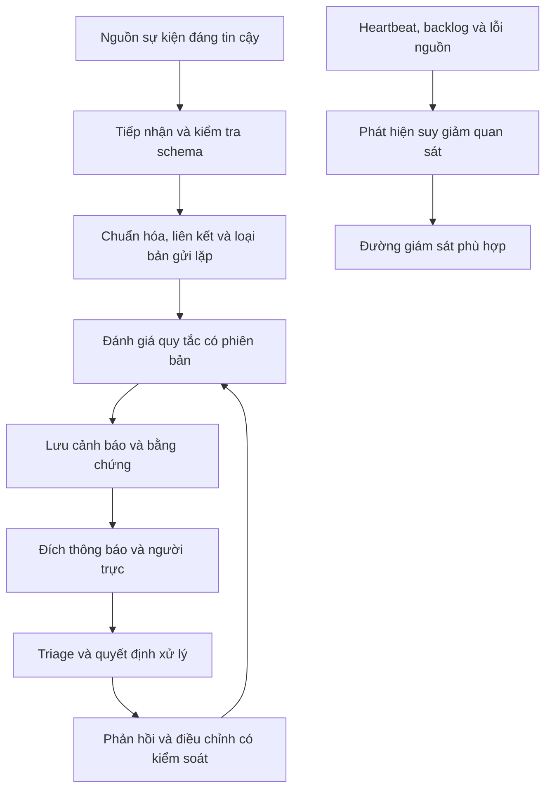

# Phát hiện incident

## 1. Phân biệt sự kiện, cảnh báo và incident

**Phát hiện incident** là quá trình thu thập và phân tích tín hiệu để nhận biết một tình huống có thể cần xử lý như sự cố an toàn thông tin. Trong thiết kế yêu cầu bảo mật, nhiệm vụ là xác định hệ thống phải quan sát được điều gì, khi nào phải tạo cảnh báo, ai nhận và dựa vào đâu để đánh giá tiếp.

Cần phân biệt:

| Khái niệm | Ý nghĩa | Ví dụ |
| --- | --- | --- |
| Sự kiện | Một điều đã xảy ra và được ghi nhận | Một tác vụ xuất hồ sơ hoàn tất |
| Tín hiệu | Thông tin được dùng để đánh giá một giả thuyết | Số lượng hồ sơ xuất tăng mạnh theo cùng danh tính |
| Cảnh báo | Kết quả một điều kiện phát hiện được thỏa | Một danh tính xuất vượt ngưỡng đã xác định |
| Incident | Tình huống được xác định cần xử lý theo quy trình sự cố | Danh tính bị chiếm dụng và đang xuất dữ liệu ngoài mục đích được phép |

Một cảnh báo chưa tự chứng minh đã xảy ra xâm nhập. Một nhân viên thực hiện tác vụ hợp lệ cũng có thể tạo tín hiệu bất thường. Ngược lại, không có cảnh báo không chứng minh hệ thống không có incident: dữ liệu nguồn có thể thiếu, quy tắc chưa bao phủ hoặc đường phát hiện đang lỗi.

Vì vậy, yêu cầu phát hiện cần liên kết được:

> Rủi ro → kịch bản cần phát hiện → dữ liệu quan sát → điều kiện cảnh báo → thời hạn và người tiếp nhận → bằng chứng kiểm chứng.

Các mã, ngưỡng, thời hạn và tình huống trong bài đều là **giả định phục vụ học tập**. Chúng không phải ngưỡng mặc định, nghĩa vụ thông báo hoặc cam kết phù hợp cho mọi hệ thống.

## 2. Bắt đầu từ kịch bản rủi ro

Yêu cầu “hệ thống phải phát hiện mọi hành vi bất thường” không có phạm vi và không thể kiểm chứng đầy đủ. Cần chọn những kịch bản cụ thể từ mục tiêu bảo vệ và mô hình đe dọa.

Ví dụ với một dịch vụ xử lý hồ sơ thanh toán nhiều tenant:

| Rủi ro hoặc kịch bản | Tín hiệu có thể cần | Câu hỏi để đặc tả |
| --- | --- | --- |
| Danh tính hợp lệ bị chiếm dụng và xuất nhiều dữ liệu | Kết quả xuất, số hồ sơ, chủ thể, tenant và thời gian | Bao nhiêu, trong khoảng nào, ở những đường xuất nào? |
| Thử dùng danh tính không hợp lệ | Kết quả xác thực và trạng thái hạn chế | Có nhận biết được thử sai phân tán hoặc thay đổi nguồn không? |
| Truy cập dữ liệu khác tenant | Quyết định từ chối, đối tượng và phạm vi chủ thể | Đây là lỗi tích hợp, thao tác nhầm hay chuỗi hành vi có chủ đích? |
| Quyền đặc biệt bị cấp ngoài quy trình | Sự kiện thay đổi quyền và tham chiếu phê duyệt | Ai thực hiện, quyền nào, có quyết định hợp lệ không? |
| Pipeline audit ngừng nhận dữ liệu | Heartbeat, tuổi tồn đọng và trạng thái nguồn | Có phân biệt hệ thống yên lặng với nguồn quan sát bị mù không? |
| Phục hồi đưa trở lại trạng thái bảo mật cũ | Phiên hoặc quyền đã thu hồi lại được chấp nhận, phiên bản cấu hình | Có nhận biết sự thoái lui sau phục hồi không? |

Không cần tất cả tín hiệu trở thành cùng một cảnh báo. Mỗi kịch bản có dữ liệu, điều kiện, mức độ và người xử lý khác nhau.

Một kịch bản xuất dữ liệu hàng loạt chỉ bao phủ một phần rủi ro lấy dữ liệu. Hành vi chậm, ít hoặc qua kênh khác cần kịch bản riêng nếu thuộc phạm vi. Không mở rộng kết luận của một quy tắc thành khả năng phát hiện mọi cách lấy dữ liệu.

### Viết mục tiêu quan sát được

Thay vì:

> Phát hiện nhanh tài khoản đáng ngờ.

Có thể viết mục tiêu:

> Nhận biết một danh tính khởi tạo nhiều tác vụ xuất hoàn tất trên cùng tenant và tổng số hồ sơ vượt điều kiện đã xác nhận; tạo bằng chứng đủ để người trực kiểm tra quyền, mục đích và phạm vi dữ liệu.

Mục tiêu vẫn cần được chuyển tiếp thành quy tắc, dữ liệu và thời hạn cụ thể.

## 3. Xác định dữ liệu nguồn và ranh giới tin cậy

Một quy tắc đúng trên giấy vẫn có thể thất bại nếu nguồn dữ liệu không thể cung cấp điều kiện cần quan sát.

### Nguồn tín hiệu theo miền bảo mật

| Miền | Dữ liệu có ích | Giới hạn cần ghi |
| --- | --- | --- |
| Xác thực | Chủ thể, kết quả, phương thức, mức xác minh, thời điểm | Đăng nhập thành công chưa chứng minh người sử dụng là chủ thể hợp pháp |
| Phân quyền | Hành động, đối tượng, tenant, quyết định và lý do | Một lần bị từ chối không tự chứng minh tấn công |
| Dữ liệu | Tác vụ xuất, số bản ghi, độ nhạy, kênh cung cấp | Số lượng phải phản ánh dữ liệu thực, không tin một giá trị client tự khai |
| Logging | Định danh sự kiện, mã liên kết, nguồn, thời điểm nhận | Mất nguồn hoặc thiếu trường có thể làm quy tắc không đánh giá được |
| Phục hồi và vận hành | Phiên bản triển khai, cấu hình, trạng thái quyền, canary | Dịch vụ hoạt động lại chưa chứng minh các kiểm soát vẫn giữ nguyên |

Dữ liệu cho phát hiện nên đủ cho mục đích, không mặc định thu toàn bộ nội dung hồ sơ. Có thể dùng số lượng, loại dữ liệu và định danh đối tượng được kiểm soát thay cho payload nhạy cảm.

### Các trường quan trọng cho ví dụ xuất dữ liệu

- eventId: định danh ổn định của một sự kiện logic.
- eventTime: thời điểm sự kiện theo định nghĩa nghiệp vụ.
- ingestTime: thời điểm hệ thống thu thập tiếp nhận.
- initiatingPrincipal: danh tính khởi tạo được truyền từ ngữ cảnh đáng tin cậy.
- executionPrincipal: dịch vụ hoặc worker thực hiện, nếu khác người khởi tạo.
- tenantId: phạm vi dữ liệu thực tế.
- exportId, outcome và recordCount: kết quả cùng số hồ sơ đã xác nhận.
- correlationId: liên kết những bước của cùng luồng.
- schemaVersion và source: phiên bản lược đồ, nguồn phát.

Không gom mọi sự kiện worker dưới một tài khoản dịch vụ rồi coi tổng của cả hệ thống là hoạt động của một người dùng. Cũng không lấy trường tự khai trong request làm initiatingPrincipal hoặc tenantId.

Nếu nguồn không xác định được một trường, phải có trạng thái và cách xử lý rõ. Điền giá trị giả để quy tắc chạy sẽ tạo kết luận sai.

## 4. Bộ yêu cầu phát hiện giả định

Giả sử rủi ro chính là danh tính bị chiếm dụng thực hiện nhiều tác vụ xuất dữ liệu. Nhóm đã thống nhất các yêu cầu sau.

| Mã | Nội dung |
| --- | --- |
| DET-EXPORT-01@1 | Trên cùng initiatingPrincipal và tenantId, tạo cảnh báo khi có ít nhất 3 tác vụ xuất hoàn tất và tổng ít nhất 10.000 hồ sơ trong cửa sổ 300 giây |
| DET-TIME-02@1 | Trong điều kiện bình thường đã xác định, cảnh báo phải được lưu trong tối đa 90 giây từ sự kiện làm đủ điều kiện; đích thông báo thử phải tiếp nhận trong tối đa 30 giây sau khi cảnh báo được lưu |
| DET-OWNER-03@1 | Mỗi cảnh báo phải có vai trò tiếp nhận; người trực phải xác nhận tiếp nhận trong tối đa 5 phút sau khi đích thông báo đã nhận, hoặc kích hoạt cơ chế chuyển cấp đã xác nhận |
| DET-DEDUP-04@1 | Không đếm lặp cùng eventId; trong 10 phút từ cảnh báo đầu, bằng chứng mới cho cùng danh tính, tenant và phiên bản quy tắc cập nhật cảnh báo đó; tenant khác không bị gộp |
| DET-SOURCE-05@1 | Nguồn có heartbeat riêng mỗi 30 giây; khi không nhận heartbeat đủ 120 giây, phải phát cảnh báo suy giảm quan sát trong tối đa 60 giây tiếp theo qua đường giám sát phù hợp |
| DET-CONTROL-06@1 | Quy tắc, ngoại lệ và bằng chứng được phân quyền, có phiên bản và dấu vết thay đổi; không đưa token hoặc nội dung hồ sơ vào cảnh báo |

Các điều kiện hỗ trợ của ví dụ:

- Sự kiện hợp lệ được tiếp nhận trong tối đa 60 giây ở điều kiện bình thường.
- Nguồn thời gian và sai số đo đủ để đánh giá các giới hạn.
- Bộ xử lý hỗ trợ tính lại cửa sổ bị ảnh hưởng bởi sự kiện đến sai thứ tự trong khoảng đến muộn đã nêu.
- Những sự kiện muộn hơn giới hạn hỗ trợ không bị âm thầm coi là hoạt động bình thường; phải được ghi nhận để xử lý theo chế độ suy giảm hoặc phân tích hồi cứu.
- Ngoại lệ hợp lệ, nếu có, phải xác định phạm vi và thời hạn; không mặc nhiên bỏ mọi hoạt động của một tài khoản.
- Cơ chế gom cảnh báo vẫn cập nhật số lượng và bằng chứng mới, không chỉ im lặng trong 10 phút.

Điều kiện phát hiện là một quy tắc giả định. Chưa có căn cứ rằng ngưỡng đó có chất lượng tốt cho một tổ chức cụ thể; chất lượng cần được đánh giá bằng dữ liệu và phản hồi phù hợp.

## 5. Đặc tả cửa sổ, ngưỡng và gom cảnh báo

### Cửa sổ phải có quy ước rõ

Với thời điểm đánh giá theo sự kiện là t, cửa sổ của ví dụ gồm các sự kiện có:

> eventTime lớn hơn t − 300 giây và không lớn hơn t.

Một sự kiện đúng tại t − 300 không còn thuộc cửa sổ. Quy ước này phải được giữ nhất quán trong triển khai và test.

Chỉ tính sự kiện export.completed hợp lệ, có kết quả hoàn tất theo định nghĩa nguồn. Không dùng export.requested thay cho hoàn tất.

### Đếm số tác vụ và tổng dữ liệu là hai điều kiện

| Dữ liệu trong cùng cửa sổ, cùng danh tính và tenant | Kết quả theo DET-EXPORT-01 |
| --- | --- |
| 2 tác vụ, tổng 12.000 hồ sơ | Chưa đủ điều kiện về số tác vụ |
| 3 tác vụ, tổng 9.999 hồ sơ | Chưa đủ điều kiện về tổng hồ sơ |
| 3 tác vụ, tổng 10.000 hồ sơ | Đủ điều kiện |
| 3 tác vụ nhưng một tác vụ nằm ngoài cửa sổ | Tính lại bằng những sự kiện còn trong cửa sổ |
| Bản gửi lại của một trong hai tác vụ | Không được đếm thành tác vụ thứ ba |
| 3 tác vụ chia giữa hai tenant | Đánh giá riêng từng tenant |

Một tác vụ xuất có nhiều sự kiện trạng thái cũng không phải nhiều tác vụ hoàn tất. Cần gắn đúng exportId và eventId theo hợp đồng dữ liệu.

### Thời gian sự kiện và thời gian xử lý

Sự kiện phát sinh trước có thể đến sau vì mạng hoặc thử lại. Nếu chỉ dùng thứ tự đến và bỏ phần đến muộn, bộ xử lý có thể không nhận ra một cửa sổ đã đủ điều kiện.

Cần xác định cách giữ trạng thái, tính lại cửa sổ và cập nhật cảnh báo trong khoảng đến muộn hỗ trợ. Khi dữ liệu vượt giới hạn đó, có thể cần phân tích hồi cứu; cảnh báo hồi cứu phải thể hiện đúng thời điểm và chế độ đánh giá.

Không gắn nhãn “phát hiện thời gian thực đúng hạn” cho một cảnh báo được tìm ra khi phát lại dữ liệu cũ nhiều giờ sau.

### Gom cảnh báo vẫn phải giữ bằng chứng

Gom giúp người trực không nhận nhiều thông báo giống nhau. Tuy nhiên:

- Mỗi bằng chứng mới vẫn phải liên kết được.
- Số liệu không được dừng cập nhật.
- Một tenant khác không bị che bởi cảnh báo cũ.
- Những thay đổi mức độ hoặc điều kiện cần chuyển cấp phải theo chính sách đã xác nhận.
- Khoảng gom không được trở thành ngoại lệ vô thời hạn.

Giảm số cảnh báo không tự chứng minh quy tắc tốt hơn; có thể chỉ là nhiều hoạt động bị che trong cùng một nhãn.

## 6. Kiến trúc phát hiện và nội dung cảnh báo



Nếu cảnh báo pipeline hỏng chỉ được gửi qua đúng pipeline đang hỏng, có thể không ai nhận biết mất khả năng quan sát. Cần xác định đường giám sát phù hợp với mô hình lỗi.

Một cảnh báo hữu ích nên có:

| Trường | Mục đích |
| --- | --- |
| alertId | Định danh để tiếp nhận và cập nhật |
| ruleId và ruleVersion | Biết điều kiện nào tạo cảnh báo |
| Kịch bản và mức độ | Giúp định tuyến, không thay bằng kết luận xâm nhập chưa xác nhận |
| Danh tính và tenant | Phạm vi cần xem xét |
| Khoảng sự kiện và thời điểm đủ điều kiện | Đối chiếu cửa sổ và thời hạn |
| Thời điểm lưu và thông báo | Đánh giá chuỗi phát hiện |
| Số tác vụ và tổng hồ sơ | Giải thích vì sao thỏa điều kiện |
| Tham chiếu sự kiện | Có thể kiểm chứng bằng chứng |
| Trạng thái nguồn | Phân biệt dữ liệu đầy đủ với dữ liệu đang suy giảm |
| Vai trò tiếp nhận | Không để cảnh báo không có người xử lý |

Không đưa toàn bộ hồ sơ, token hoặc bí mật vào thông báo. Người điều tra cần đường truy cập có phân quyền tới bằng chứng phù hợp, không phải nhận dữ liệu nhạy cảm ở mọi kênh.

### Phân biệt cảnh báo hành vi với cảnh báo bị mù

Cảnh báo xuất dữ liệu bất thường nêu một giả thuyết về hành vi. Cảnh báo mất heartbeat nêu khả năng quan sát đang suy giảm.

Cả hai đều có thể cần ưu tiên, nhưng không nên dùng cùng lời khẳng định “khách hàng đang bị lấy dữ liệu” chỉ vì nguồn log im lặng.

## 7. Từ cảnh báo tới quyết định incident

Sau khi nhận cảnh báo, người tiếp nhận cần xác nhận công việc và đánh giá các câu hỏi phù hợp:

1. Bằng chứng có đúng danh tính, tenant và thời gian không?
2. Nguồn có thiếu, trùng hoặc sai schema không?
3. Hành động có được người có thẩm quyền xác nhận là hợp lệ không?
4. Có thay đổi quyền, phiên đăng nhập hoặc kênh truy cập liên quan không?
5. Có dấu hiệu khác củng cố hoặc làm yếu giả thuyết không?
6. Có cần xử lý theo quy trình incident ngay khi còn đang xác minh không?

Không cần đợi có kết luận hoàn hảo mới tiếp nhận hoặc chuyển cấp. Tuy nhiên, cần phân biệt dữ kiện, giả thuyết và kết luận để tránh làm báo cáo mạnh hơn bằng chứng.

### Một ví dụ triage

Cảnh báo cho biết user-demo-07 xuất 12.000 hồ sơ qua 3 tác vụ của tenant A.

Các khả năng gồm:

- Một đợt xuất hợp lệ đã được phê duyệt.
- Quy trình mới làm số lượng tăng nhưng quy tắc chưa có ngữ cảnh.
- Dữ liệu đếm sai hoặc một sự kiện bị lặp.
- Danh tính bị sử dụng ngoài mục đích được phép.

Việc người dùng có quyền xuất không đủ loại bỏ giả thuyết danh tính bị chiếm dụng. Việc số lượng lớn cũng chưa đủ xác nhận bị chiếm dụng.

Nếu hoạt động được xác định là hợp lệ, ghi cách xác nhận và đánh giá có cần thay quy tắc hay không. Không tạo ngoại lệ vĩnh viễn chỉ vì một lần cảnh báo là hoạt động hợp lệ.

### Xác nhận tiếp nhận khác hoàn tất điều tra

DET-OWNER-03 yêu cầu xác nhận trong 5 phút. Mốc đó đo việc một người hoặc vai trò nhận trách nhiệm theo quy trình, không phải cam kết đã điều tra xong trong 5 phút.

Đích thông báo tiếp nhận thành công cũng không chứng minh người trực đã đọc. Hệ thống cần theo dõi riêng việc gửi, xác nhận và chuyển cấp.

## 8. Mẫu đặc tả một yêu cầu phát hiện

Một yêu cầu đủ rõ nên có các thành phần sau:

| Thành phần | Nội dung cần xác định |
| --- | --- |
| Mã và phiên bản | Định danh ổn định của yêu cầu và quy tắc |
| Mục tiêu | Rủi ro hoặc kịch bản cần nhận biết |
| Phạm vi | Dịch vụ, dữ liệu, tenant và nhóm danh tính |
| Nguồn | Loại sự kiện, schema, trường đáng tin cậy và độ trễ được hỗ trợ |
| Điều kiện | Bộ lọc, khóa nhóm, cửa sổ, phép đếm, tổng và ranh giới |
| Xử lý dữ liệu | Trùng, đến muộn, sai schema và thiếu trường |
| Đầu ra | Nội dung cảnh báo, bằng chứng và trạng thái |
| Thời hạn | Mốc bắt đầu, kết thúc và điều kiện đo |
| Trách nhiệm | Chủ sở hữu quy tắc, vai trò tiếp nhận và chuyển cấp |
| Ngoại lệ | Phạm vi, thẩm quyền, ngày hết hiệu lực và dấu vết |
| Kiểm chứng | Dữ liệu thử, oracle và giới hạn kết luận |

Biểu diễn minh họa cho phần điều kiện:

```yaml
ruleId: DET-EXPORT-01
ruleVersion: 1
sourceEvent: export.completed
groupBy:
  - initiatingPrincipal
  - tenantId
window:
  basis: eventTime
  seconds: 300
  lowerBound: exclusive
  upperBound: inclusive
conditions:
  minDistinctExports: 3
  minTotalRecords: 10000
deduplicateBy: eventId
groupAlertForSeconds: 600
normalDetectionDeadlineSeconds: 90
notificationDeadlineAfterAlertSeconds: 30
```

Đây là cấu trúc minh họa, không phải cấu hình của một sản phẩm cụ thể. Phần hỗ trợ sự kiện đến muộn, mô hình lỗi, quyền và quy trình con người vẫn cần được mô tả.

Không dùng cấu hình ngưỡng thay cho toàn bộ yêu cầu. Một quy tắc có thể tính đúng nhưng không có người nhận, không lưu bằng chứng hoặc không phát hiện được nguồn bị mất.

## 9. Test case phát hiện xuất dữ liệu vượt điều kiện

**Mã:** TC-DET-EXPORT-001.  
**Yêu cầu:** DET-EXPORT-01@1, DET-TIME-02@1 và DET-DEDUP-04@1.

**Điều kiện đầu:**

- Một danh tính thử có quyền tạo các tác vụ xuất của tenant A.
- Sự kiện có schema hợp lệ và trường nguồn đáng tin cậy.
- Pipeline ở điều kiện bình thường.
- Vai trò tiếp nhận và đích thông báo thử đã cấu hình.
- Bộ thử điều khiển hoặc đo được thời gian với độ chính xác phù hợp.
- Không có dữ liệu cũ cùng khóa nhóm làm nhiễu cửa sổ.

**Các bước minh họa:**

1. Tại giây 0, hoàn tất tác vụ E1 với 3.500 hồ sơ.
2. Tại giây 100, hoàn tất E2 với 3.500 hồ sơ.
3. Tại giây 200, hoàn tất E3 với 3.000 hồ sơ.
4. Xác nhận cả ba kết quả nghiệp vụ và tập sự kiện kỳ vọng.
5. Theo dõi tiếp nhận, xử lý và lưu cảnh báo.
6. Theo dõi việc đích thông báo thử tiếp nhận.
7. Gửi lại bản sao của một sự kiện với cùng eventId.
8. Tạo thêm bằng chứng thuộc cùng nhóm trong khoảng gom.
9. Đối chiếu số liệu và liên kết cảnh báo.

**Kết quả kỳ vọng:**

- Trước E3, nhóm chưa đủ cả hai điều kiện.
- E3 làm tổng thành 3 tác vụ và 10.000 hồ sơ trong cửa sổ.
- Cảnh báo đúng danh tính, tenant, quy tắc và phiên bản.
- Bằng chứng liên kết đủ E1, E2, E3; không chứa nội dung hồ sơ.
- Cảnh báo được lưu trong tối đa 90 giây từ thời điểm E3 làm đủ điều kiện.
- Đích thông báo thử tiếp nhận trong tối đa 30 giây từ khi cảnh báo được lưu.
- Bản gửi lại không làm tăng số tác vụ hoặc tổng hồ sơ.
- Bằng chứng mới trong khoảng gom cập nhật đúng cảnh báo theo chính sách.

### Kiểm tra phần con người bằng cách phù hợp

Để đánh giá DET-OWNER-03, cần một lượt diễn tập hoặc mô phỏng có người và trách nhiệm rõ ràng, ghi nhận việc xác nhận tiếp nhận và chuyển cấp.

Test tự động thấy endpoint thông báo trả thành công chỉ hỗ trợ kết luận việc giao thông báo. Nó không chứng minh lịch trực có người, người đó đã nhận trách nhiệm hoặc đã điều tra.

Các phép thử cần dùng đích thử để đánh giá cơ chế mà không tạo nhầm một incident thực trong hệ thống vận hành.

## 10. Ma trận kiểm chứng điều kiện và giới hạn

| Tình huống | Kết quả kỳ vọng theo bộ yêu cầu ví dụ |
| --- | --- |
| 2 tác vụ, tổng hơn 10.000 | Chưa tạo cảnh báo của quy tắc này |
| 3 tác vụ, tổng 9.999 | Chưa tạo cảnh báo của quy tắc này |
| 3 tác vụ, tổng đúng 10.000 | Tạo cảnh báo |
| Một sự kiện đúng tại biên dưới t − 300 | Không tính sự kiện đó trong cửa sổ |
| Các tác vụ chia giữa hai tenant | Không gộp để vượt ngưỡng |
| Một sự kiện được gửi lại nhiều lần | Chỉ tính một lần logic |
| Sự kiện đến sai thứ tự trong giới hạn hỗ trợ | Tính lại và nhận biết điều kiện đúng |
| Thiếu trường nhận diện bắt buộc | Không bịa danh tính; ghi nhận lỗi dữ liệu theo chính sách |
| Client tự khai số hồ sơ hoặc danh tính khác | Không ghi đè trường đáng tin cậy của nguồn |
| Dữ liệu muộn ngoài giới hạn bình thường | Đánh giá theo chế độ phù hợp, không báo là đã đáp ứng thời hạn bình thường |
| Nhiều bằng chứng cùng nhóm trong 10 phút | Cập nhật cảnh báo và giữ bằng chứng |
| Cùng danh tính nhưng tenant khác đủ điều kiện | Không bị cảnh báo tenant cũ che mất |
| Tác vụ hợp lệ đã được nghiệp vụ phê duyệt nhưng không có ngoại lệ quy tắc | Quy tắc vẫn khớp nếu đủ điều kiện; triage xác nhận ngữ cảnh |
| Nguồn nghiệp vụ không có hoạt động nhưng heartbeat còn | Không nhầm thiếu giao dịch với mất nguồn |
| Heartbeat không được nhận đủ 120 giây | Cảnh báo suy giảm trong giới hạn tiếp theo |

Dòng về tác vụ hợp lệ là điểm quan trọng: đúng điều kiện kỹ thuật và thực sự là incident là hai nhãn khác nhau. Nếu quy tắc chưa có điều kiện loại trừ, không viết test đòi im lặng chỉ vì người thử biết đây là hoạt động hợp lệ.

Khi nguồn thực thiếu loại sự kiện, một bộ test chỉ bơm dữ liệu trực tiếp vào rule engine chưa chứng minh hệ thống đầu cuối phát hiện được. Cần kiểm tra cả đường từ hành động nghiệp vụ đến đầu ra.

## 11. Đo độ trễ và chất lượng phát hiện

### 11.1. Tách các mốc đo

| Mốc | Ý nghĩa |
| --- | --- |
| t0 | Mốc hoạt động liên quan đầu tiên mà kịch bản xác định |
| t* | Thời điểm điều kiện quy tắc trở nên đầy đủ theo dữ liệu sự kiện |
| ti | Thời điểm dữ liệu cần thiết được tiếp nhận |
| ta | Thời điểm cảnh báo được lưu |
| tn | Thời điểm đích thông báo tiếp nhận |
| tack | Thời điểm người trực xác nhận trách nhiệm |
| tc | Thời điểm có quyết định phân loại hoặc xử lý theo quy trình |

Trong test ở trên, t* là giây 200. Theo yêu cầu giả định:

- Dữ liệu bình thường phải đến trong các giới hạn nguồn; dữ liệu cuối có thể đến ở giây 260.
- ta không được muộn hơn giây 290.
- Nếu ta ở giây 290, tn không được muộn hơn giây 320.
- Xác nhận tiếp nhận có giới hạn riêng tính từ tn, không tính lại từ ta hoặc t0.

Giới hạn 90 giây của DET-TIME-02 đo từ lúc đủ điều kiện, không từ tác vụ đầu ở giây 0. Bản thân điều kiện cần nhiều hành động có thể tạo một khoảng chờ trước khi đủ ngưỡng. Đánh giá rủi ro phải xem cả khoảng đó, nhất là khi thiệt hại có thể xảy ra từ tác vụ đầu tiên.

### 11.2. Không gộp các chỉ số khác nghĩa

Thời gian từ hoạt động khởi đầu đến phát hiện, từ cảnh báo đến thông báo, từ thông báo đến xác nhận và từ xác nhận đến kết luận không nên dùng lẫn nhau.

Một hệ thống có thể tạo cảnh báo đúng hạn nhưng thông báo thất bại. Hoặc thông báo đến nhanh nhưng không có ai tiếp nhận. Cả hai đều ảnh hưởng khả năng xử lý nhưng cần lỗi và chủ sở hữu khác nhau.

Nếu dùng MTTD, cần định nghĩa “thời điểm bắt đầu” và “được phát hiện” của tập đo. Trong sản xuất, thời điểm hoạt động gây hại thực sự bắt đầu có thể chưa biết; dùng sự kiện sớm nhất đang tìm thấy phải được ghi đúng là một ước lượng theo bằng chứng hiện có.

Không tự điền thời gian bằng 0 cho các tình huống chưa xác định được. Kết quả trung bình cũng có thể che một số trường hợp rất chậm, nên cần xem phân bố và các trường hợp vượt hạn.

### 11.3. Đánh giá cảnh báo đúng và sai theo nhãn rõ ràng

Cần phân biệt:

- Quy tắc tính đúng điều kiện nhưng tình huống được xác nhận là hoạt động hợp lệ.
- Quy tắc tính sai vì đếm lặp, gộp sai tenant hoặc dữ liệu lỗi.
- Kịch bản cần phát hiện nhưng quy tắc không tạo cảnh báo.
- Cảnh báo chưa được phân loại.

Để tính precision, có thể dùng TP / (TP + FP) trên tập cảnh báo đã được phân loại theo định nghĩa thống nhất. Không tự xem cảnh báo chưa xử lý là FP.

Để đánh giá recall, cần có căn cứ về các tình huống đáng lẽ phải phát hiện, bao gồm những tình huống bị bỏ sót. Dữ liệu diễn tập có nhãn hỗ trợ phép đo đó cho tập kịch bản đã tạo, không chứng minh recall của mọi incident ngoài thực tế.

Không có incident được ghi nhận không có nghĩa số bỏ sót bằng 0. Có thể chưa đủ dữ liệu để biết.

## 12. Phát hiện khi hệ thống quan sát bị lỗi

### 12.1. Heartbeat và canary

Heartbeat giúp biết nguồn còn gửi tín hiệu định kỳ ngay cả khi không có giao dịch nghiệp vụ.

Một canary có thể kiểm tra sâu hơn bằng cách tạo tín hiệu thử đi qua những bước cần xác minh. Nếu chỉ kiểm tra một tiến trình còn chạy, chưa biết parser, quy tắc hoặc thông báo có hoạt động không.

Canary cần được nhận diện bằng cơ chế đáng tin cậy và quản lý riêng trong số liệu. Không để một trường do người dùng tự gửi cho phép họ đánh dấu hoạt động là “test” rồi tránh phát hiện.

Với DET-SOURCE-05, mốc im lặng dựa vào lần nhận heartbeat hợp lệ cuối. Một timestamp tương lai do payload tự khai không được khiến bộ theo dõi tin rằng nguồn còn hoạt động trong nhiều giờ.

### 12.2. Backlog, lỗi schema và đầy dung lượng

Cần theo dõi ít nhất những yếu tố phù hợp với kiến trúc:

- Độ trễ tiếp nhận.
- Tuổi sự kiện chưa được xử lý.
- Số hoặc tỷ lệ lỗi schema.
- Tình trạng hàng đợi, lưu trữ và chỉ mục.
- Tình trạng đầu ra cảnh báo và thông báo.
- Khả năng đọc đúng dữ liệu theo quyền của bộ xử lý.

Có kết nối với kho dữ liệu chưa chứng minh dữ liệu mới đang đến. Có nhiều log chưa chứng minh loại sự kiện cần cho quy tắc vẫn đầy đủ.

Khi quá tải, chính sách bỏ, lưu đệm, xử lý muộn hoặc chuyển cấp phải được đặc tả. Không âm thầm giảm thu thập các sự kiện bắt buộc rồi vẫn báo trạng thái phát hiện bình thường.

### 12.3. Khởi động lại và phục hồi

Sau khởi động lại hoặc phục hồi, cần kiểm tra:

- Phiên bản quy tắc và ngoại lệ còn đúng không.
- Trạng thái cửa sổ và định danh chống trùng có bị mất hoặc dùng lại không.
- Có tạo nhiều cảnh báo giống nhau do đọc lại dữ liệu không.
- Có bỏ sót cửa sổ đang mở trước sự cố không.
- Dữ liệu phát lại được phân biệt với hoạt động mới như thế nào.
- Cơ chế thông báo và chuyển cấp đã phục hồi thật chưa.

Phát hiện một mẫu từ dữ liệu cũ có thể vẫn quan trọng, nhưng cần ghi đúng đó là phân tích hồi cứu. Việc phát lại không tự làm hệ thống đạt thời hạn cảnh báo đã lỡ trước đó.

Phục hồi dịch vụ cũng cần xem xét các kiểm soát liên quan: nếu quyền cũ được khôi phục ngoài ý muốn, tín hiệu và điều kiện phát hiện sự thoái lui phải có trong phạm vi đã xác nhận.

## 13. Duy trì quy tắc và bằng chứng trong vòng đời

Một quy tắc phát hiện có thể không còn phù hợp sau khi sản phẩm, dữ liệu hoặc cách sử dụng thay đổi.

Các tác nhân cần đánh giá lại gồm:

- Thêm kênh xuất hoặc thay đổi số lượng hồ sơ mỗi tác vụ.
- Thay cách gắn người khởi tạo vào worker.
- Thay schema, định danh tenant hoặc nguồn thời gian.
- Thay cách gửi, gom hoặc lưu cảnh báo.
- Thay lịch trực hoặc dịch vụ nhận thông báo.
- Thay cấu hình phục hồi, trạng thái cửa sổ hoặc cơ chế chống trùng.
- Phát hiện một kịch bản bỏ sót hoặc nhiều cảnh báo hợp lệ gây quá tải.

Mọi thay đổi ngưỡng, cửa sổ hoặc ngoại lệ cần có phiên bản và lý do. Không giảm số cảnh báo bằng cách tăng ngưỡng rồi coi đó là cải thiện nếu chưa đánh giá phần rủi ro bị bỏ sót.

### Ngoại lệ phải có phạm vi

Một ngoại lệ cho đợt xuất đã phê duyệt có thể cần chỉ rõ danh tính, tenant, kênh, khoảng thời gian, giới hạn và người chịu trách nhiệm.

Cần kiểm tra cả trường hợp hoạt động nằm trong và ngoài ngoại lệ. Hết hạn phải được thực thi; người đổi ngoại lệ cần có thẩm quyền và dấu vết.

Ngoại lệ của một quy tắc không tự cho phép bỏ toàn bộ log, bỏ phân quyền hoặc miễn mọi phát hiện khác cho danh tính đó.

### Bằng chứng cần giữ

| Hiện vật | Mục đích |
| --- | --- |
| Yêu cầu và quy tắc có phiên bản | Biết chính xác điều kiện đã áp dụng |
| Kịch bản rủi ro và tập test | Biết phạm vi được kiểm chứng |
| Sự kiện và cảnh báo được liên kết | Kiểm tra căn cứ quyết định |
| Các mốc lưu, gửi, nhận và xác nhận | Đánh giá từng thời hạn |
| Trạng thái nguồn và lỗi pipeline | Giải thích giới hạn dữ liệu |
| Kết quả triage và lý do phân loại | Phản hồi chất lượng phát hiện |
| Thay đổi ngưỡng hoặc ngoại lệ | Truy vết quyết định điều chỉnh |

Bằng chứng có thể chứa thông tin nhạy cảm về hoạt động và điểm yếu. Cần phân quyền, chọn dữ liệu tối thiểu và xác định thời hạn lưu theo căn cứ phù hợp, thay vì thu và giữ mọi thứ vô hạn.

## 14. Những lỗi đặc tả và đánh giá thường gặp

| Lỗi | Hệ quả | Cách cải thiện |
| --- | --- | --- |
| “Phát hiện mọi bất thường” | Không có phạm vi hoặc oracle | Chọn kịch bản, nguồn và điều kiện cụ thể |
| Đồng nhất cảnh báo với incident | Kết luận vượt bằng chứng | Giữ triage, mức chắc chắn và lý do |
| Chỉ thử dữ liệu trực tiếp vào bộ quy tắc | Bỏ sót lỗi nguồn và vận chuyển | Có phép thử đầu cuối từ hành động nghiệp vụ |
| Đếm request thay kết quả hoàn tất | Sai ý nghĩa dữ liệu | Chốt sự kiện và trạng thái được tính |
| Gộp mọi worker thành một người dùng | Tạo nhóm sai hoặc bỏ mất người khởi tạo | Giữ danh tính khởi tạo và thực thi riêng |
| Không xét gửi lặp hoặc đến sai thứ tự | Đếm sai hoặc bỏ sót cửa sổ | Đặc tả định danh, cửa sổ và khoảng muộn hỗ trợ |
| Đo từ thời điểm nhận log rồi gọi là độ trễ đầu cuối | Bỏ qua thời gian vận chuyển | Giữ các mốc theo định nghĩa yêu cầu |
| Coi endpoint nhận thông báo là người trực đã tiếp nhận | Không phát hiện khoảng trống trách nhiệm | Theo dõi xác nhận và chuyển cấp riêng |
| Nguồn yên lặng được xem là không có incident | Không nhận biết bị mù | Heartbeat, canary và cảnh báo suy giảm |
| Tăng ngưỡng để giảm số lượng cảnh báo | Có thể che thêm rủi ro | Đánh giá chất lượng trên tập có nhãn và kịch bản bỏ sót |
| Cho phép ngoại lệ không hết hạn | Tạo vùng không được giám sát lâu dài | Gắn phạm vi, người phê duyệt và điều kiện kết thúc |
| Ghi token và nội dung hồ sơ vào cảnh báo | Hệ thống phát hiện làm lộ dữ liệu | Dùng tham chiếu và dữ liệu tối thiểu có phân quyền |

## 15. Tiêu chí hoàn tất đặc tả và kiểm chứng phát hiện

Một yêu cầu phát hiện sẵn sàng để triển khai và đánh giá khi:

- Có kịch bản rủi ro, tài sản và phạm vi cụ thể.
- Có danh mục nguồn và trường dữ liệu đáng tin cậy.
- Điều kiện, khóa nhóm, cửa sổ, ngưỡng và ranh giới đã rõ.
- Đã xác định cách xử lý trùng, đến muộn và thiếu dữ liệu.
- Cảnh báo giải thích được lý do, có bằng chứng và không lộ bí mật.
- Mỗi thời hạn có mốc bắt đầu và kết thúc riêng.
- Có người tiếp nhận, xác nhận và chuyển cấp.
- Mất khả năng quan sát có cơ chế nhận biết phù hợp.
- Có test dương, âm, ranh giới, lỗi nguồn và phép thử đầu cuối.
- Phiên bản quy tắc, ngoại lệ và thay đổi đều truy vết được.
- Kết quả báo cáo đúng điều kiện bình thường, suy giảm hoặc hồi cứu.
- Giới hạn của độ bao phủ và chất lượng đo không bị che thành một tuyên bố an toàn chung.

Giá trị của phát hiện incident nằm ở khả năng biến một giả thuyết rủi ro thành tín hiệu có thể kiểm chứng và công việc có người chịu trách nhiệm. Một quy tắc chỉ có ý nghĩa vận hành khi dữ liệu, thời hạn, bằng chứng và quá trình tiếp nhận cùng đáp ứng yêu cầu đã xác nhận.
