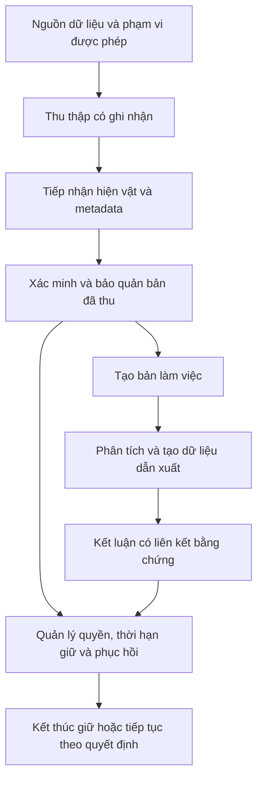

# Forensics evidence: yêu cầu đối với bằng chứng điều tra số

## 1. Vì sao bằng chứng điều tra phải được thiết kế từ trước?

Khi có sự cố, nhóm điều tra cần trả lời ai đã thực hiện hành động, tài nguyên nào bị tác động, dữ liệu có thể đã rời hệ thống qua đường nào và những kết luận đó dựa trên thông tin gì. Nếu hệ thống không ghi đúng danh tính, không giữ lịch sử quyền hoặc không xuất được dữ liệu nguồn kèm ngữ cảnh, nhiều câu hỏi sẽ không thể trả lời sau sự cố.

**Forensic evidence** trong bài là dữ liệu và hiện vật số được thu thập, bảo quản, phân tích và liên hệ với một câu hỏi điều tra. Một tệp log, ảnh chụp trạng thái, bản xuất cấu hình hoặc sự kiện từ dịch vụ ngoài có thể góp phần làm bằng chứng, nhưng giá trị của chúng phụ thuộc nguồn gốc, tính toàn vẹn, phạm vi và cách diễn giải.

Trong thiết kế yêu cầu bảo mật, mục tiêu không phải là “ghi lại mọi thứ”. Mục tiêu là tạo khả năng thu được thông tin cần thiết, có thể kiểm tra lại và được bảo vệ phù hợp, đồng thời tránh tạo thêm kho dữ liệu nhạy cảm không được quản lý.

Sau bài học, người học có thể:

- Chuyển câu hỏi điều tra thành yêu cầu về sự kiện, metadata và khả năng xuất dữ liệu.
- Phân biệt tính toàn vẹn của bản đã thu với độ tin cậy của nguồn ban đầu.
- Đặc tả lịch sử tiếp nhận, bàn giao và xử lý bằng chứng.
- Xử lý mốc thời gian, khoảng trống dữ liệu và mức chắc chắn của kết luận.
- Thiết kế quyền truy cập, vòng đời và cách xác minh kho bằng chứng.

Các yêu cầu, thời hạn và tình huống dưới đây là ví dụ học tập. Phạm vi thu thập, thời hạn giữ và việc sử dụng bằng chứng phải dựa trên mục đích, thẩm quyền và nghĩa vụ áp dụng đã được người có trách nhiệm xác nhận. Một quy trình kỹ thuật không tự bảo đảm bằng chứng sẽ được chấp nhận trong mọi thủ tục bên ngoài.

## 2. Phân biệt dữ liệu nguồn, hiện vật và kết luận

### 2.1. Một sự kiện không tự trở thành toàn bộ câu chuyện

| Đối tượng | Vai trò trong điều tra | Giới hạn cần nhớ |
| --- | --- | --- |
| Sự kiện vận hành hoặc audit | Ghi nhận một quan sát hay quyết định của thành phần | Có thể thiếu trường, bị chậm, ghi sai hoặc đến từ nguồn bị ảnh hưởng |
| Hiện vật đã thu | Bản dữ liệu được lấy từ một nguồn theo phương pháp xác định | Không mặc nhiên chứa toàn bộ dữ liệu từng tồn tại ở nguồn |
| Metadata thu thập | Giải thích lấy gì, từ đâu, khi nào, bằng cách nào | Cần được bảo vệ và liên hệ đúng với hiện vật |
| Bản làm việc hoặc dữ liệu dẫn xuất | Kết quả giải nén, phân tích, lọc, chuẩn hóa hoặc che dữ liệu | Có thể mất thông tin so với bản đã thu nếu biến đổi không được ghi nhận |
| Giả thuyết | Cách giải thích cần kiểm tra thêm | Không được trình bày như sự thật đã xác nhận |
| Kết luận | Nhận định có căn cứ từ một hoặc nhiều nguồn | Phải nêu phạm vi, giả định và giới hạn bằng chứng |

Ví dụ, log ghi nhận một thông tin xác thực được dùng để tải báo cáo không tự xác định người cụ thể đang điều khiển thông tin đó. Log truyền dữ liệu cũng không tự chứng minh người nhận đã đọc hoặc sử dụng toàn bộ nội dung.

### 2.2. Những thuộc tính cần đặc tả

Một tập bằng chứng có thể sử dụng được cần được xem xét theo các thuộc tính:

- **Liên quan:** hỗ trợ hoặc bác bỏ được câu hỏi điều tra cụ thể.
- **Nguồn gốc:** xác định nguồn, người thu và cách thu trong phạm vi biết được.
- **Toàn vẹn:** có cơ chế phát hiện thay đổi của bản đã thu và các bản được bàn giao.
- **Ngữ cảnh và độ bao phủ:** biết khoảng thời gian, tài nguyên, bộ lọc và phần thiếu.
- **Khả năng kiểm tra lại:** người có quyền có thể xem hiện vật và tái thực hiện bước phân tích phù hợp.
- **Truy vết xử lý:** biết ai đã tiếp nhận, sao chép, biến đổi, xuất hoặc kết thúc giữ.
- **Bảo mật và khả dụng:** chỉ người được phép truy cập, nhưng vẫn đọc và phục hồi được khi cần.

Không thuộc tính nào được thay thế hoàn toàn bằng một giá trị hash hoặc một dòng “đã lưu vào kho an toàn”.

## 3. Bắt đầu từ kịch bản rủi ro và câu hỏi điều tra

### 3.1. Đặt câu hỏi trước khi chọn dữ liệu

Một yêu cầu chung như “hệ thống phải hỗ trợ điều tra” khó triển khai và kiểm chứng. Hãy gắn với các kịch bản trong mô hình đe dọa.

| Kịch bản | Câu hỏi cần trả lời | Dữ liệu có thể cần |
| --- | --- | --- |
| Tài khoản bị chiếm đoạt | Thông tin xác thực hoặc phiên nào được dùng, khi nào, với quyền gì? | Sự kiện xác thực, phiên, thay đổi quyền và truy cập tài nguyên |
| Truy cập sai tổ chức | Chủ thể thuộc phạm vi nào, tài nguyên thực sự thuộc ai, điểm nào đã cho phép? | Quan hệ tổ chức, quyết định quyền, API, worker và điểm cấp nội dung |
| Nhân viên hỗ trợ lạm dụng | Hành động có nằm trong phê duyệt và thời hạn không? | Hồ sơ cấp quyền, người phê duyệt, phạm vi, audit hành động |
| Dữ liệu bị sửa hoặc xóa | Thay đổi nào xảy ra, bằng danh tính nào, bản nào có thể tin cậy để phục hồi? | Lịch sử thay đổi, audit quản trị, phiên bản dữ liệu và bản sao liên quan |
| Danh tính kỹ thuật bị lạm dụng | Workload nào hoạt động, cấu hình và quyền tại thời điểm đó ra sao? | Sự kiện workload, triển khai, quyền dịch vụ và lịch sử cấu hình |
| Audit bị gián đoạn | Khoảng nào thiếu dữ liệu và thiếu ở bước nào? | Trạng thái nguồn, hàng đợi, thu nhận và kết quả xuất dữ liệu |

Chỉ thu thập trong phạm vi được phép và có mục đích. Nếu cần mở rộng, phải có quyết định tương ứng; sự tiện lợi của công cụ không tự tạo quyền lấy dữ liệu của mọi tổ chức.

### 3.2. Ghi điều có thể mất trước khi kịp thu

Một số dữ liệu tồn tại ngắn, như trạng thái tiến trình, kết nối, cache hoặc tài nguyên tạm. Những nguồn khác có lịch quay vòng log, giới hạn truy vấn hoặc thời hạn xuất dữ liệu. Cần biết các điều kiện này trước để đặt yêu cầu khả dụng và ưu tiên thu.

Không có một thứ tự thu thập cứng phù hợp cho mọi sự cố. Thu trạng thái đang chạy có thể làm nguồn thay đổi; tắt nguồn có thể làm mất dữ liệu dễ mất nhưng ngừng được thiệt hại. Quyết định cần xét mục tiêu ứng phó, mức tác động và thẩm quyền, đồng thời ghi rõ hành động cùng ảnh hưởng tới bằng chứng.

## 4. Đặc tả dữ liệu đủ để liên hệ các lớp hệ thống

### 4.1. Danh tính khởi tạo khác danh tính thực thi

Trong hệ thống bất đồng bộ, người dùng tạo tác vụ nhưng worker dùng danh tính dịch vụ để đọc dữ liệu. Nếu chỉ ghi danh tính worker, sẽ khó biết ai kích hoạt hành động và theo quyền nghiệp vụ nào.

Yêu cầu sự kiện nên phân biệt người khởi tạo, danh tính thực thi, tổ chức yêu cầu, tổ chức sở hữu tài nguyên, quyền hoặc quyết định liên quan và định danh tương quan. Các trường này cần xuất phát từ nguồn có thẩm quyền, không chỉ sao chép tham số người gọi gửi.

Một sự kiện JSON minh họa:

```json
{
  "event_id": "evt-204",
  "schema_version": 1,
  "source": "report-content-gateway",
  "event_time": "2030-01-01T09:00:05Z",
  "observed_time": "2030-01-01T09:00:08Z",
  "initiator_id": "support-17",
  "effective_principal_id": "svc-report-reader",
  "requesting_tenant_id": "org-A",
  "resource_owner_tenant_id": "org-B",
  "resource_id": "report-82",
  "action": "report.download",
  "authorization_result": "allow",
  "correlation_id": "req-582"
}
```

Sự kiện trên là dấu hiệu cần xem xét vì tổ chức yêu cầu khác tổ chức sở hữu. Nó chưa tự chứng minh có vi phạm: cần đối chiếu quyền được cấp, ý nghĩa từng trường, kết quả cấp nội dung và độ tin cậy của nguồn ghi.

### 4.2. Nguồn từ nền tảng hoặc dịch vụ ngoài

Audit của nhà cung cấp, log cổng kết nối và log ứng dụng có thể dùng các định danh, độ phân giải và cách biểu diễn khác nhau. Cần lưu tài khoản nguồn, phạm vi nguồn, bộ lọc, phiên bản API hoặc schema, cách phân trang và thời điểm xuất.

Không mặc định một giao dịch có mã thành công chứa cùng ý nghĩa ở mọi lớp. Một lớp có thể ghi yêu cầu được chấp nhận, lớp khác ghi bắt đầu truyền, còn ứng dụng ghi hoàn tất nghiệp vụ. Bản đồ ý nghĩa trường giúp tránh nối các sự kiện chỉ vì chúng cùng có một số hoặc một nhãn giống nhau.

## 5. Viết yêu cầu bằng chứng có thể kiểm chứng

### 5.1. Một tập yêu cầu minh họa

| Định danh | Cam kết | Cách xác minh chính |
| --- | --- | --- |
| FE-01 | Các thao tác nhạy cảm phải có trường đủ để liên hệ chủ thể, quyền, tổ chức và tài nguyên | Tạo chuỗi hành động thử và đối chiếu sự kiện qua các lớp |
| FE-02 | Chức năng xuất dữ liệu điều tra phải giữ nội dung đã thu cùng metadata về nguồn và phạm vi | Xuất dữ liệu có phân trang, lọc và khoảng trống được biết trước |
| FE-03 | Chỉ người được ủy quyền mới được thu hoặc mở rộng phạm vi thu | Thử danh tính, tổ chức và khoảng thời gian ngoài phạm vi được cấp |
| FE-04 | Hiện vật đã tiếp nhận phải có cơ chế phát hiện thay đổi và xác minh sau chuyển giao | Kiểm tra dữ liệu bị sửa, metadata bị thay và bản sao chuyển không đầy đủ |
| FE-05 | Lịch sử tiếp nhận, bàn giao và biến đổi phải truy vết được | Tái dựng chuỗi xử lý từ hồ sơ tới hiện vật và bản dẫn xuất |
| FE-06 | Phân tích thời gian phải giữ dấu thời gian gốc và thông tin chuẩn hóa | Kiểm tra múi giờ, độ lệch, độ phân giải và thứ tự sự kiện |
| FE-07 | Kho bằng chứng phải giới hạn quyền đọc, xuất, sửa và xóa theo vai trò | Thử quyền, audit thao tác quản trị và truy cập khẩn cấp |
| FE-08 | Thời hạn giữ, tạm dừng xóa và kết thúc giữ phải có căn cứ và thẩm quyền | Kiểm thử vòng đời và xung đột giữa giữ đặc biệt với lịch xóa |
| FE-09 | Kết quả phân tích phải chỉ ra hiện vật, công cụ và phép biến đổi đã dùng | Tái thực hiện phân tích trên bản làm việc được xác nhận |
| FE-10 | Bằng chứng và các phụ thuộc cần thiết phải phục hồi được theo yêu cầu | Diễn tập đọc, giải mã, kiểm tra toàn vẹn và quyền sau phục hồi |

Mỗi cam kết cần được cụ thể hóa theo nguồn, môi trường và mục tiêu. Nếu chọn mục tiêu đưa sự kiện vào kho tra cứu trong tối đa 120 giây, phải định nghĩa mốc bắt đầu và điều kiện tra cứu được. Đây là giới hạn thu nhận, không tự là giới hạn phát hiện sự cố.

### 5.2. Đặc tả khi nguồn không cung cấp đủ khả năng

Nếu nguồn không hỗ trợ snapshot nhất quán hoặc không cho lấy toàn bộ dữ liệu, cần ghi giới hạn và phương án: nhiều lần xuất có đối chiếu, mốc tiến độ, định danh chống trùng hoặc nguồn bổ sung. Không báo một bản xuất là đầy đủ nếu công cụ chỉ lấy trang đầu hoặc dừng do lỗi mà không thông báo.

Nếu chưa có khả năng đáp ứng câu hỏi điều tra quan trọng, ghi khoảng trống yêu cầu và rủi ro tồn dư. Không dùng nhãn “forensic ready” chỉ vì đã bật một tùy chọn log.

## 6. Vòng đời từ nguồn tới báo cáo



### 6.1. Bản đã thu không luôn là toàn bộ trạng thái gốc

Với hệ thống đang chạy, dữ liệu có thể thay đổi trong lúc thu. Một bản xuất từ API có thể là tập kết quả tại nhiều thời điểm thay vì ảnh chụp nguyên tử. Phải mô tả đúng bản chất đó trong metadata.

Nên gọi rõ “bản đã thu từ nguồn” khi không thể khẳng định đó là một bản sao đầy đủ hoặc bất biến của toàn nguồn. Không gắn nhãn “original” theo cách làm người đọc hiểu nhầm rằng mọi trạng thái trước thu đều được bảo toàn.

### 6.2. Giữ bản đã thu và làm việc trên bản có truy vết

Sau tiếp nhận, bảo vệ bản đã thu theo quy tắc được chọn và tạo bản làm việc cho phân tích. Mỗi bản làm việc cần liên hệ tới hiện vật nguồn, cách sao chép và kiểm tra tính toàn vẹn phù hợp.

Nếu giải nén, chuyển mã hoặc phân tích thành bảng, tạo đối tượng dẫn xuất riêng. Không ghi đè lên dữ liệu nguồn đã thu rồi mất khả năng tái kiểm tra kết quả bằng công cụ khác.

### 6.3. Công cụ và thao tác cũng là một phần ngữ cảnh

Ghi tên và phiên bản công cụ, cấu hình, bộ lọc, giới hạn, thời điểm và lỗi. Nếu câu lệnh hoặc tham số chứa bí mật, không lưu bí mật vào biên bản; cần cách ghi an toàn vẫn giải thích được thao tác và nguồn quyền sử dụng.

Nếu công cụ tự bỏ trường, đổi thời gian hoặc rút gọn nội dung, phải biết và ghi nhận. Một bản báo cáo đẹp hơn không được làm mất dấu những gì đã thay đổi so với dữ liệu thu nhận.

## 7. Tính toàn vẹn, hash và nguồn gốc

### 7.1. Hash giúp phát hiện thay đổi của đối tượng xác định

Giá trị digest được tính từ byte của một hiện vật có thể hỗ trợ kiểm tra bản sao hoặc phát hiện thay đổi sau khi đã thu, nếu cơ chế và cách bảo vệ giá trị tham chiếu phù hợp với chính sách.

Cần xác định đang tính trên đối tượng nào: tệp nguồn đã xuất, gói nén, từng tệp bên trong hay bản dẫn xuất. Hash của gói nén không tự là hash của dữ liệu sau giải nén. Cùng nội dung nghiệp vụ được xuất lại với thứ tự hoặc định dạng khác có thể cho byte và digest khác nhau.

Khi chuyển giao, bên nhận cần kiểm tra đối tượng thực nhận với giá trị tham chiếu đã được bảo vệ phù hợp. Gửi một tệp rồi chỉ kiểm tra giá trị do chính nơi có thể sửa tệp cung cấp chưa giải quyết hết rủi ro thay cả tệp lẫn metadata.

### 7.2. Hash không chứng minh nguồn nói đúng

Nếu nguồn đã bị kiểm soát trước lúc thu, một tệp được băm hoàn hảo vẫn có thể chứa sự kiện giả hoặc thiếu dữ liệu. Hash không chứng minh ai đã tạo dữ liệu, dữ liệu phản ánh đúng hoạt động thực tế hay người thu có thẩm quyền.

Cần kết hợp nguồn gốc, đường thu, lịch sử quản trị, kiểm soát truy cập và nguồn đối chiếu phù hợp. Chữ ký hoặc cơ chế bảo vệ manifest có thể bổ sung xác minh nguồn phát hành gói, nhưng vẫn phụ thuộc việc quản lý khóa và độ tin cậy của chủ thể ký.

### 7.3. Manifest và kho bảo quản

Manifest nên liên hệ định danh hiện vật, kích thước, digest theo chính sách, nguồn, thời điểm, cách thu, phạm vi, lỗi và các bản phụ thuộc. Manifest cũng cần được bảo vệ; không coi nó là dữ liệu vô hại có thể sửa tự do.

Kho có cơ chế chống ghi đè hoặc giữ bất biến giúp giảm một số đường sửa, xóa. Tuy nhiên, cần kiểm tra cấu hình, thời hạn, quyền quản trị, khả năng thay chính sách và các lớp metadata liên quan. Nhãn “immutable” không tự chứng minh toàn bộ chuỗi không thể bị can thiệp.

Một lỗi toàn vẹn cần làm hiện vật bị đánh dấu và được xử lý, không được âm thầm cập nhật digest để khớp dữ liệu mới rồi tiếp tục như chưa có thay đổi.

## 8. Thời gian, thứ tự và độ đầy đủ

### 8.1. Giữ thời điểm nguồn và thời điểm quan sát riêng

Nên phân biệt thời điểm sự kiện do nguồn ghi, thời điểm hệ thống thu nhận nhìn thấy, thời điểm xuất và thời điểm phân tích. Chúng phục vụ các câu hỏi khác nhau.

Chuyển sang UTC giúp biểu diễn nhất quán nhưng không tự sửa một đồng hồ sai. Nếu có ước lượng độ lệch, giữ thông tin nguồn ước lượng, thời điểm đo và độ bất định. Không sửa dấu thời gian thô của hiện vật để làm các sự kiện trông khớp nhau.

Ví dụ, nếu định nghĩa độ lệch là đồng hồ nguồn trừ đồng hồ tham chiếu, thời điểm tham chiếu ước lượng bằng thời điểm nguồn trừ độ lệch. Đây là giá trị dẫn xuất với sai số tương ứng, không phải sự thật tuyệt đối thay thế giá trị gốc.

### 8.2. Không suy thứ tự chỉ từ hai dấu thời gian gần nhau

Hai nguồn có độ phân giải hoặc độ lệch khác nhau có thể ghi thứ tự khác với thứ tự thực. Dùng thêm định danh tương quan, số thứ tự, quan hệ yêu cầu và phản hồi hoặc bằng chứng khác khi có.

Nếu không đủ căn cứ xác định thứ tự, ghi khoảng thời gian hoặc các khả năng còn phù hợp. Không kết luận quan hệ nhân quả chỉ vì một sự kiện có dấu thời gian sớm hơn vài mili giây.

### 8.3. Chứng minh phạm vi đã thu, không chỉ số lượng tệp

Một bản xuất cần ghi khoảng thời gian truy vấn, nguồn, bộ lọc, cách phân trang, số trang hoặc mốc tiến độ, số bản ghi và lỗi đã gặp. Với nguồn thay đổi trong lúc xuất, cần biết cách xử lý bản ghi đến muộn, trùng hoặc nằm sát biên thời gian.

Nếu không có sự kiện, cần phân biệt:

- Không có hành động tương ứng trong phạm vi đã quan sát được.
- Nguồn không ghi loại hành động đó.
- Dữ liệu đã bị quay vòng hoặc chưa tới kho.
- Bộ lọc, quyền hoặc công cụ xuất đã loại dữ liệu.
- Nguồn hoặc đường thu nhận có thể đã bị ảnh hưởng.

Không thấy bằng chứng không tự là bằng chứng không có hoạt động. Kết luận phải đi cùng năng lực và giới hạn quan sát.

## 9. Chain of custody: lịch sử kiểm soát và xử lý

### 9.1. Ghi được ai chịu trách nhiệm ở từng bước

**Chain of custody** là lịch sử liên hệ việc tiếp nhận, kiểm soát, chuyển giao và xử lý một hiện vật. Quy trình cụ thể cần phù hợp mục đích sử dụng; trong hệ thống số, cần tính cả thao tác sao chép, truy cập đặc quyền và biến đổi dữ liệu, không chỉ bàn giao một thiết bị vật lý.

| Trường sự kiện xử lý | Nội dung cần ghi |
| --- | --- |
| Định danh | Hiện vật, sự kiện xử lý và hồ sơ điều tra liên quan |
| Người hoặc hệ thống thực hiện | Danh tính có thể quy trách nhiệm, không chỉ tên tài khoản dùng chung |
| Hành động | Tiếp nhận, sao chép, bàn giao, phân tích, xuất, giữ hoặc xóa |
| Thời điểm và nguồn thời gian | Mốc thực hiện cùng ngữ cảnh cần thiết |
| Nguồn và đích | Kho, người hoặc hệ thống trước và sau thao tác |
| Căn cứ và phạm vi | Mục đích, phê duyệt hoặc quyền áp dụng |
| Xác minh | Đối tượng được kiểm tra, kết quả và lỗi nếu có |
| Liên kết dẫn xuất | Bản nguồn, bản tạo mới, công cụ và phép biến đổi |

Không bắt buộc mọi lần đọc đều là một lần chuyển người sở hữu. Cần phân biệt truy cập, sao chép, chuyển trách nhiệm và tạo bản dẫn xuất để lịch sử phản ánh đúng điều xảy ra.

### 9.2. Lịch sử cũng cần được bảo vệ

Nếu cùng một người có thể sửa hiện vật và xóa toàn bộ lịch sử xử lý mà không có dấu vết độc lập, khả năng kiểm tra lại bị suy yếu. Thiết kế cần phân định quyền và có nơi ghi nhận phù hợp cho các thao tác quan trọng.

Khi sửa thông tin hồ sơ sai, giữ giá trị trước, giá trị sửa, lý do và người sửa. Không âm thầm viết lại lịch sử. Nếu phát hiện một đoạn bàn giao không đủ thông tin, ghi khoảng trống và ảnh hưởng tới kết luận thay vì bổ sung như thể đã được ghi nhận tại thời điểm ban đầu.

### 9.3. Khả năng tái thực hiện phân tích

Báo cáo cần chỉ ra hiện vật và phiên bản nào, công cụ, truy vấn, bộ lọc và cách biến đổi đã được dùng. Nếu một kết quả phụ thuộc thao tác thủ công, ghi đủ bước để người khác hiểu và kiểm tra hợp lý.

Tái thực hiện không luôn tạo byte giống nhau nếu công cụ thêm thời điểm hoặc có yếu tố không xác định. Cần xác định kết quả nào phải khớp, yếu tố nào có thể khác và vì sao. Không che các khác biệt có ảnh hưởng tới kết luận.

## 10. Bảo mật, vòng đời và phục hồi kho bằng chứng

### 10.1. Quyền theo hồ sơ, tổ chức và mục đích

Người vận hành hệ thống không mặc nhiên cần đọc nội dung mọi hiện vật. Người điều tra một tổ chức cũng không mặc nhiên có quyền mở rộng sang tổ chức khác. Cần tách các quyền thu, đọc, phân tích, xuất, quản trị kho và kết thúc giữ khi phù hợp.

Truy cập khẩn cấp cần điều kiện, hạn dùng và audit. Nếu phải chia sẻ ra ngoài nhóm, kiểm tra người nhận, phạm vi dữ liệu và kênh truyền; không đưa liên kết công khai để vượt trở ngại quyền truy cập.

### 10.2. Mã hóa và khóa phải giữ được khả dụng hợp lệ

Mã hóa khi lưu và truyền cần đi cùng quản lý khóa và danh tính. Kho còn dữ liệu nhưng không còn khóa dùng được sẽ không đáp ứng mục tiêu điều tra. Ngược lại, giữ khóa ở nơi ai cũng đọc được làm mất thuộc tính bảo vệ.

Diễn tập phục hồi cần đọc được hiện vật, metadata và lịch sử liên quan, kiểm tra toàn vẹn và giữ đúng quyền hiện hành. Không nới quyền chỉ để bài diễn tập thành công hoặc phục hồi quyền truy cập cũ đã bị thu hồi.

### 10.3. Giữ đặc biệt không đồng nghĩa giữ mọi thứ mãi mãi

Thời hạn giữ phải liên quan tới mục đích và nghĩa vụ đã xác nhận. Nếu có quyết định tạm dừng xóa, cần nêu hiện vật, phạm vi, người ra quyết định, điều kiện hiệu lực và cách kết thúc.

Kiểm thử vòng đời phải xác nhận lịch xóa không bỏ qua quyết định giữ còn hiệu lực, đồng thời dữ liệu không bị giữ vô hạn chỉ vì một cờ trạng thái không ai quản lý. Khi kết thúc, ghi cách xử lý các bản sao hoặc bản dẫn xuất thuộc phạm vi có thể quản lý.

### 10.4. Bản che dữ liệu là đối tượng dẫn xuất

Khi tạo bản che dữ liệu để chia sẻ, giữ liên kết tới bản đã thu và quy tắc che. Tính digest riêng cho đối tượng mới nếu quy trình yêu cầu. Không thay bản đã thu bằng bản đã che rồi làm mất thông tin cần xem lại.

Khả năng che dữ liệu phải được xác minh trên cả nội dung, metadata và các lớp chứa liên quan. Một tài liệu nhìn đã che trên giao diện vẫn có thể còn dữ liệu trong phần khác của định dạng; kết quả cần được kiểm tra bằng phương pháp phù hợp với loại hiện vật.

## 11. Ví dụ: điều tra báo cáo bị truy cập ngoài phạm vi hỗ trợ

### 11.1. Câu hỏi và phạm vi ban đầu

Nhân viên hỗ trợ `support-17` được phê duyệt làm việc với tổ chức A, nhưng có sự kiện cấp nội dung liên quan tới báo cáo của B. Nhóm cần xác định quyền tại thời điểm đó, đường truy cập, dữ liệu có thể đã được cấp và mức chắc chắn về danh tính thực hiện.

Phạm vi ban đầu gồm hồ sơ phê duyệt, lịch sử quyền, sự kiện xác thực, API tạo tác vụ, worker, điểm cấp nội dung và nguồn lưu trữ liên quan trong khoảng thời gian được ủy quyền. Phần mở rộng cần có quyết định và lý do, không tự thu toàn bộ dữ liệu khách hàng.

### 11.2. Danh mục hiện vật minh họa

| Hiện vật | Nội dung | Câu hỏi hỗ trợ | Giới hạn |
| --- | --- | --- | --- |
| EV-01 | Hồ sơ phê duyệt và lịch sử sửa | Được phép hỗ trợ tổ chức nào, thao tác nào, trong thời hạn nào? | Cần biết hồ sơ có phản ánh trạng thái tại thời điểm sự kiện không |
| EV-02 | Sự kiện danh tính và phiên | Thông tin xác thực nào đã được dùng? | Không tự xác định con người đang điều khiển phiên |
| EV-03 | Audit API và worker | Ai tạo tác vụ, dữ liệu và tổ chức đích được chọn ra sao? | Có thể thiếu phần nếu pipeline gián đoạn |
| EV-04 | Sự kiện điểm cấp nội dung và kho tệp | Đường nào cho phép, ghi nhận truyền dữ liệu ra sao? | Ý nghĩa số byte và trạng thái cần giải thích theo nguồn |
| EV-05 | Cấu hình và phiên bản liên quan | Quy tắc quyền thực tế tại thời điểm cần xem xét là gì? | Cấu hình hiện tại không tự đại diện quá khứ |

Mỗi hiện vật có metadata thu, phạm vi, thông tin toàn vẹn, người chịu trách nhiệm và vị trí được bảo vệ. Những lỗi truy vấn hoặc phần chưa lấy được cũng được ghi vào hồ sơ.

### 11.3. Liên hệ nguồn và giữ mức chắc chắn

Nhóm dùng định danh tương quan để nối yêu cầu tới tác vụ và đường cấp nội dung. Dấu thời gian được chuẩn hóa ở bản phân tích nhưng giữ nguyên giá trị nguồn. Nếu hai nguồn không có thông tin đồng hồ đủ tin cậy, không ép kết luận thứ tự từ chênh lệch rất nhỏ.

Hồ sơ phê duyệt có thể chứng minh phạm vi được duyệt là A. Audit có thể ghi hệ thống cho phép một giao dịch liên quan tới B. Nguồn cấp nội dung có thể ghi nhận truyền một lượng byte qua giao dịch đó. Kết luận phải dựa trên việc kiểm tra các quan hệ và ý nghĩa sự kiện, không chỉ thấy cùng một tên người dùng.

Một cách ghi kết quả phù hợp:

- Đã xác nhận những quan hệ nào từ nguồn và phiên bản cụ thể.
- Có căn cứ gì về đường cấp nội dung và phạm vi tài nguyên.
- Chưa xác định được điều gì về người điều khiển phiên hoặc việc sử dụng dữ liệu sau đó.
- Khoảng trống log hoặc nguồn bị ảnh hưởng làm giới hạn kết luận thế nào.
- Cần dữ liệu hoặc phép kiểm tra nào tiếp theo để phân biệt các giả thuyết còn lại.

Tái hiện lỗi trong môi trường thử giúp hiểu một đường kỹ thuật có thể tồn tại. Nó không tự chứng minh đường đó đã được dùng trong giao dịch quá khứ nếu thiếu bằng chứng lịch sử tương ứng.

### 11.4. Kết quả quay lại yêu cầu

Nếu không xác định được tổ chức sở hữu từ sự kiện, cập nhật FE-01. Nếu xuất log bỏ qua bản ghi đến muộn, cập nhật FE-02 cùng ca kiểm tra. Nếu quyền kho quá rộng hoặc dữ liệu bị sửa không có dấu vết, xử lý FE-04 và FE-07.

Mỗi công việc cần người thực hiện, tiêu chí chấp nhận và bằng chứng xác minh. Không chỉ thêm một trường vào schema rồi đóng khoảng trống nếu các thành phần phát sự kiện vẫn chưa ghi trường đó đúng.

## 12. Kiểm chứng yêu cầu bằng dữ liệu và tình huống thử

### 12.1. Một ma trận xác minh gọn

| Yêu cầu | Tình huống thử | Điều phải chứng minh |
| --- | --- | --- |
| FE-01 | Người dùng tạo tác vụ, worker xử lý, điểm tải cấp hoặc từ chối | Nối được đúng chủ thể, tổ chức, tài nguyên và kết quả |
| FE-02 | Nguồn có nhiều trang, dữ liệu đến muộn, trùng và một trang lỗi | Bản xuất cùng metadata phản ánh phạm vi, thiếu và lỗi, không báo đầy đủ sai |
| FE-03 | Danh tính ngoài hồ sơ hoặc sai tổ chức yêu cầu thu dữ liệu | Bị từ chối, không tạo bản xuất ngoài quyền |
| FE-04 | Sửa hiện vật, thay manifest hoặc làm thiếu dữ liệu sau chuyển | Phát hiện đúng và không tự hợp thức hóa thay đổi |
| FE-05 | Sao chép, bàn giao, tạo bản che và phân tích | Tái dựng được lịch sử và liên hệ các đối tượng |
| FE-06 | Nguồn có múi giờ, độ lệch hoặc độ phân giải khác nhau | Không đổi bản thô, phân tích giữ cách chuẩn hóa và bất định |
| FE-07 | Đọc, xuất, xóa và quản trị bằng danh tính khác nhau | Quyền được tách đúng, thao tác quan trọng có dấu vết |
| FE-08 | Lịch xóa gặp quyết định giữ còn hiệu lực rồi được kết thúc hợp lệ | Dữ liệu tuân theo vòng đời và thẩm quyền đã đặc tả |
| FE-10 | Kho chính không khả dụng, phục hồi ở môi trường được phép | Đọc và xác minh được dữ liệu, metadata, khóa và quyền |

Với FE-09, cho người có quyền dùng cùng hiện vật và quy trình phân tích để kiểm tra lại kết quả. Những khác biệt do phiên bản công cụ hoặc cấu hình cần được giải thích và xử lý nếu ảnh hưởng kết luận.

### 12.2. Điều kiện bằng chứng của chính lần kiểm thử

Lưu phiên bản yêu cầu, nguồn thử, schema, công cụ, bản dựng, cấu hình, đầu vào và kết quả. Dùng dữ liệu thử được kiểm soát; không cần lấy dữ liệu thật chỉ để chứng minh một nhánh quyền hoặc phân trang.

Một kiểm thử đơn vị cho hàm tính digest không chứng minh nguồn xuất đầy đủ hoặc kho không thể bị sửa. Cần chọn đúng lớp: kiểm thử thành phần, tích hợp, đánh giá cấu hình, diễn tập và kiểm tra hồ sơ theo từng cam kết.

Nếu chỉ kiểm tra một nguồn trong nhiều nguồn bắt buộc, kết luận phải là một phần. Giữ riêng chưa chạy, bị chặn, không đạt và đã đạt trong phạm vi, thay vì gom thành một trạng thái hoàn tất.

## 13. Những lỗi phổ biến khi đặc tả và diễn giải bằng chứng

| Biểu hiện | Vấn đề | Cách sửa |
| --- | --- | --- |
| Có log là đủ điều tra | Có thể thiếu chủ thể, tổ chức, thời gian hoặc đường xử lý | Bắt đầu từ câu hỏi và trường cần trả lời |
| Hash khớp nên dữ liệu nguồn chắc chắn đúng | Chỉ chứng minh quan hệ byte với giá trị tham chiếu trong điều kiện nhất định | Đánh giá nguồn, cách thu và bằng chứng đối chiếu |
| Chỉ lưu ảnh chụp màn hình | Có thể mất dữ liệu gốc, bộ lọc và metadata | Giữ bản xuất phù hợp cùng ngữ cảnh; ảnh chỉ bổ sung khi cần |
| Xuất được một tệp nên coi đã lấy đủ | Có thể thiếu trang, khoảng thời gian hoặc bản ghi đến muộn | Ghi mốc tiến độ, lỗi và cách đánh giá độ bao phủ |
| Chuyển UTC là đồng hồ đã đúng | Múi giờ không phải sai lệch đồng hồ | Giữ thời gian nguồn, chuẩn hóa và bất định riêng |
| Tên tài khoản là người thực hiện | Có thể là phiên bị chiếm hoặc danh tính dùng chung | Tách thông tin xác thực, danh tính kỹ thuật và suy luận về con người |
| Sửa dữ liệu nguồn cho dễ phân tích | Mất khả năng kiểm tra lại bản đã thu | Tạo bản dẫn xuất và ghi phép biến đổi |
| Cùng người sửa hiện vật và xóa lịch sử | Không có cơ sở kiểm soát thay đổi đáng tin cậy | Phân định quyền và bảo vệ lịch sử phù hợp |
| Không có sự kiện nên không có hoạt động | Có thể thiếu ghi, thu hoặc xuất dữ liệu | Nêu rõ khả năng quan sát và phần thiếu |
| Thu mọi dữ liệu rồi giữ vô hạn | Mở rộng rủi ro và vượt mục đích hoặc thẩm quyền | Giới hạn phạm vi, quyền và vòng đời có quyết định |
| Bản đã che thay luôn bản đã thu | Làm mất thông tin hoặc khả năng đối chiếu | Quản lý bản che như đối tượng dẫn xuất |
| Kho mã hóa nhưng không phục hồi được khóa | Bằng chứng có thể không đọc được khi cần | Diễn tập dữ liệu, khóa, metadata và quyền cùng nhau |

## 14. Thực hành và điều kiện bàn giao

### 14.1. Bài tập thiết kế yêu cầu

Một hệ thống nhiều tổ chức có API, hàng đợi, worker và kho tệp. Người dùng báo đã tải được dữ liệu sau khi bị thu hồi quyền. Log ứng dụng giữ người yêu cầu, log kho tệp chỉ có danh tính dịch vụ, hai nguồn có dấu thời gian khác nhau. Chức năng xuất log dùng phân trang và có thể trả dữ liệu mới trong lúc xuất.

Hãy thực hiện:

1. Viết những câu hỏi cần trả lời và xác định phạm vi thu ban đầu.
2. Phân biệt dữ liệu nguồn, bản đã thu, metadata, bản làm việc và kết luận.
3. Đặc tả trường liên hệ người yêu cầu, worker, tổ chức, tài nguyên và đường cấp nội dung.
4. Viết yêu cầu xuất dữ liệu có phân trang, bản ghi đến muộn, lỗi giữa chừng và dấu hiệu thiếu dữ liệu.
5. Thiết kế hồ sơ toàn vẹn và lịch sử bàn giao, nêu rõ điều hash không chứng minh được.
6. Ghi cách giữ thời gian nguồn, chuẩn hóa và xử lý thứ tự chưa chắc chắn.
7. Thiết kế quyền đọc, xuất, giữ đặc biệt, kết thúc giữ và phục hồi kho bằng chứng.
8. Tạo một kết luận có căn cứ cùng danh sách điều chưa thể xác định.
9. Chọn phương pháp kiểm chứng cho từng yêu cầu và dữ liệu thử cần chuẩn bị.

Không đủ cơ sở để kết luận một cá nhân cụ thể đã đọc toàn bộ dữ liệu chỉ từ một mã thành công của dịch vụ. Bài làm cần giữ đúng quan hệ giữa điều đã quan sát, suy luận được và điều còn thiếu bằng chứng.

### 14.2. Điểm kiểm tra trước khi bàn giao

- Câu hỏi điều tra, mục đích, phạm vi và thẩm quyền đã được xác định.
- Các nguồn cần thiết cùng giới hạn tồn tại hoặc truy vấn đã được ghi nhận.
- Sự kiện đủ để nối chủ thể, danh tính kỹ thuật, tổ chức, tài nguyên và hành động.
- Bản đã thu có metadata nguồn, phạm vi, phương pháp, thời điểm và lỗi.
- Cơ chế toàn vẹn có đối tượng rõ và giá trị tham chiếu được bảo vệ.
- Lịch sử tiếp nhận, bàn giao, truy cập và biến đổi có thể kiểm tra lại.
- Dấu thời gian gốc, cách chuẩn hóa và mức bất định được giữ riêng.
- Bản làm việc, bản che và dữ liệu dẫn xuất liên hệ được với hiện vật nguồn.
- Quyền, mã hóa, khóa, thời hạn giữ và phục hồi đáp ứng mục tiêu đã chọn.
- Kết luận phân biệt sự thật, giả thuyết, khoảng trống và giới hạn quy kết.
- Yêu cầu liên kết với kiểm thử, diễn tập, bằng chứng và người chịu trách nhiệm.

Khả năng điều tra tốt bắt đầu từ yêu cầu về dữ liệu và kiểm soát được thiết kế trước sự cố. Bằng chứng hữu ích là bằng chứng có thể giải thích nguồn gốc, kiểm tra cách xử lý và hỗ trợ một kết luận đúng phạm vi, đồng thời được bảo vệ khỏi thay đổi, mất mát và sử dụng ngoài mục đích.
