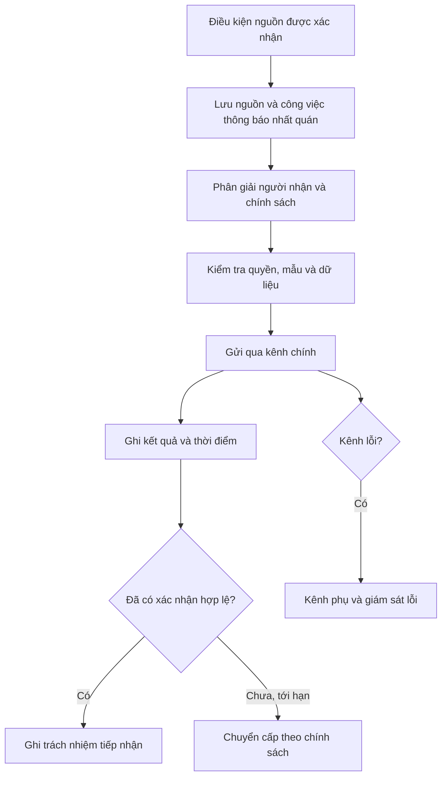

# Notification requirement

## 1. Yêu cầu thông báo trong vận hành bảo mật

**Notification requirement** đặc tả khi nào hệ thống phải thông báo, thông báo cho ai, bằng kênh nào, trong bao lâu, với nội dung gì và cần bằng chứng nào để xác nhận kết quả.

Trong vận hành và ứng phó incident, cảnh báo chỉ tạo giá trị khi thông tin đến đúng vai trò và công việc được tiếp nhận. Một rule phát hiện đúng nhưng gửi sai người, gửi chậm hoặc không được theo dõi vẫn để lại khoảng trống xử lý.

Yêu cầu thông báo cũng xuất hiện trong các luồng bảo mật khác:

- Thông báo mật khẩu, yếu tố xác thực hoặc thông tin liên hệ đã thay đổi.
- Thông báo một hoạt động nhạy cảm hoặc quyết định thu hồi quyền.
- Thông báo pipeline giám sát đang suy giảm.
- Cập nhật tình trạng sự cố cho những bên có trách nhiệm.
- Thông báo bên ngoài theo nghĩa vụ áp dụng đã được xác nhận.

Các trường hợp này có mục đích, người nhận và điều kiện khác nhau. Không nên áp dụng một mẫu nội dung hoặc một SLA chung cho tất cả.

Bài học dùng một luồng thông báo cảnh báo bảo mật mức cao làm ví dụ xuyên suốt. Mọi mã, thời hạn, lịch thử lại và vai trò trong ví dụ đều là **giả định phục vụ học tập**, không phải chính sách mặc định hoặc thời hạn thông báo bắt buộc của một văn bản thực tế.

### Đừng dùng một từ “đã gửi” cho nhiều kết quả

| Mốc hoặc kết quả | Điều có thể kết luận |
| --- | --- |
| Sự kiện nguồn được lưu | Có một điều kiện nghiệp vụ hoặc bảo mật cần xử lý |
| Thông báo được tạo | Hệ thống đã tạo công việc gửi |
| Yêu cầu gửi được chấp nhận | Thành phần hoặc nhà cung cấp nhận yêu cầu |
| Thông báo có tại đích | Đáp ứng định nghĩa giao nhận của kênh |
| Thông báo được mở hoặc xem | Có tín hiệu xem theo khả năng đo của kênh |
| Người trực xác nhận | Một chủ thể được phép đã nhận trách nhiệm theo quy trình |
| Incident được xử lý | Có kết quả xử lý theo quy trình sự cố |

Mỗi kết luận cần nguồn bằng chứng riêng. Nhà cung cấp trả thành công không tự chứng minh người nhận đã đọc hoặc đã bắt đầu xử lý.

## 2. Xác định mục đích, người nhận và nguồn thẩm quyền

Trước khi chọn email, tin nhắn hay hộp thư nội bộ, cần xác định thông báo phục vụ quyết định nào.

| Loại thông báo | Đích nhận thường cần xem xét | Điều phải làm rõ |
| --- | --- | --- |
| Cảnh báo cần người trực xử lý | Vai trò trực bảo mật hoặc vận hành | Ai nhận trách nhiệm, khi nào chuyển cấp |
| Thay đổi bảo mật tài khoản | Chủ thể hoặc kênh liên hệ đã xác minh | Sự kiện nào kích hoạt, có đường kiểm tra hoạt động lạ không |
| Thay đổi quyền hoặc truy cập dữ liệu | Chủ sở hữu tài nguyên hoặc vai trò quản lý | Phạm vi dữ liệu và người được biết |
| Cập nhật incident | Nhóm xử lý và bên liên quan được xác định | Mức chắc chắn, chu kỳ cập nhật và người duyệt nội dung |
| Thông báo bên ngoài | Người nhận theo cam kết hoặc nghĩa vụ áp dụng | Nguồn, phạm vi, mốc tính, thẩm quyền và bằng chứng giao nhận |

Không suy người nhận từ một địa chỉ tùy ý trong request. Cần có danh mục liên hệ hoặc cơ chế phân giải người nhận đáng tin cậy.

Với thông báo bên ngoài, vai trò chịu trách nhiệm phải xác nhận nghĩa vụ nào áp dụng và nội dung nào được phép phát hành. SLA của đội trực nội bộ không tự trở thành thời hạn thông báo khách hàng hoặc cơ quan bên ngoài.

Tương tự, việc đang chờ duyệt một thông điệp bên ngoài không mặc nhiên ngăn cảnh báo nội bộ đi theo quy trình đã xác nhận.

### Ai chịu trách nhiệm phần nào?

Cần tách rõ:

- Chủ sở hữu yêu cầu xác nhận mục tiêu và phạm vi.
- Chủ sở hữu luồng nguồn xác nhận sự kiện và trạng thái.
- Nhóm nền tảng thông báo thực hiện giao nhận và trạng thái kênh.
- Chủ sở hữu lịch trực duy trì vai trò, liên hệ và chuyển cấp.
- Vai trò được phân công xác nhận hoặc duyệt nội dung nhạy cảm.
- Nhóm kiểm thử và vận hành thu bằng chứng phù hợp.

Không để công việc “cấu hình người nhận” trở thành trách nhiệm chung không ai sở hữu.

## 3. Cấu trúc một yêu cầu thông báo có thể kiểm chứng

Một mẫu câu có thể dùng:

> Khi **sự kiện hoặc trạng thái đã xác định** xảy ra, hệ thống phải tạo **loại thông báo** cho **người nhận được phân giải theo quy tắc**, qua **kênh được phép**, đạt **mốc giao nhận** trong **giới hạn thời gian**; nếu chưa đạt hoặc chưa được xác nhận thì thực hiện **thử lại, chuyển kênh hoặc chuyển cấp** theo điều kiện đã nêu.

Hồ sơ yêu cầu cần có:

| Thành phần | Nội dung |
| --- | --- |
| Mã và phiên bản | Định danh yêu cầu và phiên bản chính sách |
| Nguồn | Rủi ro, sự kiện nghiệp vụ, cam kết hoặc quyết định áp dụng |
| Trigger | Điều kiện kích hoạt và mốc bắt đầu |
| Mức độ và loại | Cách định tuyến, ưu tiên và quản lý nội dung |
| Người nhận | Vai trò, phạm vi, nguồn liên hệ và xử lý khi không có người |
| Kênh | Chính, phụ, khả năng đo và phụ thuộc |
| Nội dung | Trường được phép, mẫu có phiên bản và đường xem chi tiết |
| Thời hạn | Mốc tạo, giao nhận, xác nhận và chuyển cấp |
| Thử lại | Điều kiện thử lại, giới hạn, timeout và deadline |
| Chống trùng | Định danh logic và chính sách cập nhật |
| Xác nhận | Ai được xác nhận, thao tác nào và phạm vi trách nhiệm |
| Bằng chứng | Trạng thái, thời điểm, lý do lỗi và dấu vết |
| Ngoại lệ | Thẩm quyền, phạm vi, hạn và cách phát hiện hết hiệu lực |

Cụm từ “gửi ngay đến người phụ trách” thiếu ít nhất mốc tính, người nhận, kênh, bằng chứng và hành vi khi thất bại.

## 4. Bộ yêu cầu giả định cho cảnh báo mức cao

Giả sử hệ thống đã có một bản ghi cảnh báo bảo mật mức cao. Thông báo cần giúp vai trò trực tiếp nhận để xác minh; nội dung không được khẳng định đã bị lấy dữ liệu nếu chưa có kết luận.

| Mã | Nội dung giả định |
| --- | --- |
| NOTIF-TRIGGER-01@1 | Khi cảnh báo mức cao được lưu bền vững, tạo công việc thông báo nhất quán với bản ghi nguồn; gọi thời điểm lưu nguồn là t0 |
| NOTIF-ROUTE-02@1 | Phân giải người nhận từ lịch trực và danh mục liên hệ được quản lý; người nhận phải có quyền biết cảnh báo trong phạm vi tương ứng |
| NOTIF-DELIVERY-03@1 | Ở điều kiện bình thường, thông báo phải sẵn sàng trong hộp thư vận hành có kiểm soát của vai trò đích trong tối đa 120 giây từ t0 |
| NOTIF-ACK-04@1 | Nếu đến t0 cộng 300 giây chưa có xác nhận hợp lệ, tạo công việc chuyển cấp; bắt đầu lần gửi chuyển cấp trong tối đa 30 giây tiếp theo |
| NOTIF-RETRY-05@1 | Gửi lại giữ cùng định danh thông báo logic; mỗi lần thử có định danh riêng; áp dụng lịch và giới hạn đã chốt |
| NOTIF-DATA-06@1 | Chỉ gửi dữ liệu tối thiểu theo profile kênh; không đưa mật khẩu, token phiên, khóa bí mật hoặc nội dung hồ sơ vào thông báo cảnh báo |
| NOTIF-AUDIT-07@1 | Truy vết được tạo, định tuyến, thử gửi, kết quả kênh, xác nhận và chuyển cấp; bảo vệ nhật ký và không ghi lại bí mật |

Các giả định bổ sung:

- Kênh chính của ví dụ là hộp thư vận hành có thể xác minh thời điểm thông báo sẵn sàng, không phải chỉ đo việc nhà cung cấp nhận request.
- Có kênh phụ và vai trò chuyển cấp được cấu hình riêng.
- Khi xác nhận kênh chính lỗi, lần thử kênh phụ phải bắt đầu trong tối đa 30 giây từ mốc lỗi được xác định.
- Khi mọi kênh không khả dụng, hệ thống giữ trạng thái thất bại hoặc chưa biết và kích hoạt giám sát theo mô hình lỗi; không báo đã giao.
- Kênh chính có tối đa 3 lần thử trong chu kỳ ví dụ. Lần đầu bắt đầu trong tối đa 10 giây từ t0; hai lần sau được lên lịch ở giây 15 và 45 tính từ lúc bắt đầu lần đầu, nếu còn cần gửi.
- Mỗi lần gọi có timeout 5 giây và chịu ràng buộc deadline toàn luồng.
- Xác nhận tiếp nhận là hành động có chủ ý của chủ thể đã xác thực và đủ quyền.
- Các kênh, hộp thư và người nhận trong test đều là fixture, không phải địa chỉ vận hành thật.

Các giá trị trên phục vụ minh họa. Một kênh khác có khả năng giao nhận khác cần yêu cầu và oracle tương ứng.

## 5. Trigger phải gắn với trạng thái nguồn đúng

Thông báo có thể sai ngay từ thời điểm kích hoạt.

Ví dụ:

| Trigger không đủ chính xác | Trigger cần làm rõ |
| --- | --- |
| Khi người dùng bấm đổi mật khẩu | Khi giao dịch đổi mật khẩu thành công đã được xác nhận |
| Khi có request xuất dữ liệu | Khi yêu cầu được nhận, hoặc khi kết quả hoàn tất, tùy mục đích thông báo |
| Khi phát hiện hoạt động đáng ngờ | Khi rule hoặc người có thẩm quyền tạo bản ghi cảnh báo theo điều kiện đã xác nhận |
| Khi triển khai phục hồi | Khi đạt hoặc không đạt một mốc phục hồi được định nghĩa |
| Khi thay thông tin liên hệ | Khi thay đổi được xác minh và commit theo quy trình, với chính sách người nhận riêng |

Một giao dịch bị rollback không được tạo thông báo khẳng định thay đổi đã hoàn tất.

Ngược lại, nếu trạng thái nguồn đã commit nhưng tiến trình dừng trước khi tạo công việc gửi, hệ thống có thể mất thông báo. Cần một cơ chế bền vững phù hợp để giữ quan hệ giữa nguồn và công việc thông báo, chẳng hạn bản ghi chờ gửi cùng giao dịch hoặc cơ chế tương đương đã được kiểm chứng.

Sơ đồ không yêu cầu mọi hệ thống dùng cùng công nghệ. Yêu cầu là không mất mối liên hệ và không tạo kết luận sai trong mô hình lỗi được xác nhận.

### Định danh thông báo logic

Cần phân biệt:

- Sự kiện hoặc bản ghi nguồn.
- Thông báo logic dành cho một nhóm nhận và mục đích.
- Lần thử gửi qua một kênh.
- Biên nhận hoặc callback của kênh.
- Xác nhận trách nhiệm của con người.

Gửi lại không tạo một sự kiện nguồn mới. Một sự kiện nguồn có thể tạo nhiều thông báo cho các đối tượng khác nhau nếu chính sách cho phép.

Định danh logic cần được xây dựng theo quy tắc không nhập nhằng, có xét nguồn, đối tượng nhận, mục đích và phiên bản cập nhật liên quan. Không chỉ nối vài chuỗi tự do rồi giả định không thể trùng.

## 6. Định tuyến đúng người và đúng phạm vi

### Nguồn người nhận phải được quản lý

Lịch trực, nhóm liên hệ hoặc danh bạ phải có chủ sở hữu và lịch sử thay đổi. Cần xử lý:

- Ca trực thay đổi trong lúc thông báo đang chờ.
- Người nhận bị vô hiệu hóa hoặc không còn thuộc vai trò.
- Địa chỉ chưa xác minh hoặc không còn sử dụng.
- Nhóm nhận trống.
- Vai trò chuyển cấp chưa cấu hình.
- Kênh liên hệ thay đổi hoặc gặp lỗi.

Theo ví dụ, người nhận phải được kiểm tra ở thời điểm phân giải và trước lần gửi thích hợp để không dùng một bản liên hệ cũ vượt chính sách.

Hồ sơ gửi cần lưu phiên bản quyết định định tuyến. Không chỉ lưu tên nhóm rồi để lịch trực sau này thay đổi khiến người điều tra không biết ai đã được chọn.

### Phân quyền nội dung và đường xem chi tiết

Người được phép biết có cảnh báo chưa chắc được phép đọc mọi hồ sơ hoặc tenant trong cảnh báo.

Có thể chỉ gửi mã, mức độ và hướng dẫn vào hệ thống để xem chi tiết theo quyền. Đường dẫn không được trở thành phương tiện truy cập dữ liệu chỉ vì ai đó có URL.

Khi một người thuộc nhiều nhóm hoặc tenant, cần kiểm tra nội dung và quyền tại từng phạm vi, không mặc định một thông báo nội bộ được phép chứa toàn bộ thông tin.

### Phân biệt người yêu cầu với người nhận

Trong luồng khôi phục tài khoản, địa chỉ được gửi phải đến từ kênh đã xác minh theo chính sách. Không lấy một tham số người nhận tùy ý trong request để quyết định nơi gửi phương tiện khôi phục.

Với thay đổi thông tin liên hệ, cần quyết định riêng có thông báo tới kênh cũ, kênh mới hoặc cả hai không, ở giai đoạn nào và sau bước xác minh nào. Không tự áp dụng cách định tuyến cảnh báo trực cho luồng này.

## 7. Trạng thái và bằng chứng giao nhận

Trạng thái nên mô tả điều đã biết, không làm kết quả mạnh hơn bằng chứng.

| Trạng thái hoặc quan sát | Cần hiểu như thế nào |
| --- | --- |
| CREATED | Có thông báo logic và nguồn liên kết |
| QUEUED | Có công việc gửi bền vững theo thiết kế |
| ATTEMPTING | Một lần thử đang diễn ra |
| PROVIDER_ACCEPTED | Bên cung cấp nhận yêu cầu, chưa đủ chứng minh tới người nhận |
| AVAILABLE_AT_DESTINATION | Có bằng chứng đạt định nghĩa sẵn sàng của đích |
| FAILED | Có kết quả thất bại theo hợp đồng |
| UNKNOWN | Chưa đủ bằng chứng biết kết quả cuối |
| EXPIRED | Đã hết hiệu lực theo chính sách, không tiếp tục hành động như thông báo còn mới |

Trạng thái xác nhận trách nhiệm cần được theo dõi riêng, như chưa xác nhận hoặc đã xác nhận. Incident đã đóng cũng là trạng thái khác.

Một người có thể xác nhận từ giao diện sau khi biết cảnh báo qua kênh khác, trong khi callback của kênh chính bị mất. Xác nhận hợp lệ không tự tạo bằng chứng rằng kênh chính đã giao đúng hạn.

### Callback cũng cần được xác minh

Kết quả từ nhà cung cấp phải được kiểm tra theo hợp đồng tích hợp:

- Nguồn và tính toàn vẹn.
- Liên kết đúng thông báo, lần thử và người nhận.
- Loại kết quả và thời điểm.
- Cách xử lý gửi lặp hoặc đến sai thứ tự.
- Điều kiện chống dùng lại hoặc giả mạo theo đặc tả.

Callback giao nhận không được coi là hành động xác nhận của người trực. Một tín hiệu mở email hoặc xem trước nội dung cũng không thay thế việc nhận trách nhiệm.

Nếu callback đến muộn, hệ thống không nên hồi quy từ “đã sẵn sàng tại đích” về “đang chờ” chỉ vì thứ tự nhận khác thứ tự thực tế. Quy tắc cập nhật phải được xác định và kiểm thử.

## 8. Xác nhận trách nhiệm và chuyển cấp

### Xác nhận cần có chủ thể và ý định rõ

Một xác nhận hợp lệ phải gắn với:

- Đúng cảnh báo hoặc phạm vi công việc.
- Danh tính đã được xác thực.
- Quyền nhận trách nhiệm trong phạm vi liên quan.
- Thời điểm và trạng thái được lưu bền vững.
- Quy tắc xử lý khi nhiều người cùng xác nhận.

Một người đoán được alertId không được phép xác nhận thay vai trò trực. Mở một đường dẫn xem chi tiết cũng không nên tự nhận trách nhiệm.

Các thao tác xem trước liên kết hoặc tải nội dung tự động của công cụ bảo vệ email không được làm hệ thống ghi nhận một người đã xác nhận. Thao tác thay đổi trạng thái cần được thiết kế và bảo vệ theo cơ chế xác thực, phân quyền và toàn vẹn request phù hợp.

### Deadline không được tự trôi theo từng lần thử gửi

Với NOTIF-ACK-04, mốc chuyển cấp là t0 cộng 300 giây. Việc thử lại, đổi nhà cung cấp hoặc chậm giao không bắt đầu lại đồng hồ.

Nếu chỉ khởi động bộ đếm xác nhận sau khi nhà cung cấp báo giao mà không có giới hạn tổng, một thông báo bị kẹt có thể không bao giờ chuyển cấp.

Tại deadline, bộ điều phối cần đánh giá xác nhận hợp lệ theo nguồn trạng thái có thẩm quyền. Không dùng việc một callback giao nhận đã đến để thay thế điều kiện đó.

### Xử lý đồng thời và xác nhận muộn

Nếu xác nhận và tác vụ chuyển cấp cạnh tranh, cần quy tắc thứ tự hoặc tính nhất quán rõ. Chỉ nhìn hai timestamp giống nhau có thể chưa xác định được thao tác nào đã commit trước.

Đối với ví dụ:

- Xác nhận hợp lệ đã commit trước khi quyết định tới hạn được thực hiện thì không tạo chuyển cấp vì thiếu xác nhận.
- Khi chuyển cấp đã được xác lập hợp lệ, xác nhận muộn không xóa dấu vết quá hạn.
- Lần chuyển cấp ban đầu vẫn được thực hiện theo yêu cầu; nội dung phản ánh trạng thái mới nhất để không báo sai rằng chưa ai nhận.
- Những lần nhắc tiếp theo, nếu có, phải tuân theo chính sách dừng hoặc cập nhật đã xác nhận.
- Gửi lặp cùng một xác nhận không tạo nhiều người nhận trách nhiệm ngoài chính sách.

Cần ghi được thứ tự quyết định và lý do. Không dùng việc hủy một tác vụ đang chờ để làm biến mất bằng chứng đã bỏ lỡ hạn.

### Chuyển cấp cho ai?

Vai trò chuyển cấp phải có cấu hình và người chịu trách nhiệm, chẳng hạn đầu mối điều phối incident trong ví dụ. Không chỉ gửi lại cho cùng một nhóm đang không có người mà gọi là đã chuyển cấp.

Cần kiểm tra nhóm chuyển cấp trống, liên hệ sai, ca trực đổi và quyền xem cảnh báo. Nếu không phân giải được, phải giữ trạng thái lỗi và kích hoạt đường giám sát phù hợp.

## 9. Gửi lại, chống trùng và kênh phụ

### Gửi lại do lỗi giao khác nhắc vì chưa xác nhận

Hai tình huống có nguyên nhân khác nhau:

| Tình huống | Cách xử lý cần đặc tả |
| --- | --- |
| Gọi kênh lỗi hoặc timeout | Thử lại giao nhận theo lịch và deadline |
| Nhà cung cấp đã nhận nhưng chưa có kết quả cuối | Theo dõi trạng thái, xử lý chưa biết và đối chiếu theo hợp đồng |
| Thông báo đã sẵn sàng nhưng chưa ai xác nhận | Nhắc hoặc chuyển cấp theo chính sách trách nhiệm |
| Có cập nhật nội dung quan trọng | Tạo phiên bản cập nhật và quy tắc cần xác nhận lại nếu có |

Không gửi lại mọi vài giây chỉ vì người trực chưa bấm xác nhận. Cũng không ngừng theo dõi chỉ vì nhà cung cấp đã nhận request.

### Timeout không đồng nghĩa không có tác động

Một lần gửi có thể đã được đích nhận xử lý nhưng phản hồi bị mất. Thử lại bằng một thông báo logic mới có thể tạo nhiều bản giống nhau.

Theo yêu cầu ví dụ:

- Giữ notificationId cho những lần gửi lại cùng mục đích.
- Mỗi lần thử có attemptId riêng.
- Trạng thái và bằng chứng được liên kết về cùng thông báo logic.
- Kênh hoặc đích có khả năng hỗ trợ chống trùng phải dùng đúng hợp đồng đó.
- Với hộp thư nội bộ của ví dụ, gửi lại không tạo nhiều mục logic giống nhau.

Không mặc định có thể bảo đảm đúng một bản email hoặc tin nhắn ở mọi nhà cung cấp chỉ bằng cách gán ID trong ứng dụng. Phải xác định phạm vi bảo đảm và khả năng của đích.

### Lịch thử phải có giới hạn tổng

Lịch 3 lần của ví dụ chỉ áp dụng khi còn cần thử giao và còn nằm trong chính sách. Mỗi lần cần timeout, nguyên nhân tiếp tục hoặc dừng và bằng chứng.

Không để thử lại vô hạn chiếm hàng đợi hoặc làm thời hạn chuyển cấp bị lùi. Các phiên bản chính sách khác có thể dùng backoff và jitter, nhưng phải kiểm chứng được giới hạn thời gian và tải.

### Kênh phụ cần độc lập ở phần nào?

Hai kênh có tên khác nhau vẫn có thể phụ thuộc cùng một nhà cung cấp, danh bạ hoặc vùng hạ tầng. Cần phân tích lỗi nào kênh phụ thực sự khắc phục.

Khi mọi đường đều lỗi, kết quả đúng là chưa giao, thất bại hoặc chưa biết theo bằng chứng, cùng hành động giám sát. Không đổi thành thành công chỉ vì đã thử đủ số lần.

Khi cả kênh chính và phụ cùng có tác động, báo cáo cần giữ trạng thái từng kênh và trạng thái thông báo logic. Một kênh phụ thành công không làm lần giao kênh chính trước đó trở thành đạt SLA.

## 10. Nội dung, bảo mật và hành động từ thông báo

### Gửi thông tin đủ cho mục đích

Với cảnh báo mức cao chưa được xác minh, nội dung có thể gồm:

- Mã và mức độ cảnh báo.
- Trạng thái “cần xác minh”.
- Thời điểm liên quan và phạm vi người nhận được phép biết.
- Hướng dẫn xem chi tiết trong hệ thống.
- Hành động tiếp nhận và hạn cần chú ý.
- Vai trò hỗ trợ hoặc chuyển cấp phù hợp.

Không dùng một mẫu khẳng định “đã bị xâm nhập” khi nguồn chỉ thể hiện vượt ngưỡng phát hiện.

Dữ liệu cần được kiểm soát ở cả tiêu đề, phần xem trước, push notification, nội dung và tệp đính kèm. Một phần nội dung bị che trong trang chi tiết không khắc phục việc tiêu đề đã làm lộ thông tin.

### Profile nội dung theo kênh và người nhận

Kênh có thể hiển thị trên màn hình khóa hoặc được chuyển tiếp. Cần xác nhận trường nào được phép xuất hiện ở đó, thay vì mặc định mọi thông tin nội bộ đều được gửi.

Dữ liệu từ sự kiện cần được xử lý theo template có kiểm soát. Nội dung người dùng cung cấp không được tự tạo thêm người nhận, header, markup có tác động hoặc liên kết tới một đích do họ chọn.

Địa chỉ nền của liên kết và quy tắc điều hướng phải đến từ cấu hình đáng tin cậy. Khi vào hệ thống, máy chủ vẫn phải xác thực và phân quyền; đường dẫn thông báo không thay thế quyền truy cập.

### Phân biệt thông báo thông tin với thông điệp xác minh

NOTIF-DATA-06 cấm bí mật trong thông báo cảnh báo của ví dụ. Điều đó không có nghĩa một luồng xác minh được thiết kế hợp lệ không bao giờ được gửi OTP hoặc token khôi phục.

Thông điệp xác minh cần profile riêng, với mục đích, người nhận, kênh, hiệu lực và cách sử dụng được xác nhận. Token phục vụ một thao tác phải được giới hạn đúng mục đích và không bị ghi vào log hoặc thông báo incident kèm theo.

Không đặt token phiên hoặc mật khẩu vào nội dung để “giúp người nhận xử lý nhanh”. Một đường dẫn hành động cũng cần quy tắc sử dụng, hết hạn và bảo vệ phù hợp, không chỉ cần khó đoán.

### Không gửi sai do thay đổi tài khoản

Khi thay mật khẩu, phương thức MFA hoặc liên hệ, cần kiểm tra thông báo chỉ phản ánh giao dịch đã hoàn tất. Với kênh nhận đang được thay đổi, cần chính sách xác minh và thông báo riêng.

Thông báo có thể giúp người dùng phát hiện hoạt động không mong muốn, nhưng không thay thế xác thực, phê duyệt hoặc thu hồi quyền của luồng thay đổi.

## 11. Chống lạm dụng và tránh quá tải người nhận

Thông báo có thể trở thành nguồn gây nhiễu hoặc công cụ lạm dụng nếu người khác kích hoạt được quá nhiều công việc gửi.

Cần xét:

- Yêu cầu khôi phục lặp lại.
- Sự kiện trùng hoặc sự cố tạo nhiều cảnh báo giống nhau.
- Một tenant chiếm tài nguyên gửi của các tenant khác.
- Request cố tình nhắm tới người nhận ngoài phạm vi.
- Dữ liệu nguồn tạo nội dung gây hiểu nhầm hoặc giống thông điệp có thẩm quyền.
- Lỗi nhà cung cấp gây vòng lặp thử lại.

Các kiểm soát có thể gồm quota, gom nhóm, giới hạn theo nguồn và ưu tiên. Tuy nhiên, mỗi biện pháp phải giữ rõ yêu cầu nào còn được bảo đảm.

Ví dụ, không âm thầm bỏ cảnh báo mức cao khi đạt quota chung mà vẫn báo mọi thông báo đã được xử lý. Cần có trạng thái, chính sách ưu tiên, số lượng bị giữ hoặc bỏ và hành động vận hành phù hợp.

Gom nhiều cập nhật có thể giảm nhiễu, nhưng không được che mất thay đổi mức độ, tenant mới hoặc công việc chưa có người nhận.

Thông báo bị hạn chế vì chống lạm dụng cũng cần phân biệt với lỗi gửi. Hai nguyên nhân có trách nhiệm và cách xử lý khác nhau.

## 12. Test case cho yêu cầu thông báo

### 12.1. Luồng bình thường

**Mã:** TC-NOTIF-NORMAL-001.  
**Yêu cầu:** NOTIF-TRIGGER-01@1 đến NOTIF-AUDIT-07@1 theo phần áp dụng.

**Điều kiện đầu:**

- Có vai trò trực hợp lệ và hộp thư thử.
- Người nhận được phép biết cảnh báo.
- Pipeline, lịch trực và nguồn thời gian hoạt động.
- Không có công việc cũ cùng định danh làm nhiễu.

**Các bước:**

1. Tạo và lưu bền vững một cảnh báo mức cao.
2. Thu t0, alertId và phiên bản chính sách.
3. Quan sát công việc thông báo và quyết định định tuyến.
4. Theo dõi lần gửi cùng kết quả.
5. Kiểm tra thông báo sẵn sàng trong hộp thư đích.
6. Đăng nhập bằng người trực hợp lệ và xác nhận trước deadline.
7. Quan sát tới sau hạn chuyển cấp.
8. Đối chiếu nhật ký, nội dung và số thông báo logic.

**Kết quả kỳ vọng:**

- Thông báo gắn đúng nguồn và được định tuyến đúng phạm vi.
- Đạt mốc sẵn sàng trong tối đa 120 giây.
- Nội dung đúng tình trạng và không chứa dữ liệu bị cấm.
- Xác nhận được lưu với đúng chủ thể và thời điểm.
- Không chuyển cấp vì thiếu xác nhận khi đã có xác nhận đúng hạn.
- Gửi lại hoặc callback lặp không tạo thêm thông báo logic hoặc trách nhiệm giả.

Một timeline minh họa có thể là: t0 ở giây 0, bắt đầu gửi ở giây 8, bên cung cấp nhận ở giây 10, thông báo sẵn sàng ở giây 50 và người trực xác nhận ở giây 180. Mỗi mốc cần bằng chứng riêng; chúng không phải một timestamp duy nhất.

### 12.2. Kênh chính lỗi và không có xác nhận

**Mã:** TC-NOTIF-ESCALATE-002.

1. Tạo cảnh báo và ghi t0.
2. Làm kênh chính trả lỗi đã được xác định trong hợp đồng thử.
3. Ghi mốc lỗi và quan sát lần thử kênh phụ.
4. Không tạo xác nhận của người trực.
5. Để hệ thống đi qua mốc t0 cộng 300 giây.
6. Quan sát quyết định và lần gửi chuyển cấp.
7. Sau đó tạo xác nhận muộn và kiểm tra lịch sử.

**Kết quả kỳ vọng:**

- Kênh phụ được bắt đầu trong giới hạn 30 giây từ mốc lỗi xác định.
- Không có xác nhận giả từ kết quả nhà cung cấp.
- Công việc chuyển cấp được tạo khi đủ điều kiện.
- Lần gửi chuyển cấp bắt đầu không muộn hơn t0 cộng 330 giây.
- Xác nhận muộn không xóa bằng chứng quá hạn.
- Nội dung chuyển cấp phản ánh trạng thái cập nhật.

Việc cố tình không xác nhận trong test dùng để kiểm tra nhánh chuyển cấp. Kết quả nhánh kỹ thuật hoạt động đúng phải được tách khỏi chỉ số tiếp nhận đúng hạn của con người.

### 12.3. Các tình huống cần bổ sung

| Tình huống | Oracle cần kiểm tra |
| --- | --- |
| Giao dịch nguồn rollback | Không gửi thông báo khẳng định giao dịch đã hoàn tất |
| Crash sau commit nguồn | Công việc thông báo không bị mất theo mô hình lỗi |
| Timeout nhưng đích đã nhận | Thử lại giữ định danh, không tạo mục logic trùng tại đích hỗ trợ |
| Callback giả hoặc sai attemptId | Không thay trạng thái như kết quả hợp lệ |
| Callback đúng nhưng gửi lặp, sai thứ tự | Không tạo kết quả giả hoặc hồi quy trạng thái |
| Callback giao nhận thành công | Không tự xác nhận trách nhiệm |
| Người không đủ quyền biết alertId | Không đọc nội dung hoặc xác nhận ngoài quyền |
| Link được xem trước tự động | Không phát sinh xác nhận có chủ ý |
| Người nhận đổi ca hoặc bị vô hiệu hóa | Định tuyến theo phiên bản và quy tắc hiện hành |
| Nhóm trực trống | Không báo đã giao; có xử lý lỗi và chuyển cấp phù hợp |
| Dữ liệu nguồn cố ghi đè người nhận | Không gửi ngoài danh mục được phép |
| Đồng thời xác nhận và chuyển cấp | Kết quả theo quy tắc commit, giữ được dấu vết |
| Mọi kênh không khả dụng | Giữ đúng trạng thái, deadline và giám sát |
| Nội dung hoặc template mới | Không lộ dữ liệu, không đổi ý nghĩa xác nhận ngoài chính sách |

Các bài thử phải dùng fixture và đích thử. Một script gửi được request tới nhà cung cấp không tự chứng minh luồng người nhận, quyền và xác nhận đã được kiểm chứng đầy đủ.

## 13. Đo thời gian, chất lượng và bằng chứng

### Giữ các mốc riêng

| Mốc | Ý nghĩa |
| --- | --- |
| t0 | Nguồn được lưu bền vững theo trigger |
| tq | Công việc gửi sẵn sàng |
| ts | Một lần thử bắt đầu |
| tp | Nhà cung cấp chấp nhận request |
| td | Thông báo sẵn sàng tại đích theo định nghĩa kênh |
| tack | Xác nhận hợp lệ được lưu |
| te | Quyết định chuyển cấp được xác lập |

Trong ví dụ:

- SLA giao nhận bình thường đo td − t0.
- Hạn chuyển cấp vì thiếu xác nhận vẫn tính từ t0.
- Thời gian gọi nhà cung cấp không thay thế độ trễ giao nhận.
- Mỗi lần thử có ts riêng; không dùng lần thử cuối để che thời gian đã chờ.

Cần ghi rõ phép đo đang xét kênh nào hoặc thông báo logic nào. Không trộn thành công của kênh phụ vào tỷ lệ thành công kênh chính.

### Khả năng đo và giới hạn

Một số kênh chỉ cung cấp bằng chứng chấp nhận hoặc trạng thái giao theo hợp đồng, không có bằng chứng người nhận đã đọc. Yêu cầu phải phù hợp với khả năng xác minh, hoặc bổ sung một cơ chế tiếp nhận khác.

Nếu callback không đến, có thể trạng thái chưa biết thay vì chắc chắn thất bại. Nếu có quan sát đáng tin cậy rằng thông báo không đạt đích đúng hạn, ghi kết quả vi phạm tương ứng.

Đo thời gian nhiều hệ thống cần kiểm soát sai lệch đồng hồ và ý nghĩa timestamp. Không lấy thời gian do một payload không được xác minh tự khai làm căn cứ duy nhất.

### Chỉ số có ích

Có thể theo dõi theo phạm vi và định nghĩa rõ:

- Tỷ lệ đạt deadline giao nhận.
- Độ trễ từ nguồn đến đích.
- Tỷ lệ chưa biết hoặc thất bại theo từng kênh.
- Số lần thử cho mỗi thông báo logic.
- Tỷ lệ xác nhận đúng hạn.
- Số công việc chuyển cấp và nguyên nhân.
- Tình trạng nhóm trực trống, liên hệ lỗi hoặc nguồn cấu hình cũ.
- Mức trùng hiển thị và lượng thông báo bị gom hoặc hạn chế.

Không chỉ báo thời gian trung bình; cần nhìn các trường hợp vượt hạn và nhóm người nhận bị ảnh hưởng.

### Gói bằng chứng

Mỗi kết quả kiểm chứng nên gắn với yêu cầu, phiên bản nguồn, chính sách định tuyến, template, cấu hình kênh, người nhận thử và bản dựng.

Lưu các mã liên kết và trạng thái cần thiết; tránh lưu lại token hành động, địa chỉ đầy đủ hoặc nội dung nhạy cảm ngoài nhu cầu. Bằng chứng về xác nhận phải có danh tính và thẩm quyền, không chỉ một cờ boolean.

## 14. Duy trì yêu cầu trong vòng đời phát triển

Thông báo dễ bị ảnh hưởng bởi thay đổi tưởng như nhỏ:

- Đổi sự kiện trigger hoặc thời điểm commit.
- Đổi nhà cung cấp và cách hiểu callback.
- Đổi template, ngôn ngữ hoặc phần xem trước.
- Đổi danh bạ, lịch trực, múi giờ hiển thị hoặc vai trò chuyển cấp.
- Đổi quyền truy cập đường xem chi tiết.
- Đổi quota, timeout, retry hoặc chính sách gom.
- Phục hồi từ bản sao có cấu hình và danh sách người nhận cũ.

Các thay đổi này cần phân tích tác động và cập nhật test liên quan. Một template chỉ sửa câu chữ vẫn có thể làm thông điệp từ “cần xác minh” thành kết luận chắc chắn chưa có căn cứ.

Lịch trực cần mốc hiệu lực rõ. Các giới hạn theo khoảng thời gian phải được tính nhất quán; đổi cách hiển thị giờ không được làm đồng hồ chuyển cấp bắt đầu lại.

Nếu có giờ yên lặng hoặc chế độ bảo trì, phải xác định loại thông báo nào áp dụng và ai phê duyệt. Không để một thiết lập tiện ích vô tình làm im cảnh báo bảo mật quan trọng ngoài chính sách.

Sau phục hồi, cần kiểm tra không gửi hàng loạt thông báo cũ như sự kiện mới, không mất công việc chưa giao và không dùng lại liên hệ đã bị loại bỏ.

Hồ sơ lịch sử phải giữ phiên bản chính sách đã áp dụng tại thời điểm quyết định. Không đánh giá một lần gửi cũ chỉ bằng cấu hình hiện tại.

## 15. Những lỗi đặc tả thường gặp

| Lỗi | Hệ quả | Cách cải thiện |
| --- | --- | --- |
| “Gửi ngay cho người phụ trách” | Không có oracle | Chốt trigger, vai trò, kênh, mốc và hành vi lỗi |
| Nhà cung cấp nhận là coi đã giao | Kết luận mạnh hơn bằng chứng | Định nghĩa mức giao nhận của từng kênh |
| Đã xem là coi đã nhận trách nhiệm | Tạo xác nhận giả | Có hành động xác nhận được xác thực và phân quyền |
| Reset deadline sau mỗi lần thử | Có thể không bao giờ chuyển cấp | Giữ hạn tổng từ mốc nguồn đã chốt |
| Đổi ID ở mỗi lần gửi lại | Tạo nhiều thông báo logic trùng | Tách notificationId và attemptId |
| Retry vô hạn | Tăng tải, chi phí và nhiễu | Giới hạn, deadline, trạng thái lỗi và giám sát |
| Kênh chính và phụ cùng lỗi nền | Fallback không có tác dụng | Phân tích phụ thuộc theo mô hình lỗi |
| Lấy người nhận từ request | Có thể gửi sai hoặc làm lộ dữ liệu | Phân giải từ nguồn liên hệ đáng tin cậy |
| Dùng đường dẫn như bằng chứng có quyền | Người ngoài đọc hoặc xác nhận được | Kiểm tra quyền tại máy chủ |
| Gửi đầy đủ hồ sơ để người trực tiện xem | Phát tán dữ liệu nhạy cảm | Dùng nội dung tối thiểu và tham chiếu có quyền |
| Chờ duyệt thông báo ngoài rồi chặn mọi luồng nội bộ | Trì hoãn tiếp nhận ngoài ý muốn | Tách mục đích, thẩm quyền và deadline |
| Xóa lịch sử sau xác nhận muộn | Che khoảng trống tiếp nhận | Giữ thời điểm và quyết định quá hạn |

## 16. Tiêu chí hoàn tất đặc tả notification requirement

Một tập yêu cầu thông báo sẵn sàng để triển khai và kiểm chứng khi:

- Trigger gắn với sự kiện hoặc trạng thái nguồn đúng nghĩa.
- Người nhận, phạm vi quyền và nguồn liên hệ đã được xác định.
- Mỗi kênh có định nghĩa giao nhận và bằng chứng phù hợp.
- Các deadline có mốc bắt đầu, kết thúc và điều kiện đo rõ.
- Retry, timeout, chống trùng, kênh phụ và chuyển cấp được đặc tả.
- Xác nhận trách nhiệm tách khỏi giao nhận và trạng thái incident.
- Nội dung được giới hạn theo loại thông báo, kênh và quyền.
- Có cách xử lý nhóm nhận trống, mọi kênh lỗi và kết quả chưa biết.
- Có test luồng hợp lệ, lỗi, đồng thời, quyền và khôi phục.
- Chính sách, template, định tuyến và quyết định được truy vết theo phiên bản.
- Kết quả báo cáo không vượt khả năng quan sát.

Yêu cầu thông báo tốt nối được một tín hiệu bảo mật với đúng người và trách nhiệm cụ thể. Giá trị của nó nằm ở việc chứng minh được thông tin đã đi tới đâu, trong bao lâu, ai đã nhận công việc và hệ thống làm gì khi chuỗi đó chưa hoàn tất.
