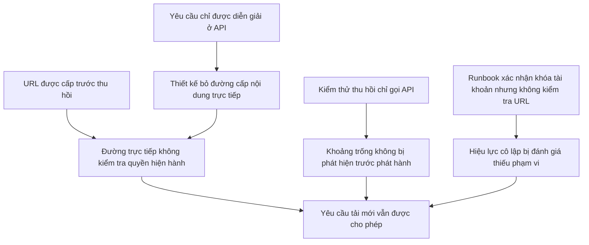

# Post-incident review: chuyển bài học sau sự cố thành yêu cầu bảo mật

## 1. Mục tiêu của đánh giá sau sự cố

**Post-incident review**, viết tắt là PIR, là hoạt động xem xét có cấu trúc sau một sự cố nhằm hiểu điều đã xảy ra, tác động, những điều kiện góp phần và các thay đổi cần thực hiện. Trong vòng đời yêu cầu bảo mật, giá trị quan trọng của PIR là biến bằng chứng vận hành thành yêu cầu, thiết kế, kiểm thử và trách nhiệm cải tiến cụ thể.

Một dịch vụ đã hoạt động lại vẫn có thể còn đường lạm dụng, thiếu khả năng quan sát hoặc phụ thuộc ứng cứu thủ công. Nếu báo cáo chỉ ghi “đã khắc phục” mà không chỉ ra phạm vi và bằng chứng, tổ chức có thể phát hành lại cùng điều kiện dẫn tới sự cố.

PIR cần giúp người đọc trả lời:

1. Điều gì đã được xác nhận, điều gì còn là giả thuyết?
2. Những dữ liệu, khách hàng và chức năng nào đã hoặc có thể bị ảnh hưởng?
3. Vì sao kiểm soát phòng ngừa, phát hiện, ứng phó hoặc phục hồi chưa đạt mục tiêu?
4. Yêu cầu nào thiếu, mơ hồ, chưa triển khai hoặc chưa được kiểm chứng đủ?
5. Ai thực hiện thay đổi, bằng chứng nào cho thấy thay đổi có hiệu lực và phần rủi ro nào còn lại?

Sau bài học, người học có thể chuẩn bị một PIR, xây dựng dòng thời gian, phân tích yếu tố góp phần, chuyển phát hiện thành yêu cầu đo được và theo dõi hành động tới lúc được xác minh. Các thời hạn và tình huống trong bài là giả định học tập, không phải quy định áp dụng chung.

## 2. Xác định phạm vi và trạng thái hoàn tất

### 2.1. Phân biệt các hoạt động liên quan

| Hoạt động | Câu hỏi chính | Đầu ra điển hình |
| --- | --- | --- |
| Ứng phó trực tiếp | Làm gì để giới hạn thiệt hại và khôi phục hoạt động? | Quyết định, hành động, trạng thái hiệu lực |
| Điều tra | Bằng chứng cho thấy điều gì và còn thiếu gì? | Hiện vật, dòng thời gian, nhận định có mức chắc chắn |
| Phân tích nguyên nhân và yếu tố góp phần | Những điều kiện nào cho phép sự cố xảy ra hoặc kéo dài? | Quan hệ giữa thiết kế, thực thi, vận hành và quyết định |
| PIR | Cần học và thay đổi gì trong hệ thống cùng cách làm việc? | Báo cáo, yêu cầu cập nhật, hành động, người chịu trách nhiệm |
| Xác minh khắc phục | Thay đổi đã xử lý vấn đề trong phạm vi nào? | Kết quả kiểm thử, diễn tập và đánh giá rủi ro cập nhật |

Các hoạt động có thể chồng lấn. Không cần chờ biết mọi chi tiết mới ghi nhận bài học ban đầu. Những phần chưa rõ phải giữ trạng thái mở, cùng người xác minh và điều kiện cập nhật.

### 2.2. Đóng sự cố khác với đóng hành động cải tiến

Có thể đã ngừng thiệt hại đang tiếp diễn và mở lại dịch vụ trong phạm vi được duyệt, trong khi thay đổi dài hạn vẫn chưa hoàn tất. Khi đó hồ sơ cần thể hiện riêng:

- Trạng thái ứng phó và phạm vi đang hoạt động.
- Trạng thái báo cáo PIR, phần đã thống nhất và phần còn cần điều tra.
- Trạng thái từng yêu cầu hoặc hành động khắc phục.
- Rủi ro tồn dư, biện pháp tạm thời và ngoại lệ còn hiệu lực nếu có.

Một cuộc họp đã diễn ra không chứng minh các hành động đã hoàn tất. Một ticket được đóng cũng không tự chứng minh thuộc tính bảo vệ đã đạt trên môi trường cần đánh giá.

### 2.3. Chọn sự kiện cần PIR theo tiêu chí rõ

Tổ chức có thể ưu tiên sự cố tác động lớn, sự cố lặp lại, gần gây tổn thất nghiêm trọng hoặc tình huống làm sai một giả định thiết kế quan trọng. Một sự cố ít ảnh hưởng nhưng bộc lộ đường vượt ranh giới nhiều khách hàng vẫn có thể cần đánh giá sâu.

Tiêu chí nên nêu ai khởi tạo, ai điều phối, khi nào bắt đầu và cách xử lý phần chưa đủ dữ liệu. Ví dụ, nhóm có thể chọn tạo bản ghi sơ bộ trong 3 ngày làm việc sau khi trạng thái ứng phó đã ổn định. Giá trị đó chỉ có nghĩa khi mốc “ổn định” và trách nhiệm được xác định.

Không trì hoãn biện pháp bảo vệ cấp thiết chỉ để chờ cuộc họp PIR. Những thay đổi thực hiện sớm cần được ghi nhận và kiểm chứng, rồi đưa vào đánh giá chung.

## 3. Chuẩn bị dữ liệu và người tham gia

### 3.1. Gói đầu vào cần thiết

| Đầu vào | Mục đích | Điều cần kiểm tra |
| --- | --- | --- |
| Hồ sơ ứng phó và quyết định | Hiểu ai biết gì và đã hành động thế nào | Mốc tiếp nhận, chuyển cấp, người nhận trách nhiệm và phạm vi hành động |
| Dữ liệu điều tra | Làm căn cứ cho nhận định | Nguồn, toàn vẹn, độ bao phủ và giới hạn quy kết |
| Kiến trúc, cấu hình, phiên bản | Hiểu đường đi thực tế tại thời điểm sự cố | Không dùng cấu hình hiện tại thay cho lịch sử mà không xác minh |
| Yêu cầu bảo mật đang áp dụng | So mục tiêu với điều đã xảy ra | Nguồn, phiên bản, tham số và phạm vi |
| Kết quả kiểm thử và diễn tập trước đó | Biết điều gì đã được kiểm chứng, điều gì bị bỏ sót | Phiên bản, môi trường, đường chạy và giới hạn kết luận |
| Báo cáo tác động | Đánh giá tổn thất và phục hồi | Tác động thực tế, tiềm tàng, chưa xác định và căn cứ |
| Biện pháp tạm thời, ngoại lệ | Biết trạng thái hiện tại | Phạm vi, hạn dùng, người duyệt và rủi ro còn lại |

Không cần đưa mọi hiện vật thô vào bản báo cáo được chia sẻ rộng. Báo cáo nên dùng tham chiếu tới nơi lưu được kiểm soát và dữ liệu đủ cho người có quyền kiểm tra kết luận.

### 3.2. Thành phần có thể giải thích và nhận trách nhiệm

Nên có người điều phối, người ghi nhận, đại diện nhóm ứng phó, phát triển, vận hành, bảo mật, kiểm thử và nghiệp vụ hoặc dữ liệu liên quan. Khi phụ thuộc nhà cung cấp, cần người có thể làm rõ cam kết và thực tế tích hợp.

Người điều phối giữ phạm vi và giúp phân biệt sự thật với diễn giải. Người có thẩm quyền quyết định về rủi ro hoặc ưu tiên cần tham gia ở điểm phù hợp; sự đồng thuận trong phòng họp không tự tạo thẩm quyền miễn trừ một yêu cầu bắt buộc.

### 3.3. Ghi bối cảnh thông tin tại thời điểm quyết định

Một quyết định trong sự cố được đưa ra với thông tin, thời gian và quyền hạn cụ thể. PIR cần hiểu bối cảnh đó trước khi đánh giá. Tránh dùng những điều chỉ biết sau điều tra để mặc định người trực đã phải biết từ đầu.

Tập trung vào những điều kiện có thể cải tiến: thông tin thiếu, giao diện gây nhầm, công cụ không thể hiện hiệu lực, quyền chưa rõ hoặc quy trình khiến chuyển cấp chậm. Trách nhiệm với hành động cải tiến vẫn phải cụ thể, có người thực hiện và người xác minh.

## 4. Điều phối một buổi PIR có đầu ra rõ

Một lịch 90 phút minh họa có thể dùng khi người tham gia đã đọc bản sơ bộ:

| Thời gian | Hoạt động | Đầu ra cần có |
| --- | --- | --- |
| 0–10 phút | Chốt mục tiêu, phạm vi và tác động đang biết | Danh sách câu hỏi và phần chưa thống nhất |
| 10–25 phút | Đi qua dòng thời gian và bằng chứng | Mốc đã xác nhận, mốc ước lượng và khoảng trống |
| 25–45 phút | Phân tích đường gây hại và yếu tố góp phần | Các quan hệ có căn cứ, giả thuyết cần kiểm tra |
| 45–60 phút | Xem phòng ngừa, phát hiện, ứng phó và phục hồi | Khả năng đã hoạt động và khoảng trống cụ thể |
| 60–80 phút | Chuyển phát hiện thành yêu cầu và hành động | Tiêu chí chấp nhận, người phụ trách và ưu tiên |
| 80–90 phút | Chốt quyết định, rủi ro còn lại và theo dõi | Phạm vi đồng thuận, việc mở và mốc cập nhật |

Thời lượng cần điều chỉnh theo quy mô sự cố. Nếu xuất hiện tranh luận không thể giải quyết bằng dữ liệu đang có, ghi hai cách giải thích, bằng chứng cần phân biệt và người xác minh. Không ép đồng thuận để hoàn tất biên bản.

Người tham gia nên có cơ hội nêu quan sát trước khi thảo luận kết luận. Khi cuộc trao đổi chuyển thành nhận xét chung về năng lực cá nhân, quay về hành vi, thông tin và điều kiện hệ thống có thể kiểm chứng.

## 5. Xây dựng dòng thời gian có nguồn và mức chắc chắn

### 5.1. Mỗi mốc cần nói rõ đang đo điều gì

Phân biệt thời điểm hoạt động được nguồn ghi, thời điểm cảnh báo phát sinh, thời điểm tiếp nhận ứng phó, xác nhận trách nhiệm, quyết định, gửi lệnh, xác minh hiệu lực và mở lại. Những mốc này phục vụ các chỉ số khác nhau.

Một hàng dòng thời gian nên có thời điểm, sự kiện, nguồn bằng chứng, mức chắc chắn, phạm vi và nhận xét. Nếu có chuẩn hóa thời gian, giữ dấu thời gian gốc cùng cách chuyển đổi và bất định liên quan.

Chuyển về UTC giúp biểu diễn nhất quán nhưng không tự sửa đồng hồ sai. Nếu không biết độ lệch đủ rõ, không suy quan hệ nhân quả từ chênh lệch nhỏ giữa hai nguồn.

### 5.2. Ví dụ dòng thời gian

Giả sử tài khoản hỗ trợ có hoạt động đáng ngờ trong luồng xuất báo cáo. Yêu cầu hiện hành quy định thu hồi quyền phải phản ánh tại mọi yêu cầu tải mới trong tối đa 60 giây kể từ khi thay đổi được ghi nhận tại nguồn quyền. Các mốc dưới đây được biểu diễn theo UTC và đã được đối chiếu trong phạm vi bài học.

| Mốc | Quan sát | Ý nghĩa và giới hạn |
| --- | --- | --- |
| 09:00 | Có giao dịch tạo báo cáo cần điều tra | Là mốc hoạt động biết được; chưa khẳng định là lúc chiếm tài khoản bắt đầu |
| 09:04 | Quy tắc tạo cảnh báo | Không gọi chênh lệch 4 phút là toàn bộ thời gian phát hiện xâm nhập nếu chưa biết điểm bắt đầu |
| 09:05 | Hệ thống ứng phó tiếp nhận cảnh báo | Mốc cho mục tiêu nhận trách nhiệm theo quy định nội bộ |
| 09:12 | Người trực nhận trách nhiệm | 7 phút từ tiếp nhận tới nhận trách nhiệm |
| 09:14:00 | Nguồn quyền ghi nhận thu hồi thành công | Bắt đầu giới hạn hiệu lực thu hồi 60 giây |
| 09:14:20 | API từ chối yêu cầu mới của tài khoản | Chứng minh hiệu lực ở API đã kiểm tra, chưa bao phủ đường khác |
| 09:34 | Nguồn cấp nội dung ghi nhận một URL cũ vẫn cho phép giao dịch tải mới | Có bằng chứng vi phạm giới hạn trên đường trực tiếp |
| 09:36 | Đường tải trực tiếp được vô hiệu hóa theo quyết định | Lệnh đã thực hiện, cần xác minh hiệu lực |
| 09:37 | Kiểm tra xác nhận các đường trong danh sách ứng cứu từ chối tải mới | Là mốc xác minh theo phạm vi đã kiểm tra, không tự chứng minh mọi đường chưa biết đều đã bị chặn |

Từ bảng, không được báo “thu hồi hoàn tất trong 20 giây” cho toàn yêu cầu. API đã đạt sớm, nhưng đường tải trực tiếp còn vi phạm. Nếu phạm vi xác minh đầy đủ của yêu cầu được hoàn tất lúc 09:37, cần giải thích cách xác định đủ phạm vi, không chỉ lấy mốc đó làm kết luận mặc định.

### 5.3. Giữ cả phần thiếu dữ liệu

Nếu thiếu log một khoảng trước 09:00, ghi rõ không thể dùng mốc 09:00 để loại trừ hoạt động sớm hơn. Nếu chỉ có sự kiện từ máy chủ, nêu chính xác máy chủ ghi nhận cấp hoặc truyền gì; không tự suy ra người nhận đã đọc và sử dụng toàn bộ dữ liệu.

Một dòng thời gian tốt giúp người đọc thấy căn cứ và giới hạn. Nó không cần tạo cảm giác mọi giây đều đã được biết chính xác.

## 6. Phân tích nguyên nhân và yếu tố góp phần

### 6.1. Tách tác nhân kích hoạt khỏi điều kiện cho phép

Tác nhân kích hoạt là sự kiện làm đường gây hại diễn ra, chẳng hạn việc một thông tin truy cập bị sử dụng. Các điều kiện góp phần có thể nằm ở thiết kế, triển khai, kiểm thử, quan sát hoặc tổ chức ứng cứu.

Trong ví dụ, việc tài khoản bị nghi chiếm đoạt không giải thích đầy đủ vì sao URL vẫn hoạt động sau thu hồi. Cần xem cơ chế URL, phạm vi yêu cầu, ngân sách thời gian, kiểm thử và công cụ xác minh hiệu lực.



Sơ đồ thể hiện giả thuyết quan hệ cần được đối chiếu với bằng chứng. Không phải mọi nhánh trong sơ đồ đều được coi là nguyên nhân đã xác nhận ngay khi vẽ ra.

### 6.2. Không ép mọi sự cố về một nguyên nhân duy nhất

Một sự cố thường có nhiều điều kiện tương tác. Nhãn “lỗi con người”, “thiếu đào tạo” hoặc “lỗi cấu hình” quá rộng nếu không giải thích được vì sao kiểm soát không ngăn, không phát hiện hoặc không giới hạn hậu quả.

Có thể dùng chuỗi câu hỏi vì sao để đào sâu, nhưng không cần đủ một số câu cố định và không dừng ở câu trả lời thuận tiện. Mỗi mối liên hệ cần căn cứ, giả định hoặc phép kiểm tra tiếp theo.

Ví dụ, “người trực không thu hồi URL” cần tiếp tục được làm rõ: công cụ có khả năng đó không, runbook có liệt kê URL không, người trực có quyền không và có biết đường đó tồn tại không? Những câu trả lời khác nhau dẫn tới thay đổi khác nhau.

### 6.3. Phân loại khoảng trống trong vòng đời yêu cầu

| Loại khoảng trống | Biểu hiện | Hướng xử lý |
| --- | --- | --- |
| Thiếu yêu cầu | Không có cam kết về hiệu lực thu hồi trên đường trực tiếp | Bổ sung yêu cầu cùng phạm vi và mốc đo |
| Yêu cầu mơ hồ | Ghi “khóa ngay” nhưng không nêu điểm hoàn tất | Làm rõ chủ thể, đường áp dụng và giới hạn |
| Thiết kế chưa bao phủ | Có yêu cầu toàn luồng nhưng thiếu cơ chế tại kho tệp | Sửa kiến trúc hoặc bỏ đường vi phạm |
| Triển khai hoặc cấu hình sai | Thiết kế đúng nhưng một điểm không dùng cấu hình đã duyệt | Sửa và xác minh cấu hình thực tế |
| Xác minh thiếu | Có ca API nhưng không thử URL đã cấp | Mở rộng tiêu chí và dữ liệu thử |
| Vận hành không duy trì | Thay đổi thêm đường mới nhưng không cập nhật runbook và kiểm thử | Gắn đánh giá tác động vào quản lý thay đổi |

Một sự cố có thể thuộc nhiều loại. Phân loại nhằm chọn hành động, không phải chỉ gắn nhãn cho báo cáo.

### 6.4. Kiểm tra giả thuyết bằng đối chiếu và tái hiện

Tái hiện trong môi trường thử có thể cho thấy một thiết kế cho phép đường lạm dụng và giúp đánh giá phương án sửa. Tuy nhiên, tái hiện hiện tại không tự chứng minh đường đó đã xảy ra trong quá khứ nếu thiếu dữ liệu tương ứng.

Với giả thuyết “kiểm tra quyền tại cổng tải sẽ chặn giao dịch sau thu hồi”, cần xác minh các điều kiện: không còn đường bỏ qua cổng, nguồn quyền có hiệu lực đúng hạn và lỗi phụ thuộc được xử lý phù hợp. Không chỉ thay một thành phần rồi suy ra toàn bộ rủi ro đã được loại bỏ.

## 7. Đánh giá tác động và rủi ro còn lại

### 7.1. Tách tác động thực tế, tiềm tàng và chưa biết

Trong ví dụ, nhóm có thể xác nhận hai giao dịch cấp nội dung báo cáo sau thời điểm thu hồi từ các nguồn đã đối chiếu. Phạm vi dữ liệu thực sự được cấp cần căn cứ vào báo cáo, nguồn truyền và ý nghĩa từng sự kiện; không chỉ đếm mã thành công.

Nếu cùng thiết kế áp dụng cho nhiều tổ chức, đó là phạm vi có thể bị ảnh hưởng cần đánh giá. Nó không tự chứng minh mọi tổ chức đã bị truy cập. Phần chưa đủ log cần được trình bày là chưa xác định, cùng hành động điều tra tiếp theo.

Các chiều tác động có thể gồm dữ liệu bị tiết lộ hoặc thay đổi, gián đoạn dịch vụ, công việc phục hồi, ảnh hưởng người dùng và khả năng quy trách nhiệm. Tránh dùng một con số duy nhất che các chiều rất khác nhau.

### 7.2. Phục hồi dịch vụ không đảo ngược mọi hậu quả

Chặn URL mới và mở lại chức năng trên thiết kế đã sửa có thể ngừng đường gây hại. Nó không lấy lại được dữ liệu đã tải về. Phục hồi từ bản sao cũng không xóa hậu quả của việc tiết lộ dữ liệu trước đó.

Nếu sự cố không cần khôi phục dữ liệu từ bản sao, không tự báo đạt mục tiêu điểm phục hồi. Các mục tiêu về dữ liệu và thời gian chỉ được đánh giá trên kịch bản, mốc đo và phạm vi đã đặc tả.

### 7.3. Cập nhật rủi ro tồn dư bằng hiện trạng đã xác minh

Sau biện pháp tạm thời, mô tả đường gây hại còn lại, điều kiện và hiệu lực đã được kiểm tra. Tách mức rủi ro hiện tại khỏi mức mục tiêu sau thay đổi chưa hoàn tất.

Nếu còn khoảng trống, cần phương án xử lý hoặc quyết định chấp nhận đúng thẩm quyền, cùng phạm vi, thời hạn và điều kiện xem lại. Một cuộc họp PIR không tự miễn trừ nghĩa vụ bắt buộc đã được xác nhận. Những vấn đề về nghĩa vụ và thông báo cần người có trách nhiệm xác định theo bối cảnh áp dụng.

## 8. Chuyển phát hiện thành yêu cầu đo được

### 8.1. Từ nhận xét tới cam kết bắt buộc

Nhận xét “thu hồi chưa triệt để” cần được chuyển thành yêu cầu có chủ thể, đối tượng, phạm vi, thời gian và hành vi lỗi. Nhận xét “thiếu log” cần nói rõ thiếu thông tin nào để trả lời câu hỏi nào.

| Phát hiện | Yêu cầu cần làm rõ hoặc bổ sung | Tiêu chí chấp nhận chính |
| --- | --- | --- |
| URL cũ vẫn tải sau thu hồi | SR-REV-01: mọi đường cấp nội dung phản ánh thay đổi trong giới hạn đã chốt | Tải mới bằng URL cũ bị từ chối tại và sau hạn hiệu lực |
| Worker dùng quyền lúc tạo tác vụ | SR-JOB-02: đánh giá điều kiện thực thi tại thời điểm được yêu cầu quy định | Thu hồi trong lúc chờ không bị bỏ qua do danh tính worker có quyền rộng |
| Không nối được người yêu cầu và tài nguyên | SR-AUD-03: sự kiện liên hệ chủ thể, tổ chức sở hữu, tác vụ và điểm tải | Truy được chuỗi qua các lớp bằng dữ liệu thử, không ghi bí mật |
| Runbook chỉ kiểm tra khóa tài khoản | SR-IR-04: xác minh hiệu lực trên danh sách đường truy cập thuộc phạm vi | Thất bại một đường được báo là cô lập chưa hoàn tất |
| Đường tải mới không qua đánh giá yêu cầu | SR-CHG-05: thay đổi điểm cấp dữ liệu phải được đánh giá tác động tới yêu cầu liên quan | Có ánh xạ, tiêu chí và bằng chứng phù hợp trước khi cho phép phát hành |

Đây là các định danh minh họa. Trong dự án thực tế, giữ định danh theo quy tắc quản lý yêu cầu và phiên bản đang áp dụng.

### 8.2. Ví dụ đặc tả lại yêu cầu thu hồi

```text
Yêu cầu: SR-REV-01, bản sửa đổi mới

Khi thay đổi thu hồi quyền được ghi nhận thành công tại nguồn có thẩm quyền,
mọi điểm cấp nội dung trong phạm vi phải từ chối yêu cầu tải mới của chủ thể
không còn đủ quyền trong tối đa 60 giây.

Phạm vi bao gồm đường truy cập được cấp trước thay đổi, cache và các điểm
cấp dữ liệu trực tiếp. Khi không xác minh được quyền còn hiệu lực, yêu cầu
tải mới phải bị từ chối theo chính sách đã chốt.

Việc ngắt luồng đang mở và xử lý dữ liệu đã tải không được suy ra từ cam kết
trên; nếu có mục tiêu liên quan, phải được đặc tả riêng.
```

Tiêu chí cần bao phủ URL cũ, phiên cũ, cache, các đường trực tiếp và lỗi nguồn quyền. Trước hạn 60 giây, hệ thống được phép từ chối sớm; không viết ca thử bắt buộc phải tiếp tục cho phép tới sát hạn.

Giới hạn 60 giây không được dành toàn bộ cho một cache rồi bỏ qua độ trễ lan truyền hoặc đường truy cập khác. Ngân sách thời gian của thiết kế phải tương thích với cam kết đầu cuối.

### 8.3. Giữ yêu cầu độc lập với lựa chọn công cụ khi phù hợp

“Mua thêm công cụ” hoặc “thêm dashboard” là phương án triển khai, chưa nói rõ mục tiêu nào được đáp ứng. Yêu cầu cần mô tả quyết định hoặc thông tin bắt buộc; thiết kế sau đó chỉ ra công cụ thực hiện.

Đào tạo, cập nhật tài liệu và nhắc nhở có thể cần thiết, nhưng nếu đường kỹ thuật vẫn cho phép vi phạm thì phải xử lý phần đó. Không đóng vấn đề thiết kế chỉ bằng một buổi phổ biến lại quy trình.

## 9. Lập hành động có người phụ trách và bằng chứng đóng

### 9.1. Mỗi hành động cần một đầu ra có thể đánh giá

Một bản ghi hành động nên có định danh, phát hiện nguồn, rủi ro, yêu cầu liên quan, phạm vi, người chịu trách nhiệm chính, người xác minh, thời hạn, phụ thuộc, tiêu chí hoàn tất và nơi lưu bằng chứng.

Nếu giao cho một nhóm, vẫn cần người hoặc vai trò cụ thể điều phối để tránh không ai nhận trách nhiệm. Nếu công việc bị chặn bởi bên khác, ghi phụ thuộc và điều kiện chuyển cấp, không chỉ đổi ngày hết hạn.

### 9.2. Ví dụ danh sách hành động

| Hành động | Đầu ra | Người phụ trách minh họa | Điều kiện hoàn tất |
| --- | --- | --- | --- |
| A-01 | Bỏ hoặc kiểm soát đường tải trực tiếp không phản ánh thu hồi | Nhóm ứng dụng | Thiết kế được đánh giá và kiểm thử trên mọi đường thuộc phạm vi đạt |
| A-02 | Bổ sung ca URL cũ, cache và lỗi nguồn quyền | Nhóm kiểm thử | Ca liên kết đúng phiên bản yêu cầu, có kết quả theo bản dựng và cấu hình |
| A-03 | Hoàn thiện dấu vết người khởi tạo, worker và tài nguyên | Nhóm ứng dụng, nền tảng | Truy lại được chuỗi hành động thử và không ghi dữ liệu cấm |
| A-04 | Cập nhật runbook cùng bước xác minh hiệu lực | Nhóm vận hành | Người trực thực hiện được trong diễn tập, thể hiện trạng thái thành công một phần |
| A-05 | Bổ sung đánh giá tác động khi thay điểm cấp nội dung | Chủ quy trình phát triển | Quy trình và ví dụ thay đổi cho thấy yêu cầu, thiết kế, kiểm thử được cập nhật |

Trong hồ sơ thật, các thời hạn, tên phụ trách và nơi lưu bằng chứng phải được điền. Bảng minh họa không thay cho cam kết đã được giao nhận.

### 9.3. Ưu tiên theo tác động và đường gây hại

Xem yêu cầu bắt buộc, khả năng tiếp diễn, phạm vi dữ liệu, biện pháp tạm thời, thời gian thực hiện và phụ thuộc. Có thể cần giữ giới hạn chức năng cho tới khi sửa và xác minh được đường vi phạm.

Không ưu tiên chỉ theo việc dễ đóng hoặc dễ trình bày trong báo cáo. Một lỗi phân quyền còn mở có thể quan trọng hơn nhiều việc tài liệu đã xong. Nếu không thể hoàn tất trong hạn, phải có quyết định về phạm vi vận hành và rủi ro, thay vì im lặng dời mốc.

### 9.4. Đóng bằng kết quả, giữ lịch sử chưa đạt

“Mã đã gộp”, “đã triển khai” và “đã xác minh” là các trạng thái khác nhau. Chỉ đóng theo tiêu chí đã thống nhất, với bằng chứng đúng phiên bản và môi trường cần đánh giá.

Nếu một phép kiểm tra thất bại, ghi phần chưa đạt và việc tiếp theo. Không xóa kết quả cũ rồi chỉ giữ lần chạy xanh. Nếu tiêu chí cần đổi, phải đánh giá lại yêu cầu và căn cứ, không đổi chỉ để hợp thức hóa triển khai.

## 10. Cấu trúc báo cáo PIR có thể sử dụng lại

Một cấu trúc gọn có thể gồm:

1. **Tóm tắt:** loại sự cố, phạm vi, trạng thái hiện tại và quyết định quan trọng.
2. **Tác động:** điều đã xác nhận, tác động tiềm tàng, phần chưa biết và căn cứ.
3. **Dòng thời gian:** mốc, nguồn, độ chắc chắn và cách đo.
4. **Đường gây hại:** tài sản, chủ thể, điều kiện và điểm kiểm soát liên quan.
5. **Yếu tố góp phần:** phân biệt kết luận với giả thuyết, ghi nguồn hỗ trợ.
6. **Khả năng ứng phó:** điều đã hoạt động, điều bị chặn và giới hạn phối hợp.
7. **Thay đổi yêu cầu:** bản sửa đổi, thiết kế và tiêu chí xác minh cần cập nhật.
8. **Hành động:** người phụ trách, thời hạn, phụ thuộc và điều kiện đóng.
9. **Rủi ro còn lại:** biện pháp tạm thời, ngoại lệ và người quyết định.
10. **Theo dõi:** phần điều tra còn mở, mốc cập nhật và điều kiện kết thúc từng phần.

Báo cáo nên đủ rõ cho người chưa tham gia sự cố. Các từ “đã an toàn”, “đã xử lý triệt để” hoặc “không bị ảnh hưởng” cần được thay bằng kết luận có phạm vi và bằng chứng nếu chưa có cơ sở cho nhận định rộng.

Giữ phiên bản, người rà soát và lịch sử sửa. Nếu thay đổi kết luận sau khi có bằng chứng mới, nêu điều đã đổi và lý do. Không ghi đè lịch sử theo cách làm người đọc không biết nhận định nào từng được dùng để ra quyết định.

Thông tin nhạy cảm nên đặt trong phần hoặc kho được kiểm soát; bản chia sẻ rộng có thể lược bớt theo mục đích. Bản lược bớt vẫn cần giữ ý nghĩa và giới hạn kết luận, không biến phần chưa biết thành không có ảnh hưởng.

## 11. Đưa kết quả trở lại vòng đời yêu cầu

### 11.1. Giữ truy vết hai chiều

```text
Bằng chứng sự cố
  -> Phát hiện PIR và yếu tố góp phần
  -> Rủi ro hoặc giả định cần cập nhật
  -> Yêu cầu bảo mật và phiên bản mới
  -> Thiết kế, cấu hình, quy trình hoặc công việc triển khai
  -> Tiêu chí chấp nhận, kiểm thử và diễn tập
  -> Bằng chứng hiệu lực
  -> Đánh giá rủi ro tồn dư và quyết định vận hành
```

Từ yêu cầu mới cần tìm được phát hiện và mục tiêu bảo vệ. Từ một phát hiện cần biết hành động nào xử lý và trạng thái xác minh ra sao. Nếu một hành động không liên hệ được với vấn đề cần giải quyết, cần làm rõ giá trị trước khi coi đó là khắc phục sự cố.

### 11.2. Cập nhật các giả định kiến trúc

Ví dụ, trước sự cố nhóm giả định mọi dữ liệu đều đi qua API kiểm tra quyền. Khi có URL trực tiếp, giả định đó không còn đúng. Cần sửa mô hình luồng dữ liệu, ranh giới tin cậy và những đánh giá từng dựa trên giả định cũ.

Một thay đổi có thể ảnh hưởng nhiều yêu cầu: cổng tải mới liên quan tới phân quyền, độ trễ thu hồi, audit, khả dụng và phục hồi. Không chỉ thêm một ca kiểm thử cho lỗi cụ thể rồi bỏ qua các phụ thuộc mới.

### 11.3. Mở rộng kiểm tra theo phạm vi có căn cứ

Nếu nhiều chức năng dùng cùng thành phần cấp nội dung, cần đánh giá những chức năng có chung điều kiện gây lỗi. Việc rà soát mở rộng nên có danh sách và tiêu chí, tránh vừa bỏ sót phần dùng chung vừa mở thành cuộc kiểm tra không có điểm kết thúc.

Kết quả có thể là một số nơi đã đáp ứng và một số nơi cần thay đổi. Không tự sao chép kết luận của một chức năng sang toàn hệ thống nếu cấu hình hoặc đường truy cập khác nhau.

### 11.4. Xem lại yêu cầu vận hành và phục hồi

PIR có thể phát hiện đường khẩn cấp không hoạt động, người dự phòng không có quyền, log không đủ hoặc phục hồi làm xuất hiện lại quyền cũ. Các vấn đề đó cần yêu cầu riêng và diễn tập phù hợp.

Ví dụ, sau phục hồi, nguồn quyền hiện hành phải được đối chiếu trước khi mở lại cấp dữ liệu. Một bản sao cũ có thể chứa quyền từng hợp lệ nhưng đã bị thu hồi. Kiểm thử phục hồi cần dữ liệu trạng thái này, không chỉ kiểm tra dịch vụ khởi động được.

## 12. Theo dõi chất lượng cải tiến

### 12.1. Dùng chỉ số có ý nghĩa và phạm vi

| Chỉ số | Câu hỏi hỗ trợ | Giới hạn diễn giải |
| --- | --- | --- |
| Phát hiện quan trọng chưa có người phụ trách | Vấn đề nào chưa được nhận trách nhiệm? | Có người nhận chưa chứng minh có tiến triển |
| Hành động quá hạn hoặc bị chặn | Phụ thuộc hoặc quyết định nào cần chuyển cấp? | Không chỉ đổi ngày để làm hết quá hạn |
| Hành động có tiêu chí chấp nhận phù hợp | Công việc có thể được xác minh không? | Có một dòng tiêu chí chưa chắc đủ phạm vi |
| Hành động đã được xác minh bằng bằng chứng hiện hành | Thay đổi nào đã chứng minh hiệu lực trong phạm vi? | Tỷ lệ tổng không thay mức quan trọng của việc còn mở |
| Giả định chưa được xác nhận | Kết luận nào còn phụ thuộc điều chưa biết? | Không đóng giả định chỉ vì đã qua thời gian |
| Ngoại lệ sắp hết hạn | Phạm vi nào sắp mất cơ sở tiếp tục vận hành? | Không tự gia hạn khi chưa đánh giá lại |

Số cuộc họp hoặc số trang báo cáo không tự thể hiện chất lượng học được. Số sự cố được báo nhiều hơn có thể phản ánh quan sát tốt hơn; số sự cố bằng không cũng có thể đi cùng thiếu phát hiện. Cần xem cách thu dữ liệu trước khi diễn giải xu hướng.

### 12.2. Không coi hoàn tất nhiều việc nhỏ là giảm hết rủi ro

Giả sử một PIR có năm hành động, trong đó bốn việc tài liệu đã xong còn sửa đường tải trực tiếp chưa đạt. Tỷ lệ hoàn tất 80% không chứng minh phần rủi ro chính đã được xử lý.

Theo dõi nên hiển thị các khoảng trống quyết định điều kiện phát hành hoặc vận hành. Nếu có báo cáo theo trọng số, phải công khai cách tính và giới hạn; không gọi kết quả đó là phần trăm rủi ro đã loại bỏ.

### 12.3. Khi nào đánh giá lại một PIR đã bàn giao?

- Có bằng chứng mới làm thay đổi tác động hoặc giải thích nguyên nhân.
- Biện pháp tạm thời không còn hiệu lực hoặc ngoại lệ hết hạn.
- Hành động khắc phục không đạt tiêu chí hoặc tạo rủi ro mới.
- Kiến trúc, nguồn quyền, điểm cấp dữ liệu hoặc mô hình trực thay đổi.
- Sự cố hoặc tình huống gần xảy ra cho thấy cùng điều kiện vẫn tồn tại.

Không nhất thiết tổ chức lại toàn bộ cuộc họp cho mọi thay đổi nhỏ. Có thể cập nhật phần bị ảnh hưởng, nhưng phải giữ lịch sử và người chịu trách nhiệm quyết định.

## 13. Những lỗi thường làm PIR không tạo ra cải tiến

| Biểu hiện | Vấn đề | Cách sửa |
| --- | --- | --- |
| Báo cáo chỉ có dòng thời gian | Biết sự kiện nhưng chưa biết cần thay đổi gì | Liên hệ yếu tố góp phần với yêu cầu và hành động |
| Dừng ở “lỗi con người” | Không giải thích điều kiện hệ thống và thông tin tại thời điểm đó | Phân tích quyền, công cụ, thiết kế, tín hiệu và quy trình |
| Ép một nguyên nhân duy nhất | Bỏ tương tác giữa nhiều lớp kiểm soát | Ghi các quan hệ có bằng chứng và giả thuyết riêng |
| Đánh giá quyết định bằng thông tin biết sau | Không phản ánh bối cảnh ứng phó thực tế | Ghi điều người thực hiện biết, chưa biết và được phép làm |
| Mọi hành động là nhắc nhở hoặc đào tạo | Có thể giữ nguyên đường kỹ thuật gây vi phạm | Sửa yêu cầu, thiết kế và kiểm thử theo phần thiếu |
| Đóng sự cố là đóng mọi công việc | Làm mất rủi ro và thay đổi chưa hoàn tất | Tách trạng thái ứng phó, PIR và hành động |
| Ticket đóng nên coi kiểm soát đạt | Nhầm hoàn thành công việc với bằng chứng hiệu lực | Đòi tiêu chí và kết quả đúng phiên bản, phạm vi |
| Không nêu phần chưa biết | Người đọc suy ra ảnh hưởng đã được loại trừ | Ghi khoảng trống, tác động tới kết luận và việc xác minh |
| Đổi yêu cầu để khớp bản sửa | Có thể làm yếu bảo vệ mà không được đánh giá | Đánh giá tác động và phê duyệt thay đổi đúng thẩm quyền |
| Công bố toàn bộ dữ liệu điều tra | Tạo thêm rủi ro và vượt phạm vi người nhận | Phân quyền, tham chiếu kho bằng chứng và bản chia sẻ phù hợp |
| Lặp lại cùng sự cố nhưng chỉ thêm ticket mới | Không xem hiệu lực khắc phục cũ | So giả định, bằng chứng và điều kiện áp dụng trước đây |
| Không có mốc theo dõi | Hành động dễ mất người nhận hoặc hết hạn | Gắn chủ trách nhiệm, hạn và điều kiện chuyển cấp |

## 14. Thực hành và điều kiện bàn giao

### 14.1. Bài tập xây dựng PIR

Một ứng dụng nhiều tổ chức dùng token lưu quyền trong cache. Khi nhân viên hỗ trợ hết hạn quyền, giao diện chặn thao tác nhưng API phụ vẫn cho đọc dữ liệu. Người trực đã thu hồi quyền ở nguồn và ghi nhận hoàn tất; sau đó mới phát hiện API phụ. Log có khoảng trống nên chưa biết toàn bộ tài nguyên đã được cấp. Nhóm đã chặn API phụ và muốn mở lại bằng một thiết kế mới.

Hãy thực hiện:

1. Xác định phạm vi PIR, trạng thái hiện tại và điều còn chưa biết.
2. Lập dòng thời gian phân biệt lệnh thu hồi với xác minh hiệu lực.
3. Ghi tác động xác nhận, tiềm tàng và chưa xác định, cùng nguồn hỗ trợ.
4. Vẽ các yếu tố góp phần ở yêu cầu, kiến trúc, triển khai, kiểm thử và runbook.
5. Tách kết luận đã có căn cứ khỏi giả thuyết cần tái hiện hoặc điều tra thêm.
6. Viết yêu cầu đo được cho hiệu lực thu hồi, phạm vi API và quan sát.
7. Tạo ít nhất ba hành động với người phụ trách, tiêu chí chấp nhận và bằng chứng đóng.
8. Nêu điều kiện mở lại, biện pháp tạm thời và rủi ro cần người có thẩm quyền quyết định.
9. Chỉ ra các chức năng dùng chung thành phần cần được đánh giá tác động.
10. Viết cách theo dõi mà không dùng tỷ lệ ticket hoàn tất làm tỷ lệ giảm rủi ro.

Một bài làm đạt cần cho người đọc đi từ bằng chứng tới phát hiện, yêu cầu và điều kiện xác minh. Việc chỉ đề xuất “cập nhật tài liệu và đào tạo lại” chưa đủ nếu API phụ vẫn có thể cấp dữ liệu ngoài quyền.

### 14.2. Điểm kiểm tra khi bàn giao

- Phạm vi, trạng thái ứng phó và phần công việc còn mở đã được phân biệt.
- Dòng thời gian có nguồn, mốc đo và mức chắc chắn.
- Tác động thực tế, tiềm tàng và chưa biết được ghi riêng.
- Phân tích giữ bối cảnh quyết định và không ép mọi vấn đề về một nhãn nguyên nhân.
- Các yếu tố góp phần liên hệ được với khoảng trống trong vòng đời yêu cầu.
- Yêu cầu mới hoặc sửa đổi có phạm vi, điều kiện, tham số và tiêu chí rõ.
- Hành động có người phụ trách, thời hạn, phụ thuộc và điều kiện đóng bằng chứng.
- Biện pháp tạm thời, ngoại lệ và rủi ro tồn dư có quyết định đúng thẩm quyền.
- Thiết kế, mô hình đe dọa, kiểm thử, runbook và diễn tập được cập nhật khi liên quan.
- Báo cáo và dữ liệu điều tra được chia sẻ theo quyền, có lịch sử phiên bản.
- Có mốc theo dõi và điều kiện mở lại đánh giá khi thông tin thay đổi.

Một PIR hữu ích tạo ra những thay đổi có thể kiểm chứng và giữ được trách nhiệm tới lúc chúng có hiệu lực. Bài học sau sự cố trở thành năng lực bảo vệ khi nó được đưa vào yêu cầu, thiết kế, kiểm thử và vận hành, với bằng chứng đủ phạm vi cho quyết định tiếp theo.
