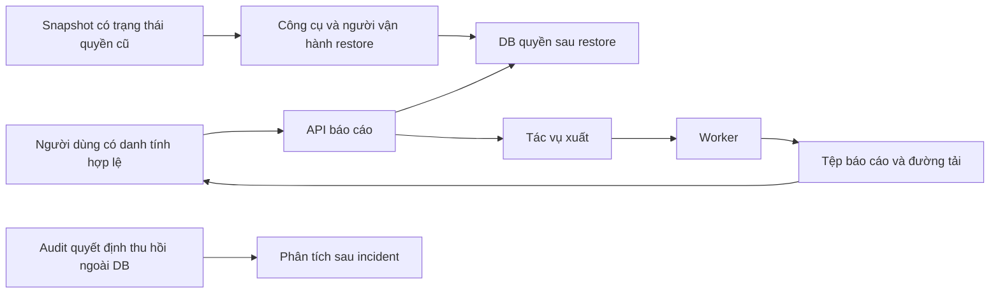
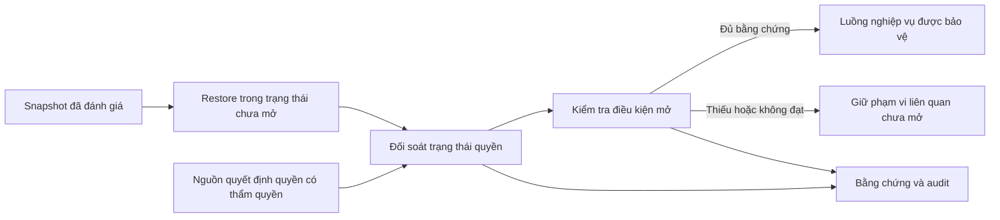

# Cập nhật threat model sau incident

## 1. Mục tiêu bài học

Một incident cho thấy ít nhất một phần cách hiểu về hệ thống, đối phương, điều kiện vận hành hoặc hiệu quả kiểm soát cần được xem lại. Nếu nhóm chỉ vá lỗi và đóng ticket, threat model có thể tiếp tục mô tả một thế giới khác với hệ thống đang hoạt động.

**Cập nhật threat model sau incident** là quá trình dùng bằng chứng sự cố để sửa mô hình tài sản, chủ thể, luồng dữ liệu, ranh giới tin cậy, giả định và kịch bản đe dọa; sau đó liên kết những thay đổi đó với rủi ro, yêu cầu bảo mật và cách xác minh.

Trong module Security Requirements, kết quả cần đi xa hơn một sơ đồ mới. Nhóm phải biết yêu cầu xác thực, phân quyền, bảo vệ dữ liệu, logging hoặc phục hồi nào cần bổ sung, thành phần nào chịu trách nhiệm và bằng chứng nào đủ để xác nhận phần thay đổi đã có hiệu lực.

Học xong bài này, bạn có thể:

- Phân biệt sự kiện đã xác nhận, suy luận có căn cứ và giả thuyết còn mở.
- Xác định giả định và ranh giới tin cậy bị incident làm thay đổi.
- Cập nhật mô hình hiện trạng mà không lẫn với kiến trúc dự kiến.
- Chuyển bài học thành yêu cầu đo được, kiểm thử và công việc có chủ sở hữu.
- Quản lý phiên bản, bằng chứng và rủi ro còn lại sau khi có bản sửa.
- Mở rộng bài học sang thành phần liên quan theo căn cứ, tránh kết luận quá rộng.

Tình huống, mã định danh và ngưỡng số trong bài là ví dụ của một dịch vụ giả định. Chúng không phải báo cáo sự cố thật hoặc mức yêu cầu áp dụng chung.

## 2. Incident cung cấp đầu vào gì cho threat model?

Threat model là cách biểu diễn có cấu trúc về điều cần bảo vệ, cách hệ thống hoạt động, điều có thể sai và biện pháp xử lý. Incident cung cấp bằng chứng để kiểm tra cách biểu diễn đó.

Có thể phát hiện:

- Một tài sản chưa được coi là nhạy cảm, như trạng thái thu hồi quyền.
- Một đường dữ liệu chưa được vẽ, như công cụ restore ghi lại dữ liệu phân quyền.
- Một chủ thể có khả năng lớn hơn dự kiến.
- Một ranh giới tin cậy bị vượt qua bởi thao tác vận hành hợp lệ.
- Một kiểm soát có mặt nhưng không bao phủ worker hoặc đường tải.
- Một giả định không còn đúng sau failover, restore hoặc thay đổi cấu hình.
- Một khoảng trống logging làm nhóm không thể xác nhận phạm vi.

NIST SP 800-61 Rev. 3 nêu việc đưa bài học từ các hoạt động ứng phó vào cải tiến liên tục, thay vì chỉ chờ tới cuối phục hồi. Bài này áp dụng nguyên tắc đó vào việc cập nhật threat model và đặc tả yêu cầu; quy trình mẫu bên dưới là cách tổ chức minh họa. [Nguồn: NIST SP 800-61 Rev. 3, phần 2.1](https://nvlpubs.nist.gov/nistpubs/SpecialPublications/NIST.SP.800-61r3.pdf#page=12).

### 2.1. Không đồng nhất các loại hồ sơ

| Hồ sơ | Câu hỏi chính |
|---|---|
| Timeline sự cố | Điều gì xảy ra, vào lúc nào, theo nguồn bằng chứng nào? |
| Phân tích nguyên nhân | Những điều kiện và thất bại nào đã góp phần tạo ra sự cố? |
| Threat model | Tài sản, chủ thể, đường đi, giả định và kịch bản đe dọa của hệ thống là gì? |
| Hồ sơ rủi ro | Hậu quả, khả năng xảy ra, kiểm soát hiện tại và quyết định xử lý ra sao? |
| Đặc tả yêu cầu | Hệ thống phải có hành vi bảo vệ nào và xác minh bằng cách nào? |
| Playbook hoặc hướng dẫn vận hành | Ai thực hiện bước nào khi một tình huống xảy ra? |

Các hồ sơ cần liên kết, nhưng không thay thế nhau. Viết lại timeline thành một mục “threat mới” chưa chắc đã cập nhật được mô hình.

### 2.2. Không chờ mọi câu hỏi có câu trả lời

Có thể cập nhật sớm những phát hiện đã đủ bằng chứng, đồng thời ghi giả thuyết còn mở và điều kiện sửa mô hình tiếp theo.

Không biến điều chưa biết thành khẳng định. Cũng không trì hoãn yêu cầu bảo vệ rõ ràng chỉ vì chưa xác định được mọi chi tiết về chủ thể gây ra sự cố.

## 3. Tình huống xuyên suốt: quyền bị thu hồi xuất hiện lại sau restore

### 3.1. Bối cảnh

Dịch vụ báo cáo nhiều tenant có:

- Nhà cung cấp danh tính để xác thực người dùng.
- Cơ sở dữ liệu ứng dụng lưu dữ liệu nghiệp vụ và quyền xuất báo cáo.
- API tạo tác vụ, worker xử lý và kho tệp phục vụ tải.
- Backup, công cụ restore và người vận hành.
- Nhật ký audit nằm ngoài cơ sở dữ liệu được restore trong tình huống này.

Một người dùng có thể còn đăng nhập hợp lệ nhưng không còn quyền xuất. Quyền xác thực và quyền thực hiện hành động là hai quyết định khác nhau.

Threat model cũ chỉ mô tả luồng người dùng gọi API, kiểm tra quyền trong cơ sở dữ liệu, worker tạo báo cáo và đường tải. Restore được xem là hoạt động vận hành bên ngoài luồng bảo mật chính.

### 3.2. Timeline đã được xác nhận trong ví dụ

| Thời điểm | Sự kiện | Bằng chứng |
|---|---|---|
| 09:00 | Tạo snapshot của cơ sở dữ liệu | Hồ sơ snapshot và mốc dữ liệu được xác minh. |
| 09:10 | Thu hồi quyền xuất của user-r | Sự kiện audit và quyết định quyền được duyệt; có mã liên kết. |
| 09:20 | Cơ sở dữ liệu không thể phục vụ do sự cố vận hành | Quan sát dịch vụ và hồ sơ sự cố. |
| 09:40 | Restore từ snapshot 09:00, mở lại sau kiểm tra sẵn sàng cơ bản | Hồ sơ restore, cấu hình và thời điểm mở dịch vụ. |
| 09:45 | user-r tạo và nhận kết quả xuất trong tenant của mình | Audit API, trạng thái tác vụ và bằng chứng trả kết quả. |
| Sau phát hiện | Quyền được thu hồi lại, chức năng bị giới hạn để điều tra | Nhật ký hành động ứng phó. |

Trong ví dụ, mục tiêu RPO nghiệp vụ cho phép một cửa sổ mất dữ liệu 30 phút. Điều đó không tự có nghĩa quyết định thu hồi quyền được phép mất hiệu lực.

Bằng chứng chỉ xác nhận một thao tác trái với quyết định quyền đã ban hành. Chưa có căn cứ từ bảng này để khẳng định truy cập chéo tenant, chủ đích của người dùng hoặc một đối phương bên ngoài.

### 3.3. Điều bị phá vỡ

API vẫn có thể đang đọc đúng giá trị trong cơ sở dữ liệu sau restore. Tuy nhiên, cơ sở dữ liệu đó chứa quyền ở thời điểm cũ, trước khi có quyết định thu hồi.

Giả định cần xem lại là:

> Sau restore, dữ liệu quyền trong cơ sở dữ liệu ứng dụng luôn có thể được dùng ngay như trạng thái có thẩm quyền hiện tại.

Nếu chỉ sửa bằng cách thu hồi lại một quyền đã biết mà giữ nguyên giả định này, lần restore sau vẫn có thể tái tạo cùng lớp rủi ro.

## 4. Chuẩn hóa bằng chứng trước khi sửa mô hình

### 4.1. Ba lớp thông tin

| Lớp | Ví dụ trong tình huống | Cách ghi |
|---|---|---|
| Sự kiện đã xác nhận | user-r được chấp nhận xuất lúc 09:45, sau quyết định thu hồi 09:10 | Gắn nguồn, thời điểm, định danh và phạm vi quan sát. |
| Suy luận có căn cứ | Restore đã đưa grant cũ trở lại vì snapshot chứa grant và trạng thái sau restore khớp | Ghi chuỗi căn cứ và điều kiện cần đúng. |
| Giả thuyết | Các tác vụ chờ hoặc liên kết tải khác cũng có thể bị ảnh hưởng | Ghi hoạt động cần xác minh, chủ sở hữu và trạng thái. |

Một suy luận có thể được nâng mức tin cậy khi có thêm bằng chứng. Không cần giả vờ mọi kết luận đều chắc chắn như nhau.

### 4.2. Những kiểm tra giúp tránh nối sai sự kiện

- Định danh user-r trong các nguồn có thực sự là cùng một chủ thể không?
- Quyết định thu hồi áp dụng cho đúng tenant và hành động xuất không?
- Có một quyết định cấp lại hợp lệ giữa hai mốc không?
- Snapshot đã dùng có đúng mốc dữ liệu được báo cáo không?
- Tác vụ lúc 09:45 là yêu cầu mới hay kết quả của công việc đã nhận từ trước?
- Đồng hồ các hệ thống có đủ đồng bộ để diễn giải thứ tự không?
- Audit có thể bị thiếu, trùng hoặc bị thay đổi trong khoảng cần xét không?
- Bằng chứng nhận kết quả nói về quyền tải hay chỉ việc tạo tệp nội bộ?

Nếu chưa giải đáp được một câu quan trọng, mô hình phải giữ phần chưa biết thay vì lấp bằng suy đoán.

### 4.3. Giảm thiên kiến nhìn lại

Không viết “đáng lẽ ai cũng phải biết” vào phân tích kỹ thuật. Cần chỉ ra mô hình, yêu cầu hoặc phép kiểm chứng nào thiếu và vì sao nó cho phép tình huống xảy ra.

Cũng không sửa toàn bộ mô hình để mọi chi tiết chỉ phù hợp với đúng một incident. Mục tiêu là nhận ra lớp rủi ro có thể lặp lại, không chỉ giải thích kết quả đã thấy.

## 5. Cập nhật tài sản, luồng dữ liệu và ranh giới tin cậy

### 5.1. Tài sản mới được làm rõ

Ngoài hồ sơ và tệp báo cáo, cần mô hình hóa:

- Trạng thái quyền hiện hành.
- Quyết định thu hồi và cấp lại đã được phê duyệt.
- Lịch sử thay đổi quyền có thể dùng đối soát.
- Snapshot và dữ liệu quyền tại thời điểm chụp.
- Quyết định cho phép mở dịch vụ sau restore.
- Trạng thái tác vụ và quyền tải đã tồn tại.

Một dữ liệu ít được chú ý có thể quyết định hệ thống có cho phép truy cập hay không. Vì vậy, trạng thái bảo mật cũng là tài sản cần bảo vệ tính toàn vẹn và tính cập nhật.

### 5.2. Mô hình hiện trạng sau khi hiểu thêm incident

Sơ đồ dưới mô tả đường đi đã quan sát và nguyên nhân cần xử lý. Nó chưa phải thiết kế đã khắc phục.



Sơ đồ rút gọn không thay thế mô hình đầy đủ về dữ liệu, quyền và điểm thực thi. Điểm mới cần làm rõ là restore có thể đưa trạng thái cũ vào nơi được dùng để quyết định quyền hiện tại.

### 5.3. Ranh giới tin cậy theo thời điểm

Snapshot có thể đúng nội dung tại lúc chụp nhưng không còn đủ làm nguồn quyết định quyền hiện tại sau các thay đổi hợp lệ.

Đây không nhất thiết là backup bị sửa độc hại. Rủi ro xuất hiện khi hệ thống nâng một trạng thái lịch sử thành nguồn có thẩm quyền mà không kiểm tra những quyết định đã xảy ra sau đó.

Cần ghi rõ:

- Nguồn nào có thẩm quyền cho từng loại dữ liệu.
- Trạng thái lịch sử được phép dùng cho mục đích gì.
- Kiểm tra nào phải hoàn tất trước khi nó tham gia quyết định truy cập.
- Khi thiếu nguồn đối soát, chức năng nào chưa được mở.

### 5.4. Mô hình cả luồng vận hành không thường xuyên

Rà soát các đường có cùng kiểu nâng mức tin cậy:

- Failover sang bản sao có độ trễ.
- Migration chuyển dữ liệu quyền.
- Import cấu hình hoặc dữ liệu từ môi trường khác.
- Rollback ứng dụng cùng cấu hình.
- Công cụ hỗ trợ sửa trực tiếp trạng thái.
- Đồng bộ quyền hoặc nhóm từ hệ thống bên ngoài.

Đây là các ứng viên đánh giá mở rộng, chưa phải kết luận chúng đều có lỗ hổng.


## 6. Cập nhật sổ giả định

Một giả định nên có nội dung, phạm vi, căn cứ, người phụ trách và điều kiện xem lại.

| Mã | Giả định trước incident | Phát hiện | Cách cập nhật |
|---|---|---|---|
| A-01 | DB quyền sau restore có thể dùng ngay như nguồn hiện hành | Snapshot đã đưa grant cũ trở lại | Chỉ được tin sau kiểm tra và đối soát trạng thái bảo mật theo cơ chế được xác minh. |
| A-02 | RPO nghiệp vụ áp dụng giống nhau cho mọi trạng thái | Mất một thay đổi quyền có hậu quả bảo mật riêng | Phân loại dữ liệu bảo mật và quy định yêu cầu phục hồi tương ứng. |
| A-03 | Kiểm tra quyền tại API đủ cho cả luồng xuất | Worker và đường tải có vòng đời riêng | Làm rõ điểm kiểm tra ở API, worker và tải; xác minh từng điểm. |
| A-04 | Readiness cơ bản đủ để mở sau restore | Tiến trình sẵn sàng nhưng quyền đã sai | Thêm tiêu chí chấp nhận bảo mật trước khi mở luồng được bảo vệ. |
| A-05 | Audit ngoài DB có thể hỗ trợ tái dựng mọi quyết định quyền | Mới xác nhận được một sự kiện cụ thể | Giữ là giả định cần đánh giá về độ đầy đủ, thứ tự, tính toàn vẹn và thẩm quyền. |

A-05 đặc biệt quan trọng: một dòng audit xác nhận thu hồi không tự làm toàn bộ hệ thống log trở thành nguồn có thẩm quyền để tái dựng quyền. Cần đánh giá nguồn đó hoặc chọn nguồn phù hợp khác.

Không thay một giả định sai bằng một giả định mới chưa được kiểm tra rồi ghi mô hình là đã an toàn.

## 7. Viết lại kịch bản đe dọa và rủi ro

### 7.1. Kịch bản có cấu trúc

Một mô tả hữu ích:

> Chủ thể vẫn có danh tính đăng nhập hợp lệ nhưng đã bị thu hồi quyền xuất có thể được phép tạo hoặc nhận báo cáo sau restore, nếu snapshot chứa grant cũ được dùng làm trạng thái có thẩm quyền mà không đối soát quyết định quyền mới hơn. Hệ quả là dữ liệu được xuất trái với chính sách đã ban hành.

Cần ghi rõ:

- **Tài sản:** trạng thái quyền và dữ liệu báo cáo.
- **Chủ thể:** người dùng có phiên hợp lệ; chưa cần giả định có quyền quản trị.
- **Tiền điều kiện:** có quyết định thu hồi sau mốc snapshot và luồng restore không giữ đúng trạng thái quyền.
- **Điểm vào:** gọi chức năng bình thường sau khi hệ thống được mở.
- **Ranh giới bị vượt:** từ trạng thái lịch sử sang nguồn quyết định hiện tại.
- **Kiểm soát liên quan:** xác thực, quyết định quyền, restore gate, worker và đường tải.
- **Bằng chứng:** timeline, snapshot, quyết định thu hồi và kết quả nghiệp vụ.
- **Giới hạn:** phạm vi chủ thể, tài nguyên và thời gian mới được xác nhận.

Chủ thể không cần gây ra lỗi cơ sở dữ liệu để kịch bản có ý nghĩa. Việc hệ thống tự đi qua một trạng thái vận hành rủi ro đã tạo cơ hội.

### 7.2. Phân biệt nguyên nhân trực tiếp và yếu tố góp phần

Trong ví dụ:

- Nguyên nhân trực tiếp đã có căn cứ: trạng thái quyền cũ được phục hồi và được dùng để quyết định truy cập.
- Yếu tố góp phần: restore chưa có điều kiện đối soát quyền; readiness không kiểm tra quyền đã thu hồi.
- Giả thuyết cần xem thêm: các tác vụ cũ và liên kết tải có cùng vấn đề.
- Cải tiến khả năng phân tích: metadata restore chưa liên kết đủ với quyết định quyền.

Không đưa mọi điểm yếu được phát hiện vào cùng một “root cause” nếu chưa chứng minh quan hệ nhân quả.

### 7.3. Cập nhật rủi ro hiện tại và rủi ro dự kiến riêng

| Trạng thái | Cách diễn giải |
|---|---|
| Trước khi có bằng chứng incident | Đánh giá dựa trên mô hình và giả định lúc đó. |
| Sau incident, trước bản sửa | Có bằng chứng đường rủi ro tồn tại; đánh giá lại phạm vi, kiểm soát hiện hữu và phần chưa biết. |
| Đang giới hạn chức năng | Rủi ro phơi lộ có thể giảm trong phạm vi bị khóa; nguyên nhân thiết kế vẫn có thể còn. |
| Thiết kế khắc phục được đề xuất | Mức giảm rủi ro là dự kiến, chưa phải kết quả đã đạt. |
| Triển khai và xác minh | Cập nhật rủi ro còn lại theo bằng chứng của bản và cấu hình thực tế. |

Không hạ mức rủi ro chỉ vì đã có ticket hoặc sơ đồ kiến trúc mới. Nếu đánh giá bằng mức định tính, cần giải thích bằng kịch bản, điều kiện và kiểm soát; không tạo con số chính xác giả từ dữ kiện chưa đủ.

## 8. Chuyển bài học thành yêu cầu bảo mật

### 8.1. Bảng truy vết tối thiểu

| Phát hiện hoặc giả định | Rủi ro | Yêu cầu mới hoặc sửa | Xác minh |
|---|---|---|---|
| A-01: DB sau restore chứa grant cũ | RISK-REC-PERM-01: quyền bị hồi sinh | POSTIR-REQ-01: giữ đúng quyết định quyền hợp lệ trước khi mở luồng | Restore snapshot cũ sau khi đã thu hồi quyền; thử lại truy cập. |
| A-05: chưa biết nguồn đối soát có đủ không | Mở dịch vụ với trạng thái quyền không xác định | POSTIR-REQ-02: không mở phần bị ảnh hưởng khi chưa đủ căn cứ | Làm thiếu nguồn hoặc thiếu đoạn quyết định và kiểm tra gate. |
| A-03: chưa rõ worker và tải | Dữ liệu tiếp tục lộ qua công việc hoặc tệp cũ | POSTIR-REQ-03: kiểm tra đúng quyền ở các điểm vòng đời | Tác vụ chờ, công bố kết quả và lần tải mới. |
| Thiếu liên kết metadata restore | Khó xác định bản và quyết định đã được áp dụng | POSTIR-REQ-04: audit quá trình đối soát và mở lại | Kiểm tra trường, quan hệ và quyền truy cập bằng chứng. |
| Quyền có thể đổi trong lúc đối soát | Bỏ sót quyết định ở khoảng chuyển trạng thái | POSTIR-REQ-05: không có khoảng trống xử lý quyết định quyền | Thu hồi hoặc cấp lại tại các điểm đồng bộ được điều khiển. |

### 8.2. Đặc tả POSTIR-REQ-01

> Sau restore dữ liệu ảnh hưởng tới quyết định quyền, hệ thống không được cấp lại quyền chỉ vì snapshot chứa trạng thái cũ. Trước khi mở các hành động được bảo vệ trong phạm vi, trạng thái quyền phải phản ánh các quyết định hợp lệ có thẩm quyền theo quy tắc thứ tự và hiệu lực đã được xác định.

Tiêu chí chấp nhận:

- Quyền đã thu hồi sau mốc snapshot không tự xuất hiện lại.
- Một quyết định cấp lại hợp lệ về sau được xử lý đúng, không bị ghi đè bởi việc áp dụng mù một sự kiện thu hồi cũ.
- Phạm vi tenant, tài nguyên và hành động được giữ đúng.
- Quy tắc xác định thứ tự, mốc đối soát và xử lý quyết định đang tới được mô tả.
- Có bằng chứng gắn trạng thái được mở với snapshot, nguồn quyền và kết quả đối soát.

Không chỉ ghi “replay log”. Cần xác định log nào đủ căn cứ, quyết định nào hợp lệ, thứ tự nào có ý nghĩa và cách phát hiện phần thiếu.

### 8.3. Đặc tả POSTIR-REQ-02

> Nếu chưa có đủ căn cứ xác minh trạng thái quyền sau restore, hệ thống phải giữ các hành động bị ảnh hưởng ở chế độ không cấp quyền theo chính sách đã chọn. Không tự coi thiếu dữ liệu là quyền mặc định hoặc dùng snapshot cũ để bỏ qua điều kiện mở lại.

Cần làm rõ:

- Luồng nào bị khóa, luồng nào có thể hoạt động theo yêu cầu riêng.
- Phản hồi cho người dùng và cách truy vấn trạng thái.
- Ai được quyết định phạm vi mở và trên bằng chứng nào.
- Cách xử lý khi nguồn đối soát mất kết nối hoặc có khoảng trống.
- Cách bảo đảm gate được thực thi phía máy chủ, không chỉ ẩn giao diện.

Yêu cầu bảo mật không nhất thiết buộc mọi chức năng dừng. Phạm vi suy giảm phải được thiết kế và quyết định rõ.

### 8.4. Đặc tả POSTIR-REQ-03

> API, worker và đường bắt đầu tải báo cáo phải kiểm tra quyền theo chính sách tại các điểm đã quy định, kể cả với tác vụ và tệp tồn tại trước restore. Dữ kiện trong tác vụ không được tự thay thế quyết định quyền hiện hành nếu chính sách yêu cầu kiểm tra lại.

Cần xác định riêng việc bắt đầu tải mới, một luồng tải đang diễn ra và dữ liệu đã được tải xong. Không hứa thu hồi được dữ liệu đã chuyển chỉ bằng việc sửa quyết định quyền.

### 8.5. Đặc tả POSTIR-REQ-04 và POSTIR-REQ-05

Audit cần liên kết được:

- Mã restore và mốc snapshot đã xác minh.
- Phiên bản ứng dụng, cấu hình và yêu cầu liên quan.
- Nguồn cùng mốc quyết định quyền được đối soát.
- Kết quả, phần thiếu, người hoặc cơ chế quyết định mở.
- Thời điểm chuyển trạng thái và phạm vi được phép hoạt động.

Không ghi token, khóa hoặc toàn bộ nội dung báo cáo chỉ để làm bằng chứng.

Đối với POSTIR-REQ-05, kế hoạch phải xử lý quyết định quyền xuất hiện trong lúc đối soát và giữa mốc đối soát với lúc mở dịch vụ. Có thể có cơ chế đồng bộ hoặc một cửa sổ quản trị được kiểm soát; phương án cụ thể phải được thiết kế, không được để khoảng này thành giả định ngầm.

## 9. Cập nhật kiến trúc đề xuất mà không làm sai hiện trạng

### 9.1. Hai lớp biểu diễn

Nên giữ riêng:

- **Hiện trạng đã hiểu sau incident:** bao gồm đường restore tạo rủi ro và các kiểm soát thực tế.
- **Thiết kế dự kiến:** mô tả phương án xử lý cùng điều kiện và giả định còn cần xác minh.

Nếu vẽ ngay mọi kiểm soát mới lên sơ đồ hiện trạng rồi bỏ trạng thái triển khai, người đọc có thể nghĩ vấn đề đã được khắc phục.

### 9.2. Luồng mục tiêu minh họa

Sơ đồ sau là thiết kế đề xuất, chưa phải tuyên bố đã triển khai:



Thiết kế còn phải mô tả quyền thay đổi trong lúc xử lý và cách các điểm thực thi dùng trạng thái sau chuyển đổi.

### 9.3. Các phương án cần đánh giá

| Phương án | Lợi ích có thể có | Điều cần xác minh |
|---|---|---|
| Tách nguồn quyền khỏi phạm vi rollback dữ liệu nghiệp vụ | Không phục hồi quyền cũ cùng snapshot nghiệp vụ | Nguồn quyền có đúng thẩm quyền, tính sẵn sàng và phạm vi lỗi phù hợp không? |
| Dùng nguồn quyết định bền vững để tái dựng trạng thái | Khôi phục được các thay đổi sau snapshot | Có đầy đủ quyết định, đúng thứ tự, tính toàn vẹn và khả năng phát hiện khoảng thiếu không? |
| Chỉ mở phạm vi quyền đã được đối soát và phê duyệt | Giới hạn rủi ro khi nguồn tự động chưa đủ | Phạm vi có kiểm soát được, khối lượng xử lý và điều kiện mở phần còn lại là gì? |

Không có phương án nào tự đúng chỉ từ tên gọi. Tách một cơ sở dữ liệu không tự bảo đảm tính độc lập nếu cả hai vẫn bị rollback hoặc quản trị qua cùng nguồn không được kiểm soát.

Mục tiêu khôi phục nghiệp vụ và điều kiện bảo mật cần được xem xét cùng nhau. Nếu phương án mới làm thay đổi thời gian phục hồi, phải cập nhật yêu cầu và kế hoạch, không bỏ kiểm tra quyền để giữ một chỉ số cũ.


## 10. Biến incident thành kiểm thử hồi quy

### 10.1. Ca tái hiện tối thiểu

Một ca có thể được viết ở mức giả mã:

```text
given:
    user-r có danh tính đăng nhập hợp lệ
    user-r có quyền xuất báo cáo trong tenant-r
    snapshot-S được tạo trước quyết định thu hồi
    nguồn quyết định có thẩm quyền ghi nhận thu hồi quyền xuất
    kiểm tra trước restore xác nhận user-r không còn được xuất

when:
    restore DB ứng dụng từ snapshot-S trong môi trường thử
    thực hiện quy trình đối soát và kiểm tra điều kiện mở
    user-r thử tạo tác vụ xuất qua API trực tiếp

then:
    quyền không tự xuất hiện lại chỉ vì snapshot chứa grant cũ
    request không được chấp nhận trái với quyết định quyền hiện hành
    không có kết quả xuất hoặc đường tải trái phép được công bố
    audit liên kết được restore, trạng thái quyền và quyết định mở
    một người dùng đối chứng còn quyền vẫn thực hiện được thao tác hợp lệ
```

Ca phải dùng thông tin xác thực hợp lệ của chủ thể. Nếu token đã hỏng và request dừng ở xác thực, test chưa chứng minh điều kiện quyền sau restore.

Observer có thể kiểm tra trạng thái và bằng chứng nội bộ, nhưng không được dùng danh tính observer để thay request của user-r.

### 10.2. Các biến thể có lý do

| Ca | Biến thể | Thuộc tính cần giữ |
|---|---|---|
| TC-POSTIR-01 | Thu hồi sau snapshot, trước sự cố | Không hồi sinh quyền khi restore. |
| TC-POSTIR-02 | Sau thu hồi có một quyết định cấp lại hợp lệ | Trạng thái mới nhất hợp lệ được áp dụng đúng; không từ chối do replay sai thứ tự. |
| TC-POSTIR-03 | Nguồn đối soát không dùng được hoặc không chứng minh đầy đủ | Không tự mở các hành động bị ảnh hưởng. |
| TC-POSTIR-04 | Tác vụ được tạo trước restore và còn trong hàng đợi | Worker xử lý theo chính sách quyền ở các điểm được quy định. |
| TC-POSTIR-05 | Có tệp và đường tải cũ | Không đi vòng kiểm tra quyền cần thiết khi bắt đầu lần tải mới. |
| TC-POSTIR-06 | Thu hồi trong lúc đối soát hoặc ngay trước mở | Không bỏ sót quyết định ở khoảng chuyển trạng thái. |
| TC-POSTIR-07 | Người dùng khác tenant thử tài nguyên | Giữ kiểm soát tenant trong cơ chế quyền vừa thay đổi. |
| TC-POSTIR-08 | Dữ liệu nghiệp vụ phục hồi trong cửa sổ RPO | Không dùng kết quả đó thay cho kiểm tra trạng thái bảo mật. |

TC-POSTIR-07 là kiểm thử hồi quy do phần dùng chung bị thay đổi, không phải tuyên bố incident đã có truy cập chéo tenant.

### 10.3. Chọn tầng xác minh

- **Thành phần:** thứ tự quyết định, xử lý lặp, lựa chọn trạng thái có hiệu lực và dữ kiện thiếu.
- **Tích hợp:** nguồn quyền, quá trình restore, gate, cache và điểm thực thi.
- **Toàn luồng:** API, worker, công bố tệp và tải theo một hành trình có trạng thái.
- **Rà soát kiến trúc:** độ đầy đủ của nguồn đối soát, ranh giới rollback và những đường chưa được test bao phủ.

Không mock sẵn “quyền đã được đối soát đúng” ở chính tầng cần chứng minh rồi kết luận toàn bộ quá trình restore an toàn.

### 10.4. Oracle ngoài mã phản hồi

Một request bị từ chối vẫn có thể đã tạo tác vụ hoặc công bố dữ liệu. Cần quan sát trạng thái bền vững, hàng đợi, đầu ra, quyền tải và audit trong phạm vi đã xác định.

Với xử lý bất đồng bộ, dùng trạng thái kết thúc hoặc mốc hoàn tất đã được thiết kế. Việc không thấy tệp ngay sau phản hồi chưa chứng minh không có tệp được tạo muộn.

Kết quả chỉ PASS khi tiền điều kiện, luồng restore, nguồn quan sát và tiêu chí đều hợp lệ. Thiếu môi trường hoặc mất bằng chứng phải được ghi đúng, không đổi thành PASS.

## 11. Quy trình cập nhật sau incident

### Bước 1: Chọn phiên bản mô hình xuất phát

Xác định mô hình nào đã dùng cho bản triển khai và phạm vi sự cố. Giữ bản đó để hiểu các giả định và quyết định tại thời điểm trước incident.

### Bước 2: Chuẩn hóa phát hiện và bằng chứng

Lập timeline đủ liên kết, phân biệt sự kiện, suy luận và giả thuyết. Ghi phần thiếu hoặc mức tin cậy của nguồn.

### Bước 3: Sửa mô hình hiện trạng

Thêm tài sản, đường đi và trạng thái vận hành đã được xác nhận. Đánh dấu giả định không còn đúng và các phần cần kiểm tra thêm.

### Bước 4: Viết lại đe dọa và đánh giá rủi ro

Giữ rõ chủ thể, tiền điều kiện, khả năng, mục tiêu và hậu quả. Đánh giá kiểm soát hiện hữu dựa trên bằng chứng, không dựa vào kế hoạch sẽ làm.

### Bước 5: Đề xuất yêu cầu và phương án thiết kế

Liên kết từng yêu cầu với phát hiện và rủi ro. Chỉ rõ phương án đã quyết định, phương án còn đang đánh giá và các giả định mới.

### Bước 6: Rà soát cùng các chủ sở hữu liên quan

Chủ dịch vụ, vận hành, phát triển, bảo mật và kiểm thử cần xác nhận luồng thực tế, phụ thuộc và cách nghiệm thu. Không giới hạn cập nhật vào một nhóm chỉ biết đường API chính.

### Bước 7: Theo dõi triển khai và xác minh

Gắn công việc, bản ứng dụng, cấu hình và bằng chứng. Một thay đổi tài liệu được duyệt không đồng nghĩa thay đổi kỹ thuật đã hoàn tất.

### Bước 8: Xem lại rủi ro còn lại và phổ biến bài học

Khi có bằng chứng, cập nhật phần đã giảm rủi ro, phần còn tồn tại và phạm vi cần theo dõi. Đưa bài học tới các hệ thống có cùng giả định theo quy trình chia sẻ nội bộ phù hợp.

Cập nhật có thể diễn ra nhiều đợt. Phát hiện mới trong phục hồi hoặc sau đó tiếp tục tạo phiên bản, thay vì chờ một cuộc họp cuối để ghi tất cả một lần.

## 12. Phiên bản, liên kết và điều kiện hoàn thành

### 12.1. Hồ sơ thay đổi nên giữ gì?

- Mã incident và mã thay đổi.
- Phiên bản threat model trước và sau.
- Phạm vi ứng dụng, môi trường và bản triển khai.
- Phát hiện, bằng chứng và giả định liên quan.
- Luồng, tài sản, ranh giới và đe dọa được thêm hoặc sửa.
- Yêu cầu, quyết định kiến trúc và kiểm thử được tạo hoặc thay đổi.
- Chủ sở hữu, người rà soát và quyết định rủi ro.
- Bằng chứng triển khai cùng phần chưa đạt.

Một liên kết chỉ trỏ tới “tài liệu mới nhất” có thể không đủ để tái dựng quyết định cũ. Cần giữ phiên bản hoặc mốc nội dung đã được duyệt.

### 12.2. Ví dụ hồ sơ rút gọn

Cấu trúc dưới là nội dung minh họa, không phải cấu hình chạy của sản phẩm:

```yaml
change_id: TM-CHG-027
incident_ref: INC-REC-027
model_from: TM-REPORT rev-1
model_to: TM-REPORT rev-2
scope:
  - Restore DB ứng dụng
  - Quyền xuất báo cáo
  - API, worker và đường tải liên quan
confirmed_findings:
  - Grant cũ xuất hiện lại từ snapshot
  - Luồng mở dịch vụ chưa đối soát trạng thái quyền
assumptions_invalidated:
  - A-01
  - A-02
open_hypotheses:
  - Mức ảnh hưởng tới tác vụ và liên kết tải đã tồn tại
risk_refs:
  - RISK-REC-PERM-01
requirement_refs:
  - POSTIR-REQ-01
  - POSTIR-REQ-02
  - POSTIR-REQ-03
  - POSTIR-REQ-04
  - POSTIR-REQ-05
model_review_state: APPROVED
implementation_state: PLANNED
verification_state: NOT_RUN
```

APPROVED ở đây chỉ nói nội dung mô hình đã được rà soát theo quy trình. PLANNED và NOT_RUN cho thấy chưa có cơ sở khẳng định hệ thống đã đáp ứng thiết kế mới.

### 12.3. Hai loại hoàn thành khác nhau

**Hoàn thành cập nhật tài liệu** có thể yêu cầu mô hình hiện trạng, giả định, đe dọa, rủi ro và liên kết công việc đã đầy đủ, được rà soát.

**Hoàn thành khắc phục rủi ro** cần thêm triển khai, kiểm thử, bằng chứng và quyết định về rủi ro còn lại.

Không đóng phần việc khắc phục chỉ vì threat model đã đổi phiên bản. Ngược lại, nếu bản sửa đã làm nhưng mô hình vẫn bỏ sót đường vận hành, bài học chưa được đưa trở lại hệ thống quản lý yêu cầu.

## 13. Mở rộng bài học mà không suy diễn phạm vi

Sau một incident, có hai câu hỏi khác nhau:

1. Những tài sản nào thực sự bị ảnh hưởng?
2. Những hệ thống nào có thể có cùng kiểu giả định hoặc kiến trúc?

Câu hỏi thứ nhất cần bằng chứng phạm vi sự cố. Câu hỏi thứ hai tạo danh sách rà soát phòng ngừa.

Với ví dụ restore quyền, có thể tìm các dịch vụ:

- Lưu quyền cùng dữ liệu nghiệp vụ và restore chung.
- Dùng snapshot cấu hình để quyết định truy cập.
- Mở sau restore chỉ qua kiểm tra sống hoặc readiness cơ bản.
- Có worker dùng dữ kiện quyền chụp ở thời điểm tạo tác vụ.
- Dùng nguồn log như lịch sử quyền nhưng chưa kiểm tra độ đầy đủ.

Đối với từng dịch vụ, ghi kết quả: có cùng điều kiện, đã có kiểm soát được xác minh, cần đánh giá thêm hoặc không thuộc phạm vi với lý do.

Không gắn nhãn mọi dịch vụ là đã bị xâm nhập. Cũng không bỏ qua khả năng cùng rủi ro chỉ vì chúng chưa từng có incident được phát hiện.

Chia sẻ bài học bằng mô hình và yêu cầu có thể áp dụng lại, đồng thời giảm thiểu dữ liệu nhạy cảm về người dùng, bí mật và chi tiết sự cố không cần thiết.


## 14. Trách nhiệm và cách đánh giá chất lượng cập nhật

### 14.1. Phân công theo thông tin cần xác nhận

| Vai trò | Đóng góp chính |
|---|---|
| Điều phối hoặc nhóm ứng phó | Cung cấp phát hiện, timeline, bằng chứng và giới hạn phạm vi. |
| Chủ dịch vụ hoặc sản phẩm | Xác định hành động hợp lệ, tác động nghiệp vụ và phạm vi được phép mở. |
| Kiến trúc và phát triển | Xác nhận luồng dữ liệu, điểm thực thi, phụ thuộc và phương án thay đổi. |
| Vận hành và nền tảng | Mô tả restore, failover, cấu hình, quyền quản trị và điều kiện sẵn sàng thực tế. |
| Nhóm danh tính hoặc phân quyền | Xác nhận nguồn có thẩm quyền, thứ tự quyết định và vòng đời quyền. |
| Kiểm thử | Chuyển yêu cầu thành oracle, fixture, biến thể và kế hoạch bằng chứng. |
| Người có thẩm quyền quyết định rủi ro | Quyết định phần chưa đạt và điều kiện hoạt động trong phạm vi được giao. |

Nhóm nhỏ có thể gộp vai trò, nhưng không được bỏ qua thông tin về luồng vận hành và nguồn quyết định quyền.

Rà soát cần tập trung vào căn cứ và điều kiện hệ thống, không quy lỗi cho cá nhân chỉ vì họ thực hiện một bước trong quy trình đã có.

### 14.2. Những câu hỏi đánh giá tài liệu

- Mô hình có phản ánh luồng thực tế đã được xác nhận không?
- Có biết điều gì thay đổi so với phiên bản trước không?
- Từng giả định quan trọng có căn cứ và điều kiện xem lại không?
- Đe dọa có chủ thể, khả năng, tiền điều kiện và hậu quả rõ không?
- Có tách hiện trạng, giải pháp tạm và thiết kế dự kiến không?
- Mỗi hành động khắc phục có yêu cầu hoặc lý do truy vết được không?
- Có biết test nào chứng minh điều gì và chưa chứng minh điều gì không?
- Có chủ sở hữu cho câu hỏi mở và rủi ro còn lại không?
- Có phân biệt hoàn tất tài liệu với hoàn tất triển khai và xác minh không?

Một sơ đồ lớn và nhiều mục đe dọa không tự làm cập nhật tốt hơn. Giá trị là khả năng giải thích quyết định và dẫn tới hành vi bảo vệ được kiểm chứng.

### 14.3. Theo dõi tiến độ có ý nghĩa

Có thể theo dõi:

- Giả định bị incident phủ định nhưng chưa có quyết định xử lý.
- Phát hiện đã xác nhận chưa được gắn với thay đổi mô hình.
- Yêu cầu mới thiếu tiêu chí chấp nhận hoặc chủ sở hữu.
- Phương án đã duyệt nhưng chưa triển khai hoặc chưa xác minh.
- Câu hỏi mở có ảnh hưởng tới quyết định cho hệ thống hoạt động.
- Hệ thống có cùng điều kiện cần rà soát nhưng chưa được đánh giá.
- Bằng chứng đã hết phù hợp do bản ứng dụng hoặc cấu hình thay đổi.

Không dùng số trang, số mối đe dọa hoặc số ticket đóng để suy ra mức an toàn. Nếu đo thời gian cập nhật, định nghĩa rõ đang đo thời gian ghi nhận bài học, duyệt mô hình hay hoàn tất khắc phục.

## 15. Những lỗi thường gặp

| Lỗi | Hệ quả | Cách điều chỉnh |
|---|---|---|
| Chỉ thêm một dòng “đã có incident” | Không sửa tài sản, đường đi và giả định sai | Gắn phát hiện với thay đổi cụ thể trong mô hình. |
| Đồng nhất timeline với threat model | Thiếu khả năng và điều kiện tạo lớp rủi ro | Chuyển sự kiện thành kịch bản có chủ thể, tài sản và ranh giới. |
| Chỉ tập trung vào điểm lỗi cuối | Bỏ sót restore, tác vụ, nguồn quyền và điều kiện mở | Đi ngược và xuôi qua quan hệ tin cậy. |
| Mặc định có đối phương bên ngoài | Sai phạm vi và hướng xử lý | Tách bằng chứng truy cập trái phép khỏi suy đoán chủ đích hoặc nguồn gốc. |
| Vẽ giải pháp như trạng thái đã chạy | Người đọc hiểu nhầm rủi ro đã được xử lý | Tách hiện trạng và thiết kế dự kiến, gắn trạng thái. |
| Dùng mọi log làm nguồn tái dựng quyền | Có thể thiếu hoặc sai thứ tự quyết định | Xác minh thẩm quyền, độ đầy đủ, tính toàn vẹn và khả năng phát hiện phần thiếu. |
| Hạ rủi ro khi tạo ticket | Đánh giá không phản ánh kiểm soát thực tế | Chỉ cập nhật mức giảm đã đạt theo bằng chứng. |
| Chỉ test đúng incident đã thấy | Bỏ sót cùng lớp lỗi ở thời điểm hoặc đường khác | Thêm biến thể có căn cứ về trạng thái, thời điểm và phụ thuộc. |
| Kết luận mọi tenant đều bị ảnh hưởng | Vượt quá bằng chứng | Ghi phạm vi xác nhận và danh sách cần đánh giá riêng. |
| Coi bản sửa code là đủ | Yêu cầu và quy trình phục hồi vẫn có thể bỏ sót | Cập nhật chuỗi mô hình–yêu cầu–thiết kế–kiểm thử–vận hành. |
| Chờ đóng incident mới chia sẻ | Bài học rõ ràng chưa được dùng để giảm rủi ro | Cập nhật theo đợt và giữ câu hỏi còn mở. |

## 16. Bài tập thực hành

Một nhóm xử lý tình huống restore trong bài và đề xuất kết luận:

> Cơ sở dữ liệu đã phục hồi trong RPO. Người dùng vẫn có token hợp lệ. Vì vậy, đây không phải vấn đề của threat model; chỉ cần thu hồi lại quyền của người dùng đã báo cáo.

Hãy thực hiện:

1. Chỉ ra những thuộc tính đang bị đồng nhất trong kết luận: phục hồi dữ liệu, xác thực và quyết định quyền.
2. Viết một kịch bản đe dọa không giả định người dùng có quyền quản trị hoặc gây ra lỗi restore.
3. Thêm tài sản và đường dữ liệu còn thiếu vào mô hình hiện trạng.
4. Ghi ít nhất ba giả định cần sửa hoặc xác minh.
5. Viết hai yêu cầu có tiêu chí chấp nhận và chỉ rõ điểm thực thi.
6. Đề xuất một phương án khắc phục, đánh dấu giả định mới của phương án.
7. Viết ca kiểm thử khi thu hồi quyền sau snapshot và ca có quyết định cấp lại hợp lệ về sau.
8. Bổ sung một ca nguồn đối soát không đủ dữ kiện.
9. Nêu cách theo dõi tác vụ chờ và liên kết tải mà không khẳng định chúng đã gây lộ dữ liệu.
10. Phân biệt điều kiện hoàn thành tài liệu với điều kiện xác nhận khắc phục.

### Gợi ý tự đánh giá

- RPO nghiệp vụ đạt không chứng minh trạng thái quyền đã đúng với các quyết định có hiệu lực.
- Token hợp lệ chỉ giúp xác định danh tính theo điều kiện xác thực; nó không tự chứng minh quyền xuất còn tồn tại.
- Kịch bản rủi ro không đòi hỏi chủ thể gây ra sự cố cơ sở dữ liệu.
- Restore là một đường thay đổi trạng thái có ảnh hưởng tới quyết định truy cập, nên cần có trong mô hình.
- Quyền, quyết định thu hồi, nguồn đối soát và điều kiện mở là các tài sản hoặc cơ chế cần được làm rõ.
- Nguồn log chỉ được dùng cho vai trò đã xác minh; một sự kiện đúng chưa chứng minh toàn bộ lịch sử đầy đủ.
- Test cấp lại quyền giúp tránh giải pháp áp dụng mọi thu hồi một cách mù quáng.
- Tác vụ chờ và đường tải là phạm vi cần xác minh, không tự động là phát hiện đã xác nhận.
- Một ticket hoặc thiết kế được duyệt chưa có giá trị như bằng chứng triển khai.
- Kết quả cần giữ liên kết từ incident tới mô hình, rủi ro, yêu cầu, test và bản thực tế.

## 17. Câu hỏi tự kiểm tra

1. Incident có thể làm thay đổi threat model mà không phát hiện một lỗi code mới không?
2. Sự kiện, suy luận và giả thuyết khác nhau như thế nào trong hồ sơ cập nhật?
3. Vì sao trạng thái quyền và quyết định thu hồi cũng là tài sản cần mô hình hóa?
4. Snapshot đúng tại thời điểm chụp có luôn đủ làm nguồn quyết định hiện tại không?
5. Tại sao cần tách sơ đồ hiện trạng với thiết kế dự kiến?
6. Khi nào một nguồn audit chưa đủ làm nguồn tái dựng quyền?
7. Một ca kiểm thử tái hiện incident cần thêm biến thể nào để kiểm tra lớp rủi ro rộng hơn?
8. Làm sao ghi nhận mức giảm rủi ro khi chức năng đang bị khóa nhưng bản sửa chưa triển khai?
9. Mở rộng bài học sang nhiều dịch vụ khác gì với khẳng định mọi dịch vụ đã bị ảnh hưởng?
10. Những liên kết nào cần có để một cập nhật threat model dẫn tới yêu cầu và kiểm chứng thực tế?

