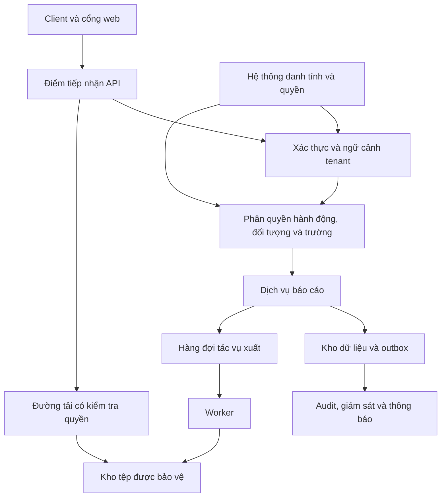

# Viết security baseline cho REST API

## 1. Mục tiêu bài thực hành

**Security baseline** là tập yêu cầu bảo mật nền được xác định cho một phạm vi hệ thống và một phiên bản cụ thể. Baseline cho REST API phải giúp người thiết kế, phát triển, kiểm thử và vận hành cùng hiểu:

- Ai được gọi hành động nào trên dữ liệu nào.
- Danh tính, quyền và dữ liệu đầu vào được kiểm tra ở đâu.
- Dữ liệu được cung cấp, lưu, ghi nhật ký và xóa như thế nào.
- Hệ thống xử lý lỗi, thử lại, quá tải và phục hồi ra sao.
- Dùng bằng chứng nào để kết luận từng yêu cầu đạt hoặc không đạt.

Bài thực hành yêu cầu chuyển một bối cảnh nghiệp vụ thành baseline có mã yêu cầu, nguồn rủi ro, tiêu chí chấp nhận và trách nhiệm rõ ràng.

Kết quả không chỉ là danh sách “dùng HTTPS, JWT, logging”. Tên một cơ chế chưa thể hiện phạm vi áp dụng, hành vi lỗi hoặc cách kiểm chứng.

Mọi hệ thống, ngưỡng, vai trò và profile trong bài đều là **giả định phục vụ học tập**. Đặc biệt, các thời hạn, giới hạn tải và cấu hình giao thức không phải khuyến nghị mặc định cho mọi API thực tế.

## 2. Đề bài: API báo cáo chi phí nhiều tenant

Giả sử một dịch vụ phục vụ nhiều tổ chức độc lập. Mỗi tổ chức là một tenant. Người dùng tạo báo cáo chi phí, gửi duyệt và xuất dữ liệu để đối chiếu.

### 2.1. Vai trò

| Vai trò | Khả năng nghiệp vụ được giao |
| --- | --- |
| MEMBER | Tạo báo cáo, xem báo cáo của mình, sửa bản nháp và gửi duyệt |
| APPROVER | Xem báo cáo trong tenant và duyệt báo cáo của người khác |
| AUDITOR | Xem báo cáo trong tenant và xuất dữ liệu theo phạm vi được phép |

Một người có thể có nhiều vai trò. Quyền được kết hợp theo chính sách, nhưng điều cấm tự duyệt báo cáo của mình vẫn áp dụng.

Việc cấp vai trò nằm ở hệ thống quản trị danh tính ngoài phạm vi endpoint của bài. API vẫn phải nhận biết thay đổi quyền trong giới hạn được xác định.

### 2.2. Tài nguyên và trạng thái

Báo cáo có các trường:

- id, tenantId, ownerId.
- title, description, amountMinor, currency.
- status, createdAt, updatedAt.
- reviewNote, approverId và approvedAt khi phù hợp.

Trạng thái nghiệp vụ gồm DRAFT, SUBMITTED và APPROVED.

tenantId, ownerId, status và thông tin người duyệt do máy chủ quản lý. Client không được tự ghi các trường đó qua payload tạo hoặc sửa.

Trong bài, amountMinor là số nguyên biểu diễn đơn vị nhỏ nhất theo quy ước dữ liệu đã thống nhất, không dùng số thực để tự suy giá trị. currency chỉ nhận VND hoặc USD như tập giá trị của bài tập; bài không có xử lý tỷ giá.

### 2.3. Các endpoint

| Method và đường dẫn | Mục đích |
| --- | --- |
| POST /v1/reports | Tạo báo cáo DRAFT |
| GET /v1/reports | Liệt kê trong phạm vi được phép |
| GET /v1/reports/{id} | Đọc một báo cáo |
| PATCH /v1/reports/{id} | Sửa trường nghiệp vụ được phép trên bản nháp |
| POST /v1/reports/{id}/submit | Chuyển DRAFT sang SUBMITTED |
| POST /v1/reports/{id}/approve | Chuyển SUBMITTED sang APPROVED |
| POST /v1/report-exports | Tạo tác vụ xuất dữ liệu |
| GET /v1/report-exports/{id} | Xem trạng thái tác vụ |
| GET /v1/report-exports/{id}/file | Nhận tệp kết quả |

Tác vụ xuất chạy ở worker. Kho tệp không được cung cấp đường công khai bỏ qua kiểm tra quyền.

### 2.4. Kiến trúc và ranh giới



Mỗi nơi nhận dữ liệu từ thành phần khác là một điểm cần xem xét ranh giới tin cậy. Không coi gateway đã kiểm tra là lý do để worker tin mọi trường trong thông điệp.

## 3. Dữ kiện và ngưỡng được cung cấp cho bài tập

Giả sử các quyết định sau đã được chủ sở hữu tương ứng xác nhận riêng cho bối cảnh học tập:

| Nội dung | Giá trị hoặc chính sách giả định |
| --- | --- |
| Danh tính | Access token do nguồn tin cậy của bài phát hành, gắn chủ thể, tenant, đối tượng nhận expense-api, quyền và thời hạn |
| Thời hạn token | Tối đa 900 giây; tại thời điểm hết hạn không được chấp nhận |
| Thu hồi | Trong tối đa 60 giây từ lúc lệnh hợp lệ được ghi nhận, các điểm thực thi ngừng cấp mới dữ liệu hoặc quyền theo trạng thái cũ |
| Kênh truyền | Các điểm API và kết nối nội bộ mang dữ liệu trong phạm vi dùng TLS 1.3 theo profile giả định của bài; không xử lý dữ liệu nghiệp vụ qua plaintext |
| Dữ liệu khi lưu | Cơ sở dữ liệu, tệp, vùng tạm và backup trong phạm vi có mã hóa bật, khóa được quản lý và quyền sử dụng được phân tách |
| Request JSON | Tối đa 64 KiB sau giải nén, độ sâu tối đa 8 |
| Phân trang | Mặc định 20, tối đa 100 phần tử mỗi trang |
| Giới hạn API | 60 request trong cửa sổ trượt 60 giây cho mỗi chủ thể và tenant, dùng trạng thái có hiệu lực trên các nút |
| Tạo export | Tối đa 3 tác vụ mới trong 300 giây cho mỗi chủ thể và tenant; tối đa 2 tác vụ export đang chạy trên một tenant |
| Idempotency | Bắt buộc cho các POST trong danh mục; giữ kết quả và ràng buộc khóa trong 24 giờ |
| Tệp export | Ngừng cho tải tại mốc hoàn tất cộng 24 giờ; hoàn tất xóa tệp và vùng tạm thuộc phạm vi trước hoặc tại mốc cộng 25 giờ |
| Audit | Còn tra cứu được trước khi đủ 30 ngày; hoàn tất xóa trong tối đa 35 ngày, trừ ngoại lệ hợp lệ được xác nhận |
| Cảnh báo mẫu | Từ chối đọc đối tượng ít nhất 5 lần trong 60 giây trên cùng chủ thể tạo cảnh báo; đích thông báo thử nhận trong tối đa 120 giây từ lần làm đủ điều kiện |
| Phục hồi | RTO tối đa 2 giờ, RPO tối đa 15 phút cho kịch bản đã thống nhất |
| Client trình duyệt | Chỉ origin https://portal.example.test được cấp CORS theo profile; API dùng bearer token gửi tường minh, không dùng cookie tự động làm thông tin xác thực |

Các giá trị này là đầu vào của bài tập, không phải kết quả người học tự suy từ tên công nghệ.

Nếu triển khai một bối cảnh khác, phải xác nhận lại nguồn, tính khả thi và phạm vi. Những điểm chưa được xác nhận cần giữ là câu hỏi mở, không đánh dấu baseline đã phê duyệt.

## 4. Sản phẩm người học cần xây dựng

Trong bài thực hành, hãy chuẩn bị một hồ sơ gồm:

1. Phạm vi, kiến trúc, tài sản và giả định.
2. Danh sách rủi ro và kịch bản lạm dụng quan trọng.
3. Ma trận vai trò, hành động, đối tượng và trường dữ liệu.
4. Baseline có mã yêu cầu, nội dung, ngưỡng và tiêu chí kiểm chứng.
5. Ma trận liên kết rủi ro, yêu cầu, điểm thực thi và test case.
6. Các điều kiện phê duyệt, việc còn mở và kế hoạch bằng chứng.

Đây là các thành phần của bài làm, không phải yêu cầu xây thêm dịch vụ hay chọn một framework cụ thể.

### Mẫu yêu cầu

```text
Mã và phiên bản:
Nguồn hoặc rủi ro:
Phạm vi:
Hành vi bắt buộc:
Ngưỡng và mốc đo:
Hành vi khi lỗi:
Điểm thực thi:
Tiêu chí chấp nhận:
Bằng chứng:
Chủ sở hữu:
Trạng thái và việc còn mở:
```

Một yêu cầu nên đủ tập trung để kết luận được. Có thể nhóm những mệnh đề liên quan, nhưng không nên gộp toàn bộ bảo mật thành một mục duy nhất.

## 5. Phân tích rủi ro trước khi chọn kiểm soát

Một tập rủi ro khởi đầu có thể là:

| Mã | Kịch bản | Hậu quả cần giảm |
| --- | --- | --- |
| R-01 | Dùng token không hợp lệ, hết hạn hoặc đã thu hồi | Giả danh hoặc duy trì truy cập |
| R-02 | Thay id để đọc hoặc sửa báo cáo khác tenant | Lộ hoặc thay đổi dữ liệu ngoài phạm vi |
| R-03 | MEMBER gọi thẳng endpoint approve hoặc tự duyệt | Vượt quyền và phá phân tách trách nhiệm |
| R-04 | Chèn tenantId, ownerId, status hoặc reviewNote vào payload | Ghi trường ngoài quyền và thay đổi trạng thái trái phép |
| R-05 | Request lớn, trang dữ liệu lớn hoặc tạo quá nhiều export | Cạn tài nguyên hoặc ảnh hưởng tenant khác |
| R-06 | Retry hoặc hai người duyệt đồng thời | Thực hiện chuyển trạng thái nhiều lần hoặc ghi kết quả mâu thuẫn |
| R-07 | Worker hoặc link tải dùng quyền cũ | Nhận dữ liệu sau khi mất quyền |
| R-08 | Log, lỗi hoặc tệp xuất chứa bí mật, dữ liệu quá phạm vi | Rò rỉ qua kênh phụ hoặc bản sao |
| R-09 | Sự kiện thiếu, pipeline lỗi hoặc thông báo không tới | Không phát hiện và không có người xử lý |
| R-10 | Phục hồi đưa trở lại quyền cũ hoặc không có khóa cần thiết | Hoạt động lại trong trạng thái không an toàn |

Không cần gán mức rủi ro bằng cảm tính chỉ để có đủ cột. Nếu chấm mức độ, phải nêu căn cứ tác động, khả năng và điều kiện của kịch bản.

Các rủi ro này định hướng baseline. Chúng không chứng minh mô hình đe dọa đã bao phủ mọi cách tấn công.

## 6. Baseline tham khảo: xác thực và phân quyền

Phần tham khảo dưới đây là một phương án có thể dùng để đối chiếu bài làm. Nó là baseline giả định cho đúng phạm vi đã nêu.

### BL-AUTHN-01 — xác thực ở mọi điểm nhận dữ liệu được bảo vệ

API phải chỉ thiết lập danh tính khi token được xác minh theo nguồn tin cậy, đúng đối tượng nhận expense-api, còn hiệu lực và gắn với tài khoản được phép hoạt động.

Không tin một payload token chỉ vì đọc được các trường. Cơ chế xác minh thực tế phải kiểm tra tính tin cậy và hiệu lực theo loại token sử dụng.

- Thiếu, sai hoặc hết hiệu lực: trả 401 theo hợp đồng của bài.
- Header tự khai chủ thể hoặc tenant không thay thế danh tính đã xác minh.
- Không nhận token qua query string như một cách xác thực của profile này.
- Không ghi nguyên token vào log hoặc lỗi.

**Kiểm chứng:** token hợp lệ, bị sửa, sai nguồn, sai đối tượng nhận, hết hạn và tài khoản không hoạt động; gọi trực tiếp từng nhóm endpoint.

### BL-AUTHN-02 — thu hồi và lỗi dịch vụ danh tính

Trong tối đa 60 giây từ mốc lệnh thu hồi hợp lệ được ghi nhận, các điểm thực thi phải ngừng cấp mới dữ liệu hoặc thực hiện hành động theo quyền, phiên hoặc token đã bị thu hồi.

Phạm vi gồm API, quyết định công bố export của worker và lần tải mới. Xử lý luồng tải đang truyền cần yêu cầu riêng nếu hệ thống đưa nó vào phạm vi.

Cache không được kéo dài quyền vượt hạn. Đặt TTL bằng 60 giây chưa tự chứng minh toàn luồng đạt, vì còn độ trễ cập nhật và quyết định.

Nếu không thể xác minh trạng thái hiệu lực đáp ứng chính sách, không cấp quyền mới. Lỗi phụ thuộc không đủ căn cứ xác thực được trả theo hợp đồng 503; không giả thành đăng nhập thành công.

**Kiểm chứng:** phiên cũ, cache ở nhiều nút, worker đang chờ, link cũ và dịch vụ danh tính không phản hồi.

### BL-AUTHZ-03 — phạm vi tenant và đối tượng

Mọi truy vấn, sửa và xuất dữ liệu phải áp dụng tenant cùng điều kiện đối tượng ở phía máy chủ.

tenantId khi tạo báo cáo lấy từ ngữ cảnh đã xác thực; ownerId lấy từ chủ thể. Client không được chọn chúng qua payload.

Đối với endpoint theo id, đối tượng không tồn tại và đối tượng ngoài tenant đều trả 404 theo chính sách của bài. Phản hồi không được tiết lộ đối tượng ngoài phạm vi.

**Kiểm chứng:** đối tượng có thật của tenant B được truy cập bằng người có quyền trong A; thử cả đọc, sửa, submit, approve, trạng thái export và tải tệp.

### BL-AUTHZ-04 — hành động, trạng thái và phân tách trách nhiệm

| Hành động | MEMBER | APPROVER | AUDITOR |
| --- | --- | --- | --- |
| Tạo báo cáo | Có, owner và tenant do máy chủ gán | Chỉ khi đồng thời có MEMBER | Chỉ khi đồng thời có MEMBER |
| Liệt kê hoặc đọc | Chỉ báo cáo của mình | Báo cáo cùng tenant | Báo cáo cùng tenant |
| Sửa bản nháp | Chỉ báo cáo của mình ở DRAFT | Không có quyền sửa chỉ từ vai trò APPROVER | Không có quyền sửa chỉ từ vai trò AUDITOR |
| Submit | Chủ sở hữu ở DRAFT | Chỉ khi cũng là chủ sở hữu có MEMBER | Chỉ khi cũng là chủ sở hữu có MEMBER |
| Approve | Không | Cùng tenant, SUBMITTED, người duyệt khác owner | Không có quyền duyệt chỉ từ AUDITOR |
| Tạo export | Không | Không có quyền xuất chỉ từ APPROVER | Có, trong tenant |
| Đọc hoặc tải export | Không | Không có quyền chỉ từ APPROVER | Chỉ tác vụ do mình tạo, còn quyền hiện hành |

Từ chối hành động ngoài quyền bằng 403 khi không thuộc chính sách 404 về phạm vi đối tượng. Trạng thái không cho phép một chuyển tiếp hợp lệ trả 409.

Ngay cả khi một người có MEMBER và APPROVER, điều kiện người duyệt khác owner vẫn bắt buộc.

**Kiểm chứng:** gọi trực tiếp endpoint, đổi method, đổi id, dùng vai trò kết hợp và thay trạng thái giữa các bước.

## 7. Baseline tham khảo: đầu vào, đầu ra và giao thức

### BL-INPUT-05 — schema và giới hạn

API chỉ chấp nhận trường được khai báo cho từng thao tác.

Đối với tạo hoặc sửa báo cáo:

- title: chuỗi từ 1 đến 120 ký tự theo quy tắc đếm được thống nhất.
- description: chuỗi tối đa 2.000 ký tự.
- amountMinor: số nguyên từ 1 đến 100.000.000.
- currency: VND hoặc USD.
- Từ chối trường ngoài schema, gồm tenantId, ownerId, status, approverId và reviewNote.
- Endpoint approve chỉ nhận reviewNote tùy chọn, tối đa 1.000 ký tự, ngoài các điều kiện quyền đã nêu.

Đếm độ dài trong bài theo Unicode code point, không mặc định bằng số byte UTF-8. Giới hạn 64 KiB của toàn request được tính theo byte sau giải nén.

JSON sai hoặc schema sai trả 400; media type không hỗ trợ trả 415; vượt giới hạn kích thước trả 413. Giới hạn giải nén và độ sâu phải được áp dụng trước khi tạo cấu trúc không bị chặn về tài nguyên.

Đầu vào không được ghép thành câu lệnh truy vấn. Kiểm tra schema và tham số hóa truy vấn giải quyết các lớp vấn đề khác nhau, cần cả hai khi phù hợp.

### BL-OUTPUT-06 — trường trả về theo quyền

Phản hồi báo cáo chỉ chứa các trường đã được cho phép: id, ownerId, title, description, amountMinor, currency, status và các mốc nghiệp vụ phù hợp.

reviewNote chỉ hiển thị cho người có APPROVER hoặc AUDITOR trong phạm vi tenant; người chỉ có MEMBER không nhận trường đó.

Không tuần tự hóa trực tiếp toàn bộ đối tượng lưu trữ để vô tình trả thêm trường. Tham số chọn trường hoặc mở rộng quan hệ, nếu có, phải bị ràng buộc bởi cùng chính sách.

Phân trang mặc định 20, tối đa 100. Kết quả lọc và tổng số phải chỉ phản ánh phạm vi được phép; không trả tổng của mọi tenant rồi chỉ lọc danh sách.

### BL-TRANSPORT-07 — kênh truyền và dữ liệu khi lưu

Theo profile giả định, các điểm mang dữ liệu trong phạm vi dùng TLS 1.3, xác minh đúng đích và nguồn tin cậy được cấu hình; từ chối kết nối không đáp ứng profile.

Không tiếp tục gửi dữ liệu rõ khi kết nối bảo vệ lỗi. Một redirect từ HTTP không tự chứng minh request chứa thông tin xác thực trước đó chưa bị lộ.

Cơ sở dữ liệu, kho tệp, vùng tạm và backup có mã hóa được bật. Hồ sơ cấu hình cần chỉ rõ khóa, danh tính được sử dụng, quyền quản trị và bằng chứng cho từng nơi lưu.

Khi không sử dụng được khóa cần thiết, hệ thống không chuyển sang ghi dữ liệu rõ để hoàn thành tác vụ.

**Kiểm chứng:** handshake theo profile, sai đích, lỗi khóa, cấu hình từng kho và truy cập bằng danh tính thiếu quyền dùng khóa.

### BL-BROWSER-08 — profile client trình duyệt

CORS chỉ cấp cho origin https://portal.example.test với method và header nằm trong danh mục API, gồm các header cần dùng như Authorization, Content-Type và Idempotency-Key.

Profile này không cho phép cookie tự động làm thông tin xác thực và không bật cơ chế gửi credential bằng cookie qua CORS.

Origin khác không nhận chính sách CORS cho phép. Điều đó không thay thế kiểm tra xác thực, phân quyền đối với client gọi API trực tiếp.

Nếu bổ sung xác thực bằng cookie, phải đánh giá thêm yêu cầu cookie và chống request giả mạo phù hợp trước khi coi phạm vi mới đã được baseline bao phủ.

## 8. Baseline tham khảo: trạng thái, tài nguyên và export

### BL-STATE-09 — chuyển trạng thái và idempotency

Các POST trong danh mục phải có Idempotency-Key theo hợp đồng API của bài. Thiếu hoặc sai định dạng khóa trả 400.

Khóa được phân vùng theo chủ thể, tenant, method và thao tác mục tiêu; gắn với nội dung request đã chuẩn hóa theo quy tắc được xác định.

Trong 24 giờ:

- Cùng khóa, cùng nội dung và cùng phạm vi trả lại kết quả logic đã ghi, không thực hiện hành động lần nữa.
- Cùng khóa nhưng nội dung khác trả 409.
- Khóa của chủ thể hoặc tenant khác không đọc được kết quả của nhau.
- Request gửi lại vẫn phải qua xác thực và kiểm tra quyền hiện hành trước khi cung cấp kết quả.

Đối với request mới, chuyển trạng thái và ghi kết quả idempotency phải nhất quán. Hai yêu cầu duyệt cạnh tranh không được tạo hai lần duyệt hợp lệ.

Khi trả kết quả lặp hợp lệ, không thực hiện lại điều kiện chuyển trạng thái như một giao dịch mới. Ví dụ, một lần submit đã thành công có thể được trả lại dù trạng thái hiện là SUBMITTED; điều đó không cho phép người vừa mất quyền đọc lại kết quả ngoài phạm vi.

**Kiểm chứng:** cùng khóa gửi lại, khác payload, khác chủ thể, crash quanh commit và hai request đồng thời.

### BL-LIMIT-10 — giới hạn tải theo chủ thể và tenant

Áp dụng giới hạn 60 request trong cửa sổ trượt 60 giây cho mỗi chủ thể và tenant trên các điểm thực thi thuộc phạm vi.

Cửa sổ tại t tính những request có thời điểm lớn hơn t − 60 và không lớn hơn t. Request vượt giới hạn trả 429; không thực hiện hành động nghiệp vụ bị chặn.

Quota tạo export tính trên tác vụ mới được chấp nhận: tối đa 3 trong 300 giây cho mỗi chủ thể và tenant. Request lặp idempotent không tạo tác vụ mới, nhưng vẫn tiêu thụ tài nguyên request và chịu giới hạn API.

Tối đa 2 export đang chạy trong một tenant; tác vụ tiếp theo có thể chờ theo hàng đợi có giới hạn được xác định cho môi trường thử. Khi không còn khả năng tiếp nhận, không báo đã nhận một công việc mà hệ thống không ghi bền vững.

Không tin header do client tùy ý gửi để thay khóa giới hạn. Phân trang, độ sâu và kích thước request vẫn phải được kiểm soát riêng.

Giới hạn trên dành cho chủ thể đã xác thực. Bảo vệ lưu lượng chưa xác thực và tải toàn cổng phải được xác định ở profile tiếp nhận riêng khi đưa bài làm vào một hệ thống thực tế.

### BL-EXPORT-11 — quyền động, tệp và vòng đời

Chỉ AUDITOR tạo export trong tenant của mình. Phạm vi dữ liệu phải được xây từ quyền và bộ lọc được kiểm tra, không dùng một câu truy vấn tự do do client gửi.

Thông điệp worker phải liên kết được người khởi tạo, tenant, exportId và phạm vi đã xác nhận. Không dùng token phiên thô làm dữ liệu lưu trong hàng đợi.

Worker kiểm tra trạng thái quyền cần thiết trước khi công bố kết quả. Đường xem tác vụ và tải tệp kiểm tra quyền hiện hành cùng điều kiện người yêu cầu là người tạo tác vụ.

Kho tệp không công khai. Link tải không được bỏ qua lớp kiểm soát. Khi quyền bị thu hồi, áp dụng giới hạn 60 giây cho các quyết định cấp mới trong phạm vi.

Gọi tf là thời điểm hoàn tất export:

- Trước tf cộng 24 giờ, tệp chỉ được cấp nếu mọi điều kiện quyền còn hợp lệ.
- Tại tf cộng 24 giờ, ngừng cấp lần tải mới.
- Trước hoặc tại tf cộng 25 giờ, hoàn tất xóa tệp và vùng tạm thuộc phạm vi đã thống nhất.
- Dọn tệp không được xóa báo cáo gốc hoặc tệp của tenant khác.

Tệp export trong bài không được đưa vào một đường backup ngoài danh mục rồi nằm lại quá hạn. Nếu kiến trúc thực có thêm bản sao, phải cập nhật phạm vi và cơ chế xóa.

### BL-ERROR-12 — lỗi có hợp đồng và không lộ dữ liệu

| Mã | Trường hợp dùng trong bài |
| --- | --- |
| 400 | JSON hoặc schema sai; thiếu khóa bắt buộc |
| 401 | Thiếu hoặc không có căn cứ xác thực hợp lệ |
| 403 | Đã xác thực nhưng không được thực hiện hành động trong phạm vi |
| 404 | Không có đối tượng hoặc đối tượng ngoài tenant theo chính sách |
| 405 | Method không được hỗ trợ trên route tương ứng |
| 409 | Trạng thái không phù hợp hoặc xung đột khóa idempotency |
| 410 | Chủ thể có quyền truy cập tác vụ nhưng tệp đã hết hiệu lực |
| 413 | Vượt giới hạn kích thước |
| 415 | Media type không hỗ trợ |
| 429 | Vượt giới hạn áp dụng |
| 503 | Phụ thuộc cần thiết không khả dụng và không đủ căn cứ tiếp tục |
| 500 | Lỗi nội bộ không thuộc hợp đồng cụ thể |

Phản hồi lỗi có mã nghiệp vụ và mã liên kết, không có stack trace, chuỗi kết nối, token, câu truy vấn hoặc dữ liệu đối tượng ngoài quyền.

Lỗi 410 chỉ được cung cấp sau kiểm tra danh tính và phạm vi; người ngoài tenant không dùng nó để biết một export có tồn tại. Trước khi tệp sẵn sàng, người có quyền nhận kết quả theo hợp đồng 409 về trạng thái chưa hoàn tất.

GET không được dùng để tạo hoặc chuyển trạng thái nghiệp vụ. Test method phải dùng điều kiện xác thực phù hợp để không nhầm lỗi đăng nhập với lỗi method.

## 9. Baseline tham khảo: audit, phát hiện và phục hồi

### BL-AUDIT-13 — bằng chứng bảo mật

Ghi các kết quả xác thực thuộc nguồn tích hợp, thao tác tạo hoặc sửa báo cáo, submit, approve, từ chối truy cập, tạo và hoàn tất export, quyết định tải tệp.

Sự kiện có tối thiểu eventId ổn định, thời điểm, nguồn, chủ thể khi đã xác định, tenant liên quan, hành động, đối tượng, kết quả và correlationId.

Với thao tác chuyển trạng thái quan trọng, trạng thái nghiệp vụ và bản ghi chờ gửi audit phải được ghi bền vững nhất quán trước khi báo thành công.

Không ghi token, bí mật hoặc toàn bộ payload báo cáo. Log injection không được tạo một sự kiện giả hay ghi đè chủ thể đáng tin cậy.

Giữ khả năng tra cứu trước khi đủ 30 ngày; hoàn tất xóa trong 35 ngày ở các nơi lưu thuộc phạm vi, trừ ngoại lệ hợp lệ. Người vận hành ứng dụng không mặc nhiên có quyền xóa kho audit.

**Kiểm chứng:** thành công, rollback, từ chối, crash, gửi lại, dữ liệu canary nhạy cảm, quyền truy cập và chính sách lưu giữ.

### BL-DETECT-14 — phát hiện và thông báo

Nguồn audit phải nhận biết được các lần đọc đối tượng bị từ chối theo hợp đồng, kể cả 404 áp dụng cho không tồn tại hoặc ngoài phạm vi. Không cần tiết lộ tenant thực của một đối tượng ngoài quyền để tạo tín hiệu này.

Khi cùng một chủ thể có ít nhất 5 lần như vậy trong cửa sổ 60 giây, tạo cảnh báo cho vai trò bảo mật được phép xem phạm vi bằng chứng. Định danh chủ thể phải nhất quán theo nguồn phát hành và chủ thể, không chỉ dựa trên một tên hiển thị.

Đích thông báo thử phải tiếp nhận trong tối đa 120 giây từ sự kiện làm đủ điều kiện. Bản gửi lặp không làm tăng số lần logic.

Bài bổ sung quyết định giám sát giả định: nguồn phát heartbeat mỗi 30 giây; nếu không nhận heartbeat hợp lệ đủ 120 giây, cảnh báo suy giảm phải được giao tới đích giám sát trong tối đa 60 giây tiếp theo.

Cảnh báo vượt ngưỡng là đầu vào triage, không tự kết luận có xâm nhập. Có nguồn bị mù cũng không đồng nghĩa không có incident.

### BL-RECOVERY-15 — phục hồi trong trạng thái an toàn

Trong kịch bản đã thống nhất, RTO tối đa 2 giờ và RPO tối đa 15 phút.

Mốc bắt đầu RTO là sự cố mô phỏng. Mốc kết thúc là khi các giao dịch kiểm chứng hoạt động, dữ liệu nhất quán và các kiểm soát xác thực, phân quyền, khóa, audit cần thiết đạt tiêu chí.

Trước khi mở lại truy cập nghiệp vụ:

- Đối chiếu quyền và trạng thái thu hồi với nguồn có thẩm quyền.
- Không làm sống lại phiên hoặc quyền cũ chỉ vì bản sao có trạng thái đó.
- Khôi phục hoặc kết nối được các khóa cần thiết theo quyền.
- Bảo đảm tệp hết hạn không trở lại khả năng tải ngoài chính sách.
- Kiểm tra outbox, idempotency và tác vụ đang dở để không nhân đôi hành động.

RPO cần được đối chiếu bằng dữ liệu và trạng thái giao dịch, không chỉ timestamp của tệp backup.

### BL-CONFIG-16 — cấu hình và bí mật

Bí mật kết nối, khóa và credential dịch vụ được quản lý ở nơi được phép, có phân quyền và cơ chế thay đổi phù hợp; không đưa vào phản hồi, log, tệp export hoặc hiện vật công khai.

Tắt các điểm debug và cấu hình chẩn đoán không thuộc phạm vi phát hành. Health công khai, nếu có, chỉ trả trạng thái tối thiểu; thông tin nội bộ và metric nhạy cảm có kiểm soát truy cập.

Phiên bản baseline, cấu hình kênh truyền, schema, chính sách quyền và cấu hình giám sát phải được truy vết tới bản triển khai. Không dùng một đường dẫn “cấu hình mới nhất” làm căn cứ duy nhất cho kết quả lịch sử.

## 10. Viết một yêu cầu hoàn chỉnh để đối chiếu

Các mục BL trong bài được xem là thành phần của baseline minh họa **BL-REST-DEMO, phiên bản 1**. Một mục có thể được mở rộng thành hồ sơ như sau:

```yaml
baselineId: BL-REST-DEMO
baselineVersion: 1
requirementId: BL-AUTHZ-03
requirementVersion: 1
sourceRisks:
  - R-02
scope:
  resources:
    - reports
    - report-exports
  enforcementPoints:
    - api
    - export-worker
    - file-delivery
statement: >
  Chỉ cho phép thao tác trên đối tượng trong tenant và phạm vi
  mà chủ thể đã xác thực được cấp quyền tại điểm thực thi.
deniedObjectPolicy: NOT_FOUND
trustedTenantSource: authenticated-context
clientWritableTenant: false
acceptance:
  - Đối tượng thật của tenant B không được chủ thể A truy cập ngoài quyền
  - Phản hồi không tiết lộ dữ liệu hoặc đường nhận dữ liệu của B
  - Không có thay đổi nghiệp vụ ngoài phạm vi
  - Có sự kiện từ chối phù hợp mà không lộ bí mật
ownerRole: application-security-owner
reviewState: DRAFT_FOR_EXERCISE
```

Trạng thái trên mô tả hồ sơ yêu cầu giả định. Nó không nói ứng dụng đã được triển khai, kiểm chứng hoặc cho phép phát hành.

Đừng chỉ ghi một dòng “tenantId phải khớp”. Cần biết tenantId đến từ đâu, được áp dụng ở đường nào, đối tượng có tồn tại không và tác động nghiệp vụ có thực sự bị ngăn không.

## 11. Ma trận rủi ro, yêu cầu và điểm thực thi

| Rủi ro | Yêu cầu chính | Điểm thực thi | Bằng chứng dự kiến |
| --- | --- | --- | --- |
| R-01 | BL-AUTHN-01, BL-AUTHN-02 | API, nguồn quyền, worker, đường tải | Kiểm thử token, thu hồi và lỗi phụ thuộc |
| R-02 | BL-AUTHZ-03, BL-OUTPUT-06 | Truy vấn đối tượng, danh sách, tải tệp | Test chéo tenant và trường phản hồi |
| R-03 | BL-AUTHZ-04, BL-STATE-09 | Dịch vụ nghiệp vụ và giao dịch trạng thái | Test tự duyệt, vượt vai trò, cạnh tranh |
| R-04 | BL-INPUT-05 | Bộ nhận request và ánh xạ trường | Test trường cấm, kiểu và ranh giới |
| R-05 | BL-INPUT-05, BL-LIMIT-10 | Cổng nhận, API, hàng đợi | Test kích thước, phân trang, quota và tải |
| R-06 | BL-STATE-09 | Giao dịch và kho idempotency | Test retry, xung đột và crash |
| R-07 | BL-AUTHN-02, BL-EXPORT-11 | Worker, trạng thái quyền, kho tệp | Test quyền thay đổi và link cũ |
| R-08 | BL-OUTPUT-06, BL-TRANSPORT-07, BL-ERROR-12, BL-AUDIT-13 | API, các kho, log và lỗi | Schema đầu ra, cấu hình và canary |
| R-09 | BL-AUDIT-13, BL-DETECT-14 | Outbox, pipeline, rule, thông báo | Đối chiếu tập sự kiện và thời hạn |
| R-10 | BL-RECOVERY-15, BL-CONFIG-16 | Backup, khôi phục, nguồn quyền và khóa | Diễn tập, dữ liệu và kiểm soát sau phục hồi |

BL-BROWSER-08 hỗ trợ kiểm soát profile client trình duyệt và cần được thử riêng theo phạm vi; không dùng nó làm thay thế các kiểm soát trong bảng.

Ma trận là chỉ mục. Nó không thay thế nội dung yêu cầu hay kết quả kiểm chứng. Mỗi liên kết phải dẫn được tới đúng phiên bản và hiện vật.

## 12. Bộ test case tối thiểu

| Mã | Tình huống | Kết quả cần kiểm chứng |
| --- | --- | --- |
| TC-01 | Token hợp lệ, sai, hết hạn hoặc sai đối tượng nhận | Chỉ thiết lập danh tính đúng điều kiện |
| TC-02 | Thu hồi quyền, giữ phiên hoặc ngữ cảnh cũ | API, worker và tải mới không vượt giới hạn 60 giây |
| TC-03 | MEMBER của A dùng id có thật của B | 404 theo chính sách, không dữ liệu hoặc tác động ngoài quyền |
| TC-04 | MEMBER sửa báo cáo của mình đã SUBMITTED | Không sửa; 409 theo trạng thái |
| TC-05 | MEMBER gọi approve trực tiếp | Không duyệt; 403 khi điều kiện đối tượng phù hợp |
| TC-06 | Người có MEMBER và APPROVER tự duyệt | Vẫn bị từ chối |
| TC-07 | Gửi tenantId, ownerId, status hoặc reviewNote qua tạo hoặc PATCH | 400, không ghi trường ngoài quyền |
| TC-08 | Người chỉ có MEMBER đọc reviewNote | Trường không được cung cấp |
| TC-09 | Request tại và vượt 64 KiB; phân trang 100 và 101 | Áp dụng đúng ranh giới và hợp đồng lỗi |
| TC-10 | Request thứ 61 trong cửa sổ còn hiệu lực | 429, không thực hiện hành động bị chặn |
| TC-11 | Cùng khóa idempotency gửi lại, khác payload hoặc khác chủ thể | Không nhân đôi, xung đột hoặc phân vùng đúng |
| TC-12 | Hai request approve cạnh tranh | Chỉ một chuyển trạng thái hợp lệ |
| TC-13 | Export đã xếp hàng nhưng người khởi tạo mất quyền | Không công bố hoặc cung cấp dữ liệu trái chính sách |
| TC-14 | Tệp tại mốc 24 giờ và dữ liệu vật lý tại hạn 25 giờ | Ngừng tải đúng hạn, xóa đúng phạm vi |
| TC-15 | Lỗi trước và sau commit, gửi audit lặp | Không khẳng định sai kết quả, không mất sự kiện đã cam kết |
| TC-16 | Đủ 5 từ chối trong cửa sổ, sự kiện trùng, nguồn mất heartbeat | Cảnh báo và suy giảm đúng điều kiện, đúng hạn |
| TC-17 | Phục hồi từ bản sao | Đạt RTO, RPO, tính nhất quán và quyền hiện hành |
| TC-18 | Client origin khác, gọi trực tiếp và cấu hình debug | CORS đúng profile, API vẫn kiểm tra quyền, không lộ cấu hình |

### Ví dụ chi tiết: chéo tenant

**Điều kiện đầu:** người dùng A có quyền hợp lệ trong tenant A; đối tượng B có thật; không bị rate limit; API và hệ thống quan sát sẵn sàng.

**Các bước:**

1. Xác nhận luồng đọc hợp lệ của A.
2. Gọi GET /v1/reports/{idB} bằng danh tính A.
3. Thu phản hồi và mã liên kết.
4. Kiểm tra không có dữ liệu hoặc liên kết hữu dụng tới B.
5. Thử các đường tác động liên quan với fixture phù hợp.
6. Đối chiếu audit và trạng thái dữ liệu.

**Oracle:** 404 đúng hợp đồng; không có dữ liệu hoặc thay đổi ngoài quyền; sự kiện có chủ thể và ngữ cảnh được phép, không tiết lộ nội dung B.

Chỉ thấy 404 chưa đủ nếu API vẫn tạo một export hoặc thay đổi dữ liệu ở bước khác.

### Giữ các điều kiện khác hợp lệ

Để thử tệp hết hạn sau 24 giờ, dùng một token mới còn hiệu lực và quyền vẫn hợp lệ. Token cũ có thời hạn tối đa 900 giây sẽ khiến bài thử thất bại vì xác thực trước khi chạm điều kiện tệp.

Để thử 64 KiB, có thể dùng JSON đúng schema với khoảng trắng hợp lệ để đạt kích thước, thay vì làm description vượt 2.000 ký tự rồi không biết bị chặn ở điều kiện nào.

Giới hạn độ sâu được kiểm chứng ở tầng tiếp nhận phù hợp. Vì schema nghiệp vụ của bài khá phẳng, một payload lồng sâu còn có thể sai schema; cần quan sát đủ để xác nhận cơ chế giới hạn tài nguyên, không chỉ nhìn một mã 400.

Với ranh giới thời gian, nêu rõ đồng hồ, sai số và điểm quyết định. Giới hạn thu hồi tối đa không có nghĩa phải tiếp tục cho phép ngay trước hạn.

## 13. Tiêu chí đánh giá bài làm

Có thể dùng thang điểm minh họa sau:

| Nhóm | Điểm |
| --- | --- |
| Phạm vi, kiến trúc và giả định rõ | 15 |
| Rủi ro có liên kết tới yêu cầu | 15 |
| Yêu cầu cụ thể, đo được, có hành vi lỗi | 25 |
| Ma trận quyền, trạng thái và phân tách trách nhiệm đúng | 15 |
| Test case và bằng chứng tương ứng | 20 |
| Vận hành, thay đổi và trách nhiệm | 10 |
| Tổng | 100 |

Điểm số hỗ trợ phản hồi học tập. Nó không cho phép bỏ qua một khoảng thiếu hụt nghiêm trọng như chưa kiểm soát tenant hoặc chưa ngăn tự duyệt.

### Dấu hiệu một yêu cầu chưa đủ chất lượng

- Chỉ ghi tên công nghệ mà không có hành vi.
- Mốc đo hoặc đơn vị chưa rõ.
- Không biết thực thi ở API, worker hay đường tải.
- Có test thành công nhưng không có test điều cấm.
- Không xử lý lỗi nguồn danh tính hoặc khóa.
- Dựa vào giao diện để bảo vệ API.
- Có ngưỡng nhưng không biết nguồn và người xác nhận.
- Không chỉ ra bằng chứng hoặc trách nhiệm.

### Dấu hiệu một bài làm có chiều sâu

Bài làm nhận ra các quan hệ chéo:

- Idempotency không được trả dữ liệu cho người đã mất quyền.
- CORS không thay phân quyền.
- Worker cần quyền hiện hành tại điểm cung cấp kết quả.
- Log không được trở thành bản sao toàn bộ dữ liệu nghiệp vụ.
- Xóa chỉ mục không tự chứng minh xóa dữ liệu gốc.
- Phục hồi cần khôi phục kiểm soát, không chỉ khả năng trả HTTP.

## 14. Phê duyệt, baseline và quản lý thay đổi

Trước khi dùng một baseline cho triển khai thực tế, cần xác nhận nội dung và nguồn với các vai trò phù hợp: nghiệp vụ, dữ liệu, bảo mật, kỹ thuật, kiểm thử và vận hành.

Phê duyệt áp dụng cho đúng phiên bản yêu cầu. Không đồng nghĩa phần mềm đã đạt kiểm thử hoặc bản phát hành đã được chấp thuận.

Cần giữ riêng:

```text
Yêu cầu: đã phê duyệt phiên bản nào
Thiết kế: đã xác nhận phương án nào
Triển khai: bản dựng và cấu hình nào
Kiểm chứng: đạt hoặc không đạt trong phạm vi nào
Khoảng thiếu hụt: còn gì, ai xử lý, đến khi nào
Phát hành: quyết định riêng theo quy trình
```

Các thay đổi phải kích hoạt phân tích tác động, ví dụ:

- Thêm vai trò mới hoặc quyền xem trường mới.
- Đổi từ bearer token sang cookie.
- Thêm kênh export hoặc cho tải trực tiếp từ kho tệp.
- Thay ngưỡng tải, thời hạn token hoặc thu hồi.
- Thay cách lưu audit hoặc cơ chế backup.
- Thêm thuộc tính ghi được từ client.
- Đưa thêm dữ liệu nhạy cảm vào báo cáo.

Không giữ nhãn “baseline v1 đã duyệt” cho một nội dung đã sửa âm thầm.

### Giới hạn cần nêu trong bài

Baseline minh họa tập trung vào các endpoint và luồng đã cho. Chính sách lưu giữ báo cáo gốc, quy trình cấp vai trò, bảo vệ toàn bộ lưu lượng chưa xác thực và nghĩa vụ thông báo bên ngoài cần phạm vi cùng nguồn riêng.

Không lấy thời hạn audit 30–35 ngày áp cho mọi dữ liệu khác. Không dùng bài làm này để tuyên bố toàn bộ tổ chức đã đáp ứng mọi nghĩa vụ dữ liệu.

Trong bài thực hành, nêu rõ các phụ thuộc đó và trách nhiệm cần xác nhận khi mở rộng phạm vi. Chưa có dữ kiện không phải lý do để bịa một chính sách.

## 15. Tình huống mở rộng để tự đối chiếu

Giả sử nhóm sản phẩm muốn thay đường tải có kiểm soát bằng một URL trực tiếp có hiệu lực 7 ngày.

Hãy phân tích:

1. URL có giữ được kiểm tra người tạo export và quyền hiện hành không?
2. Thu hồi trong 60 giây có còn đạt không?
3. Tệp ngừng cho tải tại 24 giờ có còn đúng không?
4. Ai nhận URL có thể chuyển tiếp cho người khác không?
5. Audit còn ghi được quyết định tải theo đúng chủ thể không?
6. Những yêu cầu, test và bằng chứng nào phải thay đổi?
7. Ai có thẩm quyền xác nhận phương án và rủi ro còn lại?

Không chỉ sửa một giá trị hết hạn trong code rồi coi đây là thay đổi nhỏ. Nó có thể làm thay đổi phân quyền, vòng đời dữ liệu, audit và cam kết thu hồi cùng lúc.

Một hướng trả lời đúng phải chỉ ra xung đột với baseline hiện tại, đánh giá phương án giữ kiểm soát hoặc trình thay đổi có nguồn và thẩm quyền. Không coi việc người dùng muốn tiện hơn là căn cứ tự động hạ yêu cầu.

## 16. Checklist hoàn tất bài thực hành

Bài làm sẵn sàng để xem xét khi:

- Phạm vi và các phần ngoài phạm vi được mô tả rõ.
- Dữ liệu, vai trò, endpoint và trạng thái có cùng một cách hiểu.
- Có mã rủi ro, mã yêu cầu và liên kết hai chiều.
- Mỗi yêu cầu có hành vi, điểm thực thi, ngưỡng và oracle.
- Ma trận quyền xét tenant, đối tượng, hành động và trường.
- Đã xét schema, giới hạn tải, retry, idempotency và đồng thời.
- Worker và đường tải không tạo đường bỏ qua.
- Audit, phát hiện, thông báo và phục hồi có bằng chứng dự kiến.
- Test case cô lập đúng điều kiện và không chỉ kiểm tra mã phản hồi.
- Những phụ thuộc chưa xác nhận giữ đúng trạng thái.
- Baseline có phiên bản, chủ sở hữu và quy trình thay đổi.

Một baseline REST API có ích phải biến mục tiêu bảo vệ thành những quyết định mà người xây dựng và người kiểm thử có thể thực hiện nhất quán. Bài thực hành hoàn tất khi người đọc biết cần xây gì, phải ngăn điều gì, kiểm chứng bằng cách nào và kết luận chỉ có giá trị trong phạm vi nào.
