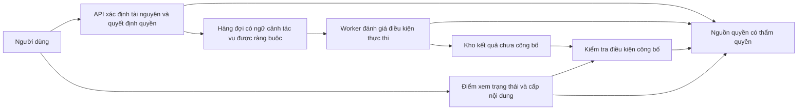

# Thực hành tổng hợp: viết requirement cho authorization

## 1. Mục tiêu và sản phẩm cần bàn giao

**Authorization**, hay phân quyền, quyết định một chủ thể có được thực hiện một hành động trên một tài nguyên trong bối cảnh cụ thể hay không. Đăng nhập thành công chỉ xác lập một phần thông tin về danh tính; hệ thống vẫn cần quyết định quyền cho từng hành động thuộc phạm vi bảo vệ.

Bài thực hành này yêu cầu chuyển mục tiêu nghiệp vụ và kịch bản đe dọa thành một bộ yêu cầu phân quyền có thể triển khai, đo và kiểm chứng. Trọng tâm là viết rõ điều kiện cho phép, điều kiện từ chối, nguồn thông tin có thẩm quyền và thời điểm áp dụng quyết định.

Sản phẩm cần có:

1. Phạm vi, giả định và danh sách câu hỏi nghiệp vụ chưa được quyết định.
2. Mô hình chủ thể, tài nguyên, hành động và bối cảnh.
3. Ma trận quyền kèm điều kiện theo tổ chức, quan hệ và trạng thái.
4. Bộ yêu cầu có định danh, nguồn rủi ro, phạm vi và tiêu chí chấp nhận.
5. Các ca hợp lệ, từ chối, biên thời gian, thay đổi quyền và lỗi phụ thuộc.
6. Liên kết từ rủi ro tới yêu cầu, điểm thực thi và bằng chứng xác minh.

Người học nên tự viết bản đầu trước khi đọc bộ yêu cầu mẫu. Những quy tắc và con số dưới đây là giả định đã chọn cho bài tập, không phải mô hình quyền hay ngưỡng bắt buộc cho mọi hệ thống.

## 2. Đề bài: nền tảng học tập nhiều tổ chức

### 2.1. Bối cảnh nghiệp vụ

Nền tảng phục vụ nhiều tổ chức độc lập. Mỗi tổ chức có các lớp học, học viên và giảng viên. Một người có thể là thành viên của nhiều tổ chức với vai trò khác nhau. Vai trò ở tổ chức A không tạo quyền tương ứng ở B.

Hệ thống có các chức năng:

- Học viên xem tiến độ học của chính mình trong tổ chức còn hiệu lực thành viên.
- Giảng viên xem tiến độ học viên trong lớp được phân công còn hiệu lực.
- Quản trị viên tổ chức xem tiến độ trong tổ chức và quản lý một số vai trò được cho phép.
- Giảng viên và quản trị viên tạo báo cáo theo phạm vi dữ liệu họ được phép xuất.
- Worker xử lý tác vụ xuất và ghi tệp; một điểm cấp nội dung trả kết quả cho người dùng.
- Nhân viên hỗ trợ có thể được cấp quyền đọc tạm thời đối với một lớp, theo phê duyệt riêng.

### 2.2. Các quyết định đã chốt cho bài tập

| Nội dung | Quy tắc dùng trong bài |
| --- | --- |
| Thành viên | Quyền dựa trên thành viên còn hiệu lực của đúng tổ chức, trừ đường hỗ trợ được cấp riêng |
| Giảng viên | Chỉ đọc và xuất tiến độ của lớp đang được phân công trong đúng tổ chức |
| Quản trị viên tổ chức | Đọc và xuất tiến độ trong tổ chức; API quản lý vai trò chỉ được gán `instructor` hoặc `learner` |
| Học viên | Chỉ đọc bản ghi tiến độ của chính mình, không được xuất báo cáo nhóm |
| Hỗ trợ | Chỉ đọc tiến độ của lớp được ghi trong grant; không được xuất hoặc thay quyền qua grant đó |
| Phê duyệt hỗ trợ | Quản trị viên của tổ chức đích phê duyệt; chủ thể phê duyệt phải khác người yêu cầu và người nhận quyền |
| Thời hạn hỗ trợ | Tối đa 30 phút; có hiệu lực khi `startsAt <= now < expiresAt` |
| Báo cáo xuất | Chỉ người yêu cầu ban đầu, khi vẫn đủ quyền xuất đối với phạm vi báo cáo, được xem trạng thái và tải |
| Thu hồi chủ động | Có hiệu lực với yêu cầu mới trong tối đa 60 giây từ lúc thay đổi được ghi nhận tại nguồn quyền |
| Hết hạn tự nhiên | Không cho phép dùng grant từ đúng `expiresAt`; không cộng thêm 60 giây cho thời hạn này |
| Trường dữ liệu tiến độ | Chỉ gồm `learnerId`, `displayName`, `cohortId`, `progressPercent` theo phạm vi bản ghi được phép |
| Đổi vai trò quản trị cao hơn | Ngoài chức năng đang thiết kế; không được tự mở đường gán vai trò đó qua API chung |

Các trường như ghi chú nội bộ, metadata hỗ trợ và thông tin xác thực không thuộc dữ liệu của API tiến độ. Quyền đọc một bản ghi không tự cho phép đọc mọi trường của hồ sơ liên quan.

### 2.3. Phạm vi cần xét

Phạm vi gồm API đọc, danh sách và tìm kiếm, tạo tác vụ xuất, worker, xem trạng thái, tải tệp, thay vai trò và grant hỗ trợ. Nếu có đường quản trị hoặc tải trực tiếp cung cấp cùng dữ liệu, nó cũng phải được đưa vào đánh giá.

Không thiết kế lại toàn bộ hệ thống xác thực trong bài này. Tuy nhiên, yêu cầu phải nêu thông tin danh tính nào đã được xác minh và không được coi dữ liệu người gọi tự khai là căn cứ quyền cuối cùng.

## 3. Nhận diện rủi ro trước khi viết quyền

| Rủi ro | Kịch bản lạm dụng | Mục tiêu bảo vệ |
| --- | --- | --- |
| R-AZ-01 | Người của A tham chiếu lớp, học viên hoặc báo cáo của B | Giữ ranh giới tổ chức trên mọi điểm cấp dữ liệu |
| R-AZ-02 | Giảng viên đổi định danh lớp để đọc lớp chưa được phân công | Kiểm tra quan hệ với tài nguyên, không chỉ kiểm tra tên vai trò |
| R-AZ-03 | Người dùng sửa trường vai trò hoặc tổ chức trong yêu cầu | Ngăn tự nâng quyền và gán thuộc tính bảo mật trái phép |
| R-AZ-04 | Tác vụ hoặc URL cũ tiếp tục cấp dữ liệu sau khi mất quyền | Tôn trọng thay đổi quyền trong giới hạn đã chốt |
| R-AZ-05 | Nhân viên hỗ trợ dùng grant ngoài lớp hoặc sau hết hạn | Giới hạn mục đích, tài nguyên, hành động và thời gian |
| R-AZ-06 | Worker dùng quyền kỹ thuật rộng để thực hiện yêu cầu không hợp lệ | Tách đặc quyền dịch vụ khỏi quyền nghiệp vụ được ủy nhiệm |
| R-AZ-07 | Danh sách, cache hoặc API phụ trả bản ghi hoặc trường ngoài phạm vi | Áp dụng quyền nhất quán trên đường đọc và dữ liệu dẫn xuất |
| R-AZ-08 | Không xác định được ai đã cấp quyền hoặc tải dữ liệu | Giữ dấu vết đủ để điều tra và thu hồi đúng đối tượng |
| R-AZ-09 | Phục hồi cấu hình cũ làm quyền đã thu hồi hoạt động trở lại | Khôi phục dịch vụ mà vẫn tôn trọng trạng thái quyền hiện hành |

Một yêu cầu có thể xử lý nhiều rủi ro và một rủi ro thường cần nhiều yêu cầu. Không ép bảng thành quan hệ một đối một nếu điều đó làm mất phần quan trọng của luồng.

## 4. Mô hình hóa quyết định: chủ thể, tài nguyên, hành động, bối cảnh

### 4.1. Bốn thành phần cần rõ

| Thành phần | Ví dụ | Nguồn cần được tin cậy |
| --- | --- | --- |
| Chủ thể | Người dùng, nhân viên hỗ trợ, danh tính worker | Danh tính đã xác minh và quan hệ thành viên được quản lý |
| Tài nguyên | Bản ghi tiến độ, lớp, tác vụ, tệp báo cáo, grant | Quan hệ sở hữu và liên kết tài nguyên do hệ thống quản lý |
| Hành động | `progress.read`, `export.create`, `export.download`, `role.assign` | Hành động do điểm xử lý xác định, không do người gọi tự chọn để né chính sách |
| Bối cảnh | Thời điểm, quan hệ phân công, grant còn hiệu lực, trạng thái quyền | Nguồn quyền, nguồn thời gian và trạng thái có thẩm quyền |

Tên vai trò là một đầu vào, chưa phải toàn bộ quyết định. `instructor` chỉ tạo quyền trên lớp có quan hệ phân công phù hợp. `tenant_admin` chỉ có quyền trong tổ chức tương ứng và trong tập hành động được cho phép.

### 4.2. Một quy tắc khái quát cho đọc tiến độ

```text
Cho phép progress.read khi:
  - Danh tính hợp lệ; và
  - Tài nguyên được xác định bằng quan hệ do hệ thống quản lý; và
  - Có ít nhất một đường cấp quyền được chính sách cho phép:
      + Học viên có thành viên còn hiệu lực và đọc tiến độ của chính mình;
      + Giảng viên có thành viên, vai trò và phân công lớp còn hiệu lực;
      + Quản trị viên có vai trò còn hiệu lực trong đúng tổ chức;
      + Nhân viên hỗ trợ có grant đúng lớp, đúng hành động và còn hiệu lực;
  - Không có điều kiện từ chối bắt buộc áp dụng.

Nếu không xác lập được một đường cho phép hợp lệ: từ chối.
```

Đây là mô tả logic, không phải mã triển khai hoàn chỉnh. Quy tắc cụ thể phải bao phủ trạng thái, trường dữ liệu và hiệu lực thay đổi quyền. Nếu có nhiều đường cấp quyền, việc hết một grant không tự xóa một quyền độc lập khác còn hợp lệ; hệ thống phải đánh giá đúng tập quyền đang áp dụng.

### 4.3. Đừng tin riêng định danh tổ chức trong yêu cầu

Một đường dẫn có `tenantId=A` không chứng minh tài nguyên được tham chiếu thuộc A. Cần lấy hoặc ràng buộc tổ chức sở hữu từ dữ liệu hệ thống, rồi kiểm tra chủ thể đối với tổ chức đó.

Thông tin vai trò, chủ sở hữu, người yêu cầu hoặc grant gửi trong phần thân cũng không được tự tạo quyền. Nếu được phép thay một thuộc tính, cần có hành động và chính sách riêng cho thay đổi đó.

## 5. Ma trận quyền và điều kiện đi kèm

### 5.1. Ma trận nghiệp vụ

| Hành động | Học viên | Giảng viên | Quản trị viên tổ chức | Nhân viên hỗ trợ |
| --- | --- | --- | --- | --- |
| Đọc tiến độ cá nhân | Chính mình trong tổ chức còn thành viên | Học viên thuộc lớp đang được phân công | Trong tổ chức quản trị | Thuộc lớp được grant đọc còn hiệu lực |
| Đọc danh sách tiến độ lớp | Không | Lớp đang được phân công | Lớp thuộc tổ chức quản trị | Đúng lớp được grant |
| Tạo báo cáo xuất | Không | Trong phạm vi lớp được phân công | Trong tổ chức quản trị | Không được cấp qua grant hỗ trợ |
| Xem trạng thái hoặc tải báo cáo | Không trong phạm vi bài tập | Báo cáo tự yêu cầu và vẫn đủ quyền đối với phạm vi đó | Báo cáo tự yêu cầu và vẫn đủ quyền đối với phạm vi đó | Không được cấp qua grant hỗ trợ |
| Gán vai trò qua API chung | Không | Không | Gán vai trò cho phép cho thành viên của đúng tổ chức | Không được cấp qua grant hỗ trợ |
| Phê duyệt hỗ trợ | Không | Không | Đúng tổ chức, khác người yêu cầu và người nhận quyền | Không được cấp qua grant hỗ trợ |

Các ô chỉ mô tả đường quyền tương ứng. Nếu một người đồng thời có nhiều vai trò, phải đánh giá từng đường hợp lệ; không dựa trên một nhãn “vai trò chính” tùy ý để bỏ hoặc mở quyền.

### 5.2. Tài khoản kỹ thuật có ma trận riêng

Worker cần thao tác dữ liệu để chạy tác vụ hợp lệ. Nó không phải người dùng được phép xuất mọi dữ liệu theo ý mình. Yêu cầu phải ràng buộc tác vụ với người khởi tạo, tổ chức, phạm vi dữ liệu và trạng thái quyền cần thiết.

Danh tính của worker, quyền kỹ thuật và quyền nghiệp vụ được ủy nhiệm cần được ghi nhận riêng. Không dùng một cột “service = allow all” để giải quyết mọi lời gọi nội bộ.

### 5.3. Ma trận chưa thay thế đặc tả

Ô “giảng viên được xuất lớp được phân công” còn thiếu thời điểm đánh giá, hành vi khi mất phân công, quy tắc với báo cáo cũ và tình huống nguồn quyền lỗi. Những phần đó phải được viết trong yêu cầu và tiêu chí chấp nhận.

## 6. Mẫu viết một authorization requirement

Một bản ghi yêu cầu nên gồm:

- Định danh, phiên bản và mục tiêu bảo vệ.
- Nguồn nghiệp vụ, giả định và rủi ro liên quan.
- Chủ thể, hành động, tài nguyên và phạm vi dữ liệu.
- Điều kiện cho phép và điều kiện từ chối bắt buộc.
- Nguồn thông tin có thẩm quyền và thời điểm đánh giá.
- Hành vi khi thiếu dữ liệu, lỗi phụ thuộc hoặc trạng thái đổi.
- Tiêu chí chấp nhận, phương pháp xác minh và bằng chứng cần lưu.

Mẫu câu có thể dùng:

> Khi [chủ thể] yêu cầu [hành động] trên [tài nguyên], [điểm thực thi] phải xác minh [điều kiện] từ [nguồn], tại [thời điểm]. Nếu không đủ điều kiện, phải [kết quả từ chối và tác dụng phụ được phép]. Xác minh bằng [ca thử hoặc đánh giá].

| Câu chưa đủ rõ | Vấn đề | Cách làm rõ |
| --- | --- | --- |
| Chỉ người có quyền được truy cập | Không định nghĩa quyền, tài nguyên hoặc thời điểm | Ghi quan hệ và điều kiện cụ thể |
| Admin được làm mọi thứ | Không có ranh giới tổ chức, hành động và dữ liệu | Liệt kê quyền theo phạm vi và các giới hạn |
| Dùng token có role là đủ | Bỏ nguồn quyền hiện hành và thu hồi | Đặc tả tính hợp lệ, nguồn và giới hạn thay đổi quyền |
| Có thư viện phân quyền | Chỉ nói lựa chọn triển khai | Nêu hành vi phải cho phép và phải từ chối |
| Ẩn nút là đã chặn | Không bảo vệ đường gọi phía máy chủ | Kiểm thử tại API và các điểm cấp dữ liệu |

## 7. Bộ yêu cầu mẫu để đối chiếu bài làm

### AZ-01 — Chỉ cho phép theo chính sách xác định

Mỗi hành động thuộc phạm vi phải được đánh giá bằng chính sách có định danh và phiên bản. Chỉ cho phép khi xác lập được một đường cấp quyền hợp lệ và mọi điều kiện bắt buộc của đường đó được đáp ứng. Trạng thái không có quy tắc cho phép hoặc không xác định được quyết định phải bị từ chối theo hợp đồng lỗi.

Tiêu chí: hành động chưa được khai báo, chủ thể thiếu thuộc tính cần thiết và lỗi lấy quyết định không dẫn tới mặc định cho phép. Quyền hợp lệ theo ma trận vẫn hoạt động khi các điều kiện được đáp ứng.

### AZ-02 — Giữ ranh giới tổ chức và quan hệ tài nguyên

API, worker và điểm cấp nội dung phải xác định tổ chức sở hữu tài nguyên từ quan hệ do hệ thống quản lý, rồi kiểm tra quyền tương ứng. Vai trò của chủ thể ở tổ chức khác không được dùng làm quyền cho tài nguyên đích.

Tiêu chí: đổi định danh tổ chức, lớp, học viên, tác vụ hoặc tệp không cho phép vượt phạm vi. Cần dùng tài nguyên tồn tại thật nhưng ngoài quyền, không chỉ thử định danh không tồn tại.

### AZ-03 — Giới hạn bản ghi theo quan hệ nghiệp vụ

Đọc tiến độ phải tuân theo quan hệ đã chốt: học viên đọc chính mình; giảng viên đọc lớp được phân công; quản trị viên đọc trong tổ chức; hỗ trợ đọc đúng lớp theo grant. Danh sách, tìm kiếm, tổng hợp và phân trang phải giữ cùng phạm vi bản ghi.

Tiêu chí: không có bản ghi ngoài phạm vi trong kết quả, số lượng hoặc dữ liệu tổng hợp mà hợp đồng không cho phép tiết lộ. Thay trang hoặc điều kiện lọc không tạo đường bỏ qua quyền.

### AZ-04 — Giới hạn trường dữ liệu trả về

Các đường đọc tiến độ và báo cáo thuộc bài tập chỉ được trả tập trường đã chốt cho chức năng. Quyền trên bản ghi không được mở các trường ghi chú nội bộ, metadata hỗ trợ hoặc thông tin xác thực qua lựa chọn trường, đối tượng lồng nhau hay thông báo lỗi.

Tiêu chí: phản hồi hợp lệ đúng tập trường; yêu cầu mở rộng trường không được cấp dữ liệu ngoài hợp đồng. Dữ liệu lấy từ cache hoặc xuất báo cáo cũng phải đáp ứng giới hạn tương ứng.

### AZ-05 — Kiểm soát thay đổi vai trò

API gán vai trò chỉ cho quản trị viên còn quyền của tổ chức đích gán `instructor` hoặc `learner` cho thành viên thuộc tổ chức đó. Trường do người gọi gửi không được thay chủ sở hữu tổ chức hoặc mở quyền gán vai trò quản trị cao hơn.

Với thao tác hàng loạt trong bài tập, mọi thay đổi phải được kiểm tra quyền; nếu một mục không được phép thì toàn bộ thao tác bị từ chối và không đổi vai trò. Sự kiện từ chối theo yêu cầu audit vẫn có thể được ghi.

Tiêu chí: tự sửa vai trò qua API hồ sơ, thêm trường ngoài hợp đồng, gán cho tổ chức khác và trộn mục hợp lệ với mục ngoài quyền đều không tạo thay đổi trái phép.

### AZ-06 — Grant hỗ trợ có phạm vi và thời hạn

Grant hỗ trợ phải xác định người nhận quyền, tổ chức, lớp, hành động đọc, căn cứ công việc, người phê duyệt và khoảng hiệu lực. Người phê duyệt phải là quản trị viên có quyền ở tổ chức đích và khác chủ thể yêu cầu cùng chủ thể nhận grant. Thời lượng không vượt 30 phút.

Không cho dùng grant trước `startsAt` hoặc từ đúng `expiresAt`. Grant không tạo quyền xuất, đổi vai trò hoặc phê duyệt grant khác. Không xác minh được điều kiện bắt buộc thì không cấp quyền qua grant đó.

Tiêu chí: tự phê duyệt, sai lớp, sai hành động, thiếu phê duyệt, thời lượng vượt giới hạn và dùng tại biên hết hạn đều có kết quả đúng quy tắc. Nếu người dùng có quyền độc lập khác, kiểm thử phải tách đường quyền để không nhầm kết quả.

### AZ-07 — Từ chối không tạo hiệu ứng nghiệp vụ trái phép

Yêu cầu bị từ chối không được tạo tác vụ xuất, cấp đường tải, đổi quyền hoặc trả dữ liệu ngoài phạm vi. Phản hồi và tác dụng phụ phải theo hợp đồng, không chứa nội dung nhạy cảm của tài nguyên ngoài quyền.

Audit quyết định và các hiệu ứng bảo vệ đã được đặc tả là ngoại lệ có chủ đích đối với việc không tạo hiệu ứng nghiệp vụ. Không viết một cam kết cấm mọi thay đổi khiến việc ghi nhận từ chối cũng bị coi là lỗi.

### AZ-08 — Kiểm tra quyền của tác vụ bất đồng bộ

Tác vụ xuất phải được ràng buộc với người yêu cầu, tổ chức, phạm vi dữ liệu và hành động đã được xác thực tại API. Trước khi đọc dữ liệu, worker phải đánh giá điều kiện thực thi theo nguồn quyền có thẩm quyền và giới hạn hiệu lực thay đổi quyền đã chốt; quyền kỹ thuật của worker không thay cho quyền nghiệp vụ của người yêu cầu.

Trước khi công bố kết quả, phải xác nhận điều kiện cho phép công bố theo đặc tả. Tác vụ không đủ điều kiện phải chuyển trạng thái phù hợp và không để lại tệp có thể tải ngoài quyền.

Tiêu chí: giữ tác vụ ở hàng đợi, thu hồi quyền hoặc phân công, rồi cho xử lý tiếp; kết quả phải tôn trọng quy tắc thời điểm và giới hạn thu hồi. Thông điệp bị đổi tổ chức hoặc phạm vi không được dùng đặc quyền worker để đọc dữ liệu khác.

### AZ-09 — Kiểm tra quyền xem và tải báo cáo

Chỉ người khởi tạo đã được hệ thống ghi nhận, khi vẫn đủ quyền xuất đối với phạm vi báo cáo, được xem trạng thái và tải trong bài tập. Việc biết định danh tác vụ, có cùng vai trò hoặc thuộc cùng tổ chức chưa đủ để đọc báo cáo do người khác yêu cầu.

Mọi đường cấp nội dung phải thực thi điều kiện tương ứng, kể cả đường đã cấp trước đó. Nếu một URL trực tiếp không thể đáp ứng điều kiện và giới hạn thu hồi, thiết kế chưa đạt yêu cầu; không được coi URL khó đoán là kiểm tra quyền.

### AZ-10 — Hiệu lực thay đổi và biên thời gian

Thu hồi chủ động thành viên, phân công hoặc quyền phải phản ánh tại mọi yêu cầu mới thuộc phạm vi trong tối đa 60 giây kể từ ghi nhận thành công tại nguồn quyền. Giới hạn gồm lan truyền, cache và thông tin truy cập đã cấp.

Hết hạn grant tự nhiên tuân theo biên `now < expiresAt`, không được cộng thêm độ trễ thu hồi. Hành vi đối với luồng đang mở phải được đặc tả riêng nếu cần; thay đổi quyền không thể lấy lại dữ liệu đã tải về.

Tiêu chí: đo từ đúng nguồn tới từng điểm thực thi. Trước hạn thu hồi, hệ thống được phép từ chối sớm; từ đúng hạn trở đi phải từ chối đường không còn quyền. Với grant hết hạn, kiểm tra trước, đúng và sau mốc theo độ phân giải đã chọn.

### AZ-11 — Audit quyết định nhạy cảm

Thay vai trò, cấp hoặc thu hồi grant, đọc tiến độ toàn lớp, tạo báo cáo và cấp nội dung phải ghi quyết định cho phép hoặc từ chối, chủ thể khởi tạo, danh tính thực thi nếu khác, tổ chức, tài nguyên, hành động, phiên bản chính sách, kết quả, thời điểm và định danh tương quan phù hợp.

Trong bài tập, thao tác thành công thuộc nhóm trên chỉ được công bố dữ liệu hoặc hoàn tất thay đổi sau khi sự kiện cần thiết đã được ghi bền vững vào kênh audit được thiết kế. Nếu không ghi được, phải từ chối thao tác đó và báo hiệu vận hành theo đường đã chốt. Không ghi token, bí mật hay nội dung tiến độ vào sự kiện.

Tiêu chí: kiểm tra cả đường thành công, từ chối, tác vụ nền và lỗi kênh audit. Có thể truy chuỗi quyết định nhưng không có dữ liệu cấm trong log.

### AZ-12 — Cô lập quyết định và dữ liệu trong cache

Cache không được tái sử dụng quyết định hoặc dữ liệu cho chủ thể, tổ chức, tài nguyên, hành động hoặc trạng thái quyền khác theo cách mở rộng quyền. Thiết kế phải xét mọi thuộc tính ảnh hưởng quyết định, phiên bản quyền hoặc chính sách và thời hạn grant.

Tiêu chí: làm nóng cache bằng chủ thể có quyền, sau đó truy cập bằng chủ thể ngoài quyền; đổi tổ chức, tài nguyên, quan hệ hoặc trạng thái không làm lộ dữ liệu. Cache phải tương thích với AZ-10 và hành vi khi không xác minh được quyền.

### AZ-13 — Phục hồi không tái kích hoạt quyền cũ

Trước khi mở lại chức năng cấp dữ liệu sau phục hồi, hệ thống phải đối chiếu trạng thái quyền, grant và đường truy cập với nguồn hiện hành được thiết kế cho tình huống đó. Không coi quyền trong bản sao cũ là đủ để tiếp tục cho phép.

Tiêu chí: phục hồi bản sao được tạo trước khi một quyền bị thu hồi hoặc hết hạn; quyền cũ không được hoạt động trở lại trái với điều kiện hiện hành. Không xác minh được quyền thì từ chối đường cấp dữ liệu tương ứng.

## 8. Kiểm tra yêu cầu trên luồng đồng bộ và bất đồng bộ



Sơ đồ thể hiện nơi cần đánh giá, không yêu cầu mọi lời gọi đều phải truy vấn trực tiếp cùng một dịch vụ. Có thể dùng cơ chế khác nếu chứng minh được ngữ nghĩa, độ trễ và hành vi lỗi đáp ứng bộ yêu cầu.

Một lần kiểm tra lúc tạo tác vụ không đủ cho mọi trạng thái sau đó. Quyền có thể đổi khi tác vụ đang chờ, sau khi tệp được tạo hoặc trước lúc người dùng tải. Cần xét đúng thời điểm, thay vì mặc định trạng thái lúc bắt đầu hợp lệ mãi mãi.

Khi có chuyển giao quyền nghiệp vụ giữa các dịch vụ, giữ người khởi tạo và phạm vi được ủy nhiệm. Không cho một dịch vụ có đặc quyền rộng trở thành đường thực hiện yêu cầu ngoài quyền của người gọi.

## 9. Viết tiêu chí chấp nhận và ca kiểm thử

### 9.1. Danh mục ca cốt lõi

| Ca thử | Điều kiện | Kết quả cần chứng minh |
| --- | --- | --- |
| TC-AZ-01 | Học viên đọc tiến độ chính mình rồi đổi sang người khác | Đường hợp lệ hoạt động, đường ngoài quyền bị từ chối |
| TC-AZ-02 | Giảng viên đọc lớp được phân công và lớp khác cùng tổ chức | Vai trò không mở rộng ra mọi lớp |
| TC-AZ-03 | Người có vai trò ở A tham chiếu tài nguyên thật của B | Không vượt tổ chức bằng thay định danh |
| TC-AZ-04 | Yêu cầu danh sách, trang tiếp theo và trường lồng ngoài hợp đồng | Không lộ bản ghi, trường hoặc dữ liệu tổng hợp ngoài quyền |
| TC-AZ-05 | Gán vai trò ngoài danh sách hoặc sửa thuộc tính bảo mật qua API hồ sơ | Không nâng quyền hoặc chuyển phạm vi trái phép |
| TC-AZ-06 | Thao tác hàng loạt có một mục ngoài quyền | Không đổi một phần vai trò, có audit phù hợp |
| TC-AZ-07 | Grant sai lớp, tự phê duyệt, vượt thời lượng hoặc hết hạn | Không cấp quyền qua grant không hợp lệ |
| TC-AZ-08 | Thu hồi trong lúc tác vụ đang chờ hoặc trước công bố | Worker và điểm công bố tôn trọng điều kiện hiện hành |
| TC-AZ-09 | Người khác cùng tổ chức dùng định danh báo cáo | Không đọc trạng thái hoặc tải nếu không phải người khởi tạo theo quy tắc bài tập |
| TC-AZ-10 | Tải bằng đường cũ tại và sau hạn thu hồi | Mọi đường trong phạm vi từ chối đúng giới hạn |
| TC-AZ-11 | Làm nóng cache bằng người có quyền rồi đổi chủ thể hoặc tổ chức | Không dùng nhầm quyết định hoặc dữ liệu đã cache |
| TC-AZ-12 | Nguồn quyền hoặc kênh audit lỗi | Hành vi lỗi đúng yêu cầu, không tạo tài nguyên ngoài ý muốn |
| TC-AZ-13 | Phục hồi trạng thái quyền cũ | Không làm sống lại quyền bị thu hồi hoặc grant hết hạn |

### 9.2. Ví dụ ca từ chối trên tài nguyên tồn tại

```text
Cho trước:
  - Giảng viên U thuộc tổ chức A.
  - U đang được phân công lớp C1, không được phân công C2.
  - C2 tồn tại trong A và có học viên cùng dữ liệu tiến độ.

Khi:
  - U gọi trực tiếp API đọc tiến độ của C2.

Thì:
  - Không trả dữ liệu tiến độ của C2 hoặc trường nhạy cảm trong lỗi.
  - Không tạo tác vụ hoặc đường tải ngoài ý muốn.
  - Quyết định bị từ chối được ghi nhận nếu thuộc phạm vi audit.
  - U vẫn đọc được C1 theo đường hợp lệ.
```

Nếu chỉ thử một lớp không tồn tại, phản hồi lỗi có thể do tra cứu thất bại chứ chưa chứng minh chính sách phân quyền đúng.

### 9.3. Ví dụ biên thời gian và thay đổi trạng thái

Với grant, dùng đồng hồ điều khiển được để thử ngay trước, đúng và sau `expiresAt` theo độ phân giải của hợp đồng. Không dùng khoảng ngủ để cố bắt đúng một mốc trong kiểm thử đơn vị.

Với thu hồi, giữ riêng mốc nguồn ghi nhận và mốc quan sát tại từng điểm thực thi. Nếu yêu cầu là tối đa 60 giây, kết quả trung bình hoặc một lần đo tốt không chứng minh mọi đường đều đạt. Cần kết hợp thiết kế giới hạn độ trễ, cấu hình và các ca lỗi liên quan.

Với tác vụ nền, điều khiển thứ tự: tạo tác vụ, giữ worker ở điểm chờ, thay quyền, rồi cho tiếp tục sau mốc có hiệu lực cần kiểm tra. Quan sát cả tệp tạm, trạng thái công bố và đường tải, không chỉ phản hồi của API tạo tác vụ.

## 10. Truy vết từ rủi ro tới kiến trúc và bằng chứng

Một ma trận gọn cho bài tập có thể là:

| Rủi ro | Yêu cầu chính | Điểm cần thực thi | Bằng chứng dự kiến |
| --- | --- | --- | --- |
| R-AZ-01, R-AZ-02 | AZ-02, AZ-03 | API đọc, truy vấn dữ liệu, worker và điểm tải | Kiểm thử tài nguyên chéo phạm vi và rà soát đường cấp dữ liệu |
| R-AZ-03 | AZ-05, AZ-07 | API thay vai trò, cập nhật hồ sơ, thao tác hàng loạt | Kiểm thử trường ngoài quyền và tính toàn bộ của giao dịch |
| R-AZ-04, R-AZ-06 | AZ-08, AZ-09, AZ-10 | Hàng đợi, worker, cache và điểm cấp nội dung | Thay quyền giữa các trạng thái, đo hiệu lực thu hồi |
| R-AZ-05 | AZ-06, AZ-10 | Cấp, phê duyệt và sử dụng grant | Kiểm thử phạm vi, tự phê duyệt và biên thời gian |
| R-AZ-07 | AZ-03, AZ-04, AZ-12 | Danh sách, tìm kiếm, xuất và cache | Kiểm thử bản ghi, trường, phân trang và cô lập cache |
| R-AZ-08 | AZ-11 | Các điểm quyết định và kênh audit | Truy vết sự kiện thành công, từ chối và lỗi |
| R-AZ-09 | AZ-13 | Quy trình phục hồi, nguồn quyền và mở lại | Diễn tập khôi phục quyền cũ và xác minh quyền hiện hành |

AZ-01 là nguyên tắc quyết định áp dụng xuyên suốt. Khi dùng ma trận thực tế, cần bổ sung phiên bản, người phụ trách và liên kết tới nội dung chi tiết, không chỉ giữ tên đối tượng.

Một ca có tên trong bảng chưa chứng minh đã chạy. Bằng chứng phải chỉ ra bản dựng, cấu hình, dữ liệu, môi trường, thời điểm, kết quả và phần chưa được bao phủ. Nếu chỉ kiểm tra API nhưng thiếu worker, trạng thái toàn yêu cầu không được báo là đã xác minh đầy đủ.

## 11. Câu hỏi cần giải quyết khi mở rộng đề bài

Các quyết định của bài tập có thể khác nghiệp vụ thực tế. Khi đổi quyết định, hãy sửa yêu cầu và tiêu chí liên quan, thay vì âm thầm thêm một nhánh cho phép trong triển khai.

| Câu hỏi mở rộng | Ảnh hưởng cần đánh giá |
| --- | --- |
| Quản trị viên có được tải báo cáo do người khác tạo không? | Sửa AZ-09, dữ liệu chia sẻ, audit và ca ngoài quyền |
| Giảng viên ngừng phân công có còn đọc dữ liệu lịch sử không? | Định nghĩa quan hệ lịch sử, phạm vi dữ liệu và hiệu lực thu hồi |
| Hỗ trợ cần xuất dữ liệu trong sự cố khẩn cấp không? | Grant riêng, thẩm quyền, giới hạn, dữ liệu và kiểm thử |
| Một người có nhiều vai trò hoặc nhiều grant thì quyền kết hợp thế nào? | Quy tắc hợp, điều kiện từ chối bắt buộc và nguồn quyền |
| Có quyền quản trị xuyên nhiều tổ chức không? | Đường quyền riêng với phạm vi rõ, không suy từ vai trò cục bộ |
| Thao tác hàng loạt có được thành công một phần không? | Hợp đồng phản hồi, giao dịch, audit và dữ liệu không được tiết lộ |
| Nguồn quyền không khả dụng thì chức năng nào được tiếp tục? | Giới hạn thông tin lưu đệm, rủi ro và hành vi lỗi từng chức năng |
| Quyền đổi khi đang truyền tệp thì có phải ngắt không? | Cam kết cho luồng đang mở, thời gian và khả năng can thiệp |

Nếu chưa có câu trả lời, ghi giả định và người cần quyết định. Không báo một yêu cầu đã sẵn sàng khi phần thiếu có thể làm thay đổi điều kiện cho phép cốt lõi.

Khi thay kiến trúc hoặc mô hình quyền, đánh giá lại xác thực, dữ liệu, audit, vận hành và phục hồi có liên quan. Đổi một thư viện phân quyền không tự giải quyết việc thiếu yêu cầu hoặc thiếu đường thực thi.

## 12. Tiêu chí tự đánh giá bài làm

Một thang điểm minh họa gồm:

| Nhóm tiêu chí | Điểm tối đa | Dấu hiệu bài làm tốt |
| --- | --- | --- |
| Phạm vi và mô hình | 20 | Đủ chủ thể, tài nguyên, hành động, bối cảnh và nguồn tin cậy |
| Ma trận quyền | 20 | Có điều kiện theo tổ chức, quan hệ, trường và trạng thái |
| Chất lượng yêu cầu | 25 | Cụ thể, nhất quán, có hành vi lỗi và giới hạn đo được |
| Tiêu chí và kiểm thử | 20 | Bao phủ đường hợp lệ, từ chối, thời gian, tác vụ nền và cache |
| Truy vết | 10 | Nối được rủi ro, yêu cầu, thiết kế và bằng chứng |
| Phần chưa biết và rủi ro tồn dư | 5 | Công khai giả định, quyết định còn thiếu và giới hạn kết luận |

Điểm tổng không thay điều kiện bắt buộc. Một bài cho phép truy cập chéo tổ chức hoặc cho worker thực hiện mọi yêu cầu bằng quyền dịch vụ vẫn có lỗi cốt lõi cần sửa dù có nhiều bảng và nhiều ca thử.

Nên tự rà theo câu hỏi: người phát triển có biết phải chặn ở đâu không, người kiểm thử có thể xác định đúng sai tại biên không và người sở hữu nghiệp vụ có hiểu phạm vi quyền đang được cấp không?

## 13. Những lỗi hay gặp trong bài authorization requirement

| Biểu hiện | Điều bị bỏ sót | Cách sửa |
| --- | --- | --- |
| Chỉ liệt kê role | Quan hệ với tổ chức, tài nguyên và trạng thái | Viết điều kiện đầy đủ cho từng hành động |
| Tin tenant trong đường dẫn | Tài nguyên có thể thực sự thuộc tổ chức khác | Dùng quan hệ sở hữu do hệ thống quản lý |
| Có token hợp lệ nên cho phép | Token không tự tạo mọi quyền nghiệp vụ | Xác minh hành động và phạm vi tài nguyên |
| Admin được bỏ qua mọi kiểm tra | Ranh giới tổ chức và quyền bị mở quá rộng | Tách quyền theo hành động và phạm vi |
| Chỉ chặn đọc chi tiết | Danh sách, tìm kiếm, tổng hợp hoặc xuất vẫn có thể lộ dữ liệu | Bao phủ các đường đọc và dữ liệu dẫn xuất |
| Chỉ kiểm tra quyền lúc tạo tác vụ | Quyền có thể đổi trước lúc đọc hoặc công bố | Đặc tả thời điểm đánh giá lại và hiệu lực thay đổi |
| Coi biết URL là đủ quyền | Đường tải cũ có thể tiếp tục cấp nội dung | Giữ điều kiện quyền tại mọi điểm cấp dữ liệu |
| Grant hết hạn được cộng thêm thời gian cache | Làm yếu biên thời hạn đã chốt | Phân biệt hết hạn tự nhiên và độ trễ thu hồi chủ động |
| Từ chối đúng nhưng vẫn tạo tệp | Có hiệu ứng nghiệp vụ ngoài quyền | Kiểm tra trạng thái, tài nguyên và dọn dữ liệu tạm |
| Cache theo tài nguyên nhưng bỏ chủ thể | Dùng nhầm kết quả cho người khác | Cô lập theo các thuộc tính ảnh hưởng quyết định |
| Audit có token hoặc nội dung báo cáo | Tạo thêm đường lộ bí mật và dữ liệu | Chỉ ghi metadata cần thiết, có quyền truy cập |
| Khôi phục cấu hình cũ rồi mở ngay | Có thể tái kích hoạt quyền đã thu hồi | Đối chiếu nguồn hiện hành và diễn tập trường hợp này |

## 14. Cách thực hiện và điều kiện bàn giao

### 14.1. Các bước thực hành

1. Tóm tắt phạm vi và chép lại các quyết định nghiệp vụ thành danh sách có định danh.
2. Liệt kê chủ thể, tài nguyên, hành động, thuộc tính và quan hệ cần dùng.
3. Viết ma trận quyền, sau đó thử các trường hợp cùng vai trò nhưng khác tổ chức hoặc khác quan hệ.
4. Liệt kê kịch bản lạm dụng và kiểm tra mỗi đường quan trọng đã có yêu cầu xử lý.
5. Viết bộ yêu cầu trước khi chọn thư viện hoặc cách bố trí thành phần.
6. Với từng yêu cầu, viết ít nhất một đường hợp lệ và một điều kiện từ chối phù hợp; thêm biên và trạng thái khi cần.
7. Rà toàn luồng API, worker, cache, công bố, tải, audit và phục hồi.
8. Dựng truy vết, ghi người phụ trách giả định còn mở và cách lấy bằng chứng.
9. Đối chiếu với bộ mẫu, giải thích mọi lựa chọn khác bằng quyết định nghiệp vụ rõ ràng.

Bài tập không yêu cầu triển khai hệ thống thật. Nếu có phần triển khai thực hành riêng, dùng dữ liệu và danh tính thử trong môi trường được phép; kết quả triển khai phải được đánh giá theo bộ yêu cầu đã chốt.

### 14.2. Điểm kiểm tra khi bàn giao

- Danh tính đã xác minh được phân biệt với quyền thực hiện hành động.
- Vai trò luôn có phạm vi; tổ chức sở hữu tài nguyên được xác định từ nguồn có thẩm quyền.
- Quan hệ người học, giảng viên, quản trị viên và hỗ trợ được diễn đạt rõ.
- Có giới hạn bản ghi, trường dữ liệu, danh sách và dữ liệu dẫn xuất.
- Đổi vai trò và thuộc tính bảo mật có chính sách riêng, không tự nâng quyền.
- Grant có người phê duyệt, phạm vi, hành động và biên thời gian.
- Worker không dùng đặc quyền kỹ thuật thay quyền nghiệp vụ của người yêu cầu.
- Tác vụ cũ, URL cũ, cache và thay đổi quyền được xử lý nhất quán.
- Từ chối không tạo tài nguyên hoặc tiết lộ nội dung ngoài hợp đồng.
- Audit đủ để điều tra và không chứa bí mật hoặc dữ liệu bị cấm.
- Phục hồi không làm sống lại quyền cũ ngoài điều kiện hiện hành.
- Các yêu cầu có tiêu chí, ca thử, truy vết và phần chưa biết được công khai.

Một bộ authorization requirement tốt cho biết ai được làm gì, trên dữ liệu nào, trong điều kiện nào và tại thời điểm nào. Bài làm hoàn chỉnh cần giúp triển khai đúng đường cho phép, chặn đúng đường ngoài quyền và thu được bằng chứng đủ phạm vi để xác minh cả hai.
