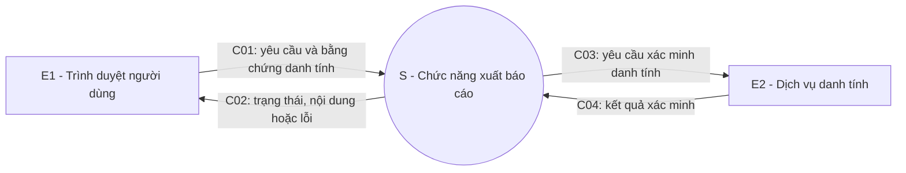
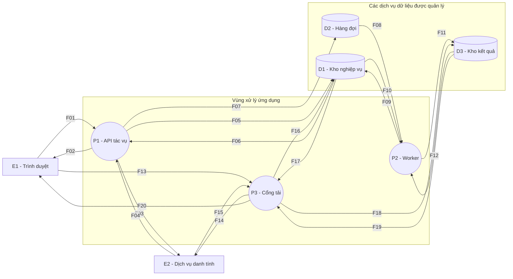
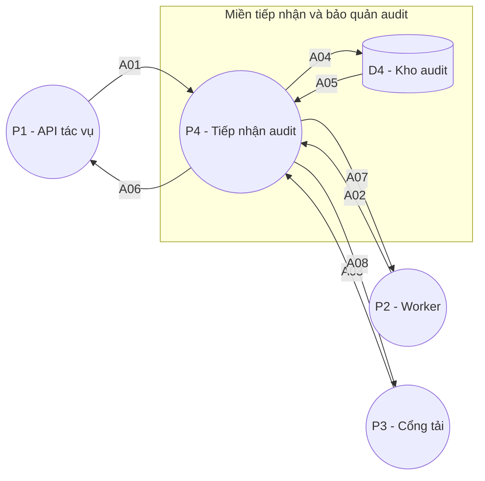

# Thực hành tổng hợp: lập data flow diagram cho yêu cầu bảo mật

## 1. Mục tiêu và sản phẩm cần bàn giao

**Data flow diagram**, viết tắt là DFD, mô tả dữ liệu đi từ đâu, qua xử lý nào, được lưu ở đâu và được chuyển tới ai. Trong thiết kế yêu cầu bảo mật, DFD giúp nhận diện tài sản, ranh giới tin cậy, danh tính và những điểm có thể đọc, sửa hoặc tiết lộ dữ liệu.

Một sơ đồ có biểu tượng máy chủ và mũi tên chưa đủ nếu không biết mũi tên mang dữ liệu gì. Ngược lại, DFD không cần thể hiện từng lớp mã hoặc từng gói mạng để trở nên hữu ích. Độ chi tiết phải đủ để đặt câu hỏi và viết yêu cầu kiểm chứng được.

Bài thực hành yêu cầu tạo:

1. Tuyên bố phạm vi, giả định và các câu hỏi chưa được xác nhận.
2. Sơ đồ ngữ cảnh cho toàn hệ thống đang xét.
3. Sơ đồ phân rã cho một luồng nghiệp vụ có rủi ro.
4. Danh mục thành phần, từ điển luồng và dữ liệu lưu trữ.
5. Ranh giới tin cậy và nguồn có thẩm quyền cho các quyết định quan trọng.
6. Các yêu cầu về xác thực, phân quyền, dữ liệu, audit và phục hồi được suy ra từ mô hình.
7. Liên kết tới tiêu chí chấp nhận và bằng chứng xác minh.

Người học nên tự vẽ bản đầu trước khi đối chiếu với phần mẫu. Các tên, định danh và thời hạn trong bài là giả định phục vụ bài tập, không phải cấu hình hoặc mức bảo vệ mặc định cho mọi hệ thống.

## 2. Đề bài: xuất báo cáo học viên cho nhiều tổ chức

### 2.1. Luồng nghiệp vụ hợp lệ

Nền tảng phục vụ các tổ chức độc lập. Người dùng có quyền xuất yêu cầu tạo báo cáo học viên. API xác minh danh tính, kiểm tra quyền và tạo tác vụ. Hàng đợi chuyển thông điệp tới worker; worker đọc dữ liệu, tạo tệp trong kho kết quả. Người yêu cầu xem trạng thái rồi tải qua cổng cấp nội dung.

Mỗi báo cáo chỉ thuộc một tổ chức. Người dùng có thể là thành viên của nhiều tổ chức với quyền khác nhau. Trong phạm vi bài tập, chỉ người yêu cầu ban đầu, khi vẫn đủ quyền xuất đối với phạm vi báo cáo, được xem trạng thái và tải kết quả.

### 2.2. Các giả định kiến trúc của bản mẫu

- Dịch vụ danh tính là một hệ thống bên ngoài phạm vi ứng dụng. Trong thiết kế minh họa, API và cổng tải gọi dịch vụ để xác minh bằng chứng mà người dùng gửi.
- Nguồn quyền nghiệp vụ và quan hệ sở hữu nằm trong kho dữ liệu ứng dụng. Dịch vụ danh tính xác minh danh tính; nó không thay nguồn quyền trên báo cáo.
- Worker dùng danh tính kỹ thuật riêng, đồng thời giữ liên hệ với người khởi tạo và phạm vi tác vụ. Nó không được coi quyền đọc kỹ thuật là quyền nghiệp vụ của mọi yêu cầu.
- Kho kết quả không cung cấp đường tải công khai hoặc URL truy cập trực tiếp cho trình duyệt. Mọi lần cấp nội dung trong bản mẫu đều qua cổng tải.
- Mã hóa lưu trữ do nền tảng kho dữ liệu cung cấp. Ứng dụng không gọi dịch vụ khóa để giải mã từng tệp trong bản mẫu này; quản lý khóa là phụ thuộc phải được làm rõ trong góc nhìn lưu trữ và phục hồi.
- Có bộ tiếp nhận audit riêng, giữ sự kiện trong kho audit. Các thao tác nhạy cảm cần biết sự kiện đã được ghi bền vững hay chưa theo yêu cầu sẽ đặc tả.

Đây là giả định của bài tập, không phải kết luận về một hệ thống đang vận hành. Nếu kiến trúc thật dùng xác minh token cục bộ, URL trực tiếp hoặc mã hóa phía ứng dụng, phải sửa mô hình và các luồng liên quan.

### 2.3. Dữ liệu và trạng thái cần bảo vệ

Báo cáo chứa định danh học viên, tên hiển thị, thông tin liên hệ và tiến độ học, được giả định là dữ liệu nhạy cảm. Còn có bằng chứng danh tính, quyền xuất, định danh tác vụ, quan hệ tổ chức, tệp tạm, cấu hình và dữ liệu audit.

Phạm vi chính bắt đầu từ yêu cầu xuất, bao gồm xử lý nền, công bố kết quả và cấp nội dung. Vòng đời audit, xóa dữ liệu và phục hồi được biểu diễn bằng các góc nhìn bổ sung. Không bỏ chúng chỉ vì chúng không nằm trên đường người dùng bấm nút tải.

## 3. Dùng đúng các thành phần của DFD

| Thành phần | Ý nghĩa | Ví dụ trong bài | Lỗi cần tránh |
| --- | --- | --- | --- |
| Thực thể ngoài | Nguồn hoặc nơi nhận nằm ngoài hệ thống đang mô hình hóa | Trình duyệt người dùng, dịch vụ danh tính | Hiểu ngoài phạm vi là không cần phân tích |
| Tiến trình | Biến đổi, kiểm tra hoặc điều phối dữ liệu | API xuất, worker, cổng tải, bộ tiếp nhận audit | Chỉ ghi tên máy chủ mà không biết nó làm gì |
| Kho dữ liệu | Nơi dữ liệu được giữ để dùng sau | Kho nghiệp vụ, hàng đợi, kho tệp, kho audit | Bỏ cache và tệp tạm có ảnh hưởng bảo mật |
| Luồng dữ liệu | Một tập dữ liệu chuyển theo hướng xác định | Thông điệp tác vụ, bản ghi báo cáo, kết quả xác minh | Đặt tên bằng thao tác điều khiển nhưng không nêu dữ liệu |
| Ranh giới tin cậy | Điểm thay đổi giả định về quyền, chủ thể quản lý hoặc độ tin cậy | Trình duyệt sang dịch vụ, dịch vụ sang kho dùng chung | Đồng nhất hoàn toàn với sơ đồ mạng |

### 3.1. DFD khác sơ đồ trình tự

Mũi tên DFD biểu diễn dữ liệu, không tự khẳng định thứ tự thực hiện. Đọc hình từ trái sang phải không chứng minh API đã kiểm tra quyền trước khi tạo tác vụ. Thứ tự đó phải có yêu cầu và có thể cần sơ đồ trình tự hoặc trạng thái bổ sung.

Một lời gọi và kết quả trả về là hai hướng dữ liệu. Trong sơ đồ chi tiết, nên tách để thấy dữ liệu nhạy cảm đi ngược về đâu. Nếu gộp nhiều thông điệp thành một nhóm để hình dễ đọc, từ điển phải nói rõ nội dung và hướng từng phần.

### 3.2. Mô hình logic không bị buộc vào một máy hoặc một công cụ

Một tiến trình có thể chạy trên nhiều nút; nhiều tiến trình có thể cùng nằm trên một hạ tầng. Hàng đợi là kho giữ thông điệp trong mô hình logic dù nền tảng thực thi có nhiều thành phần bên trong.

Sơ đồ triển khai có thể bổ sung vùng mạng, tài khoản nền tảng và giao thức. DFD vẫn cần giữ được quan hệ dữ liệu và quyền khi đổi công nghệ triển khai.

### 3.3. Kiểm tra quy tắc kết nối

Dữ liệu đi giữa một thực thể ngoài và một kho thường cần đi qua tiến trình thực sự tiếp nhận hoặc cấp dữ liệu. Nếu người dùng tải trực tiếp từ kho, mô hình phải thể hiện giao diện cấp nội dung của kho như một tiến trình hoặc dịch vụ liên quan, cùng cơ chế quyền; không chỉ bỏ đường đó khỏi hình.

Khi hai kho trao đổi dữ liệu, cần biết tiến trình sao chép hoặc đồng bộ nào thực hiện và bằng danh tính nào. Một mũi tên “backup” không có chủ thể hay dữ liệu rõ sẽ khó suy ra yêu cầu bảo mật.

## 4. Bước 1: chốt phạm vi và lập sơ đồ ngữ cảnh

### 4.1. Ghi rõ quy ước cấp độ

Trong bài, sơ đồ ngữ cảnh chỉ có một tiến trình đại diện toàn bộ chức năng được xét; sơ đồ Level 1 phân rã chức năng đó. Tên cấp có thể khác giữa các nhóm. Cần ghi quy ước thay vì tranh luận từ tên gọi khi cấu trúc đã rõ.

Ở mức ngữ cảnh, các kho nội bộ không phải thực thể bên ngoài. Dịch vụ danh tính bên ngoài vẫn cần hiện ra vì có trao đổi ảnh hưởng quyết định xác thực.



### 4.2. Giữ cân bằng khi phân rã

Các luồng qua ranh giới của sơ đồ cha phải xuất hiện tương ứng trong sơ đồ con, có thể được tách nhỏ hơn. Trong bài:

- C01 được phân thành yêu cầu tạo hoặc xem tác vụ và yêu cầu tải.
- C02 được phân thành phản hồi tác vụ và phản hồi nội dung tải.
- C03, C04 được phân thành trao đổi xác minh của API và của cổng tải.

Nếu thêm một đối tác bên ngoài ở Level 1 mà sơ đồ ngữ cảnh không có, cần cập nhật ngữ cảnh hoặc giải thích đó là góc nhìn mở rộng. Không làm mất một đường dữ liệu chỉ vì chia sơ đồ thành nhiều trang.

## 5. Bước 2: phân rã luồng chính

### 5.1. Danh mục thành phần

| Định danh | Thành phần | Trách nhiệm và dữ liệu liên quan |
| --- | --- | --- |
| P1 | API tác vụ | Tiếp nhận yêu cầu, xác minh danh tính, kiểm tra quyền, quản lý tác vụ và trạng thái |
| P2 | Worker báo cáo | Nhận tác vụ, kiểm tra điều kiện thực thi, đọc đúng dữ liệu, tạo kết quả |
| P3 | Cổng tải | Xác minh người gọi, quyền hiện hành và quan hệ báo cáo trước khi cấp nội dung |
| P4 | Bộ tiếp nhận audit | Kiểm tra sự kiện, ghi bền vững và trả trạng thái tiếp nhận |
| D1 | Kho nghiệp vụ | Dữ liệu học viên, nguồn quyền, quan hệ tổ chức, tác vụ và metadata báo cáo |
| D2 | Hàng đợi | Thông điệp tác vụ đang chờ xử lý và thông tin thử lại được quản lý |
| D3 | Kho kết quả | Tệp báo cáo cùng metadata cần cho truy cập và vòng đời |
| D4 | Kho audit | Sự kiện nhạy cảm, nguồn phát, thời điểm và liên hệ điều tra |

P4 và D4 được trình bày trong góc nhìn audit để sơ đồ chính còn đọc được. Tệp tạm trong P2 và bản sao dữ liệu được khai báo ở các phần sau; chúng không được coi là dữ liệu không tồn tại chỉ vì không vẽ thành kho riêng trong hình này.

### 5.2. Sơ đồ Level 1 cho tạo và tải báo cáo



Vùng DATA chỉ là nhóm bố cục. Nó không khẳng định D1, D2 và D3 có cùng tài khoản, quyền hoặc ranh giới quản trị. Từng dịch vụ vẫn cần danh tính truy cập và chính sách riêng.

Các mã F giúp hình gọn; ý nghĩa nằm trong từ điển bắt buộc đi kèm. Nếu tách F05 hoặc F09 thành đọc và ghi chi tiết, phải cập nhật liên kết ở sơ đồ và các yêu cầu phụ thuộc.

## 6. Bước 3: lập từ điển luồng và dữ liệu

### 6.1. Luồng chính

| Luồng | Nguồn → đích | Nội dung và ý nghĩa |
| --- | --- | --- |
| F01 | E1 → P1 | Yêu cầu tạo hoặc xem tác vụ, bằng chứng danh tính, định danh tổ chức hoặc tác vụ do người gọi đề xuất |
| F02 | P1 → E1 | Kết quả tạo, trạng thái được phép xem hoặc lỗi theo hợp đồng; không phải nội dung tệp |
| F03 | P1 → E2 | Yêu cầu xác minh bằng chứng qua giao diện được phép, có danh tính kỹ thuật của P1 |
| F04 | E2 → P1 | Kết quả xác minh và ngữ cảnh danh tính; không tự là quyết định quyền xuất |
| F05 | P1 → D1 | Truy vấn thành viên, quyền, quan hệ tài nguyên và lệnh ghi trạng thái tác vụ hợp lệ |
| F06 | D1 → P1 | Quan hệ, quyền, metadata tác vụ và kết quả ghi theo phạm vi truy vấn |
| F07 | P1 → D2 | Thông điệp tác vụ đã ràng buộc người yêu cầu, tổ chức, phạm vi dữ liệu và định danh tác vụ |
| F08 | D2 → P2 | Thông điệp được giao và metadata xử lý, có thể gồm lần thử lại; không mặc định chỉ giao đúng một lần |
| F09 | P2 → D1 | Truy vấn quyền tại thời điểm cần thiết, truy vấn dữ liệu và lệnh cập nhật trạng thái, metadata kết quả |
| F10 | D1 → P2 | Dữ liệu học viên được chọn, ngữ cảnh quyền và kết quả truy cập hoặc ghi |
| F11 | P2 → D3 | Nội dung báo cáo và metadata lưu trữ theo phạm vi tác vụ |
| F12 | D3 → P2 | Kết quả ghi, tham chiếu và phiên bản đối tượng; không phải URL công khai tự cấp quyền |
| F13 | E1 → P3 | Yêu cầu tải, định danh báo cáo và bằng chứng danh tính |
| F14 | P3 → E2 | Yêu cầu xác minh danh tính cho đường tải |
| F15 | E2 → P3 | Kết quả xác minh theo chính sách; quyền nghiệp vụ vẫn cần F16, F17 |
| F16 | P3 → D1 | Truy vấn người yêu cầu ban đầu, tổ chức sở hữu, trạng thái báo cáo và quyền hiện hành |
| F17 | D1 → P3 | Metadata và quyết định đầu vào để xác lập phạm vi được phép |
| F18 | P3 → D3 | Yêu cầu đọc đúng đối tượng và phiên bản theo quan hệ được hệ thống quản lý |
| F19 | D3 → P3 | Nội dung tệp hoặc lỗi; có thể là dữ liệu rõ ở lớp ứng dụng dù kho được mã hóa khi lưu |
| F20 | P3 → E1 | Nội dung được phép hoặc lỗi không tiết lộ dữ liệu ngoài quyền |

F07 không chứa mật khẩu, token người dùng hoặc toàn bộ dữ liệu học viên chỉ để worker khỏi truy vấn lại. Nếu thiết kế cần một bằng chứng ủy nhiệm riêng, phải mô tả vòng đời, phạm vi, xác minh và thu hồi; không tự coi một trường trong thông điệp là bằng chứng đáng tin cậy.

F09, F10 bao gồm cả trạng thái công bố kết quả. Việc D3 đã ghi tệp thành công không tự cho phép đánh dấu báo cáo sẵn sàng: còn điều kiện quyền và audit cần được thực thi theo yêu cầu.

### 6.2. Dữ liệu lưu và bản sao

| Vị trí | Dữ liệu đáng chú ý | Câu hỏi cần ghi trong mô hình |
| --- | --- | --- |
| D1 | Dữ liệu học viên, quyền, tác vụ, quan hệ sở hữu | Ai đọc, sửa, xóa; lịch sử quyền và trạng thái có thể đối chiếu không? |
| D2 | Phạm vi tác vụ, người yêu cầu, metadata thử lại | Hết hạn, xử lý trùng, hàng đợi lỗi và quyền đọc thông điệp thế nào? |
| D3 | Kết quả xuất, tham chiếu phiên bản | Có đường trực tiếp ngoài P3 không; ai có thể thay nội dung hoặc metadata? |
| D4 | Sự kiện, chủ thể và liên hệ tài nguyên | Có bí mật hoặc dữ liệu cá nhân vượt mục đích không; ai sửa và xuất được? |
| Tệp tạm của P2 | Dữ liệu đang tạo hoặc tải trung gian | Lưu ở đâu, khi lỗi có dọn không, có thể bị tiến trình khác đọc không? |
| Cache hoặc bản sao đọc nếu có | Quyền, metadata hoặc dữ liệu | Các thuộc tính nào ảnh hưởng quyết định, giới hạn stale và thu hồi là gì? |
| Bản sao phục hồi | Dữ liệu, cấu hình, metadata và phụ thuộc khóa | Có thể phục hồi đúng quyền hiện hành không, có bản nào đã chứa thay đổi độc hại? |

Trong bản nộp thực tế, không dùng “nếu có” để che một thành phần đã biết tồn tại. Cần xác minh có hay không, ghi người phụ trách và cập nhật sơ đồ trước khi chốt đánh giá phụ thuộc vào câu trả lời đó.

## 7. Bước 4: bổ sung audit, lỗi và phục hồi

### 7.1. Góc nhìn audit của cùng hệ thống

Sơ đồ dưới phân rã phần audit nội bộ chưa đặt trong hình luồng chính. P1, P2 và P3 giữ nguyên định danh. Đây không phải sơ đồ con mô tả thứ tự; cam kết chỉ công bố dữ liệu sau khi audit được ghi bền vững cần yêu cầu riêng.



| Luồng | Nội dung cần mô tả |
| --- | --- |
| A01, A02, A03 | Sự kiện từ từng tiến trình: chủ thể khởi tạo, danh tính thực thi, tổ chức, tài nguyên, hành động, kết quả và định danh tương quan |
| A04 | Sự kiện được chấp nhận cùng metadata nguồn và thu nhận để lưu bền vững |
| A05 | Kết quả ghi hoặc lỗi; không được coi bộ đệm chưa bền vững là đã đáp ứng nếu yêu cầu đòi ghi bền vững |
| A06, A07, A08 | Trạng thái tiếp nhận có thể liên hệ tới đúng sự kiện của từng tiến trình, hoặc lỗi và timeout |

Không ghi nội dung báo cáo, mật khẩu, token hoặc URL có khả năng cấp quyền vào sự kiện. D4 là tài sản cần bảo vệ, không phải nơi được phép chứa mọi thông tin để tiện điều tra.

Nếu sự kiện được nhận bất đồng bộ, phải làm rõ điểm xác nhận nào đáp ứng cam kết. Nếu dùng hàng đợi bền vững thay cho ghi trực tiếp D4, cần đưa hàng đợi đó vào mô hình và phân biệt ghi bền vững với có thể tra cứu.

### 7.2. Góc nhìn phục hồi

Bổ sung P5 là tiến trình sao lưu và phục hồi do nền tảng quản lý, D5 là kho bản sao. Chúng thuộc phạm vi nội bộ của hệ thống mẫu, có ranh giới và danh tính riêng. Không phải mũi tên nào sau đây cũng là một lần sao chép do ứng dụng gọi; đây là mô hình logic của khả năng nền tảng phải cung cấp.

| Luồng | Nguồn → đích | Dữ liệu và mục đích |
| --- | --- | --- |
| B01 | D1 → P5 | Dữ liệu, metadata và trạng thái có thể thu theo cơ chế sao lưu đã chọn |
| B02 | D3 → P5 | Nội dung, phiên bản hoặc tham chiếu được bảo toàn theo chính sách bản sao |
| B03 | P5 → D5 | Gói bản sao và thông tin cần xác minh, nhận diện điểm phục hồi |
| B04 | D5 → P5 | Bản sao được chọn cho diễn tập hoặc phục hồi có thẩm quyền |
| B05 | P5 → D1 | Dữ liệu và cấu hình khôi phục theo quy tắc đối chiếu quyền hiện hành |
| B06 | P5 → D3 | Đối tượng, metadata hoặc tham chiếu khôi phục trước khi cho phép cấp nội dung |

B01 và B02 không tự hứa rằng mọi bản sao nhất quán tại cùng một thời điểm. Cần xác định cách phối hợp điểm phục hồi của dữ liệu tác vụ, metadata và tệp. Nếu D1 nói báo cáo sẵn sàng nhưng D3 chưa có đúng phiên bản, chức năng phải xử lý theo yêu cầu, không trả một tệp khác cho cùng định danh.

D4 có chính sách giữ, toàn vẹn và phục hồi riêng. Nếu kiến trúc sử dụng P5 để sao lưu D4, cần thêm luồng tương ứng; bản mẫu không mặc định B01 hoặc B02 đã bao phủ audit.

Các phụ thuộc khóa do nền tảng quản lý phải được ghi trong hồ sơ D1, D3 và D5: bên quản lý, quyền sử dụng, phiên bản cần giữ và khả năng phục hồi. Nếu khóa được truy xuất qua một dịch vụ riêng bởi P5, phải thêm thực thể hoặc tiến trình, yêu cầu và kết quả thực tế vào góc nhìn này. Không vẽ dữ liệu mã hóa rồi bỏ qua điều kiện đọc lại hợp lệ.

### 7.3. Luồng lỗi cũng mang dữ liệu

Thông báo lỗi có thể chứa tên tệp, định danh tổ chức, nội dung truy vấn hoặc dữ liệu đầu vào. F02, F12, F19, F20 và các luồng phản hồi audit phải được mô tả cả khi thất bại.

Các trường hợp cần xét gồm nguồn quyền không khả dụng, ghi tệp thành công nhưng ghi metadata thất bại, audit timeout, thông điệp được giao lại và dữ liệu trong kho thay đổi giữa kiểm tra với sử dụng. Cần biết tài nguyên nào được tạo, được công bố, bị giữ lại hoặc được dọn.

Không cần vẽ một mũi tên riêng cho mọi loại lỗi nếu nhóm luồng đã có hợp đồng đầy đủ. Nhưng một phản hồi lỗi phải có nơi nhận và dữ liệu được phép rõ ràng, không bị bỏ khỏi phân tích bảo mật.

## 8. Bước 5: đánh dấu ranh giới tin cậy

### 8.1. Danh mục ranh giới

| Định danh | Ranh giới | Thay đổi về giả định tin cậy | Luồng liên quan |
| --- | --- | --- | --- |
| TB-01 | Trình duyệt ↔ ứng dụng | Dữ liệu và định danh do người gọi đề xuất cần được kiểm tra; phản hồi có thể tiết lộ dữ liệu | F01, F02, F13, F20 |
| TB-02 | Ứng dụng ↔ dịch vụ danh tính | Phụ thuộc danh tính kỹ thuật, đối tác và ý nghĩa kết quả xác minh | F03, F04, F14, F15 |
| TB-03 | Tiến trình ↔ kho nghiệp vụ | Quyền đọc, sửa dữ liệu và nguồn quan hệ sở hữu, quyền nghiệp vụ | F05, F06, F09, F10, F16, F17 |
| TB-04 | API ↔ hàng đợi ↔ worker | Chuyển từ yêu cầu tương tác sang xử lý bất đồng bộ; quyền có thể đổi giữa hai thời điểm | F07, F08 |
| TB-05 | Worker, cổng tải ↔ kho kết quả | Danh tính kỹ thuật cấp dữ liệu, phiên bản đối tượng và quyền công bố | F11, F12, F18, F19 |
| TB-06 | Ứng dụng ↔ miền audit | Quyền phát sự kiện khác quyền đọc hoặc quản trị bằng chứng | A01–A08 |
| TB-07 | Dữ liệu hoạt động ↔ miền bản sao | Quyền sao lưu, xóa, phục hồi và trạng thái lịch sử khác hiện trạng | B01–B06 |
| TB-L | Giữa dữ liệu các tổ chức | Ranh giới quyền logic dù cùng tiến trình, bảng hoặc kho | Các luồng mang tổ chức, truy vấn dữ liệu và kết quả báo cáo |

TB-L không nhất thiết là một đường mạng hoặc một hộp riêng. Nó cần thể hiện trong thuộc tính và điều kiện truy cập. Một hệ thống cùng mạng nội bộ vẫn có nhiều ranh giới quyền.

Một luồng có thể cắt nhiều ranh giới và một vùng có thể chứa nhiều quyền khác nhau. Không suy ra mọi thứ trong một subgraph Mermaid đều được phép tin nhau.

### 8.2. Câu hỏi tại mỗi lần vượt ranh giới

Với từng luồng, trả lời:

1. Ai là người khởi tạo và danh tính nào thực hiện giao dịch?
2. Nguồn nào được phép khẳng định danh tính, tổ chức, chủ sở hữu và quyền?
3. Bên nhận có thể kiểm chứng thông tin đó bằng cách nào?
4. Dữ liệu có nhạy cảm, có thể bị sửa, phát lại hoặc chuyển sai đối tượng không?
5. Bên nhận có đặc quyền lớn hơn người yêu cầu không?
6. Có thay đổi quyền, thời gian hoặc trạng thái giữa kiểm tra và sử dụng không?
7. Khi lỗi, hệ thống từ chối, thử lại, giữ dữ liệu hay công bố kết quả?
8. Bằng chứng nào xác nhận quyết định, và log có tạo thêm đường lộ dữ liệu không?

Bước này tạo cơ sở cho yêu cầu; nó chưa phải bằng chứng rằng triển khai đã kiểm tra đúng.

## 9. Bước 6: suy ra yêu cầu bảo mật cụ thể

### 9.1. Từ mũi tên đến cam kết

Không nên đặt một nhãn “HTTPS” lên mọi mũi tên rồi coi phân tích đã hoàn tất. Kênh bảo vệ giải quyết một phần rủi ro truyền tải; nó không tự kiểm tra đúng tổ chức, hạn thu hồi hoặc việc worker dùng quyền rộng.

| Định danh | Yêu cầu minh họa | Luồng hoặc đối tượng | Tiêu chí xác minh chính |
| --- | --- | --- | --- |
| SR-DFD-01 | P1 và P3 phải xác minh danh tính theo chính sách, đúng đối tác và ngữ cảnh; thiếu bằng chứng hợp lệ không được cấp dữ liệu | F01, F03, F04, F13, F14, F15 | Thử bằng chứng hợp lệ, không hợp lệ, thiếu và lỗi dịch vụ; không chỉ kiểm tra giao diện |
| SR-DFD-02 | Quyền dựa trên tổ chức sở hữu và quan hệ tài nguyên do hệ thống quản lý, không theo riêng định danh người gọi khai | F05, F06, F09, F10, F16, F17 | Người A tham chiếu tài nguyên thật của B phải bị từ chối, kể cả API trạng thái |
| SR-DFD-03 | Thông điệp tác vụ phải ràng buộc người yêu cầu, tổ chức và phạm vi; worker kiểm tra điều kiện thực thi theo quyền hiện hành | F07–F10 | Sửa phạm vi, giao lại thông điệp và thu hồi quyền khi đang chờ không tạo xử lý ngoài quyền |
| SR-DFD-04 | Chỉ người khởi tạo còn đủ quyền được xem hoặc tải; mọi điểm cấp nội dung phải phản ánh thu hồi chủ động trong giới hạn đã chốt | F02, F13, F16–F20 | Thử người khác cùng tổ chức, phiên cũ và yêu cầu sau mốc hiệu lực |
| SR-DFD-05 | Báo cáo, tệp tạm và bản sao phải đáp ứng chính sách bảo vệ dữ liệu khi lưu và truyền; danh tính ngoài phạm vi không được đọc rõ | D1–D5 và dữ liệu tạm | Kiểm tra quyền, cấu hình, đường ghi tạm và dữ liệu sau phục hồi |
| SR-DFD-06 | Các thao tác nhạy cảm phải có sự kiện đủ liên hệ chủ thể, tổ chức, tài nguyên, kết quả và thời điểm; không ghi bí mật hoặc nội dung báo cáo | A01–A08, D4 | Truy được chuỗi tạo, xử lý, cấp nội dung và từ chối qua các lớp |
| SR-DFD-07 | Không công bố kết quả hoặc cấp nội dung trước khi audit bắt buộc được ghi bền vững theo hợp đồng | P1–P4, F02, F20 | Mất hoặc timeout đường audit không tạo phản hồi thành công giả hay tệp được công bố ngoài điều kiện |
| SR-DFD-08 | Lỗi và yêu cầu bị từ chối không tạo tác vụ, tệp có thể tải hoặc thay đổi quyền ngoài hợp đồng; dữ liệu tạm được xử lý theo vòng đời | F02, F07, F11, F12, F19, F20 | Quan sát cả kho, hàng đợi và metadata; không chỉ nhìn mã phản hồi |
| SR-DFD-09 | Phục hồi phải giữ quan hệ dữ liệu, phiên bản tệp và quyền hiện hành; quyền cũ không tự được tái kích hoạt | B01–B06, D1, D3, D5 | Diễn tập bản sao trước thu hồi, thiếu phiên bản tệp và phụ thuộc khóa |

Các hàng là bản tóm tắt cần được triển khai thành bản ghi yêu cầu đầy đủ. Giữ định danh, nguồn, phạm vi, người chịu trách nhiệm, hành vi lỗi và tiêu chí chấp nhận phù hợp. Không dùng tên một công cụ làm nội dung duy nhất của yêu cầu.

### 9.2. Ví dụ đặc tả giới hạn thu hồi

Giả sử nghiệp vụ chọn giới hạn 60 giây cho yêu cầu tải mới. Một yêu cầu chi tiết có thể viết:

```text
Khi thu hồi quyền được ghi nhận thành công tại nguồn có thẩm quyền ở T0,
mọi điểm cấp nội dung thuộc phạm vi phải từ chối yêu cầu tải mới của chủ thể
không còn quyền kể từ T0 + 60 giây.

Phạm vi bao gồm đường được cấp trước T0, các cache và điểm tải liên quan.
Không xác minh được điều kiện quyền còn hiệu lực thì từ chối theo chính sách.

Việc xử lý luồng đang truyền phải có yêu cầu riêng nếu cần ngắt.
Dữ liệu đã tải về không thể được thu hồi chỉ bằng thay đổi quyền phía máy chủ.
```

Trước hạn, hệ thống có thể từ chối sớm; không được viết ca thử bắt buộc cho phép tới giây 59. Nếu kiến trúc có đường tải trực tiếp, phải thêm vào DFD và đánh giá giới hạn trên đường đó. Không giữ hình cũ để tránh thấy thiết kế vi phạm.

### 9.3. Quyền của worker và tác vụ cũ

Giả sử P1 đã tạo tác vụ hợp lệ, sau đó người yêu cầu mất quyền trước lúc P2 đọc dữ liệu. Quy tắc thời điểm cần được ghi rõ: P2 phải dùng điều kiện thực thi hiện hành tương thích với giới hạn thay đổi quyền, không chỉ tin kết quả lúc tạo.

Trước khi công bố và tại P3, tiếp tục kiểm tra các điều kiện được yêu cầu quy định. Tệp đã được tạo không có nghĩa được phép cấp cho bất kỳ ai biết tham chiếu.

Nếu có cache quyền, thêm vị trí, phạm vi khóa cache và đường làm mới vào mô hình đủ chi tiết. Một cache chỉ phân biệt tài nguyên nhưng bỏ tổ chức hoặc chủ thể có thể làm hai luồng hợp lệ riêng lẻ kết hợp thành tiết lộ dữ liệu.

## 10. Bước 7: kiểm tra mô hình bằng tình huống và bằng chứng

### 10.1. Đi qua đường hợp lệ rồi thử đường ngoài quyền

Một phiên rà soát nên theo trọn luồng: F01 tới lưu tác vụ, qua F07, F08, đọc dữ liệu, tạo kết quả, cập nhật metadata, rồi F13 tới F20. Tại mỗi bước, nêu dữ liệu nào được dùng và ai có quyền kiểm soát nó.

Sau đó thử các biến thể:

- Người A thay định danh tổ chức hoặc báo cáo sang B.
- Người cùng tổ chức nhưng không phải người khởi tạo xem trạng thái hoặc tải.
- Quyền bị thu hồi khi thông điệp đang chờ hoặc tệp đã tạo.
- Thông điệp bị giao lại, tác vụ thử lại hoặc metadata không khớp đối tượng.
- Kho ghi thành công nhưng API hoặc worker mất phản hồi.
- Audit không xác nhận, dữ liệu quyền không lấy được hoặc tệp tạm không dọn.
- Một bản sao cũ được phục hồi sau khi quyền đã bị thu hồi.

DFD giúp nhận ra những câu hỏi này; nó không thực hiện chúng. Các quy tắc thứ tự, giao dịch và trạng thái cần được kiểm chứng ở thiết kế hoặc triển khai tương ứng.

### 10.2. Ma trận xác minh

| Ca | Điều kiện | Bằng chứng cần thu |
| --- | --- | --- |
| TC-DFD-01 | Người có quyền tạo và tải báo cáo | Chuỗi định danh tác vụ, người khởi tạo, dữ liệu đúng tổ chức và audit tương quan |
| TC-DFD-02 | Tài nguyên tồn tại nhưng thuộc tổ chức khác | Từ chối ở điểm áp dụng, không trả nội dung hoặc metadata ngoài quyền |
| TC-DFD-03 | Thông điệp không khớp tác vụ, tổ chức hoặc phạm vi đăng ký | Worker không đọc ngoài quyền; trạng thái và tác dụng phụ đúng đặc tả |
| TC-DFD-04 | Thu hồi quyền khi tác vụ đang chờ và sau khi tệp được tạo | Mốc nguồn quyền và kết quả từng điểm thực thi theo giới hạn đã chốt |
| TC-DFD-05 | Giao lại cùng thông điệp sau mất phản hồi | Không công bố sai tài nguyên hoặc tạo hiệu ứng ngoài quy tắc thử lại |
| TC-DFD-06 | Lỗi audit trước công bố hoặc cấp nội dung | Kết quả tiếp nhận, trạng thái tác vụ, kho tệp và phản hồi không mâu thuẫn yêu cầu |
| TC-DFD-07 | Danh tính không được cấp quyền gọi kho trực tiếp | Không đọc rõ hoặc lấy được nội dung qua một đường không có trong mô hình |
| TC-DFD-08 | Phục hồi dữ liệu và tệp lệch phiên bản, quyền cũ | Không cấp tệp sai hoặc làm sống lại quyền; ghi rõ phần phục hồi chưa đạt |

Dữ liệu thử phải phân biệt được các tổ chức và có tài nguyên thật ngoài quyền. Chỉ gửi một định danh không tồn tại rồi nhận lỗi chưa chứng minh phân quyền đúng.

### 10.3. Kiểm tra tính đúng của chính sơ đồ

Rà xem:

1. Mọi luồng qua phạm vi cha có được cân bằng ở phần phân rã không?
2. Mỗi mũi tên có tên hoặc định danh và mục từ điển tương ứng không?
3. Chiều phản hồi, dữ liệu nhạy cảm và nhánh lỗi có được mô tả không?
4. Có tiến trình nào tạo dữ liệu mà không có đầu vào hoặc nguồn xác định không?
5. Có kho nào bị người dùng đọc trực tiếp nhưng đường đó bị bỏ khỏi mô hình không?
6. Các dữ liệu tạm, cache, hàng đợi lỗi và bản sao đã được xác minh tồn tại hay chưa?
7. Ranh giới được giải thích bằng quyền hoặc mức tin cậy, hay chỉ là vị trí hộp trên hình?
8. Điều nào đã biết từ hệ thống, điều nào chỉ là giả định thiết kế?

Không tự động coi mọi tiến trình không có đầu vào trên hình là lỗi sản phẩm: có thể mô hình đã bỏ đầu vào định thời hoặc quản trị. Cần làm rõ, không đoán.

## 11. Quản lý phiên bản và truy vết khi kiến trúc đổi

### 11.1. Giữ định danh và nguồn thông tin

Mỗi sơ đồ nên có phạm vi, phiên bản, ngày rà soát, người phụ trách, căn cứ và danh sách giả định còn mở. Bản vẽ “hiện trạng” cần bằng chứng phù hợp như cấu hình, tài liệu giao diện hoặc quan sát được phép; một hình do nhóm tự suy ra chưa tự là hiện trạng đã xác nhận.

Giữ định danh E, P, D, F cùng liên kết yêu cầu khi đổi công nghệ. Nếu tách, gộp hoặc loại bỏ, ghi quan hệ thay thế. Không tái dùng F18 cho một luồng hoàn toàn khác rồi để yêu cầu cũ trỏ nhầm.

### 11.2. Ví dụ thay đổi: thêm URL tải trực tiếp

Nếu P1 hoặc P3 bắt đầu cấp URL trực tiếp, phải thêm dữ liệu URL đi tới E1, tiến trình dịch vụ nhận URL và đường trả nội dung từ dịch vụ đó về E1. D3 không còn chỉ là kho được P3 đọc trong mô hình sử dụng của người dùng.

Cần xem lại ít nhất SR-DFD-02, SR-DFD-04, SR-DFD-05 và SR-DFD-06: quyền gắn với URL, khả năng thu hồi, dữ liệu được trả, xác định người thực hiện và audit thay đổi ra sao? Tuổi thọ URL cần được xét trong toàn bộ ngân sách thu hồi, không tách riêng khỏi cache và lan truyền.

Một sơ đồ trình tự bổ sung có thể mô tả thời điểm cấp và kiểm tra URL. Nó không thay cho cập nhật đường dữ liệu trên DFD.

### 11.3. Chuỗi truy vết cần giữ

```text
Rủi ro: người A tải dữ liệu B hoặc tiếp tục tải sau thu hồi
  -> TB-01, TB-03, TB-05 và ranh giới logic TB-L
  -> F13, F16, F17, F18, F19, F20
  -> SR-DFD-02, SR-DFD-04
  -> Thiết kế quan hệ sở hữu, nguồn quyền và cổng tải
  -> TC-DFD-02, TC-DFD-04, TC-DFD-07
  -> Bằng chứng theo phiên bản, cấu hình và phạm vi
```

Một yêu cầu có thể liên hệ nhiều luồng. Một luồng cũng có thể cần xác thực, phân quyền, mã hóa và audit đồng thời. Không cố biến mọi mũi tên thành đúng một yêu cầu nếu nó làm mất ý nghĩa.

Một sơ đồ được phê duyệt không tự chứng minh mã nguồn hoặc cấu hình đã thực thi đúng. Báo cáo trạng thái thiết kế và trạng thái xác minh triển khai riêng.

## 12. Tiêu chí tự đánh giá bài làm

| Nhóm tiêu chí | Điểm tối đa | Dấu hiệu bài làm tốt |
| --- | --- | --- |
| Phạm vi và ngữ cảnh | 15 | Biết bên ngoài, nội bộ, giả định và quy ước cấp độ |
| Thành phần và luồng | 25 | Tiến trình, kho, hai chiều dữ liệu và ý nghĩa từng luồng rõ |
| Ranh giới và nguồn tin cậy | 20 | Tách danh tính, quyền, tổ chức và đặc quyền kỹ thuật |
| Suy ra yêu cầu | 20 | Có cam kết đo được, hành vi lỗi và phạm vi đầu cuối |
| Kiểm chứng và truy vết | 15 | Có ca thử cùng bằng chứng, không nhầm hình với triển khai |
| Vòng đời và thay đổi | 5 | Xét audit, dữ liệu tạm, phục hồi và cập nhật mô hình |

Tổng điểm không thay việc xử lý lỗi cốt lõi. Một sơ đồ đẹp nhưng bỏ đường tải trực tiếp hoặc coi worker có quyền đọc mọi thứ vẫn chưa đủ cơ sở đánh giá bảo mật.

Điểm của một nhóm cũng không phải tỷ lệ rủi ro đã loại bỏ. Thang điểm chỉ hỗ trợ người học tự rà chất lượng bản nộp.

## 13. Những lỗi thường gặp khi lập DFD bảo mật

| Biểu hiện | Điều bị bỏ sót | Cách sửa |
| --- | --- | --- |
| Chỉ vẽ máy chủ và mạng | Không biết dữ liệu nào, quyền nào đi qua | Gắn tiến trình, kho, luồng và từ điển dữ liệu |
| Mũi tên chỉ ghi “API” hoặc “HTTPS” | Tên giao diện hoặc giao thức không nói nội dung và quyền | Nêu tập dữ liệu, chiều và danh tính liên quan |
| Dùng hình để khẳng định thứ tự kiểm tra | DFD không tự thể hiện trình tự | Thêm yêu cầu, sơ đồ trình tự hoặc trạng thái phù hợp |
| Token hợp lệ nên mọi luồng được phép | Xác thực bị nhầm thành phân quyền | Tách nguồn danh tính và nguồn quyền trên tài nguyên |
| Cùng mạng nên cùng mức tin cậy | Bỏ ranh giới quản trị và đặc quyền | Đánh dấu từng thay đổi về quyền và chủ thể quản lý |
| Tenant chỉ lấy từ đầu vào | Người gọi có thể đề xuất phạm vi ngoài quyền | Dùng quan hệ sở hữu có thẩm quyền và kiểm tra tương ứng |
| Worker không còn người khởi tạo | Đặc quyền dịch vụ có thể che quyền nghiệp vụ | Giữ liên hệ chủ thể, tác vụ và phạm vi được phép |
| Bỏ chiều trả dữ liệu | Không thấy đường tiết lộ hoặc lỗi chứa dữ liệu | Vẽ hoặc mô tả phản hồi với nội dung rõ |
| Bỏ tệp tạm, hàng đợi lỗi và bản sao | Dữ liệu tồn tại ngoài đường chính không được bảo vệ | Khai báo vị trí, vòng đời, quyền và góc nhìn bổ sung |
| Có mã hóa nên không cần quyền đọc | Kho có thể giải mã cho một danh tính quá rộng | Kiểm tra cả cấu hình lẫn quyền cấp dữ liệu rõ |
| Audit chỉ là mũi tên một chiều | Không rõ ghi bền vững, lỗi hoặc xác nhận | Mô hình tiếp nhận, lưu và kết quả theo yêu cầu |
| Phục hồi chỉ sao chép tệp | Thiếu metadata, khóa và quyền hiện hành | Diễn tập toàn bộ điều kiện mở lại hợp lệ |
| Đổi kiến trúc nhưng giữ hình cũ | Yêu cầu và kiểm thử trỏ tới đường không còn đúng | Đánh giá tác động, cập nhật phiên bản và bằng chứng |

## 14. Cách thực hành và điều kiện bàn giao

### 14.1. Các bước tự thực hiện

1. Viết tuyên bố phạm vi và liệt kê giả định của luồng xuất báo cáo.
2. Vẽ sơ đồ ngữ cảnh một tiến trình, ghi rõ dữ liệu ra vào.
3. Phân rã thành các tiến trình và kho; kiểm tra cân bằng với ngữ cảnh.
4. Lập từ điển luồng, tách thông tin danh tính, quyền, tổ chức và dữ liệu nội dung.
5. Bổ sung audit, lỗi, dữ liệu tạm, bản sao và các phụ thuộc phục hồi.
6. Đánh dấu ranh giới tin cậy, kể cả ranh giới logic giữa các tổ chức.
7. Chọn ít nhất một kịch bản sai danh tính, một kịch bản ngoài quyền và một kịch bản thay đổi trạng thái.
8. Viết yêu cầu đo được cùng tiêu chí chấp nhận cho từng kịch bản.
9. Liên kết yêu cầu tới luồng, điểm thực thi, phương pháp xác minh và bằng chứng dự kiến.
10. Đổi một giả định, chẳng hạn thêm tải trực tiếp, rồi ghi những phần phải cập nhật.

Bài tập không yêu cầu truy cập hoặc thử nghiệm trên hệ thống thật. Nếu thực hiện phần triển khai riêng, dùng dữ liệu và môi trường được phép; ghi rõ đâu là mô hình giả định, đâu là quan sát đã xác nhận.

### 14.2. Điểm kiểm tra khi bàn giao

- Phạm vi, quy ước cấp và giả định được ghi rõ.
- Sơ đồ ngữ cảnh và phân rã cân bằng về dữ liệu qua ranh giới.
- Mỗi tiến trình, kho và luồng có định danh ổn định cùng ý nghĩa cụ thể.
- Có nguồn và đích cho dữ liệu nhạy cảm, phản hồi và lỗi.
- Danh tính khởi tạo, danh tính kỹ thuật, quyền và quan hệ tổ chức được phân biệt.
- Ranh giới tin cậy phản ánh quyền và mức tin cậy, không chỉ bố cục.
- Luồng bất đồng bộ, dữ liệu tạm, audit và phục hồi không bị bỏ ngoài phân tích.
- Những thuộc tính như kênh truyền, mã hóa và quyền khóa có nơi ghi nhận phù hợp.
- Yêu cầu có phạm vi, nguồn có thẩm quyền, thời điểm và hành vi lỗi.
- Tiêu chí chấp nhận kiểm tra đường hợp lệ, ngoài quyền và trạng thái thay đổi.
- Có truy vết, người phụ trách và câu hỏi mở ảnh hưởng kết luận.
- Thiết kế và bằng chứng triển khai được báo cáo bằng các trạng thái riêng.

Một DFD hữu ích giúp nhóm chỉ ra dữ liệu có thể được tạo, đọc, thay đổi và tiết lộ ở đâu, rồi chuyển từng điểm quan trọng thành yêu cầu có thể kiểm chứng. Giá trị của bản vẽ nằm ở các quyết định bảo vệ mà nó làm rõ và những đường còn thiếu mà nó giúp phát hiện, cùng khả năng cập nhật khi hệ thống thay đổi.

