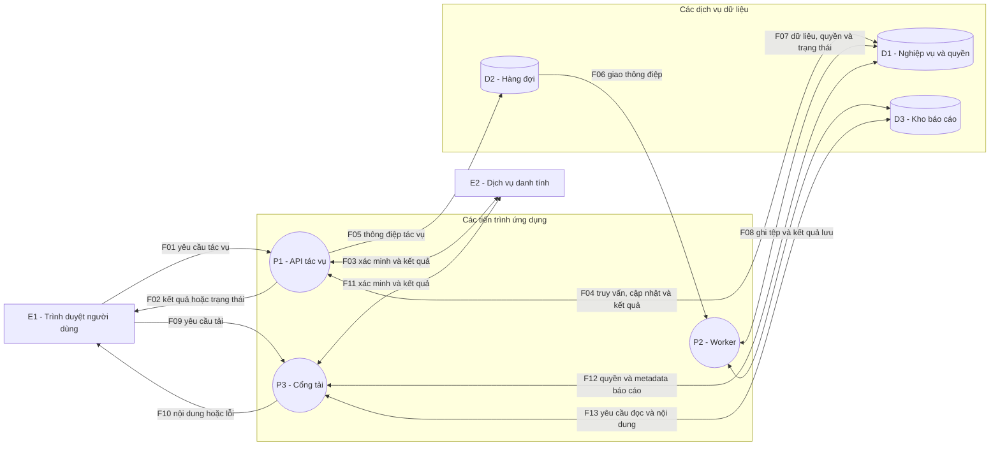

# Thực hành tổng hợp: lập threat model bằng STRIDE

## 1. Mục tiêu và sản phẩm cần bàn giao

**Threat model**, hay mô hình đe dọa, mô tả những kết quả gây hại có thể xảy ra với một hệ thống, các điều kiện cho phép chúng xảy ra và cách xử lý phù hợp. **STRIDE** là một cách gợi mở có cấu trúc để nhận diện các nhóm đe dọa; nó không tự tính mức rủi ro và không tự chứng minh triển khai có lỗ hổng.

Trong module yêu cầu bảo mật, mục tiêu của bài tập là chuyển mô hình đe dọa thành những cam kết cụ thể, đo được và có thể kiểm chứng. Một danh sách tên tấn công hoặc bảng đánh dấu đủ sáu chữ STRIDE chưa phải sản phẩm hoàn chỉnh.

Bản nộp cần gồm:

1. Phạm vi, tài sản, mục tiêu bảo vệ và những giả định chưa được xác nhận.
2. Mô hình hệ thống với chủ thể, tiến trình, kho dữ liệu, luồng và ranh giới tin cậy.
3. Danh sách kịch bản đe dọa có chủ thể, tiền điều kiện, đường đi và hậu quả.
4. Đánh giá ưu tiên có căn cứ, tách mức rủi ro khỏi mức chắc chắn.
5. Bộ yêu cầu xử lý, điểm thực thi và tiêu chí chấp nhận.
6. Liên kết tới kiểm thử, diễn tập, bằng chứng và người chịu trách nhiệm.
7. Rủi ro còn lại cùng điều kiện xem xét lại.

Người học nên tự lập bản đầu trước khi đối chiếu với mẫu. Các định danh, ngưỡng và quyết định nghiệp vụ trong bài là giả định phục vụ thực hành, không phải chính sách mặc định cho mọi hệ thống.

## 2. Hiểu đúng sáu nhóm STRIDE

### 2.1. Từ nhóm đe dọa tới câu hỏi cụ thể

| Nhóm | Ý nghĩa | Câu hỏi gợi mở | Ví dụ trong nền tảng học tập |
| --- | --- | --- | --- |
| S — Spoofing | Giả mạo hoặc sử dụng danh tính để được coi là một chủ thể khác | Hệ thống biết bên gửi thực sự là ai bằng cách nào? | Người giữ mã phiên bị lấy được hành động dưới danh tính hỗ trợ |
| T — Tampering | Thay đổi dữ liệu hoặc trạng thái trái phép | Chủ thể có thể sửa thông điệp, metadata, cấu hình hoặc nội dung không? | Đổi phạm vi tổ chức trong thông điệp tác vụ |
| R — Repudiation | Phủ nhận một hành động trong điều kiện thiếu căn cứ quy trách nhiệm phù hợp | Có thể chứng minh hệ thống đã ghi nhận hành động nào, do danh tính nào không? | Tải báo cáo nhưng audit chỉ lưu tài khoản dịch vụ chung |
| I — Information disclosure | Tiết lộ thông tin cho chủ thể không được phép | Dữ liệu có thể rời phạm vi bảo vệ qua đường nào? | Người của A tải được báo cáo thuộc B |
| D — Denial of service | Làm mất hoặc suy giảm khả năng cung cấp dịch vụ cho chủ thể hợp lệ | Có thể chiếm tài nguyên hoặc làm hỏng phụ thuộc quan trọng không? | Một tổ chức làm đầy hàng đợi tác vụ xuất |
| E — Elevation of privilege | Có được quyền hoặc thực hiện hành động vượt quyền đang được cấp | Chủ thể ít quyền có thể khiến thành phần nhiều quyền làm thay không? | Người dùng nhờ worker đọc dữ liệu ngoài phạm vi được phép |

STRIDE gắn với những thuộc tính bảo vệ khác nhau, như xác thực, toàn vẹn, khả năng quy trách nhiệm, bí mật, khả dụng và phân quyền. Một sự kiện có thể ảnh hưởng nhiều thuộc tính.

### 2.2. Không cần ép mỗi kịch bản vào đúng một chữ

Đổi trường tổ chức trong tác vụ có thể liên quan đến tampering, dẫn tới elevation of privilege và information disclosure. Nên ghi nhóm chính cùng nhóm liên quan nếu hữu ích, rồi giữ một bản ghi kịch bản thống nhất thay vì sao chép thành ba rủi ro độc lập để cộng điểm.

Người dùng đã được xác thực nhưng đọc dữ liệu của người khác thường là vấn đề quyền trên tài nguyên. Không gọi mọi hành vi trái phép là spoofing chỉ vì người thực hiện là kẻ tấn công.

Repudiation không được xử lý hoàn toàn chỉ bằng câu “đã có log”. Cần xem danh tính được ghi, tính toàn vẹn, nguồn gốc và giới hạn quy kết. Một sự kiện dùng thông tin xác thực hợp lệ chưa tự chứng minh con người cụ thể đang điều khiển thông tin đó.

### 2.3. Đe dọa, lỗ hổng và rủi ro là các kết luận khác nhau

- Đe dọa mô tả một khả năng hoặc kịch bản gây hại.
- Lỗ hổng là điểm yếu có thể bị khai thác; muốn nói đã xác nhận phải có căn cứ tương ứng.
- Rủi ro xét khả năng xảy ra và tác động của kịch bản trong bối cảnh.
- Kiểm soát là biện pháp được dùng để xử lý một phần hoặc toàn bộ đường gây hại.
- Yêu cầu xác định hành vi hoặc thuộc tính bắt buộc cần được chứng minh.

Một giả thuyết “worker có thể tin trường tổ chức từ thông điệp” chưa phải lỗ hổng đã xác nhận. Tuy nhiên, nó đủ để tạo câu hỏi thiết kế và đặc tả yêu cầu ngăn xử lý ngoài quyền.

## 3. Đề bài: chức năng xuất báo cáo nhiều tổ chức

### 3.1. Bối cảnh nghiệp vụ

Một nền tảng học tập phục vụ nhiều tổ chức. Người có quyền xuất yêu cầu báo cáo học viên; API tạo tác vụ, hàng đợi chuyển thông điệp, worker đọc dữ liệu và ghi tệp. Người yêu cầu xem trạng thái rồi tải qua cổng cấp nội dung.

Nhân viên hỗ trợ chỉ được đọc hoặc thao tác trong phạm vi quyền tạm thời đã được duyệt. Họ không mặc nhiên có quyền với mọi tổ chức. Quản trị viên của tổ chức A cũng không có quyền với B chỉ vì tên vai trò giống nhau.

Báo cáo chứa định danh học viên, tên, thông tin liên hệ và tiến độ học, được giả định là dữ liệu nhạy cảm. Ngoài nội dung báo cáo, cần bảo vệ trạng thái quyền, metadata tác vụ, thông tin truy cập, sự kiện audit và bản sao phục hồi.

### 3.2. Những quyết định đã chốt cho bài tập

| Nội dung | Quy tắc dùng trong bài |
| --- | --- |
| Quan hệ tổ chức | Mỗi tác vụ và báo cáo thuộc đúng một tổ chức; quyền của chủ thể phải được xét trong tổ chức đó |
| Người xem báo cáo | Chỉ người yêu cầu ban đầu, khi vẫn đủ quyền xuất đối với phạm vi báo cáo, được xem trạng thái và tải |
| Xác thực nhạy cảm | Tạo báo cáo nhạy cảm cần MFA phù hợp, hoàn thành không quá 5 phút trước thao tác |
| Thu hồi chủ động | Mọi yêu cầu tải mới phải phản ánh thay đổi quyền trong tối đa 60 giây từ khi nguồn có thẩm quyền ghi nhận thành công |
| Grant hỗ trợ | Phạm vi, hành động và phê duyệt riêng; tối đa 30 phút, có hiệu lực khi `startsAt <= now < expiresAt` |
| Đường tải | Bản mẫu chỉ cho tải qua cổng cấp nội dung, không cấp URL đọc trực tiếp ra ngoài |
| Hạn mức | Cần kiểm soát theo tổ chức; giá trị cụ thể phải được quyết định từ nhu cầu và dữ liệu tải trước khi chốt yêu cầu |
| Audit | Các quyết định nhạy cảm phải có sự kiện theo ngữ nghĩa và độ bền được đặc tả |
| Phục hồi | Không được làm quyền đã thu hồi hoặc grant hết hạn hoạt động trở lại |

Không cộng giới hạn lan truyền thu hồi 60 giây vào thời hạn tự nhiên của grant. Hết hạn đúng mốc và thu hồi chủ động là hai điều kiện khác nhau.

### 3.3. Phạm vi và điều chưa giả định thay

Phạm vi gồm tạo, xử lý, xem trạng thái, tải, audit, dữ liệu tạm, thay đổi quyền và phục hồi liên quan. Các tiến trình dùng danh tính kỹ thuật riêng, nhưng quyền kỹ thuật không thay cho điều kiện nghiệp vụ của người khởi tạo.

Dịch vụ danh tính bên ngoài cung cấp kết quả xác thực; nguồn quyền nghiệp vụ nằm trong dữ liệu ứng dụng. Bản mẫu giả định API và cổng tải gọi dịch vụ danh tính để xác minh bằng chứng. Nếu thiết kế thật xác minh cục bộ, cần mô tả cách lấy khóa tin cậy, cấu hình và vòng đời tương ứng.

Mã hóa lưu trữ do nền tảng cung cấp trong ví dụ. Nếu thêm mã hóa phía ứng dụng hoặc dịch vụ khóa riêng, phải bổ sung luồng, quyền và phụ thuộc phục hồi; không coi từ “mã hóa” là đủ mô tả.

## 4. Lập mô hình hệ thống và ranh giới tin cậy

### 4.1. Góc nhìn luồng dữ liệu chính



Các cạnh hai chiều ở F03, F04, F07, F08, F11, F12 và F13 là nhóm yêu cầu cùng phản hồi để hình dễ đọc. Trong từ điển cần nêu rõ dữ liệu mỗi chiều. Hình không tự chứng minh thứ tự kiểm tra quyền trước khi đọc hoặc trả nội dung; yêu cầu và kiểm thử phải xác nhận điều đó.

Nhóm DATA là bố cục, không khẳng định các kho có cùng quyền hoặc cùng miền quản trị. Không coi mọi thành phần bên trong ứng dụng là đáng tin cậy như nhau.

### 4.2. Từ điển luồng rút gọn

| Luồng | Dữ liệu cần biết |
| --- | --- |
| F01, F09 | Bằng chứng danh tính, hành động, định danh tác vụ hoặc tài nguyên và tham số do người gọi đề xuất |
| F02, F10 | Kết quả được phép, trạng thái hoặc nội dung; lỗi không được mang dữ liệu ngoài quyền |
| F03, F11 | Yêu cầu xác minh qua danh tính kỹ thuật của dịch vụ và kết quả xác thực theo chính sách; chưa phải quyền trên báo cáo |
| F04 | Truy vấn quyền, quan hệ tổ chức, ghi tác vụ; phản hồi gồm phạm vi được phép, metadata và kết quả ghi |
| F05, F06 | Định danh tác vụ, người khởi tạo, tổ chức, phạm vi dữ liệu và metadata giao hoặc thử lại |
| F07 | Truy vấn điều kiện thực thi, dữ liệu học viên và cập nhật trạng thái; phản hồi có dữ liệu và kết quả theo phạm vi |
| F08 | Tệp và metadata gửi tới kho; phản hồi có tham chiếu, phiên bản hoặc lỗi, không tự tạo quyền tải cho người dùng |
| F12 | Truy vấn quan hệ người yêu cầu, sở hữu, trạng thái và quyền; phản hồi là nguồn đầu vào quyết định tại cổng tải |
| F13 | Yêu cầu đọc đúng đối tượng, phiên bản và nội dung trả về; dữ liệu có thể ở dạng rõ tại ứng dụng dù kho mã hóa khi lưu |

Không đưa mật khẩu hoặc token người dùng vào thông điệp hàng đợi chỉ để worker dễ xử lý. Nếu cần bằng chứng ủy nhiệm riêng, phải mô tả cơ chế, phạm vi và vòng đời của nó.

### 4.3. Các góc nhìn bắt buộc ngoài hình chính

| Thành phần hoặc luồng bổ sung | Nội dung phải khai báo | Câu hỏi đe dọa |
| --- | --- | --- |
| P4, D4 — tiếp nhận và lưu audit | Sự kiện từ P1–P3, xác nhận ghi hoặc lỗi, quyền đọc và quản trị | Có sửa, làm mất hoặc giả sự kiện được không? |
| Tệp tạm của P2 | Vị trí, quyền, dữ liệu, thời hạn và dọn khi lỗi | Có bản rõ ngoài kho kết quả được bảo vệ không? |
| Cache quyền hoặc metadata | Thuộc tính ảnh hưởng quyết định, nguồn và độ cũ tối đa | Có dùng nhầm quyền giữa chủ thể hoặc tổ chức không? |
| Bản sao và tiến trình phục hồi | Dữ liệu, cấu hình, khóa, danh tính, người điều khiển | Có khôi phục quyền cũ hoặc mất khả năng đọc dữ liệu không? |
| Quản trị và cấp grant | Chủ thể phê duyệt, đối tượng, hành động và audit | Có tự cấp, sửa phạm vi hoặc dùng sau hết hạn không? |

Bản mẫu khai báo các góc nhìn này để giữ phạm vi phân tích. Khi triển khai bản nộp đầy đủ, cần sơ đồ hoặc từ điển chi tiết tương ứng với thiết kế đã chọn. Không dùng việc tách hình để loại chúng khỏi danh sách đe dọa.

### 4.4. Ranh giới cần đánh giá

- TB-01: trình duyệt sang tiến trình ứng dụng; dữ liệu do người gọi đưa ra chưa phải sự thật có thẩm quyền.
- TB-02: ứng dụng sang dịch vụ danh tính; phải xác minh đúng đối tác và ý nghĩa bằng chứng.
- TB-03: các tiến trình sang D1 và D3; danh tính kỹ thuật, quyền đọc và quyền thay dữ liệu có thể rộng hơn người gọi.
- TB-04: API sang hàng đợi rồi tới worker; thay đổi thời điểm, trạng thái và chủ thể thực thi.
- TB-05: miền audit; quyền phát sự kiện khác quyền đọc, sửa hoặc kết thúc giữ bằng chứng.
- TB-06: miền bản sao và phục hồi; trạng thái lịch sử không tự là trạng thái quyền hiện hành.
- TB-L: ranh giới logic giữa các tổ chức, kể cả khi dữ liệu cùng bảng hoặc cùng máy chủ.

Mỗi ranh giới cần nguồn có thẩm quyền cho danh tính, quyền, quan hệ tài nguyên và thời gian. Vị trí trong mạng nội bộ không thay thế những điều kiện đó.

## 5. Dùng STRIDE để khám phá kịch bản có cấu trúc

### 5.1. Đi theo thành phần, luồng và ranh giới

Với từng tiến trình, kho hoặc luồng, dùng sáu nhóm như câu hỏi gợi mở. Không cần mọi ô đều sinh một đe dọa mới và không được bỏ một kịch bản chỉ vì nó không khớp cách đặt tên của bảng.

| Đối tượng | Các câu hỏi gợi mở |
| --- | --- |
| Thực thể và danh tính | Bên gửi có thể giả mạo ai, dùng thông tin của người khác hoặc phủ nhận hành động nào? |
| Tiến trình | Có bị lừa dùng đặc quyền, xử lý dữ liệu sai, lộ đầu ra hoặc làm cạn tài nguyên không? |
| Kho dữ liệu | Ai có thể đọc, sửa, xóa, làm mất khả dụng hoặc làm suy yếu lịch sử? |
| Luồng dữ liệu | Có thể sửa, nghe lộ, phát lại, chuyển sai đối tượng hoặc làm quá tải đường nhận không? |
| Ranh giới tin cậy | Bên nhận đang tin thuộc tính nào do bên ít quyền kiểm soát, và điều gì xảy ra khi nguồn tin lỗi? |
| Vòng đời | Sau thử lại, thu hồi, hết hạn, xoay khóa hoặc phục hồi, giả định nào có thể không còn đúng? |

Đây là cách đặt câu hỏi, không phải ma trận khẳng định mỗi loại đối tượng chỉ có một số nhóm STRIDE cố định. Một kịch bản có thể đi qua nhiều đối tượng và nhiều nhóm.

### 5.2. Mẫu bản ghi một đe dọa

Mỗi bản ghi cần:

1. Định danh ổn định, tên hành vi và nhóm STRIDE liên quan.
2. Tài sản, mục tiêu bảo vệ, thành phần hoặc luồng bị tác động.
3. Chủ thể và khả năng, bao gồm quyền hợp lệ đang có nếu có.
4. Tiền điều kiện và giả định cần xác nhận.
5. Chuỗi hành vi ở mức đủ chỉ ra đường tới hậu quả.
6. Kiểm soát hiện có, bằng chứng và giới hạn của chúng.
7. Hậu quả, phạm vi ảnh hưởng, mức chắc chắn và cách ưu tiên.
8. Hướng xử lý, yêu cầu, điểm thực thi, cách xác minh và người phụ trách.

Một câu như “có nguy cơ SQL injection” chưa cho biết dữ liệu, quyền và hậu quả của bài toán. Có thể dùng tên kỹ thuật như thông tin bổ sung, nhưng bản ghi vẫn phải giải thích được đường gây hại.

### 5.3. Tách quan sát, giả định và việc cần xác minh

Nếu chưa kiểm tra P3 có đánh giá lại quyền hay không, ghi là câu hỏi mở. Nếu đã có kiểm thử cho thấy người A tải được báo cáo B, ghi bằng chứng và phiên bản tương ứng.

Đừng biến “chưa thấy lỗi” thành “không có đường lạm dụng”. Cũng đừng gọi mọi giả thuyết thành lỗ hổng đã xác nhận. Cả hai cách đều làm sai ưu tiên và quyết định.

## 6. Danh mục đe dọa mẫu để đối chiếu

### TM-01 — Dùng phiên bị lấy dưới danh tính người có quyền

**Nhóm:** S, có thể dẫn tới I hoặc E. **Vị trí:** E1, F01, F09, P1 và P3. **Tiền điều kiện:** chủ thể gây hại giữ thông tin phiên còn được máy chủ chấp nhận.

**Đường gây hại:** chủ thể dùng phiên để tạo hoặc tải báo cáo dưới danh tính nạn nhân. Nếu thao tác nhạy cảm không kiểm tra độ mới MFA, cửa sổ lạm dụng có thể lớn hơn chính sách mong muốn.

**Hậu quả:** dữ liệu được cấp theo quyền nạn nhân, khó phân biệt người thực sự điều khiển phiên. **Cần xác minh:** bảo vệ mã phiên, thời hạn, step-up và hiệu lực thu hồi trên mọi điểm cấp nội dung.

MFA không tự chặn mọi lần dùng phiên đã bị lấy và không thay kiểm tra quyền. Yêu cầu cần nói rõ thao tác nào đòi bằng chứng mới.

### TM-02 — Nguồn không được phép đưa tác vụ vào hàng đợi

**Nhóm:** S và E. **Vị trí:** F05, F06, D2, P2. **Tiền điều kiện:** có đường ghi hàng đợi hoặc giả thông điệp mà worker coi là tác vụ hợp lệ.

**Đường gây hại:** chủ thể đưa thông điệp trông đúng cấu trúc vào D2; P2 dùng đặc quyền dịch vụ để đọc dữ liệu. Chỉ kiểm tra có trường `requesterId` không chứng minh người yêu cầu hoặc nguồn phát thực sự được phép.

**Hậu quả:** thực thi tác vụ ngoài phê duyệt, truy cập hoặc tạo dữ liệu ngoài phạm vi. **Cần xác minh:** danh tính bên xuất bản, quyền hàng đợi, liên hệ thông điệp với tác vụ trong D1 và cách worker đánh giá điều kiện thực thi.

### TM-03 — Thay tổ chức hoặc phạm vi trong thông điệp

**Nhóm:** T, E, I. **Vị trí:** F05–F07. **Tiền điều kiện:** chủ thể sửa được thông điệp hoặc một thuộc tính tác vụ mà worker tin.

**Đường gây hại:** đổi tổ chức A sang B hoặc mở rộng phạm vi; worker không đối chiếu quan hệ do hệ thống quản lý mà dùng trực tiếp trường đã sửa.

**Hậu quả:** báo cáo chứa dữ liệu ngoài quyền. **Cần xác minh:** ràng buộc người yêu cầu, tổ chức, phạm vi và trạng thái quyền; bảo vệ tính toàn vẹn chỉ xử lý một phần nếu chính bên được phép gửi vẫn có thể yêu cầu ngoài quyền.

### TM-04 — Thay nội dung hoặc tham chiếu báo cáo đã được duyệt

**Nhóm:** T và I. **Vị trí:** D1, D3, F08, F12, F13. **Tiền điều kiện:** có quyền sửa tệp, phiên bản hoặc metadata chọn đối tượng ngoài mục đích cho phép.

**Đường gây hại:** cổng tải kiểm tra quyền trên báo cáo A nhưng đọc đối tượng khác vì metadata bị thay, hoặc nội dung bị ghi đè sau bước kiểm tra.

**Hậu quả:** trả dữ liệu sai, xuyên tổ chức hoặc sai toàn vẹn. **Cần xác minh:** quan hệ tác vụ–đối tượng–phiên bản, quyền sửa, cách chống thay đổi giữa kiểm tra và sử dụng, điều kiện công bố.

### TM-05 — Không liên hệ được hành động với chủ thể khởi tạo

**Nhóm:** R. **Vị trí:** P1–P4, D4. **Tiền điều kiện:** sự kiện chỉ ghi danh tính worker hoặc tài khoản dịch vụ chung.

**Đường gây hại:** người dùng tạo tác vụ, worker đọc và cổng tải cấp dữ liệu nhưng không có liên hệ người khởi tạo, tổ chức và tài nguyên. Khi bị hỏi, không đủ căn cứ xác định chuỗi hành động.

**Hậu quả:** hạn chế điều tra, thu hồi và đánh giá tác động. **Cần xác minh:** ngữ nghĩa trường, định danh tương quan, độ bền và độ bao phủ của audit; không tự suy danh tính con người từ tên tài khoản.

### TM-06 — Sửa hoặc làm mất lịch sử quyết định

**Nhóm:** R và T. **Vị trí:** P4, D4, quyền quản trị audit. **Tiền điều kiện:** cùng một danh tính có thể thực hiện thao tác nhạy cảm và xóa hoặc viết lại dấu vết mà không có cơ sở đối chiếu phù hợp.

**Đường gây hại:** sau truy cập, chủ thể thay hoặc xóa sự kiện, làm mốc thời gian và phạm vi hành động không thể kiểm tra lại.

**Hậu quả:** kết luận điều tra thiếu tin cậy. **Cần xác minh:** tách quyền, lịch sử thay đổi, cơ chế toàn vẹn, thời hạn giữ và kênh ghi nhận thao tác quản trị. Digest của bản đã thu không tự chứng minh nguồn chưa bị sửa trước lúc thu.

### TM-07 — Tải tài nguyên ngoài quyền bằng định danh thật

**Nhóm:** I và E. **Vị trí:** F02, F09–F13, TB-L. **Tiền điều kiện:** người dùng hợp lệ biết định danh báo cáo hoặc tác vụ của người khác.

**Đường gây hại:** P1 hoặc P3 chỉ kiểm tra đã đăng nhập hoặc cùng tên vai trò, không xét tổ chức, người khởi tạo và phạm vi quyền trên báo cáo.

**Hậu quả:** lộ trạng thái, metadata hoặc nội dung ngoài quyền. **Cần xác minh:** tài nguyên tồn tại thật của tổ chức khác và người khác cùng tổ chức; định danh khó đoán không thay kiểm tra quyền.

### TM-08 — Lộ dữ liệu qua bản tạm, lỗi hoặc sự kiện

**Nhóm:** I. **Vị trí:** P2, dữ liệu tạm, F02, F10, D4. **Tiền điều kiện:** đường phụ giữ hoặc xuất dữ liệu nhạy cảm ngoài chính sách.

**Đường gây hại:** nội dung báo cáo được ghi trong lỗi, token xuất hiện trong log, hoặc tệp tạm còn đọc được sau khi tác vụ thất bại.

**Hậu quả:** dữ liệu rời phạm vi bảo vệ dù đường tải chính đã kiểm tra quyền. **Cần xác minh:** nơi lưu, vòng đời, quyền đọc và dữ liệu trên đường lỗi; không thu thêm dữ liệu thật chỉ để tiện điều tra.

### TM-09 — Chiếm tài nguyên xuất báo cáo của tổ chức khác

**Nhóm:** D. **Vị trí:** P1, D2, P2, D1 và D3. **Tiền điều kiện:** tài khoản hợp lệ có thể gửi nhiều tác vụ hoặc yêu cầu rất nặng.

**Đường gây hại:** làm đầy hàng đợi, chiếm worker, kết nối hoặc dung lượng, khiến tổ chức khác không hoàn thành công việc. Hạn mức theo một nút hoặc một địa chỉ mạng có thể không khớp đơn vị cần bảo vệ.

**Hậu quả:** suy giảm khả dụng và tăng chi phí. **Cần xác minh:** hạn mức theo tổ chức, số đang chờ và đang chạy, kích thước, lịch phân bổ, hủy và lỗi giữa các bước.

### TM-10 — Lỗi phụ thuộc làm tê liệt hoặc làm yếu đường xử lý

**Nhóm:** D; có thể dẫn tới I hoặc E nếu dự phòng sai. **Vị trí:** E2, nguồn quyền, P4 và các tiến trình phụ thuộc.

**Đường gây hại:** mất dịch vụ danh tính, quyền hoặc audit làm tác vụ treo, thử lại vô hạn hoặc khiến ứng dụng chuyển sang cho phép với dữ liệu cũ ngoài giới hạn.

**Hậu quả:** mất khả dụng hoặc mở truy cập trái yêu cầu. **Cần xác minh:** timeout, giới hạn thử lại, cơ chế phản hồi và chế độ lỗi. Không được tắt kiểm tra bắt buộc chỉ để báo dịch vụ vẫn hoạt động.

### TM-11 — Tự mở rộng grant hoặc vai trò hỗ trợ

**Nhóm:** E và T. **Vị trí:** API quản trị, dữ liệu quyền, grant. **Tiền điều kiện:** chủ thể có thể tác động các trường bảo mật hoặc quy trình phê duyệt không độc lập.

**Đường gây hại:** tự phê duyệt, đổi lớp hoặc tổ chức đích, thêm quyền xuất hoặc gia hạn mà không có quyết định hợp lệ.

**Hậu quả:** quyền cục bộ hoặc tạm thời trở thành quyền rộng và kéo dài. **Cần xác minh:** ai được gán gì cho ai, nguồn thời gian, biên hết hạn và audit; mốc 30 phút không có ý nghĩa nếu một đường khác còn chấp nhận grant.

### TM-12 — Quyền cũ trở lại sau thử lại hoặc phục hồi

**Nhóm:** E, có thể dẫn tới I hoặc T. **Vị trí:** D1, D2, bản sao, P2 và P3. **Tiền điều kiện:** khôi phục hoặc phát lại trạng thái trước khi quyền bị thu hồi.

**Đường gây hại:** tác vụ cũ được xử lý với quyền lịch sử hoặc bản sao phục hồi làm grant hết hạn được coi là còn hiệu lực. Nguồn quyền hiện hành không được đối chiếu trước mở lại.

**Hậu quả:** quyền đã kết thúc có thể lại cấp dữ liệu hoặc cho sửa trạng thái. **Cần xác minh:** quy tắc phục hồi, thời gian, điểm tin cậy, cách xử lý thông tin không thể xác nhận và các phụ thuộc danh tính, khóa.

## 7. Đánh giá ưu tiên mà không biến STRIDE thành thang điểm

### 7.1. STRIDE nhận diện nhóm, không xếp mức nghiêm trọng

Một đe dọa thuộc E không mặc nhiên luôn nghiêm trọng hơn I, và có nhiều nhóm không tự làm điểm rủi ro cao hơn. Cần xét tài sản, đường tiếp cận, tiền điều kiện, phạm vi hậu quả và kiểm soát đã có bằng chứng.

| Khía cạnh | Câu hỏi đánh giá |
| --- | --- |
| Khả năng tiếp cận | Cần tài khoản, grant, danh tính dịch vụ hay quyền quản trị nào? |
| Điều kiện thực hiện | Đường đi có tồn tại, có thể lặp lại hoặc tự động hóa, có phụ thuộc bước khó đạt không? |
| Tác động | Dữ liệu nào, bao nhiêu tổ chức, thời gian gián đoạn và khả năng phục hồi ra sao? |
| Hiệu lực kiểm soát | Có bằng chứng hiện hành hay mới là mô tả và kế hoạch? |
| Phát hiện và giới hạn | Có nhận biết và can thiệp trước khi thiệt hại tiếp tục không? |
| Mức chắc chắn | Kết luận dựa trên quan sát, hồ sơ, giả định hay thông tin còn thiếu? |
| Điều kiện bắt buộc | Có yêu cầu hoặc nghĩa vụ đã xác nhận không được phép bỏ qua không? |

Không thấy sự cố trong lịch sử không tự chứng minh khả năng xảy ra thấp nếu hệ thống không ghi hoặc không giữ đủ dấu vết. Mã hóa lưu trữ không được tính như biện pháp ngăn người dùng trái phép khi ứng dụng vẫn giải mã và trả dữ liệu.

### 7.2. Tách mức rủi ro khỏi mức chắc chắn

TM-07 có thể có tác động lớn trong khi chưa biết P3 có kiểm tra quyền đầy đủ hay không. Kết luận phù hợp là cần xác minh khẩn cấp theo tác động và điều kiện tiếp cận, không phải tự gán “thấp” vì chưa thấy lỗi hoặc “đã khai thác” vì hậu quả có thể lớn.

Nếu tổ chức có thang đánh giá và ma trận, dùng mô tả mức cùng quy tắc đã thống nhất. Không tự nhân các giá trị thứ bậc rồi diễn giải thành xác suất hoặc tổn thất định lượng. Ghi lý do để người quyết định có thể kiểm tra.

### 7.3. Giữ riêng ba trạng thái rủi ro

- Mốc ban đầu cần định nghĩa những kiểm soát nào đang được loại trừ khỏi đánh giá.
- Rủi ro tồn dư hiện tại dựa trên kiểm soát đang có và bằng chứng thực tế.
- Rủi ro mục tiêu là kỳ vọng sau phương án chưa hoàn tất, kèm điều kiện phải chứng minh.

Một thiết kế đã duyệt hoặc ticket đã giao không tự làm rủi ro hiện tại giảm. Chấp nhận rủi ro là quyết định chịu trách nhiệm trong phạm vi thẩm quyền, không làm một yêu cầu chưa đạt biến thành đạt.

## 8. Chuyển đe dọa thành yêu cầu bảo mật

### 8.1. Ánh xạ có mục tiêu và điểm thực thi

| Yêu cầu | Cam kết cần đặc tả | Đe dọa chính | Nơi thực thi |
| --- | --- | --- | --- |
| SR-ST-01 | Xác minh danh tính, phiên và độ mới MFA cho đúng thao tác nhạy cảm | TM-01 | P1, P3 và nguồn phiên liên quan |
| SR-ST-02 | Chỉ chủ thể có quyền với đúng tổ chức, người khởi tạo và phạm vi tài nguyên được xem hoặc tải | TM-07 | P1, P3, truy vấn D1 |
| SR-ST-03 | Nguồn xuất bản được phép; thông điệp ràng buộc với tác vụ hợp lệ; worker đánh giá quyền nghiệp vụ theo thời điểm yêu cầu quy định | TM-02, TM-03, TM-12 | P1, D2, P2, D1 |
| SR-ST-04 | Metadata và phiên bản đối tượng phải liên hệ đúng báo cáo đã được phép, không bị thay trái quyền | TM-04 | D1, D3, P2, P3 |
| SR-ST-05 | Dữ liệu nhạy cảm, bản tạm, lỗi và bản sao được bảo vệ theo chính sách; không đưa bí mật vào log | TM-08 | Luồng truyền, kho, P2, P4 |
| SR-ST-06 | Audit đủ ngữ nghĩa, nguồn gốc, độ bền, quyền và vòng đời để điều tra trong phạm vi | TM-05, TM-06 | P1–P4, D4 |
| SR-ST-07 | Hạn mức và phân bổ tài nguyên theo tổ chức, với giới hạn thử lại và xử lý đồng thời rõ | TM-09, TM-10 | P1, D2, P2 và các phụ thuộc |
| SR-ST-08 | Grant chỉ được cấp đúng thẩm quyền, phạm vi, hành động và thời hạn; không tự nâng hoặc gia hạn | TM-11 | API quản trị, nguồn quyền, các điểm sử dụng |
| SR-ST-09 | Thu hồi chủ động và hết hạn có hiệu lực đúng giới hạn trên mọi điểm cấp dữ liệu | TM-01, TM-07, TM-11, TM-12 | Nguồn quyền, cache, P2, P3 |
| SR-ST-10 | Phục hồi dữ liệu, khóa, cấu hình và quyền phải đáp ứng điều kiện mở lại an toàn | TM-10, TM-12 | Tiến trình phục hồi và nguồn hiện hành |

Các hàng trên là khung, chưa phải mọi yêu cầu chi tiết. Một hàng chứa nhiều cam kết độc lập cần tách thành các bản ghi có tiêu chí riêng. Không đóng SR-ST-06 chỉ vì một sự kiện mẫu có đủ trường trong khi quyền xóa audit chưa được đánh giá.

### 8.2. Ví dụ yêu cầu quyền đọc và tải

> Với yêu cầu xem trạng thái hoặc tải báo cáo, P1 hoặc P3 phải xác định người khởi tạo, tổ chức sở hữu và phạm vi báo cáo từ quan hệ do hệ thống quản lý. Chỉ cho phép khi người gọi là người khởi tạo và còn đủ quyền đối với phạm vi đó theo chính sách hiện hành. Nếu không xác lập được điều kiện cho phép, phải từ chối và không tiết lộ nội dung hoặc metadata ngoài hợp đồng.

Kết quả mong đợi phải bao gồm tác dụng phụ: yêu cầu bị từ chối không tạo đường tải, sao chép nội dung sang vị trí công khai hoặc ghi dữ liệu nhạy cảm vào lỗi. Audit quyết định vẫn được phép theo yêu cầu tương ứng.

### 8.3. Ví dụ yêu cầu audit và đường lỗi

> Quyết định tạo tác vụ, thực thi, công bố và cấp nội dung phải có sự kiện liên hệ người khởi tạo, danh tính thực thi nếu khác, tổ chức, tài nguyên, hành động, kết quả, thời điểm và định danh tương quan. Không ghi mã phiên, token, khóa hoặc nội dung báo cáo vào sự kiện.

Nếu bài tập chọn ghi bền vững trước khi công bố dữ liệu, phải đặc tả chính xác điểm xác nhận và hành vi khi lỗi. Một phản hồi từ bộ đệm chưa bền vững không đáp ứng cam kết đó. Việc đưa sự kiện vào kho tra cứu có thể có mục tiêu thời gian riêng.

Khả năng ghi log không tự xử lý mọi TM-05 và TM-06. Cần thêm quyền truy cập, lịch sử thay đổi, toàn vẹn, nguồn thời gian và cách dùng bằng chứng.

### 8.4. Yêu cầu hạn mức còn thiếu tham số chưa sẵn sàng triển khai

“Phải giới hạn tác vụ xuất” cần được hoàn thiện bằng đơn vị giới hạn, số đang chờ, số đang chạy, kích thước dữ liệu, cửa sổ tính nếu có, cách phản hồi và điều kiện đồng thời.

Đặt người chịu trách nhiệm lấy dữ liệu tải và quyết định tham số trước mốc phê duyệt. Không tự bịa một số để hoàn thành bảng, cũng không để giá trị chờ xác nhận trong bản đặc tả được báo là hoàn tất.

## 9. Thiết kế kiểm chứng cho từng đường gây hại

### 9.1. Ca đúng, ca sai và ca lỗi

| Ca thử | Đe dọa, yêu cầu liên quan | Điều phải chứng minh |
| --- | --- | --- |
| TC-ST-01 | TM-01, SR-ST-01 | Bằng chứng đúng hoạt động; thiếu, sai hoặc quá hạn không thực hiện thao tác nhạy cảm |
| TC-ST-02 | TM-02, SR-ST-03 | Danh tính không có quyền xuất bản không đưa được tác vụ hợp lệ vào luồng xử lý |
| TC-ST-03 | TM-03, SR-ST-03 | Thông điệp sai tổ chức hoặc phạm vi không khiến worker đọc ngoài quyền |
| TC-ST-04 | TM-04, SR-ST-04 | Thay metadata, đối tượng hoặc phiên bản không làm trả nội dung sai tài nguyên đã được phép |
| TC-ST-05 | TM-05, SR-ST-06 | Truy được chuỗi API–worker–cổng tải với đúng người khởi tạo và tổ chức |
| TC-ST-06 | TM-06, SR-ST-06 | Thao tác sửa, xóa hoặc xuất audit trái quyền bị ngăn hoặc được phát hiện đúng cơ chế đã đặc tả |
| TC-ST-07 | TM-07, SR-ST-02 | Tài nguyên thật ngoài quyền bị từ chối; tài nguyên hợp lệ vẫn hoạt động |
| TC-ST-08 | TM-08, SR-ST-05 | Đường lỗi và bản tạm không làm lộ dữ liệu hoặc bí mật ngoài chính sách |
| TC-ST-09 | TM-09, SR-ST-07 | Không vượt hạn mức khi tranh chỗ; ảnh hưởng liên tổ chức nằm trong tiêu chí đã chốt |
| TC-ST-10 | TM-10, SR-ST-07 | Lỗi phụ thuộc không gây thử lại vô hạn hoặc bỏ kiểm tra bắt buộc |
| TC-ST-11 | TM-11, SR-ST-08 | Không tự phê duyệt, đổi phạm vi hoặc dùng grant tại và sau hết hạn |
| TC-ST-12 | TM-12, SR-ST-09, SR-ST-10 | Tác vụ cũ và phục hồi không làm sống lại quyền ngoài điều kiện hiện hành |

Các ca cần dùng danh tính, tài nguyên và dữ liệu thử được kiểm soát. Không cần thực hiện hành vi trên hệ thống thật để hoàn thành bài tập đặc tả; mọi xác minh thực tế phải trong phạm vi được phép.

### 9.2. Kiểm tra thời gian đúng ngữ nghĩa

Với grant có khoảng `startsAt <= now < expiresAt`, kiểm tra ngay trước, đúng và ngay sau từng biên theo độ phân giải đã chọn. Với MFA “không quá 5 phút”, đúng 5 phút còn đáp ứng điều kiện độ mới trong bài tập, nhưng thiếu quyền vẫn phải từ chối.

Với thu hồi chủ động, lấy T0 là mốc nguồn ghi nhận thành công. Kể từ T0 cộng 60 giây, mọi yêu cầu tải mới trong phạm vi phải bị từ chối nếu quyền không còn. Trước hạn, hệ thống được phép từ chối sớm; không bắt buộc phải cho phép tới sát hạn.

Một lần đo tốt không chứng minh giới hạn trên mọi nút và mọi trạng thái lỗi. Kết hợp đánh giá thiết kế, cấu hình, cache, biên và các đường thực thi. Không dùng thời gian trung bình để đóng cam kết tối đa nếu yêu cầu không được viết theo trung bình.

### 9.3. Bằng chứng cần gắn với phiên bản

Ghi bản dựng, cấu hình, môi trường, phiên bản yêu cầu, dữ liệu thử, mốc đo và kết quả cụ thể. Mock nguồn quyền có thể thử nhánh lỗi, nhưng không chứng minh chính sách quyền thật trên nền tảng.

Định nghĩa ca kiểm thử khác với kết quả một lần chạy. Có tên ca trong ma trận chỉ cho thấy đã lập kế hoạch, chưa cho thấy yêu cầu đã đáp ứng. Phần chưa chạy, bị chặn, không đạt và đạt một phần phải hiển thị riêng.

## 10. Làm sâu một kịch bản: tải báo cáo sau thu hồi

### 10.1. Mô tả theo chuỗi nhân quả

Giả sử người U tạo báo cáo khi có quyền. Sau đó quyền bị thu hồi, nhưng P3 dùng thông tin quyền lưu đệm quá lâu hoặc một đường tải không kiểm tra lại. U gửi yêu cầu tải mới sau giới hạn 60 giây và vẫn nhận nội dung.

Kịch bản có thể được ghi dưới I và E. Nếu đầu vào bị sửa để chuyển sang tài nguyên khác thì có thêm T; không cần thêm nhóm chỉ để đủ chữ.

Tài sản là báo cáo nhạy cảm. Tiền điều kiện là U giữ thông tin truy cập hoặc định danh còn được chấp nhận. Hậu quả là tiếp tục tiết lộ dữ liệu sau khi quyền đã kết thúc; dữ liệu tải thành công có thể được giữ ngoài hệ thống.

### 10.2. Đánh giá kiểm soát theo đường thực tế

MFA khi tạo tác vụ không tự chặn yêu cầu tải bằng phiên cũ. Mã hóa trong D3 không chặn P3 trả nội dung rõ nếu chính sách quyền bị bỏ qua. Audit có thể hỗ trợ điều tra, nhưng không lấy lại dữ liệu đã cấp.

Phương án phải xử lý các điểm cấp nội dung, thời gian cache, nguồn quyết định và lỗi phụ thuộc. Nếu thiết kế đổi sang URL trực tiếp, phải thêm đường đó vào mô hình và kiểm tra khả năng thu hồi tương ứng, không chỉ giữ kết quả kiểm thử P3.

### 10.3. Điều còn lại sau khi yêu cầu đã đạt

Ngay cả khi thu hồi được xác minh phù hợp trong giới hạn, U có thể đã tải trước khi thay đổi có hiệu lực. Một người vẫn có quyền hợp lệ cũng có thể lạm dụng mục đích được cấp. Những kịch bản đó cần quyết định riêng về giới hạn dữ liệu, quyền, phát hiện hoặc biện pháp khác.

Không hứa thu hồi dữ liệu đã tải chỉ bằng thay đổi quyền máy chủ. Hành vi với luồng đang mở cũng cần cam kết riêng nếu mục tiêu yêu cầu ngắt.

Nếu phương án chưa hoàn tất, báo rủi ro hiện tại theo hiệu lực đang có, giữ mức mục tiêu cùng điều kiện cần chứng minh. Đó là cơ sở cho quyết định phạm vi phát hành hoặc xử lý tạm thời đúng thẩm quyền.

## 11. Duy trì mô hình trong vòng đời yêu cầu

### 11.1. Giữ định danh và trạng thái riêng

Một bản threat model cần phạm vi, phiên bản, người phụ trách, căn cứ, giả định và ngày rà soát. TM-01 hoặc SR-ST-02 phải liên hệ được với đúng nội dung, không chỉ là số thứ tự có thể đổi khi sắp xếp bảng.

Theo dõi riêng trạng thái đe dọa đã nhận diện, đang xác minh, đã có quyết định, yêu cầu đã triển khai và yêu cầu đã được kiểm chứng. Không đóng một đe dọa chỉ vì tạo ticket. Khi chấp nhận phần rủi ro, giữ phạm vi, thẩm quyền, thời hạn và điều kiện xem lại.

### 11.2. Truy vết hai chiều

```text
TM-07: truy cập báo cáo ngoài quyền
  -> TB-01, TB-03, TB-L
  -> F02, F09, F10, F12, F13
  -> SR-ST-02 và các điều kiện liên quan của SR-ST-09
  -> Thiết kế nguồn quyền, quan hệ sở hữu và điểm cấp nội dung
  -> TC-ST-07, ca thay đổi quyền và ca lỗi phụ thuộc
  -> Bằng chứng theo phiên bản và kết luận trong phạm vi
```

Từ bằng chứng cần tìm được yêu cầu và kịch bản nó hỗ trợ. Từ thay đổi thiết kế cần tìm được những kết luận phải xem lại. Không duy trì hai bảng liên kết thủ công độc lập nếu chúng dễ mâu thuẫn.

### 11.3. Kích hoạt xem xét lại

Cần đánh giá tác động khi thêm tổ chức, loại dữ liệu, vai trò, API, đường tải, dịch vụ tích hợp, nguồn quyền hoặc cache. Thay cách mã hóa, quản lý khóa, audit và phục hồi cũng có thể làm giả định trước đây hết hiệu lực.

Sự cố, kết quả kiểm thử hoặc diễn tập mới phải quay lại mô hình. Không nhất thiết chạy lại mọi phép kiểm tra sau mọi thay đổi, nhưng phải xác định phần bị ảnh hưởng và cơ sở giữ hoặc thay bằng chứng cũ.

## 12. Tiêu chí tự đánh giá bài làm

| Nhóm tiêu chí | Điểm tối đa | Dấu hiệu bài làm tốt |
| --- | --- | --- |
| Phạm vi và mô hình | 20 | Đủ tài sản, chủ thể, dữ liệu, luồng và giả định |
| Áp dụng STRIDE | 20 | Câu hỏi có hệ thống, kịch bản cụ thể, không chỉ gắn nhãn |
| Đánh giá ưu tiên | 15 | Có khả năng, tác động, kiểm soát và mức chắc chắn |
| Chất lượng yêu cầu | 25 | Cam kết rõ, đúng điểm thực thi, có thời điểm và hành vi lỗi |
| Xác minh và truy vết | 15 | Liên hệ kiểm thử, bằng chứng, phiên bản và giới hạn |
| Vòng đời và rủi ro tồn dư | 5 | Có trách nhiệm, phần còn mở và điều kiện xem lại |

Điểm tổng không thay việc xử lý vấn đề cốt lõi. Một bài có đủ sáu nhóm nhưng cho phép truy cập chéo tổ chức hoặc không xét quyền worker vẫn chưa đủ cơ sở bàn giao.

Số lượng đe dọa không phải thước đo mức an toàn. Mười kịch bản trùng nhau không có giá trị bằng một tập kịch bản rõ đường đi, có yêu cầu xử lý và bằng chứng phù hợp.

## 13. Các lỗi thường gặp khi lập mô hình STRIDE

| Biểu hiện | Vấn đề | Cách sửa |
| --- | --- | --- |
| Mỗi chữ chỉ có một tên tấn công chung | Chưa có chủ thể, tài sản và đường tới hậu quả | Viết kịch bản theo mô hình hệ thống |
| Cố điền đủ mọi ô | Tạo bản ghi giả hoặc trùng, khó ưu tiên | Dùng câu hỏi để khám phá, ghi lý do không áp dụng khi cần |
| Đếm số nhóm để xếp mức rủi ro | STRIDE không là thang nghiêm trọng | Đánh giá bối cảnh, khả năng và tác động |
| Giả thuyết được báo như lỗ hổng xác nhận | Sai mức chắc chắn và căn cứ quyết định | Tách điều biết, điều giả định và việc xác minh |
| Token hợp lệ nên quyền đúng | Nhầm xác thực với authorization | Kiểm tra tài nguyên, tổ chức, hành động và trạng thái |
| TLS hoặc mã hóa xử lý mọi nhóm | Không bao phủ sai quyền, đặc quyền dịch vụ hoặc audit thiếu | Đối chiếu từng biện pháp với đường gây hại |
| Có log là chống phủ nhận hoàn toàn | Chưa xét nguồn, toàn vẹn và giới hạn quy kết | Đặc tả khả năng quy trách nhiệm phù hợp |
| Hệ thống nội bộ nên bỏ phân tích | Còn tài khoản hợp lệ, dịch vụ bị kiểm soát và miền quản trị khác | Xét ranh giới tin cậy theo quyền |
| Bỏ hàng đợi, cache và bản sao | Bỏ thay đổi trạng thái, quyền và dữ liệu ngoài luồng chính | Theo hết vòng đời tác vụ và dữ liệu |
| Mọi giải pháp là mua công cụ | Không rõ hành vi bảo vệ cần chứng minh | Viết yêu cầu trước, chọn giải pháp sau |
| Có ticket là rủi ro đã giảm | Biện pháp chưa có hiệu lực xác minh | Tách rủi ro hiện tại, mục tiêu và bằng chứng |
| Chấp nhận rủi ro làm yêu cầu thành đạt | Che khoảng trống và có thể vượt thẩm quyền | Báo trạng thái đáp ứng và quyết định riêng |

## 14. Cách thực hành và điều kiện bàn giao

### 14.1. Các bước tự thực hiện

1. Tóm tắt phạm vi và những quyết định nghiệp vụ của đề bài.
2. Liệt kê tài sản, chủ thể, đặc quyền và các câu hỏi chưa được quyết định.
3. Vẽ mô hình luồng chính, khai báo audit, dữ liệu tạm, cache và phục hồi.
4. Đánh dấu ranh giới tin cậy cùng nguồn có thẩm quyền.
5. Dùng STRIDE đặt câu hỏi cho từng thành phần, luồng và chuyển trạng thái.
6. Chuẩn hóa kịch bản, gộp trùng nhưng giữ các biến thể quan trọng.
7. Đánh giá ưu tiên và mức chắc chắn bằng tiêu chí rõ ràng.
8. Viết yêu cầu, điểm thực thi và điều kiện chấp nhận cho các kịch bản được chọn.
9. Thiết kế đường hợp lệ, đường ngoài quyền, lỗi, biên và đồng thời có liên quan.
10. Dựng truy vết, giao người phụ trách phần mở và ghi rủi ro còn lại.
11. Thay một giả định, như thêm tải trực tiếp, rồi chỉ ra phần mô hình và bằng chứng phải cập nhật.

Bài tập không yêu cầu tự khai thác dịch vụ đang hoạt động. Mục tiêu là xây dựng mô hình, đặc tả và kế hoạch xác minh có căn cứ; nếu triển khai thử riêng, phải dùng dữ liệu và môi trường được phép.

### 14.2. Điểm kiểm tra khi bàn giao

- Phạm vi, tài sản và giả định được ghi rõ.
- Danh tính, quyền nghiệp vụ và đặc quyền kỹ thuật được phân biệt.
- Luồng dữ liệu và ranh giới tin cậy đủ để giải thích từng kịch bản.
- Các nhóm STRIDE được dùng đúng ý nghĩa, không bị biến thành điểm rủi ro.
- Kịch bản có tiền điều kiện, hành vi và hậu quả cụ thể.
- Kiểm soát hiện có được phân biệt với kế hoạch và giả định.
- Ưu tiên có căn cứ, công khai phần chưa biết và mức chắc chắn.
- Yêu cầu xử lý có phạm vi, nguồn quyết định, thời điểm và hành vi lỗi.
- Audit, dữ liệu tạm, hạn mức, grant và phục hồi được xét khi liên quan.
- Có tiêu chí, ca kiểm thử, bằng chứng dự kiến và liên kết phiên bản.
- Khoảng trống có người phụ trách; quyết định chấp nhận có đúng thẩm quyền.
- Có điều kiện cập nhật mô hình khi kiến trúc, dữ liệu hoặc bằng chứng đổi.

Một threat model bằng STRIDE có thể sử dụng được khi người đọc hiểu điều gì có thể gây hại, kiểm soát nào xử lý đường đó và bằng chứng nào còn cần thu. Bản nộp hoàn chỉnh nối được những câu trả lời này với yêu cầu bảo mật, thiết kế, kiểm thử và trách nhiệm vận hành trong suốt vòng đời phát triển.
