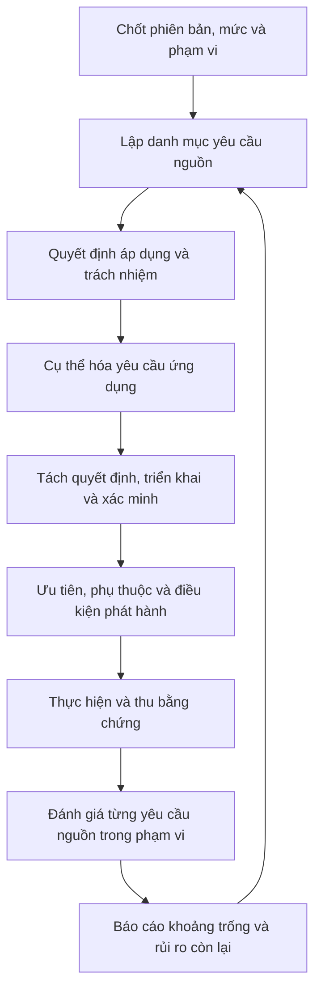

# Thực hành tổng hợp: mapping ASVS vào backlog

## 1. Mục tiêu và sản phẩm cần bàn giao

**Mapping ASVS vào backlog** là thiết lập liên kết có thể kiểm tra giữa yêu cầu trong một phiên bản ASVS được chọn với các yêu cầu ứng dụng, công việc phát triển và bằng chứng xác minh. Mục tiêu là giúp nhóm biết phải xây dựng, kiểm tra và duy trì điều gì, thay vì chỉ thêm một nhãn bảo mật vào ticket.

Một dòng ASVS không nhất thiết tương ứng đúng một user story. Nó có thể cần tài liệu chính sách, thay đổi ở nhiều thành phần và nhiều phép xác minh. Một công việc dùng chung cũng có thể đóng góp cho nhiều yêu cầu nguồn, nhưng không tự chứng minh đầy đủ tất cả các yêu cầu đó.

Bản nộp của bài thực hành gồm:

1. Phiên bản ASVS, mục tiêu mức xác minh và phạm vi ứng dụng.
2. Danh mục yêu cầu nguồn với quyết định áp dụng và căn cứ.
3. Yêu cầu nội bộ đã cụ thể hóa theo tài sản, kiến trúc và mô hình đe dọa.
4. Backlog gồm công việc ra quyết định, thực thi và xác minh, có phụ thuộc rõ.
5. Tiêu chí chấp nhận, định nghĩa sẵn sàng và điều kiện hoàn tất.
6. Ma trận truy vết từ nguồn tới phạm vi thực thi và bằng chứng.
7. Cách báo cáo khoảng trống, ngoại lệ và cập nhật khi nguồn thay đổi.

Người học nên tự lập bản đầu trước khi xem các mẫu. Những công việc và tham số của sản phẩm trong bài là thiết kế minh họa, không phải toàn bộ yêu cầu để đạt một mức ASVS.

## 2. Chốt phiên bản, mức và ý nghĩa của việc mapping

### 2.1. Cố định nguồn để liên kết không đổi nghĩa

ASVS là tiêu chuẩn yêu cầu xác minh bảo mật ứng dụng. Bài này cố định **ASVS 5.0.0**. Dùng dạng tham chiếu có phiên bản, chẳng hạn `v5.0.0-8.2.2`, vì định danh hoặc nội dung có thể thay đổi giữa các bản. Nguồn phát hành và quy tắc tham chiếu được công bố trên [trang dự án ASVS của OWASP](https://asvs.owasp.org/).

Không dùng một liên kết tới nhánh phát triển như thể nó là ảnh chụp của bản đã chốt. Hồ sơ mapping cần chỉ ra bản phát hành, ngôn ngữ, vị trí nguồn và thời điểm tiếp nhận. Bản dịch hoặc diễn giải nội bộ phải giữ liên hệ với nội dung nguồn để kiểm tra khi có khác biệt.

### 2.2. Mức xác minh không phải nhãn ưu tiên ticket

Trong ASVS 5.0.0, các mức L1, L2 và L3 biểu thị tập yêu cầu ở mức tương ứng; mục tiêu L2 bao gồm yêu cầu L1 và L2 áp dụng, kể cả điều kiện chặt hơn được nêu trong từng mục. Tổ chức chọn mục tiêu theo bối cảnh; không coi L1 là P1, L2 là P2. [Phần giới thiệu ASVS 5.0.0](https://raw.githubusercontent.com/OWASP/ASVS/v5.0.0/5.0/en/0x03-What-is-the-ASVS.md).

Bài tập giả định nhóm đặt mục tiêu L2 cho ứng dụng, có thể bổ sung một số yêu cầu ngoài tập đó theo rủi ro. Các bảng mẫu chỉ minh họa một phần việc. Muốn kết luận về mục tiêu L2 phải đánh giá toàn bộ tập áp dụng của phạm vi đã chốt, không chỉ những dòng được đưa vào bài học.

### 2.3. Phân biệt tài liệu, triển khai và hoạt động bên ngoài

ASVS 5.0.0 phân biệt việc ghi nhận quyết định bảo mật với việc thực thi quyết định đó; hoạt động xác minh có thể cần tài liệu hoặc kiến trúc, không chỉ kiểm thử hộp đen. Tiêu chuẩn tập trung vào kết quả bảo mật của ứng dụng; ví dụ, sao lưu do tiến trình bên ngoài thực hiện không tự thuộc phạm vi ASVS. [Phạm vi và quyết định được tài liệu hóa](https://raw.githubusercontent.com/OWASP/ASVS/v5.0.0/5.0/en/0x03-What-is-the-ASVS.md).

Vì vậy, backlog vẫn có thể chứa việc phục hồi, quy trình ứng cứu hoặc nghĩa vụ hợp đồng cần thiết cho hệ thống. Ghi nguồn riêng cho chúng; không tự tạo một ASVS ID để mọi việc đều có vẻ được tiêu chuẩn bao phủ.

## 3. Đề bài: nền tảng học tập nhiều tổ chức

### 3.1. Kiến trúc và dữ liệu

Nền tảng có trình duyệt, API, worker, hàng đợi, kho nghiệp vụ, kho báo cáo và kênh audit. Một người có thể thuộc nhiều tổ chức với vai trò khác nhau. Quyền ở A không tự có hiệu lực ở B.

Người có quyền yêu cầu xuất báo cáo học viên. API tạo tác vụ, worker đọc dữ liệu và tạo tệp; cổng tải cấp nội dung sau khi kiểm tra điều kiện tương ứng. Mỗi báo cáo thuộc một tổ chức. Trong bài, chỉ người khởi tạo còn đủ quyền xuất đối với phạm vi báo cáo được xem trạng thái và tải.

API tiến độ chỉ được trả tập trường đã được nghiệp vụ quyết định. Các trường ghi chú nội bộ, metadata hỗ trợ và dữ liệu xác thực không nằm trong tập được cấp qua chức năng đó. Quyền sửa từng trường cũng phải được quyết định, không suy từ quyền đọc.

### 3.2. Những quyết định sản phẩm dùng cho bài tập

| Nội dung | Giả định minh họa |
| --- | --- |
| Loại phiên | Mã tham chiếu opaque do máy chủ quản lý; dịch vụ danh tính dùng chung là phụ thuộc phải xác định phạm vi |
| Idle timeout của nhân sự | 15 phút, chỉ hoạt động hợp lệ được định nghĩa mới cập nhật mốc |
| Absolute timeout của nhân sự | 4 giờ từ mốc xác thực gốc được chấp nhận |
| Biên hết hạn | Phiên không hợp lệ từ đúng deadline |
| Nguồn quyền | Quan hệ tổ chức, sở hữu và phân công do hệ thống quản lý |
| Kiểm tra phía máy chủ | API, worker và cổng cấp dữ liệu không dựa vào việc ẩn nút để bảo vệ |
| Thu hồi quyền báo cáo | Yêu cầu nội bộ chọn giới hạn 60 giây cho yêu cầu tải mới sau khi nguồn có thẩm quyền ghi nhận thu hồi |
| Audit | Có định danh chủ thể, tài nguyên, tổ chức, hành động, kết quả và thông tin tương quan theo chính sách riêng |

Các con số này không được gán là thời hạn do ASVS quy định. Quyết định phiên phải được đánh giá và biện minh theo đầy đủ nội dung mục nguồn, không chỉ điền một bảng thời gian.

Quy tắc thu hồi quyền báo cáo cũng không thay thế yêu cầu về kết thúc phiên. Khóa một quyền xuất, vô hiệu phiên và vô hiệu tài khoản là những sự kiện khác nhau, có phạm vi và yêu cầu tương ứng riêng.

### 3.3. Rủi ro để xác định công việc cần thiết

- R-01: người dùng đọc chức năng hoặc báo cáo ngoài quyền.
- R-02: người của A tác động dữ liệu thuộc B.
- R-03: phản hồi hoặc cập nhật làm lộ, sửa trường ngoài quyền.
- R-04: phiên bị lấy tiếp tục hoạt động quá thời hạn.
- R-05: chỉ xóa cookie nhưng máy chủ vẫn nhận thông tin phiên cũ.
- R-06: worker dùng đặc quyền kỹ thuật thay cho quyền của người khởi tạo.
- R-07: quyền thay đổi nhưng dữ liệu cũ, cache hoặc đường tải vẫn tiếp tục cấp nội dung.
- R-08: không truy vết hoặc không phục hồi được an toàn sau sự cố.

ASVS là một nguồn yêu cầu. Mô hình đe dọa, dữ liệu, nghiệp vụ và vận hành có thể tạo thêm công việc ngay cả khi bảng ASVS chưa có một dòng phù hợp trực tiếp.

## 4. Quy trình từ nguồn tới backlog và bằng chứng



Các bước có thể lặp lại khi phát hiện câu hỏi thiết kế chưa được giải quyết. Không cần nhập toàn bộ văn bản vào mọi ticket. Nên có bản ghi nguồn duy nhất, rồi liên kết những công việc cần thực hiện.

Một mapping hữu ích phải trả lời được:

- Một yêu cầu nguồn được áp dụng cho thành phần, hành động và dữ liệu nào?
- Những công việc nào đóng góp phần nào vào yêu cầu đó?
- Điều kiện nào cần đúng trước khi triển khai hoặc kiểm thử?
- Ai chịu trách nhiệm kết luận mức đáp ứng?
- Bằng chứng thuộc phiên bản và môi trường nào?
- Phần chưa đáp ứng hoặc chưa xác minh đang được xử lý ra sao?

## 5. Lập danh mục nguồn và quyết định áp dụng

### 5.1. Bản ghi nguồn tối thiểu

| Trường | Mục đích |
| --- | --- |
| Định danh có phiên bản | Giữ liên kết tới đúng yêu cầu, không chỉ tên chương |
| Vị trí và nội dung nguồn | Có thể kiểm tra nguyên văn cùng ghi chú mức hoặc điều kiện liên quan |
| Mức của mục nguồn | Phân biệt với ưu tiên, độ khó hoặc sprint |
| Phạm vi áp dụng | Chức năng, thành phần, dữ liệu và môi trường cần đánh giá |
| Quyết định áp dụng | Áp dụng, không áp dụng có căn cứ, hoặc chờ xác minh |
| Yêu cầu nội bộ | Phần đặc tả cụ thể hóa cho sản phẩm |
| Chủ trách nhiệm | Người hoặc vai trò điều phối việc đáp ứng và đánh giá |
| Mapping công việc | Các công việc tài liệu, triển khai, kiểm chứng và phụ thuộc |
| Bằng chứng, kết luận | Kết quả hiện hành và giới hạn; giữ lịch sử khi thay đổi |

Khi lưu nội dung tiêu chuẩn trong công cụ thực tế, giữ nguồn và các điều kiện đầy đủ theo cách sử dụng được phép. Các mô tả ngắn trong bài là diễn giải để học, không thay thế văn bản nguồn.

### 5.2. Không áp dụng khác với chưa làm

Nếu không có một loại giao thức hoặc chức năng trong phạm vi, một yêu cầu đặc thù có thể không áp dụng sau khi đã kiểm tra căn cứ. Nếu chức năng tồn tại nhưng thiếu công cụ, nhân lực hoặc bằng chứng, đó là phần chưa đáp ứng hoặc chưa được xác minh.

“Chờ xác minh tính áp dụng” cần có người phụ trách và mốc giải quyết. Không loại nó khỏi báo cáo theo cách khiến phần chưa biết biến thành không có nghĩa vụ.

### 5.3. Dùng thành phần chung không đồng nghĩa tự đạt

Một dịch vụ phiên hoặc thư viện phân quyền chung có thể thực hiện một phần kiểm soát. Ứng dụng vẫn phải cấu hình, gọi đúng và bao phủ mọi điểm cấp dữ liệu. Cần ghi phần kế thừa, điều kiện cấu hình và phần trách nhiệm của nhóm sản phẩm.

Bằng chứng của nhà cung cấp không tự chứng minh cổng tải hoặc worker của ứng dụng đã dùng đúng. Một hành động bổ sung ở ứng dụng có thể cần thiết dù thành phần chung đã được kiểm chứng riêng.

## 6. Chọn tập ví dụ ASVS và giữ đúng ý nghĩa nguồn

### 6.1. Ví dụ từ nhóm phân quyền

Các định danh và mức dưới đây được đối chiếu với [chương Authorization của ASVS 5.0.0](https://raw.githubusercontent.com/OWASP/ASVS/v5.0.0/5.0/en/0x17-V8-Authorization.md). Cột ý chính là diễn giải ngắn.

| Tham chiếu | Mức | Ý chính |
| --- | --- | --- |
| v5.0.0-8.1.1 | L1 | Ghi quy tắc quyền chức năng và dữ liệu |
| v5.0.0-8.1.2 | L2 | Ghi quy tắc đọc, sửa từng trường |
| v5.0.0-8.2.1 | L1 | Thực thi quyền trên chức năng |
| v5.0.0-8.2.2 | L1 | Thực thi quyền trên dữ liệu cụ thể |
| v5.0.0-8.2.3 | L2 | Thực thi quyền trên trường |
| v5.0.0-8.3.1 | L1 | Đặt thực thi tại lớp dịch vụ đáng tin cậy |
| v5.0.0-8.4.1 | L2 | Bảo vệ ranh giới quyền giữa các tổ chức |

8.1.1 và 8.2.2 đóng góp khác nhau: có ma trận quyền đã duyệt chưa chứng minh API thực thi đúng; kiểm thử API đạt một đường chưa thay thế quy tắc cần ghi nhận.

**Lưu ý về mapping sai tham số:** 8.3.2 ở L3 có yêu cầu áp dụng thay đổi quyền ngay và điều kiện xử lý khi không làm được; mục nguồn cũng nêu giới hạn đối với lộ thông tin. Không thay bằng “60 giây” rồi báo đạt. Giới hạn nội bộ của bài cần đánh giá riêng. [Yêu cầu 8.3.2 trong bản nguồn](https://raw.githubusercontent.com/OWASP/ASVS/v5.0.0/5.0/en/0x17-V8-Authorization.md).

### 6.2. Ví dụ từ nhóm quản lý phiên

Các mục sau lấy từ [chương Session Management của ASVS 5.0.0](https://raw.githubusercontent.com/OWASP/ASVS/v5.0.0/5.0/en/0x16-V7-Session-Management.md).

| Tham chiếu | Mức | Ý chính |
| --- | --- | --- |
| v5.0.0-7.1.1 | L2 | Ghi idle, absolute timeout và các biện minh liên quan |
| v5.0.0-7.3.1 | L2 | Thực thi timeout không hoạt động theo quyết định |
| v5.0.0-7.3.2 | L2 | Thực thi thời hạn tuyệt đối theo quyết định |
| v5.0.0-7.4.1 | L1 | Kết thúc phiên làm thông tin phiên không còn dùng được |

7.1.1 còn đòi tính phù hợp với kiểm soát khác và biện minh sai khác với yêu cầu tái xác thực của NIST SP 800-63B được mục nguồn đề cập. Bảng 15 phút và 4 giờ chưa đủ để đóng mục này nếu phần đánh giá đó chưa có.

7.4.1 không được đóng chỉ bằng quan sát cookie biến mất. Cần bằng chứng về việc thông tin phiên không còn được sử dụng theo phạm vi mục nguồn; thiết kế liên kết danh tính cũng cần được đánh giá nếu có.

### 6.3. Giữ mã nội bộ khác mã nguồn

Dùng `APP-AZ-01` hoặc `APP-SES-01` cho yêu cầu sản phẩm; dùng `BL-...` cho backlog. Không sửa nội dung ASVS rồi vẫn giữ nguyên mã nguồn như thể đó là yêu cầu nguyên bản.

Nếu một công việc chỉ đóng góp vào phần của một mục nguồn, quan hệ phải ghi “đóng góp cho” cùng phạm vi, không ghi “đã đáp ứng” khi chưa có kết luận đầy đủ.

## 7. Tách công việc để mỗi phần có thể bàn giao và xác minh

### 7.1. Một cấu trúc backlog khả thi

Nhóm có thể tổ chức một epic về bảo vệ dữ liệu học viên, rồi tạo các công việc bên dưới. Tên epic không tự là kết luận về mức ASVS. Những công việc không phải tính năng người dùng vẫn cần đầu ra cụ thể.

| Công việc | Loại đầu ra | Nguồn liên quan | Phụ thuộc chính |
| --- | --- | --- | --- |
| BL-AZ-01 | Quy tắc chức năng, dữ liệu và trường được quyết định, có phiên bản | 8.1.1, 8.1.2 của bản 5.0.0 | Phạm vi nghiệp vụ và mô hình dữ liệu |
| BL-AZ-02 | Thực thi các quy tắc ở API đọc, danh sách và thay đổi dữ liệu | 8.2.1, 8.2.2, 8.2.3, 8.3.1, 8.4.1 | BL-AZ-01 |
| BL-AZ-03 | Thực thi và xác minh trên worker, trạng thái, cổng tải | 8.2.2, 8.3.1, 8.4.1 | BL-AZ-01, thiết kế luồng bất đồng bộ |
| BL-SES-01 | Quyết định phiên và đánh giá căn cứ được duyệt | 7.1.1 | Luồng danh tính, nhu cầu sử dụng, rủi ro |
| BL-SES-02 | Thực thi idle và absolute timeout | 7.3.1, 7.3.2 | BL-SES-01, đồng hồ và trạng thái phiên |
| BL-SES-03 | Kết thúc phiên trên các đường dùng thông tin phiên | 7.4.1 | Bản đồ phiên, client và điểm thực thi |
| BL-VER-01 | Đánh giá phạm vi còn thiếu và tổng hợp kết luận nguồn | Các nguồn được đưa vào phạm vi | Bằng chứng tài liệu, thực thi và tích hợp |

Các mã ngắn trong cột nguồn chỉ để bảng dễ đọc; bản ghi công việc thực phải giữ tham chiếu đầy đủ như `v5.0.0-8.2.2`. Tất cả mapping ở đây là đóng góp cho phạm vi cụ thể, không phải khẳng định một ticket bao phủ toàn ứng dụng.

Có thể tách BL-SES-02 thành idle và absolute riêng nếu cần giao độc lập. Nếu tách, vẫn giữ quan hệ với chính sách và đánh giá tổng hợp; không bỏ một cam kết chỉ vì nó chưa nằm trong sprint.

### 7.2. Một mục nguồn có nhiều công việc

Quyền theo tài nguyên cần hoạt động ở cả API và cổng tải. BL-AZ-02 đạt ở API chưa đủ nếu BL-AZ-03 bỏ cổng tải. Không cộng hai ô “Done” để thay cho đánh giá đủ đường thực thi.

Tương tự, BL-SES-01 có thể hoàn tất trước BL-SES-02. Kết luận nguồn về tài liệu và kết luận về thực thi phải có bằng chứng riêng. Thứ tự phụ thuộc giúp tránh việc kỹ sư tự chọn thời hạn trong mã rồi viết lại chính sách cho khớp.

### 7.3. Một công việc liên hệ nhiều nguồn

Một thay đổi ở cổng tải có thể thực thi quyền tài nguyên, giữ ranh giới tổ chức và đặt kiểm tra phía máy chủ. Với từng liên kết, ghi tiêu chí nào của công việc đóng góp cho nguồn nào.

Không dùng quan hệ chung “related” để tính độ bao phủ. Nên phân biệt “quyết định chính sách cho”, “thực thi một phần”, “xác minh tiêu chí” và “cung cấp bằng chứng”. Kết luận đạt nguồn là một bước đánh giá, không phải một loại nhãn tự sinh từ liên kết.

## 8. Ví dụ chi tiết: ticket phân quyền trên báo cáo

### 8.1. Bản ghi BL-AZ-03

**Vấn đề:** một người có thể biết định danh tác vụ hoặc tệp không do mình tạo; worker và cổng tải có đặc quyền kỹ thuật rộng hơn người dùng. Chỉ kiểm tra đã đăng nhập hoặc ẩn nút sẽ không đủ cho quy tắc của sản phẩm.

**Đầu ra:** các điểm thực thi áp dụng APP-AZ-01 và APP-AZ-02 theo phạm vi báo cáo. Công việc đóng góp cho `v5.0.0-8.2.2`, `v5.0.0-8.3.1`, `v5.0.0-8.4.1`; không tự kết luận toàn bộ các mục này đạt trên ứng dụng.

**APP-AZ-01 — Đọc trạng thái và tải:** máy chủ phải lấy người khởi tạo, tổ chức sở hữu và phạm vi dữ liệu từ quan hệ do hệ thống quản lý. Chỉ cho phép khi người gọi là người khởi tạo và đủ quyền xuất đối với phạm vi đó theo chính sách áp dụng.

**APP-AZ-02 — Xử lý nền:** worker phải ràng buộc thông điệp với tác vụ hợp lệ và đánh giá điều kiện thực thi tại thời điểm yêu cầu nội bộ quy định. Không dùng quyền kỹ thuật để thực hiện một phạm vi mà người khởi tạo không được phép.

### 8.2. Tiêu chí chấp nhận

| Mã | Điều kiện | Kết quả mong đợi |
| --- | --- | --- |
| AC-AZ-01 | Người khởi tạo còn đủ quyền, đúng tổ chức và báo cáo sẵn sàng | Xem trạng thái và tải được đúng nội dung |
| AC-AZ-02 | Người A tham chiếu báo cáo tồn tại thật thuộc B | Không nhận nội dung hoặc metadata ngoài hợp đồng |
| AC-AZ-03 | Người khác cùng tổ chức có quyền xuất nhưng không phải người khởi tạo | Không xem hoặc tải báo cáo theo quy tắc đã chốt |
| AC-AZ-04 | Thay trường tổ chức, người khởi tạo hoặc phạm vi do client cung cấp | Không tạo căn cứ quyền trái với dữ liệu do hệ thống quản lý |
| AC-AZ-05 | Thông điệp tác vụ không khớp tổ chức hoặc phạm vi đăng ký | Worker không đọc ngoài quyền, không công bố tệp hợp lệ ngoài ý muốn |
| AC-AZ-06 | Quyền đổi trong lúc tác vụ chờ hoặc trước tải | Hành vi đúng yêu cầu về thời điểm và hiệu lực thay đổi quyền |
| AC-AZ-07 | Nguồn bắt buộc để quyết định quyền không khả dụng | Không mặc định cho phép; không tạo đường cấp dữ liệu dự phòng trái chính sách |
| AC-AZ-08 | Yêu cầu bị từ chối | Không tạo tác vụ hoặc tệp tải được ngoài hợp đồng; audit phù hợp vẫn có thể được ghi |

AC-AZ-03 là quy tắc sản phẩm, không được ghi là câu chữ do ASVS bắt buộc cho mọi ứng dụng. Nếu nghiệp vụ cho chia sẻ báo cáo giữa người cùng tổ chức, phải sửa yêu cầu và tiêu chí bằng quyết định rõ ràng, rồi đánh giá mapping lại.

### 8.3. Phạm vi và bằng chứng

Bằng chứng cần chỉ ra đường API, worker, trạng thái và cấp nội dung nào đã được kiểm tra; tài nguyên, tổ chức và quyền thử; cấu hình cùng bản dựng. Rà thiết kế để xác định có đường tải trực tiếp hoặc kênh quản trị nào chưa nằm trong danh sách.

Một kiểm thử với định danh không tồn tại không thay ca dùng tài nguyên thật ngoài quyền. Phản hồi bị từ chối cũng chưa đủ nếu tệp vẫn được tạo và đọc qua đường khác.

Tách nhiệm vụ tạo ca kiểm thử nếu cần người phụ trách khác, nhưng không bỏ trách nhiệm xác minh khỏi điều kiện hoàn tất của phạm vi công việc.

## 9. Ví dụ chi tiết: chính sách và thực thi phiên

### 9.1. BL-SES-01 — Chốt quyết định

Công việc phải tạo bản quyết định có phiên bản về idle, absolute, nguồn thời gian, hoạt động được tính, tương tác với dịch vụ danh tính và căn cứ phù hợp với rủi ro. Các đánh giá được mục nguồn 7.1.1 yêu cầu phải có người chịu trách nhiệm; không chỉ ghi hai giá trị thời gian rồi đóng.

Bản quyết định của bài tập chọn 15 phút không hoạt động và 4 giờ tuyệt đối cho nhân sự. Polling nền, heartbeat, yêu cầu bị từ chối và việc cấp lại cookie không được dùng để đặt lại mọi mốc.

Bằng chứng cho phần quyết định gồm nội dung đã chốt, căn cứ, phạm vi và việc rà soát. Nó không phải bằng chứng rằng ứng dụng đã thực thi.

### 9.2. BL-SES-02 — Thực thi hai deadline

Một yêu cầu nội bộ có thể viết:

```text
APP-SES-01

idleDeadline = lastMeaningfulActivityAt + 15 phút
absoluteDeadline = rootAuthenticatedAt + 4 giờ

Phiên không được dùng cho hành động bảo vệ khi:
  now >= idleDeadline
  hoặc now >= absoluteDeadline.

Chỉ hoạt động hợp lệ theo chính sách mới cập nhật mốc hoạt động.
Việc cập nhật đó không đặt lại mốc xác thực gốc.
```

Tiêu chí cần gồm trước, đúng và sau mỗi deadline; hoạt động thường xuyên không vượt absolute; polling không giữ phiên sống; thời gian client tự gửi không kéo dài mốc máy chủ. Dùng đồng hồ điều khiển được ở lớp phù hợp, rồi kiểm tra tích hợp nguồn thời gian và các điểm thực thi.

Hai kết quả nên được liên hệ tới hai cam kết thực thi riêng. Idle đạt không làm absolute đạt; chính sách tồn tại cũng không thay một kết quả thực thi.

### 9.3. BL-SES-03 — Kết thúc phiên

Đặc tả đường kết thúc cần chỉ rõ thông tin phiên nào bị vô hiệu, phạm vi ứng dụng, các điểm còn có thể nhận nó và ý nghĩa phản hồi thành công. Với thiết kế bài tập, sau khi thao tác kết thúc đã được xác nhận thành công, phát lại thông tin phiên cũ không được cấp dữ liệu bảo vệ.

Kiểm tra bằng thông tin thử đã được giữ trước đăng xuất, không chỉ nhìn cookie biến mất. Nếu phiên tại dịch vụ danh tính còn tồn tại, cần xác minh việc tạo lại phiên ứng dụng theo đúng chính sách; không báo đăng xuất mọi hệ thống khi chỉ xử lý cục bộ.

Đừng áp ngầm giới hạn 60 giây của quyền báo cáo vào 7.4.1 rồi báo đáp ứng nguồn. Nếu kiến trúc hiện tại chưa đạt ngữ nghĩa kết thúc cần thiết, ghi khoảng trống, sửa thiết kế hoặc đánh giá trong quy trình thích hợp.

## 10. Ưu tiên, phụ thuộc và điều kiện phát hành

### 10.1. Ưu tiên theo bối cảnh, giữ nguyên nghĩa vụ nguồn

Mức ASVS giúp biết yêu cầu thuộc tập mục tiêu nào, nhưng thứ tự backlog còn phụ thuộc rủi ro cụ thể, đường đang lộ, số người bị ảnh hưởng, điều kiện bắt buộc và phụ thuộc triển khai.

Nếu đã xác nhận truy cập chéo tổ chức, phần chặn đường đó có thể cần làm trước các cải tiến ít cấp thiết hơn. Công việc tài liệu nền vẫn cần hoàn tất để xác minh đúng, nhưng không được trì hoãn biện pháp cấp thiết chỉ để chờ mọi bảng đã đẹp.

Có thể dùng P0, P1 hoặc các nhãn quy trình của nhóm. Ghi chúng ở trường riêng với L1, L2. Không đổi mức nguồn hoặc đánh dấu không áp dụng chỉ vì một ticket được xếp sau.

### 10.2. Tách công việc khám phá khi còn thiếu quyết định

Nếu chưa biết cổng tải có đọc trực tiếp nguồn quyền không, tạo việc xác minh kiến trúc với câu hỏi, đầu ra, người phụ trách và thời hạn. Kết thúc việc khám phá phải tạo được quyết định hoặc công việc tiếp theo, không chỉ một nhận xét “đã tìm hiểu”.

Một công việc triển khai chưa sẵn sàng khi tiêu chí cho phép cốt lõi còn mơ hồ. Có thể tiến hành phần độc lập đã rõ, nhưng cần nêu chính xác phần đó không chứng minh điều kiện đang chờ.

### 10.3. Điều kiện phát hành không chỉ là tỷ lệ hoàn tất

Nếu yêu cầu bắt buộc về ranh giới tổ chức chưa đạt, một tỷ lệ ticket hoàn tất cao không tự cho phép phát hành. Cần xét phần thiếu cụ thể, phạm vi chức năng, biện pháp tạm thời và thẩm quyền quyết định.

Ngoại lệ là bản ghi về việc một yêu cầu áp dụng chưa được đáp ứng trong phạm vi, thời gian và điều kiện xác định. Nó không đổi kết quả kiểm chứng thành đạt và không tự cho phép bỏ nghĩa vụ bên ngoài đã xác nhận.

Không tuyên bố “đạt ASVS L2” chỉ từ các bảng mẫu trong bài. Nếu chỉ đánh giá một tập con, mô tả tập con, phiên bản, phạm vi và giới hạn kết luận.

## 11. Định nghĩa sẵn sàng và hoàn tất

### 11.1. Điều kiện đưa công việc vào thực hiện

Một định nghĩa sẵn sàng có thể yêu cầu:

- Có nguồn với phiên bản và phạm vi áp dụng.
- Biết công việc đóng góp toàn bộ hay một phần nào của yêu cầu nội bộ.
- Quy tắc nghiệp vụ, tham số và nguồn có thẩm quyền đủ rõ.
- Có điểm thực thi, phụ thuộc và chủ trách nhiệm.
- Tiêu chí bao gồm đường hợp lệ, từ chối và lỗi có liên quan.
- Có cách chuẩn bị danh tính, dữ liệu và môi trường thử.
- Phần chưa biết có người xử lý và không bị trình bày như quyết định đã chốt.

Những điều kiện này không phải một luồng phê duyệt mới ngoài quy trình nhóm đã có. Chúng giúp người nhận hiểu đầu ra cần tạo.

### 11.2. Điều kiện hoàn tất công việc

Tùy loại đầu ra, hoàn tất cần nội dung quyết định, triển khai hoặc bằng chứng tương ứng. Với công việc thực thi, thường cần thay đổi đã có trong phiên bản cần đánh giá, tiêu chí đã được xác minh, phạm vi còn thiếu được ghi và tài liệu liên quan được cập nhật.

Không yêu cầu mọi công việc đều có kiểm thử tự động. Đánh giá chính sách có thể cần rà soát tài liệu; cấu hình nền tảng có thể cần đối chiếu và quan sát; thời gian hoặc quyền cần kiểm thử phù hợp. Chọn phương pháp theo cam kết.

Bằng chứng cần định danh lần đánh giá, phiên bản yêu cầu, bản dựng, cấu hình, môi trường, dữ liệu, phương pháp, kết quả và giới hạn. Không dùng một liên kết trỏ tới lần chạy mới nhất làm hồ sơ duy nhất cho quyết định trước đây.

### 11.3. Hoàn tất nguồn là kết luận tổng hợp

Có thể theo dõi các trục riêng:

| Trục | Trạng thái minh họa |
| --- | --- |
| Tính áp dụng | Áp dụng, không áp dụng có căn cứ, chờ xác minh |
| Công việc | Chưa làm, đang làm, đã bàn giao, bị chặn |
| Xác minh | Chưa đánh giá, đạt một phần, không đạt, đạt trong phạm vi, cần đánh giá lại |
| Ngoại lệ | Không có, đang xem xét, còn hiệu lực, hết hạn |

Một nguồn áp dụng chỉ được kết luận đã đáp ứng khi có đủ bằng chứng cho các tiêu chí và phạm vi cần thiết. Các công việc đóng góp đều “Done” chưa đủ nếu cách chia việc bỏ mất một phần yêu cầu.

## 12. Ma trận bằng chứng, chỉ số và cập nhật nguồn

### 12.1. Một góc nhìn trạng thái minh họa

Giả sử nhóm xem xét một tập con sáu mục nguồn trên bản dựng và cấu hình đã chốt:

| Nguồn | Đóng góp chính | Bằng chứng giả định | Kết luận minh họa |
| --- | --- | --- | --- |
| v5.0.0-8.1.1 | BL-AZ-01 | Quy tắc chức năng và dữ liệu được rà soát đủ phạm vi | Đạt trong phạm vi |
| v5.0.0-8.1.2 | BL-AZ-01 | Quy tắc đọc, sửa trường và điều kiện liên quan được rà soát | Đạt trong phạm vi |
| v5.0.0-8.2.2 | BL-AZ-02, BL-AZ-03 | API đạt; cổng tải chưa được kiểm tra đầy đủ | Đạt một phần |
| v5.0.0-8.4.1 | BL-AZ-02, BL-AZ-03 | Có đường trạng thái trả metadata của tổ chức khác | Không đạt |
| v5.0.0-7.1.1 | BL-SES-01 | Chính sách và căn cứ được đánh giá theo đầy đủ mục nguồn | Đạt trong phạm vi |
| v5.0.0-7.4.1 | BL-SES-03 | Kiểm chứng kết thúc trên các điểm sử dụng trong phạm vi đạt | Đạt trong phạm vi |

Đây là dữ liệu giả định để luyện báo cáo, không phải kết quả đã chạy trên một sản phẩm. Trong tình huống này, BL-VER-01 phải giữ phần chưa đạt và chưa được xác minh, không tô xanh tất cả vì API đã có middleware chung.

### 12.2. Chỉ số phải có mẫu số và ý nghĩa rõ

Với tập con trên, số nguồn đã được mapping tới công việc là 6/6, nhưng số đã xác minh đầy đủ trong phạm vi là 4/6. Hai con số trả lời hai câu hỏi khác nhau.

Một phép tính tổng quát:

```text
Độ bao phủ mapping =
  số yêu cầu áp dụng có công việc hoặc bằng chứng hiện có phù hợp
  / tổng số yêu cầu áp dụng trong tập đã chốt

Tỷ lệ đã xác minh =
  số yêu cầu áp dụng có đủ bằng chứng đạt còn hiệu lực
  / tổng số yêu cầu áp dụng trong tập đã chốt
```

Báo cáo riêng các mục chờ xác minh tính áp dụng để chúng không biến mất khỏi tổng quan. Nếu có không áp dụng hoặc ngoại lệ, trình bày căn cứ và số lượng riêng; không tính ngoại lệ như đã đạt.

4/6 không là phần trăm rủi ro đã loại bỏ, cũng không là mức đạt của toàn ASVS L2. Một mục không đạt về xuyên tổ chức có thể quyết định điều kiện phát hành bất kể tỷ lệ tổng.

### 12.3. Khi phiên bản hoặc phạm vi thay đổi

Quy trình chuyển đổi cần giữ nguồn cũ, nguồn mới và loại quan hệ: giữ nguyên, đổi nghĩa, tách, gộp, thêm hoặc bỏ. Đối chiếu nội dung và điều kiện, không chỉ so số định danh.

Đánh giá tác động tới yêu cầu nội bộ, công việc, tiêu chí và bằng chứng. Một ca từng đạt có thể còn đóng góp cho phần giữ nguyên, nhưng không tự bao phủ phần mới. Giữ lịch sử để biết quyết định phát hành cũ đã dựa vào tập nguồn nào.

Thay đổi nội bộ như thêm worker, đường tải trực tiếp, loại trường dữ liệu hoặc dịch vụ danh tính cũng cần đánh giá lại mapping dù phiên bản ASVS không đổi.

### 12.4. Công cụ chỉ hỗ trợ tính nhất quán

Có thể kiểm tra định danh nguồn tồn tại, không thiếu phiên bản, liên kết không hỏng, người phụ trách còn rõ và bằng chứng không trỏ nhầm bản cũ. Chọn một nơi quản lý gốc cho mỗi loại đối tượng để tránh hai bảng nhập tay lệch nhau.

Sự hiện diện của liên kết không tự chứng minh ngữ nghĩa phù hợp. Công cụ không nên tự chuyển nguồn thành đạt chỉ vì mọi ticket liên quan đã đóng.

## 13. Các lỗi mapping thường gặp

| Biểu hiện | Vấn đề | Cách sửa |
| --- | --- | --- |
| Một ticket cho cả chương | Phạm vi quá rộng, không biết phần nào còn thiếu | Giữ yêu cầu nguồn riêng và chia công việc theo đầu ra có thể xác minh |
| Sao chép câu nguồn làm acceptance criterion duy nhất | Chưa cụ thể hóa dữ liệu, hành động, trạng thái | Thêm yêu cầu ứng dụng và ca đúng, sai, lỗi |
| Chỉ làm phần tài liệu | Chưa kiểm chứng thực thi | Tách công việc tài liệu với triển khai và bằng chứng |
| Chỉ có middleware hoặc kiểm thử một endpoint | Có thể bỏ worker, danh sách, trường và tải trực tiếp | Lập danh sách điểm thực thi theo phạm vi |
| L1 tương ứng P1, L2 tương ứng P2 | Trộn mức nguồn với thứ tự backlog | Dùng trường riêng và ưu tiên theo bối cảnh |
| Gắn ID không có phiên bản | Định danh có thể đổi nghĩa theo nguồn | Giữ phiên bản và vị trí nguồn đã chốt |
| Gắn một thời hạn nội bộ như thể ASVS quy định | Làm sai nguồn hoặc che khoảng trống | Giữ quyết định nội bộ riêng, kiểm tra tương thích với mục nguồn |
| Nhà cung cấp có chứng nhận nên ứng dụng đạt | Chưa kiểm tra cấu hình và cách tích hợp | Ghi phần kế thừa và phần trách nhiệm ứng dụng |
| Thiếu công cụ nên đánh dấu không áp dụng | Nhầm khả năng triển khai với phạm vi yêu cầu | Giữ khoảng trống hoặc công việc xác minh |
| Có ngoại lệ thì chuyển sang pass | Đổi quyết định chịu rủi ro thành bằng chứng đáp ứng | Theo dõi ngoại lệ và kết luận xác minh riêng |
| Test xanh thì đóng mọi nguồn liên quan | Một ca có thể chỉ bao phủ một phần | Ghi đóng góp cụ thể và đánh giá tổng hợp |
| Gắn ASVS cho mọi việc vận hành | Có thể vượt nội dung, phạm vi nguồn | Dùng nguồn nội bộ hoặc nghĩa vụ phù hợp khi không có mapping trực tiếp |
| Nâng phiên bản bằng thay tiền tố hàng loạt | Mất thay đổi về ngữ nghĩa và phạm vi | So nội dung, tách gộp và bằng chứng liên quan |

## 14. Thực hành và điều kiện bàn giao

### 14.1. Các bước thực hiện

1. Chốt ASVS 5.0.0, mục tiêu L2 và phạm vi sản phẩm của bài tập.
2. Tạo danh mục nguồn cho các mục mẫu, giữ liên kết tới đúng bản.
3. Quyết định áp dụng theo chức năng và ghi phần cần xác minh.
4. Viết quy tắc sản phẩm cho chức năng, bản ghi, trường và phiên.
5. Tách công việc quyết định, triển khai và xác minh; nối phụ thuộc.
6. Viết tiêu chí cho API, worker, trạng thái, tải và phiên theo phạm vi.
7. Dùng tài nguyên thật ngoài quyền, mốc thời gian điều khiển được và tình huống lỗi để thiết kế ca thử.
8. Dựng ma trận đóng góp, bằng chứng và trạng thái nguồn.
9. Ghi các yêu cầu riêng về audit, thu hồi quyền báo cáo và phục hồi; không tự gắn nguồn không có căn cứ.
10. Giả lập một thay đổi như thêm đường tải trực tiếp, rồi cập nhật công việc và bằng chứng bị ảnh hưởng.
11. Viết báo cáo giới hạn: những nguồn nào đã đánh giá, phần nào chưa đạt và điều kiện phát hành.

Bài tập không yêu cầu tạo ticket trong một dịch vụ bên ngoài hoặc sửa sản phẩm thật. Bản nộp có thể là một danh mục backlog cùng ma trận đủ chi tiết để người khác thực hiện và kiểm tra.

### 14.2. Thang tự đánh giá minh họa

| Nhóm | Điểm tối đa | Dấu hiệu đạt |
| --- | --- | --- |
| Nguồn và phạm vi | 20 | Đúng phiên bản, mức, ID và căn cứ áp dụng |
| Yêu cầu ứng dụng | 25 | Cụ thể hóa đúng mục tiêu, không làm yếu hoặc đổi nghĩa nguồn |
| Cấu trúc backlog | 20 | Có đầu ra, phụ thuộc, trách nhiệm và cách chia phù hợp |
| Tiêu chí, bằng chứng | 20 | Có đường hợp lệ, từ chối, biên và phạm vi xác minh |
| Báo cáo và thay đổi | 15 | Phân biệt mapping với đạt, giữ khoảng trống và lịch sử |

Điểm tổng không thay điều kiện bảo mật bắt buộc. Một bản mapping đủ ID nhưng không kiểm soát truy cập chéo tổ chức vẫn có lỗi cốt lõi cần xử lý.

### 14.3. Điểm kiểm tra trước khi bàn giao

- Phiên bản, nguồn, mức mục tiêu và phạm vi được xác định.
- Các định danh được đối chiếu với nội dung đúng bản.
- Tính áp dụng, mức thực thi, xác minh và ngoại lệ được theo dõi riêng.
- Mỗi công việc có đầu ra, người phụ trách, phụ thuộc và tiêu chí.
- Tài liệu quyết định không bị nhầm với bằng chứng thực thi.
- Quan hệ nhiều nguồn–nhiều công việc có đóng góp và phạm vi rõ.
- Các điểm API, worker, cổng tải, trường dữ liệu và phiên được xét đầy đủ theo phần việc.
- Bằng chứng có phiên bản, môi trường và giới hạn kết luận.
- Chỉ số không che phần chưa biết, không đạt hoặc ngoại lệ.
- Yêu cầu nội bộ, phục hồi và hoạt động ngoài phạm vi nguồn vẫn được quản lý bằng căn cứ phù hợp.
- Có quy trình cập nhật khi tiêu chuẩn, chức năng hoặc kiến trúc thay đổi.

Một mapping có thể sử dụng được giúp nhóm đi từ yêu cầu nguồn tới hành vi sản phẩm, công việc thực hiện và bằng chứng đánh giá. Giá trị của backlog nằm ở khả năng hoàn thành và chứng minh đúng phần bảo vệ cần thiết, đồng thời cho thấy rõ những phần chưa đủ cơ sở để kết luận.
