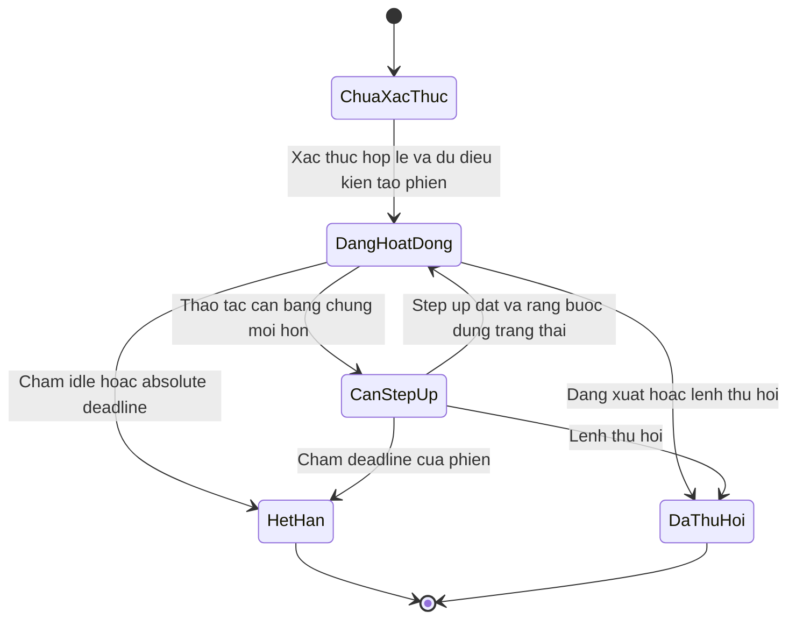

# Thực hành tổng hợp: thiết kế session policy

## 1. Mục tiêu và đầu ra của bài thực hành

**Session policy** là tập quy tắc quản lý việc tạo, sử dụng, gia hạn trong phạm vi cho phép, nâng mức xác thực, hết hạn và thu hồi phiên. Chính sách cần thể hiện người dùng được tiếp tục hoạt động trong điều kiện nào, khi nào phải xác thực lại và hệ thống thực thi quyết định đó ra sao trên các điểm truy cập.

Một cookie còn tồn tại trong trình duyệt không chứng minh phiên vẫn hợp lệ. Một token chưa hết hạn không tự chứng minh người dùng vẫn có quyền với tài nguyên. Một thao tác làm mới thông tin truy cập cũng không nhất thiết là một lần xác thực mới.

Bài thực hành yêu cầu chuyển các mục tiêu bảo mật và nhu cầu sử dụng thành:

1. Phạm vi, giả định và hồ sơ chính sách theo loại người dùng.
2. Mô hình dữ liệu, thời gian và trạng thái của phiên.
3. Bộ yêu cầu có định danh, điều kiện chấp nhận và nguồn rủi ro.
4. Quy tắc phối hợp giữa phiên, phân quyền và quyền tạm thời.
5. Ca kiểm thử biên, đồng thời, lỗi phụ thuộc và phục hồi.
6. Truy vết từ rủi ro tới thiết kế và bằng chứng.

Người học nên tự thiết kế bản đầu trước khi đối chiếu với phần mẫu. Các con số trong bài là giả định nghiệp vụ để luyện đặc tả, không phải thời hạn an toàn chung hoặc khuyến nghị áp dụng nguyên trạng cho mọi sản phẩm.

## 2. Đề bài và các quyết định đã chốt

### 2.1. Bối cảnh hệ thống

Nền tảng học tập phục vụ nhiều tổ chức, có học viên, giảng viên, quản trị viên và nhân viên hỗ trợ. Một người có thể có vai trò khác nhau ở nhiều tổ chức. Các thao tác nhạy cảm gồm xuất báo cáo học viên, thay vai trò và kích hoạt quyền hỗ trợ tạm thời.

Trong bài tập, trình duyệt dùng mã phiên opaque do máy chủ quản lý. Mã này không mang vai trò để trình duyệt tự quyết định quyền. Các ứng dụng di động, token dành cho tích hợp bên ngoài và cơ chế lưu token riêng của chúng nằm ngoài phạm vi; khi mở rộng cần chính sách và bằng chứng tương ứng.

Hệ thống có nhiều nút xử lý, kho phiên, nguồn quyền, kênh audit và một đường danh tính dùng chung. Đăng xuất cục bộ phải có hiệu lực trong phạm vi ứng dụng, kể cả khi phiên tại dịch vụ danh tính còn tồn tại.

### 2.2. Hồ sơ chính sách mẫu

| Thuộc tính | Hồ sơ Learner | Hồ sơ Staff |
| --- | --- | --- |
| Nhóm áp dụng | Tài khoản chỉ có phân loại học viên theo nguồn có thẩm quyền | Tài khoản được phân loại nhân sự, gồm giảng viên, quản trị viên và hỗ trợ |
| Thời gian không hoạt động tối đa | 30 phút | 15 phút |
| Thời gian tuyệt đối từ lần xác thực gốc được chấp nhận | 8 giờ | 4 giờ |
| Số phiên hoạt động đồng thời | Tối đa 3 phiên trên một tài khoản | Tối đa 3 phiên trên một tài khoản |
| Thao tác nhạy cảm | Phải đủ quyền và đáp ứng mức xác thực riêng nếu được cấp chức năng | Phải đủ quyền và có MFA hoàn thành không quá 5 phút trước thao tác |
| Quyền hỗ trợ tạm thời | Không được cấp qua hồ sơ này | Tối đa 30 phút, có phạm vi và phê duyệt riêng |

Nếu tài khoản thuộc cả hai phân loại, dùng Staff. Khi cần chuyển sang hồ sơ chặt hơn trong một phiên, không được dùng việc đổi hồ sơ để đặt lại mốc xác thực hoặc kéo dài thời gian. Giảm mức ràng buộc cũng không tự kéo dài phiên hiện có; quy tắc tạo phiên mới cần được áp dụng riêng.

Các quyết định dùng chung:

- Thu hồi chủ động có hiệu lực với yêu cầu mới trong tối đa 60 giây từ khi nguồn phiên hoặc quyền có thẩm quyền ghi nhận thay đổi thành công.
- Hết hạn do thời gian phải được kiểm tra theo các mốc đã tính; không cộng thêm 60 giây vào thời hạn tự nhiên.
- Phiên thứ tư bị từ chối; hệ thống không âm thầm đẩy một phiên khác ra ngoài.
- Người dùng có thể đăng xuất phiên hiện tại; không buộc MFA mới chỉ để kết thúc phiên đó.
- Quản lý và thu hồi phiên khác của chính mình cần xác thực lại theo mức đã chốt cho thao tác. Bài tập chọn MFA còn mới trong 5 phút cho thao tác này.
- Khi không thể dùng đường tự phục vụ, việc thu hồi khẩn cấp đi qua quy trình xác minh và thẩm quyền ứng cứu riêng.

### 2.3. Hoạt động nào được tính là người dùng đang hoạt động?

Trong bài tập, chỉ hành động nghiệp vụ được phép và do tương tác người dùng tạo ra theo danh sách máy chủ xác định mới cập nhật mốc hoạt động. Heartbeat, polling nền, thông báo đẩy, yêu cầu thất bại và yêu cầu bị từ chối không tự giữ phiên sống.

Một phiên nhiều tab vẫn là một phiên nếu dùng cùng mã phiên. Không đếm tab như thiết bị độc lập. Nếu có chức năng xem bài dài hoặc làm bài thi cần điều kiện đặc biệt, phải bổ sung quyết định nghiệp vụ rõ; không âm thầm cho mọi polling kéo dài mọi phiên.

## 3. Phân biệt các đối tượng và đồng hồ

### 3.1. Các khái niệm dễ bị gộp nhầm

| Đối tượng | Vai trò | Điều không được suy ra |
| --- | --- | --- |
| Bản ghi phiên | Trạng thái máy chủ gắn với danh tính và chính sách | Có bản ghi không có nghĩa còn hợp lệ ở mọi thời điểm |
| Mã phiên | Thông tin do trình duyệt trình ra để liên hệ phiên | Không phải danh sách quyền được tin vì người gọi gửi |
| Cookie | Cách trình duyệt giữ và gửi mã phiên theo thuộc tính | Cookie chưa bị xóa không làm sống lại phiên đã hết hạn |
| Thông tin truy cập của một API khác | Cơ chế có vòng đời riêng nếu kiến trúc sử dụng | Hết hoặc còn hạn của nó không tự đồng nhất với phiên trình duyệt |
| Bằng chứng MFA | Mức và thời điểm một sự kiện xác thực đã hoàn tất | Không tự cấp quyền xuất hoặc quyền quản trị |
| Grant hỗ trợ | Quyền tạm thời theo tài nguyên, hành động và thời hạn | Không tự tạo phiên mới hoặc kéo dài phiên nền |
| Phiên tại nhà cung cấp danh tính | Trạng thái tại một hệ thống liên quan | Đăng xuất cục bộ không tự chứng minh đăng xuất mọi hệ thống |

### 3.2. Những mốc nên lưu riêng

Một mô hình logic có thể có định danh phiên nội bộ, mã công khai để người dùng nhận diện phiên, danh tính, thời điểm tạo, mốc xác thực gốc, mốc hoạt động hợp lệ gần nhất, hồ sơ chính sách, trạng thái, phiên bản và thời điểm thu hồi.

Mốc MFA cần chỉ ra sự kiện đã xác minh và thời điểm thực hiện thực tế. Không cập nhật nó chỉ vì cookie được cấp lại hoặc vì người dùng vừa gọi một API làm mới.

Mã công khai trong màn hình quản lý phiên phải khác về vai trò sử dụng với bí mật cho phép truy cập. Việc nhìn thấy danh sách phiên không được tiết lộ mã phiên có thể dùng để đăng nhập hộ.

### 3.3. Công thức hiệu lực cơ bản

Với một phiên chưa bị thu hồi, phần kiểm tra thời gian có thể mô tả như sau:

```text
idleDeadline = lastMeaningfulActivityAt + idleLimit
absoluteDeadline = rootAuthenticatedAt + absoluteLimit

Phiên chỉ có thể hợp lệ khi:
  now < idleDeadline
  và now < absoluteDeadline
  và trạng thái cho phép sử dụng
  và các điều kiện xác minh bắt buộc khác được đáp ứng.
```

Tại đúng một deadline, phiên hết hiệu lực theo quy tắc đã chọn. Thời gian do nguồn có thẩm quyền cung cấp; không tin đồng hồ trình duyệt để kéo dài phiên. Phải xác định độ phân giải và cách xử lý sai lệch có liên quan, thay vì thêm dung sai ngầm.

Quyền thực hiện hành động vẫn phải được đánh giá riêng sau khi xác lập phiên hợp lệ. Công thức này không thay cho chính sách authorization.

## 4. Rủi ro và mục tiêu bảo vệ

| Rủi ro | Kịch bản | Mục tiêu chính sách |
| --- | --- | --- |
| R-SP-01 | Mã phiên bị lấy và tái sử dụng | Giới hạn cửa sổ sử dụng, bảo vệ cách lưu và hỗ trợ thu hồi |
| R-SP-02 | Mã có từ trước xác thực được dùng để giữ quyền sau đăng nhập | Ràng buộc chuyển trạng thái và xoay mã đúng cách |
| R-SP-03 | Polling hoặc làm mới kéo dài phiên vô hạn | Phân biệt hoạt động thực, idle limit và absolute limit |
| R-SP-04 | Phiên hợp lệ được dùng để thực hiện thao tác quá nhạy cảm | Kiểm tra lại quyền và độ mới xác thực theo thao tác |
| R-SP-05 | Phiên cũ hoặc điểm API khác bỏ qua thu hồi | Thực thi thời hạn và trạng thái trên mọi đường thuộc phạm vi |
| R-SP-06 | Nhiều yêu cầu đăng nhập vượt số phiên cho phép | Quản lý giới hạn đồng thời một cách nhất quán |
| R-SP-07 | Trình duyệt bị dẫn thực hiện thay đổi ngoài ý muốn | Kiểm soát yêu cầu thay đổi trạng thái ngoài cookie phiên |
| R-SP-08 | Khôi phục kho phiên làm mã đã thu hồi hoạt động lại | Đối chiếu trạng thái hiện hành trước mở lại |
| R-SP-09 | Không biết ai đã tạo, nâng mức hoặc thu hồi phiên | Giữ audit đủ điều tra mà không lộ bí mật phiên |

Một chính sách không loại bỏ hết rủi ro từ thiết bị hoặc trình duyệt bị kiểm soát. Cần ghi giới hạn đó và liên kết với các biện pháp khác. Không dùng IP hoặc dấu hiệu thiết bị như bằng chứng danh tính tuyệt đối nếu thiết kế chỉ coi chúng là tín hiệu rủi ro.

## 5. Thiết kế các quyết định vòng đời

### 5.1. Tạo phiên và làm mới trong giới hạn

Tạo phiên phải dựa trên kết quả xác thực đã được máy chủ xác minh, đúng đối tượng và ngữ cảnh. Mã phiên mới cần được sinh theo chính sách về bí mật và nguồn ngẫu nhiên đã phê duyệt, không do người dùng chọn.

Một hành động hợp lệ có thể cập nhật `lastMeaningfulActivityAt`; việc đó không thay `rootAuthenticatedAt`. Cấp lại cookie, đổi mã kỹ thuật hoặc tái kết nối cũng không tự đặt lại giới hạn tuyệt đối.

Nếu sử dụng dịch vụ danh tính chung, kết quả quay về mà không có xác thực mới không được tự tạo một mốc xác thực mới. Muốn bắt đầu một cửa sổ tuyệt đối mới phải có sự kiện xác thực đáp ứng điều kiện đã chọn và bằng chứng có thể xác minh.

### 5.2. Step-up và quyền tạm thời

Step-up là nâng mức hoặc làm mới bằng chứng xác thực để thực hiện một thao tác. Trong bài tập, thao tác nhạy cảm của Staff cần MFA có tuổi từ 0 đến 5 phút, bao gồm đúng 5 phút. Bằng chứng ở tương lai không được coi là rất mới nếu không có quy tắc sai lệch được phê duyệt.

MFA mới không kéo dài phiên vượt giới hạn tuyệt đối hiện hành chỉ bằng cách cập nhật một trường. Nó cũng không cấp quyền nghiệp vụ mới nếu người dùng chưa có quyền tương ứng.

Grant hỗ trợ có khoảng riêng `startsAt <= now < expiresAt`. Thời hạn grant không được vượt điều kiện hiệu lực của phiên theo cách cho phép tiếp tục dùng khi phiên đã hết hạn. Phiên còn sống cũng không làm grant tự gia hạn.

### 5.3. Xoay mã và các yêu cầu đang chạy

Cần xoay mã khi chuyển từ chưa xác thực sang đã xác thực và khi hoàn tất thay đổi mức bảo vệ được thiết kế cần xoay. Mã cũ phải bị vô hiệu tại nguồn khi chuyển đổi; các điểm thực thi phải tuân theo giới hạn lan truyền đã chốt.

Mã trước xác thực không được trở thành mã đã xác thực. Khi nâng mức, mã cũ không được kế thừa mức mới hoặc grant mới; chỉ mã và bản ghi được ràng buộc đúng mới dùng được trạng thái đó. Điều này cần được kiểm tra cả khi nhiều tab hoặc yêu cầu đồng thời đang hoạt động.

Nếu có cơ chế xoay định kỳ hoặc khoảng chấp nhận mã cũ, phải đặc tả phạm vi và điều kiện riêng. Không tự thêm một khoảng ân hạn không được kiểm soát chỉ để các tab không báo lỗi.

## 6. Mô hình trạng thái và đường sử dụng



`CanStepUp` mô tả điều kiện của thao tác đang yêu cầu, không nhất thiết có nghĩa mọi thao tác cơ bản đều bị khóa. Cần quyết định rõ ứng dụng có cho tiếp tục các thao tác khác còn hợp lệ hay không. Trong bài tập, thao tác cơ bản được tiếp tục nếu phiên và quyền tương ứng vẫn hợp lệ; thao tác nhạy cảm chưa đủ bằng chứng thì không được thực hiện.

Trạng thái hết hạn hoặc đã thu hồi không tự chuyển lại hoạt động bằng polling hay khôi phục cookie. Cần một quá trình tạo phiên mới đáp ứng chính sách.

Nếu hệ thống có nhiều lớp kiểm tra, lập danh sách API, worker, điểm tải và kênh quản trị áp dụng phiên hoặc quyền ủy nhiệm từ phiên. Mỗi lớp cần biết trạng thái nào phải xác minh, không mặc định lớp phía trước luôn làm thay.

## 7. Bộ yêu cầu mẫu có thể đo và kiểm chứng

### SP-01 — Tạo phiên từ xác thực đáng tin cậy

Máy chủ chỉ tạo phiên đã xác thực từ bằng chứng đáp ứng chính sách, được xác minh đúng danh tính, ngữ cảnh và điều kiện cần thiết. Mã trước xác thực hoặc mã do người gọi lựa chọn không được dùng làm mã phiên đã xác thực.

Tiêu chí: đăng nhập thành công cấp trạng thái mới đúng danh tính; đăng nhập thất bại không tạo phiên có quyền; mã cũ không được dùng để truy cập như phiên mới. Mốc xác thực gốc phản ánh sự kiện được chấp nhận, không phải thời điểm trả giao diện.

### SP-02 — Bảo vệ thông tin phiên trên trình duyệt và đường truyền

Mã phiên chỉ được truyền qua đường được chính sách cho phép và cookie có thuộc tính bảo vệ đã chốt. Không đưa mã vào URL, nội dung báo cáo, log hoặc dữ liệu mà mã phía client không cần đọc. Không cấp dữ liệu bảo vệ qua đường truyền không đáp ứng yêu cầu.

Tiêu chí: kiểm tra thuộc tính cookie, mọi đường gửi, thông báo lỗi và log; không chỉ kiểm tra một phản hồi đăng nhập. Hành vi chuyển hướng không được làm bí mật bị gửi trước qua đường không được phép.

### SP-03 — Thực thi idle timeout

Mọi điểm sử dụng phiên trong phạm vi phải từ chối phiên tại và sau idle deadline. Chỉ các hành động trong danh sách hoạt động hợp lệ, đã đáp ứng điều kiện phiên và quyền, mới được cập nhật mốc hoạt động.

Tiêu chí: thử trước, đúng và sau deadline; polling nền, heartbeat, yêu cầu bị từ chối hoặc dữ liệu thời gian do trình duyệt gửi không kéo dài phiên. Hoạt động hợp lệ trước hạn cập nhật đúng mốc nhưng không đổi giới hạn tuyệt đối.

### SP-04 — Thực thi absolute timeout

Phiên phải hết hiệu lực tại `rootAuthenticatedAt + absoluteLimit` theo hồ sơ áp dụng, kể cả khi liên tục có hoạt động hợp lệ. Đổi mã, cấp lại cookie hoặc làm mới thông tin kỹ thuật không được đặt lại mốc gốc khi chưa có sự kiện xác thực mới đáp ứng chính sách.

Tiêu chí: hoạt động sát hạn không làm phiên vượt hạn; kết quả quay lại từ dịch vụ danh tính với mốc xác thực cũ không bị ghi thành xác thực vừa hoàn tất.

### SP-05 — Xác thực mới cho thao tác nhạy cảm

Trước thao tác nhạy cảm được liệt kê, máy chủ phải kiểm tra mức xác thực và thời điểm MFA đã được xác minh, đồng thời kiểm tra quyền nghiệp vụ. Với Staff trong bài tập, tuổi MFA phải trong khoảng từ 0 đến 5 phút, bao gồm hai đầu.

Tiêu chí: thiếu bằng chứng, sai mức, quá hạn hoặc không xác minh được không tạo hiệu ứng của thao tác nhạy cảm. MFA hợp lệ không cho phép thao tác mà người dùng vốn không có quyền.

### SP-06 — Xoay mã không truyền quyền mới cho mã cũ

Chuyển trạng thái cần xoay mã phải tạo và ràng buộc mã mới, vô hiệu mã cũ tại nguồn và không sao chép quyền mới sang mã cũ. Những điểm thực thi phải phản ánh thu hồi mã cũ trong giới hạn lan truyền đã chọn.

Tiêu chí: mã trước đăng nhập không truy cập được như phiên đã đăng nhập; sau step-up, mã cũ không nhận mức mới; không tạo thêm một phiên độc lập làm vượt hạn mức chỉ vì thay mã của cùng phiên logic.

### SP-07 — Đăng xuất và thu hồi có phạm vi rõ

Đăng xuất phiên hiện tại phải ghi nhận vô hiệu tại nguồn và yêu cầu trình duyệt xóa cookie tương ứng theo đúng thuộc tính phạm vi. Máy chủ phải từ chối yêu cầu mới bằng thông tin đã thu hồi trong tối đa 60 giây từ mốc nguồn ghi nhận thành công.

Thu hồi phiên khác và toàn bộ phiên phải có hành động, quyền và yêu cầu xác thực tương ứng. Người dùng chỉ quản lý phiên của mình; đường ứng cứu có thẩm quyền riêng. Không đồng nhất đăng xuất cục bộ với đăng xuất tại mọi dịch vụ danh tính hoặc ứng dụng khác.

Tiêu chí: phát lại cookie cũ trên từng điểm thực thi; thử thu hồi phiên của người khác; kiểm tra trạng thái một phần nếu có nơi chưa thực thi. Xóa cookie phía trình duyệt mà máy chủ vẫn chấp nhận mã sau giới hạn là không đạt.

### SP-08 — Giới hạn ba phiên hoạt động

Hệ thống phải giữ tối đa ba phiên hoạt động trên một tài khoản theo định nghĩa trạng thái đã chốt. Khi đã đủ ba, tạo phiên mới phải bị từ chối mà không âm thầm thu hồi phiên khác. Phiên hết hạn hoặc đã thu hồi không được tiếp tục chiếm hạn mức ngoài quy tắc dọn trạng thái đã định.

Tiêu chí: hai yêu cầu tạo phiên tranh vị trí thứ ba không làm tổng thành bốn. Xoay mã của cùng phiên không được đếm thành hai phiên; lỗi giữa các bước không để lại chỗ chiếm hoặc phiên dùng được ngoài ý muốn.

### SP-09 — Phiên không thay thế quyết định quyền

Mỗi hành động phải kiểm tra quyền với đúng tổ chức, tài nguyên và trạng thái theo yêu cầu authorization. Đổi tổ chức làm việc không được mang quyền của tổ chức trước sang tổ chức mới chỉ vì dùng cùng phiên.

Tiêu chí: phiên hợp lệ nhưng thiếu quyền vẫn bị từ chối; thay tổ chức, vai trò hoặc quan hệ tài nguyên không dùng nhầm cache quyền. Danh tính kỹ thuật xử lý tác vụ không làm mất liên kết tới chủ thể và phạm vi được phép.

### SP-10 — Quyền tạm thời độc lập với tuổi phiên

Grant hỗ trợ phải có chủ thể, tổ chức, tài nguyên, hành động, phê duyệt và khoảng thời gian riêng. Chỉ sử dụng khi cả phiên lẫn grant đều hợp lệ. Làm mới hoạt động phiên không được gia hạn grant; MFA mới không tự thay phê duyệt.

Tiêu chí: phiên còn sống nhưng grant hết hạn bị từ chối trên đường quyền đó; grant còn hạn nhưng phiên hết hiệu lực cũng không được dùng. Quyền độc lập khác, nếu có, phải được đánh giá riêng để tránh nhầm kết quả.

### SP-11 — Chống yêu cầu thay đổi trạng thái ngoài ý muốn

Các thao tác thay đổi trạng thái dựa trên cookie, gồm quản lý phiên và quyền, phải có cơ chế xác minh yêu cầu theo chính sách chống CSRF đã chọn. Thuộc tính cookie không được coi là bằng chứng duy nhất rằng mọi yêu cầu đều do người dùng chủ động tạo.

Tiêu chí: yêu cầu thiếu hoặc sai bằng chứng chống CSRF theo hợp đồng không thực hiện thay đổi. Các thao tác đọc không được vô tình tạo hiệu ứng thay đổi bảo mật chỉ vì truy cập đường dẫn.

### SP-12 — Audit vòng đời không lộ bí mật

Tạo, thất bại xác thực liên quan, step-up, xoay mã, hết hạn, thu hồi và thao tác quản lý phiên phải có sự kiện theo phạm vi đã chốt. Sự kiện cần liên hệ chủ thể, phiên bằng định danh tham chiếu an toàn, hành động, kết quả, chính sách, thời điểm và người ra lệnh nếu khác.

Không ghi mã phiên có thể dùng để truy cập, mật khẩu, token hoặc bằng chứng bí mật vào log. Tiêu chí gồm truy vết chuỗi vòng đời và kiểm tra dữ liệu cấm trên cả đường lỗi.

### SP-13 — Hành vi khi nguồn phiên hoặc quyền lỗi

Khi không xác minh được trạng thái bắt buộc, hệ thống không được mặc định coi cookie hoặc dữ liệu cũ là đủ để tiếp tục hành động bảo vệ. Cơ chế lưu đệm được phép phải có phạm vi, điều kiện hiệu lực và giới hạn tương thích với thời hạn và thu hồi.

Tiêu chí: timeout, lỗi một nút, mất nguồn quyền và dữ liệu phiên không nhất quán không tạo phiên vô hạn hoặc mở quyền. Đường quản lý sự cố cần báo được trạng thái chưa hoàn tất; mục tiêu khả dụng phải được xử lý bằng thiết kế phù hợp, không tự tắt kiểm tra.

### SP-14 — Phục hồi không làm sống lại phiên cũ

Trước khi mở lại các đường sử dụng phiên sau phục hồi, phải đối chiếu thông tin phiên, thu hồi, mốc thời gian và grant với nguồn hiện hành được thiết kế cho tình huống đó. Thông tin không xác minh được còn hợp lệ phải bị từ chối hoặc yêu cầu tạo phiên mới theo chính sách.

Tiêu chí: phục hồi bản sao trước lúc đăng xuất, thu hồi hoặc hết grant; những trạng thái cũ không được cấp quyền trở lại. Khóa hoặc cấu hình cần thiết phải sẵn sàng hợp lệ, nhưng không nới quyền chỉ để phục hồi thành công.

## 8. Đặc tả cách giữ phiên trong trình duyệt

### 8.1. Ví dụ cookie cho kiến trúc bài tập

Một phản hồi minh họa có thể là:

```http
Set-Cookie: sid=<opaque-session-value>; Path=/; Secure; HttpOnly; SameSite=Lax
```

Trong ví dụ, không đặt `Domain` để cookie có phạm vi host theo cách sử dụng đã chọn. Cần đối chiếu thực tế các đường ứng dụng, cách triển khai và hợp đồng trình duyệt; dòng minh họa không tự là cấu hình đầy đủ cho mọi môi trường.

`Secure` giới hạn cách gửi theo cơ chế trình duyệt; `HttpOnly` hạn chế script đọc giá trị cookie; `SameSite` ảnh hưởng cách gửi trong bối cảnh khác site. Những thuộc tính này không tự ngăn một script cùng nguồn đã bị kiểm soát thực hiện hành động qua phiên, và không thay toàn bộ cơ chế chống CSRF.

Không có thời hạn cookie cố định trong ví dụ không có nghĩa đóng trình duyệt chắc chắn vô hiệu phiên máy chủ. Trình duyệt có thể có hành vi khôi phục trạng thái; chính sách máy chủ mới quyết định phiên có còn được dùng hay không.

### 8.2. Xóa cookie và xác minh phía máy chủ

Đăng xuất cần xử lý cả trạng thái nguồn và cookie đúng tên, đường dẫn, phạm vi đã dùng. Nếu chỉ thay giao diện hoặc xóa một cookie không đúng phạm vi, mã cũ có thể vẫn được gửi hoặc vẫn sử dụng được khi bị phát lại.

Kiểm thử phải dùng lại thông tin phiên đã giữ trong môi trường thử để xác minh máy chủ, không chỉ quan sát cookie biến mất trên màn hình.

### 8.3. IP, thiết bị và nhiều tab

IP hoặc dấu hiệu thiết bị có thể hỗ trợ nhận diện rủi ro, nhưng đổi mạng không tự chứng minh bị chiếm phiên. Nếu dùng chúng để chặn hoặc yêu cầu step-up, ghi điều kiện và hành vi cụ thể, đồng thời xem nhu cầu người dùng đổi mạng hợp lệ.

Nhiều tab dùng cùng phiên cần xử lý trạng thái nhất quán. Cấp quyền mới ở một tab không được làm các mã cũ hoặc bản sao trạng thái ngoài ràng buộc nhận quyền mới không kiểm soát.

## 9. Thiết kế bộ kiểm thử chính sách

### 9.1. Ma trận ca cốt lõi

| Ca | Điều kiện | Kết quả mong đợi |
| --- | --- | --- |
| TC-SP-01 | Mã có trước đăng nhập được dùng sau đăng nhập | Không dùng được như mã phiên đã xác thực |
| TC-SP-02 | Yêu cầu ngay trước, đúng và sau idle deadline | Đúng biên đã chọn, không kéo dài bằng yêu cầu bị từ chối |
| TC-SP-03 | Polling nền liên tục nhưng không có hoạt động được tính | Vẫn hết idle theo quy tắc |
| TC-SP-04 | Hoạt động hợp lệ liên tục tới absolute deadline | Không vượt thời hạn tuyệt đối |
| TC-SP-05 | MFA có tuổi 5 phút, ngay sau đó và mốc ở tương lai | Đánh giá đúng điều kiện độ mới, không tự tạo quyền nghiệp vụ |
| TC-SP-06 | Phát lại mã cũ sau xoay hoặc thu hồi | Không kế thừa quyền mới và không còn dùng được sau giới hạn tương ứng |
| TC-SP-07 | Hai đăng nhập tranh chỗ thứ ba | Không vượt tổng ba phiên, không đẩy phiên khác ngoài chính sách |
| TC-SP-08 | Phiên còn sống nhưng grant hết hạn, và ngược lại | Chỉ cho phép khi mọi điều kiện của đường quyền đều hợp lệ |
| TC-SP-09 | Phiên A đổi sang tổ chức B không có quyền tương ứng | Không dùng quyền hoặc cache của A cho B |
| TC-SP-10 | Yêu cầu thay đổi trạng thái thiếu kiểm tra CSRF theo hợp đồng | Không thực hiện thay đổi |
| TC-SP-11 | Nguồn phiên hoặc quyền lỗi, một nút còn dữ liệu cũ | Không bỏ qua deadline và giới hạn thu hồi |
| TC-SP-12 | Phục hồi bản sao trước khi phiên bị thu hồi | Không tái kích hoạt phiên hoặc grant cũ |
| TC-SP-13 | Đăng xuất cục bộ khi phiên danh tính ngoài vẫn tồn tại | Phiên ứng dụng cũ vẫn bị từ chối; tạo lại phải theo chính sách xác thực |

### 9.2. Ví dụ ca absolute timeout

```text
Cho trước:
  - Phiên Staff có mốc xác thực gốc T0.
  - Absolute limit là 4 giờ.
  - Người dùng có hoạt động hợp lệ thường xuyên nên chưa chạm idle limit.

Khi:
  - Gửi một yêu cầu tại T0 + 4 giờ.

Thì:
  - Phiên không được dùng để thực hiện hành động bảo vệ.
  - Cookie vừa được cấp lại trước đó không làm thay mốc T0.
  - Tạo phiên mới chỉ được thực hiện qua quy trình đáp ứng chính sách.
```

### 9.3. Điều khiển thời gian và đồng thời

Ở lớp đơn vị, dùng đồng hồ điều khiển được để kiểm tra đúng các điểm biên. Ở lớp tích hợp, xác minh nguồn thời gian, chuyển đổi độ phân giải, cache và các điểm thực thi. Không dùng việc ngủ gần một ngưỡng làm bằng chứng duy nhất cho chính sách.

Thu hồi có giới hạn hoàn tất: trước 60 giây có thể đã từ chối sớm; tại và sau hạn phải đáp ứng. Hết hạn tự nhiên dùng deadline riêng, không được nhận thêm khoảng thời gian đó.

Với giới hạn phiên, tạo trạng thái hai phiên rồi đồng bộ hai yêu cầu đăng nhập tranh một vị trí. Quan sát kết quả máy chủ, bộ đếm, bản ghi và thông tin đã cấp; không chỉ đếm phản hồi thành công trong một lần chạy ngẫu nhiên.

## 10. Truy vết rủi ro, yêu cầu và bằng chứng

| Rủi ro | Yêu cầu chính | Thành phần liên quan | Bằng chứng dự kiến |
| --- | --- | --- | --- |
| R-SP-01, R-SP-02 | SP-01, SP-02, SP-06, SP-07 | Xác thực, phát mã, cookie, nguồn phiên | Kiểm tra chuyển trạng thái và phát lại mã thử |
| R-SP-03 | SP-03, SP-04 | Định nghĩa hoạt động, đồng hồ và kiểm tra deadline | Ca idle, polling, hoạt động liên tục và cấp lại cookie |
| R-SP-04 | SP-05, SP-09, SP-10 | Xác thực lại, nguồn quyền và grant | Ca độ mới, sai tổ chức, thiếu quyền và hết grant |
| R-SP-05 | SP-07, SP-13 | Nguồn phiên, cache và mọi điểm thực thi | Đo hiệu lực trên các đường cùng trường hợp lỗi |
| R-SP-06 | SP-08 | Tạo phiên và quản lý hạn mức | Ca tranh chỗ, lỗi giữa các bước và xoay mã |
| R-SP-07 | SP-02, SP-11 | Cookie và điểm thay đổi trạng thái | Ca thiếu hoặc sai bằng chứng yêu cầu |
| R-SP-08 | SP-14 | Sao lưu, phục hồi và nguồn thu hồi hiện hành | Diễn tập trạng thái đã hết hiệu lực |
| R-SP-09 | SP-12 | Audit và kho tra cứu | Truy vết vòng đời, kiểm tra không lộ bí mật |

Danh sách phương pháp chưa phải bằng chứng đã đạt. Mỗi lần xác minh cần phiên bản yêu cầu, bản dựng, cấu hình, môi trường, dữ liệu, mốc đo và kết quả. Nếu một nút chưa được kiểm tra hoặc một đường không đáp ứng, không báo toàn yêu cầu đã xác minh đầy đủ.

Thiết kế dùng cache hoặc mã tự chứa chỉ phù hợp nếu chứng minh được ngữ nghĩa và các giới hạn đã chốt. Không thể tuyên bố thu hồi toàn cục tức thời chỉ vì đã cập nhật một nguồn mà các điểm cấp dữ liệu chưa sử dụng lại.

## 11. Tình huống cần quyết định thêm khi mở rộng

| Câu hỏi | Nội dung cần bổ sung vào chính sách |
| --- | --- |
| Có cho nhớ đăng nhập dài hạn không? | Vòng đời cơ chế riêng, quyền được phép, thu hồi và yêu cầu xác thực mới |
| Bổ sung ứng dụng di động hoặc API token? | Liên hệ phiên, access token, refresh token và hiệu lực thu hồi trên từng lớp |
| Cần đăng xuất xuyên ứng dụng không? | Phạm vi, giao thức tích hợp, lỗi một phần và bằng chứng từng hệ thống |
| Bài thi kéo dài vượt idle limit thì sao? | Hoạt động nào được tính, cách tiếp tục bài và dữ liệu cần bảo vệ |
| Thay đổi mật khẩu hoặc khôi phục tài khoản ảnh hưởng phiên nào? | Quy tắc giữ hoặc thu hồi, mốc bắt đầu và ngoại lệ có căn cứ |
| Phát hiện thiết bị rủi ro thì làm gì? | Tín hiệu, độ chắc chắn, step-up, hạn chế hoặc thu hồi theo phạm vi |
| Nhân viên cần quyền ứng cứu khi danh tính chính lỗi? | Xác minh, thẩm quyền, thời hạn, audit và kết thúc quyền khẩn cấp |

Nếu thêm refresh token, cần đặc tả việc xoay, dùng lại, yêu cầu đồng thời và mất phản hồi theo thiết kế cụ thể. Không mặc định xoay token đơn thuần giải quyết mọi phát lại, cũng không tự đặt một khoảng ân hạn không giới hạn.

Nếu thay đổi từ mã opaque sang mã tự chứa, phải xem lại cách áp dụng thay đổi quyền và thu hồi. Việc kiểm tra tính hợp lệ mật mã của một mã không tự cho biết nguồn phiên đã thu hồi nó hay chưa.

Các câu hỏi chưa được quyết định cần có người phụ trách và ảnh hưởng tới điều kiện chấp nhận. Không để phần cốt lõi chưa rõ nhưng báo chính sách đã sẵn sàng triển khai.

## 12. Tiêu chí tự đánh giá bài làm

| Nhóm tiêu chí | Điểm tối đa | Dấu hiệu bài làm tốt |
| --- | --- | --- |
| Phạm vi và mô hình | 15 | Phân biệt phiên, mã, cookie, bằng chứng xác thực và grant |
| Quy tắc thời gian | 25 | Mốc gốc, idle, absolute, độ mới và thu hồi không bị gộp nhầm |
| Vòng đời và quyền | 20 | Tạo, xoay, nâng mức, thu hồi, tổ chức và đồng thời nhất quán |
| Bảo vệ và hành vi lỗi | 15 | Có cookie, CSRF, lỗi nguồn, audit và phục hồi phù hợp |
| Kiểm thử | 15 | Có ca biên, lỗi, phát lại, nhiều nút và tranh chỗ |
| Truy vết và phần chưa biết | 10 | Nối được rủi ro, yêu cầu, bằng chứng và câu hỏi còn mở |

Điểm tổng không thay các điều kiện bắt buộc. Một thiết kế cho polling kéo dài phiên vô hạn hoặc phục hồi làm sống lại phiên đã thu hồi vẫn có khoảng trống cốt lõi cần sửa dù báo cáo có nhiều mục hoàn chỉnh.

Một bài làm tốt giúp người phát triển biết mốc nào được cập nhật, người kiểm thử biết kết quả đúng tại dấu bằng và người vận hành biết phạm vi thực sự đã bị thu hồi.

## 13. Những lỗi phổ biến

| Biểu hiện | Vấn đề | Cách sửa |
| --- | --- | --- |
| Cookie còn nên coi phiên còn | Bỏ kiểm tra nguồn, trạng thái và deadline | Máy chủ đánh giá hiệu lực theo chính sách |
| Mỗi request đặt lại mọi mốc | Có thể xóa giới hạn tuyệt đối và giữ phiên vô hạn | Chỉ cập nhật mốc hoạt động từ hành động được chấp nhận |
| Polling tính như người đang thao tác | Không phản ánh quyết định nghiệp vụ đã chọn | Định nghĩa danh sách hoạt động máy chủ công nhận |
| Refresh được coi là MFA mới | Làm yếu yêu cầu độ mới xác thực | Dùng sự kiện xác thực đã được xác minh |
| MFA mới tự mở quyền quản trị | Trộn xác thực với authorization | Kiểm tra cả danh tính, mức xác thực và quyền |
| Xóa cookie là xong đăng xuất | Mã đã giữ ở nơi khác có thể vẫn được dùng | Vô hiệu nguồn và kiểm tra phát lại trên các điểm thực thi |
| Thu hồi cho phép cộng thêm vào mọi TTL | Làm dài thời hạn tự nhiên ngoài chính sách | Tách deadline khỏi giới hạn lan truyền thay đổi |
| Đăng xuất ứng dụng là đăng xuất toàn bộ SSO | Không có bằng chứng về phạm vi hệ thống khác | Đặc tả và kiểm tra từng phạm vi |
| Giới hạn phiên bằng đếm rồi tạo riêng | Hai yêu cầu có thể vượt hạn | Thiết kế nhất quán và kiểm thử tranh vị trí cuối |
| Ghi raw session ID để debug | Tạo thêm nguồn bí mật có thể bị phát lại | Dùng định danh tham chiếu không có quyền truy cập |
| Nguồn phiên lỗi thì chấp nhận cookie cũ vô hạn | Mất hiệu lực hết hạn và thu hồi | Quy định cache, hành vi lỗi và thiết kế khả dụng |
| Phục hồi kho phiên rồi mở ngay | Có thể dùng lại phiên hoặc quyền đã hết hiệu lực | Đối chiếu trạng thái hiện hành trước cấp dữ liệu |

## 14. Cách thực hành và điều kiện bàn giao

### 14.1. Các bước thực hiện

1. Ghi phạm vi trình duyệt và những thành phần có thể tiếp tục dùng quyền từ phiên.
2. Chọn hồ sơ chính sách, định nghĩa từng mốc và đơn vị thời gian.
3. Mô tả hoạt động được tính, hành động không kéo dài phiên và trường hợp nghiệp vụ đặc biệt.
4. Vẽ trạng thái và quy tắc tạo, step-up, xoay, hết hạn, đăng xuất và thu hồi.
5. Viết yêu cầu theo mẫu, gắn rủi ro và nguồn có thẩm quyền.
6. Rà cookie, CSRF, nhiều tab, nhiều nút, cache và đường danh tính liên quan.
7. Thiết kế ca biên, đồng thời, lỗi và phục hồi; ghi cách điều khiển và đo.
8. Dựng truy vết, công khai giả định và người cần quyết định phần còn thiếu.
9. Đối chiếu với bộ mẫu và giải thích mọi lựa chọn khác bằng mục tiêu nghiệp vụ rõ ràng.

Bài tập tập trung vào đặc tả và kiểm chứng; không yêu cầu thay đổi một hệ thống đang vận hành. Nếu có triển khai thực hành riêng, dùng dữ liệu và môi trường được phép, rồi đánh giá kết quả theo chính sách đã chốt.

### 14.2. Điểm kiểm tra khi bàn giao

- Phân biệt phiên ứng dụng, cookie, token ngoài phạm vi, bằng chứng MFA và grant.
- Mỗi thời hạn có mốc gốc, tính bao gồm, độ phân giải và nguồn thời gian.
- Hoạt động được tính không làm mất absolute limit.
- Step-up không tự cấp quyền hoặc kéo dài mọi trạng thái.
- Mã cũ không nhận quyền mới và bị vô hiệu theo giới hạn được đặc tả.
- Đăng xuất, thu hồi một phiên và thu hồi toàn bộ có phạm vi cùng thẩm quyền rõ.
- Hạn mức phiên được giữ khi đồng thời và khi xoay mã.
- Cookie, chống CSRF và kiểm tra phía máy chủ được xác minh đúng vai trò.
- Mọi điểm thực thi liên quan có hành vi khi mất nguồn hoặc cache cũ.
- Audit không chứa bí mật phiên và có thể truy vết vòng đời.
- Phục hồi không tái kích hoạt phiên hoặc grant cũ.
- Có tiêu chí, ca thử, bằng chứng và phần chưa biết được ghi minh bạch.

Một session policy có thể sử dụng được khi người dùng, nhóm phát triển và vận hành cùng hiểu điều kiện tiếp tục truy cập, điều kiện xác thực lại và thời điểm quyền truy cập thực sự chấm dứt. Bộ yêu cầu cần giữ những điều kiện đó nhất quán qua các lớp, đồng thời tạo được bằng chứng đủ phạm vi để xác minh.
