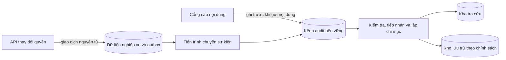

# Thực hành tổng hợp: thiết kế audit logging policy

## 1. Mục tiêu và sản phẩm cần bàn giao

**Audit logging policy** là tập quy tắc về những hành động phải được ghi nhận, dữ liệu được phép xuất hiện trong sự kiện, độ bền và khả năng tra cứu, quyền truy cập, vòng đời và cách xử lý khi ghi nhận thất bại.

Audit không chỉ là thêm một lệnh ghi log. Chính sách cần giúp trả lời ai đã yêu cầu, danh tính nào thực hiện, tài nguyên thuộc phạm vi nào, hệ thống đã quyết định gì, hiệu ứng nào thực sự hoàn tất và mức chắc chắn của bằng chứng đến đâu.

Bài thực hành yêu cầu tạo:

1. Phạm vi, mục đích, tài sản và câu hỏi điều tra cần hỗ trợ.
2. Danh mục sự kiện bắt buộc cùng ngữ nghĩa, nguồn và điều kiện phát sinh.
3. Schema có phiên bản, ví dụ sự kiện và quy tắc dữ liệu nhạy cảm.
4. Cam kết ghi bền vững, chuyển sự kiện, tra cứu và phát hiện khoảng trống.
5. Quyền đọc, tìm kiếm, xuất, quản trị và kết thúc giữ.
6. Chính sách lưu giữ, giữ đặc biệt, xóa và phục hồi.
7. Yêu cầu đo được, tiêu chí chấp nhận và truy vết tới bằng chứng kiểm thử.

Người học nên tự viết bản đầu trước khi đối chiếu với mẫu. Các thời hạn, dung lượng và định danh trong bài là giả định của bài tập, không phải thời hạn tuân thủ hoặc cấu hình an toàn chung.

Một chính sách tốt không khẳng định có thể ghi mọi chi tiết trong mọi lỗi. Nó nêu rõ bảo đảm trong mô hình lỗi nào, hành vi bảo vệ khi mất khả năng ghi và những khoảng trống phải được công khai.

## 2. Đề bài và những quyết định đã chốt

### 2.1. Bối cảnh nghiệp vụ

Nền tảng học tập phục vụ nhiều tổ chức. Người dùng đăng nhập, quản trị viên thay vai trò, nhân viên hỗ trợ nhận quyền tạm thời và người có quyền yêu cầu xuất báo cáo học viên.

API tạo tác vụ; worker đọc dữ liệu và tạo tệp; cổng tải cấp nội dung. Mỗi tác vụ và báo cáo thuộc đúng một tổ chức. Một người có thể có quyền ở A nhưng không có quyền ở B.

Hệ thống có kho nghiệp vụ, kênh tiếp nhận audit, kho tra cứu, kho lưu trữ dài hạn và quy trình phục hồi. Các thành phần có danh tính kỹ thuật riêng. Dữ liệu học viên, thông tin phiên, quyền, metadata và sự kiện audit đều là tài sản cần bảo vệ.

### 2.2. Mục đích sử dụng audit

| Mục đích | Câu hỏi chính sách phải hỗ trợ |
| --- | --- |
| Điều tra truy cập | Danh tính nào yêu cầu hoặc nhận dữ liệu, từ đường nào, theo quyền gì? |
| Quản lý đặc quyền | Ai cấp, sửa, thu hồi quyền; phạm vi, người phê duyệt và thời hạn là gì? |
| Xác minh ứng phó | Lệnh cô lập đã được tiếp nhận hay đã có hiệu lực trên những điểm nào? |
| Phân tích tác vụ nền | Người khởi tạo liên hệ với worker, tệp và lần cấp nội dung như thế nào? |
| Phát hiện khoảng trống | Nguồn nào ngừng gửi, sự kiện nào chưa được chuyển hoặc chưa tra cứu được? |
| Kiểm tra chính audit | Ai đọc, xuất, thay chính sách hoặc xóa dữ liệu audit? |

Log chẩn đoán có thể hỗ trợ tìm lỗi, còn chỉ số và trace có thể hỗ trợ quan sát hiệu năng. Chúng không tự thay audit nếu không đáp ứng ngữ nghĩa, độ bền, quyền và vòng đời của chính sách.

### 2.3. Hồ sơ chính sách mẫu

| Thuộc tính | Quyết định dùng trong bài |
| --- | --- |
| Sự kiện bắt buộc | Không sampling hoặc âm thầm bỏ sự kiện trong danh mục bắt buộc |
| Thay đổi quyền trong kho nghiệp vụ | Hiệu ứng và bản ghi audit ở outbox phải được ghi nguyên tử trong cùng giao dịch được hỗ trợ |
| Cấp nội dung báo cáo | Ghi bền vững quyết định cho phép phát hành trước khi gửi phần nội dung được bảo vệ đầu tiên |
| Độ trễ tra cứu mục tiêu | Tối đa 120 giây từ mốc ghi bền vững được quy định cho từng nguồn |
| Thời gian giữ thông thường | 180 ngày từ mốc tiếp nhận bền vững tại miền audit, nếu không có quyết định giữ đặc biệt |
| Phân tầng lưu | 30 ngày đầu tra cứu trực tiếp; phần thời hạn còn lại được lưu ở tầng phù hợp |
| Phục hồi tra cứu lưu trữ | Tối đa 4 giờ từ yêu cầu hợp lệ được tiếp nhận tới khi phạm vi yêu cầu có thể tra cứu |
| Quyền truy cập | Theo vai trò, hồ sơ điều tra và phạm vi tổ chức, có audit thao tác |
| Giữ đặc biệt | Có thẩm quyền, phạm vi, căn cứ, chủ trách nhiệm và điều kiện kết thúc |

Độ trễ 120 giây là cam kết cần thiết kế và kiểm chứng trên phạm vi vận hành đã chốt. Khi có sự cố làm vượt, phải ghi nhận vi phạm và xử lý; không giả định mục tiêu tự biến thành bảo đảm vô điều kiện trước mọi mất mát.

30 ngày tra cứu trực tiếp và 180 ngày giữ là hai giới hạn khác nhau. Không xóa dữ liệu ở ngày 30 chỉ vì nó rời tầng tra cứu nhanh. Cũng không giữ mọi dữ liệu vô hạn vì có một hồ sơ điều tra đang mở.

## 3. Xác định phạm vi sự kiện từ rủi ro

### 3.1. Liên kết rủi ro với nhu cầu bằng chứng

| Rủi ro | Dữ liệu cần biết | Nguồn cần xem |
| --- | --- | --- |
| R-AUD-01: truy cập sai tổ chức | Chủ thể, tổ chức yêu cầu, tổ chức sở hữu, tài nguyên và kết quả quyền | API, worker, cổng tải |
| R-AUD-02: lạm dụng hỗ trợ | Grant, người cấp và phê duyệt, phạm vi, thời hạn, người dùng quyền | Nguồn quyền và điểm thực thi |
| R-AUD-03: tác vụ không quy được người khởi tạo | Liên hệ yêu cầu, tác vụ, danh tính kỹ thuật và kết quả | API, hàng đợi, worker |
| R-AUD-04: báo cô lập hoàn tất sai | Lệnh, nguồn ghi nhận, hiệu lực từng điểm và lỗi | Dịch vụ phiên, quyền và các điểm cấp nội dung |
| R-AUD-05: sửa hoặc xóa dấu vết | Quyền quản trị, phiên bản chính sách, lịch sử thao tác | Miền audit và nơi ghi nhận quản trị độc lập phù hợp |
| R-AUD-06: log làm lộ dữ liệu | Trường sự kiện, nội dung lỗi, quyền tìm kiếm và xuất | Nguồn phát, bộ nhận, kho và công cụ hiển thị |
| R-AUD-07: mất quan sát nhưng không biết | Mốc tiến độ, độ trễ, khoảng thiếu và lỗi tiếp nhận | Outbox, pipeline, kho tra cứu |
| R-AUD-08: không đọc được bằng chứng khi cần | Dữ liệu, schema, khóa, cấu hình và quyền phục hồi | Kho dài hạn và quy trình phục hồi |

Không cần ghi toàn bộ nội dung báo cáo để biết báo cáo nào được cấp. Không cần lưu token để liên hệ một phiên nếu có định danh tham chiếu không cho phép đăng nhập.

### 3.2. Ghi rõ phần nằm ngoài cam kết

Chính sách cần xác định môi trường, thành phần và dữ liệu thuộc phạm vi. Việc một nhà cung cấp chỉ giữ một loại log trong thời hạn ngắn là phụ thuộc cần giải quyết, không phải lý do tự coi nguồn đó đã đáp ứng.

Nếu chưa có sự kiện ở một API cũ, ghi khoảng trống và hành động bổ sung. Nếu hệ thống thử nghiệm bị loại khỏi một cam kết, cần có căn cứ và kiểm soát để không đưa dữ liệu thật hoặc quyền thật vào đó trái quyết định.

## 4. Danh mục sự kiện và ngữ nghĩa

### 4.1. Chọn tên theo điều đã quan sát

| Nhóm sự kiện | Điều kiện phát sinh | Ý nghĩa và trường đặc thù |
| --- | --- | --- |
| identity.authentication.succeeded / failed | Có kết quả xác thực tại nguồn thuộc phạm vi | Phương thức hoặc mức được phép ghi, nguồn xác minh; không lưu bằng chứng bí mật |
| session.terminated | Kết thúc phiên được ghi nhận tại nguồn | Phiên tham chiếu, lý do, chủ thể ra lệnh; chưa tự chứng minh hiệu lực mọi điểm |
| authorization.decided | Có quyết định quyền thuộc danh mục nhạy cảm | Hành động, tài nguyên, kết quả cho phép hoặc từ chối và phiên bản chính sách |
| role.change.committed | Giao dịch đổi vai trò và outbox đã được ghi thành công | Chủ thể đích, phạm vi vai trò trước và sau theo danh mục được phép ghi |
| support.grant.requested / approved / revoked | Yêu cầu hoặc thay đổi grant xảy ra | Người yêu cầu, người nhận, người phê duyệt, hành động, phạm vi và thời hạn |
| export.request.accepted | Tác vụ được tạo theo hợp đồng | Người khởi tạo, tổ chức, phạm vi dữ liệu tham chiếu và tác vụ |
| export.processing.started / completed / failed | Worker chuyển trạng thái tương ứng | Danh tính thực thi, lần thử, tác vụ và tham chiếu kết quả hoặc lý do lỗi đã phân loại |
| report.release.authorized | Quyết định cho phép gửi nội dung đã được ghi bền vững | Chủ thể, báo cáo, đối tượng hoặc phiên bản và lần cấp nội dung |
| report.delivery.observed | Cổng tải ghi nhận kết quả truyền theo khả năng quan sát | Mức hoàn tất, số byte theo định nghĩa, lỗi nếu biết và liên hệ lần cấp |
| response.action.requested / observed | Có lệnh ứng cứu hoặc kết quả xác minh tại một điểm | Phạm vi, người ra lệnh, điểm thực thi và trạng thái có hiệu lực |
| audit.accessed / exported | Có thao tác đọc hoặc xuất thuộc chính sách | Người đọc, hồ sơ, phạm vi truy vấn hoặc xuất an toàn và kết quả |
| audit.policy.changed / retention.action | Có đổi cấu hình, quyết định giữ hoặc xử lý vòng đời | Phiên bản, thẩm quyền, phạm vi và kết quả |

Danh mục này là khung cho bài tập. Bản nộp phải nêu rõ những hành động nào bắt buộc phát `authorization.decided`, tránh cách viết khiến người triển khai tự chọn chỉ ghi những nhánh thuận tiện.

Các quyết định bị từ chối vẫn cần sự kiện theo danh mục. Khi hệ thống không ghi được, nó vẫn phải từ chối hành vi trái quyền, đồng thời báo mất khả năng quan sát qua đường đã thiết kế; không chuyển thành cho phép để tránh thiếu log.

### 4.2. Quyết định không đồng nghĩa hiệu ứng đã hoàn tất

`report.release.authorized` cho biết hệ thống cho phép một lần cấp nội dung, không chứng minh người nhận đã có toàn bộ tệp. `report.delivery.observed` chỉ mô tả điều cổng tải quan sát được; số byte do máy chủ báo không tự chứng minh một người đã đọc hoặc sử dụng dữ liệu.

`role.change.committed` phải gắn với kết quả giao dịch thực sự thành công. Không phát nó trước một thay đổi có thể rollback rồi để báo cáo coi quyền đã đổi. Nếu cần sự kiện yêu cầu hoặc ý định trước đó, dùng tên và ngữ nghĩa riêng.

Tương tự, `session.terminated` tại nguồn và kết quả xác minh cô lập trên từng điểm là các sự kiện khác nhau. Không dùng một lệnh được gửi thành công như bằng chứng mọi cache hoặc đường tải đã ngừng cấp dữ liệu.

### 4.3. Mức độ ưu tiên, hành động và kết quả là các thuộc tính khác nhau

Một sự kiện từ chối có thể là hành vi bình thường hoặc dấu hiệu cần điều tra; một sự kiện thành công cũng có thể quan trọng. Không mã hóa mọi thất bại thành mức nghiêm trọng cao nhất và mọi thành công thành mức thấp.

Giữ `event_type`, `decision`, `operation_outcome` và `severity` theo schema rõ. Nếu một trường không áp dụng cho loại sự kiện, quy định cách bỏ hoặc dùng giá trị được kiểm soát; không tạo từ ngữ tự do khó truy vấn.

## 5. Schema sự kiện có phiên bản

### 5.1. Ví dụ một quyết định cấp nội dung

```json
{
  "schema_version": 1,
  "event_id": "ev-204",
  "event_type": "report.release.authorized",
  "event_time": "2030-01-01T09:00:05.120Z",
  "source": "report-gateway",
  "source_instance": "gateway-2",
  "initiator_id": "user-17",
  "effective_principal_id": "svc-report-reader",
  "session_reference": "session-display-82",
  "requesting_tenant_id": "org-A",
  "resource_owner_tenant_id": "org-A",
  "resource_type": "report",
  "resource_id": "report-51",
  "resource_version": "version-3",
  "action": "report.download",
  "decision": "allow",
  "reason_code": "EXPORT_POLICY_SATISFIED",
  "policy_version": "authorization-12",
  "correlation_id": "req-582",
  "release_attempt_id": "release-9"
}
```

Đây là dữ liệu thử. `session_reference` phải là định danh không có quyền truy cập, không phải mã phiên được trình duyệt dùng để xác thực. Các định danh người dùng, tổ chức và tài nguyên vẫn có thể là dữ liệu nhạy cảm cần quyền đọc phù hợp.

Kênh tiếp nhận bổ sung metadata riêng như thời điểm tiếp nhận, nguồn đã xác minh, kết quả kiểm tra schema và vị trí lưu. Không để bên gửi giả trường metadata của bên nhận rồi làm nó trông như thông tin đã được xác nhận độc lập.

### 5.2. Những trường cần định nghĩa

| Trường hoặc nhóm | Quy tắc cần ghi |
| --- | --- |
| event_id | Định danh duy nhất theo cơ chế được chọn; cùng sự kiện thử chuyển lại giữ cùng ID |
| event_type, schema_version | Có danh mục, ý nghĩa, trường bắt buộc và cách xử lý phiên bản |
| event_time | Thời điểm theo nguồn; nguồn thời gian, múi giờ và độ phân giải được biết |
| received_at, indexed_at | Do lớp thu nhận hoặc tra cứu ghi; không ghi đè thời điểm nguồn |
| initiator_id | Chủ thể khởi tạo nghiệp vụ nếu xác lập được; không suy từ danh tính worker |
| effective_principal_id | Danh tính kỹ thuật thực thi, khác với quyền nghiệp vụ |
| Các trường tenant | Nêu trường nào do nguồn có thẩm quyền xác định, trường nào chỉ là đầu vào đề xuất |
| resource_id, resource_version | Tài nguyên thực sự được quyết định hoặc tác động |
| decision, reason_code | Giá trị có kiểm soát; không nhúng toàn bộ dữ liệu đầu vào vào lý do |
| correlation_id | Liên hệ luồng, không tạo quyền và không tự chứng minh nhân quả |
| attempt_id | Phân biệt lần nghiệp vụ hoặc lần thực hiện, khác số lần chuyển cùng sự kiện |
| policy_version | Phiên bản quy tắc được dùng, khi nguồn có khả năng xác định |

Khi chưa xác minh được chủ thể trong một lần xác thực thất bại, không gắn định danh tài khoản do người gọi khai thành danh tính đã xác nhận. Nếu cần giữ đầu vào đó, dùng trường có ngữ nghĩa rõ và giới hạn dữ liệu phù hợp.

### 5.3. Ràng buộc dữ liệu và thay đổi schema

Đặt độ dài, kiểu, tập giá trị và giới hạn kích thước cho từng trường. Dữ liệu do người dùng kiểm soát phải được đánh dấu về nguồn, kiểm tra và trình bày an toàn. JSON có cấu trúc giúp tránh một số nhầm lẫn nhưng không tự làm mọi giá trị an toàn trên giao diện hoặc khi xuất.

Schema mới phải có cách đọc dữ liệu cũ, kiểm thử tương thích và mốc triển khai. Nếu trường mới cần cho điều tra nhưng một nguồn cũ chưa phát, ghi độ bao phủ một phần; không giả định phiên bản parser mới đã tạo lại được dữ liệu quá khứ.

Sự kiện sai schema không được âm thầm mất. Cần nơi xử lý bị từ chối hoặc cách giữ có kiểm soát, cảnh báo và chính sách sửa hoặc chuyển lại; nơi đó cũng có thể chứa dữ liệu nhạy cảm và cần vòng đời riêng.

## 6. Độ bền và tính nhất quán với hiệu ứng nghiệp vụ

### 6.1. Mô hình truyền sự kiện



Outbox là bản ghi chờ chuyển sự kiện nằm trong cùng giao dịch bền vững với thay đổi nghiệp vụ theo khả năng của kho. Nó giúp tránh tình huống quyền đã đổi nhưng sự kiện tương ứng chưa từng được ghi. Nó không tự chứng minh đã chuyển tới kho tra cứu hoặc đã có bản sao độc lập với kho nguồn.

### 6.2. Thay đổi quyền trong giao dịch

Với thay vai trò hoặc grant trong bài tập:

1. Xác minh điều kiện quyền và dữ liệu cần thiết.
2. Trong giao dịch phù hợp, thực hiện thay đổi và thêm sự kiện kết quả vào outbox.
3. Chỉ xác nhận thành công khi giao dịch được ghi thành công theo hợp đồng độ bền.
4. Nếu không thể giữ cả hiệu ứng lẫn sự kiện, rollback theo ngữ nghĩa giao dịch.
5. Chuyển sự kiện sang miền audit bằng cơ chế thử lại và theo dõi tiến độ.

Không cần chờ một thao tác ghi độc lập ở kho audit từ xa rồi coi hai kho đã tự nguyên tử. Nếu thiết kế dùng hai nơi ghi không có giao thức nhất quán tương ứng, phải phân tích các cửa sổ lỗi và đưa ra cam kết phù hợp.

Thời điểm bắt đầu tính độ trễ 120 giây của nguồn này là mốc giao dịch bền vững đã chốt, không phải khi tiến trình chuyển sự kiện cuối cùng mới chạy.

### 6.3. Đọc và cấp nội dung không có giao dịch rollback tương tự

Với cổng tải, ghi bền vững `report.release.authorized` theo hợp đồng trước khi gửi byte nội dung được bảo vệ đầu tiên. Nếu không đạt điều kiện ghi trong thời gian chờ đã đặc tả, không bắt đầu gửi nội dung.

Sau đó ghi quan sát kết quả truyền theo khả năng thực tế. Tiến trình có thể dừng sau khi đã gửi một phần nhưng trước lúc ghi sự kiện kết quả. Trường hợp đó phải là kết quả chưa biết hoặc chưa đầy đủ, không được tự chuyển thành chưa truyền gì.

Không thể rollback dữ liệu đã rời hệ thống như rollback một giao dịch dữ liệu nội bộ. Chính sách phải phản ánh giới hạn này thay vì hứa có một bản ghi hoàn tất chắc chắn cho mọi lần truyền trong mọi lỗi.

### 6.4. Định nghĩa ghi bền vững và mô hình lỗi

Hồ sơ thiết kế phải nói xác nhận bền vững có ý nghĩa gì: vị trí, cơ chế lưu, bản sao và loại lỗi được bảo vệ. Ví dụ, thiết kế có thể cam kết giữ sau khi một nút xử lý bị mất trong miền đã chọn, nhưng chưa bao phủ mất toàn bộ vùng triển khai.

Ghi vào bộ đệm bộ nhớ hoặc chỉ gọi hàm gửi không tự đáp ứng cam kết bền vững. Cũng không dùng từ “không thể mất” nếu chưa xác định mô hình lỗi và phụ thuộc.

Quyền của tài khoản ứng dụng với outbox, kho audit và lịch sử quản trị cần được giới hạn. Nếu một chủ thể có thể sửa dữ liệu lẫn mọi dấu vết liên quan, cơ chế ghi nguyên tử riêng lẻ chưa xử lý được rủi ro xóa dấu vết chủ động.

## 7. Chuyển sự kiện, thứ tự và phát hiện khoảng trống

### 7.1. Chấp nhận chuyển lặp, không giả định đúng một lần

Thiết kế có thể chuyển ít nhất một lần trong các điều kiện đã chọn: cùng sự kiện được gửi lại khi mất phản hồi. Cần giữ `event_id` qua các lần chuyển đó, còn lần thử nghiệp vụ mới có định danh tương ứng riêng.

Kho hoặc lớp lập chỉ mục phải có quy tắc xử lý trùng phù hợp để một sự kiện được chuyển hai lần không tự trở thành hai hành động nghiệp vụ. Không dùng chỉ số lượng bản ghi thô làm số lần tải hoặc số lần đổi quyền khi chưa xét điều này.

Nếu cùng ID nhưng nội dung khác nhau, không âm thầm ghi đè. Cần xử lý xung đột, giữ bằng chứng phù hợp và báo lỗi để xác định nguồn dữ liệu hoặc triển khai có vấn đề.

Chống trùng sự kiện không tự làm nghiệp vụ có tính idempotent. Tác vụ bị thực hiện hai lần có thể cần hai quan sát thực tế; chính sách cần phân biệt lặp chuyển dữ liệu với lặp hiệu ứng nghiệp vụ.

### 7.2. Thứ tự và thời gian

Giữ `event_time`, `received_at` và `indexed_at` riêng. Sự kiện đến muộn không được đổi thời điểm nguồn để trông như vừa xảy ra. Chuyển về UTC giúp biểu diễn nhất quán nhưng không tự sửa một đồng hồ sai.

Khi tính độ trễ, cần nguồn thời gian và giới hạn sai lệch đủ để đánh giá. Không lấy hai đồng hồ không được kiểm soát rồi diễn giải chênh lệch như phép đo chính xác.

Định danh tương quan giúp nối luồng nhưng không tự chứng minh thứ tự hoặc quan hệ nhân quả. Có thể cần số thứ tự theo nguồn, phiên bản trạng thái hoặc quan hệ cha–con. Nếu nguồn khởi động lại làm thay miền số thứ tự, phải ghi định danh thế hệ hoặc quy tắc tương ứng.

Không ép hai sự kiện gần nhau từ hai nguồn thành thứ tự chắc chắn nếu độ bất định thời gian lớn hơn khoảng chênh lệch.

### 7.3. Chuyển chậm, mất nguồn và dữ liệu bị từ chối

Cần theo dõi số lượng chờ, tuổi bản ghi lâu nhất, mốc tiến độ, lỗi chuyển, lỗi schema, khả năng ghi kho và độ trễ lập chỉ mục. Ngưỡng cảnh báo phải gắn với khả năng can thiệp trước khi vi phạm mục tiêu hoặc hết dung lượng.

Để kiểm tra luồng đầu cuối, có thể phát sự kiện thử được nhận diện rõ và xác nhận tra cứu được. Một heartbeat từ tiến trình không chứng minh sự kiện bắt buộc của ứng dụng đang đi hết đường.

Số thứ tự có thể giúp phát hiện khoảng trống trong một miền được định nghĩa, nhưng không chứng minh nguồn đã tạo mọi sự kiện cần có. Phải đối chiếu với giao dịch, outbox hoặc hành vi thử có căn cứ.

Khi phát hiện khoảng thiếu, ghi nguồn, phạm vi thời gian biết được, mức chắc chắn, cách khôi phục và người xử lý. Không điền dữ liệu suy đoán như thể đó là sự kiện gốc.

### 7.4. Khi kênh đầy hoặc lỗi kéo dài

Không âm thầm sampling sự kiện bắt buộc. Thiết kế cần có ngưỡng dung lượng, kiểm soát tốc độ, backpressure và hành vi khi không thể bảo đảm ghi.

Trong bài tập:

- Thay đổi quyền không ghi được sự kiện nguyên tử thì không xác nhận thay đổi thành công.
- Cấp nội dung không ghi được sự kiện cho phép bền vững thì không bắt đầu gửi nội dung.
- Yêu cầu trái quyền vẫn bị từ chối dù ghi sự kiện từ chối gặp lỗi.
- Vi phạm khả năng ghi phải được báo qua đường vận hành được thiết kế độc lập phù hợp.
- Mất audit không được làm hệ thống thử lại vô hạn hoặc tạo tải vượt kiểm soát.

Sự kiện lỗi không nên tự tạo vòng lặp sinh log không giới hạn. Quy định cách gom tín hiệu vận hành lặp lại nếu cần, nhưng không gọi việc gom đó là giữ đủ các sự kiện nghiệp vụ bắt buộc đã bị bỏ.

## 8. Bảo vệ dữ liệu và tính toàn vẹn

### 8.1. Cho phép trường cần thiết, loại bí mật từ nguồn

Danh mục trường được phép cần được kiểm soát theo từng loại sự kiện. Ưu tiên định danh nội bộ và mã lý do thay vì sao chép nguyên yêu cầu, phản hồi, nội dung báo cáo hoặc stack trace chứa dữ liệu vào audit.

Không ghi mật khẩu, token xác thực, mã phiên có khả năng truy cập, khóa bí mật hoặc đường dẫn mang bí mật cấp nội dung. Việc mã hóa kho audit không làm những dữ liệu này trở nên được phép ghi.

Tên, địa chỉ liên hệ, IP và dấu hiệu thiết bị cũng cần mục đích, phạm vi và thời hạn phù hợp nếu được giữ. Định danh được giả danh hóa vẫn có thể liên kết tới một người; không tự coi đó là dữ liệu không cần bảo vệ.

### 8.2. Dữ liệu người gọi không được giả metadata đáng tin cậy

Nếu nhận định danh tương quan từ bên ngoài, kiểm tra định dạng và độ dài, đồng thời giữ phân biệt với định danh do máy chủ cấp. Không để trường người dùng tự gửi ghi đè danh tính đã xác minh, tổ chức sở hữu hoặc nguồn tiếp nhận.

Lý do từ chối và thông báo lỗi nên dùng mã được kiểm soát. Nội dung tự do cần được giới hạn và xử lý an toàn ở nơi hiển thị hoặc xuất. Ký tự điều khiển, xuống dòng và dữ liệu có thể bị công cụ đích diễn giải phải có ca kiểm thử phù hợp.

Nếu che hoặc biến đổi dữ liệu tại bộ nhận, phải biết điều gì đã mất và vì sao. Không che một bí mật ở giao diện rồi để bản thô vẫn được sao chép vào nơi nhiều người đọc.

### 8.3. Toàn vẹn và khả năng quy trách nhiệm

Xác minh nguồn phát, giới hạn quyền ghi, bảo vệ lịch sử quản trị và kiểm soát việc sửa hoặc xóa. Có thể dùng cơ chế kiểm tra toàn vẹn, manifest hoặc lưu trữ chống ghi đè theo thiết kế và mô hình đe dọa đã chọn.

Một digest giúp kiểm tra thay đổi của bản byte được lấy làm tham chiếu khi giá trị tham chiếu được bảo vệ phù hợp. Nó không tự chứng minh nguồn chưa bị kiểm soát trước khi tạo sự kiện, hoặc mọi hành động đều đã được ghi.

Chữ ký hoặc cơ chế nối sự kiện cũng phụ thuộc khóa, quyền và trạng thái. Không ghi “không thể chối bỏ” như một thuộc tính tuyệt đối chỉ vì có hash. Chính sách cần chỉ ra hệ thống hỗ trợ quy trách nhiệm tới mức nào và phần nào cần nguồn đối chiếu.

### 8.4. Thu thập bằng chứng trong sự cố

Khi xuất dữ liệu phục vụ điều tra, giữ hiện vật, nguồn, phạm vi truy vấn, thời điểm, công cụ, người thực hiện và các giới hạn hoặc lỗi. Dữ liệu dẫn xuất, như bản che hoặc bảng đã chuẩn hóa, cần liên hệ tới bản đã thu.

Không sửa bản đã thu để các mốc thời gian trông khớp nhau. Nếu chuẩn hóa, giữ quy tắc và mức bất định. Không thấy sự kiện phải được diễn giải cùng độ bao phủ của nguồn, không tự là bằng chứng không có hành vi.

## 9. Quyền truy cập và vòng đời

### 9.1. Ma trận quyền mẫu

| Vai trò | Được làm | Giới hạn |
| --- | --- | --- |
| Dịch vụ phát sự kiện | Gửi loại sự kiện được cấp cho nguồn | Không tự đọc, sửa hoặc xóa toàn kho |
| Dịch vụ tiếp nhận | Kiểm tra, ghi và trả trạng thái theo chức năng | Không có quyền nghiệp vụ để xuất báo cáo học viên |
| Người vận hành pipeline | Xem trạng thái, lỗi, dung lượng và metadata cần thiết | Không mặc nhiên đọc nội dung mọi sự kiện |
| Người điều tra | Tìm và đọc theo hồ sơ, phạm vi được cấp | Không tự mở rộng sang tổ chức hoặc thời gian ngoài quyền |
| Người xuất bằng chứng | Tạo bản xuất theo quyền riêng nếu được cấp | Ghi mục đích, phạm vi, nơi nhận và kết quả |
| Người quản lý vòng đời | Thực hiện giữ hoặc xóa theo quyết định | Không tự thay căn cứ hoặc xóa lịch sử quản trị |
| Người duyệt chính sách | Phê duyệt thay đổi trong thẩm quyền | Không dùng nhãn phê duyệt thay bằng chứng thực thi |

Một người có thể giữ nhiều vai trò, nhưng sự kết hợp quyền và rủi ro cần được đánh giá. Đọc audit của tổ chức mình không đồng nghĩa có quyền xem danh tính hoặc hành động của tổ chức khác trên một giao dịch bị từ chối.

Audit của việc đọc hoặc xuất không nên tạo vòng đệ quy vô hạn. Chính sách chọn những thao tác truy cập cần ghi và cách ghi theo lớp; không yêu cầu mỗi lần bộ tiếp nhận thêm sự kiện phải phát tiếp một sự kiện cùng loại không có điểm dừng.

### 9.2. Thời hạn và chuyển tầng

Trong hồ sơ bài tập, mốc giữ thông thường là thời điểm tiếp nhận bền vững tại miền audit do hệ thống quản lý, không phải thời điểm người gọi tự khai. Phải giữ thời điểm nguồn riêng để điều tra.

Ở ngày 30, dữ liệu có thể rời tầng tra cứu trực tiếp nhưng vẫn phải được tìm và khôi phục truy vấn trong mục tiêu 4 giờ của phạm vi được yêu cầu hợp lệ. Manifest hoặc catalog cần liên hệ tới đối tượng lưu và schema tương ứng.

Mốc 180 ngày xác định hết thời hạn giữ thông thường và chuyển sang xử lý kết thúc giữ. Bài tập chọn dọn khỏi các bản sao phục vụ tra cứu và lưu trữ đang hoạt động trong tối đa 24 giờ tiếp theo nếu không có quyết định giữ hợp lệ. Như vậy, 180 ngày không được mô tả sai thành cam kết mọi byte ở mọi nơi biến mất ngay tại mốc đó.

Bản sao phục hồi phải có chính sách riêng về khả năng giữ dữ liệu đã hết hạn, quyền đọc và cách áp lại quyết định xóa khi khôi phục. Nếu chưa xác định được các giới hạn đó, ghi phần vòng đời bản sao chưa hoàn tất; không tuyên bố đã xóa ở mọi bản sao.

### 9.3. Giữ đặc biệt và kết thúc giữ

Quyết định giữ đặc biệt cần có định danh, căn cứ, người có thẩm quyền, phạm vi, ngày bắt đầu, người theo dõi và điều kiện kết thúc. Cơ chế xóa phải kiểm tra trạng thái giữ đủ nhất quán để tránh xóa đúng lúc quyết định đã có hiệu lực.

Khi kết thúc giữ, đánh giá lại thời hạn thông thường. Không mặc định gia hạn thêm 180 ngày chỉ vì vừa gỡ trạng thái giữ. Nếu thời hạn đã qua, áp dụng hành vi kết thúc giữ theo chính sách.

Thay đổi quyết định, thao tác xóa và việc không thể xóa đủ phạm vi phải được ghi nhận. Không tạo một cờ giữ vĩnh viễn không người chịu trách nhiệm.

### 9.4. Những giá trị phải được xác nhận trong dự án thật

Thời hạn 180 ngày, 30 ngày, 24 giờ và 4 giờ là dữ liệu của bài tập. Người có trách nhiệm cần xác nhận mục đích, nhu cầu điều tra, chi phí, nghĩa vụ và giới hạn nhà cung cấp trước khi chọn cho sản phẩm.

Không tự đưa một thời hạn pháp lý hoặc hợp đồng chung vào mọi loại sự kiện. Cũng không giảm thời hạn chỉ vì kho hiện tại thiếu dung lượng mà không có quyết định và đánh giá tác động.

## 10. Điều tra, tra cứu và phục hồi

### 10.1. Các truy vấn nghiệp vụ cần hỗ trợ

Bản nộp cần chỉ ra cách người có quyền trả lời:

- Người dùng hoặc grant nào được dùng để yêu cầu và tải một báo cáo?
- Quyền được cấp hoặc thu hồi bởi ai, theo phạm vi và phiên bản chính sách nào?
- Worker nào xử lý, có thử lại không, đầu ra được công bố dưới phiên bản nào?
- Lần cấp nội dung nào được phép, quan sát truyền cho biết gì và phần nào còn chưa biết?
- Thời điểm nào nguồn ngừng gửi hoặc dữ liệu không thể tra cứu?
- Ai đã đọc, xuất hoặc thay chính sách giữ sự kiện liên quan?

Truy vấn phải giữ ranh giới tổ chức và quyền hồ sơ, kể cả khi lọc theo định danh tương quan có sự kiện của nhiều tổ chức. Công cụ tổng hợp hoặc số lượng kết quả cũng không được tự làm lộ phạm vi ngoài quyền.

### 10.2. Phục hồi khả năng đọc bằng chứng

Diễn tập cần dữ liệu, catalog, schema, cấu hình, khóa và danh tính cần thiết. Khôi phục các đối tượng mà không thể giải mã hoặc hiểu trường không đáp ứng mục tiêu tra cứu.

Sau phục hồi, phải áp lại quyền hiện hành, quyết định giữ và xóa, thay vì khôi phục toàn bộ quyền đọc cũ như thể chúng còn hợp lệ. Bản sao trước lúc một người bị thu hồi quyền không được làm người đó truy cập lại.

Đo 4 giờ từ mốc yêu cầu phục hồi tra cứu hợp lệ được tiếp nhận tới khi phạm vi cần thiết có thể được người có quyền truy vấn. Thời hạn đó không phải mục tiêu phục hồi toàn nền tảng hoặc mọi kịch bản mất vùng.

### 10.3. Báo cáo độ bao phủ và sự không chắc chắn

Nếu một nguồn không gửi trong một khoảng, công cụ cần cho người điều tra biết khi có thông tin đáng tin cậy về khoảng đó. Không trình bày một tập kết quả trống như kết luận chắc chắn không có hành động.

Thời gian nguồn, kết quả truyền và quan hệ danh tính đều có giới hạn. Báo cáo phải phân biệt sự thật đã quan sát, suy luận và câu hỏi cần xác minh. Một token hoặc phiên được dùng không tự xác định con người thực sự đang điều khiển nó.

## 11. Chuyển chính sách thành yêu cầu đo được

| Yêu cầu | Cam kết | Phương pháp xác minh |
| --- | --- | --- |
| AL-01 | Các hành động trong danh mục bắt buộc tạo đúng loại sự kiện và trường theo schema | Tạo chuỗi hành động hợp lệ, từ chối và lỗi qua API, worker, cổng tải |
| AL-02 | Metadata nguồn, chủ thể và phạm vi không bị thay bằng giá trị người gọi giả | Kiểm thử trường giả, nguồn không có quyền và đối chiếu quan hệ hệ thống |
| AL-03 | Thay đổi quyền và sự kiện outbox có ngữ nghĩa giao dịch nguyên tử theo thiết kế | Kiểm tra lỗi trước, trong, sau commit và quan sát cả dữ liệu lẫn sự kiện |
| AL-04 | Không gửi nội dung bảo vệ trước xác nhận audit bền vững cần thiết | Thử timeout, lỗi kênh ghi, dừng tiến trình và quan sát đầu ra |
| AL-05 | Chuyển lại sự kiện không làm tăng sai số hành động; xung đột cùng ID không bị ghi đè âm thầm | Gửi lặp, mất phản hồi và cùng ID khác nội dung |
| AL-06 | Độ trễ tra cứu không quá 120 giây theo mốc nguồn và điều kiện đã chốt; vi phạm được phát hiện | Đo từ commit hoặc xác nhận bền vững đúng loại nguồn, cùng tải và lỗi liên quan |
| AL-07 | Không có bí mật hoặc nội dung bị cấm trong sự kiện, lỗi và kho xử lý từ chối | Dữ liệu thử có thể nhận diện, kiểm tra các lớp lưu, hiển thị và xuất |
| AL-08 | Quyền đọc, xuất, quản trị và xóa giữ đúng phạm vi, có dấu vết phù hợp | Kiểm thử vai trò, hồ sơ, tổ chức và đường khẩn cấp |
| AL-09 | Giữ, chuyển tầng, kết thúc giữ và xóa đáp ứng mốc cùng quyết định có thẩm quyền | Điều khiển thời gian, thử giữ đồng thời với xóa và kiểm tra bản sao thuộc phạm vi |
| AL-10 | Bằng chứng, metadata và quyền phục hồi đáp ứng mục tiêu tra cứu trong phạm vi | Diễn tập dữ liệu lưu dài hạn, khóa, schema và trạng thái quyền cũ |

Mỗi hàng cần được triển khai thành bản ghi đầy đủ, có nguồn rủi ro, phạm vi, người phụ trách, tham số và hành vi lỗi. Không dùng một ô “ghi log đầy đủ” làm tiêu chí cho cả mười yêu cầu.

### 11.1. Ví dụ tiêu chí cho AL-03

```text
Cho trước:
  - Quản trị viên có quyền thay vai trò của thành viên trong tổ chức A.
  - Thay đổi và sự kiện outbox được thiết kế trong cùng giao dịch.

Khi:
  - Gây lỗi có kiểm soát tại các điểm trước và sau commit.

Thì:
  - Không có trạng thái commit thành công mà thiếu sự kiện outbox tương ứng.
  - Không có sự kiện kết quả commit bị công bố như thành công cho giao dịch rollback.
  - Thử chuyển lại không làm xuất hiện thêm một hành động thay vai trò giả.
  - Phản hồi không xác định do mất kết nối được xử lý bằng định danh thao tác
    và tra trạng thái theo hợp đồng, không bị suy thành chắc chắn thất bại.
```

Ca này kiểm chứng ngữ nghĩa cụ thể của thiết kế. Nó không tự chứng minh kho nguồn và kho audit không thể cùng bị quản trị viên đặc quyền sửa trái phép; AL-08 và đánh giá toàn vẹn xử lý phần đó.

### 11.2. Truy vết hai chiều

```text
R-AUD-03: không quy được tác vụ cho người khởi tạo
  -> Chính sách danh tính và tương quan
  -> AL-01, AL-02, AL-05
  -> API, hàng đợi, worker, cổng tải và bộ nhận
  -> Ca tạo, thử lại, tải và từ chối
  -> Bằng chứng schema, sự kiện, phiên bản và phạm vi
```

Từ một sự kiện cần tìm được cam kết mà nó đáp ứng; từ một yêu cầu cần biết nguồn nào còn thiếu. Số nguồn đã bật log không thay cho độ bao phủ theo hành động và ngữ nghĩa.

## 12. Bộ kiểm thử và diễn tập cần có

| Ca | Tình huống | Điều phải quan sát |
| --- | --- | --- |
| TC-AL-01 | Người hợp lệ tạo tác vụ và tải báo cáo | Đúng chuỗi danh tính, tổ chức, tài nguyên, quyết định và quan sát kết quả |
| TC-AL-02 | Người A tham chiếu tài nguyên thật của B | Từ chối không lộ nội dung; sự kiện không trao quyền đọc chéo audit cho A |
| TC-AL-03 | Worker thử lại sau mất phản hồi | Giữ khác biệt giữa chuyển lặp cùng sự kiện và lần nghiệp vụ thực sự mới |
| TC-AL-04 | Giao dịch đổi vai trò rollback | Không có kết quả commit giả; trạng thái nghiệp vụ và outbox nhất quán |
| TC-AL-05 | Không nhận được xác nhận bền vững trước tải | Không gửi nội dung; hồ sơ thể hiện đúng phần chưa biết hoặc thất bại |
| TC-AL-06 | Tiến trình dừng sau khi gửi một phần dữ liệu | Không báo chắc chắn chưa truyền; liên hệ được quyết định cho phép và quan sát có được |
| TC-AL-07 | Sự kiện đến muộn, trùng, sai schema hoặc thiếu một đoạn | Không âm thầm bỏ, có mốc tiến độ, lỗi và trạng thái độ bao phủ |
| TC-AL-08 | Chuỗi đầu vào có token thử, xuống dòng hoặc nội dung điều khiển | Không lộ bí mật, giả metadata hoặc tạo bản ghi và hiển thị sai |
| TC-AL-09 | Người vận hành, điều tra và xuất có quyền khác nhau | Đúng phạm vi, không tự mở rộng và có audit thao tác quản trị |
| TC-AL-10 | Chạm ngày 30, ngày 180 và thời hạn dọn | Chuyển tầng và kết thúc giữ đúng ngữ nghĩa, không xóa trước hạn hoặc giữ vô căn cứ |
| TC-AL-11 | Quyết định giữ có hiệu lực khi lịch xóa sắp chạy | Không xóa trái quyết định; gỡ giữ không tự gia hạn vô hạn |
| TC-AL-12 | Khôi phục kho dài hạn sau mất tầng tra cứu | Dữ liệu đọc được, toàn vẹn phù hợp, schema và quyền hiện hành hoạt động |

### 12.1. Bằng chứng cần lưu

Ghi phiên bản chính sách, danh mục sự kiện, schema, bản dựng, cấu hình, môi trường, dữ liệu thử, điều kiện tải hoặc lỗi và kết quả. Dùng dữ liệu thử nhận diện được, không đưa bí mật thật vào báo cáo để chứng minh khả năng phát hiện.

Với thời hạn, dùng đồng hồ điều khiển được cho logic và kiểm tra tích hợp mốc thực tế ở các điểm liên quan. Với độ trễ đầu cuối, cần đo được sai lệch và có căn cứ cho phạm vi tải, dung lượng và thời gian phụ thuộc được thiết kế hỗ trợ.

Phân biệt đạt, không đạt, chưa chạy, bị chặn và đạt một phần. Một mẫu sự kiện đúng không chứng minh mọi nguồn, mọi nhánh lỗi và vòng đời đều đúng.

### 12.2. Điều kiện xem lại

Cập nhật khi có hành động mới, API mới, đường tải khác, thay schema, nguồn quyền, cơ chế outbox, kho audit, khóa hoặc chính sách giữ. Sự cố và kết quả diễn tập làm sai giả định cũng phải quay lại yêu cầu.

Bằng chứng cũ chỉ tiếp tục dùng được trong phần có đánh giá tác động phù hợp. Không tự giữ trạng thái xanh sau khi thay cấu hình hoặc quyền quản trị ảnh hưởng kết luận.

## 13. Tự đánh giá và những lỗi phổ biến

### 13.1. Thang điểm minh họa

| Nhóm tiêu chí | Điểm tối đa | Dấu hiệu bài làm tốt |
| --- | --- | --- |
| Mục đích và phạm vi | 15 | Câu hỏi điều tra, tài sản, nguồn và phần còn thiếu rõ |
| Sự kiện và schema | 25 | Ngữ nghĩa nhất quán, đủ danh tính, dữ liệu tối thiểu và có phiên bản |
| Độ bền, chuyển và lỗi | 25 | Tách commit, quyết định, truyền, thử lại và khoảng trống |
| Quyền và vòng đời | 20 | Có phạm vi, giữ, xóa, toàn vẹn, khóa và phục hồi |
| Kiểm chứng, truy vết | 15 | Có ca thử, bằng chứng và giới hạn kết luận |

Điểm tổng không thay yêu cầu cốt lõi. Một chính sách ghi nhiều trường nhưng chứa mã phiên có thể phát lại, hoặc báo thay đổi thành công khi thiếu sự kiện bắt buộc, vẫn cần sửa trước khi kết luận đáp ứng.

### 13.2. Các lỗi cần tránh

| Biểu hiện | Vấn đề | Cách sửa |
| --- | --- | --- |
| Ghi toàn bộ request và response | Dễ lộ bí mật, dữ liệu ngoài mục đích | Danh mục trường được phép theo sự kiện |
| Chỉ ghi action và user | Không rõ tài nguyên, tổ chức, danh tính kỹ thuật và kết quả | Schema có ngữ nghĩa và nguồn cho từng trường |
| Gọi hàm gửi là đã bền vững | Dữ liệu có thể chỉ ở bộ nhớ hoặc chưa được nhận | Định nghĩa điểm xác nhận và mô hình lỗi |
| Quyền đã đổi rồi mới cố gửi log | Có cửa sổ mất dấu vết kết quả | Giao dịch với outbox hoặc cơ chế nhất quán phù hợp |
| Ghi success trước thay đổi có thể rollback | Sự kiện không phản ánh hiệu ứng | Tách ý định và kết quả, ràng buộc commit |
| Authorized đồng nghĩa đã tải xong | Vượt khả năng quan sát | Tách quyết định phát hành và quan sát truyền |
| Chuyển lại tạo event ID mới | Dễ đếm sai số hành động | Giữ ID cùng sự kiện, phân biệt attempt nghiệp vụ |
| Hash nên không thể phủ nhận | Bỏ nguồn gốc, khóa và quyền sửa lịch sử | Đánh giá toàn bộ chuỗi bằng chứng |
| Log lỗi ghi vào chính nơi đang hỏng mà không có đường khác | Mất quan sát không được nhận biết | Thiết kế tín hiệu dự phòng phù hợp |
| 180 ngày nghĩa mọi byte tự biến mất đúng mốc | Không xét dọn, bản sao và giữ đặc biệt | Định nghĩa mốc, hành vi hoàn tất và từng phạm vi |
| Phục hồi cả quyền cũ | Có thể tái mở dữ liệu cho người đã mất quyền | Áp lại quyền và quyết định vòng đời hiện hành |
| Không có sự kiện nên không có truy cập | Có thể nguồn hoặc pipeline đã mất dữ liệu | Báo độ bao phủ và phần chưa biết |

## 14. Cách thực hành và điều kiện bàn giao

### 14.1. Các bước tự thực hiện

1. Chọn phạm vi và câu hỏi điều tra cho luồng xuất cùng quản lý quyền.
2. Liệt kê sự kiện bắt buộc, hành động từ chối và nguồn phát.
3. Phân biệt ý định, quyết định, commit và quan sát hiệu ứng.
4. Viết schema, nguồn có thẩm quyền, trường cấm và giới hạn dữ liệu.
5. Chọn điểm ghi bền vững cho từng loại hành động và định nghĩa mô hình lỗi.
6. Đặc tả chuyển lại, chống trùng, xung đột, thứ tự và độ trễ.
7. Lập ma trận quyền đọc, xuất, quản trị, giữ và xóa.
8. Chọn vòng đời và ghi phần bản sao hoặc nghĩa vụ cần xác nhận.
9. Viết yêu cầu đo được, tiêu chí và ca lỗi có khả năng phân biệt đúng sai.
10. Diễn tập một chuỗi có thay quyền, tác vụ nền, tải dở, nguồn chậm và phục hồi.
11. Báo cáo phạm vi đã xác minh, phần thiếu, người phụ trách và rủi ro còn lại.

Bài tập không yêu cầu bật thu thập trên môi trường thật hoặc lấy dữ liệu khách hàng. Nếu có triển khai thực hành riêng, dùng dữ liệu, danh tính và môi trường được phép rồi đánh giá theo chính sách đã chốt.

### 14.2. Điểm kiểm tra trước khi bàn giao

- Mục đích sử dụng và nguồn bắt buộc được ghi rõ.
- Danh tính khởi tạo, danh tính kỹ thuật, tổ chức và tài nguyên được phân biệt.
- Sự kiện không báo kết quả vượt điều nguồn thực sự quan sát.
- Thay đổi nghiệp vụ và độ bền audit có ngữ nghĩa nhất quán.
- Cấp dữ liệu có điều kiện ghi trước phù hợp, không hứa rollback dữ liệu đã gửi.
- Có chuyển lại, xử lý trùng, xung đột và phát hiện khoảng trống.
- Dấu thời gian và độ trễ dùng đúng mốc, giữ phần bất định.
- Bí mật và dữ liệu ngoài mục đích không đi vào log hoặc kho lỗi.
- Quyền truy cập và quản trị audit được kiểm tra theo phạm vi.
- Giữ, chuyển tầng, xóa, bản sao và giữ đặc biệt có trách nhiệm rõ.
- Phục hồi được dữ liệu, schema, khóa và quyền hiện hành.
- Yêu cầu, kiểm thử và bằng chứng có phiên bản cùng giới hạn kết luận.

Một audit logging policy có thể sử dụng được giúp tổ chức hiểu và kiểm tra các quyết định bảo mật mà không tạo thêm nguồn lộ dữ liệu hoặc bằng chứng sai nghĩa. Chất lượng của chính sách nằm ở sự nhất quán giữa hành động, bản ghi, quyền và vòng đời, cùng khả năng chứng minh những cam kết đó trong cả điều kiện lỗi.
