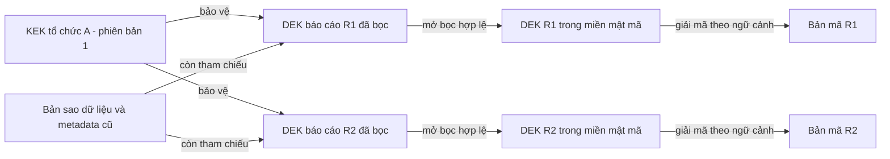
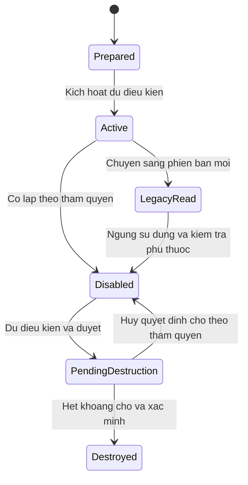
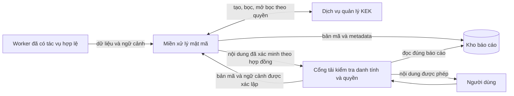

# Thực hành tổng hợp: thiết kế key lifecycle

## 1. Mục tiêu và sản phẩm cần bàn giao

**Key lifecycle**, hay vòng đời khóa mật mã, mô tả cách một khóa được tạo, gắn với mục đích, đưa vào sử dụng, giới hạn quyền, thay thế, xử lý khi có sự cố, phục hồi và kết thúc sử dụng. Thiết kế tốt phải bảo vệ dữ liệu đồng thời giữ khả năng đọc hợp lệ trong suốt thời gian dữ liệu còn cần được giữ.

Bài thực hành không yêu cầu tự viết thuật toán mật mã. Mục tiêu là chuyển tài sản, rủi ro và kiến trúc thành các yêu cầu quản lý khóa có thể triển khai và kiểm chứng.

Bản nộp cần gồm:

1. Phạm vi, mục tiêu bảo vệ, loại khóa và các phụ thuộc.
2. Danh mục khóa, quan hệ khóa–dữ liệu và metadata có phiên bản.
3. Mô hình trạng thái cùng quyền chuyển trạng thái.
4. Chính sách tạo, sử dụng, phân phối và lưu khóa.
5. Quy trình xoay vòng thông thường, chuyển dữ liệu và xử lý lỗi.
6. Kịch bản nghi ngờ lộ khóa, thu hồi quyền, phục hồi và hủy.
7. Yêu cầu đo được, tiêu chí chấp nhận, kiểm thử và bằng chứng.
8. Rủi ro còn lại cùng người chịu trách nhiệm quyết định.

OWASP nhấn mạnh việc xác định thành phần xử lý khóa, quy tắc vòng đời, khả năng ứng phó lộ khóa và trách nhiệm sử dụng khóa. Đây là cơ sở tham khảo cho bài; mô hình trạng thái và các giá trị dưới đây là thiết kế riêng để thực hành. [OWASP Key Management Cheat Sheet](https://cheatsheetseries.owasp.org/cheatsheets/Key_Management_Cheat_Sheet.html).

Mọi mốc 30, 90, 180 ngày hoặc thời gian chờ trong ví dụ đều là giả định nghiệp vụ. Không dùng chúng như thời hạn bắt buộc hoặc khuyến nghị chung cho mọi loại khóa.

## 2. Đề bài: bảo vệ báo cáo học viên nhiều tổ chức

### 2.1. Bối cảnh và kiến trúc

Nền tảng phục vụ nhiều tổ chức. Worker tạo báo cáo chứa thông tin học viên; cổng tải chỉ cấp nội dung cho người đủ quyền. Kho dữ liệu và các bản sao phải được bảo vệ nếu bị đọc ngoài đường ứng dụng hợp lệ.

Bài tập chọn mô hình mã hóa phong bì:

- Mỗi báo cáo có một khóa dữ liệu riêng.
- Khóa dữ liệu được bảo vệ bằng khóa bọc thuộc tổ chức tương ứng.
- Khóa bọc được quản lý trong dịch vụ khóa; ứng dụng không xuất vật liệu khóa bọc dạng rõ.
- Một miền xử lý mật mã thực hiện thao tác với khóa dữ liệu. API nghiệp vụ và worker không nhận khóa dữ liệu dạng rõ.
- Bản mã, khóa dữ liệu đã bọc và metadata cần thiết được lưu theo định dạng có phiên bản.

**DEK** là khóa dùng bảo vệ dữ liệu; **KEK** là khóa dùng bảo vệ khóa khác trong mô hình này. Khóa dữ liệu đã được bọc có thể đi cùng bản mã, còn quyền dùng khóa bọc phải được bảo vệ riêng. [OWASP Cryptographic Storage: encrypting stored keys](https://cheatsheetseries.owasp.org/cheatsheets/Cryptographic_Storage_Cheat_Sheet.html#encrypting-stored-keys).

Miền xử lý mật mã là ranh giới thiết kế, không tự là chứng nhận phần cứng hoặc bảo đảm không thể lấy khóa từ bộ nhớ. Nhóm cần chỉ rõ module, thư viện, dịch vụ và mô hình lỗi thực tế trước khi tuyên bố thuộc tính đó.

### 2.2. Các quyết định mẫu

| Nội dung | Quy tắc dùng trong bài |
| --- | --- |
| Phạm vi khóa bọc | Mỗi tổ chức có không gian khóa riêng; phiên bản khóa được xác định rõ |
| Khóa dữ liệu | Một DEK mới cho mỗi báo cáo được tạo; không tái dùng để bảo vệ báo cáo khác |
| Cơ chế bảo vệ nội dung | Cơ chế có xác thực theo bộ thuật toán và tham số do tổ chức phê duyệt |
| Quy tắc nonce | Theo đúng cơ chế đã chọn, kể cả điều kiện đồng thời và khôi phục trạng thái |
| Quyền dùng khóa | Tách tạo hoặc bọc khóa, mở bọc để đọc, chuyển khóa và quản trị |
| Chu kỳ bọc dữ liệu mới | Phiên bản KEK không được dùng để bọc mới từ đúng mốc 90 ngày sau kích hoạt |
| Báo cáo hoạt động | Thời gian giữ thông thường 30 ngày, trừ quyết định giữ hợp lệ |
| Bản sao phục hồi | Có thể còn cần tới 180 ngày theo chính sách bản sao đã xác nhận |
| Điều kiện hủy khóa | Không còn phụ thuộc cần đọc, không có quyết định giữ ngăn hủy, có thẩm quyền và bằng chứng |
| Khoảng chờ hủy | Tối thiểu 7 ngày từ quyết định đưa vào chờ hủy, chỉ áp dụng trong thiết kế bài tập |

Chu kỳ 90 ngày không quyết định khi nào được hủy khóa. Bản sao cũ có thể còn tham chiếu phiên bản cũ lâu hơn; thời gian giữ khóa cần xét đúng đồ thị phụ thuộc.

Nếu chưa quyết định bộ thuật toán, tham số, module hoặc giới hạn sử dụng, phải ghi đầu việc xác nhận. Không báo thiết kế đã sẵn sàng chỉ vì bảng có các thời hạn.

### 2.3. Mục tiêu và giới hạn bảo vệ

Mã hóa giúp xử lý một số đường đọc dữ liệu trái phép nhưng không thay phân quyền trên báo cáo. Cổng tải có thể dùng khóa đúng kỹ thuật mà vẫn trả dữ liệu cho người không có quyền nếu kiểm tra nghiệp vụ sai.

Không hứa xoay khóa sẽ lấy lại dữ liệu đã bị sao chép. Không coi vô hiệu tài khoản dịch vụ là đồng nghĩa vật liệu khóa đã được xuất trước đó tự mất tác dụng ngoài hệ thống.

## 3. Phân loại khóa, tham chiếu và quan hệ phụ thuộc

### 3.1. Những đối tượng không được gộp chung

| Đối tượng | Vai trò | Cách quản lý cần rõ |
| --- | --- | --- |
| DEK | Bảo vệ nội dung báo cáo | Nguồn sinh, phạm vi dữ liệu, nonce và giới hạn dùng |
| KEK | Bọc hoặc mở bọc DEK | Phiên bản, trạng thái, quyền, phụ thuộc và nơi quản lý |
| Khóa logic | Nhóm quản lý xuyên các phiên bản | Chủ sở hữu, mục đích, chính sách và phiên bản được dùng cho ghi mới |
| Alias hoặc tuyến hiện hành | Chỉ dẫn tới phiên bản dùng cho thao tác phù hợp | Không dùng thay lịch sử phiên bản cần đọc dữ liệu cũ |
| Thông tin xác thực dịch vụ | Cho workload gọi dịch vụ khóa | Thời hạn, thu hồi và quyền; không phải chính DEK hoặc KEK |
| Khóa ký, MAC hoặc TLS nếu có | Mục đích mật mã khác | Vòng đời riêng, không tự dùng chung với KEK của báo cáo |

Thay thông tin xác thực của worker có thể cần thiết khi bị lộ quyền truy cập, nhưng không tự thay vật liệu mã hóa đã bị lộ. Ngược lại, thay KEK mà vẫn giữ danh tính trái phép có quyền mở bọc mới cũng không hoàn tất ứng phó.

### 3.2. Đồ thị khóa–dữ liệu



Mũi tên mô tả phụ thuộc logic, không phải nơi lưu DEK rõ lâu dài. Bản sao metadata vẫn có thể cần phiên bản KEK cũ dù dữ liệu hoạt động đã dùng metadata mới.

Khi đánh giá hủy, phải đi theo cả bản sao, tệp tạm được giữ, bản dẫn xuất và dữ liệu có quyết định giữ đặc biệt. Số bản ghi ở kho hoạt động bằng không chưa chứng minh không còn phụ thuộc.

### 3.3. Danh mục khóa tối thiểu

| Trường | Ý nghĩa |
| --- | --- |
| Logical key ID và version ID | Phân biệt mục quản lý với phiên bản vật liệu hoặc phiên bản dịch vụ |
| Chủ sở hữu và tenant | Người chịu trách nhiệm dữ liệu, không gian khóa và miền sử dụng |
| Mục đích, cơ chế, policy version | Những thao tác được phép cùng căn cứ lựa chọn |
| Nơi quản lý | Dịch vụ, tài khoản, vùng hoặc module và phụ thuộc phục hồi |
| generatedAt, activatedAt | Mốc tạo và kích hoạt; không tự được thay khi đổi alias |
| newUseNotAfter | Mốc chấm dứt dùng cho bảo vệ dữ liệu hoặc DEK mới theo chính sách |
| Trạng thái và trạng thái sự cố | Tình trạng vận hành tách với nghi ngờ hoặc xác nhận lộ khóa |
| Quyền và chủ thể dùng | Ai bọc, mở bọc, chuyển, vô hiệu hoặc hủy |
| Phụ thuộc | Dữ liệu hoạt động, bản sao, manifest và quyết định giữ |
| Lịch sử thay đổi | Ai, khi nào, theo căn cứ nào, kết quả đã xác minh hay chỉ gửi lệnh |
| Điều kiện kết thúc | Bằng chứng hết phụ thuộc, phê duyệt, khoảng chờ và kết quả hủy |

Không lưu khóa rõ vào danh mục. Định danh, trạng thái và đồ thị phụ thuộc cũng có thể nhạy cảm, nên chỉ cho người có nhu cầu và quyền thích hợp xem.

## 4. Mô hình trạng thái và thời gian

### 4.1. Mô hình nội bộ cho phiên bản KEK

| Trạng thái | Được làm trong bài tập | Không được suy ra |
| --- | --- | --- |
| Prepared | Kiểm tra cấu hình và điều kiện trước kích hoạt | Chưa được dùng cho dữ liệu sản phẩm |
| Active | Bọc DEK mới trong giới hạn; mở bọc hợp lệ theo quyền | Không mặc nhiên cho mọi danh tính hoặc tổ chức |
| LegacyRead | Đọc dữ liệu cũ, hoặc phục vụ chuyển khóa theo quyền riêng | Không bọc mới cho tác vụ sản phẩm |
| Disabled | Không dùng qua các giao diện bị chính sách vô hiệu | Không chứng minh các bản khóa rõ đã rời hệ thống cũng bị vô hiệu |
| PendingDestruction | Giữ trạng thái chờ với mọi điều kiện cần kiểm tra | Chưa phải đã hủy; có thể còn khả năng hủy quyết định chờ theo thẩm quyền |
| Destroyed | Không còn khả năng sử dụng hoặc phục hồi trong phạm vi đã được xác minh | Không khẳng định mọi bản sao bí mật ngoài phạm vi kiểm soát đã biến mất |

Đây là mô hình thiết kế của bài, không phải tên trạng thái bắt buộc của một tiêu chuẩn hoặc mọi dịch vụ khóa. Cần ánh xạ sang API, chính sách và hành vi thật của nền tảng.



Bản vẽ không tự cấp quyền chuyển trạng thái. Khi vô hiệu do nghi ngờ, muốn cho dùng lại phải có đánh giá riêng; không tự đưa về Active chỉ vì hệ thống cần hoạt động.

### 4.2. Trạng thái lộ khóa là một thuộc tính riêng

Có thể theo dõi Clear, Suspected hoặc Confirmed cùng hồ sơ sự cố. Một phiên bản chưa hết chu kỳ vẫn cần bị ngừng dùng sớm nếu có căn cứ phù hợp. Một phiên bản LegacyRead cũng có thể bị nghi lộ.

Khóa đã xác nhận bị lộ không được tự quay lại dùng bình thường bằng cách đổi nhãn. Nếu cần thao tác phục vụ chuyển hoặc phục hồi có kiểm soát, phải có phạm vi, quyền và quyết định riêng.

### 4.3. Quy tắc tại mốc thời gian

Trong bài, KEK chỉ được bọc mới khi thời điểm sử dụng nhỏ hơn `activatedAt + 90 ngày` và trạng thái cho phép. Tại đúng mốc, không được dùng cho thao tác mới. Ngày ở ví dụ này là đơn vị 24 giờ theo nguồn thời gian đã chốt, không phải tự chọn theo đồng hồ máy client.

Tác vụ lấy tham chiếu khóa trước mốc nhưng thực hiện thao tác sau mốc vẫn phải đáp ứng điều kiện tại thời điểm được chính sách quy định. Cần kiểm tra tuyến cũ, cache và lời gọi trực tiếp để không biến alias mới thành lớp bảo vệ duy nhất.

Mốc tạo, kích hoạt, ngừng ghi mới, ngừng đọc và hủy có ý nghĩa khác nhau. Đổi tên, sao chép hoặc mở bọc lại không được làm các mốc sử dụng của cùng vật liệu khóa tự bắt đầu lại.

## 5. Thiết kế đường sử dụng và quyền

### 5.1. Luồng tạo và đọc báo cáo



Trong bản triển khai, phải xác định luồng nào chứa khóa dữ liệu rõ và nó ở bên trong ranh giới nào. Bài tập yêu cầu DEK rõ không trả về worker hoặc API nghiệp vụ; không tự suy rằng tiến trình đã đáp ứng chỉ vì API được đặt tên là “crypto”.

Ngữ cảnh gồm tổ chức, báo cáo và phiên bản định dạng được xác định từ quan hệ có thẩm quyền. Không cho client tự chọn tùy ý một key reference hoặc tổ chức để dịch vụ mở bọc hộ.

### 5.2. Ma trận quyền mẫu

| Chủ thể | Quyền cần có | Quyền không tự được cấp |
| --- | --- | --- |
| Worker nghiệp vụ | Yêu cầu mã hóa báo cáo thuộc tác vụ được phép | Không đọc vật liệu KEK hoặc yêu cầu giải mã báo cáo bất kỳ |
| Cổng tải | Yêu cầu giải mã trong phạm vi đã được kiểm tra | Không gán quyền, đổi alias hoặc hủy khóa |
| Miền mật mã | Gọi thao tác khóa theo tenant, mục đích và dữ liệu hợp lệ | Không bỏ kiểm tra nghiệp vụ hoặc xuất khóa rõ ra kênh không được phép |
| Tiến trình chuyển khóa | Mở bọc hoặc chuyển theo phạm vi được duyệt | Không xuất dữ liệu khách hàng hoặc chọn tổ chức tùy ý |
| Quản trị khóa | Thực hiện thay đổi vòng đời trong quyền được giao | Không mặc nhiên đọc nội dung báo cáo |
| Người phê duyệt hủy | Đánh giá điều kiện và duyệt theo thẩm quyền | Không tự thay bằng chứng phụ thuộc để đạt điều kiện |

Một người quản trị có khả năng thay chính sách để tự cấp quyền vẫn là rủi ro cần đánh giá. Tách nhãn vai trò mà cùng một người có thể sửa mọi quyền, xóa audit và đọc dữ liệu không tự tạo được phân tách hữu hiệu.

### 5.3. Vật liệu khóa, cache và dữ liệu lỗi

Không ghi DEK rõ, KEK rõ hoặc thông tin xác thực vào log, cấu hình nguồn, ảnh triển khai hoặc bản báo lỗi. Cần kiểm tra cả dump, trace, tệp tạm và công cụ chẩn đoán có thể thu bộ nhớ.

Bài tập không cho giữ DEK rõ trong cache dùng chung giữa các yêu cầu. Nếu một phương án khác dùng cache, phải có chính sách riêng về thời gian, phạm vi, quyền, thu hồi và mô hình xâm nhập.

Với runtime có quản lý bộ nhớ, một lệnh gán rỗng hoặc ghi đè một mảng không tự chứng minh mọi bản sao vật liệu nhạy cảm đã bị xóa khỏi mọi vùng nhớ. Yêu cầu phải phù hợp khả năng module, thư viện và môi trường được chọn.

## 6. Tạo, kích hoạt và metadata có phiên bản

### 6.1. Điều kiện đưa khóa vào sử dụng

Trước khi kích hoạt, cần xác nhận mục đích, tổ chức sở hữu, cơ chế và tham số đã được duyệt, nguồn sinh phù hợp, quyền, vị trí, audit, khả năng phục hồi và người chịu trách nhiệm.

Khóa thử không được tự chuyển thành khóa sản phẩm; không tái dùng cùng vật liệu giữa môi trường vì thuận tiện. Việc nhập khóa từ nguồn ngoài, nếu được phép, cần nguồn gốc, kiểm tra và quy trình riêng.

Kích hoạt là một thay đổi trạng thái có lịch sử. Không để một đối tượng vừa tạo tự được mọi dịch vụ dùng ngay trước khi chính sách liên quan sẵn sàng.

### 6.2. Metadata của đối tượng mã hóa

Một ví dụ dữ liệu thử:

```json
{
  "format_version": 1,
  "tenant_id": "org-A",
  "report_id": "report-51",
  "payload_scheme_id": "approved-payload-profile-1",
  "payload_version": 3,
  "dek_reference": "dek-report-51",
  "kek_version_reference": "org-A-kek-v2",
  "wrapped_dek_reference": "wrapped-dek-record-51-v2",
  "payload_object_reference": "ciphertext-object-51-v3",
  "context_schema_version": 1
}
```

Đây là tham chiếu, không phải bản mã đầy đủ. Định dạng thật còn cần dữ liệu như nonce, thẻ xác thực hoặc tham số do cơ chế yêu cầu. Những giá trị đó và bản DEK đã bọc cần được giữ, ràng buộc và đọc theo hợp đồng.

`dek_reference` không phải vật liệu khóa. `kek_version_reference` không được lấy từ đầu vào không tin cậy để tự chọn bất kỳ khóa nào dịch vụ có quyền dùng. Các trường định tuyến, đối tượng và quan hệ tenant phải được đối chiếu với chính sách cùng dữ liệu quản lý.

### 6.3. Ngữ cảnh ổn định và ngữ cảnh có thể thay đổi

Nếu thiết kế dùng dữ liệu liên kết được xác thực cho nội dung, cần biểu diễn có quy tắc và phiên bản. Những thuộc tính ổn định như tổ chức và báo cáo giúp ràng buộc dữ liệu vào đúng đối tượng.

Đừng gắn một thuộc tính định tuyến thường xuyên thay đổi vào phần xác thực nội dung rồi vẫn hứa rằng chỉ bọc lại khóa mà không động tới bản mã. Nếu thay thuộc tính đó làm ngữ cảnh khác, kế hoạch chuyển cần tính tới việc cập nhật bảo vệ nội dung đúng cơ chế.

Metadata dùng cho bọc khóa cũng cần được bảo vệ và kiểm tra trong ngữ cảnh phù hợp. Dữ liệu liên kết không được coi là bí mật chỉ vì nó được xác thực.

## 7. Thiết kế xoay vòng và chuyển dữ liệu

### 7.1. Phân biệt các thao tác

| Thao tác | Điều thay đổi | Điều không tự thay đổi |
| --- | --- | --- |
| Đổi tuyến hoặc alias hiện hành | Khóa hoặc phiên bản được chọn cho thao tác mới | Metadata, bản mã và phụ thuộc của dữ liệu cũ |
| Tạo phiên bản KEK mới | Vật liệu hoặc phiên bản dùng để bảo vệ DEK | DEK đã tồn tại và nội dung đã mã hóa |
| Bọc lại DEK | Bản DEK được bảo vệ dưới KEK mới | Vật liệu DEK và bản mã nội dung nếu ngữ cảnh được thiết kế tương thích |
| Tạo DEK mới và mã hóa lại | Khóa dữ liệu, bản mã và metadata tương ứng | Các bản sao cũ đã tồn tại ở nơi khác |
| Thay thông tin xác thực dịch vụ | Quyền gọi và danh tính truy cập dịch vụ | Vật liệu khóa đã bị lộ hoặc dữ liệu đã bị đọc |

OWASP lưu ý bọc lại DEK không đặt lại giới hạn sử dụng của chính DEK; thay DEK cho nội dung đã mã hóa cần xử lý mã hóa lại dữ liệu. Đây là khác biệt quan trọng khi chọn phương án. [OWASP: cryptoperiods and rotation](https://cheatsheetseries.owasp.org/cheatsheets/Key_Management_Cheat_Sheet.html#cryptoperiods-and-rotation).

Không báo “đã đổi mọi khóa dữ liệu” khi mới đổi alias hoặc đổi lớp bọc. Cũng không mặc định phải mã hóa lại mọi tệp cho mỗi lần xoay KEK thông thường nếu thiết kế và chính sách cho phép phương án khác.

### 7.2. Quy trình xoay KEK thông thường

Giả sử tổ chức A đang dùng K1 và chuẩn bị K2:

1. Kiểm tra tồn kho, phụ thuộc, giới hạn sử dụng và khả năng hoàn tất trước mốc ngừng bọc mới.
2. Tạo K2, thiết lập chính sách, audit và kiểm tra truy cập bằng danh tính thử được phép.
3. Kích hoạt tuyến bọc mới về K2 theo thao tác có phiên bản và thẩm quyền.
4. Ngừng bọc mới bằng K1 tại những điểm thực thi cần thiết; không chỉ thay giao diện quản lý.
5. Xác minh tác vụ mới dùng K2, kể cả nút còn cấu hình cũ và tác vụ đã giữ tham chiếu K1.
6. Chuyển K1 sang LegacyRead theo chính sách.
7. Nếu cần, bọc lại các DEK đang lưu dưới K2 bằng tiến trình được cấp quyền riêng.
8. Đánh giá dữ liệu hoạt động, bản sao và quyết định giữ trước khi tiến tới vô hiệu hoặc hủy K1.

Dữ liệu cũ phải tra đúng phiên bản, không chỉ lấy alias mới rồi thử giải mã. Việc giữ K1 cho đọc có phạm vi và quyền riêng; nó không được cho phép worker tiếp tục dùng K1 để bọc tác vụ mới.

Nếu nền tảng tự xoay vật liệu phía sau một khóa logic, phải hiểu cách nó nhận diện và dùng phiên bản cũ. Không tự suy rằng API có nút “rotate” sẽ thực hiện đúng mọi bước ứng dụng cần.

### 7.3. Chuyển đổi phải chịu được gián đoạn

Mỗi đối tượng cần định danh chuyển, phiên bản nguồn, phiên bản đích và mốc tiến độ. Cập nhật tham chiếu DEK đã bọc cần nhất quán với metadata; lỗi giữa các bước không được làm hệ thống trỏ tới bản chưa được ghi hoàn tất.

Có thể cần kiểm tra phiên bản hoặc điều kiện so sánh trước cập nhật để hai tiến trình không ghi đè kết quả của nhau. Thử lại phải nhận biết đối tượng đã chuyển, không tự làm thay ngữ cảnh hoặc tạo nhiều kết quả không kiểm soát.

Kiểm thử gồm dừng sau khi tạo bản bọc mới, trước cập nhật metadata, sau commit nhưng mất phản hồi và khi hai tiến trình cùng xử lý một đối tượng. Giữ đủ dữ liệu để tiếp tục hoặc quay lui trong phạm vi được phép mà không bật lại việc bọc mới bằng K1 trái hạn.

### 7.4. Bản sao cũ là một nhóm phụ thuộc riêng

Bản sao bất biến có thể chứa DEK đã bọc bằng K1 và metadata cũ. Bọc lại dữ liệu hoạt động không tự sửa bản sao đó. Có thể cần giữ K1 cho đọc được kiểm soát đến khi các bản sao hết nhu cầu, hoặc xây dựng phương án chuyển bản sao phù hợp.

Kết luận hoàn tất chuyển phải nêu phạm vi: dữ liệu hoạt động, bản sao, bản xuất hay toàn bộ tập phụ thuộc đã biết. Không dùng số đếm bằng không ở kho chính làm điều kiện duy nhất để hủy K1.

Nếu chính sách buộc ngừng đọc sớm hơn thời hạn dữ liệu cần giữ, đó là xung đột cần giải quyết bằng thiết kế hoặc quyết định có thẩm quyền, không để tiến trình hủy tự chọn một bên.

## 8. Giới hạn sử dụng, nonce và dữ liệu bị thay

### 8.1. Tuổi lịch không phải giới hạn duy nhất

Thiết kế phải ghi những giới hạn của cơ chế đã được chọn: lượng dữ liệu, số thao tác, độ dài đầu vào, điều kiện nonce hoặc các tham số khác. Chu kỳ 90 ngày của KEK không tự chứng minh DEK được sử dụng trong giới hạn.

Nếu một cơ chế yêu cầu nonce không lặp với cùng khóa, cần biết phạm vi duy nhất là gì và ai bảo đảm. Một DEK mới cho mỗi báo cáo làm thay đổi phạm vi nhưng không tự xử lý mọi lần mã hóa lại, từng phần hoặc thử lại dưới cùng DEK.

Đặc biệt, nếu tác vụ thử lại với nội dung khác nhưng tái dùng cùng DEK và nonce, thiết kế có thể vi phạm điều kiện cơ chế. Chính sách cần quy tắc về lần tạo, trạng thái và cách tiếp tục; không chỉ kiểm tra một hàm gọi riêng.

### 8.2. Đồng thời và khôi phục trạng thái

Xét nhiều nút, nhiều luồng, snapshot, rollback và bản nhân môi trường. Một bộ đếm nonce hoặc mốc dùng khóa được phục hồi về giá trị cũ có thể tạo tái sử dụng ngoài ý muốn.

Không thấy trùng trong một mẫu không chứng minh thiết kế không thể trùng. Cần kết hợp đánh giá cơ chế bảo đảm, nơi lưu trạng thái, giới hạn vận hành và các phép thử chủ đích.

Khi không thể cấp giá trị an toàn hoặc không xác nhận được trạng thái khóa bắt buộc, không dùng giá trị cố định hoặc khóa mặc định để tiếp tục. Hành vi lỗi phải từ chối thao tác hoặc giữ công việc chưa hoàn tất theo hợp đồng.

### 8.3. Xác thực nội dung và ngữ cảnh

Kiểm thử sai tenant, sai báo cáo, metadata hoặc bản mã bị sửa, khóa không đúng và dữ liệu cắt cụt. Với yêu cầu xác minh toàn đối tượng trước công bố, lỗi không được để lại tệp rõ có thể tải.

Nếu dùng định dạng từng phần, phải biết xác thực phần nào và điều kiện xác nhận toàn đối tượng hoàn tất. Đổi thứ tự, bỏ hoặc lặp phần không được làm một tệp thiếu được báo là báo cáo hợp lệ.

Giá trị tham chiếu khóa và metadata được lưu bên cạnh bản mã vẫn cần quyền sửa, kiểm tra ngữ cảnh và toàn vẹn phù hợp. “Không phải bí mật” không có nghĩa được phép thay tùy ý.

## 9. Xử lý nghi ngờ lộ khóa và thu hồi

### 9.1. Phân biệt thứ gì thực sự bị ảnh hưởng

| Tình huống | Câu hỏi và hành động cần đánh giá |
| --- | --- |
| Thông tin xác thực workload bị lấy | Danh tính đã dùng thao tác nào, trong thời gian nào; thu hồi quyền và thay thông tin truy cập ra sao? |
| Có khả năng gọi mở bọc trái phép | DEK hoặc nội dung nào có thể đã được lấy; có cần thay cả khóa dữ liệu không? |
| Vật liệu DEK bị lộ | Những bản mã nào dùng DEK đó, ai có thể giữ bản sao, cần mã hóa lại và giới hạn cấp dữ liệu thế nào? |
| Vật liệu KEK bị lộ | Những DEK đã bọc và bản sao nào có thể bị mở ngoài hệ thống? |
| Metadata hoặc khóa bị thay | Có bị chuyển sang khóa do đối thủ kiểm soát hoặc trả dữ liệu sai không? |
| Mất khả dụng của dịch vụ khóa | Là lỗi dịch vụ, quyền, cấu hình hay mất vật liệu; phương án phục hồi nào giữ được bảo mật? |

KMS không cho xuất KEK không có nghĩa danh tính có quyền gọi mở bọc không thể gây lộ dữ liệu. Ngược lại, có một lần gọi bất thường không tự chứng minh vật liệu KEK đã rời module; cần giữ đúng mức chắc chắn.

### 9.2. Trình tự ứng phó mẫu

- Ghi hồ sơ sự cố, khóa hoặc danh tính liên quan, thời điểm và bằng chứng đã biết.
- Ngừng bảo vệ dữ liệu mới bằng phiên bản bị nghi theo thẩm quyền và phạm vi phù hợp.
- Thu hồi quyền hoặc vô hiệu thao tác cần thiết, xác minh hiệu lực tại những điểm liên quan.
- Giữ audit và dữ liệu cần điều tra mà không sao chép vật liệu khóa vào hồ sơ thông thường.
- Tạo môi trường, danh tính hoặc khóa thay thế theo kế hoạch đã được đánh giá.
- Xác định cần bọc lại, thay DEK và mã hóa lại, hoặc giữ dữ liệu ở trạng thái hạn chế.
- Đánh giá tác động đã xảy ra và rủi ro còn lại; mở lại theo điều kiện được duyệt.

Không hủy khóa ngay chỉ để thể hiện đã ứng cứu nếu còn cần phục hồi, điều tra hoặc dữ liệu phải được giữ. Nhưng cũng không tiếp tục dùng không giới hạn chỉ vì sợ gián đoạn; quyết định phải dựa trên tình huống và thẩm quyền.

### 9.3. Vì sao bọc lại có thể không đủ khi đã lộ?

Giả sử đối thủ đã có DEK hoặc có cả KEK bị lộ và bản DEK đã bọc cũ. Bọc lại cùng DEK bằng K2 không làm bản DEK mà đối thủ có trở nên vô dụng. Nếu cần bảo vệ dữ liệu mới hoặc phiên bản dữ liệu tương lai khỏi vật liệu đó, có thể phải dùng DEK mới và xử lý lại nội dung.

Mã hóa lại vẫn không thu hồi được bản rõ hoặc bản mã cũ mà đối thủ đã có đủ khóa để đọc. Vì vậy, kết quả ứng phó phải nêu đường đã đóng và tác động không thể đảo ngược, không chỉ ghi “rotation thành công”.

Với cơ chế có xác thực đối xứng, lộ khóa cũng có thể ảnh hưởng niềm tin vào dữ liệu được tạo dưới khóa đó. Cần xem nguồn đối chiếu và trạng thái dữ liệu trước khi chọn bản để phục hồi.

### 9.4. Thu hồi quyền không phải hủy vật liệu

Khi nguồn quản lý xác nhận một thao tác vô hiệu đã hoàn tất, yêu cầu mới thuộc phạm vi phải tuân theo trạng thái đó. Cần đặc tả thời gian hoàn tất lệnh, cơ chế lan truyền và hành vi ở từng điểm, thay vì coi một nút hiển thị Disabled là bằng chứng mọi nơi đã dừng.

DEK đã được mở bọc và đang ở miền xử lý có thể không tự biến mất khi KEK bị vô hiệu. Bài tập không có cache DEK dùng chung, nhưng vẫn phải quy định công việc đang chạy, kiểm tra trước công bố và cách cô lập tiến trình nếu cần.

Khả năng ngăn sử dụng ngoài hệ thống sau khi vật liệu đã bị xuất là một giới hạn khác. Không đặt một mục tiêu “thu hồi mọi bản khóa đã lộ” nếu không có cơ chế thực hiện.

## 10. Phục hồi và kết thúc vòng đời

### 10.1. Phục hồi cần một tập phụ thuộc đầy đủ

Dữ liệu phục hồi có thể cần bản mã, DEK đã bọc, version ID của KEK, schema ngữ cảnh, metadata đối tượng, danh tính dịch vụ và chính sách quyền. Khôi phục mỗi kho tệp không tự bảo đảm đọc được nội dung.

Với KEK không xuất được, khả năng phục hồi phụ thuộc tính năng của dịch vụ, tài khoản, vùng và cơ chế bảo vệ đã chọn. Không yêu cầu nhân viên sao chép khóa rõ ra tệp để tạo một “bản backup” không được phép.

Phải xác nhận kịch bản mất mát nào được hỗ trợ: mất một nút, mất vùng xử lý, lỗi chính sách, xóa nhầm hay mất toàn bộ khả năng truy cập dịch vụ khóa. Bằng chứng cho kịch bản đầu không thay cho kịch bản cuối.

### 10.2. Diễn tập bản sao cũ

Bài diễn tập cần một bản sao còn dùng K1, trong khi hệ thống hiện hành đã dùng K2 và một số quyền đã bị thu hồi. Mục tiêu là đọc được dữ liệu còn được phép giữ bằng đúng phiên bản, đồng thời không tái mở quyền cũ.

Nếu bản sao có metadata khóa không còn trong danh mục hiện hành, cần cách đối chiếu có kiểm soát. Không thử tất cả khóa mà dịch vụ có thể truy cập rồi lấy kết quả nào giải mã được; cách đó có thể che lỗi quan hệ tổ chức và định tuyến.

Mục tiêu thời gian và điểm phục hồi phải được quyết định riêng theo nghiệp vụ. “Đọc được một tệp thử” không tự chứng minh phục hồi mọi dữ liệu, trong mọi kịch bản, đúng thời hạn.

### 10.3. Điều kiện đưa vào chờ hủy

Trước PendingDestruction, yêu cầu:

1. Khóa không còn được dùng cho bảo vệ mới.
2. Đã kiểm tra dữ liệu hoạt động, bản sao, bản dẫn xuất và quan hệ bọc khóa.
3. Mọi dữ liệu còn phải đọc có phương án hợp lệ đã được xác minh.
4. Không có quyết định giữ hoặc nghĩa vụ áp dụng ngăn hành động đó.
5. Có người đề xuất, người duyệt độc lập theo chính sách và căn cứ đủ rõ.
6. Có hồ sơ trạng thái, phạm vi, kết quả kiểm tra và ngày sớm nhất được hủy.

Khoảng chờ 7 ngày của bài tập chỉ bắt đầu sau quyết định hợp lệ. Đến cuối khoảng chờ phải kiểm tra lại điều kiện; hết thời gian không tự biến một quyết định sai thành được phép.

### 10.4. Hủy, xóa tham chiếu và xóa dữ liệu là ba việc khác nhau

Xóa alias hoặc bản ghi ứng dụng không chứng minh vật liệu khóa đã bị hủy. Gửi yêu cầu hủy theo lịch cũng chưa phải hủy hoàn tất. Cần đối chiếu trạng thái dịch vụ, các bản sao được quản lý và phạm vi xác minh.

Việc mất khả năng giải mã bằng hủy khóa chỉ có ý nghĩa trong phạm vi không còn bản vật liệu có thể dùng để khôi phục quyền đọc. Bản rõ đã xuất hoặc DEK rõ bị giữ ở nơi khác không bị xóa chỉ vì KEK trong dịch vụ bị hủy.

Không hủy một KEK dùng chung để xóa riêng một báo cáo nếu còn báo cáo khác phụ thuộc. Ngay cả khi đã xóa bản DEK bọc ở kho hoạt động, các bản sao cũ của nó vẫn có thể cần được xét trước khi tuyên bố không thể đọc nữa.

Kết quả phải ghi việc nào đã thực hiện, trên phiên bản và miền nào, cùng giới hạn. Không dùng thuật ngữ “crypto-shredding” thay cho bằng chứng về toàn bộ phụ thuộc trong phạm vi yêu cầu.

## 11. Chuyển thiết kế thành yêu cầu có thể kiểm chứng

| Yêu cầu | Cam kết | Bằng chứng chính |
| --- | --- | --- |
| KL-01 | Mỗi loại khóa có mục đích, chủ sở hữu, version ID, trạng thái và phụ thuộc được quản lý | Danh mục, schema, lịch sử và kiểm tra phát hiện đối tượng ngoài danh mục |
| KL-02 | Tạo và kích hoạt đáp ứng chính sách cơ chế, nguồn sinh, quyền và môi trường | Đánh giá cấu hình, module và ca kích hoạt không đủ điều kiện |
| KL-03 | API nghiệp vụ không nhận vật liệu KEK hoặc DEK rõ ngoài ranh giới đã chốt | Kiểm tra giao diện, log, trace, dữ liệu lỗi và nơi xử lý vật liệu |
| KL-04 | Thao tác khóa giữ đúng tenant, mục đích, chủ thể và quyền nghiệp vụ | Ca sai tổ chức, sai thao tác, sai ngữ cảnh và danh tính ngoài phạm vi |
| KL-05 | Không bọc mới bằng phiên bản hết thời hạn hoặc đã ngừng dùng | Ca trước, đúng, sau mốc; tuyến cũ, cache và tác vụ đã giữ tham chiếu |
| KL-06 | Xoay và chuyển giữ dữ liệu đọc được theo chính sách, chịu được thử lại và đồng thời | Ca chuyển một phần, lỗi giữa các bước và đối chiếu metadata |
| KL-07 | Nonce và giới hạn sử dụng đáp ứng cơ chế trên toàn phạm vi dùng chung | Đánh giá thiết kế, ca thử lại, khởi động lại, rollback và đồng thời |
| KL-08 | Có hành vi ứng phó đúng cho nghi ngờ lộ danh tính, DEK hoặc KEK | Diễn tập cô lập, thay thế, chọn chuyển dữ liệu và đánh giá phần còn lại |
| KL-09 | Phục hồi dữ liệu cùng khóa, metadata và quyền hiện hành trong phạm vi đã chốt | Diễn tập bản sao cũ, phiên bản cũ, thiếu phụ thuộc và quyền đã thu hồi |
| KL-10 | Hủy chỉ xảy ra khi đủ điều kiện, đúng thẩm quyền, qua khoảng chờ và được xác minh | Ca còn phụ thuộc, giữ đặc biệt, hủy quyết định chờ và hủy hoàn tất |
| KL-11 | Hoạt động vòng đời và dùng khóa được ghi theo chính sách, không chứa vật liệu bí mật | Truy vết danh tính, phiên bản, mục đích, quyết định, kết quả và lỗi |

Các hàng là tóm tắt cần được chia thành yêu cầu chi tiết nếu có nhiều cam kết độc lập. Không đóng KL-06 chỉ vì alias đã đổi, hoặc đóng KL-09 vì một bản sao lưu có thông báo thành công.

### 11.1. Ví dụ yêu cầu tại thời điểm cắt chuyển

```text
KL-05 — Ngừng bọc mới bằng K1

Khi phiên bản K1 chạm newUseNotAfter hoặc được nguồn có thẩm quyền
chuyển sang trạng thái không cho bọc mới, mọi thao tác bọc mới thuộc
phạm vi phải bị từ chối với K1.

Tác vụ đã lấy tham chiếu K1 trước mốc không được dùng tham chiếu đó
để vượt điều kiện tại thời điểm thực hiện thao tác.

Chuyển sang K2 chỉ theo tuyến và chính sách được phê duyệt.
Không dự phòng về K1 trái trạng thái khi K2 hoặc dịch vụ khóa lỗi.
```

Bọc lại để chuyển khóa có quyền và ngữ nghĩa riêng: K1 có thể là khóa nguồn để mở bọc, không phải khóa đích cho bảo vệ mới. Kiểm thử cần phân biệt hai hành động này.

### 11.2. Audit không chứa vật liệu khóa

Sự kiện nên có key reference, phiên bản, tenant, thao tác, chủ thể, căn cứ phê duyệt, trạng thái trước và sau, thời điểm, kết quả và định danh công việc. Không ghi khóa rõ hoặc toàn bộ phản hồi dịch vụ có thể chứa vật liệu nhạy cảm.

Gửi lệnh và quan sát kết quả có thể là hai sự kiện. Thay chính sách quyền, bật lại, đổi tuyến, chuyển và hủy cũng cần truy vết. Miền audit phải có quyền và vòng đời phù hợp, không do mọi chủ thể dùng khóa tự sửa.

### 11.3. Truy vết rủi ro tới yêu cầu

```text
Rủi ro: hủy K1 khi bản sao vẫn chứa DEK bọc bằng K1
  -> Danh mục phụ thuộc và thời hạn giữ
  -> KL-01, KL-09, KL-10
  -> Thiết kế manifest, quyền phục hồi và chặn hủy
  -> Ca phục hồi bản sao cũ, ca hủy khi còn phụ thuộc
  -> Bằng chứng theo phiên bản dịch vụ, cấu hình và dữ liệu thử
  -> Quyết định tiếp tục giữ, chuyển hoặc kết thúc vòng đời
```

Từ một yêu cầu phải tìm được rủi ro và điều kiện cần chứng minh. Từ một thay đổi dịch vụ hoặc chính sách phải tìm được bằng chứng bị ảnh hưởng, không chỉ ticket triển khai.

## 12. Bộ kiểm thử và diễn tập

| Ca | Tình huống | Điều phải chứng minh |
| --- | --- | --- |
| TC-KL-01 | Tạo khóa thử, sai môi trường hoặc cấu hình chưa duyệt | Không tự kích hoạt thành khóa sản phẩm |
| TC-KL-02 | Danh tính bọc gọi mở bọc, tenant A dùng khóa B | Từ chối theo quyền, không lộ khóa hoặc nội dung |
| TC-KL-03 | Mã hóa và giải mã hợp lệ, sai ngữ cảnh, metadata hoặc bản mã bị sửa | Đúng dữ liệu khi hợp lệ; lỗi không công bố nội dung ngoài hợp đồng |
| TC-KL-04 | Trước, đúng và sau mốc 90 ngày | Không bọc mới sau biên, không đặt lại tuổi chỉ vì đổi alias |
| TC-KL-05 | Tác vụ giữ K1 trước cắt chuyển, thực hiện sau đó | Không vượt trạng thái bằng tham chiếu cũ |
| TC-KL-06 | Đổi tuyến, chuyển một phần và mất phản hồi | Dữ liệu cũ và mới được định tuyến đúng; thử lại không làm hỏng metadata |
| TC-KL-07 | Hai tiến trình chuyển cùng đối tượng | Không ghi đè ngoài điều kiện, không trỏ tới bản bọc chưa hoàn tất |
| TC-KL-08 | Khởi động lại hoặc phục hồi trạng thái sinh nonce | Không vi phạm quy tắc cơ chế do trạng thái cũ |
| TC-KL-09 | Dịch vụ khóa timeout, từ chối hoặc bị vô hiệu | Không dùng khóa mặc định, không lưu rõ, không công bố thành công giả |
| TC-KL-10 | Lộ quyền gọi dịch vụ, nghi lộ DEK hoặc KEK | Chọn đúng phạm vi cô lập và chuyển, không coi mọi tình huống như nhau |
| TC-KL-11 | Phục hồi bản sao còn K1 sau khi hệ thống dùng K2 | Đọc dữ liệu hợp lệ đúng phiên bản, giữ quyền hiện hành |
| TC-KL-12 | Đề nghị hủy khi còn bản sao hoặc giữ đặc biệt | Bị chặn; không tự hủy khi hết khoảng chờ mà điều kiện chưa đạt |
| TC-KL-13 | Hủy được duyệt, sau đó thử dùng hoặc phục hồi trong phạm vi | Kết quả đúng trạng thái và khả năng còn lại được ghi rõ |
| TC-KL-14 | Log, dump và báo lỗi trong các ca trên | Không làm vật liệu bí mật rời nơi được phép |

### 12.1. Cách tạo bằng chứng

Dùng khóa, dữ liệu và danh tính thử trong môi trường được phép. Không hủy hoặc vô hiệu khóa sản phẩm chỉ để hoàn thành bài tập. Các thao tác không đảo ngược trong kiểm thử cần fixture và phạm vi được chuẩn bị riêng.

Lưu phiên bản yêu cầu, chính sách mật mã, module hoặc dịch vụ, cấu hình, trạng thái, dữ liệu thử, phương pháp và kết quả. Chỉ lưu tham chiếu an toàn; không chép vật liệu khóa thật vào báo cáo.

Một ca với mock có thể thử nhánh lỗi của ứng dụng, nhưng không chứng minh quyền hoặc vòng đời trên dịch vụ thật. Cần bằng chứng tích hợp phù hợp cho cam kết đó.

### 12.2. Giới hạn kết luận

Không thấy khóa trong một lần tìm kiếm log không chứng minh mọi dump và bản sao đều không có khóa. Không thấy nonce trùng trong mẫu không chứng minh duy nhất trong mọi lần chạy. Đổi alias thành công không chứng minh chuyển dữ liệu xong.

Một lần giải mã từ bản sao thành công chứng minh phần dữ liệu và phụ thuộc đã thử, không tự bao phủ mọi kịch bản mất vùng. Phần chưa xác minh cần giữ trạng thái riêng; không biến kế hoạch thành bằng chứng hiệu lực.

Cần đánh giá lại khi đổi dịch vụ khóa, quyền, cơ chế, ngữ cảnh, chính sách giữ, nơi sao lưu hoặc đường quản trị. Bằng chứng cũ chỉ còn được dùng trong phạm vi có căn cứ giữ nguyên.

## 13. Tự đánh giá và các lỗi thường gặp

### 13.1. Thang điểm minh họa

| Nhóm | Điểm tối đa | Dấu hiệu bài làm tốt |
| --- | --- | --- |
| Phạm vi và mô hình khóa | 20 | Phân biệt vật liệu, tham chiếu, phiên bản, mục đích và tenant |
| Trạng thái và quyền | 20 | Có điều kiện chuyển, biên thời gian và thẩm quyền |
| Xoay, chuyển và giới hạn dùng | 25 | Phân biệt bọc lại, đổi DEK, nonce, lỗi và đồng thời |
| Sự cố, phục hồi và hủy | 20 | Đúng phụ thuộc, dữ liệu giữ, phần không thể đảo ngược |
| Yêu cầu và kiểm chứng | 15 | Có tiêu chí, ca thử, bằng chứng và rủi ro còn lại |

Điểm tổng không thay các điều kiện cốt lõi. Một bản thiết kế hủy khóa còn cần cho dữ liệu phải giữ, hoặc cho mọi dịch vụ dùng khóa của mọi tổ chức, vẫn phải sửa dù có nhiều tài liệu đầy đủ.

### 13.2. Các lỗi cần tránh

| Biểu hiện | Vấn đề | Cách sửa |
| --- | --- | --- |
| Mọi bí mật đều gọi là encryption key | Trộn khóa, phiên và thông tin xác thực | Phân loại theo mục đích và thao tác |
| Có KMS nên ứng dụng chắc chắn an toàn | Bỏ quyền, ngữ cảnh và đường cấp dữ liệu | Kiểm tra cả nghiệp vụ lẫn quyền khóa |
| Rotate là đổi alias | Dữ liệu cũ và khóa cũ chưa được xử lý | Ghi rõ từng bước và phạm vi hoàn tất |
| Bọc lại đồng nghĩa đổi DEK | Vật liệu bảo vệ nội dung vẫn có thể như cũ | Tách chuyển lớp bọc với mã hóa lại dữ liệu |
| Hết 90 ngày thì xóa khóa | Có thể làm mất dữ liệu còn cần giữ | Dùng đồ thị phụ thuộc và điều kiện hủy |
| Một kho hết tham chiếu là đủ | Bản sao hoặc dữ liệu dẫn xuất vẫn có thể cần khóa | Kiểm kê toàn phạm vi và ghi giới hạn |
| Disable là vô hiệu mọi bản vật liệu đã lộ | Bản ngoài hệ thống có thể còn dùng được | Phân biệt quyền dịch vụ và sở hữu vật liệu |
| Giữ raw key trong biến môi trường hoặc log để phục hồi | Tạo đường lộ khóa ngoài thiết kế | Dùng cơ chế quản lý và phục hồi được duyệt |
| Nonce chỉ xét trong một tiến trình | Bỏ nhiều nút, thử lại và rollback | Xác định miền duy nhất và nơi giữ trạng thái |
| Hủy theo lịch là đã hủy xong | Chưa tới thao tác không đảo ngược hoặc còn bản sao | Xác minh trạng thái và phạm vi thực tế |
| Backup còn nên dữ liệu chắc chắn đọc được | Có thể thiếu khóa, ngữ cảnh hoặc quyền | Diễn tập toàn tập phụ thuộc |
| Xoay sau lộ là xóa được hậu quả | Không lấy lại dữ liệu hoặc khóa đối thủ đã giữ | Báo rõ phần đã đóng và tác động còn lại |

## 14. Cách thực hành và điều kiện bàn giao

### 14.1. Các bước tự thực hiện

1. Liệt kê tài sản, mục tiêu và mô hình đe dọa cho báo cáo nhiều tổ chức.
2. Vẽ quan hệ DEK, KEK, dữ liệu, metadata và bản sao.
3. Lập danh mục khóa cùng trạng thái, chủ sở hữu và mốc thời gian.
4. Chọn hoặc ghi đầu việc xác nhận cơ chế, module và giới hạn sử dụng.
5. Viết ma trận quyền cho nghiệp vụ, miền mật mã, chuyển khóa và quản trị.
6. Đặc tả tạo, kích hoạt, cắt chuyển, đọc dữ liệu cũ và bọc lại.
7. Thử tình huống gián đoạn, hai tiến trình chuyển và tác vụ giữ tham chiếu cũ.
8. Viết ba kịch bản sự cố: lộ thông tin xác thực, lộ DEK và lộ KEK.
9. Thiết kế phục hồi bản sao cũ khi quyền và khóa hiện hành đã thay đổi.
10. Xác định điều kiện chờ hủy, hủy quyết định và xác minh kết thúc.
11. Chuyển các quyết định thành yêu cầu, ca kiểm thử và bằng chứng.
12. Ghi câu hỏi còn mở, người chịu trách nhiệm và rủi ro tồn dư.

Không cần tự chọn một thuật toán chỉ để điền đủ bảng. Nếu đầu vào có ảnh hưởng tới tính an toàn chưa được quyết định, phải công khai phần đó và điều kiện hoàn thiện trước triển khai.

### 14.2. Điểm kiểm tra khi bàn giao

- Phân biệt khóa dữ liệu, khóa bọc, định danh, phiên bản và thông tin xác thực.
- Có chủ sở hữu, mục đích, nguồn sinh và ranh giới xử lý vật liệu.
- Mỗi trạng thái và chuyển trạng thái có quyền, điều kiện và bằng chứng.
- Mốc ngừng bảo vệ mới không bị nhầm với mốc ngừng đọc hoặc hủy.
- Quyền đúng tổ chức và mục đích, không thay kiểm tra nghiệp vụ bằng đặc quyền dịch vụ.
- Metadata, phiên bản và ngữ cảnh đủ để đọc và chuyển nhất quán.
- Xoay và bọc lại không làm che giới hạn sử dụng của DEK.
- Có hành vi khi timeout, mất nguồn, thử lại, đồng thời và phục hồi trạng thái.
- Ứng phó phân biệt lộ quyền gọi, vật liệu DEK và vật liệu KEK.
- Bản sao, khóa, quyền hiện hành và khả năng phục hồi được xét cùng nhau.
- Hủy có căn cứ hết phụ thuộc, thẩm quyền, khoảng chờ và phạm vi xác minh.
- Audit không chứa vật liệu bí mật, kết luận không vượt bằng chứng.

Một thiết kế key lifecycle có thể sử dụng được khi nhóm biết khóa nào bảo vệ dữ liệu nào, ai được dùng vào việc gì và điều kiện nào cho phép thay hoặc kết thúc sử dụng. Giá trị của thiết kế nằm ở việc giữ bảo mật, toàn vẹn và khả năng đọc hợp lệ nhất quán qua các thay đổi, cùng khả năng chứng minh những cam kết đó bằng kiểm thử và diễn tập.
